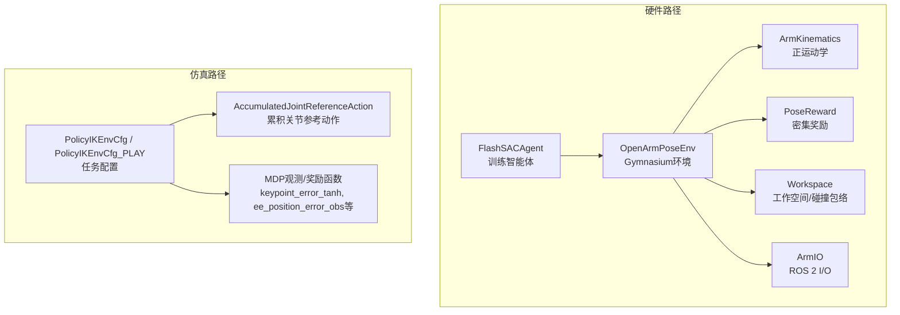
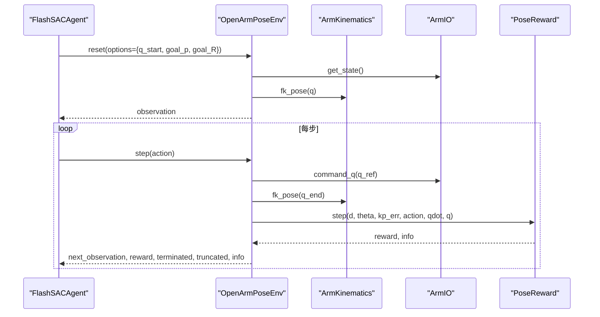
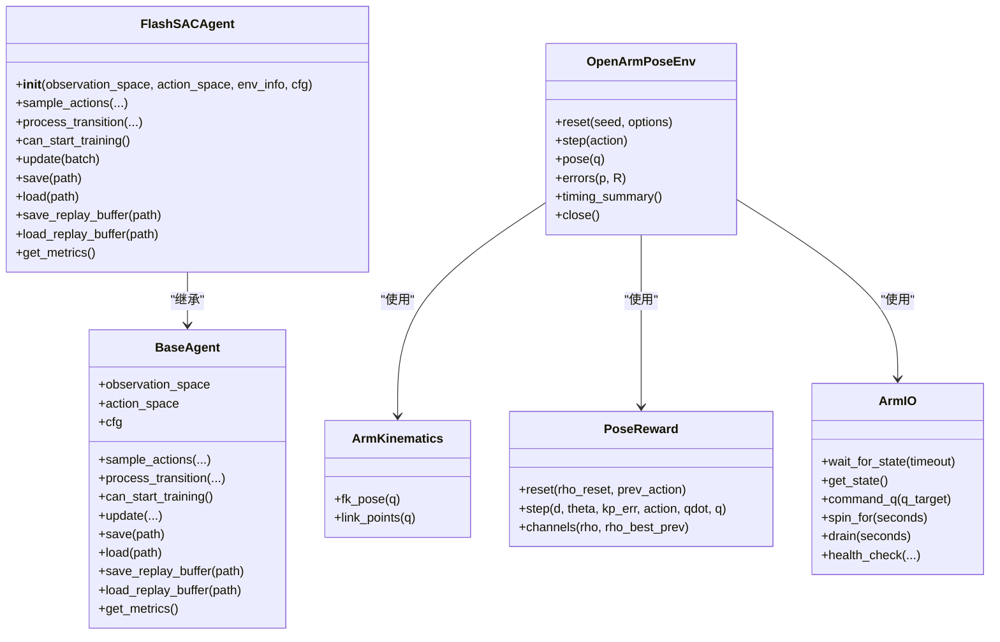

# API参考文档

<cite>
**本文引用的文件**   
- [base_agent.py](file://hardware/flash_rl/agents/base_agent.py)
- [agent.py](file://hardware/flash_rl/agents/flashSAC/agent.py)
- [kinematics.py](file://hardware/policyik_hw/utils/kinematics.py)
- [pose_math.py](file://hardware/policyik_hw/utils/pose_math.py)
- [pose_env.py](file://hardware/policyik_hw/envs/pose_env.py)
- [reward.py](file://hardware/policyik_hw/envs/reward.py)
- [workspace.py](file://hardware/policyik_hw/envs/workspace.py)
- [ros_io.py](file://hardware/policyik_hw/robot/ros_io.py)
- [mdp.py](file://simulation/policyik_sim/tasks/mdp.py)
- [actions.py](file://simulation/policyik_sim/tasks/actions.py)
- [env_cfg.py](file://simulation/policyik_sim/tasks/env_cfg.py)
</cite>

## 目录
1. [引言](#引言)
2. [项目结构](#项目结构)
3. [核心组件](#核心组件)
4. [架构总览](#架构总览)
5. [详细组件分析](#详细组件分析)
6. [依赖关系分析](#依赖关系分析)
7. [性能与实现要点](#性能与实现要点)
8. [故障排查指南](#故障排查指南)
9. [结论](#结论)
10. [附录：常用调用模式与最佳实践](#附录常用调用模式与最佳实践)

## 引言
本API参考文档面向PolicyIK的核心接口，覆盖以下关键部分：
- FlashSACAgent基类与具体实现（训练、采样、更新、保存/加载）
- 运动学计算工具（OpenArm右臂正解、连杆点集）
- 位姿数学运算（旋转矩阵、轴角、关键点误差等）
- Gymnasium环境接口（真实机械臂任务）
- ROS 2集成接口（关节状态订阅、命令发布、电机健康检查）
- 仿真侧MDP观测与奖励函数、累积关节参考动作器、任务配置

文档为每个公共API提供参数说明、返回值类型、使用示例路径与异常处理建议，并给出代码级架构图与流程图，帮助读者快速定位实现位置。

## 项目结构
PolicyIK在硬件与仿真两条路径上分别实现了相同的目标：让OpenArm右臂完成6自由度位姿到达任务。硬件路径使用Gymnasium环境与ROS 2通信；仿真路径基于Isaac Lab构建MDP观测与奖励。

**图表来源**
- [agent.py:335-565](file://hardware/flash_rl/agents/flashSAC/agent.py#L335-L565)
- [pose_env.py:206-544](file://hardware/policyik_hw/envs/pose_env.py#L206-L544)
- [kinematics.py:81-129](file://hardware/policyik_hw/utils/kinematics.py#L81-L129)
- [reward.py:85-184](file://hardware/policyik_hw/envs/reward.py#L85-L184)
- [workspace.py:52-252](file://hardware/policyik_hw/envs/workspace.py#L52-L252)
- [ros_io.py:53-149](file://hardware/policyik_hw/robot/ros_io.py#L53-L149)
- [env_cfg.py:121-134](file://simulation/policyik_sim/tasks/env_cfg.py#L121-L134)
- [actions.py:15-76](file://simulation/policyik_sim/tasks/actions.py#L15-L76)
- [mdp.py:37-232](file://simulation/policyik_sim/tasks/mdp.py#L37-L232)

**章节来源**
- [agent.py:335-565](file://hardware/flash_rl/agents/flashSAC/agent.py#L335-L565)
- [pose_env.py:206-544](file://hardware/policyik_hw/envs/pose_env.py#L206-L544)
- [kinematics.py:81-129](file://hardware/policyik_hw/utils/kinematics.py#L81-L129)
- [reward.py:85-184](file://hardware/policyik_hw/envs/reward.py#L85-L184)
- [workspace.py:52-252](file://hardware/policyik_hw/envs/workspace.py#L52-L252)
- [ros_io.py:53-149](file://hardware/policyik_hw/robot/ros_io.py#L53-L149)
- [env_cfg.py:121-134](file://simulation/policyik_sim/tasks/env_cfg.py#L121-L134)
- [actions.py:15-76](file://simulation/policyik_sim/tasks/actions.py#L15-L76)
- [mdp.py:37-232](file://simulation/policyik_sim/tasks/mdp.py#L37-L232)

## 核心组件
本节概述PolicyIK中最重要的公共API类别与方法，包括：
- 智能体基类与FlashSACAgent
- 运动学工具ArmKinematics
- 位姿数学pose_math
- Gymnasium环境OpenArmPoseEnv及其配置
- 奖励函数PoseReward
- 工作空间与逆序课程ReverseCurriculum
- ROS 2 I/O ArmIO
- 仿真MDP观测/奖励与累积动作器

**章节来源**
- [base_agent.py:11-83](file://hardware/flash_rl/agents/base_agent.py#L11-L83)
- [agent.py:30-565](file://hardware/flash_rl/agents/flashSAC/agent.py#L30-L565)
- [kinematics.py:81-129](file://hardware/policyik_hw/utils/kinematics.py#L81-L129)
- [pose_math.py:12-125](file://hardware/policyik_hw/utils/pose_math.py#L12-L125)
- [pose_env.py:46-544](file://hardware/policyik_hw/envs/pose_env.py#L46-L544)
- [reward.py:23-184](file://hardware/policyik_hw/envs/reward.py#L23-L184)
- [workspace.py:14-252](file://hardware/policyik_hw/envs/workspace.py#L14-L252)
- [ros_io.py:53-149](file://hardware/policyik_hw/robot/ros_io.py#L53-L149)
- [mdp.py:37-232](file://simulation/policyik_sim/tasks/mdp.py#L37-L232)
- [actions.py:15-76](file://simulation/policyik_sim/tasks/actions.py#L15-L76)

## 架构总览
下图展示硬件路径中智能体与环境之间的交互流程，以及底层运动学与ROS 2通信的依赖关系。

**图表来源**
- [agent.py:423-516](file://hardware/flash_rl/agents/flashSAC/agent.py#L423-L516)
- [pose_env.py:324-508](file://hardware/policyik_hw/envs/pose_env.py#L324-L508)
- [kinematics.py:104-129](file://hardware/policyik_hw/utils/kinematics.py#L104-L129)
- [ros_io.py:119-133](file://hardware/policyik_hw/robot/ros_io.py#L119-L133)
- [reward.py:106-146](file://hardware/policyik_hw/envs/reward.py#L106-L146)

## 详细组件分析

### FlashSACAgent与BaseAgent
FlashSACAgent继承自BaseAgent，实现策略梯度算法中的Actor-Critic架构，包含温度自适应、目标网络EMA更新、经验回放缓冲、奖励归一化等功能。

#### BaseAgent抽象接口
- 属性
  - observation_space: 观测空间
  - action_space: 动作空间
  - cfg: 配置对象
- 方法
  - sample_actions(interaction_step, prev_transition, training): 返回动作张量
  - process_transition(transition): 将样本加入缓冲区
  - can_start_training(): 判断是否可开始训练
  - update(batch=None): 执行一次网络更新，返回指标字典
  - save(path), load(path): 保存/加载模型与优化器状态
  - save_replay_buffer(path), load_replay_buffer(path): 保存/加载经验回放
  - get_metrics(): 返回额外指标

**章节来源**
- [base_agent.py:11-83](file://hardware/flash_rl/agents/base_agent.py#L11-L83)

#### FlashSACAgent公共API
- 构造
  - __init__(observation_space, action_space, env_info, cfg): 初始化网络、设备、噪声分布、奖励归一化、经验回放缓冲
- 采样
  - sample_actions(interaction_step, prev_transition, training): 根据温度与噪声重复逻辑采样动作
- 数据处理
  - process_transition(transition): 加入缓冲并更新奖励统计
- 训练控制
  - can_start_training(): 缓冲可采样即True
  - update(batch=None): 执行actor/critic/temperature/target_critic更新，返回标量指标
- 持久化
  - save(path), load(path): 保存/加载actor、critic、target_critic、temperature、reward_normalizer与agent_state
  - save_replay_buffer(path), load_replay_buffer(path): 缓冲持久化
- 指标
  - get_metrics(): 返回空字典（可扩展）

参数与返回值说明（摘要）
- sample_actions
  - 输入: interaction_step(int), prev_transition(dict[str,Tensor]), training(bool)
  - 输出: Tensor形状与action_space一致
- process_transition
  - 输入: transition(dict[str,Tensor])
  - 输出: None
- can_start_training
  - 输出: bool
- update
  - 输入: batch(dict[str,Tensor], 可选)
  - 输出: dict[str,float]（损失、熵、温度等）
- save/load
  - 输入: path(str)
  - 输出: None

异常处理
- 当load_optimizer=True时，若缺少agent_state.pt会抛出断言错误
- 当load_reward_normalizer=True但reward_normalizer未初始化时会抛出断言错误

典型调用模式
- 训练循环中先调用can_start_training，再update；推理时sample_actions(training=False)

**章节来源**
- [agent.py:30-565](file://hardware/flash_rl/agents/flashSAC/agent.py#L30-L565)

### 运动学工具ArmKinematics
ArmKinematics封装了OpenArm右臂的正运动学，支持末端工具偏移与碰撞工具点。

主要方法与属性
- __init__(urdf_xml=None, tool_z_m=0.0, collision_tool_z_m=0.0)
  - 从URDF构建KDL树与链，校验DoF数量
- fk_pose(q) -> (p: np.ndarray[3], R: np.ndarray[3,3])
  - 返回末端工具点在link0坐标系下的位置与旋转矩阵
- link_points(q) -> np.ndarray[(n_segments + extra, 3)]
  - 返回各连杆原点及工具/碰撞工具点坐标

辅助模块函数
- set_urdf_path(path): 设置自定义URDF路径
- get_urdf_xml() -> str: 获取v1 URDF XML字符串

异常处理
- 如果链DoF不等于7，抛出RuntimeError
- home构型或EE位姿不在工作空间内会在PoseCloud构造时报错

使用示例路径
- 在环境中通过cloud.kin.fk_pose(q)获取当前位姿
- 在workspace中通过config_margin与config_ok进行碰撞检测

**章节来源**
- [kinematics.py:63-129](file://hardware/policyik_hw/utils/kinematics.py#L63-L129)
- [workspace.py:52-99](file://hardware/policyik_hw/envs/workspace.py#L52-L99)

### 位姿数学pose_math
提供NumPy与Torch两套旋转与误差计算工具。

NumPy接口
- rot6d_from_R(R: np.ndarray[3,3]) -> np.ndarray[6]: 取前两列
- angle_between(Ra, Rb) -> float: 两旋转矩阵间角度
- rotvec_body(R_ee, R_goal) -> np.ndarray[3]: 末端系下轴角向量
- keypoint_offsets(kp_size) -> np.ndarray[3,3]: 三个关键点偏移
- keypoints(p, R, kp_size) -> np.ndarray[3,3]: 关键点坐标
- keypoint_error(p, R, p_goal, R_goal, kp_size) -> float: 三点平均欧氏距离

Torch接口
- t_R_from_rot6d(v): 6D向量重建旋转矩阵
- t_angle_between(Ra, Rb): 批量角度
- t_rotvec_body(R_ee, R_goal): 批量轴角
- t_R_from_rotvec(v): 轴角到旋转矩阵（Rodrigues，theta=0安全）
- t_keypoint_error(p, R, p_goal, R_goal, kp_size): 批量关键点误差

异常与数值稳定性
- 对接近零向量与近π旋转做了保护（clamp_min、eigh分支）

使用示例路径
- 环境观测中使用rot6d_from_R与rotvec_body编码位姿误差
- HER缓冲与奖励函数中使用t_*系列函数进行批量化计算

**章节来源**
- [pose_math.py:12-125](file://hardware/policyik_hw/utils/pose_math.py#L12-L125)

### Gymnasium环境OpenArmPoseEnv
OpenArmPoseEnv是真实机械臂上的6自由度位姿到达环境，遵循Gymnasium规范。

配置EnvConfig关键字段（摘要）
- r_goal, cloud_samples, cloud_halfwidth_deg, cloud_seed: 工作空间云参数
- centre_m, min_base_dist_m, min_x/y/z_m, max_y_m: 工作空间边界
- tool_z_m, collision_tool_z_m, tool_min/max_*: 工具与碰撞包络
- self_clearance_m, self_pair_min_gap: 自碰撞约束
- control_hz, max_episode_steps: 控制频率与最大步数
- action_scale_rad, max_joint_delta_rad, max_joint_velocity_rad_s: 动作缩放与速度限制
- ref_limit_relax_deg, zoom_obs, gain_schedule, obs_noise_*: 观测与控制细节
- success_tau_m, success_tau_r_deg, settled_hold_steps: 成功判定
- health_guard/collision_guard/reset_ramp_*: 安全与复位参数

公共方法
- reset(*, seed=None, options=None) -> (obs, info)
  - 支持options.q_start, options.goal_p, options.goal_R或ReverseCurriculum
- step(action) -> (next_obs, reward, terminated, truncated, info)
  - 内部包含健康检查、状态冻结检测、碰撞包络检查、奖励计算与episode汇总
- pose(q) -> (p, R): 当前位姿
- errors(p, R) -> (d, theta, kp_err): 位置/角度/关键点误差
- timing_summary() -> dict: 步骤耗时统计
- close(): 释放资源

异常处理
- 初始化时若8秒内无/joint_states，抛出RuntimeError
- 步进中检测到电机健康故障或状态冻结，抛出RuntimeError
- 连续碰撞阻挡达到阈值时，按collision_terminate决定terminated或truncated

使用示例路径
- 训练脚本中通过reset(options=...)设定起始位姿与目标
- 评估脚本中读取timing_summary与episode信息

**章节来源**
- [pose_env.py:46-544](file://hardware/policyik_hw/envs/pose_env.py#L46-L544)

### 奖励函数PoseReward与配置PoseRewardConfig
PoseReward提供密集奖励，包括位置线性项、tanh精细项、关键点宽/窄项、动作变化惩罚、关节速度惩罚、BSP/SNLB/PBRs/Dwell/软限位裕度等。

配置字段（摘要）
- tau_p, tau_r_deg, tau_u, kp_size: 尺度与关键点大小
- w_pos_linear, w_tanh_fine, std_tanh_fine: 位置与tanh项权重与尺度
- w_kp_wide/sharp, std_kp_wide/sharp: 关键点误差项
- w_action_rate, w_joint_vel: 平滑与能耗惩罚
- w_bsp, bsp_cap, w_snlb, w_dwell, dwell_rho: 改进与驻留奖励
- w_pbrs, pbrs_cap, pbrs_gamma: 势函数 shaping
- w_limit_margin, limit_eps, limit_gate_rho: 软限位裕度惩罚
- rho_obs_d0, scale_by_dt, dt: 观测通道与时间缩放

方法
- reset(rho_reset, prev_action=None)
- step(d, theta, kp_err, action=None, qdot=None, q=None) -> (reward, info)
- channels(rho, rho_best_prev) -> np.ndarray[2]

异常处理
- validate()对正数与符号约束进行检查，不合法则抛出ValueError

批量化版本
- torch_pose_reward(cfg, d, theta, kp_err, rho_prev, rho_best_prev, action, prev_action, qdot, q, lim_lo, lim_hi) -> (reward, success)

**章节来源**
- [reward.py:23-184](file://hardware/policyik_hw/envs/reward.py#L23-L184)

### 工作空间与逆序课程Workspace
PoseCloud生成可达工作空间点集，并提供config_ok/in_workspace/config_margin等方法用于碰撞与包络检查。ReverseCurriculum提供sigma调度以逐步缩小初始扰动范围。

关键API
- PoseCloud.__init__(q_home, cfg, lim_lo, lim_hi)
- PoseCloud.config_margin(q) -> float
- PoseCloud.config_ok(q) -> bool
- PoseCloud.in_workspace(p) -> bool
- PoseCloud.sample_within(radius, rng) -> (q, p, R)
- ReverseCurriculum.on_episode(step) -> str
- schedule_value(schedule, frac) -> float

异常处理
- home构型或EE位姿不在工作空间内抛出RuntimeError
- 有效条目不足min_entries抛出RuntimeError

**章节来源**
- [workspace.py:14-252](file://hardware/policyik_hw/envs/workspace.py#L14-L252)

### ROS 2集成接口ArmIO
ArmIO订阅/joint_states并发布/forward_position_controller/commands，同时订阅/motor_health进行电机健康检查。

公共API
- check_single_control_stack(raise_on_fail=True) -> bool: 预检控制器栈唯一性
- wait_for_state(timeout=8.0) -> bool: 等待首次关节状态
- get_state() -> (q: np.ndarray[7], dq: np.ndarray[7]): 关节位置与速度
- state_age() -> float: 最新状态年龄
- command_q(q_target: np.ndarray[7]) -> None: 发布位置命令
- spin_for(seconds, timeout_sec=0.002) -> None: 阻塞式回调处理
- drain(seconds=0.02) -> int: 非阻塞回读积压消息计数
- health_check(max_reply_age_s=0.5, max_temp_c=60.0, max_data_age_s=1.0) -> (bool|None, str): 健康检查

消息格式
- 订阅: sensor_msgs.msg.JointState
- 发布: std_msgs.msg.Float64MultiArray
- 健康: std_msgs.msg.String(JSON)

异常处理
- 多controller_manager或无controller_manager时抛出RuntimeError或打印警告
- 电机无响应、温度过高、反复DISABLED时health_check返回False并附带原因

**章节来源**
- [ros_io.py:19-149](file://hardware/policyik_hw/robot/ros_io.py#L19-L149)

### 仿真侧MDP观测与奖励
仿真路径提供丰富的观测与奖励函数，便于在Isaac Lab环境中训练PolicyIK。

关键函数（摘要）
- goal_position_obs(env, command_name): 目标位置观测
- keypoint_offset_obs(env, command_name, asset_cfg, kp_size): 关键点偏移观测
- keypoint_error_tanh(env, std, command_name, asset_cfg, kp_size, zero_sum): 关键点跟踪核
- ee_position_error_obs(env, command_name, asset_cfg, d0): 位置误差观测
- ee_orientation_error_obs(env, command_name, asset_cfg, d0_rad): 方向误差观测
- tolerance_error_state(env, command_name, asset_cfg, tau_p, tau_r_rad): 容差状态rho与历史best
- error_history_obs(env, command_name, asset_cfg, tau_p, tau_r_deg, d0): h_t观测
- improvement_reward(env, command_name, asset_cfg, tau_p, tau_r_deg, beta): 改进奖励
- potential_shaping(env, command_name, asset_cfg, gamma, tau_p, tau_r_deg, cap): 势函数shaping
- backslide_penalty(env, command_name, asset_cfg, tau_p, tau_r_deg, cap): 后退惩罚
- dwell_reward(env, command_name, asset_cfg, tau_p, tau_r_deg, rho_max): 驻留奖励
- joint_margin_cost(env, asset_cfg, command_name, rho_gate, body_cfg, eps): 关节裕度成本
- command_state_obs(env, action_name): 指令状态反馈

异常处理
- 需要env.common_step_counter否则AttributeError
- 某些动作项需保留_int_target否则RuntimeError

**章节来源**
- [mdp.py:37-232](file://simulation/policyik_sim/tasks/mdp.py#L37-L232)

### 累积关节参考动作器AccumulatedJointReferenceAction
该动作器对策略输出的动作进行积分，形成累积关节参考z，并根据末端位姿误差动态调整增益。

公共API
- reset(env_ids=None)
- process_actions(actions: torch.Tensor) -> None
- _gain() -> torch.Tensor: 误差相关增益

配置AccumulatedJointReferenceActionCfg
- command_name, ee_body_name, g_min, d_lo, d_hi, ori_lo_deg, ori_hi_deg

异常处理
- 若无软限位数据或动作项未保留_int_target，可能触发运行时错误

**章节来源**
- [actions.py:15-76](file://simulation/policyik_sim/tasks/actions.py#L15-L76)

### 任务配置PolicyIKEnvCfg / PolicyIKEnvCfg_PLAY
定义训练与评估任务的观测、奖励、动作与事件配置，替换默认端点跟踪为关键点跟踪，并注入误差历史、指令状态反馈等观测。

关键配置点
- 命令与重置事件：PoolPoseCommandCfg与reset_joints_from_pool
- 观测项：goal_position、keypoint_offsets、position/orientation coarse/fine、error_history、command_state
- 奖励项：keypoint_error_tanh、backslide、potential_shaping、dwell、joint_margin、improvement
- 动作项：AccumulatedJointReferenceActionCfg

**章节来源**
- [env_cfg.py:27-134](file://simulation/policyik_sim/tasks/env_cfg.py#L27-L134)

## 依赖关系分析

**图表来源**
- [base_agent.py:11-83](file://hardware/flash_rl/agents/base_agent.py#L11-L83)
- [agent.py:335-565](file://hardware/flash_rl/agents/flashSAC/agent.py#L335-L565)
- [pose_env.py:206-544](file://hardware/policyik_hw/envs/pose_env.py#L206-L544)
- [kinematics.py:81-129](file://hardware/policyik_hw/utils/kinematics.py#L81-L129)
- [reward.py:85-184](file://hardware/policyik_hw/envs/reward.py#L85-L184)
- [ros_io.py:53-149](file://hardware/policyik_hw/robot/ros_io.py#L53-L149)

**章节来源**
- [base_agent.py:11-83](file://hardware/flash_rl/agents/base_agent.py#L11-L83)
- [agent.py:335-565](file://hardware/flash_rl/agents/flashSAC/agent.py#L335-L565)
- [pose_env.py:206-544](file://hardware/policyik_hw/envs/pose_env.py#L206-L544)
- [kinematics.py:81-129](file://hardware/policyik_hw/utils/kinematics.py#L81-L129)
- [reward.py:85-184](file://hardware/policyik_hw/envs/reward.py#L85-L184)
- [ros_io.py:53-149](file://hardware/policyik_hw/robot/ros_io.py#L53-L149)

## 性能与实现要点
- FlashSACAgent
  - 支持torch.compile与AMP混合精度，减少前向与反向传播开销
  - 温度自适应与目标网络EMA更新提升稳定性
  - 噪声重复逻辑（Zeta分布）降低高频抖动
- 环境OpenArmPoseEnv
  - 动作缩放与速度限幅避免过大指令
  - 碰撞包络检查与连续阻挡截断保障安全
  - 健康监控与状态冻结检测提高鲁棒性
- 奖励PoseReward
  - 多分量加权组合，兼顾收敛速度与平滑性
  - PBRs势函数与SNLB改进奖励促进单调进步
- 仿真MDP
  - 关键点跟踪核替代传统方向项，提升姿态对齐质量
  - 累积关节参考动作器结合误差相关增益，改善轨迹平滑

[本节为通用指导，不直接分析具体文件]

## 故障排查指南
常见问题与定位
- 无/joint_states
  - 现象：环境初始化超时
  - 处理：确认bringup已启动且ROS 2节点正常
  - 参考：[pose_env.py:239-244](file://hardware/policyik_hw/envs/pose_env.py#L239-L244)
- 多控制器冲突
  - 现象：check_single_control_stack报错
  - 处理：仅保留一个controller_manager
  - 参考：[ros_io.py:19-50](file://hardware/policyik_hw/robot/ros_io.py#L19-L50)
- 电机健康故障
  - 现象：health_check返回False
  - 处理：检查CAN通信、温度、DISABLED状态
  - 参考：[ros_io.py:87-106](file://hardware/policyik_hw/robot/ros_io.py#L87-L106)
- 状态冻结
  - 现象：连续多步关节状态不变
  - 处理：重启CAN接口与launch
  - 参考：[pose_env.py:404-423](file://hardware/policyik_hw/envs/pose_env.py#L404-L423)
- 碰撞阻挡
  - 现象：连续碰撞阻挡导致truncated或terminated
  - 处理：调整workspace包络或任务目标
  - 参考：[pose_env.py:447-501](file://hardware/policyik_hw/envs/pose_env.py#L447-L501)
- 奖励配置非法
  - 现象：validate抛出ValueError
  - 处理：检查tau、std、cap等正数与符号约束
  - 参考：[reward.py:60-73](file://hardware/policyik_hw/envs/reward.py#L60-L73)

**章节来源**
- [pose_env.py:239-244](file://hardware/policyik_hw/envs/pose_env.py#L239-L244)
- [ros_io.py:19-50](file://hardware/policyik_hw/robot/ros_io.py#L19-L50)
- [ros_io.py:87-106](file://hardware/policyik_hw/robot/ros_io.py#L87-L106)
- [pose_env.py:404-423](file://hardware/policyik_hw/envs/pose_env.py#L404-L423)
- [pose_env.py:447-501](file://hardware/policyik_hw/envs/pose_env.py#L447-L501)
- [reward.py:60-73](file://hardware/policyik_hw/envs/reward.py#L60-L73)

## 结论
本文档系统梳理了PolicyIK的核心API，涵盖智能体、运动学、位姿数学、Gymnasium环境、ROS 2集成与仿真MDP。通过明确的参数与返回值说明、异常处理建议与图示化的架构与流程，读者可以快速理解并正确使用这些接口，并在真实与仿真环境中稳定训练与部署PolicyIK策略。

[本节为总结性内容，不直接分析具体文件]

## 附录：常用调用模式与最佳实践

### 训练循环（硬件）
- 初始化环境OpenArmPoseEnv与奖励PoseReward
- 创建FlashSACAgent并传入observation_space、action_space、env_info、cfg
- 循环：
  - 若can_start_training为True，则update()
  - 每步：sample_actions(training=True)，env.step(action)，process_transition(transition)
  - 定期save()/save_replay_buffer()

参考路径
- [agent.py:423-516](file://hardware/flash_rl/agents/flashSAC/agent.py#L423-L516)
- [pose_env.py:386-508](file://hardware/policyik_hw/envs/pose_env.py#L386-L508)

### 评估与可视化
- 使用reset(options={...})指定起始位姿与目标
- 关闭训练开关training=False，收集episode统计与timing_summary

参考路径
- [pose_env.py:324-347](file://hardware/policyik_hw/envs/pose_env.py#L324-L347)
- [pose_env.py:525-535](file://hardware/policyik_hw/envs/pose_env.py#L525-L535)

### 仿真任务配置
- 使用PolicyIKEnvCfg或PolicyIKEnvCfg_PLAY
- 观测包含goal_position、keypoint_offsets、coarse/fine误差、error_history、command_state
- 奖励包含keypoint_error_tanh、backslide、potential_shaping、dwell、joint_margin、improvement

参考路径
- [env_cfg.py:60-112](file://simulation/policyik_sim/tasks/env_cfg.py#L60-L112)
- [mdp.py:37-232](file://simulation/policyik_sim/tasks/mdp.py#L37-L232)

### 位姿数学与运动学
- 使用rot6d_from_R与rotvec_body编码位姿误差
- 使用fk_pose与link_points进行正解与连杆点集计算

参考路径
- [pose_math.py:12-58](file://hardware/policyik_hw/utils/pose_math.py#L12-L58)
- [kinematics.py:104-129](file://hardware/policyik_hw/utils/kinematics.py#L104-L129)
