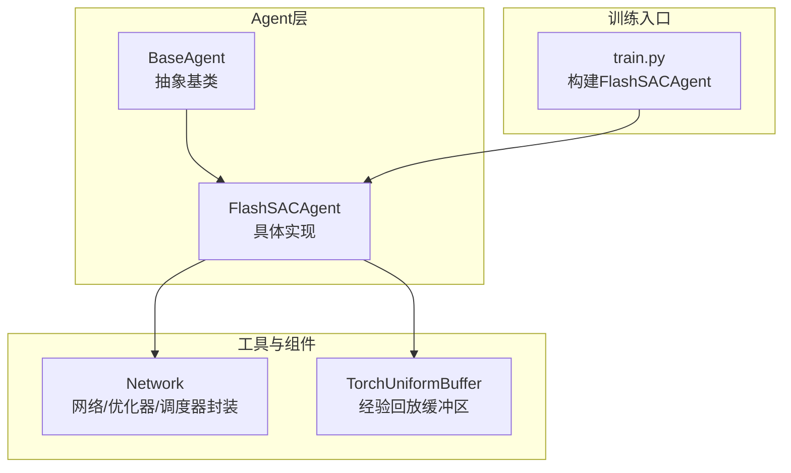
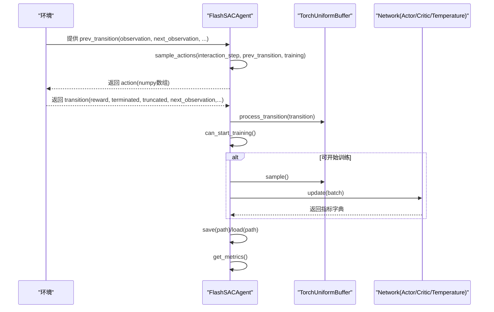
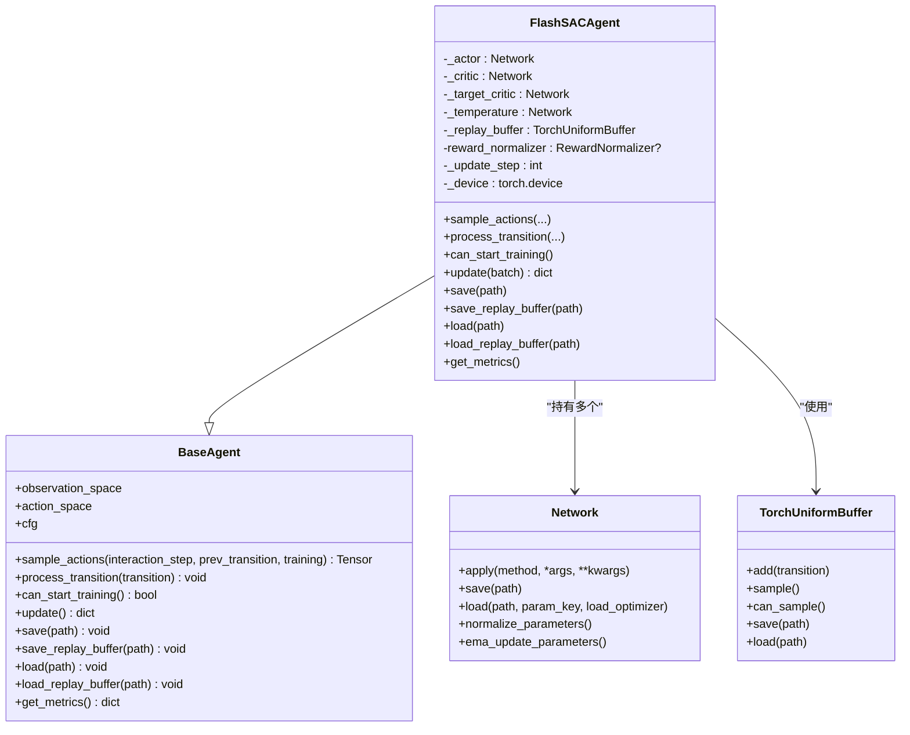
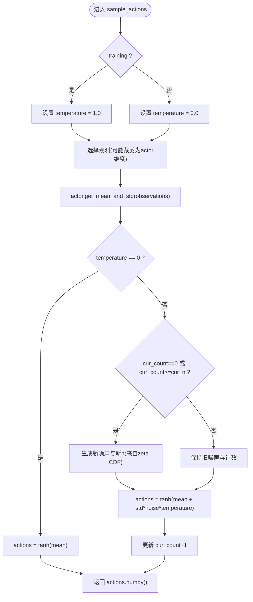
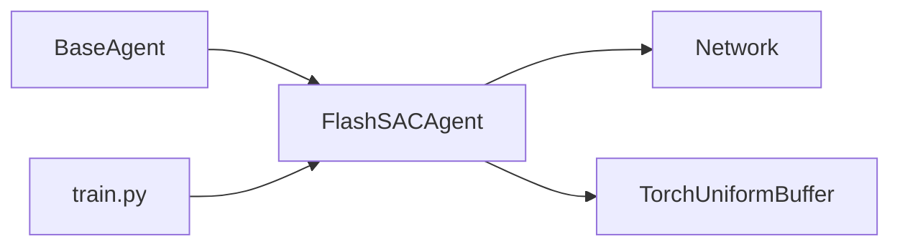

# Agent接口API

<cite>
**本文引用的文件**   
- [base_agent.py](file://hardware/flash_rl/agents/base_agent.py)
- [agent.py](file://hardware/flash_rl/agents/flashSAC/agent.py)
- [network.py](file://hardware/flash_rl/agents/utils/network.py)
- [torch_buffer.py](file://hardware/flash_rl/buffers/torch_buffer.py)
- [train.py](file://hardware/policyik_hw/train.py)
</cite>

## 目录
1. [简介](#简介)
2. [项目结构](#项目结构)
3. [核心组件](#核心组件)
4. [架构总览](#架构总览)
5. [详细组件分析](#详细组件分析)
6. [依赖关系分析](#依赖关系分析)
7. [性能与实现特性](#性能与实现特性)
8. [故障排查指南](#故障排查指南)
9. [结论](#结论)
10. [附录：使用示例与最佳实践](#附录使用示例与最佳实践)

## 简介
本文件为 PolicyIK 的 Agent 接口 API 文档，重点覆盖以下两部分：
- BaseAgent 抽象基类：定义所有智能体的统一接口契约。
- FlashSACAgent 实现类：基于 PyTorch 的 Soft Actor-Critic 算法实现，提供采样、训练更新、状态保存加载、回放缓冲区管理等功能。

文档将详细说明 sample_actions、process_transition、update 等核心方法的参数类型、返回值和使用方式，并给出训练状态管理、模型保存加载、指标获取等功能的规范说明。同时提供如何继承 BaseAgent 实现自定义算法，以及如何使用 FlashSACAgent 进行训练和推理的指导。

## 项目结构
与 Agent 接口相关的核心代码位于 hardware/flash_rl 目录下：
- agents/base_agent.py：BaseAgent 抽象基类定义。
- agents/flashSAC/agent.py：FlashSACAgent 实现及配置数据类。
- agents/utils/network.py：Network 封装（网络、优化器、调度器、EMA、权重归一化）。
- buffers/torch_buffer.py：基于 PyTorch 的均匀经验回放缓冲区。
- policyik_hw/train.py：构建 FlashSACAgent 的配置与实例化入口。



图表来源
- [base_agent.py:11-83](file://hardware/flash_rl/agents/base_agent.py#L11-L83)
- [agent.py:335-564](file://hardware/flash_rl/agents/flashSAC/agent.py#L335-L564)
- [network.py:22-178](file://hardware/flash_rl/agents/utils/network.py#L22-L178)
- [torch_buffer.py:31-236](file://hardware/flash_rl/buffers/torch_buffer.py#L31-L236)
- [train.py:132-157](file://hardware/policyik_hw/train.py#L132-L157)

章节来源
- [base_agent.py:11-83](file://hardware/flash_rl/agents/base_agent.py#L11-L83)
- [agent.py:335-564](file://hardware/flash_rl/agents/flashSAC/agent.py#L335-L564)
- [network.py:22-178](file://hardware/flash_rl/agents/utils/network.py#L22-L178)
- [torch_buffer.py:31-236](file://hardware/flash_rl/buffers/torch_buffer.py#L31-L236)
- [train.py:132-157](file://hardware/policyik_hw/train.py#L132-L157)

## 核心组件
本节概述 BaseAgent 与 FlashSACAgent 的核心职责与公共接口。

- BaseAgent
  - 目的：定义通用智能体接口，约束子类必须实现的交互与训练方法。
  - 关键抽象方法：sample_actions、process_transition、can_start_training、update、save、save_replay_buffer、load、load_replay_buffer、get_metrics。
  - 属性：observation_space、action_space、cfg。

- FlashSACAgent
  - 目的：实现基于分布式 critic 的 SAC 算法，支持温度自适应、奖励归一化、EMA 目标网络、编译加速等。
  - 关键能力：动作采样（训练/推理模式）、过渡处理（加入回放缓冲与奖励统计）、训练启动判断、批量更新、检查点保存/加载、回放缓冲持久化、指标收集。

章节来源
- [base_agent.py:11-83](file://hardware/flash_rl/agents/base_agent.py#L11-L83)
- [agent.py:335-564](file://hardware/flash_rl/agents/flashSAC/agent.py#L335-L564)

## 架构总览
下图展示 Agent 接口在系统中的位置与主要交互流程：训练循环通过 agent.sample_actions 与环境交互，通过 process_transition 记录样本，当 can_start_training 满足时调用 update 执行网络更新；save/load 用于检查点管理；get_metrics 返回训练指标。



图表来源
- [agent.py:423-516](file://hardware/flash_rl/agents/flashSAC/agent.py#L423-L516)
- [torch_buffer.py:141-183](file://hardware/flash_rl/buffers/torch_buffer.py#L141-L183)

## 详细组件分析

### BaseAgent 抽象基类
- 设计要点
  - 使用泛型 Config 类型变量，使子类可以绑定自己的配置数据结构。
  - 暴露 observation_space、action_space、cfg 只读属性，便于外部访问环境与配置。
  - 强制子类实现交互与训练相关方法，保证统一的训练循环接口。

- 公共接口摘要
  - __init__(observation_space, action_space, env_info, cfg)
    - 作用：初始化基础空间与配置。
  - sample_actions(interaction_step, prev_transition, training) -> Tensor
    - 输入：
      - interaction_step: int，当前交互步数（可用于学习率或噪声策略）。
      - prev_transition: MutableMapping[str, Tensor]，包含 observation、next_observation 等键。
      - training: bool，是否处于训练模式。
    - 输出：Tensor（通常为 numpy 数组形式的动作张量）。
  - process_transition(transition: MutableMapping[str, Tensor]) -> None
    - 作用：将交互样本写入回放缓冲或其他存储结构。
  - can_start_training() -> bool
    - 作用：判断是否满足开始训练的样本条件（如缓冲长度）。
  - update() -> dict[str, Any]
    - 作用：执行一次训练更新，返回指标字典（损失、熵、温度等）。
  - save(path: str) -> None / load(path: str) -> None
    - 作用：保存/加载模型与优化器状态。
  - save_replay_buffer(path: str) -> None / load_replay_buffer(path: str) -> None
    - 作用：持久化/恢复回放缓冲区。
  - get_metrics() -> dict[str, Any]
    - 作用：返回当前指标（可为空字典）。

章节来源
- [base_agent.py:11-83](file://hardware/flash_rl/agents/base_agent.py#L11-L83)

### FlashSACAgent 实现类
- 设计要点
  - 使用 dataclass FlashSACConfig 集中管理超参与设备、编译、AMP 等选项。
  - 内部维护 Actor、Critic、Target Critic、Temperature 四个 Network 封装对象。
  - 使用 TorchUniformBuffer 作为经验回放缓冲，支持 n-step 回报计算。
  - 可选奖励归一化（RewardNormalizer），EMA 目标网络更新，梯度缩放（GradScaler）以支持 AMP。
  - 支持 torch.compile 加速前向与 EMA 更新。

- 关键方法与行为
  - sample_actions(interaction_step, prev_transition, training) -> numpy.ndarray
    - 训练模式 temperature=1.0，推理模式 temperature=0.0。
    - 若启用不对称观测，仅取 actor 观测维度。
    - 使用 zeta 分布重复噪声逻辑，减少高频噪声抖动。
    - 返回 CPU numpy 数组动作。
  - process_transition(transition) -> None
    - 将 transition 加入回放缓冲。
    - 若启用奖励归一化，更新 reward_normalizer 的统计信息。
  - can_start_training() -> bool
    - 基于缓冲 can_sample() 判断。
  - update(batch=None) -> dict[str, float]
    - 从缓冲采样或接收外部 batch。
    - 根据 asymmetric_observation 构造 actor_observation/actor_next_observation。
    - 可选对 reward 进行归一化。
    - 按 actor_update_period 控制 actor 更新频率。
    - 调用 _update_networks 执行 actor/critic/target_critic/temperature 更新。
    - 返回标量化指标字典（张量转 float）。
  - save(path) / load(path)
    - 保存/加载 actor、critic、target_critic、temperature 网络与优化器状态。
    - 保存/加载 agent_state.pt（包含 update_step、grad_scaler 状态）。
    - 可选加载 reward_normalizer。
  - save_replay_buffer(path) / load_replay_buffer(path)
    - 持久化/恢复 replay_buffer.pt。
  - get_metrics() -> dict[str, Any]
    - 默认返回空字典，可在子类扩展。

- 配置项 FlashSACConfig（节选）
  - seed、normalize_reward、normalized_G_max
  - asymmetric_observation、device_type
  - buffer_max_length、buffer_min_length、buffer_device_type、sample_batch_size
  - learning_rate_* 系列（warmup、cosine decay）
  - actor_num_blocks、actor_hidden_dim、actor_bc_alpha、actor_noise_zeta_mu/max、actor_update_period
  - critic_num_blocks、critic_hidden_dim、critic_num_bins、critic_min_v、critic_max_v、critic_target_update_tau
  - temp_initial_value、temp_target_sigma、temp_target_entropy
  - gamma、n_step
  - use_compile、compile_mode、use_amp
  - load_optimizer、load_reward_normalizer
  - lan_cols（LAN critic 的观测列选择）



图表来源
- [base_agent.py:11-83](file://hardware/flash_rl/agents/base_agent.py#L11-L83)
- [agent.py:335-564](file://hardware/flash_rl/agents/flashSAC/agent.py#L335-L564)
- [network.py:22-178](file://hardware/flash_rl/agents/utils/network.py#L22-L178)
- [torch_buffer.py:31-236](file://hardware/flash_rl/buffers/torch_buffer.py#L31-L236)

章节来源
- [agent.py:335-564](file://hardware/flash_rl/agents/flashSAC/agent.py#L335-L564)
- [network.py:22-178](file://hardware/flash_rl/agents/utils/network.py#L22-L178)
- [torch_buffer.py:31-236](file://hardware/flash_rl/buffers/torch_buffer.py#L31-L236)

### 训练流程时序图
```mermaid
sequenceDiagram
participant Loop as "训练循环"
participant Agent as "FlashSACAgent"
participant Buffer as "TorchUniformBuffer"
participant Updater as "_update_networks"
Loop->>Agent : sample_actions(step, prev_transition, training=True)
Agent-->>Loop : action(numpy)
Loop->>Agent : process_transition(transition)
Agent->>Buffer : add(transition)
Loop->>Agent : can_start_training()
alt 可训练
Agent->>Buffer : sample()
Agent->>Updater : update(batch)
Updater-->>Agent : metrics(dict)
Agent->>Agent : update_step += 1
end
```

图表来源
- [agent.py:423-516](file://hardware/flash_rl/agents/flashSAC/agent.py#L423-L516)
- [torch_buffer.py:141-183](file://hardware/flash_rl/buffers/torch_buffer.py#L141-L183)

### 复杂逻辑流程图：动作采样与噪声重复


图表来源
- [agent.py:222-256](file://hardware/flash_rl/agents/flashSAC/agent.py#L222-L256)
- [agent.py:423-456](file://hardware/flash_rl/agents/flashSAC/agent.py#L423-L456)

## 依赖关系分析
- BaseAgent 与 FlashSACAgent
  - FlashSACAgent 继承 BaseAgent，实现其抽象方法。
- FlashSACAgent 与 Network
  - 使用 Network 封装 Actor、Critic、Target Critic、Temperature，统一管理优化器、调度器、EMA、权重归一化与编译。
- FlashSACAgent 与 TorchUniformBuffer
  - 使用缓冲存储 n-step 过渡样本，支持 can_sample、sample、save/load。
- train.py 与 FlashSACAgent
  - 构建 FlashSACConfig 并实例化 FlashSACAgent，作为训练入口。



图表来源
- [base_agent.py:11-83](file://hardware/flash_rl/agents/base_agent.py#L11-L83)
- [agent.py:335-564](file://hardware/flash_rl/agents/flashSAC/agent.py#L335-L564)
- [network.py:22-178](file://hardware/flash_rl/agents/utils/network.py#L22-L178)
- [torch_buffer.py:31-236](file://hardware/flash_rl/buffers/torch_buffer.py#L31-L236)
- [train.py:132-157](file://hardware/policyik_hw/train.py#L132-L157)

章节来源
- [base_agent.py:11-83](file://hardware/flash_rl/agents/base_agent.py#L11-L83)
- [agent.py:335-564](file://hardware/flash_rl/agents/flashSAC/agent.py#L335-L564)
- [network.py:22-178](file://hardware/flash_rl/agents/utils/network.py#L22-L178)
- [torch_buffer.py:31-236](file://hardware/flash_rl/buffers/torch_buffer.py#L31-L236)
- [train.py:132-157](file://hardware/policyik_hw/train.py#L132-L157)

## 性能与实现特性
- torch.compile 加速
  - 可对网络前向与 EMA 更新函数进行编译，提升训练吞吐。
  - compile_mode 支持 auto 自动选择（依据 PyTorch 版本）。
- AMP（混合精度）
  - 通过 GradScaler 支持 FP16 训练，降低显存占用并提升速度。
- 奖励归一化
  - 可选的 RewardNormalizer，基于 gamma 与 G_max 进行指数移动平均估计，稳定训练。
- EMA 目标网络
  - Target Critic 通过 EMA 平滑更新，提高稳定性。
- 噪声重复策略
  - 使用截断 Zeta 分布采样重复次数，减少高频噪声抖动，提升探索质量。

[本节为通用性能讨论，不直接分析具体文件]

## 故障排查指南
- 无法开始训练
  - 检查缓冲长度是否达到 buffer_min_length（can_sample）。
  - 确认 process_transition 已正确调用且 transition 字段完整。
- 动作异常或发散
  - 检查 temperature 设置是否正确（训练=1.0，推理=0.0）。
  - 检查 asymmetric_observation 与 actor_observation 维度裁剪是否匹配。
  - 检查奖励归一化是否启用且统计正常。
- 保存/加载失败
  - 确保路径存在且权限正确。
  - 若 load_optimizer=False，则不会恢复优化器与调度器状态。
  - 若启用 load_reward_normalizer，需确保对应文件存在。
- 指标为空
  - get_metrics 默认返回空字典，如需指标请在子类中扩展。

章节来源
- [agent.py:471-516](file://hardware/flash_rl/agents/flashSAC/agent.py#L471-L516)
- [agent.py:518-564](file://hardware/flash_rl/agents/flashSAC/agent.py#L518-L564)
- [torch_buffer.py:166-183](file://hardware/flash_rl/buffers/torch_buffer.py#L166-L183)

## 结论
BaseAgent 提供了统一的智能体接口契约，FlashSACAgent 在其之上实现了完整的 SAC 训练流程，包括动作采样、过渡处理、训练更新、检查点管理与回放缓冲持久化。通过 Network 与 TorchUniformBuffer 的组合，系统具备良好的可扩展性与性能优化能力。用户可基于 BaseAgent 快速实现自定义算法，或使用 FlashSACAgent 进行高效训练与推理。

[本节为总结性内容，不直接分析具体文件]

## 附录：使用示例与最佳实践

### 使用 FlashSACAgent 进行训练与推理
- 训练阶段
  - 构建 FlashSACConfig，设置设备、缓冲大小、学习率、网络结构等超参。
  - 实例化 FlashSACAgent，并在训练循环中：
    - 调用 sample_actions(training=True) 获取动作。
    - 调用 process_transition 记录样本。
    - 当 can_start_training 为真时调用 update 执行训练。
    - 定期调用 save 保存检查点与回放缓冲。
- 推理阶段
  - 设置 training=False，sample_actions 返回确定性动作（temperature=0.0）。
  - 通过 load 加载检查点，必要时加载回放缓冲。

参考实现入口
- [train.py:132-157](file://hardware/policyik_hw/train.py#L132-L157)

章节来源
- [train.py:132-157](file://hardware/policyik_hw/train.py#L132-L157)
- [agent.py:423-516](file://hardware/flash_rl/agents/flashSAC/agent.py#L423-L516)

### 继承 BaseAgent 实现自定义算法
- 步骤
  - 定义自定义配置数据类（例如 MyConfig）。
  - 创建子类 CustomAgent(BaseAgent[MyConfig])。
  - 实现 sample_actions、process_transition、can_start_training、update、save、load、save_replay_buffer、load_replay_buffer、get_metrics。
  - 在 __init__ 中初始化网络、优化器、缓冲等组件。
  - 在 update 中实现你的算法更新逻辑，并返回指标字典。
- 建议
  - 复用 Network 封装以简化优化器与调度器管理。
  - 使用 TorchUniformBuffer 或自定义缓冲存储样本。
  - 在 save/load 中持久化必要状态（模型、优化器、调度器、缓冲元数据）。

章节来源
- [base_agent.py:11-83](file://hardware/flash_rl/agents/base_agent.py#L11-L83)
- [network.py:22-178](file://hardware/flash_rl/agents/utils/network.py#L22-L178)
- [torch_buffer.py:31-236](file://hardware/flash_rl/buffers/torch_buffer.py#L31-L236)
