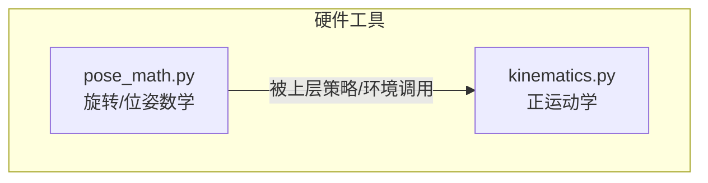
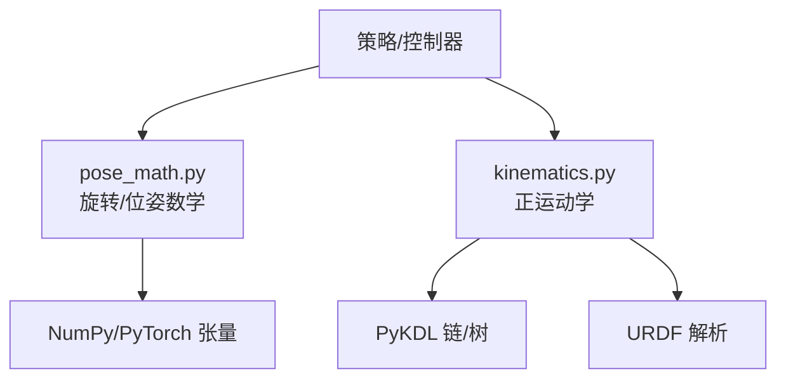
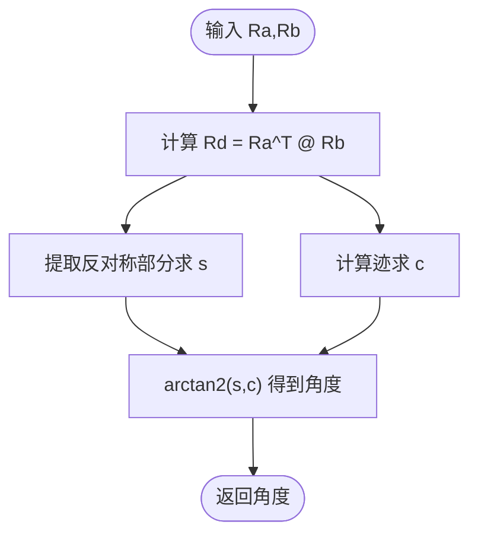
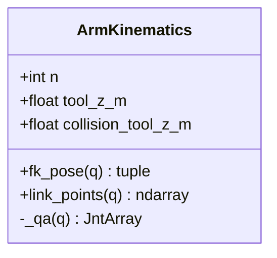
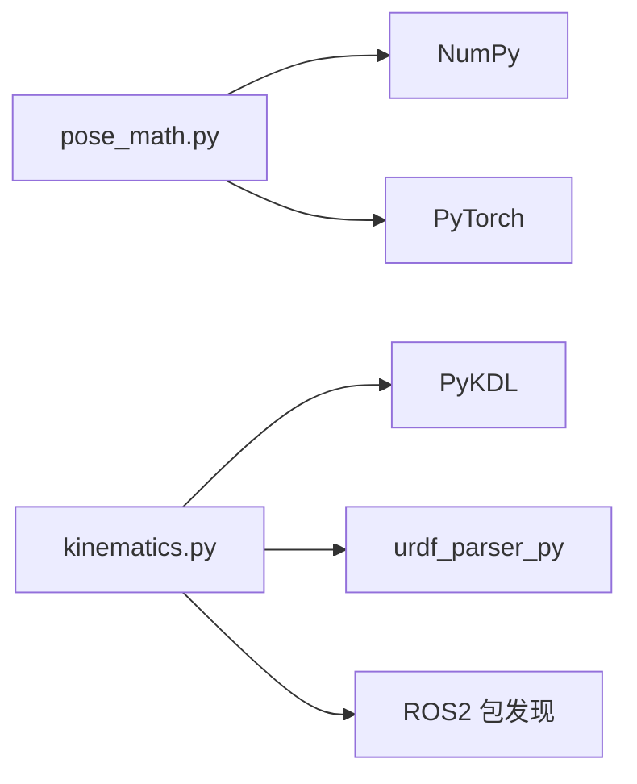

# 数学工具API

<cite>
**本文引用的文件**   
- [pose_math.py](file://hardware/policyik_hw/utils/pose_math.py)
- [kinematics.py](file://hardware/policyik_hw/utils/kinematics.py)
</cite>

## 目录
1. [简介](#简介)
2. [项目结构](#项目结构)
3. [核心组件](#核心组件)
4. [架构总览](#架构总览)
5. [详细组件分析](#详细组件分析)
6. [依赖关系分析](#依赖关系分析)
7. [性能与数值稳定性](#性能与数值稳定性)
8. [故障排查指南](#故障排查指南)
9. [结论](#结论)
10. [附录：使用示例](#附录使用示例)

## 简介
本文件为 PolicyIK 的数学工具函数提供 API 文档，聚焦以下两个模块：
- 位姿数学（pose_math.py）：旋转矩阵、轴角向量、6D 旋转表示之间的转换；角度差计算；基于关键点的位姿误差度量；以及对应的 PyTorch 批量版本。
- 运动学（kinematics.py）：OpenArm 右臂的正向运动学求解、连杆原点与工具点位置获取、URDF 加载与链构建。

这些函数为机器人控制中的坐标变换、姿态对齐、轨迹规划与误差评估提供基础能力。

## 项目结构
与本文相关的代码位于 hardware/policyik_hw/utils 目录下：
- pose_math.py：NumPy 与 PyTorch 两套实现，提供旋转与位姿相关的基础运算。
- kinematics.py：基于 URDF 与 PyKDL 的 OpenArm 右臂正向运动学封装。

图表来源
- [pose_math.py:1-125](file://hardware/policyik_hw/utils/pose_math.py#L1-L125)
- [kinematics.py:1-129](file://hardware/policyik_hw/utils/kinematics.py#L1-L129)

章节来源
- [pose_math.py:1-125](file://hardware/policyik_hw/utils/pose_math.py#L1-L125)
- [kinematics.py:1-129](file://hardware/policyik_hw/utils/kinematics.py#L1-L129)

## 核心组件
- 位姿数学（pose_math.py）
  - NumPy 接口：rot6d_from_R、angle_between、rotvec_body、keypoint_offsets、keypoints、keypoint_error
  - PyTorch 接口：t_R_from_rot6d、t_angle_between、t_rotvec_body、t_R_from_rotvec、t_keypoint_error
- 运动学（kinematics.py）
  - ArmKinematics 类：fk_pose、link_points
  - URDF 管理：get_urdf_xml、set_urdf_path
  - 常量：ROOT_LINK、TIP_LINK、JOINTS、N_JOINTS

章节来源
- [pose_math.py:1-125](file://hardware/policyik_hw/utils/pose_math.py#L1-L125)
- [kinematics.py:1-129](file://hardware/policyik_hw/utils/kinematics.py#L1-L129)

## 架构总览
PoseMath 提供旋转与位姿的底层数学原语；Kinematics 在 URDF 描述的基础上构建机械臂树与链，并对外暴露正向运动学接口。二者通过 NumPy/PyTorch 张量进行数据交换，便于在仿真与真实硬件中复用。

图表来源
- [pose_math.py:1-125](file://hardware/policyik_hw/utils/pose_math.py#L1-L125)
- [kinematics.py:1-129](file://hardware/policyik_hw/utils/kinematics.py#L1-L129)

## 详细组件分析

### 位姿数学（pose_math.py）API 规范

#### 旋转与姿态表示
- rot6d_from_R(R)
  - 输入：R (3,3) 旋转矩阵
  - 输出：v (6,) 前两个列向量拼接
  - 用途：将标准旋转矩阵压缩为 6D 表示，便于优化或网络输出
- t_R_from_rot6d(v)
  - 输入：v (N,6) 6D 表示
  - 输出：R (N,3,3) 旋转矩阵
  - 说明：对两列做 Gram-Schmidt 正交化后叉乘得到第三列，保证行列式为 +1
- t_R_from_rotvec(v)
  - 输入：v (N,3) 轴角向量（模长为角度）
  - 输出：R (N,3,3) 旋转矩阵
  - 说明：Rodrigues 公式实现，theta=0 时安全退化为单位阵

#### 角度与轴角
- angle_between(Ra, Rb)
  - 输入：Ra, Rb (3,3) 旋转矩阵
  - 输出：float 角度（弧度）
  - 说明：基于 Rd = Ra^T Rb 的反对称部分与迹计算夹角
- rotvec_body(R_ee, R_goal)
  - 输入：R_ee, R_goal (3,3)
  - 输出：axis-angle 向量 (3,)，在末端坐标系下表达的对数映射
  - 说明：当接近奇异（theta≈0 或 π）时采用特征分解稳定估计主轴

#### 关键点与误差度量
- keypoint_offsets(kp_size)
  - 输入：kp_size (float)
  - 输出：(3,3) 三个偏移向量，分别沿 EE 三轴
- keypoints(p, R, kp_size)
  - 输入：p (3,), R (3,3), kp_size (float)
  - 输出：(3,3) 三个关键点在世界坐标系下的位置
- keypoint_error(p, R, p_goal, R_goal, kp_size)
  - 输入：同上
  - 输出：float 平均欧氏距离（米）
  - 说明：用于位姿误差的几何度量

#### PyTorch 批量接口
- t_angle_between(Ra, Rb)
  - 输入：Ra, Rb (N,3,3)
  - 输出：angles (N,)
- t_rotvec_body(R_ee, R_goal)
  - 输入：R_ee, R_goal (N,3,3)
  - 输出：out (N,3) 轴角向量
- t_keypoint_error(p, R, p_goal, R_goal, kp_size)
  - 输入：p, p_goal (N,3); R, R_goal (N,3,3); kp_size (float)
  - 输出：errors (N,) 每个样本的平均关键点距离

图表来源
- [pose_math.py:22-26](file://hardware/policyik_hw/utils/pose_math.py#L22-L26)

章节来源
- [pose_math.py:12-15](file://hardware/policyik_hw/utils/pose_math.py#L12-L15)
- [pose_math.py:22-42](file://hardware/policyik_hw/utils/pose_math.py#L22-L42)
- [pose_math.py:45-58](file://hardware/policyik_hw/utils/pose_math.py#L45-L58)
- [pose_math.py:61-68](file://hardware/policyik_hw/utils/pose_math.py#L61-L68)
- [pose_math.py:76-81](file://hardware/policyik_hw/utils/pose_math.py#L76-L81)
- [pose_math.py:84-101](file://hardware/policyik_hw/utils/pose_math.py#L84-L101)
- [pose_math.py:104-115](file://hardware/policyik_hw/utils/pose_math.py#L104-L115)
- [pose_math.py:118-124](file://hardware/policyik_hw/utils/pose_math.py#L118-L124)

### 运动学（kinematics.py）API 规范

#### 常量与 URDF 管理
- ROOT_LINK="openarm_right_link0"
- TIP_LINK="openarm_right_link7"
- JOINTS=["openarm_joint1", ..., "openarm_joint7"]
- N_JOINTS=7
- set_urdf_path(path)
  - 作用：设置自定义 URDF 路径以替代默认包内 URDF
- get_urdf_xml()
  - 作用：读取 v1 URDF 文本（优先使用自定义路径）

#### 类 ArmKinematics
- 构造参数
  - urdf_xml: str|None，可选直接传入 URDF XML 字符串
  - tool_z_m: float，沿 link7 z 轴的工具点偏移（米）
  - collision_tool_z_m: float，碰撞检测用的额外工具点偏移（米）
- fk_pose(q)
  - 输入：q (7,) 关节角
  - 输出：(p (3,), R (3,3)) 工具点在基座坐标系下的位姿
  - 说明：若 tool_z_m≠0，则在 link7 末端沿 z 轴平移
- link_points(q)
  - 输入：q (7,)
  - 输出：(M,3) 各连杆原点 + 工具点/碰撞点（按 z 排序追加）
  - 用途：可视化、碰撞检测、轨迹插值参考点

图表来源
- [kinematics.py:81-128](file://hardware/policyik_hw/utils/kinematics.py#L81-L128)

章节来源
- [kinematics.py:12-18](file://hardware/policyik_hw/utils/kinematics.py#L12-L18)
- [kinematics.py:63-78](file://hardware/policyik_hw/utils/kinematics.py#L63-L78)
- [kinematics.py:81-128](file://hardware/policyik_hw/utils/kinematics.py#L81-L128)

## 依赖关系分析
- pose_math.py
  - 依赖 NumPy（NumPy 版）与 PyTorch（批量版），内部无外部库耦合
- kinematics.py
  - 依赖 PyKDL（运动学求解）、urdf_parser_py（URDF 解析）
  - 通过 ROS2 命令查找 openarm_description 包路径，从而定位 URDF 文件

图表来源
- [pose_math.py:1-125](file://hardware/policyik_hw/utils/pose_math.py#L1-L125)
- [kinematics.py:1-129](file://hardware/policyik_hw/utils/kinematics.py#L1-L129)

章节来源
- [pose_math.py:1-125](file://hardware/policyik_hw/utils/pose_math.py#L1-L125)
- [kinematics.py:1-129](file://hardware/policyik_hw/utils/kinematics.py#L1-L129)

## 性能与数值稳定性
- 角度与轴角计算
  - 使用 arctan2 避免象限歧义
  - 对 theta≈0 与 theta≈π 的边界情况采用特征分解或阈值判断，提升数值稳定性
- 6D 到旋转矩阵
  - 通过 Gram-Schmidt 正交化与叉积构造正交基，确保旋转矩阵合法性
- 批量 PyTorch 实现
  - 使用 clamp_min 防止除零，避免梯度不稳定
- 正向运动学
  - 基于 PyKDL 递归求解，复杂度 O(n)，n 为关节数（此处为 7）

[本节为通用指导，不直接分析具体文件]

## 故障排查指南
- URDF 路径问题
  - 现象：无法找到 openarm_description 包或 URDF 文件
  - 处理：使用 set_urdf_path 指定本地 URDF 路径，或通过 get_urdf_xml 检查实际读取内容
- 维度不匹配
  - 现象：传入 q 长度不为 7，或 R 非 (3,3)/(N,3,3)
  - 处理：校验输入形状，确保与 API 约定一致
- 奇异姿态
  - 现象：角度接近 0 或 π 导致轴角估计不稳定
  - 处理：使用提供的 rotvec_body/t_rotvec_body，其内部已包含边界保护逻辑
- 工具点未生效
  - 现象：tool_z_m 设置后位姿未变化
  - 处理：确认构造 ArmKinematics 时传入了正确的 tool_z_m，并在 fk_pose 中返回的是工具点位姿

章节来源
- [kinematics.py:63-78](file://hardware/policyik_hw/utils/kinematics.py#L63-L78)
- [kinematics.py:81-128](file://hardware/policyik_hw/utils/kinematics.py#L81-L128)

## 结论
pose_math.py 提供了稳健的旋转与位姿数学原语，支持 NumPy 与 PyTorch 两种后端；kinematics.py 在 URDF 基础上构建了 OpenArm 右臂的正向运动学接口。两者结合可完成从关节空间到位姿空间的映射，并为误差评估与控制提供必要的数学支撑。

[本节为总结性内容，不直接分析具体文件]

## 附录：使用示例

### 示例一：用正向运动学与位姿误差评估目标位姿
- 步骤
  1) 初始化 ArmKinematics，设置 tool_z_m 以定义工具点
  2) 生成一组关节角 q
  3) 调用 fk_pose(q) 得到当前位姿 (p, R)
  4) 给定目标位姿 (p_goal, R_goal)
  5) 使用 keypoint_error 或 t_keypoint_error 计算位姿误差
- 参考路径
  - [kinematics.py:81-128](file://hardware/policyik_hw/utils/kinematics.py#L81-L128)
  - [pose_math.py:45-58](file://hardware/policyik_hw/utils/pose_math.py#L45-L58)
  - [pose_math.py:118-124](file://hardware/policyik_hw/utils/pose_math.py#L118-L124)

### 示例二：将旋转矩阵转换为轴角向量（末端坐标系）
- 步骤
  1) 已知当前末端旋转 R_ee 与目标旋转 R_goal
  2) 调用 rotvec_body(R_ee, R_goal) 得到轴角向量（弧度）
  3) 该向量可用于小步长姿态控制或误差反馈
- 参考路径
  - [pose_math.py:29-42](file://hardware/policyik_hw/utils/pose_math.py#L29-L42)

### 示例三：从 6D 表示恢复旋转矩阵（批量）
- 步骤
  1) 网络输出 v (N,6)
  2) 调用 t_R_from_rot6d(v) 得到 R (N,3,3)
  3) 后续可继续计算角度差或轴角向量
- 参考路径
  - [pose_math.py:61-68](file://hardware/policyik_hw/utils/pose_math.py#L61-L68)

### 示例四：替换 URDF 路径以适配不同机器人配置
- 步骤
  1) 调用 set_urdf_path("/path/to/custom.urdf")
  2) 重新实例化 ArmKinematics
  3) 验证 get_urdf_xml() 返回的内容是否符合预期
- 参考路径
  - [kinematics.py:63-78](file://hardware/policyik_hw/utils/kinematics.py#L63-L78)
