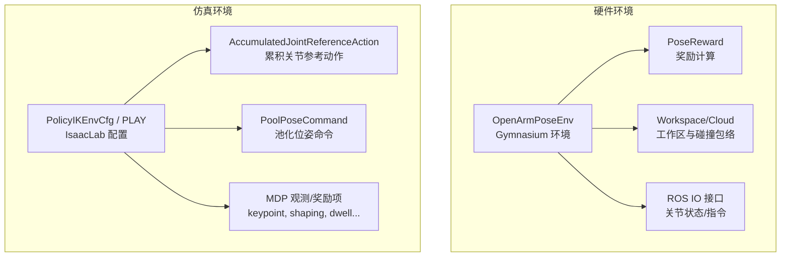
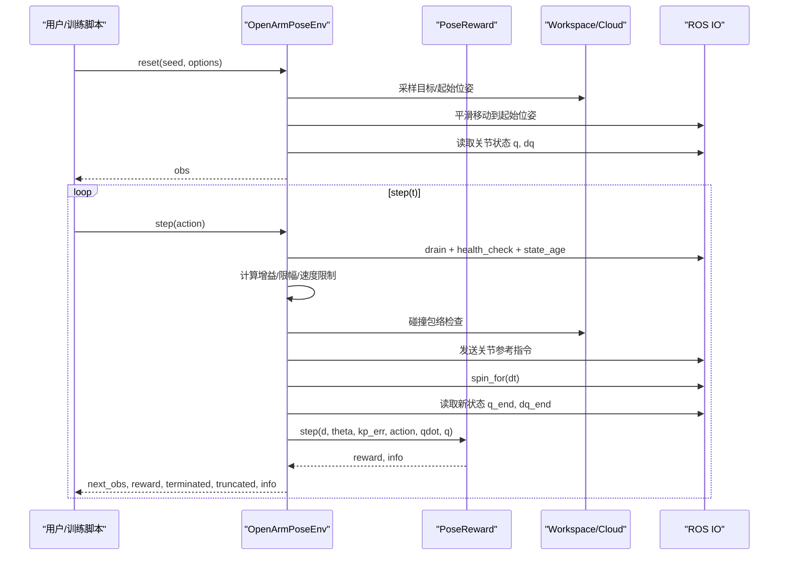
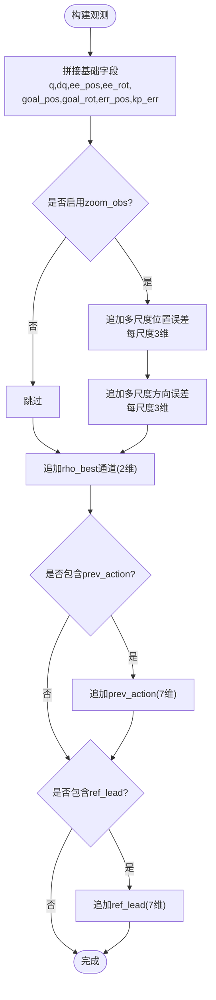
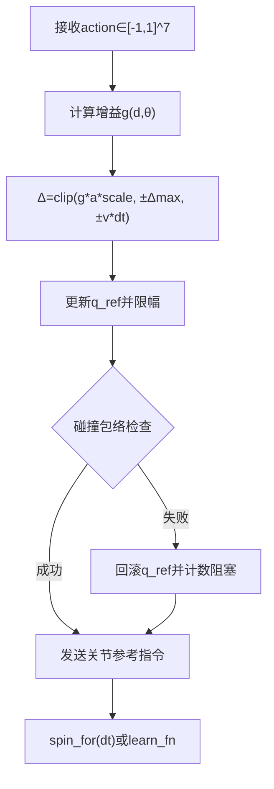
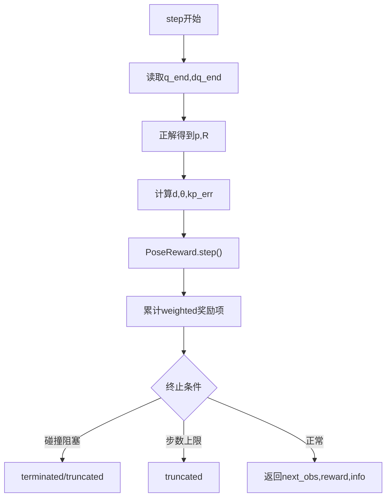
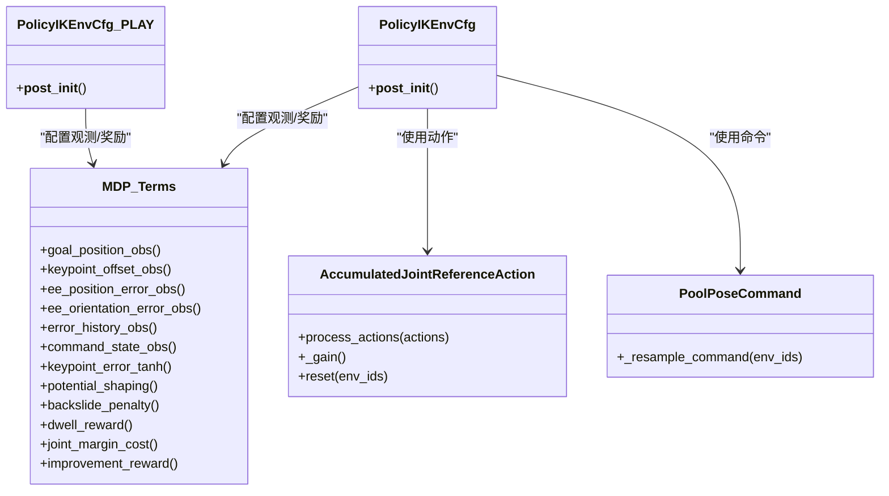
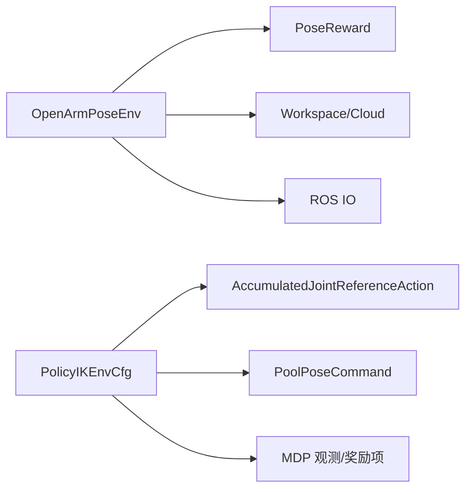
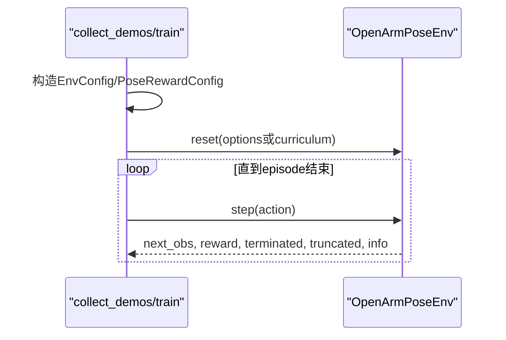

# 环境接口API

<cite>
**本文引用的文件**   
- [pose_env.py](file://hardware/policyik_hw/envs/pose_env.py)
- [reward.py](file://hardware/policyik_hw/envs/reward.py)
- [env_cfg.py](file://simulation/policyik_sim/tasks/env_cfg.py)
- [actions.py](file://simulation/policyik_sim/tasks/actions.py)
- [sampling.py](file://simulation/policyik_sim/tasks/sampling.py)
- [mdp.py](file://simulation/policyik_sim/tasks/mdp.py)
- [train.py](file://hardware/policyik_hw/train.py)
- [collect_demos.py](file://hardware/policyik_hw/collect_demos.py)
</cite>

## 目录
1. [简介](#简介)
2. [项目结构与环境分类](#项目结构与环境分类)
3. [核心组件](#核心组件)
4. [架构总览](#架构总览)
5. [详细组件分析](#详细组件分析)
6. [依赖关系分析](#依赖关系分析)
7. [性能与实时特性](#性能与实时特性)
8. [故障排查指南](#故障排查指南)
9. [结论](#结论)
10. [附录：使用示例](#附录使用示例)

## 简介
本文件为 PolicyIK 的“环境接口”提供完整 API 文档，覆盖两类环境：
- 真实机械臂环境 OpenArmPoseEnv：基于 Gymnasium 标准接口，面向真实 OpenArm 右臂的姿态到达任务。
- 仿真环境（PolicyIK 在 Isaac Lab/OpenArm 上的扩展）：通过配置类与 MDP 项组合实现 Gymnasium 风格训练/评估流程。

文档重点说明 reset、step、render 等核心方法的行为与参数，定义观察空间与动作空间规范，解释奖励函数计算方式，并给出环境配置选项、初始化参数、错误处理策略以及实际交互示例。

## 项目结构与环境分类
PolicyIK 包含两套环境实现：
- 硬件侧：OpenArmPoseEnv 直接继承 gym.Env，封装真实机械臂控制、安全保护、碰撞检测、奖励计算与观测构造。
- 仿真侧：基于 openarm_isaac_lab 的 OpenArmReachEnvCfg 派生类，通过 isaaclab 的 command/action/observation/reward 管理器装配任务；同时引入自定义动作 AccumulatedJointReferenceAction、命令采样 PoolPoseCommand 和 MDP 观测/奖励项。

图表来源
- [pose_env.py:206-253](file://hardware/policyik_hw/envs/pose_env.py#L206-L253)
- [reward.py:85-146](file://hardware/policyik_hw/envs/reward.py#L85-L146)
- [env_cfg.py:121-132](file://simulation/policyik_sim/tasks/env_cfg.py#L121-L132)
- [actions.py:15-76](file://simulation/policyik_sim/tasks/actions.py#L15-L76)
- [sampling.py:40-68](file://simulation/policyik_sim/tasks/sampling.py#L40-L68)
- [mdp.py:37-231](file://simulation/policyik_sim/tasks/mdp.py#L37-L231)

章节来源
- [pose_env.py:1-18](file://hardware/policyik_hw/envs/pose_env.py#L1-L18)
- [env_cfg.py:1-21](file://simulation/policyik_sim/tasks/env_cfg.py#L1-L21)

## 核心组件
- OpenArmPoseEnv：真实机械臂姿态到达环境，实现 Gymnasium 标准接口。
- PoseReward/PoseRewardConfig：密集奖励函数与配置，包含位置误差、关键点跟踪、动作平滑、关节速度惩罚、回退惩罚、停留奖励、势能塑形、软限位边际成本等。
- EnvConfig：环境行为与观测/动作缩放、噪声、安全保护、成功判定、重置时序等配置。
- 仿真配置 PolicyIKEnvCfg/PLAY：在 OpenArmReachEnvCfg 基础上替换命令源、事件、观测项、奖励项与动作项。
- AccumulatedJointReferenceAction：累积式关节参考动作，按末端误差自适应缩放步长。
- PoolPoseCommand：从预存池子中采样目标位姿。
- MDP 观测/奖励项：关键点位姿偏移、多尺度误差观测、误差历史、改进奖励、势能塑形、回退惩罚、停留奖励、关节边际成本、命令状态反馈等。

章节来源
- [pose_env.py:206-253](file://hardware/policyik_hw/envs/pose_env.py#L206-L253)
- [reward.py:23-146](file://hardware/policyik_hw/envs/reward.py#L23-L146)
- [env_cfg.py:121-132](file://simulation/policyik_sim/tasks/env_cfg.py#L121-L132)
- [actions.py:15-76](file://simulation/policyik_sim/tasks/actions.py#L15-L76)
- [sampling.py:40-68](file://simulation/policyik_sim/tasks/sampling.py#L40-L68)
- [mdp.py:37-231](file://simulation/policyik_sim/tasks/mdp.py#L37-L231)

## 架构总览
下图展示真实环境与仿真环境的整体交互与数据流。

图表来源
- [pose_env.py:324-508](file://hardware/policyik_hw/envs/pose_env.py#L324-L508)
- [reward.py:106-146](file://hardware/policyik_hw/envs/reward.py#L106-L146)

## 详细组件分析

### OpenArmPoseEnv（真实机械臂环境）
OpenArmPoseEnv 是 Gymnasium 环境的标准实现，负责：
- 初始化：验证配置、构建关节极限、奖励函数、观测布局、工作区/碰撞包络、课程学习器（可选）、ROS IO 连接。
- 观察空间：Box(-inf, inf, (obs_dim,), float32)，维度由 EnvConfig.zoom_obs、prev_action/ref_lead 等开关决定。
- 动作空间：Box(-1, 1, (N_JOINTS,), float32)，单位归一化动作经缩放、限幅、速度限制后映射到关节参考增量。
- reset：支持两种模式
  - 通过 curriculum 自动采样目标与反向起始位姿。
  - 通过 options 指定 q_start、goal_p、goal_R。
- step：执行安全与健康检查、计算动作增益与限幅、碰撞包络保护、发送指令、等待 dt、计算奖励与终止条件。
- render：未实现可视化（metadata.render_modes 为空）。

#### 观察空间定义
- 固定字段：q(7)、dq(7)、ee_pos(3)、ee_rot(6)、goal_pos(3)、goal_rot(6)、err_pos(3)、kp_err(9)。
- 可选 zoom 字段：多尺度位置/方向误差通道（每尺度 3-D）。
- 状态通道：rho_best(2)，来自奖励模块的 rho/rho_best_prev 归一化。
- 可选历史：prev_action(7)、ref_lead(7)。

图表来源
- [pose_env.py:21-43](file://hardware/policyik_hw/envs/pose_env.py#L21-L43)
- [pose_env.py:269-289](file://hardware/policyik_hw/envs/pose_env.py#L269-L289)

#### 动作空间与动作处理
- 输入动作 a ∈ [-1, 1]^7。
- 根据当前末端误差 d, θ 计算增益 g ∈ [gain_min, 1]（可关闭）。
- 增量 Δ = clip(g * a * action_scale_rad, ±max_joint_delta_rad, ±vel_cap)。
- 更新内部参考 q_ref，受软限位、ref_band 约束；若开启 ref_limit_relax_deg，允许参考越界但测量关节保持硬限。
- 碰撞包络检查失败时回滚 q_ref 并计数连续阻塞。

图表来源
- [pose_env.py:386-468](file://hardware/policyik_hw/envs/pose_env.py#L386-L468)
- [pose_env.py:299-301](file://hardware/policyik_hw/envs/pose_env.py#L299-L301)

#### 奖励函数与终止条件
- 奖励由 PoseReward.step 计算，包含线性位置误差、tanh精细跟踪、关键点宽/窄核、动作速率惩罚、关节速度惩罚、回退惩罚、改进奖励、停留奖励、势能塑形、软限位边际成本等。
- 终止条件：
  - 碰撞连续阻塞超过阈值：可选择 terminated 或 truncated。
  - 达到最大步数：truncated。
- info 中包含 episode 摘要、各奖励项均值、时间统计等。

图表来源
- [pose_env.py:468-508](file://hardware/policyik_hw/envs/pose_env.py#L468-L508)
- [reward.py:106-146](file://hardware/policyik_hw/envs/reward.py#L106-L146)

#### 初始化参数与配置
- EnvConfig：控制频率、最大步数、动作缩放、关节限幅、噪声、zoom 观测、增益调度、成功容忍度、重置时序、健康/碰撞保护、冻结状态检测等。
- PoseRewardConfig：各奖励项权重、尺度、dt 缩放、rho 阈值、limit margin 门控等。
- 构造函数签名：OpenArmPoseEnv(cfg: EnvConfig, rew_cfg: PoseRewardConfig, curr_cfg=None, io=None)。

章节来源
- [pose_env.py:46-158](file://hardware/policyik_hw/envs/pose_env.py#L46-L158)
- [pose_env.py:206-253](file://hardware/policyik_hw/envs/pose_env.py#L206-L253)
- [reward.py:23-83](file://hardware/policyik_hw/envs/reward.py#L23-L83)

### 仿真环境（PolicyIKEnvCfg / PLAY）
仿真环境基于 OpenArmReachEnvCfg，通过 _configure 注入：
- 命令源：PoolPoseCommand，从 npz 池子中采样 ee_pos/ee_quat。
- 重置事件：reset_joints_from_pool，从池子均匀采样初始关节角。
- 观测项：goal_position、keypoint_offsets、ee_position_error_obs、ee_orientation_error_obs、error_history、command_state、actions。
- 奖励项：end_effector_keypoint_tracking、backslide、potential_shaping、dwell、joint_margin、improvement，以及 sharp keypoint tracking（训练时）。
- 动作项：AccumulatedJointReferenceAction，按末端误差自适应缩放累积关节参考增量。

图表来源
- [env_cfg.py:27-112](file://simulation/policyik_sim/tasks/env_cfg.py#L27-L112)
- [actions.py:15-76](file://simulation/policyik_sim/tasks/actions.py#L15-L76)
- [sampling.py:40-68](file://simulation/policyik_sim/tasks/sampling.py#L40-L68)
- [mdp.py:37-231](file://simulation/policyik_sim/tasks/mdp.py#L37-L231)

章节来源
- [env_cfg.py:27-132](file://simulation/policyik_sim/tasks/env_cfg.py#L27-L132)
- [actions.py:15-76](file://simulation/policyik_sim/tasks/actions.py#L15-L76)
- [sampling.py:19-68](file://simulation/policyik_sim/tasks/sampling.py#L19-L68)
- [mdp.py:37-231](file://simulation/policyik_sim/tasks/mdp.py#L37-L231)

## 依赖关系分析
- OpenArmPoseEnv 依赖：
  - PoseReward：计算奖励与状态通道。
  - Workspace/Cloud：工作区采样、碰撞包络、构型边界检查。
  - ROS IO：关节状态读取、指令下发、健康检查、状态年龄检测。
- 仿真环境依赖：
  - IsaacLab 管理器：EventTerm/ObsTerm/RewardTerm/SceneEntityCfg。
  - 自定义动作 AccumulatedJointReferenceAction。
  - 自定义命令 PoolPoseCommand。
  - MDP 观测/奖励项。

图表来源
- [pose_env.py:206-253](file://hardware/policyik_hw/envs/pose_env.py#L206-L253)
- [env_cfg.py:121-132](file://simulation/policyik_sim/tasks/env_cfg.py#L121-L132)

章节来源
- [pose_env.py:206-253](file://hardware/policyik_hw/envs/pose_env.py#L206-L253)
- [env_cfg.py:121-132](file://simulation/policyik_sim/tasks/env_cfg.py#L121-L132)

## 性能与实时特性
- 控制频率：control_hz 决定 dt，影响奖励缩放与步进时序。
- 步进耗时：timing_summary 提供 median/p90 耗时与有效 Hz。
- 冻结状态检测：当关节状态长时间不变且指令非零时抛出异常，提示 CAN 通信问题。
- 碰撞保护：连续阻塞超过阈值可触发 truncated/terminated，避免危险构型。
- 健康检查：电机健康异常可立即终止或警告继续。

章节来源
- [pose_env.py:525-535](file://hardware/policyik_hw/envs/pose_env.py#L525-L535)
- [pose_env.py:404-423](file://hardware/policyik_hw/envs/pose_env.py#L404-L423)
- [pose_env.py:447-501](file://hardware/policyik_hw/envs/pose_env.py#L447-L501)
- [pose_env.py:393-403](file://hardware/policyik_hw/envs/pose_env.py#L393-L403)

## 故障排查指南
- 无 /joint_states 超时：检查 bringup launch 是否运行。
- 关节极限冲突：检查 joint_lo_deg/joint_hi_deg 与 URDF 交集是否为空。
- 配置校验失败：EnvConfig.validate 与 PoseRewardConfig.validate 会抛出 ValueError，需修正参数范围。
- 冻结状态：CAN 读停滞导致关节状态重复发布，需重启 CAN 接口并重新拉起。
- 碰撞连续阻塞：检查工作区/包络配置与策略输出，必要时调整 collision_block_steps 或策略平滑性。

章节来源
- [pose_env.py:239-244](file://hardware/policyik_hw/envs/pose_env.py#L239-L244)
- [pose_env.py:217-220](file://hardware/policyik_hw/envs/pose_env.py#L217-L220)
- [pose_env.py:132-158](file://hardware/policyik_hw/envs/pose_env.py#L132-L158)
- [reward.py:60-73](file://hardware/policyik_hw/envs/reward.py#L60-L73)
- [pose_env.py:413-423](file://hardware/policyik_hw/envs/pose_env.py#L413-L423)
- [pose_env.py:490-501](file://hardware/policyik_hw/envs/pose_env.py#L490-L501)

## 结论
OpenArmPoseEnv 提供了完整的 Gymnasium 标准接口用于真实机械臂的姿态到达任务，具备丰富的观测、安全的动作处理、密集的奖励信号与完善的错误处理机制。仿真环境通过 IsaacLab 的配置体系与自定义动作/命令/MDP 项实现了高保真训练流程。两者共同构成 PolicyIK 的训练与评估闭环。

## 附录：使用示例

### 真实环境交互示例（收集演示/训练）
- 构造 EnvConfig 与 PoseRewardConfig，调用 validate。
- 创建 OpenArmPoseEnv，传入 curriculum 或 options。
- 循环调用 reset/step，记录 obs、action、reward、terminated、truncated、info。

图表来源
- [collect_demos.py:152-162](file://hardware/policyik_hw/collect_demos.py#L152-L162)
- [train.py:232-248](file://hardware/policyik_hw/train.py#L232-L248)

章节来源
- [collect_demos.py:152-162](file://hardware/policyik_hw/collect_demos.py#L152-L162)
- [train.py:232-248](file://hardware/policyik_hw/train.py#L232-L248)

### 仿真环境训练入口
- 使用 PolicyIKEnvCfg/PLAY 作为环境配置，结合 IsaacLab 的管理器进行训练。
- 通过 PoolPoseCommand 与 reset_joints_from_pool 提供稳定的目标与初始位姿分布。
- 使用 AccumulatedJointReferenceAction 将策略输出映射为累积关节参考增量，并按末端误差自适应缩放。

章节来源
- [env_cfg.py:27-132](file://simulation/policyik_sim/tasks/env_cfg.py#L27-L132)
- [sampling.py:19-68](file://simulation/policyik_sim/tasks/sampling.py#L19-L68)
- [actions.py:15-76](file://simulation/policyik_sim/tasks/actions.py#L15-L76)