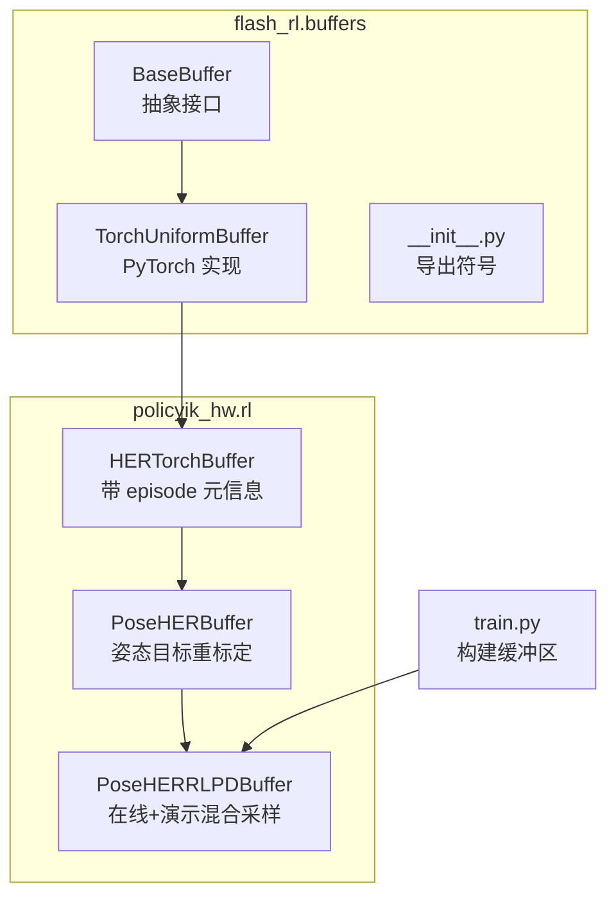
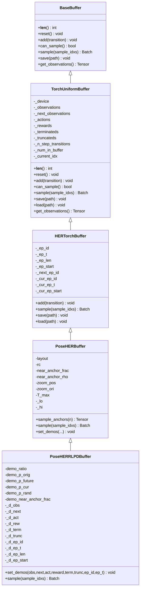
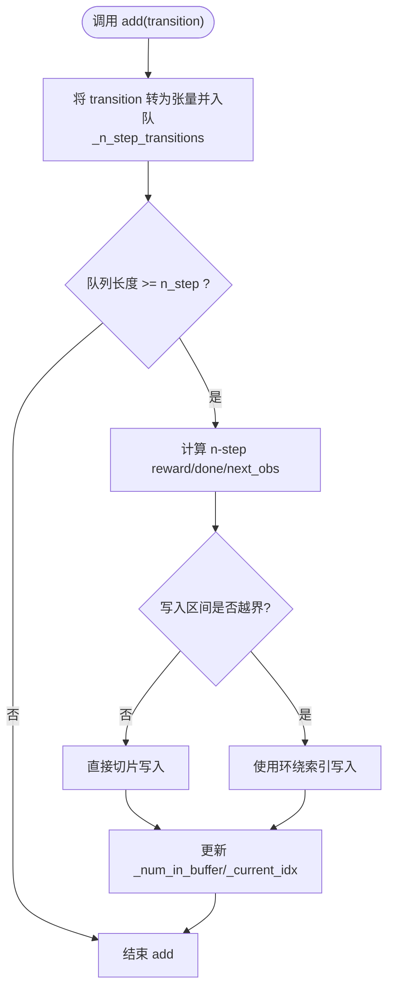
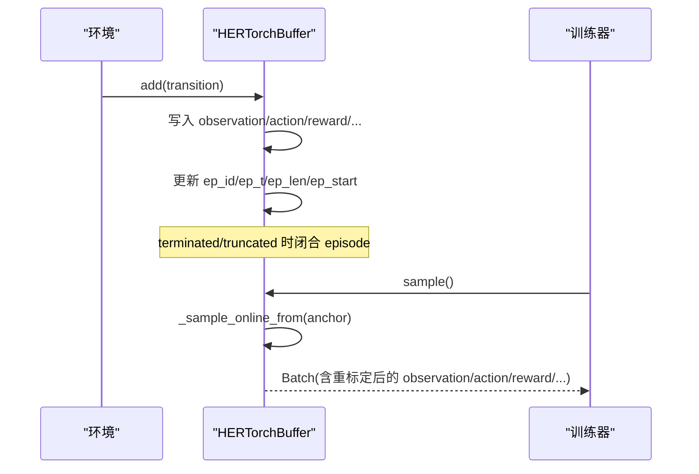
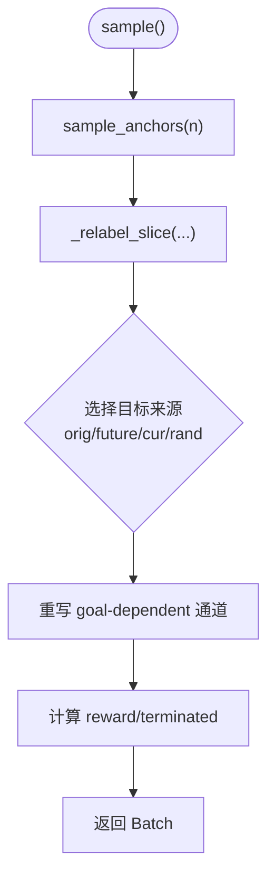
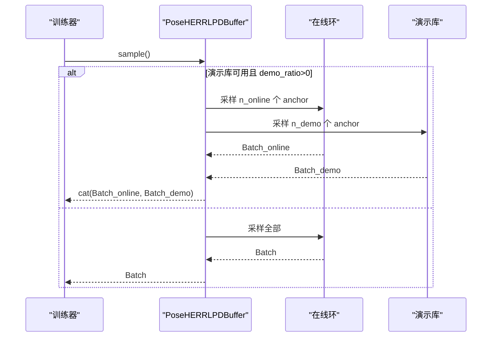
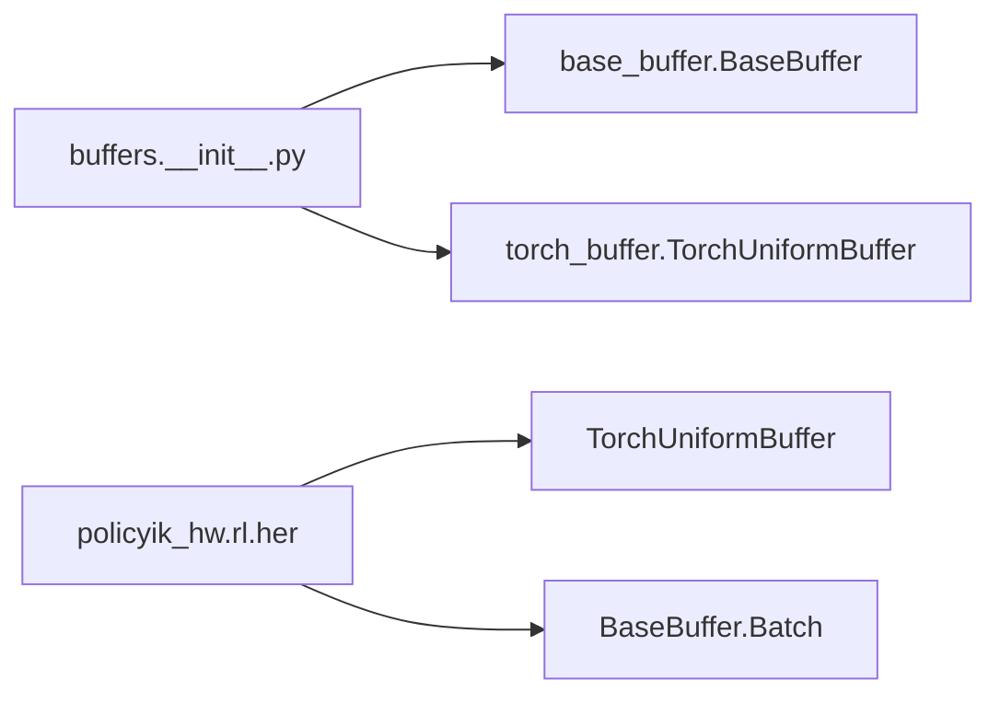

# 缓冲区API

<cite>
**本文引用的文件**   
- [base_buffer.py](file://hardware/flash_rl/buffers/base_buffer.py)
- [torch_buffer.py](file://hardware/flash_rl/buffers/torch_buffer.py)
- [__init__.py](file://hardware/flash_rl/buffers/__init__.py)
- [her.py](file://hardware/policyik_hw/rl/her.py)
- [train.py](file://hardware/policyik_hw/train.py)
</cite>

## 目录
1. [简介](#简介)
2. [项目结构](#项目结构)
3. [核心组件](#核心组件)
4. [架构总览](#架构总览)
5. [详细组件分析](#详细组件分析)
6. [依赖关系分析](#依赖关系分析)
7. [性能与容量管理](#性能与容量管理)
8. [故障排查指南](#故障排查指南)
9. [结论](#结论)
10. [附录：使用示例与集成要点](#附录使用示例与集成要点)

## 简介
本文件为 PolicyIK 的经验回放缓冲区 API 文档，聚焦于抽象基类 BaseBuffer 与其 PyTorch 实现 TorchUniformBuffer，并扩展说明 HER（Hindsight Experience Replay）缓冲区的特殊用法与配置。内容涵盖：
- 接口规范：add、sample、can_sample、reset、save/load、get_observations 等
- 数据格式与批量采样语义
- 缓冲区容量管理与 n-step 回报计算
- HER 目标重标定策略与 PoseHERBuffer/PoseHERRLPDBuffer 的配置项
- 在训练循环中集成的实践建议

## 项目结构
与缓冲区相关的代码主要位于 hardware/flash_rl/buffers 与 hardware/policyik_hw/rl 两个位置：
- flash_rl/buffers：定义通用缓冲区抽象与 PyTorch 均匀采样实现
- policyik_hw/rl/her.py：基于 TorchUniformBuffer 的 HER 增强缓冲区
- policyik_hw/train.py：构建并注入 HER 缓冲区的入口



**图表来源**
- [base_buffer.py:11-69](file://hardware/flash_rl/buffers/base_buffer.py#L11-L69)
- [torch_buffer.py:31-236](file://hardware/flash_rl/buffers/torch_buffer.py#L31-L236)
- [her.py:39-517](file://hardware/policyik_hw/rl/her.py#L39-L517)
- [train.py:160-178](file://hardware/policyik_hw/train.py#L160-L178)

**章节来源**
- [base_buffer.py:11-69](file://hardware/flash_rl/buffers/base_buffer.py#L11-L69)
- [torch_buffer.py:31-236](file://hardware/flash_rl/buffers/torch_buffer.py#L31-L236)
- [her.py:39-517](file://hardware/policyik_hw/rl/her.py#L39-L517)
- [train.py:160-178](file://hardware/policyik_hw/train.py#L160-L178)

## 核心组件
- BaseBuffer：定义统一的缓冲区抽象接口，包括长度、重置、添加、采样、保存、获取观测等。
- TorchUniformBuffer：基于 PyTorch 张量的环形缓冲区，支持 n-step 回报累积、批量采样、持久化。
- HERTorchBuffer：在 TorchUniformBuffer 基础上维护每步的 episode 元信息，用于 HER 重标定。
- PoseHERBuffer：面向 6D 姿态目标的 HER 实现，提供多种目标来源概率与近端锚点采样。
- PoseHERRLPDBuffer：在 PoseHERBuffer 之上增加“冻结演示”存储，按比例从在线环与演示库混合采样。

**章节来源**
- [base_buffer.py:11-69](file://hardware/flash_rl/buffers/base_buffer.py#L11-L69)
- [torch_buffer.py:31-236](file://hardware/flash_rl/buffers/torch_buffer.py#L31-L236)
- [her.py:39-517](file://hardware/policyik_hw/rl/her.py#L39-L517)

## 架构总览
下图展示了从抽象到具体实现的继承链，以及训练侧如何构造并注入 HER 缓冲区。



**图表来源**
- [base_buffer.py:11-69](file://hardware/flash_rl/buffers/base_buffer.py#L11-L69)
- [torch_buffer.py:31-236](file://hardware/flash_rl/buffers/torch_buffer.py#L31-L236)
- [her.py:39-517](file://hardware/policyik_hw/rl/her.py#L39-L517)

## 详细组件分析

### BaseBuffer 抽象接口
- 设计目的：统一所有缓冲区的对外行为，屏蔽底层存储差异。
- 关键方法：
  - __len__：返回当前缓冲区有效条目数。
  - reset：清空并重新初始化内部状态。
  - add：向缓冲区追加一条或多条过渡（transition）。
  - can_sample：判断是否满足最小采样长度。
  - sample：按索引或随机批量采样，返回 Batch。
  - save/load：持久化与恢复缓冲区内容与元信息。
  - get_observations：返回已存储观测的连续视图。

- 参数约定（由子类实现）：
  - observation_space/action_space：Gymnasium 空间，决定观测/动作形状与 dtype。
  - n_step/gamma：n-step 回报折现参数。
  - max_length/min_length：最大容量与可采样最小长度。
  - sample_batch_size：默认批量大小。

**章节来源**
- [base_buffer.py:11-69](file://hardware/flash_rl/buffers/base_buffer.py#L11-L69)

### TorchUniformBuffer 实现
- 存储布局：固定大小的环形数组，分别存放 observation、next_observation、action、reward、terminated、truncated。
- 设备与类型：
  - device_type：支持 "cpu" 或 "cuda[:id]"；自动规范化。
  - dtype：将 numpy 类型映射到 torch 类型，float64 强制为 float32。
- n-step 处理：
  - 通过 _n_step_transitions 队列累积 n 步过渡，并在 add 时计算 n-step reward、done 标志与 next_observation。
- 容量管理：
  - _num_in_buffer：当前有效条目数，上限为 max_length。
  - _current_idx：写入指针，环形回绕。
- 采样：
  - sample(sample_idxs=None)：若未指定索引，则按 sample_batch_size 随机采样；否则按给定索引采样。
  - 返回 Batch 字典，键包含 observation、action、reward、terminated、truncated、next_observation。
- 持久化：
  - save(path)：保存数据与 num_in_buffer、current_idx。
  - load(path)：恢复数据与元信息；对环形缓冲区加载时的 current_idx 一致性进行校验。



**图表来源**
- [torch_buffer.py:141-164](file://hardware/flash_rl/buffers/torch_buffer.py#L141-L164)

**章节来源**
- [torch_buffer.py:31-236](file://hardware/flash_rl/buffers/torch_buffer.py#L31-L236)

### HERTorchBuffer（HER 基础）
- 新增字段：
  - ep_id/ep_t/ep_len/ep_start：记录每条过渡所属 episode 的 ID、时间步、长度与起始位置。
  - next_ep_id/cur_ep_id/cur_ep_t/cur_ep_start：episode 边界追踪。
- 行为变化：
  - add：逐条写入，同时维护 episode 元信息；当 terminated/truncated 时更新该 episode 的长度并推进 episode 计数器。
  - sample：重写为基于 anchor 的重标定流程，调用 _sample_online_from。
  - save/load：额外保存/加载 episode 元信息至 .her 文件。



**图表来源**
- [her.py:79-126](file://hardware/policyik_hw/rl/her.py#L79-L126)

**章节来源**
- [her.py:39-156](file://hardware/policyik_hw/rl/her.py#L39-L156)

### PoseHERBuffer（姿态目标 HER）
- 目标来源概率：
  - p_orig/p_future/p_cur/p_rand：原始目标、未来目标、扰动当前目标、随机目标的采样概率，需和为 1。
- 近端锚点采样：
  - near_anchor_frac/near_anchor_rho：以一定比例优先选择接近目标的锚点，提升样本质量。
- 观察空间布局：
  - layout：规定 ee_pos/ee_rot/goal_pos/goal_rot/err_pos/kp_err/rho_best/q/dq/prev_action 等通道在观测向量中的起止位置。
- 重标定逻辑：
  - 根据概率分布选择目标来源，必要时使用 gamma 指数偏移选取未来帧。
  - 重写 goal-dependent 通道（goal_pos/rot、误差、rho_best 等），并对 action/prev_action 做相对缩放。
  - 使用 torch_pose_reward 计算奖励，结合 best_prev 历史最优 rho 信息。



**图表来源**
- [her.py:226-240](file://hardware/policyik_hw/rl/her.py#L226-L240)
- [her.py:314-411](file://hardware/policyik_hw/rl/her.py#L314-L411)

**章节来源**
- [her.py:158-411](file://hardware/policyik_hw/rl/her.py#L158-L411)

### PoseHERRLPDBuffer（在线+演示混合）
- 演示库：
  - set_demos：设置冻结的演示轨迹，要求每个 episode 以 ep_t=0 开始且最后一步 terminated/truncated。
  - demo_ratio：每批中来自演示的比例（[0,1)）。
  - demo_p_orig/demo_p_future/demo_p_cur/demo_p_rand：演示目标来源概率，需非负且和为 1。
  - demo_near_anchor_frac：演示锚点的近端采样比例。
- 采样策略：
  - 若演示库为空或 demo_ratio<=0，退化为父类采样。
  - 否则按比例拆分 batch，分别从在线环与演示库采样后拼接。



**图表来源**
- [her.py:413-517](file://hardware/policyik_hw/rl/her.py#L413-L517)

**章节来源**
- [her.py:413-517](file://hardware/policyik_hw/rl/her.py#L413-L517)

## 依赖关系分析
- 模块导出：
  - buffers.__init__.py 导出 BaseBuffer、Batch、TorchUniformBuffer。
- 运行时依赖：
  - gymnasium.spaces.Space 用于声明观测/动作空间。
  - torch.Tensor 作为数据存储与计算载体。
  - numpy 用于类型映射与外部数据输入（如演示库）。



**图表来源**
- [__init__.py:1-5](file://hardware/flash_rl/buffers/__init__.py#L1-L5)
- [her.py:1-19](file://hardware/policyik_hw/rl/her.py#L1-L19)

**章节来源**
- [__init__.py:1-5](file://hardware/flash_rl/buffers/__init__.py#L1-L5)
- [her.py:1-19](file://hardware/policyik_hw/rl/her.py#L1-L19)

## 性能与容量管理
- 环形缓冲区：
  - 通过 _current_idx 与模运算避免频繁内存分配，提高写入吞吐。
  - 在 contiguous 写入路径上直接切片赋值，减少 scatter 开销。
- 设备优化：
  - CPU 模式下启用 pin_memory 以提升 GPU-CPU 传输效率。
  - dtype 映射确保 float64 被强制为 float32，降低显存占用。
- n-step 回报：
  - 通过 deque(maxlen=n_step) 控制队列长度，避免无限增长。
  - 仅在队列满时计算 n-step 回报，减少冗余计算。
- 容量与采样：
  - min_length 控制可采样阈值，防止过早采样导致偏差。
  - sample_batch_size 控制每次采样的批量大小，便于与训练器对齐。

**章节来源**
- [torch_buffer.py:68-96](file://hardware/flash_rl/buffers/torch_buffer.py#L68-L96)
- [torch_buffer.py:141-164](file://hardware/flash_rl/buffers/torch_buffer.py#L141-L164)
- [torch_buffer.py:166-183](file://hardware/flash_rl/buffers/torch_buffer.py#L166-L183)

## 故障排查指南
- 维度不匹配：
  - 现象：set_demos 时报错 demo obs/action 维度与缓冲区不一致。
  - 原因：演示数据的观测/动作维度与缓冲区初始化空间不符。
  - 解决：检查 env.observation_space/action_space 与传入演示数据的形状。
- Episode 完整性：
  - 现象：set_demos 报错 episode 不完整或缺少 ep_t=0。
  - 原因：演示序列未按 episode 正确切分或未以终止步结尾。
  - 解决：预处理演示数据，确保每个 episode 以 ep_t=0 开始并以 terminated/truncated 结束。
- 概率配置错误：
  - 现象：HERConfig.validate 抛出概率和不等于 1 的错误。
  - 原因：p_orig/p_future/p_cur/p_rand 之和不为 1 或 p_orig<=0。
  - 解决：调整概率使其合法。
- 环形缓冲区加载异常：
  - 现象：load 时报错 current_idx 与 num_in_buffer 不一致。
  - 原因：旧缓冲区为环形且需要旋转行顺序，当前未实现。
  - 解决：确保加载到相同容量的缓冲区，或在写入前进行行旋转。

**章节来源**
- [her.py:436-478](file://hardware/policyik_hw/rl/her.py#L436-L478)
- [torch_buffer.py:205-232](file://hardware/flash_rl/buffers/torch_buffer.py#L205-L232)
- [her.py:31-37](file://hardware/policyik_hw/rl/her.py#L31-L37)

## 结论
- BaseBuffer 提供了统一的缓冲区抽象，TorchUniformBuffer 给出了高效、可扩展的 PyTorch 实现。
- HERTorchBuffer/PoseHERBuffer/PoseHERRLPDBuffer 在均匀采样基础上引入 HER 重标定与演示混合，显著提升稀疏目标任务的学习效率。
- 通过合理的容量管理、dtype/device 配置与 n-step 回报计算，可在保证稳定性的同时获得良好的训练吞吐。

## 附录：使用示例与集成要点
- 构建 PoseHER 缓冲区（训练入口）：
  - 参考 train.py 中的 build_buffer，传入 env.observation_space/action_space、HER 概率配置、演示比例与环境增益配置。
- 训练循环集成建议：
  - 收集过渡：env.step 返回 transition，调用 buffer.add(transition)。
  - 采样批次：buffer.can_sample() 为真时，调用 buffer.sample() 获取 Batch。
  - 更新模型：使用 Batch 中的 observation/action/reward/terminated/truncated/next_observation 执行梯度更新。
  - 定期持久化：调用 buffer.save(path) 保存缓冲区与元信息，必要时配合 .her 文件。

```mermaid
sequenceDiagram
participant Loop as "训练主循环"
participant Env as "环境"
participant Buf as "PoseHERRLPDBuffer"
participant Net as "策略网络"
Loop->>Env : step(action)
Env-->>Loop : transition
Loop->>Buf : add(transition)
alt can_sample()
Loop->>Buf : sample()
Buf-->>Loop : Batch
Loop->>Net : update(Batch)
end
Loop->>Buf : save(path)
```

**图表来源**
- [train.py:160-178](file://hardware/policyik_hw/train.py#L160-L178)
- [her.py:413-517](file://hardware/policyik_hw/rl/her.py#L413-L517)

**章节来源**
- [train.py:160-178](file://hardware/policyik_hw/train.py#L160-L178)
- [her.py:413-517](file://hardware/policyik_hw/rl/her.py#L413-L517)
