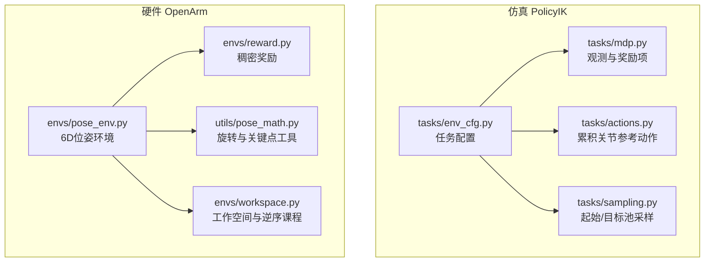
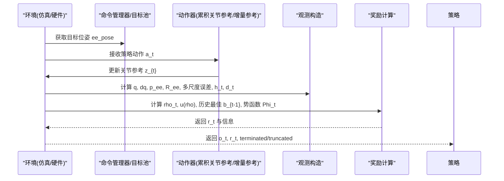
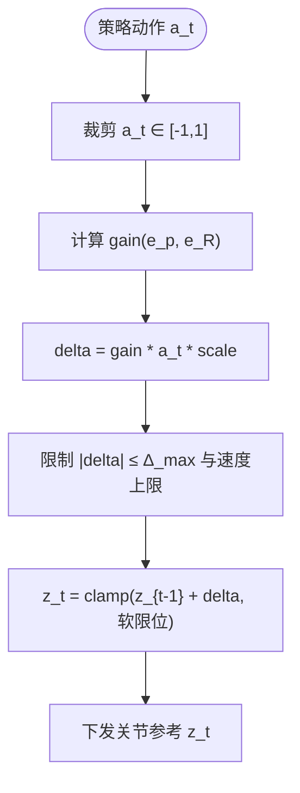
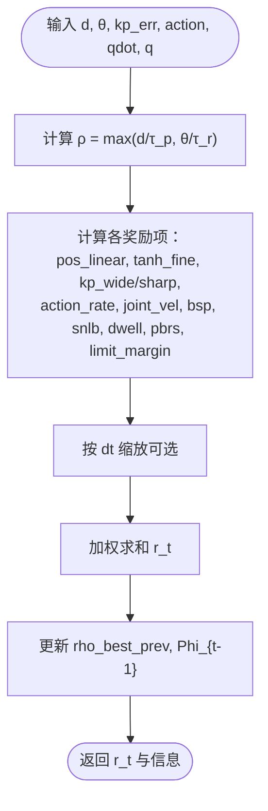
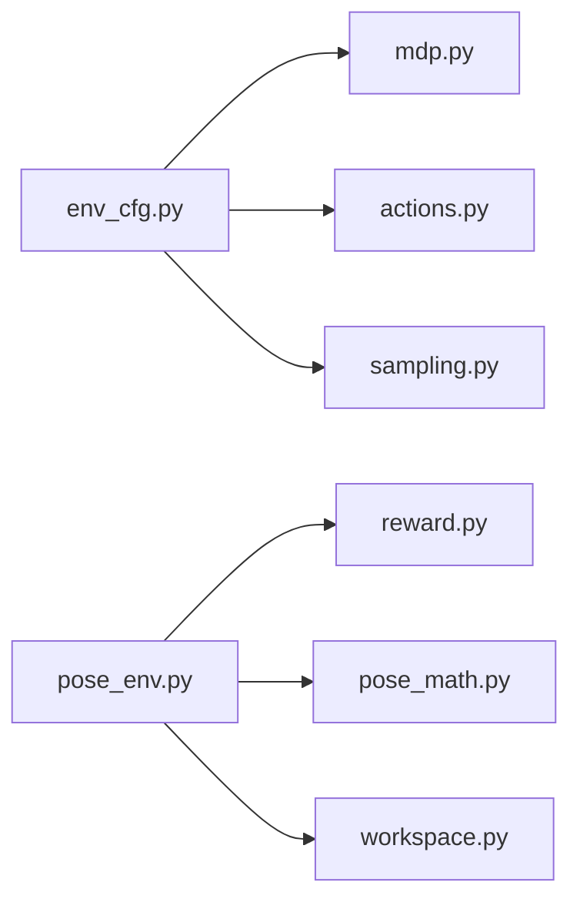

# MDP建模与任务定义

<cite>
**本文引用的文件**   
- [simulation/policyik_sim/tasks/mdp.py](file://simulation/policyik_sim/tasks/mdp.py)
- [simulation/policyik_sim/tasks/env_cfg.py](file://simulation/policyik_sim/tasks/env_cfg.py)
- [simulation/policyik_sim/tasks/actions.py](file://simulation/policyik_sim/tasks/actions.py)
- [simulation/policyik_sim/tasks/sampling.py](file://simulation/policyik_sim/tasks/sampling.py)
- [hardware/policyik_hw/envs/pose_env.py](file://hardware/policyik_hw/envs/pose_env.py)
- [hardware/policyik_hw/envs/reward.py](file://hardware/policyik_hw/envs/reward.py)
- [hardware/policyik_hw/utils/pose_math.py](file://hardware/policyik_hw/utils/pose_math.py)
- [hardware/policyik_hw/envs/workspace.py](file://hardware/policyik_hw/envs/workspace.py)
</cite>

## 目录
1. [引言](#引言)
2. [项目结构](#项目结构)
3. [核心组件](#核心组件)
4. [架构总览](#架构总览)
5. [详细组件分析](#详细组件分析)
6. [依赖关系分析](#依赖关系分析)
7. [性能考虑](#性能考虑)
8. [故障排查指南](#故障排查指南)
9. [结论](#结论)
10. [附录：MDP参数调优指南](#附录mdp参数调优指南)

## 引言
本技术文档围绕OpenArm机械臂的6D位姿控制任务，系统阐述基于Markov决策过程（MDP）的建模方式。内容涵盖状态空间设计、动作空间映射、奖励函数实现，并深入解释关键函数如keypoint_error_tanh、ee_position_error_obs、ee_orientation_error_obs等的数学原理与实现细节。同时说明多尺度误差计算、历史误差跟踪、命令状态反馈等高级概念，并提供MDP参数调优与性能优化建议，帮助读者在仿真与真实硬件上稳定训练和部署策略。

## 项目结构
本项目分为仿真与硬件两套环境：
- 仿真侧使用Isaac Lab构建PolicyIK任务，包含MDP观测与奖励项、累积关节参考动作、从池采样起始位姿和目标位姿等模块。
- 硬件侧提供Gymnasium风格的OpenArmPoseEnv，封装了真实机械臂的观测构造、动作执行、碰撞与安全保护、以及稠密奖励计算。

**图表来源**
- [simulation/policyik_sim/tasks/env_cfg.py:27-112](file://simulation/policyik_sim/tasks/env_cfg.py#L27-L112)
- [hardware/policyik_hw/envs/pose_env.py:206-256](file://hardware/policyik_hw/envs/pose_env.py#L206-L256)

**章节来源**
- [simulation/policyik_sim/tasks/env_cfg.py:1-134](file://simulation/policyik_sim/tasks/env_cfg.py#L1-L134)
- [hardware/policyik_hw/envs/pose_env.py:1-159](file://hardware/policyik_hw/envs/pose_env.py#L1-L159)

## 核心组件
- 观测与奖励项（仿真）：定义6D位姿误差、关键点跟踪、历史误差通道、命令状态反馈等。
- 累积关节参考动作（仿真）：将策略输出的归一化动作积分成关节参考，并根据当前误差自适应缩放步长。
- 池采样（仿真）：从预生成的起始位姿池与目标位姿池中均匀采样，支持可选的目标方向采样。
- 真实环境（硬件）：封装ROS/CAN通信、安全与碰撞检查、观测构造、奖励计算与课程学习。
- 奖励（硬件）：实现位置线性项、tanh精细项、关键点宽/窄核、动作平滑、关节速度惩罚、回退惩罚、停留奖励、势函数塑形、软限位边际成本等。
- 姿态数学工具（硬件）：提供旋转矩阵到6D表示、轴角误差、关键点误差等基础运算。
- 工作空间与课程（硬件）：生成可达工作空间点云、碰撞包络、逆序课程以逐步增加初始扰动。

**章节来源**
- [simulation/policyik_sim/tasks/mdp.py:25-232](file://simulation/policyik_sim/tasks/mdp.py#L25-L232)
- [simulation/policyik_sim/tasks/actions.py:15-76](file://simulation/policyik_sim/tasks/actions.py#L15-L76)
- [simulation/policyik_sim/tasks/sampling.py:19-69](file://simulation/policyik_sim/tasks/sampling.py#L19-L69)
- [hardware/policyik_hw/envs/pose_env.py:206-544](file://hardware/policyik_hw/envs/pose_env.py#L206-L544)
- [hardware/policyik_hw/envs/reward.py:23-184](file://hardware/policyik_hw/envs/reward.py#L23-L184)
- [hardware/policyik_hw/utils/pose_math.py:12-125](file://hardware/policyik_hw/utils/pose_math.py#L12-L125)
- [hardware/policyik_hw/envs/workspace.py:14-252](file://hardware/policyik_hw/envs/workspace.py#L14-L252)

## 架构总览
PolicyIK的MDP由“观测—动作—奖励”三部分组成，仿真与硬件分别实现但保持语义一致：
- 观测：包含关节偏差与速度、目标位姿、多尺度位置与方向误差、关键点偏移、历史误差通道、命令状态反馈、上一动作等。
- 动作：仿真采用累积关节参考动作；硬件采用带误差依赖增益的关节增量参考。
- 奖励：仿真通过Isaac Lab RewardTerm组合多个项；硬件通过PoseReward统一计算并输出信息字典。

**图表来源**
- [simulation/policyik_sim/tasks/env_cfg.py:60-112](file://simulation/policyik_sim/tasks/env_cfg.py#L60-L112)
- [simulation/policyik_sim/tasks/actions.py:33-64](file://simulation/policyik_sim/tasks/actions.py#L33-L64)
- [hardware/policyik_hw/envs/pose_env.py:269-289](file://hardware/policyik_hw/envs/pose_env.py#L269-L289)
- [hardware/policyik_hw/envs/reward.py:106-146](file://hardware/policyik_hw/envs/reward.py#L106-L146)

## 详细组件分析

### 状态空间设计
- 基础观测：
  - 关节偏差与速度：q - q_default、dq。
  - 目标位姿：goal position (3)、goal orientation (6D或四元数)。
  - 多尺度误差：粗粒度与细粒度的位置与方向误差，用于在不同距离范围内提供不同尺度的梯度信号。
  - 关键点偏移：三个附着于末端执行器的关键点在当前与目标位姿下的偏移向量（9维）。
  - 历史误差通道：h_t = [clip(b_{t-1}/d0, 0, 1), clip((rho_t - b_{t-1})/d0, 0, 1)]，其中b为历史最优rho，rho为归一化误差度量。
  - 命令状态反馈：d_t = z_{t-1} - q_t，反映动作积分器设定值与实测关节之间的差。
  - 上一动作：a_{t-1}，用于平滑与可微分性。

- 多尺度误差：
  - 位置误差：ee_position_error_obs对位置误差进行体坐标系投影并按d0裁剪至[-1,1]。
  - 方向误差：ee_orientation_error_obs使用Log(R_ee^T R_goal)^vee得到轴角向量，按d0_rad裁剪。
  - 仿真中同时提供粗粒度(d0=0.01, d0_rad≈20°)与细粒度(d0=0.0005, d0_rad≈0.25°)两对通道。

- 历史误差跟踪：
  - tolerance_error_state维护每环境的rho_t、b_{t-1}与重置标志reset，当episode开始或目标变化时重置。
  - error_history_obs输出h_t，作为观测的一部分，帮助策略感知收敛进度与是否发生回退。

- 命令状态反馈：
  - command_state_obs读取动作项的内部目标z_{t-1}与当前关节q_t之差，提供积分器可见性，有助于提高稳定性与收敛速度。

**章节来源**
- [simulation/policyik_sim/tasks/mdp.py:37-160](file://simulation/policyik_sim/tasks/mdp.py#L37-L160)
- [simulation/policyik_sim/tasks/mdp.py:225-232](file://simulation/policyik_sim/tasks/mdp.py#L225-L232)
- [simulation/policyik_sim/tasks/env_cfg.py:60-83](file://simulation/policyik_sim/tasks/env_cfg.py#L60-L83)
- [hardware/policyik_hw/envs/pose_env.py:269-289](file://hardware/policyik_hw/envs/pose_env.py#L269-L289)

### 动作空间映射
- 仿真：AccumulatedJointReferenceAction将策略输出的归一化动作a_t累积为关节参考z_t，并根据当前位置与方向误差自适应调整步长gain∈[g_min,1]。
  - gain由位置误差d与方向误差θ共同决定，形成双通道斜坡函数，确保远距离大步进、近距离小步进。
  - 内部目标z_t被软限位限制，避免超出关节范围。
- 硬件：OpenArmPoseEnv.step中对策略动作进行裁剪、乘以action_scale_rad与误差依赖的gain，再限制最大关节增量与速度上限，最后写入机器人控制器。

**图表来源**
- [simulation/policyik_sim/tasks/actions.py:33-64](file://simulation/policyik_sim/tasks/actions.py#L33-L64)
- [hardware/policyik_hw/envs/pose_env.py:386-459](file://hardware/policyik_hw/envs/pose_env.py#L386-L459)

**章节来源**
- [simulation/policyik_sim/tasks/actions.py:15-76](file://simulation/policyik_sim/tasks/actions.py#L15-L76)
- [hardware/policyik_hw/envs/pose_env.py:386-459](file://hardware/policyik_hw/envs/pose_env.py#L386-L459)

### 奖励函数实现
- 归一化误差度量rho：
  - rho = max(e_p / τ_p, e_R / τ_r)，其中e_p为位置误差，e_R为方向误差（弧度），τ_p与τ_r为阈值。
- 关键点跟踪奖励：
  - keypoint_error_tanh使用三个关键点欧氏距离均值ε，奖励为1 - tanh(ε/std)，std控制核宽度。
- 改进奖励（SNLB）：
  - improvement_reward = [U(ρ_t) - U(b_{t-1})]_+，U(ρ)=0.5*(1+tanh((1-ρ)/β))，仅在目标未变化时生效。
- 势函数塑形（PBRS）：
  - potential_shaping = γ·Φ_t - Φ_{t-1}，Φ = -min(cap, ρ)，目标变化时置零。
- 回退惩罚：
  - backslide_penalty = -min(cap, [ρ_t - b_{t-1}]_+)，防止误差回退。
- 停留奖励：
  - dwell_reward = 1[ρ_t ≤ ρ_max]，鼓励进入容差区域后保持稳定。
- 关节软限位边际成本：
  - joint_margin_cost根据关节到软限位的归一化距离计算惩罚，并在ρ超过门限时激活。

硬件端PoseReward实现了上述各项，并以dt缩放（可选），输出加权项与总奖励，同时维护rho_best_prev与Phi_{t-1}等历史状态。

**图表来源**
- [hardware/policyik_hw/envs/reward.py:106-146](file://hardware/policyik_hw/envs/reward.py#L106-L146)
- [simulation/policyik_sim/tasks/mdp.py:163-222](file://simulation/policyik_sim/tasks/mdp.py#L163-L222)

**章节来源**
- [hardware/policyik_hw/envs/reward.py:23-184](file://hardware/policyik_hw/envs/reward.py#L23-L184)
- [simulation/policyik_sim/tasks/mdp.py:115-222](file://simulation/policyik_sim/tasks/mdp.py#L115-L222)

### 关键函数数学原理与实现细节

#### keypoint_error_tanh
- 目的：用三个附着于末端执行器的关键点距离均值ε衡量跟踪质量，并通过tanh核给出平滑奖励。
- 数学：
  - 关键点偏移offs = kp_size·I（或zero_sum中心化版本）。
  - 当前关键点kp_cur = p_ee + R_ee·offs，目标关键点kp_des = p_goal + R_goal·offs。
  - ε = mean(||kp_cur - kp_des||_2)。
  - 奖励 = 1 - tanh(ε / std)。
- 实现要点：
  - 在基坐标系下计算世界坐标的关键点，然后转换到根坐标系以消除全局旋转影响。
  - zero_sum选项对offs进行中心化，减少偏置。

**章节来源**
- [simulation/policyik_sim/tasks/mdp.py:65-89](file://simulation/policyik_sim/tasks/mdp.py#L65-L89)
- [hardware/policyik_hw/utils/pose_math.py:45-58](file://hardware/policyik_hw/utils/pose_math.py#L45-L58)

#### ee_position_error_obs
- 目的：输出体坐标系下的位置误差，裁剪至[-1,1]，提供多尺度位置信号。
- 数学：
  - err_body = R_ee^T · (p_goal - p_ee)。
  - 输出 = clip(err_body / d0, -1, 1)。
- 实现要点：
  - 使用四元数共轭将世界坐标差变换到末端体坐标系。
  - d0控制尺度，仿真中提供粗/细两档。

**章节来源**
- [simulation/policyik_sim/tasks/mdp.py:92-101](file://simulation/policyik_sim/tasks/mdp.py#L92-L101)
- [simulation/policyik_sim/tasks/env_cfg.py:72-83](file://simulation/policyik_sim/tasks/env_cfg.py#L72-L83)

#### ee_orientation_error_obs
- 目的：输出体坐标系下的方向误差（轴角向量），裁剪至[-1,1]。
- 数学：
  - φ = Log(R_ee^T R_goal)^vee（最短路径轴角）。
  - 输出 = clip(φ / d0_rad, -1, 1)。
- 实现要点：
  - quat_error_rotvec_body实现四元数相对旋转到轴角的映射，处理接近π与0的数值稳定性。
  - d0_rad控制角度尺度，仿真中提供粗/细两档。

**章节来源**
- [simulation/policyik_sim/tasks/mdp.py:25-34](file://simulation/policyik_sim/tasks/mdp.py#L25-L34)
- [simulation/policyik_sim/tasks/mdp.py:104-112](file://simulation/policyik_sim/tasks/mdp.py#L104-L112)

#### 多尺度误差与历史误差
- 多尺度误差：
  - 通过不同的d0与d0_rad提供粗/细两档位置与方向误差，使策略在大误差时获得强梯度、在小误差时获得精细调节。
- 历史误差：
  - tolerance_error_state维护rho_t与b_{t-1}，error_history_obs输出h_t，帮助策略识别收敛阶段与回退事件。

**章节来源**
- [simulation/policyik_sim/tasks/mdp.py:115-160](file://simulation/policyik_sim/tasks/mdp.py#L115-L160)
- [hardware/policyik_hw/envs/reward.py:18-21](file://hardware/policyik_hw/envs/reward.py#L18-L21)

#### 命令状态反馈
- 目的：暴露动作积分器的设定值与当前关节的差d_t，提升策略的可控性与稳定性。
- 实现：command_state_obs读取动作项的_int_target与当前关节位置差。

**章节来源**
- [simulation/policyik_sim/tasks/mdp.py:225-232](file://simulation/policyik_sim/tasks/mdp.py#L225-L232)
- [simulation/policyik_sim/tasks/actions.py:22-23](file://simulation/policyik_sim/tasks/actions.py#L22-L23)

## 依赖关系分析
- 仿真任务配置(env_cfg)依赖mdp中的观测与奖励项，actions中的累积关节参考动作，sampling中的池采样。
- 硬件环境(pose_env)依赖reward中的稠密奖励、pose_math中的姿态数学工具、workspace中的工作空间与课程。
- 两者通过一致的MDP语义对齐：rho、h_t、d_t、关键点误差等概念在仿真与硬件中保持一致。

**图表来源**
- [simulation/policyik_sim/tasks/env_cfg.py:18-20](file://simulation/policyik_sim/tasks/env_cfg.py#L18-L20)
- [hardware/policyik_hw/envs/pose_env.py:12-16](file://hardware/policyik_hw/envs/pose_env.py#L12-L16)

**章节来源**
- [simulation/policyik_sim/tasks/env_cfg.py:1-134](file://simulation/policyik_sim/tasks/env_cfg.py#L1-L134)
- [hardware/policyik_hw/envs/pose_env.py:1-159](file://hardware/policyik_hw/envs/pose_env.py#L1-L159)

## 性能考虑
- 向量化与批处理：
  - 仿真侧大量使用torch张量操作，避免Python循环，提升并行效率。
  - 关键点误差与旋转误差均批量计算，注意维度广播与数值稳定性（如除零保护）。
- 数值稳定性：
  - 四元数乘法与共轭、轴角映射需处理接近0与π的情况，避免奇异。
  - 裁剪与clamp用于保证观测与奖励有界，利于RL算法稳定训练。
- 时间步缩放：
  - 硬件奖励可按dt缩放，确保不同控制频率下奖励尺度一致。
- 动作平滑与速度限制：
  - 通过动作速率惩罚与关节速度惩罚抑制高频抖动，提高硬件安全性与寿命。

[本节为通用指导，不直接分析具体文件]

## 故障排查指南
- 硬件健康与状态冻结：
  - pose_env在电机健康检查失败或关节状态长时间不变时会抛出异常，提示检查CAN接口与驱动。
- 碰撞保护：
  - workspace.config_ok与config_margin用于检测自碰撞与外部障碍，连续阻塞会触发截断或终止。
- 命令与观测一致性：
  - 若command_state_obs报错，检查动作项是否保存_int_target与joint_ids。
- 奖励项权重异常：
  - 若训练发散，检查w_bsp、w_snlb、w_dwell、w_pbrs等权重符号与大小，确保与agent gamma一致（PBRS要求gamma匹配）。

**章节来源**
- [hardware/policyik_hw/envs/pose_env.py:393-421](file://hardware/policyik_hw/envs/pose_env.py#L393-L421)
- [hardware/policyik_hw/envs/workspace.py:122-175](file://hardware/policyik_hw/envs/workspace.py#L122-L175)
- [simulation/policyik_sim/tasks/mdp.py:225-232](file://simulation/policyik_sim/tasks/mdp.py#L225-L232)
- [hardware/policyik_hw/envs/reward.py:60-73](file://hardware/policyik_hw/envs/reward.py#L60-L73)

## 结论
PolicyIK通过一致的MDP建模在仿真与硬件之间桥接，利用多尺度误差、历史误差通道与命令状态反馈增强策略的可学习性与鲁棒性。关键点跟踪核、改进奖励、势函数塑形与回退惩罚共同构成稠密且稳定的奖励信号。累积关节参考动作与误差依赖增益确保动作执行的平滑与安全。通过合理调参与性能优化，可在OpenArm上实现可靠的6D位姿控制。

[本节为总结，不直接分析具体文件]

## 附录：MDP参数调优指南

### 观测与奖励参数
- 多尺度误差尺度：
  - d0与d0_rad：粗尺度用于快速收敛，细尺度用于精细定位。建议先调粗尺度，再引入细尺度。
- 关键点核宽度std：
  - std_kp_wide与std_kp_sharp：宽核提供早期探索信号，窄核提供后期精修。建议从0.20与0.05起步。
- 历史误差通道d0：
  - rho_obs_d0：控制h_t的尺度，过大可能饱和，过小可能噪声敏感。建议20~50。
- 改进奖励β：
  - tau_u或β：控制U(ρ)的平滑度，较大更平滑但信号弱，较小更尖锐但易震荡。建议0.5左右。
- PBRS参数：
  - pbrs_gamma需与agent gamma一致；cap控制势函数上界，避免过大导致不稳定。
- 回退惩罚cap：
  - bsp_cap：限制单次回退惩罚幅度，避免过大导致策略崩溃。

### 动作参数
- 累积动作增益：
  - g_min、d_lo、d_hi、ori_lo_deg、ori_hi_deg：控制远/近距步长比例。建议g_min≈0.1，d_lo≈0.0005，d_hi≈0.00931，角度阈值从0.4°~2.3°起步。
- 硬件动作缩放：
  - action_scale_rad与max_joint_delta_rad、max_joint_velocity_rad_s：确保动作幅值与速度在硬件安全范围内。

### 工作空间与课程
- 工作空间半径r_goal与样本数n_samples：
  - 覆盖目标部署区域，样本数足够以避免稀疏性。
- 逆序课程sigma_schedule：
  - sigma_lo_deg与schedule逐步增大初始扰动，帮助策略泛化。

### 调试建议
- 逐步启用奖励项：
  - 先启用kp_wide与tanh_fine，再添加snlb、pbrs、dwell与limit_margin。
- 监控rho与h_t：
  - 观察rho是否单调下降，h_t是否出现回退峰值，据此调整权重与尺度。
- 硬件安全优先：
  - 开启collision_guard与health_guard，必要时设置collision_terminate以立即停止危险行为。

[本节为通用指导，不直接分析具体文件]
