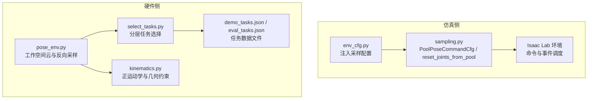
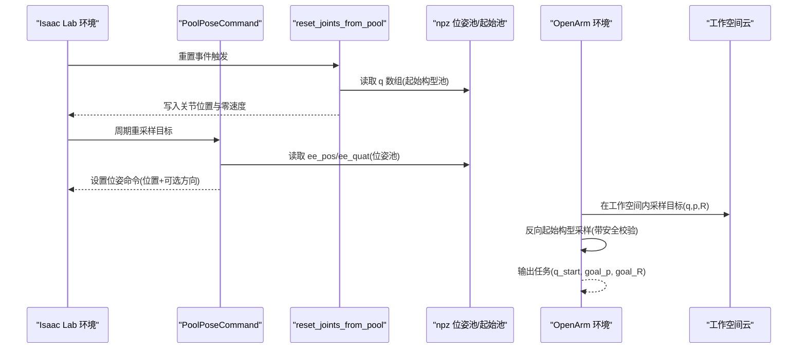
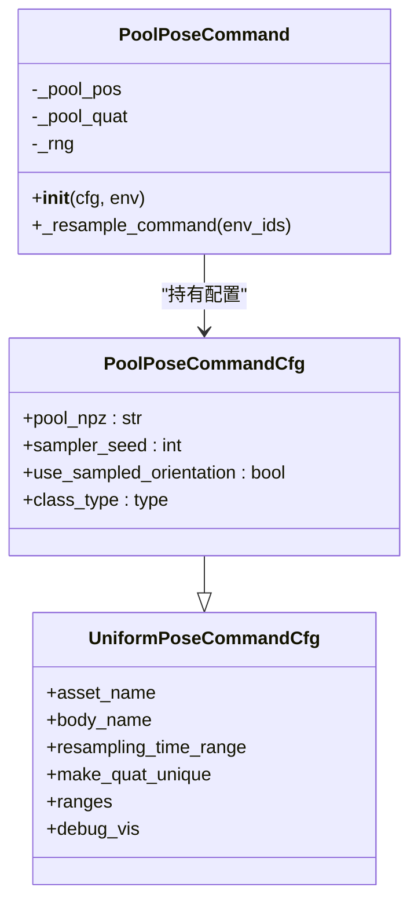
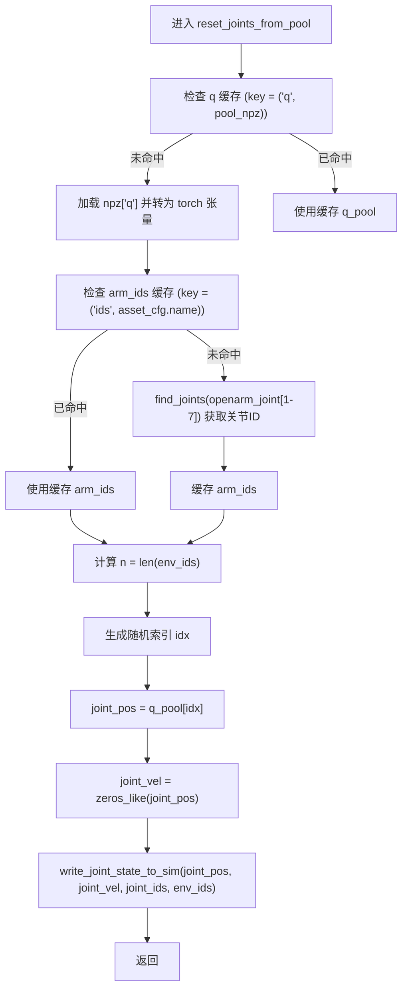
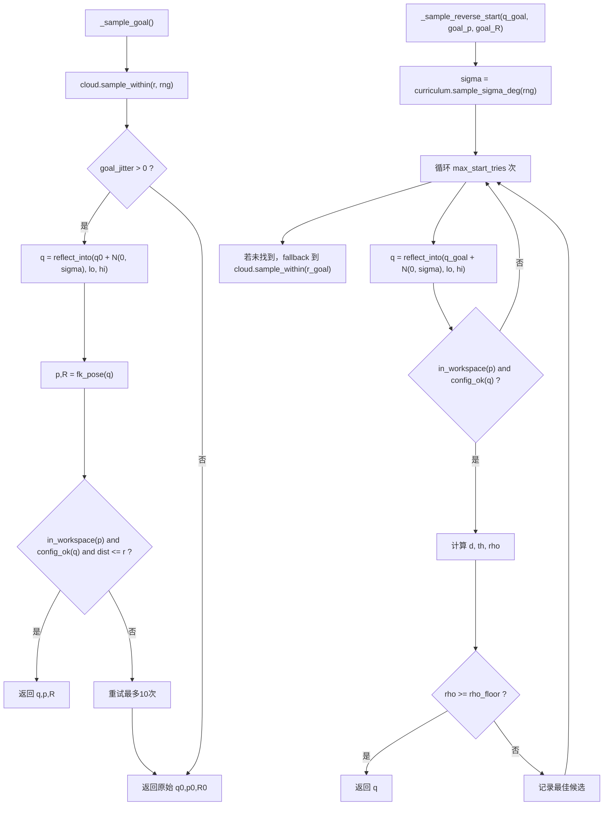
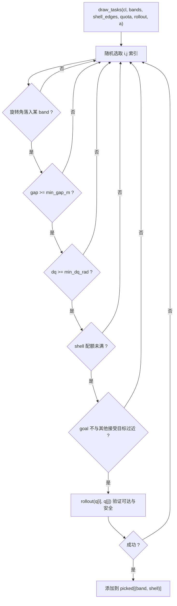
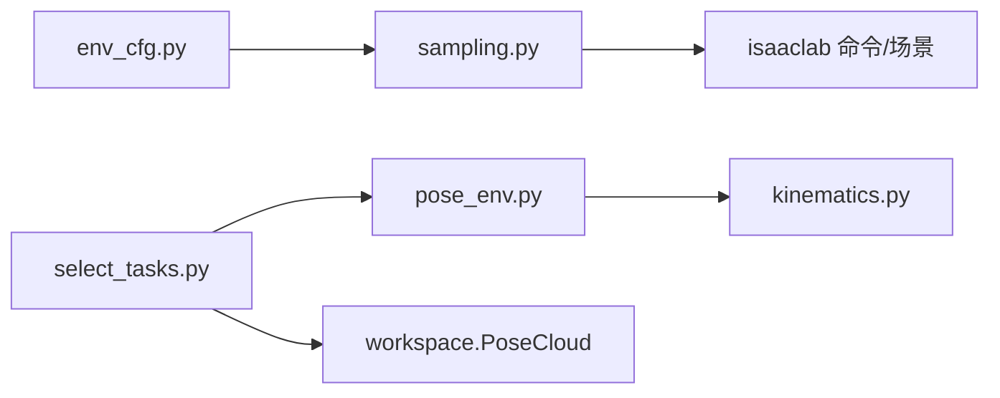
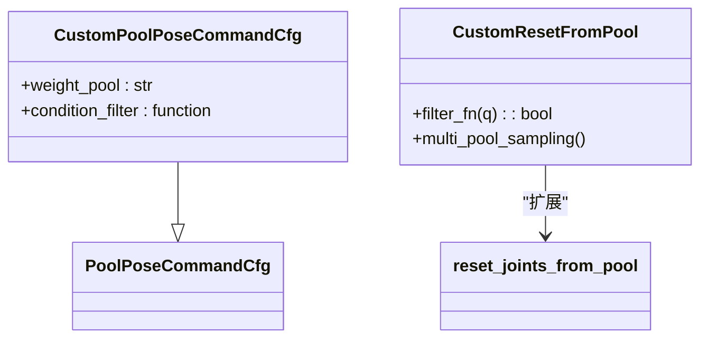

# 任务采样策略

<cite>
**本文引用的文件**   
- [sampling.py](file://simulation/policyik_sim/tasks/sampling.py)
- [env_cfg.py](file://simulation/policyik_sim/tasks/env_cfg.py)
- [pose_env.py](file://hardware/policyik_hw/envs/pose_env.py)
- [select_tasks.py](file://hardware/policyik_hw/select_tasks.py)
- [demo_tasks.json](file://hardware/data/demo_tasks.json)
- [eval_tasks.json](file://hardware/data/eval_tasks.json)
- [kinematics.py](file://hardware/policyik_hw/utils/kinematics.py)
</cite>

## 目录
1. [引言](#引言)
2. [项目结构](#项目结构)
3. [核心组件](#核心组件)
4. [架构总览](#架构总览)
5. [详细组件分析](#详细组件分析)
6. [依赖关系分析](#依赖关系分析)
7. [性能与复杂度](#性能与复杂度)
8. [参数调优指南](#参数调优指南)
9. [自定义采样策略开发](#自定义采样策略开发)
10. [故障排查](#故障排查)
11. [结论](#结论)

## 引言
本技术文档围绕“任务采样策略系统”展开，重点解释以下目标：
- PoolPoseCommandCfg 与 reset_joints_from_pool 的实现机制。
- 目标位姿池管理、起始构型采样、工作空间分布控制。
- 采样算法的数学原理、均匀性保证、边界处理。
- 训练数据与评估数据的分离策略、数据文件格式与加载机制。
- 采样参数调优指南与自定义采样策略开发方法。

该系统在仿真侧通过 Isaac Lab 的任务配置注入采样命令和重置事件；在硬件侧通过 OpenArm 环境实现基于工作空间云的反向起始构型采样与轨迹回放式任务选择。两者共同构成从“预生成池”到“在线采样”的完整闭环。

## 项目结构
与本主题直接相关的代码与数据分布如下：
- 仿真任务采样与配置：
  - simulation/policyik_sim/tasks/sampling.py：定义 PoolPoseCommandCfg、PoolPoseCommand 与 reset_joints_from_pool。
  - simulation/policyik_sim/tasks/env_cfg.py：将采样器注入到 Isaac Lab 环境中，并区分训练与评估的数据池路径。
- 硬件环境与任务选择：
  - hardware/policyik_hw/envs/pose_env.py：OpenArm 6-D 位姿环境，包含工作空间云、反向起始构型采样、反射边界处理等。
  - hardware/policyik_hw/select_tasks.py：从工作空间云中分层抽样大旋转演示任务，输出 demo_tasks.json。
  - hardware/data/demo_tasks.json / eval_tasks.json：演示与评估任务数据文件。
  - hardware/policyik_hw/utils/kinematics.py：OpenArm 正运动学工具，供工作空间构建与验证使用。

图表来源
- [env_cfg.py:27-44](file://simulation/policyik_sim/tasks/env_cfg.py#L27-L44)
- [sampling.py:19-68](file://simulation/policyik_sim/tasks/sampling.py#L19-L68)
- [pose_env.py:168-196](file://hardware/policyik_hw/envs/pose_env.py#L168-L196)
- [select_tasks.py:70-114](file://hardware/policyik_hw/select_tasks.py#L70-L114)
- [kinematics.py:81-129](file://hardware/policyik_hw/utils/kinematics.py#L81-L129)

章节来源
- [env_cfg.py:27-44](file://simulation/policyik_sim/tasks/env_cfg.py#L27-L44)
- [sampling.py:19-68](file://simulation/policyik_sim/tasks/sampling.py#L19-L68)
- [pose_env.py:168-196](file://hardware/policyik_hw/envs/pose_env.py#L168-L196)
- [select_tasks.py:70-114](file://hardware/policyik_hw/select_tasks.py#L70-L114)
- [kinematics.py:81-129](file://hardware/policyik_hw/utils/kinematics.py#L81-L129)

## 核心组件
本节聚焦两个关键实现：
- PoolPoseCommandCfg：以池化方式提供末端执行器位姿目标（位置与可选方向）。
- reset_joints_from_pool：在重置事件中从预生成的起始构型池中均匀抽取机器人关节初始状态。

此外，硬件侧 pose_env.py 中的工作空间云与反向起始构型采样提供了另一种“在线”采样范式，用于演示任务选择与真实环境评估。

章节来源
- [sampling.py:40-68](file://simulation/policyik_sim/tasks/sampling.py#L40-L68)
- [sampling.py:19-37](file://simulation/policyik_sim/tasks/sampling.py#L19-L37)
- [pose_env.py:349-384](file://hardware/policyik_hw/envs/pose_env.py#L349-L384)

## 架构总览
下图展示仿真侧与硬件侧的采样流程与数据流：

图表来源
- [env_cfg.py:27-44](file://simulation/policyik_sim/tasks/env_cfg.py#L27-L44)
- [sampling.py:19-68](file://simulation/policyik_sim/tasks/sampling.py#L19-L68)
- [pose_env.py:349-384](file://hardware/policyik_hw/envs/pose_env.py#L349-L384)

## 详细组件分析

### PoolPoseCommandCfg 与 PoolPoseCommand
- 设计目标：
  - 将末端位姿目标限制为从预生成池行中均匀抽取，避免连续空间随机导致的分布偏差。
  - 支持可选的方向采样，保持位置与方向来自同一行，确保一致性。
- 关键行为：
  - 初始化时加载 npz 文件，缓存 ee_pos 与 ee_quat。
  - 重采样时按 env_ids 数量生成整数索引，批量取出行向量，并写入命令缓冲区。
  - use_sampled_orientation 控制是否同时更新方向部分。
- 配置项：
  - pool_npz：位姿池文件路径。
  - sampler_seed：采样随机种子。
  - use_sampled_orientation：是否启用方向采样。

图表来源
- [sampling.py:40-68](file://simulation/policyik_sim/tasks/sampling.py#L40-L68)

章节来源
- [sampling.py:40-68](file://simulation/policyik_sim/tasks/sampling.py#L40-L68)

### reset_joints_from_pool
- 设计目标：
  - 在环境重置阶段，从预生成的起始构型池均匀抽取机器人关节初始状态，并将速度置零。
- 关键行为：
  - 按 pool_npz 键缓存 q 数组，按 asset_cfg.name 缓存机械臂关节 ID。
  - 对每个 env_ids 生成随机索引，批量取出对应行作为 joint_pos，并写回仿真。
- 性能优化：
  - 全局 _CACHE 避免重复加载 npz 与重复查询关节 ID。
  - 批量操作减少调用开销。

图表来源
- [sampling.py:19-37](file://simulation/policyik_sim/tasks/sampling.py#L19-L37)

章节来源
- [sampling.py:19-37](file://simulation/policyik_sim/tasks/sampling.py#L19-L37)

### 工作空间分布控制与反向起始构型采样（硬件侧）
- 工作空间云：
  - PoseCloud 根据 EnvConfig 构造，包含 r_goal、n_samples、joint_halfwidth_deg、centre_m 等参数，用于在工作空间内采样可行位姿。
- 目标采样：
  - _sample_goal 从云中选择满足半径 r_goal 的目标 (q0, p0, R0)，并可加入高斯抖动与反射边界处理。
- 反向起始构型采样：
  - _sample_reverse_start 以目标构型为中心加噪声生成候选起始构型，进行工作空间与安全校验，并按奖励势函数 rho 筛选。
- 反射边界处理：
  - reflect_into 将越界关节值折叠回合法区间，而非简单截断，有助于维持分布均匀性。

图表来源
- [pose_env.py:199-203](file://hardware/policyik_hw/envs/pose_env.py#L199-L203)
- [pose_env.py:349-384](file://hardware/policyik_hw/envs/pose_env.py#L349-L384)

章节来源
- [pose_env.py:199-203](file://hardware/policyik_hw/envs/pose_env.py#L199-L203)
- [pose_env.py:349-384](file://hardware/policyik_hw/envs/pose_env.py#L349-L384)

### 任务选择与数据文件格式
- select_tasks.py：
  - 从 PoseCloud 中按旋转角度区间与径向壳层进行分层抽样，确保覆盖不同旋转范围与工作空间区域。
  - 离线回放 env 的动作律（gain=1），验证可达性与安全性（关节裕度、包络间隙、工作空间约束、步数上限）。
  - 输出 demo_tasks.json，字段包括 trial_id、q_start、q_goal、goal_p、goal_R、gap_m、rot_deg 等。
- 数据文件：
  - demo_tasks.json：演示任务集合，强调大旋转与可回放性。
  - eval_tasks.json：评估任务集合，通常更简洁，包含 q_start、goal_p、goal_R 与 gap_m。

图表来源
- [select_tasks.py:70-114](file://hardware/policyik_hw/select_tasks.py#L70-L114)

章节来源
- [select_tasks.py:70-114](file://hardware/policyik_hw/select_tasks.py#L70-L114)
- [demo_tasks.json:1-800](file://hardware/data/demo_tasks.json#L1-L800)
- [eval_tasks.json:1-800](file://hardware/data/eval_tasks.json#L1-L800)

## 依赖关系分析
- 仿真侧：
  - env_cfg.py 将 PoolPoseCommandCfg 注入 Isaac Lab 环境，并注册 reset_joints_from_pool 为重置事件。
  - sampling.py 依赖 isaaclab 的命令与场景实体配置，以及 numpy/torch 进行张量操作。
- 硬件侧：
  - pose_env.py 依赖 kinematics.py 的正运动学实现，用于 FK 计算与点集生成。
  - select_tasks.py 依赖 pose_env.py 的 EnvConfig 与 workspace.PoseCloud，以及 safety.joint_limits。

图表来源
- [env_cfg.py:27-44](file://simulation/policyik_sim/tasks/env_cfg.py#L27-L44)
- [sampling.py:19-68](file://simulation/policyik_sim/tasks/sampling.py#L19-L68)
- [pose_env.py:168-196](file://hardware/policyik_hw/envs/pose_env.py#L168-L196)
- [select_tasks.py:152-199](file://hardware/policyik_hw/select_tasks.py#L152-L199)

章节来源
- [env_cfg.py:27-44](file://simulation/policyik_sim/tasks/env_cfg.py#L27-L44)
- [sampling.py:19-68](file://simulation/policyik_sim/tasks/sampling.py#L19-L68)
- [pose_env.py:168-196](file://hardware/policyik_hw/envs/pose_env.py#L168-L196)
- [select_tasks.py:152-199](file://hardware/policyik_hw/select_tasks.py#L152-L199)

## 性能与复杂度
- 时间复杂度：
  - reset_joints_from_pool：O(n) 生成索引与批量写入，其中 n 为 env_ids 数量。
  - PoolPoseCommand._resample_command：O(n) 生成索引与批量赋值。
  - 硬件侧 _sample_goal/_sample_reverse_start：每次尝试 O(1) FK 与安全检查，最多固定次数重试。
- 空间复杂度：
  - _CACHE 缓存 q_pool 与 arm_ids，避免重复 IO 与查询。
  - 位姿池与起始池以 npz 形式驻留内存，大小取决于池规模。
- 性能建议：
  - 增大池规模以提升分布覆盖，但需权衡内存占用。
  - 合理设置 resampling_time_range 与 use_sampled_orientation，避免不必要的方向重采样。

章节来源
- [sampling.py:19-68](file://simulation/policyik_sim/tasks/sampling.py#L19-L68)
- [pose_env.py:349-384](file://hardware/policyik_hw/envs/pose_env.py#L349-L384)

## 参数调优指南
- PoolPoseCommandCfg：
  - pool_npz：选择覆盖目标部署工作空间的位姿池，确保 ee_pos/ee_quat 的行一致。
  - sampler_seed：固定种子以保证实验可复现。
  - use_sampled_orientation：训练时开启以获得方向多样性；评估时可关闭以简化任务。
- reset_joints_from_pool：
  - start_pool.npz：起始构型池应覆盖关节极限附近与中间区域，避免集中在单一区域。
- 硬件侧 PoseCloud 与 EnvConfig：
  - r_goal：控制目标半径，影响可达性与任务难度。
  - cloud_samples/cloud_halfwidth_deg：控制工作空间云密度与关节半宽，影响分布均匀性。
  - centre_m/min_base_dist_m/link/tool 边界：控制工作空间几何约束，避免不可达或碰撞区域。
- select_tasks.py：
  - rot-bands/shells：调整旋转区间与径向壳层，平衡任务多样性与覆盖率。
  - min-gap-m/min-goal-sep-m/min-dq-rad：控制任务间距离与关节空间差异，提升泛化性。
  - limit-margin/clearance/max-steps：强化安全性与可达性约束。

章节来源
- [env_cfg.py:27-44](file://simulation/policyik_sim/tasks/env_cfg.py#L27-L44)
- [sampling.py:63-68](file://simulation/policyik_sim/tasks/sampling.py#L63-L68)
- [pose_env.py:46-118](file://hardware/policyik_hw/envs/pose_env.py#L46-L118)
- [select_tasks.py:19-41](file://hardware/policyik_hw/select_tasks.py#L19-L41)

## 自定义采样策略开发
- 扩展 PoolPoseCommandCfg：
  - 继承 UniformPoseCommandCfg，新增自定义字段（如权重池、条件过滤）。
  - 重写 _resample_command，实现加权采样或条件拒绝采样。
- 扩展 reset_joints_from_pool：
  - 增加起始构型过滤逻辑（例如按关节裕度或工作空间可达性筛选）。
  - 支持多池混合采样，按概率分配各池样本。
- 硬件侧自定义：
  - 修改 _sample_goal/_sample_reverse_start，引入新的分布模型（如核密度估计引导）。
  - 扩展 reflect_into 以支持非对称边界或软约束。

图表来源
- [sampling.py:63-68](file://simulation/policyik_sim/tasks/sampling.py#L63-L68)
- [sampling.py:19-37](file://simulation/policyik_sim/tasks/sampling.py#L19-L37)

章节来源
- [sampling.py:19-68](file://simulation/policyik_sim/tasks/sampling.py#L19-L68)

## 故障排查
- 常见问题：
  - 关节状态冻结：硬件环境检测到关节状态长时间不变，抛出异常提示 CAN 接口问题。
  - 碰撞保护：连续步骤被碰撞守卫阻断，导致 episode 终止或截断。
  - 电机健康告警：health_check 返回 False 或 None，需检查电机状态与日志。
- 定位建议：
  - 检查 reset_joints_from_pool 是否正确写入关节位置与速度。
  - 确认位姿池与起始池的 npz 键名与维度匹配。
  - 验证 PoseCloud 的边界参数是否过于严格导致无解。

章节来源
- [pose_env.py:393-421](file://hardware/policyik_hw/envs/pose_env.py#L393-L421)
- [pose_env.py:447-501](file://hardware/policyik_hw/envs/pose_env.py#L447-L501)

## 结论
该任务采样策略系统在仿真侧通过 PoolPoseCommandCfg 与 reset_joints_from_pool 实现了从预生成池的均匀采样，并在硬件侧通过工作空间云与反向起始构型采样保证了任务的可达性与安全性。训练与评估数据通过不同的池与任务选择流程分离，确保了泛化能力与评估可靠性。通过合理的参数调优与自定义策略扩展，可进一步提升采样质量与任务多样性。