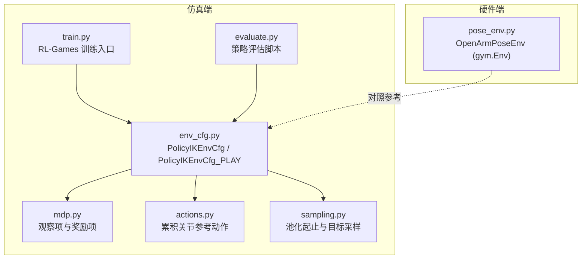
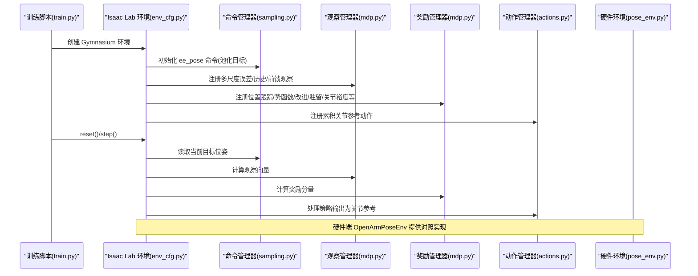
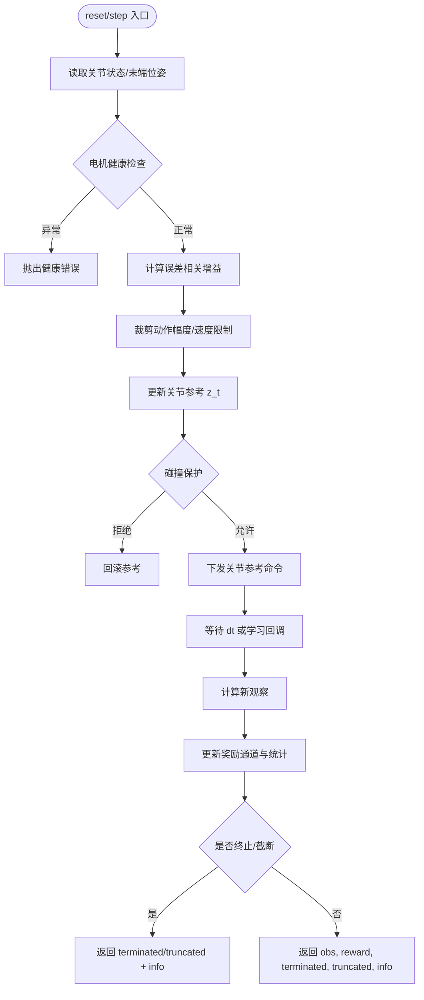
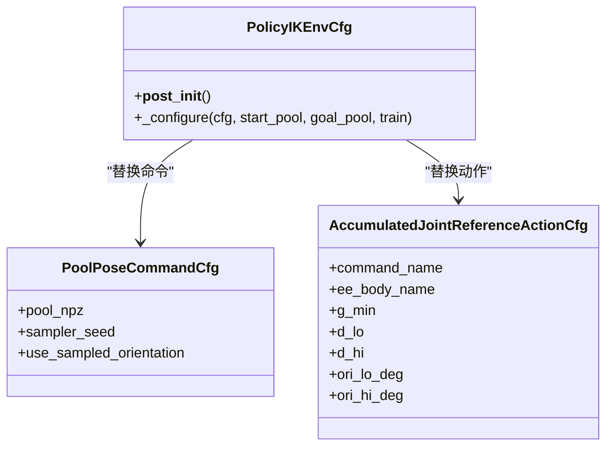
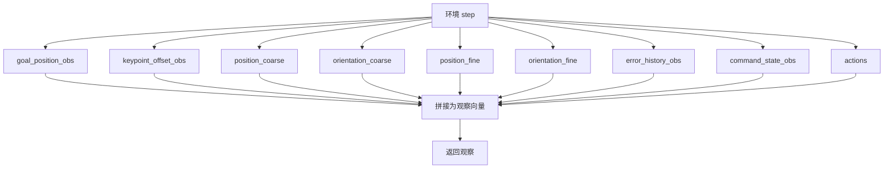
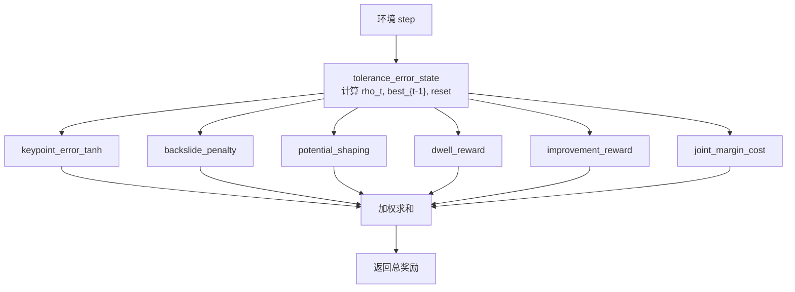
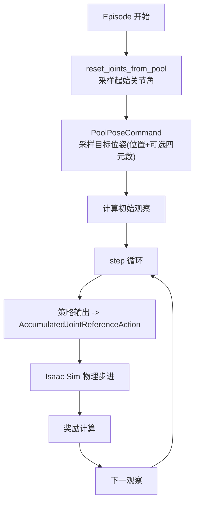
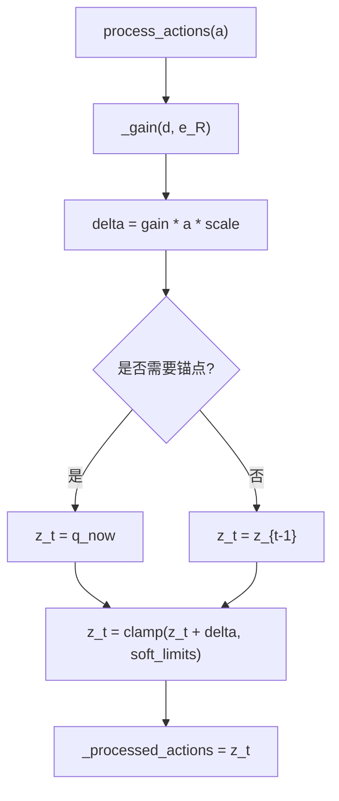
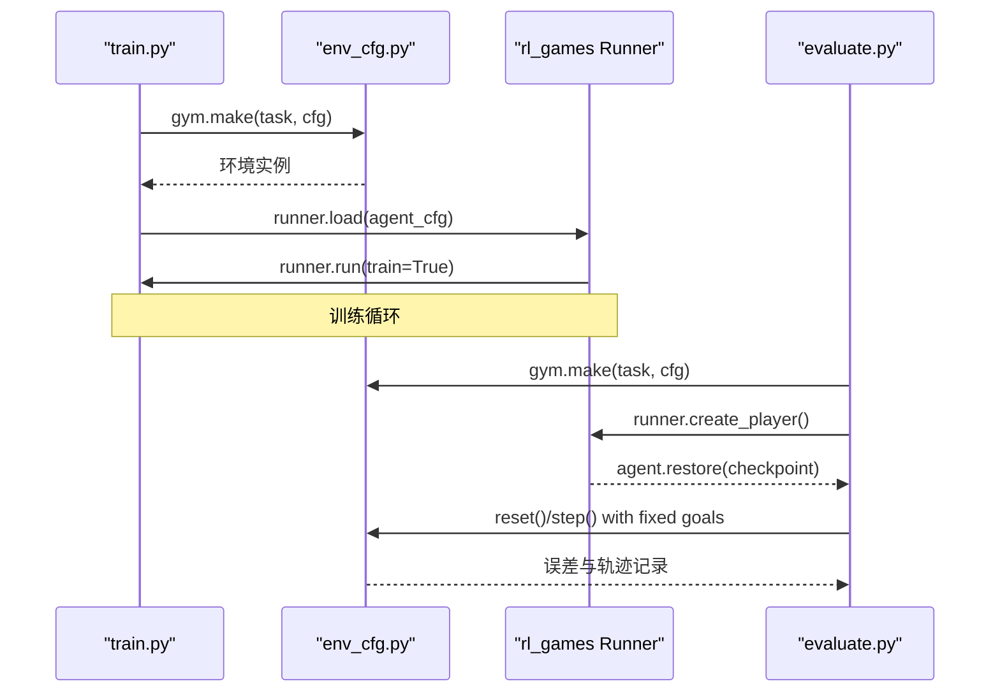
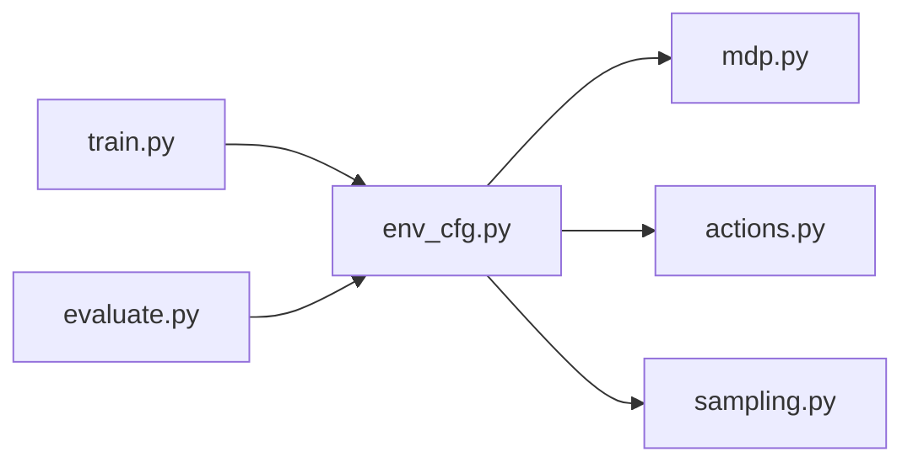

# 仿真环境

<cite>
**本文引用的文件**   
- [env_cfg.py](file://simulation/policyik_sim/tasks/env_cfg.py)
- [mdp.py](file://simulation/policyik_sim/tasks/mdp.py)
- [actions.py](file://simulation/policyik_sim/tasks/actions.py)
- [sampling.py](file://simulation/policyik_sim/tasks/sampling.py)
- [train.py](file://simulation/policyik_sim/train.py)
- [evaluate.py](file://simulation/policyik_sim/evaluate.py)
- [pose_env.py](file://hardware/policyik_hw/envs/pose_env.py)
</cite>

## 目录
1. [引言](#引言)
2. [项目结构](#项目结构)
3. [核心组件](#核心组件)
4. [架构总览](#架构总览)
5. [详细组件分析](#详细组件分析)
6. [依赖关系分析](#依赖关系分析)
7. [性能与稳定性考虑](#性能与稳定性考虑)
8. [故障排查指南](#故障排查指南)
9. [结论](#结论)
10. [附录：配置项与扩展指南](#附录配置项与扩展指南)

## 引言
本技术文档面向基于 Isaac Lab 的 PolicyIK 仿真任务，重点解释 OpenArmPoseEnv 类及其在硬件侧的实现，并系统梳理仿真侧的 Gymnasium 环境接口、观察空间设计、动作空间定义、奖励函数、MDP 建模、任务采样策略与动作映射。同时提供配置文件选项说明与自定义扩展指南，帮助读者快速理解并扩展该仿真环境。

## 项目结构
本项目包含硬件端与仿真端两套实现：
- 硬件端：OpenArmPoseEnv 直接对接真实机械臂，使用原生 gym.Env 接口，负责状态观测、动作执行、奖励计算与安全保护。
- 仿真端：基于 Isaac Lab Manager-Based RL 环境，通过 env_cfg.py 组合命令、观察、奖励、事件与动作；mdp.py 提供观察项与奖励项；actions.py 定义累积关节参考动作；sampling.py 提供从池子中采样起始位姿与目标位姿的能力；train.py 与 evaluate.py 分别负责训练与评估流程。

图表来源
- [env_cfg.py:27-132](file://simulation/policyik_sim/tasks/env_cfg.py#L27-L132)
- [mdp.py:37-231](file://simulation/policyik_sim/tasks/mdp.py#L37-L231)
- [actions.py:15-76](file://simulation/policyik_sim/tasks/actions.py#L15-L76)
- [sampling.py:19-68](file://simulation/policyik_sim/tasks/sampling.py#L19-L68)
- [train.py:103-206](file://simulation/policyik_sim/train.py#L103-L206)
- [evaluate.py:52-185](file://simulation/policyik_sim/evaluate.py#L52-L185)
- [pose_env.py:206-543](file://hardware/policyik_hw/envs/pose_env.py#L206-L543)

章节来源
- [env_cfg.py:27-132](file://simulation/policyik_sim/tasks/env_cfg.py#L27-L132)
- [mdp.py:37-231](file://simulation/policyik_sim/tasks/mdp.py#L37-L231)
- [actions.py:15-76](file://simulation/policyik_sim/tasks/actions.py#L15-L76)
- [sampling.py:19-68](file://simulation/policyik_sim/tasks/sampling.py#L19-L68)
- [train.py:103-206](file://simulation/policyik_sim/train.py#L103-L206)
- [evaluate.py:52-185](file://simulation/policyik_sim/evaluate.py#L52-L185)
- [pose_env.py:206-543](file://hardware/policyik_hw/envs/pose_env.py#L206-L543)

## 核心组件
- OpenArmPoseEnv（硬件端）：基于 gym.Env 的真实机械臂控制环境，封装了运动学、误差度量、奖励通道、安全保护、逆课程学习等逻辑。
- PolicyIKEnvCfg（仿真端）：继承自 openarm_isaac_lab 的 Reach 环境配置，注入池化起止与目标采样、多尺度误差观察、历史误差状态、势函数塑造、改进奖励、关节裕度惩罚、累积关节参考动作等。
- mdp.py：提供观察项与奖励项的具体实现，包括关键点跟踪、位置/姿态误差、误差历史、势函数塑形、回退惩罚、驻留奖励、关节裕度成本、指令状态反馈等。
- actions.py：累积关节参考动作，将策略输出的归一化动作映射为带自适应增益的关节参考增量，并维护内部积分目标。
- sampling.py：从预存 npz 池中均匀采样起始关节角与末端位姿（位置+可选四元数），支持训练时采样方向。
- train.py / evaluate.py：基于 RL-Games 的训练与评估入口，负责环境创建、向量化包装、策略加载与回放。

章节来源
- [pose_env.py:206-543](file://hardware/policyik_hw/envs/pose_env.py#L206-L543)
- [env_cfg.py:27-132](file://simulation/policyik_sim/tasks/env_cfg.py#L27-L132)
- [mdp.py:37-231](file://simulation/policyik_sim/tasks/mdp.py#L37-L231)
- [actions.py:15-76](file://simulation/policyik_sim/tasks/actions.py#L15-L76)
- [sampling.py:19-68](file://simulation/policyik_sim/tasks/sampling.py#L19-L68)
- [train.py:103-206](file://simulation/policyik_sim/train.py#L103-L206)
- [evaluate.py:52-185](file://simulation/policyik_sim/evaluate.py#L52-L185)

## 架构总览
下图展示仿真端与硬件端的环境交互与数据流。仿真端通过 Isaac Lab Manager-Based 环境装配命令、观察、奖励与动作；硬件端则直接管理 IO、运动学与奖励通道。

图表来源
- [train.py:103-206](file://simulation/policyik_sim/train.py#L103-L206)
- [env_cfg.py:27-132](file://simulation/policyik_sim/tasks/env_cfg.py#L27-L132)
- [sampling.py:40-68](file://simulation/policyik_sim/tasks/sampling.py#L40-L68)
- [mdp.py:37-231](file://simulation/policyik_sim/tasks/mdp.py#L37-L231)
- [actions.py:15-76](file://simulation/policyik_sim/tasks/actions.py#L15-L76)
- [pose_env.py:206-543](file://hardware/policyik_hw/envs/pose_env.py#L206-L543)

## 详细组件分析

### OpenArmPoseEnv（硬件端）
OpenArmPoseEnv 是硬件端的 Gymnasium 风格环境（继承自 gym.Env），负责：
- 初始化：验证配置、构建布局、逆运动学云、奖励函数、逆课程学习器、随机源、初始目标位姿等。
- 观察空间：拼接关节角、角速度、末端位姿、姿态表示、目标位姿、误差、关键点偏移、缩放观察、奖励通道、历史动作、参考前馈等。
- 动作空间：Box(-1, 1, N_JOINTS)，经增益调度、限幅、速度限制后转换为关节参考增量。
- 步推进：读取状态、健康检查、冻结状态检测、碰撞保护、命令下发、计时、奖励更新、终止/截断判定、统计汇总。
- 课程学习：根据 sigma 采样起始位姿，保证 rho 不低于阈值。

图表来源
- [pose_env.py:324-508](file://hardware/policyik_hw/envs/pose_env.py#L324-L508)

章节来源
- [pose_env.py:206-543](file://hardware/policyik_hw/envs/pose_env.py#L206-L543)

### 仿真端环境配置 PolicyIKEnvCfg
PolicyIKEnvCfg 继承自 openarm_isaac_lab 的 Reach 环境配置，并通过 _configure 注入以下关键能力：
- 命令：替换为 PoolPoseCommand，从 npz 池子中采样目标位姿（位置+可选四元数）。
- 事件：在 reset 时将机械臂关节重置为池子中的起始配置。
- 观察：
  - goal_position：目标位置（基座标系）。
  - keypoint_offsets：三个关键点相对于末端的偏移误差（9维）。
  - position_coarse/orientation_coarse：粗粒度位置/姿态误差（d0 较大）。
  - position_fine/orientation_fine：细粒度位置/姿态误差（d0 较小）。
  - error_history：历史误差状态 h_t（两通道）。
  - command_state：指令状态 d_t（上一时刻保留的关节参考与当前关节差）。
  - actions：上一动作。
- 奖励：
  - end_effector_keypoint_tracking：关键点跟踪 tanh 核奖励。
  - backslide_penalty：回退惩罚（基于 rho 与 best）。
  - potential_shaping：势函数塑形（F = gamma*Phi_t - Phi_{t-1}）。
  - dwell_reward：驻留奖励（rho <= rho_max）。
  - joint_margin_cost：关节裕度惩罚（软限内距离）。
  - improvement_reward：改进奖励（U(rho_t) - U(b_{t-1})_+）。
  - end_effector_keypoint_tracking_sharp：训练时额外锐化关键点跟踪。
- 动作：AccumulatedJointReferenceAction，累积关节参考，带误差相关增益 g(e_p, e_R)。

图表来源
- [env_cfg.py:27-132](file://simulation/policyik_sim/tasks/env_cfg.py#L27-L132)
- [sampling.py:40-68](file://simulation/policyik_sim/tasks/sampling.py#L40-L68)
- [actions.py:66-76](file://simulation/policyik_sim/tasks/actions.py#L66-L76)

章节来源
- [env_cfg.py:27-132](file://simulation/policyik_sim/tasks/env_cfg.py#L27-L132)

### 观察空间设计
观察向量由多个分量拼接而成，强调多尺度误差、历史状态与参考前馈：
- 目标位置：goal_position_obs 返回基座坐标系下的目标位置。
- 关键点偏移：keypoint_offset_obs 计算三个关键点在当前与目标位姿下的偏移误差（9维）。
- 多尺度误差：
  - position_coarse/orientation_coarse：以较大 d0/d0_rad 进行 clip，提供全局误差信号。
  - position_fine/orientation_fine：以较小 d0/d0_rad 进行 clip，提供精细误差信号。
- 历史误差：error_history_obs 输出 h_t = [clip(best_prev/d0, 0, 1), clip((rho - best_prev)/d0, 0, 1)]。
- 指令状态：command_state_obs 输出 d_t = z_{t-1} - q_t，便于策略感知累积参考与当前关节的差异。
- 上一动作：actions 字段用于时序建模。

图表来源
- [mdp.py:37-112](file://simulation/policyik_sim/tasks/mdp.py#L37-L112)
- [mdp.py:155-160](file://simulation/policyik_sim/tasks/mdp.py#L155-L160)
- [mdp.py:225-231](file://simulation/policyik_sim/tasks/mdp.py#L225-L231)
- [env_cfg.py:60-112](file://simulation/policyik_sim/tasks/env_cfg.py#L60-L112)

章节来源
- [mdp.py:37-112](file://simulation/policyik_sim/tasks/mdp.py#L37-L112)
- [mdp.py:155-160](file://simulation/policyik_sim/tasks/mdp.py#L155-L160)
- [mdp.py:225-231](file://simulation/policyik_sim/tasks/mdp.py#L225-L231)
- [env_cfg.py:60-112](file://simulation/policyik_sim/tasks/env_cfg.py#L60-L112)

### 奖励函数设计
奖励由多分量加权组成，兼顾位置跟踪、姿态保持、势函数塑形、改进激励、驻留与关节裕度：
- 关键点跟踪：keypoint_error_tanh 使用 1 - tanh(eps/std) 作为平滑奖励，支持 zero_sum 关键点中心对齐。
- 回退惩罚：backslide_penalty 对 rho_t - b_{t-1} 的正部分施加上限 cap 的负奖励。
- 势函数塑形：potential_shaping 采用 F = gamma*Phi_t - Phi_{t-1}，其中 Phi = -min(cap, rho)。
- 驻留奖励：dwell_reward 当 rho_t <= rho_max 时给予单位奖励。
- 改进奖励：improvement_reward 使用 U(rho) = 0.5*(1+tanh((1-rho)/beta))，奖励连续改进。
- 关节裕度成本：joint_margin_cost 在软限内计算最小归一化距离，并在 rho > rho_gate 时激活。

图表来源
- [mdp.py:71-89](file://simulation/policyik_sim/tasks/mdp.py#L71-L89)
- [mdp.py:118-152](file://simulation/policyik_sim/tasks/mdp.py#L118-L152)
- [mdp.py:163-188](file://simulation/policyik_sim/tasks/mdp.py#L163-L188)
- [mdp.py:191-222](file://simulation/policyik_sim/tasks/mdp.py#L191-L222)
- [env_cfg.py:85-101](file://simulation/policyik_sim/tasks/env_cfg.py#L85-L101)

章节来源
- [mdp.py:71-89](file://simulation/policyik_sim/tasks/mdp.py#L71-L89)
- [mdp.py:118-152](file://simulation/policyik_sim/tasks/mdp.py#L118-L152)
- [mdp.py:163-188](file://simulation/policyik_sim/tasks/mdp.py#L163-L188)
- [mdp.py:191-222](file://simulation/policyik_sim/tasks/mdp.py#L191-L222)
- [env_cfg.py:85-101](file://simulation/policyik_sim/tasks/env_cfg.py#L85-L101)

### MDP 建模与任务采样
- 状态空间：由多尺度误差、历史误差、指令状态与前馈信息构成，维度约 54。
- 动作空间：累积关节参考增量，策略输出归一化动作经误差相关增益映射到关节参考。
- 转移函数：仿真端由 Isaac Sim 物理引擎驱动；硬件端由 IO 层下发关节参考并读取状态。
- 奖励函数：见上文多分量加权。
- 任务采样：
  - 起始位姿：reset_joints_from_pool 从池子中均匀采样关节角，置零速度。
  - 目标位姿：PoolPoseCommand 从池子中均匀采样行（位置+可选四元数），训练时可启用 use_sampled_orientation。
  - 训练/评估集：TRAIN_START_POOL/TRAIN_GOAL_POOL 用于训练，SOURCE_SET 用于评估。

图表来源
- [sampling.py:19-37](file://simulation/policyik_sim/tasks/sampling.py#L19-L37)
- [sampling.py:40-68](file://simulation/policyik_sim/tasks/sampling.py#L40-L68)
- [actions.py:15-64](file://simulation/policyik_sim/tasks/actions.py#L15-L64)
- [env_cfg.py:27-44](file://simulation/policyik_sim/tasks/env_cfg.py#L27-L44)

章节来源
- [sampling.py:19-37](file://simulation/policyik_sim/tasks/sampling.py#L19-L37)
- [sampling.py:40-68](file://simulation/policyik_sim/tasks/sampling.py#L40-L68)
- [actions.py:15-64](file://simulation/policyik_sim/tasks/actions.py#L15-L64)
- [env_cfg.py:27-44](file://simulation/policyik_sim/tasks/env_cfg.py#L27-L44)

### 动作空间映射（累积关节参考 + 自适应增益）
AccumulatedJointReferenceAction 将策略输出的动作 a ∈ [-1, 1] 映射为关节参考增量：
- 增益计算：根据末端位置误差 d 与姿态误差 e_R 计算 g ∈ [g_min, 1]，位置误差与姿态误差各自有线性斜坡区间。
- 累积目标：维护内部积分目标 z_t，每次更新 z_t = clamp(z_{t-1} + g * a * scale, soft_limits)。
- 锚点机制：首次 action 时以当前关节角作为锚点，避免初始偏移。
- 限幅：支持 clip 参数进一步约束最终关节参考。

图表来源
- [actions.py:33-64](file://simulation/policyik_sim/tasks/actions.py#L33-L64)

章节来源
- [actions.py:15-76](file://simulation/policyik_sim/tasks/actions.py#L15-L76)

### 训练与评估流程
- 训练：train.py 启动 Isaac Sim，创建 Gymnasium 环境，包装为 RL-Games VecEnv，加载策略配置并运行训练。
- 评估：evaluate.py 加载策略与任务文件，设置固定目标（可加瞬态扰动），记录位置/姿态误差与末端轨迹。

图表来源
- [train.py:103-206](file://simulation/policyik_sim/train.py#L103-L206)
- [evaluate.py:52-185](file://simulation/policyik_sim/evaluate.py#L52-L185)

章节来源
- [train.py:103-206](file://simulation/policyik_sim/train.py#L103-L206)
- [evaluate.py:52-185](file://simulation/policyik_sim/evaluate.py#L52-L185)

## 依赖关系分析
- env_cfg.py 依赖 mdp.py（观察/奖励）、actions.py（动作）、sampling.py（命令/事件）。
- mdp.py 依赖 isaaclab.managers 与 isaaclab.utils.math。
- actions.py 依赖 isaaclab.envs.mdp.actions 与 isaaclab.utils.math。
- sampling.py 依赖 isaaclab.envs.mdp.commands 与 numpy/torch。
- train.py/evaluate.py 依赖 rl_games、isaaclab_tasks、policyik_sim.tasks。

图表来源
- [env_cfg.py:18-20](file://simulation/policyik_sim/tasks/env_cfg.py#L18-L20)
- [mdp.py:9-10](file://simulation/policyik_sim/tasks/mdp.py#L9-L10)
- [actions.py:9-12](file://simulation/policyik_sim/tasks/actions.py#L9-L12)
- [sampling.py:10-13](file://simulation/policyik_sim/tasks/sampling.py#L10-L13)
- [train.py:100-101](file://simulation/policyik_sim/train.py#L100-L101)
- [evaluate.py:42-45](file://simulation/policyik_sim/evaluate.py#L42-L45)

章节来源
- [env_cfg.py:18-20](file://simulation/policyik_sim/tasks/env_cfg.py#L18-L20)
- [mdp.py:9-10](file://simulation/policyik_sim/tasks/mdp.py#L9-L10)
- [actions.py:9-12](file://simulation/policyik_sim/tasks/actions.py#L9-L12)
- [sampling.py:10-13](file://simulation/policyik_sim/tasks/sampling.py#L10-L13)
- [train.py:100-101](file://simulation/policyik_sim/train.py#L100-L101)
- [evaluate.py:42-45](file://simulation/policyik_sim/evaluate.py#L42-L45)

## 性能与稳定性考虑
- 仿真端：
  - 使用池化数据减少在线采样开销，npz 缓存提升重复访问效率。
  - 多尺度误差观察有助于策略在不同精度下稳定收敛。
  - 势函数塑形与改进奖励鼓励单调进步，降低回退风险。
- 硬件端：
  - 健康检查与冻结状态检测防止 CAN 总线卡死导致的安全问题。
  - 碰撞保护在连续冲突时截断或终止 episode，避免危险构型。
  - 增益调度与速度限制确保动作平滑且符合动力学约束。

[本节为通用指导，不直接分析具体文件]

## 故障排查指南
- 硬件端常见问题：
  - 无 /joint_states：OpenArmPoseEnv 初始化时会等待 ROS 状态，超时抛错。
  - 电机健康异常：health_check 返回 False 时抛出 RuntimeError。
  - 关节状态冻结：连续多步 q 不变且需求非零，抛出 Frozen 错误。
  - 碰撞保护触发：连续冲突步数超过阈值，episode 被截断或终止。
- 仿真端常见问题：
  - 池子数据缺失：PoolPoseCommand 或 reset_joints_from_pool 需要有效的 npz 文件。
  - 观察/奖励键名不匹配：env_cfg 中注册的 term 名称需与 mdp.py 函数一致。
  - 动作未保持内部参考：AccumulatedJointReferenceAction 需要 _int_target 存在，否则 command_state_obs 会报错。

章节来源
- [pose_env.py:239-244](file://hardware/policyik_hw/envs/pose_env.py#L239-L244)
- [pose_env.py:393-403](file://hardware/policyik_hw/envs/pose_env.py#L393-L403)
- [pose_env.py:407-423](file://hardware/policyik_hw/envs/pose_env.py#L407-L423)
- [pose_env.py:447-457](file://hardware/policyik_hw/envs/pose_env.py#L447-L457)
- [sampling.py:48-60](file://simulation/policyik_sim/tasks/sampling.py#L48-L60)
- [mdp.py:225-231](file://simulation/policyik_sim/tasks/mdp.py#L225-L231)

## 结论
本技术文档系统梳理了 PolicyIK 在 Isaac Lab 仿真环境与真实机械臂上的实现细节。硬件端 OpenArmPoseEnv 提供了完整的 Gymnasium 风格接口与安全保护；仿真端通过 env_cfg.py 组合命令、观察、奖励与动作，形成多尺度误差、历史状态与参考前馈的观察空间，以及位置跟踪、姿态保持、势函数塑形等多分量奖励。动作空间采用累积关节参考与自适应增益，结合池化任务采样，有效提升了训练稳定性与泛化能力。

[本节为总结性内容，不直接分析具体文件]

## 附录：配置项与扩展指南

### 配置文件选项说明（仿真端）
- 命令与事件：
  - commands.ee_pose：替换为 PoolPoseCommandCfg，支持 pool_npz、sampler_seed、use_sampled_orientation。
  - events.reset_robot_joints：使用 reset_joints_from_pool，参数包含 pool_npz 与 SceneEntityCfg("robot")。
- 观察项：
  - policy.goal_position、keypoint_offsets、position_coarse、orientation_coarse、position_fine、orientation_fine、error_history、command_state、actions。
- 奖励项：
  - rewards.end_effector_keypoint_tracking、backslide、potential_shaping、dwell、joint_margin、improvement、end_effector_keypoint_tracking_sharp（训练时）。
- 动作项：
  - actions.arm_action：替换为 AccumulatedJointReferenceActionCfg，参数包括 command_name、ee_body_name、g_min、d_lo、d_hi、ori_lo_deg、ori_hi_deg。

章节来源
- [env_cfg.py:27-112](file://simulation/policyik_sim/tasks/env_cfg.py#L27-L112)

### 自定义扩展指南
- 新增观察项：
  - 在 mdp.py 中实现新的函数，并在 env_cfg.py 的 policy 字典中注册 ObsTerm。
- 新增奖励项：
  - 在 mdp.py 中实现新的函数，并在 env_cfg.py 的 rewards 字典中注册 RewTerm，设置权重与参数。
- 自定义动作：
  - 继承 JointPositionAction 或现有 AccumulatedJointReferenceAction，重写 process_actions 与 _gain，并在 env_cfg.py 中替换 actions.arm_action。
- 自定义任务采样：
  - 扩展 PoolPoseCommand 或 reset_joints_from_pool，支持新的分布或约束，并在 env_cfg.py 中替换命令与事件。

[本节为通用指导，不直接分析具体文件]