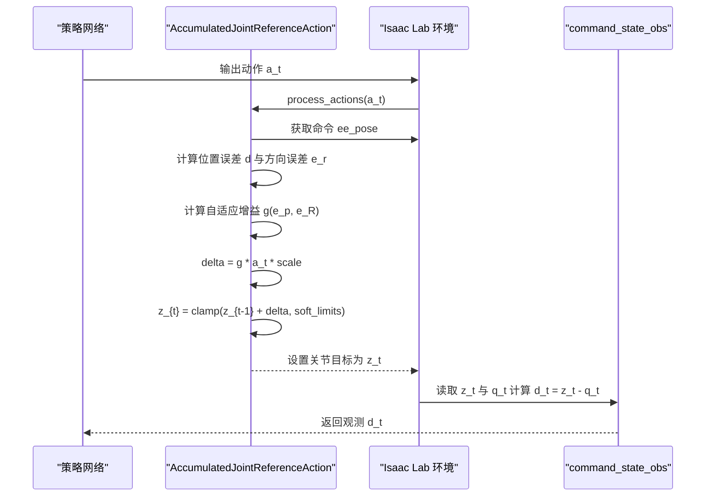
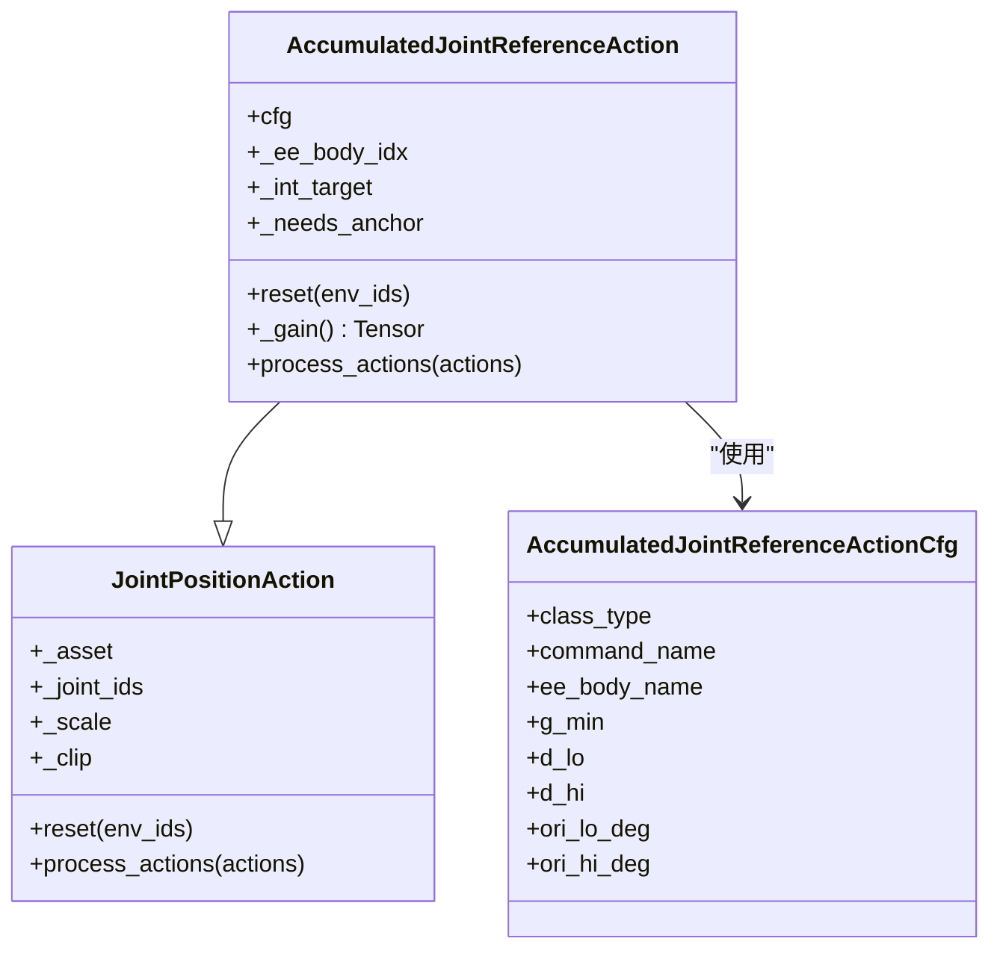
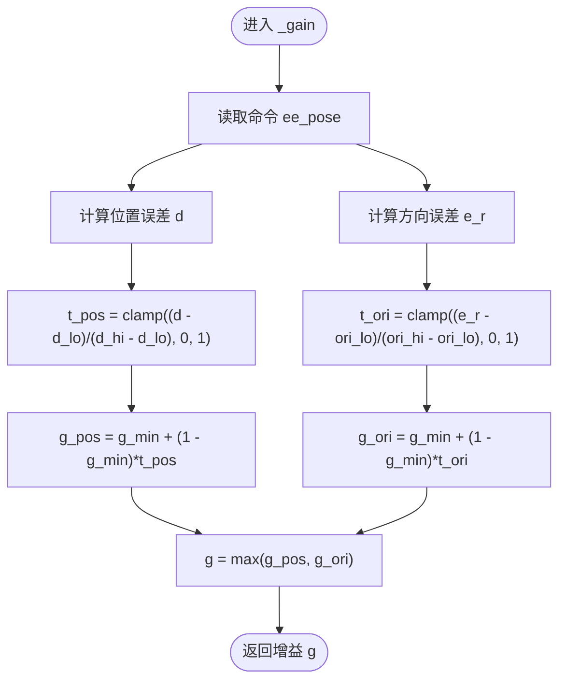
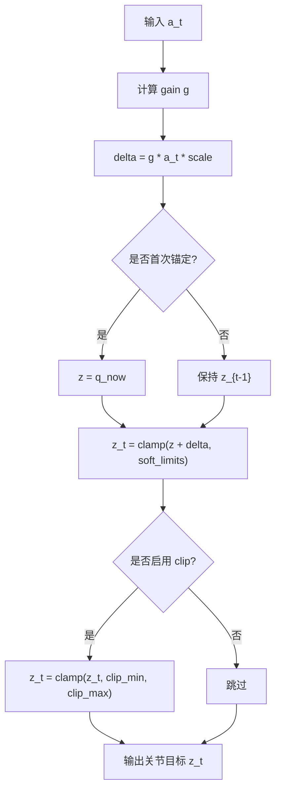
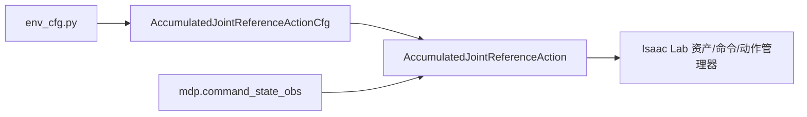

# 动作空间设计

<cite>
**本文引用的文件**   
- [actions.py](file://simulation/policyik_sim/tasks/actions.py)
- [env_cfg.py](file://simulation/policyik_sim/tasks/env_cfg.py)
- [mdp.py](file://simulation/policyik_sim/tasks/mdp.py)
</cite>

## 目录
1. [引言](#引言)
2. [项目结构](#项目结构)
3. [核心组件](#核心组件)
4. [架构总览](#架构总览)
5. [详细组件分析](#详细组件分析)
6. [依赖关系分析](#依赖关系分析)
7. [性能与数值特性](#性能与数值特性)
8. [调优指南](#调优指南)
9. [故障排查](#故障排查)
10. [结论](#结论)

## 引言
本技术文档聚焦于 PolicyIK 系统中的“累积关节参考动作”设计，重点解释 AccumulatedJointReferenceActionCfg 的实现原理与工程实践。该动作空间将策略输出的原始动作映射为“对内部关节参考的增量更新”，并通过误差依赖的自适应增益机制实现平滑、安全且可学习的控制接口。文档涵盖以下主题：
- 累积关节参考的设计思想与状态维护
- 自适应增益机制与误差依赖缩放策略
- 动作空间维度、边界约束与平滑性保证
- 动作到关节指令的映射与安全机制（速度限制、位置约束）
- 动作空间调优方法与自定义扩展建议

## 项目结构
PolicyIK 在仿真侧通过任务配置装配观察项、奖励项、命令源与动作执行器。其中，累积关节参考动作由 actions.py 定义，并在 env_cfg.py 中注入到环境配置；观测与奖励函数位于 mdp.py。

```mermaid
graph TB
subgraph "任务配置"
ENV_CFG["env_cfg.py<br/>装配命令/观测/奖励/动作"]
end
subgraph "动作层"
ACTIONS["actions.py<br/>AccumulatedJointReferenceAction / Cfg"]
end
subgraph "MDP"
MDP["mdp.py<br/>观测/奖励/误差状态"]
end
ENV_CFG --> ACTIONS
ENV_CFG --> MDP
ACTIONS --> MDP
```

图表来源
- [env_cfg.py:105-112](file://simulation/policyik_sim/tasks/env_cfg.py#L105-L112)
- [actions.py:15-75](file://simulation/policyik_sim/tasks/actions.py#L15-L75)
- [mdp.py:225-231](file://simulation/policyik_sim/tasks/mdp.py#L225-L231)

章节来源
- [env_cfg.py:1-134](file://simulation/policyik_sim/tasks/env_cfg.py#L1-L134)
- [actions.py:1-76](file://simulation/policyik_sim/tasks/actions.py#L1-L76)
- [mdp.py:1-232](file://simulation/policyik_sim/tasks/mdp.py#L1-L232)

## 核心组件
- AccumulatedJointReferenceAction：继承自关节位置动作基类，维护“内部关节参考 z_t”，每步根据策略输出动作 a_t 计算增量并更新 z_t，最终将 z_t 作为处理后的关节目标。
- AccumulatedJointReferenceActionCfg：配置类，声明命令名、末端体名称、增益下限 g_min、位置与方向误差斜坡参数等。
- command_state_obs：从动作执行器读取内部关节参考 z_t 与当前关节 q_t 的差值 d_t = z_t - q_t，作为观测的一部分反馈给策略。

关键要点
- 累积参考 z_t 提供积分式平滑，避免策略直接输出绝对关节位置导致的突变。
- 自适应增益 g(e_p, e_R) 根据末端位姿误差动态调节动作幅度，提升收敛性与鲁棒性。
- 软限位与可选 clip 双重约束保障安全性与可行性。

章节来源
- [actions.py:15-75](file://simulation/policyik_sim/tasks/actions.py#L15-L75)
- [mdp.py:225-231](file://simulation/policyik_sim/tasks/mdp.py#L225-L231)

## 架构总览
下图展示策略输出动作到关节指令的完整流程，包括误差估计、增益计算、增量累积与约束处理。



图表来源
- [actions.py:33-63](file://simulation/policyik_sim/tasks/actions.py#L33-L63)
- [mdp.py:225-231](file://simulation/policyik_sim/tasks/mdp.py#L225-L231)

## 详细组件分析

### AccumulatedJointReferenceAction 与 ActionCfg
该类实现了“累积关节参考”的核心逻辑：
- 初始化阶段：记录末端体索引，初始化内部关节参考 z 为当前关节位置，并标记需要锚定（首次动作时以当前关节位置对齐）。
- reset：在重置后等待首个动作到来再锚定 z，避免初始配置写入时序问题。
- _gain：基于末端位置误差 d 与方向误差 e_r 计算自适应增益 g ∈ [g_min, 1]。
- process_actions：将策略输出 a_t 按增益与尺度转换为增量 delta，累加到 z，并进行软限位与可选 clip。



图表来源
- [actions.py:15-75](file://simulation/policyik_sim/tasks/actions.py#L15-L75)

#### 自适应增益机制与误差依赖缩放
- 位置误差 d：末端位置与命令位置的欧氏距离。
- 方向误差 e_r：四元数误差幅值。
- 增益分段线性插值：
  - 位置通道：当 d ∈ [d_lo, d_hi] 时，增益从 g_min 线性增长至接近 1。
  - 方向通道：当 e_r ∈ [ori_lo_deg, ori_hi_deg] 时，同样进行线性插值。
  - 最终增益取两通道各自增益的上界，确保不会因任一误差过大而过度缩小动作。
- 作用效果：误差大时放大动作以提升收敛速度；误差小时降低增益以抑制震荡，提高稳定性。



图表来源
- [actions.py:33-46](file://simulation/policyik_sim/tasks/actions.py#L33-L46)

#### 动作到关节指令的映射与安全机制
- 增量累积：delta = g * a_t * scale，z_t = clamp(z_{t-1} + delta, soft_joint_pos_limits)。
- 软限位：使用 soft_joint_pos_limits 作为硬边界，防止超出机械或仿真允许范围。
- 可选 clip：若配置了 clip，则在软限位后再进行一次 clip，进一步限制输出范围。
- 锚定机制：首次动作前将 z 对齐到当前关节位置，避免初始偏移导致的大步长。



图表来源
- [actions.py:48-63](file://simulation/policyik_sim/tasks/actions.py#L48-L63)

#### 观测接口：command_state_obs
- 功能：返回 d_t = z_t - q_t，即内部关节参考与真实关节的差值，作为策略观测的一部分。
- 意义：为策略提供“当前跟踪误差”的直接信号，有助于学习更稳定的闭环行为。

章节来源
- [actions.py:15-75](file://simulation/policyik_sim/tasks/actions.py#L15-L75)
- [mdp.py:225-231](file://simulation/policyik_sim/tasks/mdp.py#L225-L231)

## 依赖关系分析
- 动作层依赖 Isaac Lab 的 JointPositionAction 基类与环境资产数据（关节位置、末端体位姿、软限位等）。
- 环境配置 env_cfg.py 将 AccumulatedJointReferenceActionCfg 注入到 arm_action，并设置 scale、g_min、d_lo/d_hi、ori_lo_deg/ori_hi_deg 等超参。
- MDP 模块提供观测与奖励，其中 command_state_obs 直接访问动作执行器的内部状态 _int_target。



图表来源
- [env_cfg.py:105-112](file://simulation/policyik_sim/tasks/env_cfg.py#L105-L112)
- [actions.py:15-75](file://simulation/policyik_sim/tasks/actions.py#L15-L75)
- [mdp.py:225-231](file://simulation/policyik_sim/tasks/mdp.py#L225-L231)

章节来源
- [env_cfg.py:105-112](file://simulation/policyik_sim/tasks/env_cfg.py#L105-L112)
- [actions.py:15-75](file://simulation/policyik_sim/tasks/actions.py#L15-L75)
- [mdp.py:225-231](file://simulation/policyik_sim/tasks/mdp.py#L225-L231)

## 性能与数值特性
- 向量运算：所有误差与增益计算均使用张量广播与逐元素操作，适合批量环境并行。
- 数值稳定：分母使用 max(..., 1e-6/1e-9) 避免除零；clamp 保证 t 与误差比例在合理区间。
- 复杂度：每步 O(N_env × N_joints)，N_env 为环境批大小，N_joints 为关节维数（OpenArm 通常为 7）。
- 平滑性：累积参考 z 提供低通滤波效果，减少策略输出的高频抖动；增益随误差减小而降低，进一步抑制震荡。

[本节为通用性能讨论，不直接分析具体文件]

## 调优指南
以下为针对 AccumulatedJointReferenceActionCfg 的关键超参调优建议：

- scale（动作尺度）
  - 作用：将策略输出 a_t 缩放到关节角度增量。
  - 建议：从较小值开始（例如 0.05~0.1），逐步增大直至收敛速度与稳定性平衡。
  - 影响：过大易震荡；过小收敛慢。

- g_min（最小增益）
  - 作用：保证即使在误差很小时仍有基础动作幅度。
  - 建议：0.05~0.2 之间；过小可能导致停滞，过大可能引起微震荡。

- d_lo, d_hi（位置误差斜坡）
  - 作用：定义位置误差到增益的线性插值区间。
  - 建议：d_lo 设为接近零的小值（如 0.0005），d_hi 根据工作空间精度设定（如 0.005~0.01）。
  - 影响：d_hi 越大，增益上升越平缓；d_lo 越小，近零误差时增益更接近 g_min。

- ori_lo_deg, ori_hi_deg（方向误差斜坡）
  - 作用：定义方向误差（弧度）到增益的线性插值区间。
  - 建议：ori_lo_deg 设为小角度（如 0.1~0.5°），ori_hi_deg 设为中等角度（如 1~3°）。
  - 注意：代码内部会转换为弧度参与计算。

- clip（可选裁剪）
  - 作用：在软限位之后再次限制输出范围。
  - 建议：仅在需要额外保护时使用；通常与软限位配合即可。

- 与观测和奖励的配合
  - command_state_obs 提供 d_t = z_t - q_t，有助于策略感知跟踪误差。
  - 奖励项中的 keypoint_tracking、potential_shaping、improvement_reward 等与动作空间协同，鼓励平滑收敛与持续改进。

章节来源
- [env_cfg.py:105-112](file://simulation/policyik_sim/tasks/env_cfg.py#L105-L112)
- [actions.py:67-75](file://simulation/policyik_sim/tasks/actions.py#L67-L75)
- [mdp.py:225-231](file://simulation/policyik_sim/tasks/mdp.py#L225-L231)

## 故障排查
- 症状：策略输出动作有效但机器人不动或移动极慢
  - 检查：scale 是否过小；g_min 是否过低；d_hi 是否过大导致增益始终接近 g_min。
- 症状：震荡或高频抖动
  - 检查：scale 是否过大；g_min 是否过高；ori_lo_deg/ori_hi_deg 是否过宽导致增益变化不够平滑。
- 症状：关节超限或仿真报错
  - 检查：soft_joint_pos_limits 是否正确；clip 是否启用且范围合理。
- 症状：观测 d_t 异常或训练不稳定
  - 检查：command_state_obs 是否能正确访问动作执行器的 _int_target；确认 action_name 匹配。

章节来源
- [actions.py:48-63](file://simulation/policyik_sim/tasks/actions.py#L48-L63)
- [mdp.py:225-231](file://simulation/policyik_sim/tasks/mdp.py#L225-L231)

## 结论
AccumulatedJointReferenceActionCfg 通过“累积关节参考 + 误差依赖增益”的设计，将策略输出转化为安全、平滑且高效的关节指令。其核心优势在于：
- 累积参考提供积分式平滑，增强稳定性；
- 自适应增益根据位姿误差自动调节动作幅度，兼顾收敛速度与鲁棒性；
- 软限位与可选 clip 提供强安全保障；
- 与观测/奖励体系紧密耦合，便于端到端学习。

在实际工程中，建议从保守的 scale 与 g_min 出发，逐步放宽 d_hi 与 ori_hi_deg，并结合 reward shaping 与 observation design 进行联合调优。对于自定义扩展，可在保留累积参考框架的前提下，替换增益函数形式（如非线性映射、学习型增益）或引入速度/加速度约束，进一步提升动作空间的表达能力与安全性。