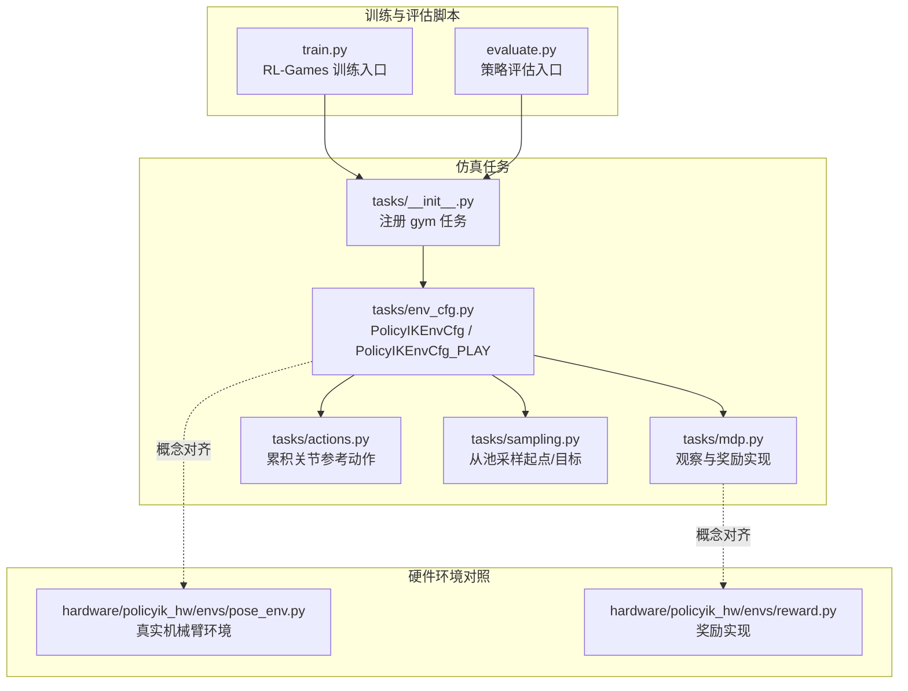
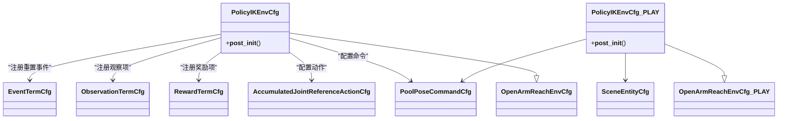
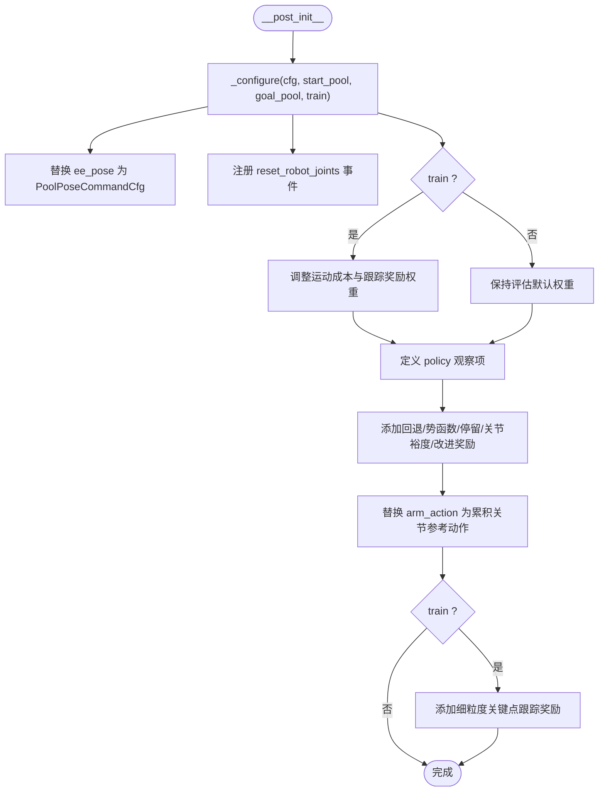
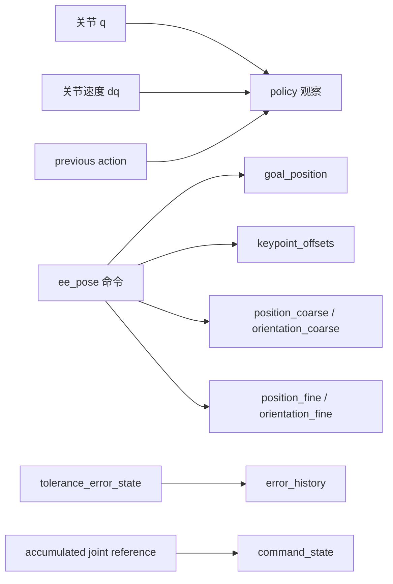
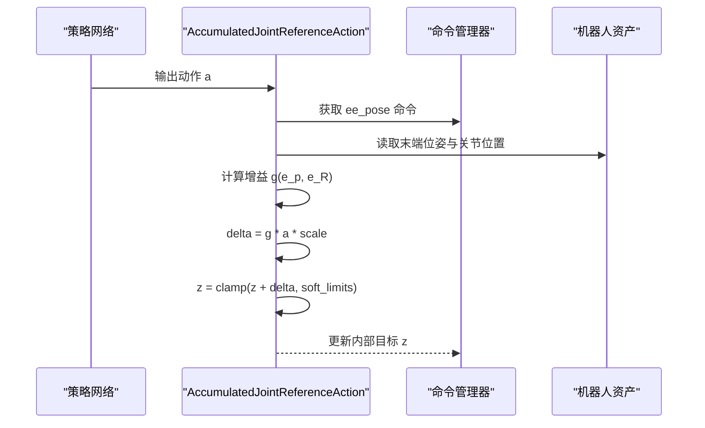
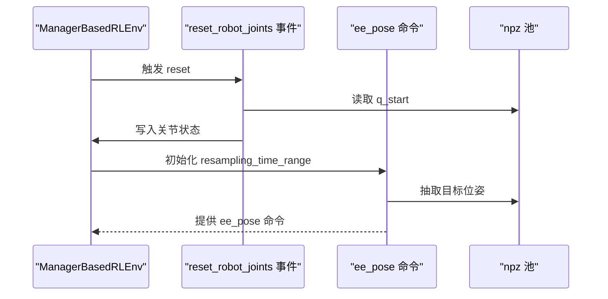
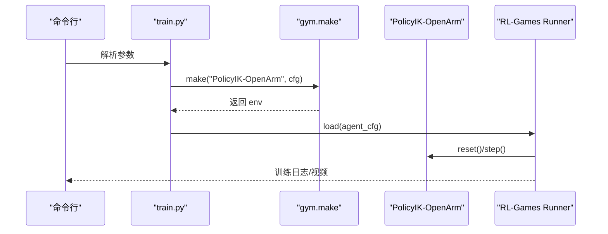
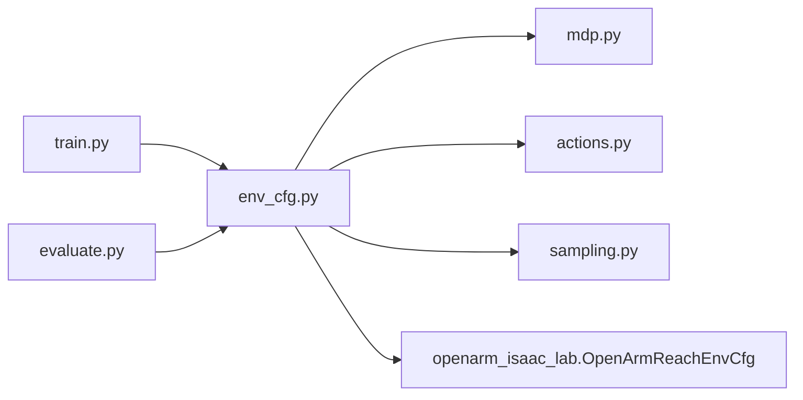

# 环境配置系统

<cite>
**本文引用的文件**   
- [env_cfg.py](file://simulation/policyik_sim/tasks/env_cfg.py)
- [mdp.py](file://simulation/policyik_sim/tasks/mdp.py)
- [actions.py](file://simulation/policyik_sim/tasks/actions.py)
- [sampling.py](file://simulation/policyik_sim/tasks/sampling.py)
- [__init__.py](file://simulation/policyik_sim/tasks/__init__.py)
- [train.py](file://simulation/policyik_sim/train.py)
- [evaluate.py](file://simulation/policyik_sim/evaluate.py)
- [pose_env.py](file://hardware/policyik_hw/envs/pose_env.py)
- [reward.py](file://hardware/policyik_hw/envs/reward.py)
</cite>

## 目录
1. [引言](#引言)
2. [项目结构](#项目结构)
3. [核心组件](#核心组件)
4. [架构总览](#架构总览)
5. [详细组件分析](#详细组件分析)
6. [依赖关系分析](#依赖关系分析)
7. [性能与稳定性考量](#性能与稳定性考量)
8. [故障排查指南](#故障排查指南)
9. [结论](#结论)
10. [附录：配置示例与最佳实践](#附录配置示例与最佳实践)

## 引言
本文面向 Isaac Lab 的 PolicyIK 环境配置系统，重点解释训练模式与评估模式的配置差异、环境初始化流程、场景实体配置、观察空间定义、奖励函数配置、动作空间设计以及配置文件层次结构与继承关系。文档同时给出如何自定义观察项、奖励项和动作空间的实践建议，帮助读者在仿真与硬件两套环境中保持一致的配置语义。

## 项目结构
PolicyIK 的环境配置位于仿真任务包中，并通过 gymnasium 注册两个任务入口：
- PolicyIK-OpenArm：训练模式，使用 PolicyIKEnvCfg
- PolicyIK-OpenArm-Play：评估模式，使用 PolicyIKEnvCfg_PLAY

图表来源
- [__init__.py:5-23](file://simulation/policyik_sim/tasks/__init__.py#L5-L23)
- [env_cfg.py:121-133](file://simulation/policyik_sim/tasks/env_cfg.py#L121-L133)
- [train.py:100-180](file://simulation/policyik_sim/train.py#L100-L180)
- [evaluate.py:45-75](file://simulation/policyik_sim/evaluate.py#L45-L75)

章节来源
- [__init__.py:1-24](file://simulation/policyik_sim/tasks/__init__.py#L1-L24)
- [env_cfg.py:1-134](file://simulation/policyik_sim/tasks/env_cfg.py#L1-L134)

## 核心组件
- PolicyIKEnvCfg：训练模式配置类，继承自 OpenArmReachEnvCfg，通过 _configure 注入训练专用的命令、事件、观察、奖励与动作配置。
- PolicyIKEnvCfg_PLAY：评估模式配置类，继承自 OpenArmReachEnvCfg_PLAY，复用同一 _configure 但传入评估数据源并关闭训练相关开关。
- mdp.py：提供观察项函数与奖励项函数，包括关键点跟踪、位姿误差观测、容差状态、PBRS 势函数、回退惩罚、停留奖励、关节裕度成本等。
- actions.py：AccumulatedJointReferenceAction 及其配置，将策略输出转换为带误差自适应增益的累积关节参考指令。
- sampling.py：PoolPoseCommand 与 reset_joints_from_pool，从预存 npz 池中均匀采样目标位姿与初始关节角。
- pose_env.py 与 reward.py：硬件环境的对照实现，用于理解观察列布局、奖励通道与参数语义。

章节来源
- [env_cfg.py:27-133](file://simulation/policyik_sim/tasks/env_cfg.py#L27-L133)
- [mdp.py:37-231](file://simulation/policyik_sim/tasks/mdp.py#L37-L231)
- [actions.py:15-76](file://simulation/policyik_sim/tasks/actions.py#L15-L76)
- [sampling.py:19-68](file://simulation/policyik_sim/tasks/sampling.py#L19-L68)
- [pose_env.py:21-43](file://hardware/policyik_hw/envs/pose_env.py#L21-L43)
- [reward.py:23-83](file://hardware/policyik_hw/envs/reward.py#L23-L83)

## 架构总览
PolicyIK 基于 Isaac Lab 的 ManagerBasedRLEnv 构建，通过 managers 模块的 ObservationTerm、RewardTerm、EventTerm、SceneEntityCfg 等声明式配置对象组合环境行为。训练与评估共享同一配置构造器 _configure，区别在于：
- 训练模式：启用采样的末端姿态方向；使用更激进的平滑与跟踪奖励权重；引入细粒度关键点跟踪奖励；采用累积关节参考动作。
- 评估模式：固定使用 SOURCE_SET 作为起点与目标池；不启用训练专用奖励分支；保持与部署一致的观察与动作接口。

图表来源
- [env_cfg.py:121-133](file://simulation/policyik_sim/tasks/env_cfg.py#L121-L133)
- [actions.py:66-76](file://simulation/policyik_sim/tasks/actions.py#L66-L76)
- [sampling.py:63-68](file://simulation/policyik_sim/tasks/sampling.py#L63-L68)

## 详细组件分析

### 配置类与继承关系
- PolicyIKEnvCfg：
  - 调用 _configure(self, TRAIN_START_POOL, TRAIN_GOAL_POOL, train=True)
  - 替换 ee_pose 命令为 PoolPoseCommandCfg，启用 use_sampled_orientation
  - 设置 reset_robot_joints 事件从 start pool 采样关节角
  - 调整 action_rate、joint_vel 等运动成本权重，并添加 keypoint_error_tanh 宽核跟踪奖励
  - 定义 policy 观察：goal_position、keypoint_offsets、position_coarse/orientation_coarse、position_fine/orientation_fine、error_history、command_state、actions
  - 添加 backslide、potential_shaping、dwell、joint_margin、improvement 奖励
  - 将 arm_action 替换为 AccumulatedJointReferenceActionCfg，并暴露 command_state 观察
  - 训练模式下额外添加细粒度关键点跟踪奖励 end_effector_keypoint_tracking_sharp

- PolicyIKEnvCfg_PLAY：
  - 调用 _configure(self, SOURCE_SET, SOURCE_SET, train=False)
  - 不启用 use_sampled_orientation，不添加 sharp 关键点奖励
  - 其他观察与奖励结构与训练一致，保证评估与部署一致性

图表来源
- [env_cfg.py:27-133](file://simulation/policyik_sim/tasks/env_cfg.py#L27-L133)

章节来源
- [env_cfg.py:27-133](file://simulation/policyik_sim/tasks/env_cfg.py#L27-L133)

### 场景实体与命令
- SceneEntityCfg：用于绑定机器人资产、末端执行器 body、关节名等实体引用。例如：
  - 末端执行器 openarm_hand 用于位置/方向误差与关键点计算
  - 关节 openarm_joint[1-7] 用于关节裕度成本
- PoolPoseCommandCfg：从 pool_npz 中读取 ee_pos 与 ee_quat，按 env_ids 批量采样目标位姿；可选 use_sampled_orientation 以采样方向。

章节来源
- [env_cfg.py:27-44](file://simulation/policyik_sim/tasks/env_cfg.py#L27-L44)
- [sampling.py:40-68](file://simulation/policyik_sim/tasks/sampling.py#L40-L68)

### 观察空间定义
policy 观察由多个 ObsTerm 拼接而成，维度约 54-D，包含：
- goal_position：目标位置（基座坐标系）
- keypoint_offsets：三个关键点相对于当前末端的偏移（基座坐标系）
- position_coarse/orientation_coarse：粗尺度位姿误差（归一化裁剪）
- position_fine/orientation_fine：细尺度位姿误差（归一化裁剪）
- error_history：历史最优与当前容差状态的通道（rho_best_prev/delta_rho）
- command_state：上一时刻动作保留的关节参考与当前关节之差
- actions：上一动作（用于差分正则）

图表来源
- [env_cfg.py:60-112](file://simulation/policyik_sim/tasks/env_cfg.py#L60-L112)
- [mdp.py:37-112](file://simulation/policyik_sim/tasks/mdp.py#L37-L112)
- [mdp.py:155-160](file://simulation/policyik_sim/tasks/mdp.py#L155-L160)
- [mdp.py:225-231](file://simulation/policyik_sim/tasks/mdp.py#L225-L231)

章节来源
- [env_cfg.py:60-112](file://simulation/policyik_sim/tasks/env_cfg.py#L60-L112)
- [mdp.py:37-112](file://simulation/policyik_sim/tasks/mdp.py#L37-L112)
- [mdp.py:155-160](file://simulation/policyik_sim/tasks/mdp.py#L155-L160)
- [mdp.py:225-231](file://simulation/policyik_sim/tasks/mdp.py#L225-L231)

### 奖励函数配置
训练模式下的奖励项包括：
- end_effector_keypoint_tracking：宽核关键点跟踪奖励（std=0.20）
- backslide_penalty：回退惩罚（cap=3.0）
- potential_shaping：PBRS 势函数 shaping（gamma=0.99）
- dwell：停留奖励（rho<=1.0）
- joint_margin_cost：关节软限裕度成本（仅在 rho>10.0 时生效）
- improvement_reward：改进奖励（U(rho)-U(best) 的正部）
- action_rate、joint_vel：运动平滑与速度正则
- end_effector_keypoint_tracking_sharp：细核关键点跟踪奖励（std=0.05，仅训练）

这些奖励均基于 mdp.py 中的函数实现，统一通过 RewardTermCfg 注册。

章节来源
- [env_cfg.py:46-119](file://simulation/policyik_sim/tasks/env_cfg.py#L46-L119)
- [mdp.py:71-90](file://simulation/policyik_sim/tasks/mdp.py#L71-L90)
- [mdp.py:163-222](file://simulation/policyik_sim/tasks/mdp.py#L163-L222)

### 动作空间与累积关节参考
AccumulatedJointReferenceAction 将策略输出的动作增量映射到累积关节参考 z，并根据末端位置与方向误差自适应缩放增益 g(e_p, e_R)，范围在 [g_min, 1]。该机制使策略在远距离时使用较大步长，接近目标时自动减小步长，提升收敛稳定性。

图表来源
- [actions.py:15-64](file://simulation/policyik_sim/tasks/actions.py#L15-L64)

章节来源
- [actions.py:15-76](file://simulation/policyik_sim/tasks/actions.py#L15-L76)

### 采样与初始化流程
- 起点采样：reset_joints_from_pool 从 start pool 中随机抽取关节角并置零速度，写入机器人关节状态。
- 目标采样：PoolPoseCommand 从 goal pool 中抽取行向量（位置+方向），支持 use_sampled_orientation。
- 训练与评估的数据源：
  - 训练：TRAIN_START_POOL 与 TRAIN_GOAL_POOL
  - 评估：SOURCE_SET 同时作为起点与目标集

图表来源
- [env_cfg.py:31-44](file://simulation/policyik_sim/tasks/env_cfg.py#L31-L44)
- [sampling.py:19-68](file://simulation/policyik_sim/tasks/sampling.py#L19-L68)

章节来源
- [env_cfg.py:31-44](file://simulation/policyik_sim/tasks/env_cfg.py#L31-L44)
- [sampling.py:19-68](file://simulation/policyik_sim/tasks/sampling.py#L19-L68)

### 训练与评估入口
- train.py：加载 Hydra 配置，创建 gym 环境，包装为 RL-Games 向量化环境，启动训练循环。
- evaluate.py：加载策略检查点，冻结目标重采样，逐任务回放并记录位姿误差与轨迹。

图表来源
- [train.py:100-245](file://simulation/policyik_sim/train.py#L100-L245)

章节来源
- [train.py:100-245](file://simulation/policyik_sim/train.py#L100-L245)
- [evaluate.py:45-185](file://simulation/policyik_sim/evaluate.py#L45-L185)

## 依赖关系分析
- env_cfg.py 依赖：
  - isaaclab.managers 的观察/奖励/事件/场景实体配置类
  - openarm.tasks 的 OpenArmReachEnvCfg 基类
  - tasks/mdp.py 的观察与奖励函数
  - tasks/actions.py 的累积关节参考动作配置
  - tasks/sampling.py 的池采样命令与事件
- 运行时依赖：
  - data/*.npz 池文件（训练与评估）
  - RL-Games 与 isaac-lab 的任务注册机制

图表来源
- [env_cfg.py:1-21](file://simulation/policyik_sim/tasks/env_cfg.py#L1-L21)
- [train.py:100-180](file://simulation/policyik_sim/train.py#L100-L180)
- [evaluate.py:45-75](file://simulation/policyik_sim/evaluate.py#L45-L75)

章节来源
- [env_cfg.py:1-21](file://simulation/policyik_sim/tasks/env_cfg.py#L1-L21)
- [train.py:100-180](file://simulation/policyik_sim/train.py#L100-L180)
- [evaluate.py:45-75](file://simulation/policyik_sim/evaluate.py#L45-L75)

## 性能与稳定性考量
- 动力学求解迭代次数：cfg.scene.robot.spawn.articulation_props.solver_position_iteration_count 设置为 32，提高接触稳定性。
- 动作增益自适应：根据末端距离与方向误差调节步长，避免过大控制量导致发散。
- 奖励 shaping：PBRS 势函数与改进奖励结合，加速收敛并减少回退。
- 关节裕度成本：在接近软限时施加惩罚，提升安全性与可执行性。
- 观察归一化：误差观测通过 d0 或角度阈值进行裁剪，稳定策略输入分布。

章节来源
- [env_cfg.py:103-110](file://simulation/policyik_sim/tasks/env_cfg.py#L103-L110)
- [actions.py:33-46](file://simulation/policyik_sim/tasks/actions.py#L33-L46)
- [mdp.py:176-188](file://simulation/policyik_sim/tasks/mdp.py#L176-L188)
- [mdp.py:207-222](file://simulation/policyik_sim/tasks/mdp.py#L207-L222)

## 故障排查指南
- 无电机健康状态或 CAN 通信异常（硬件环境）：
  - 现象：抛出 MOTOR HEALTH FAULT 或关节状态冻结错误
  - 处理：检查 bringup 是否运行、CAN 接口是否正常、重启节点后重试
- 观察项缺失或类型错误：
  - 现象：command_state_obs 报错找不到动作项的内部目标
  - 处理：确保 arm_action 使用 AccumulatedJointReferenceAction 且已正确注册
- 目标未更新或重采样异常：
  - 现象：评估时目标不变或策略无法收敛
  - 处理：检查 PoolPoseCommand 的 pool_npz 路径与 use_sampled_orientation 设置
- 奖励不稳定或发散：
  - 现象：训练曲线震荡或策略输出过大
  - 处理：调小 action_rate/joint_vel 权重，增大 d0 或角度阈值，检查 PBRS gamma 与 agent gamma 是否一致

章节来源
- [pose_env.py:393-420](file://hardware/policyik_hw/envs/pose_env.py#L393-L420)
- [mdp.py:225-231](file://simulation/policyik_sim/tasks/mdp.py#L225-L231)
- [reward.py:60-73](file://hardware/policyik_hw/envs/reward.py#L60-L73)

## 结论
PolicyIK 的环境配置系统通过声明式的 managers 配置与模块化 mdp 函数实现了训练与评估的一致接口。_configure 集中管理命令、事件、观察、奖励与动作，PolicyIKEnvCfg 与 PolicyIKEnvCfg_PLAY 分别注入训练与评估所需的数据源与开关。累积关节参考动作与自适应增益提升了控制稳定性，PBRS 与改进奖励加速了学习过程。遵循本文的配置与最佳实践，可在仿真与硬件环境中获得一致的观察与奖励语义，便于策略迁移与部署。

## 附录：配置示例与最佳实践

### 自定义观察空间
- 新增观察项：
  - 在 env_cfg.py 的 _configure 中添加新的 pol.xxx = ObsTerm(func=..., params={...})
  - 在 mdp.py 中实现对应的观测函数，返回 torch.Tensor
- 注意事项：
  - 确保 SceneEntityCfg 绑定的 body/joint 名称与机器人模型一致
  - 对数值型观测进行合理归一化（如 d0 或角度阈值裁剪）

章节来源
- [env_cfg.py:60-83](file://simulation/policyik_sim/tasks/env_cfg.py#L60-L83)
- [mdp.py:37-112](file://simulation/policyik_sim/tasks/mdp.py#L37-L112)

### 自定义奖励函数
- 新增奖励项：
  - 在 env_cfg.py 中添加 cfg.rewards.xxx = RewTerm(func=mdp.xxx, weight=..., params={...})
  - 在 mdp.py 中实现奖励函数，返回 torch.Tensor
- 注意事项：
  - 训练与评估的奖励权重需保持一致，除非明确需要区分
  - PBRS 的 gamma 应与 RL 算法的 discount factor 一致

章节来源
- [env_cfg.py:85-101](file://simulation/policyik_sim/tasks/env_cfg.py#L85-L101)
- [mdp.py:163-222](file://simulation/policyik_sim/tasks/mdp.py#L163-L222)

### 自定义动作空间
- 替换动作项：
  - 在 env_cfg.py 中将 cfg.actions.arm_action 替换为自定义 ActionCfg
  - 在 actions.py 中实现新的动作类与配置类
- 注意事项：
  - 若需要暴露 command_state 观察，确保动作项维护内部目标 z
  - 使用合理的 scale 与增益范围，避免过大控制量

章节来源
- [env_cfg.py:105-112](file://simulation/policyik_sim/tasks/env_cfg.py#L105-L112)
- [actions.py:15-76](file://simulation/policyik_sim/tasks/actions.py#L15-L76)

### 数据池与任务文件
- 训练数据池：
  - TRAIN_START_POOL：起始关节配置
  - TRAIN_GOAL_POOL：训练目标位姿（含位置与方向）
- 评估数据池：
  - SOURCE_SET：评估任务的起点与目标（由评估脚本直接写入）
- 生成与格式：
  - npz 文件中应包含 ee_pos、ee_quat（目标）或 q（起点）

章节来源
- [env_cfg.py:22-25](file://simulation/policyik_sim/tasks/env_cfg.py#L22-L25)
- [sampling.py:40-68](file://simulation/policyik_sim/tasks/sampling.py#L40-L68)
- [evaluate.py:98-104](file://simulation/policyik_sim/evaluate.py#L98-L104)
