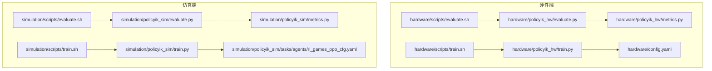
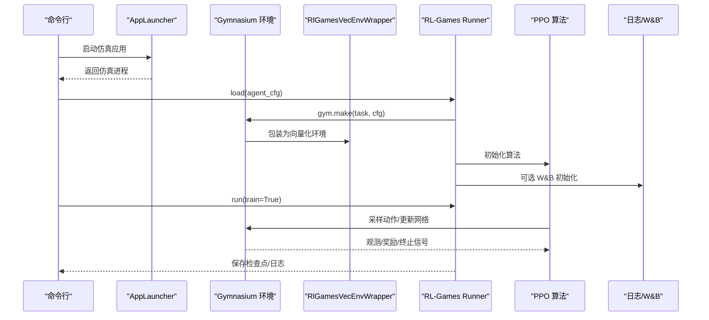
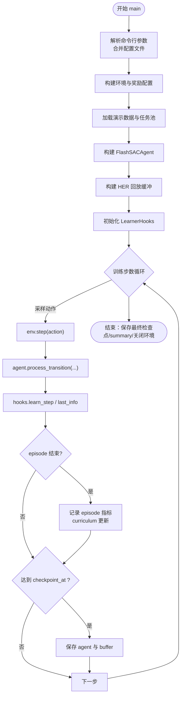
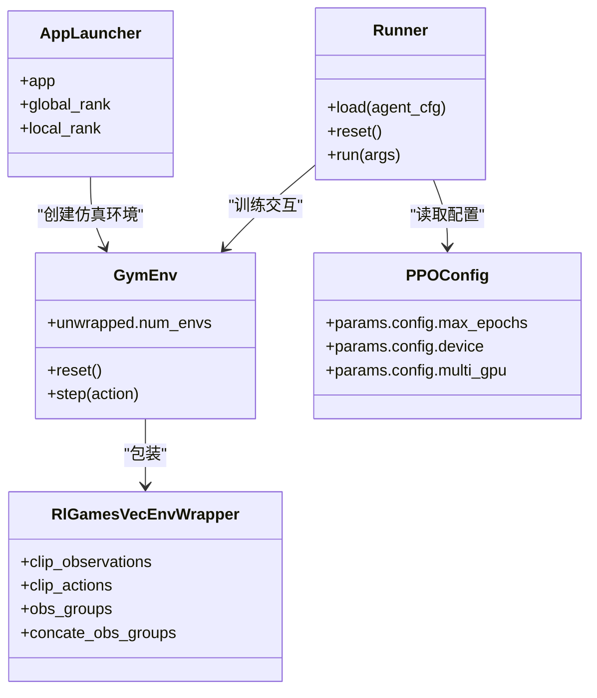
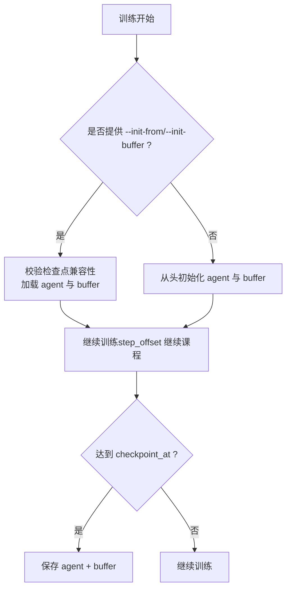
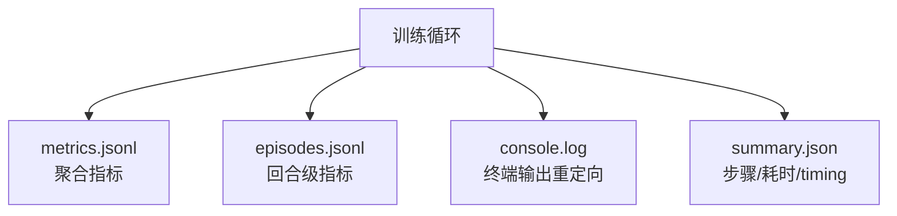
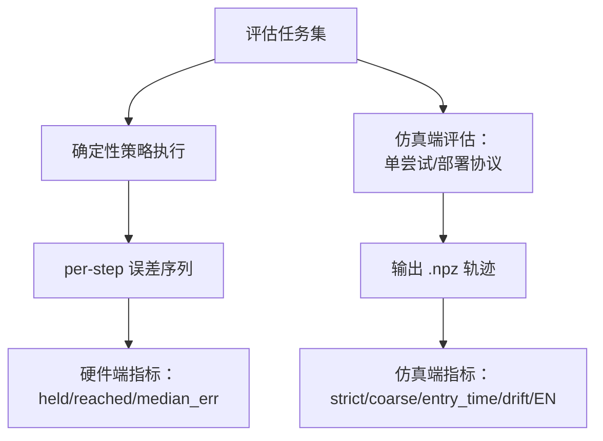
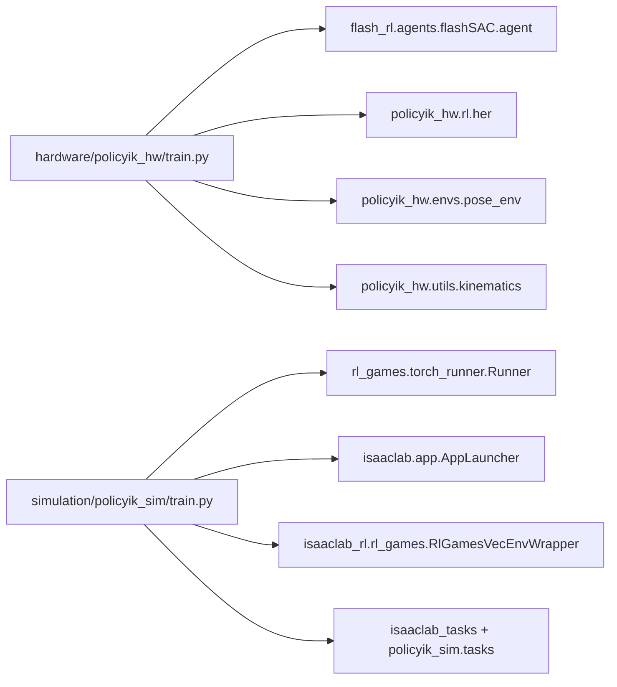

# 训练与评估流程

<cite>
**本文引用的文件**   
- [hardware/policyik_hw/train.py](file://hardware/policyik_hw/train.py)
- [hardware/policyik_hw/evaluate.py](file://hardware/policyik_hw/evaluate.py)
- [hardware/policyik_hw/metrics.py](file://hardware/policyik_hw/metrics.py)
- [hardware/config.yaml](file://hardware/config.yaml)
- [hardware/scripts/train.sh](file://hardware/scripts/train.sh)
- [hardware/scripts/evaluate.sh](file://hardware/scripts/evaluate.sh)
- [simulation/policyik_sim/train.py](file://simulation/policyik_sim/train.py)
- [simulation/policyik_sim/evaluate.py](file://simulation/policyik_sim/evaluate.py)
- [simulation/policyik_sim/metrics.py](file://simulation/policyik_sim/metrics.py)
- [simulation/policyik_sim/tasks/agents/rl_games_ppo_cfg.yaml](file://simulation/policyik_sim/tasks/agents/rl_games_ppo_cfg.yaml)
- [simulation/scripts/train.sh](file://simulation/scripts/train.sh)
- [simulation/scripts/evaluate.sh](file://simulation/scripts/evaluate.sh)
</cite>

## 目录
1. [简介](#简介)
2. [项目结构](#项目结构)
3. [核心组件](#核心组件)
4. [架构总览](#架构总览)
5. [详细组件分析](#详细组件分析)
6. [依赖关系分析](#依赖关系分析)
7. [性能与分布式特性](#性能与分布式特性)
8. [训练脚本使用指南](#训练脚本使用指南)
9. [评估与指标计算](#评估与指标计算)
10. [常见问题与排错](#常见问题与排错)
11. [结论](#结论)

## 简介
本技术文档围绕 PolicyIK 仓库中的“真实机械臂”和“仿真 Isaac Lab + RL-Games”两条训练与评估流水线展开，重点说明：
- RL-Games 在仿真侧的集成方式、训练循环、检查点管理、日志记录。
- 真实机械臂侧基于 FlashSAC 的训练循环、HER 回放缓冲、演示数据混合、课程学习、检查点与日志输出。
- 命令行参数配置、超参数调优建议、分布式训练支持。
- 评估指标计算、性能基准测试、结果可视化与汇总。
- 完整的训练与评估脚本使用指南、调试技巧与优化建议。

## 项目结构
仓库包含两套相对独立的训练与评估路径：
- hardware：面向真实 OpenArm 右臂，采用 FlashSAC + HER + 演示数据混合，自定义训练循环与日志系统。
- simulation：面向 Isaac Sim / Isaac Lab，通过 RL-Games 的 Runner 进行 PPO 训练，并提供批量评估与部署协议指标计算。

**图表来源**
- [hardware/scripts/train.sh:1-14](file://hardware/scripts/train.sh#L1-L14)
- [hardware/scripts/evaluate.sh:1-19](file://hardware/scripts/evaluate.sh#L1-L19)
- [simulation/scripts/train.sh:1-26](file://simulation/scripts/train.sh#L1-L26)
- [simulation/scripts/evaluate.sh:1-23](file://simulation/scripts/evaluate.sh#L1-L23)

**章节来源**
- [hardware/scripts/train.sh:1-14](file://hardware/scripts/train.sh#L1-L14)
- [simulation/scripts/train.sh:1-26](file://simulation/scripts/train.sh#L1-L26)

## 核心组件
- 硬件端训练器：FlashSACAgent + HER 回放缓冲 + 演示数据混合 + 课程学习 + 自定义 RunLogger。
- 仿真端训练器：IsaacLab + RL-Games Runner（PPO），Hydra 任务配置，可选 Weights & Biases 跟踪。
- 评估器：硬件端对固定任务集做确定性策略执行；仿真端支持单尝试与多阶段部署协议评估。
- 指标工具：硬件端按 gap-bin 汇总“保持/到达”指标；仿真端计算严格/粗略成功率、进入时间、漂移、部署协议累计成功等。

**章节来源**
- [hardware/policyik_hw/train.py:132-178](file://hardware/policyik_hw/train.py#L132-L178)
- [simulation/policyik_sim/train.py:103-218](file://simulation/policyik_sim/train.py#L103-L218)
- [hardware/policyik_hw/evaluate.py:71-129](file://hardware/policyik_hw/evaluate.py#L71-L129)
- [simulation/policyik_sim/evaluate.py:52-77](file://simulation/policyik_sim/evaluate.py#L52-L77)
- [hardware/policyik_hw/metrics.py:56-78](file://hardware/policyik_hw/metrics.py#L56-L78)
- [simulation/policyik_sim/metrics.py:33-96](file://simulation/policyik_sim/metrics.py#L33-L96)

## 架构总览
仿真端训练主流程（RL-Games）：
- AppLauncher 启动 Isaac Sim。
- Hydra 加载任务与环境配置，注册 RL-Games 环境包装器。
- Runner 加载算法配置并执行训练，支持分布式与视频录制、W&B 跟踪。

**图表来源**
- [simulation/policyik_sim/train.py:67-104](file://simulation/policyik_sim/train.py#L67-L104)
- [simulation/policyik_sim/train.py:179-218](file://simulation/policyik_sim/train.py#L179-L218)
- [simulation/policyik_sim/train.py:220-245](file://simulation/policyik_sim/train.py#L220-L245)

**章节来源**
- [simulation/policyik_sim/train.py:67-104](file://simulation/policyik_sim/train.py#L67-L104)
- [simulation/policyik_sim/train.py:179-218](file://simulation/policyik_sim/train.py#L179-L218)
- [simulation/policyik_sim/train.py:220-245](file://simulation/policyik_sim/train.py#L220-L245)

## 详细组件分析

### 硬件端训练器（FlashSAC + HER + 演示数据）
- 构建解析器与配置合并：支持 --config、--name、--total-steps、--checkpoint-at、--init-from、--init-buffer、--step-offset、--urdf、--device 等参数。
- 构建 Agent：FlashSACAgent，配置包括 seed、normalize_reward、buffer_size、batch_size、actor/critic 网络结构、温度自适应、gamma、n_step、use_compile 等。
- 构建 Buffer：PoseHERRLPDBuffer，支持 HER（原始/未来/当前/随机重标记）、演示数据混合比例、near-anchor 策略、zoom 缩放、增益配置等。
- 训练循环：每步采样动作、env.step、process_transition、hooks.learn_step/idle 触发更新；episode 结束时记录 episode 指标；按 checkpoint_at 保存检查点与 buffer；最终保存 summary.json。
- 日志系统：RunLogger 写入 metrics.jsonl、episodes.jsonl、console.log，并 Tee stdout/stderr。

**图表来源**
- [hardware/policyik_hw/train.py:26-38](file://hardware/policyik_hw/train.py#L26-L38)
- [hardware/policyik_hw/train.py:132-178](file://hardware/policyik_hw/train.py#L132-L178)
- [hardware/policyik_hw/train.py:271-328](file://hardware/policyik_hw/train.py#L271-L328)
- [hardware/policyik_hw/train.py:371-428](file://hardware/policyik_hw/train.py#L371-L428)

**章节来源**
- [hardware/policyik_hw/train.py:26-38](file://hardware/policyik_hw/train.py#L26-L38)
- [hardware/policyik_hw/train.py:132-178](file://hardware/policyik_hw/train.py#L132-L178)
- [hardware/policyik_hw/train.py:271-328](file://hardware/policyik_hw/train.py#L271-L328)
- [hardware/policyik_hw/train.py:371-428](file://hardware/policyik_hw/train.py#L371-L428)

### 仿真端训练器（RL-Games PPO）
- 命令行参数：--video、--num_envs、--task、--agent、--seed、--distributed、--checkpoint、--sigma、--max_iterations、--wandb-*、--track、--export_io_descriptors 等。
- 环境注册：将 Gymnasium 环境包装为 RlGamesVecEnvWrapper，并注册到 RL-Games 的 vecenv 配置中。
- 分布式训练：当启用 --distributed 时，根据 rank/local_rank 设置 device 与 multi_gpu，并对 seed 进行偏移。
- 训练运行：Runner.load(agent_cfg)，可选 W&B 跟踪，runner.run(train=True)。

**图表来源**
- [simulation/policyik_sim/train.py:28-59](file://simulation/policyik_sim/train.py#L28-L59)
- [simulation/policyik_sim/train.py:103-159](file://simulation/policyik_sim/train.py#L103-L159)
- [simulation/policyik_sim/train.py:179-218](file://simulation/policyik_sim/train.py#L179-L218)
- [simulation/policyik_sim/tasks/agents/rl_games_ppo_cfg.yaml:1-81](file://simulation/policyik_sim/tasks/agents/rl_games_ppo_cfg.yaml#L1-L81)

**章节来源**
- [simulation/policyik_sim/train.py:28-59](file://simulation/policyik_sim/train.py#L28-L59)
- [simulation/policyik_sim/train.py:103-159](file://simulation/policyik_sim/train.py#L103-L159)
- [simulation/policyik_sim/train.py:179-218](file://simulation/policyik_sim/train.py#L179-L218)
- [simulation/policyik_sim/tasks/agents/rl_games_ppo_cfg.yaml:1-81](file://simulation/policyik_sim/tasks/agents/rl_games_ppo_cfg.yaml#L1-L81)

### 检查点管理与恢复
- 硬件端：save_all 同时保存 agent 与 replay_buffer；check_resume 校验观测维度与环境接口一致性；支持 --init-from 与 --init-buffer 恢复训练，--step-offset 继续课程进度。
- 仿真端：通过 --checkpoint 指定路径，Runner.load 后 runner.run 传入 resume_path；PPO 配置中 load_checkpoint/load_path 控制是否加载。

**图表来源**
- [hardware/policyik_hw/train.py:181-189](file://hardware/policyik_hw/train.py#L181-L189)
- [hardware/policyik_hw/train.py:263-268](file://hardware/policyik_hw/train.py#L263-L268)
- [hardware/policyik_hw/train.py:310-321](file://hardware/policyik_hw/train.py#L310-L321)
- [simulation/policyik_sim/train.py:118-123](file://simulation/policyik_sim/train.py#L118-L123)
- [simulation/policyik_sim/train.py:242-245](file://simulation/policyik_sim/train.py#L242-L245)

**章节来源**
- [hardware/policyik_hw/train.py:181-189](file://hardware/policyik_hw/train.py#L181-L189)
- [hardware/policyik_hw/train.py:263-268](file://hardware/policyik_hw/train.py#L263-L268)
- [hardware/policyik_hw/train.py:310-321](file://hardware/policyik_hw/train.py#L310-L321)
- [simulation/policyik_sim/train.py:118-123](file://simulation/policyik_sim/train.py#L118-L123)
- [simulation/policyik_sim/train.py:242-245](file://simulation/policyik_sim/train.py#L242-L245)

### 日志记录与可视化
- 硬件端：RunLogger 输出 metrics.jsonl、episodes.jsonl、console.log；write_summary 输出 summary.json，含步骤、全局步数、回合数、耗时与 timing 摘要。
- 仿真端：RL-Games 默认日志目录 logs/rl_games/<config_name>/<full_experiment_name>；可开启 --video 录制训练视频；可选 --track 与 wandb 跟踪。

**图表来源**
- [hardware/policyik_hw/train.py:84-107](file://hardware/policyik_hw/train.py#L84-L107)
- [hardware/policyik_hw/train.py:251-260](file://hardware/policyik_hw/train.py#L251-L260)
- [simulation/policyik_sim/train.py:138-159](file://simulation/policyik_sim/train.py#L138-L159)
- [simulation/policyik_sim/train.py:186-196](file://simulation/policyik_sim/train.py#L186-L196)
- [simulation/policyik_sim/train.py:224-240](file://simulation/policyik_sim/train.py#L224-L240)

**章节来源**
- [hardware/policyik_hw/train.py:84-107](file://hardware/policyik_hw/train.py#L84-L107)
- [hardware/policyik_hw/train.py:251-260](file://hardware/policyik_hw/train.py#L251-L260)
- [simulation/policyik_sim/train.py:138-159](file://simulation/policyik_sim/train.py#L138-L159)
- [simulation/policyik_sim/train.py:186-196](file://simulation/policyik_sim/train.py#L186-L196)
- [simulation/policyik_sim/train.py:224-240](file://simulation/policyik_sim/train.py#L224-L240)

### 评估指标计算与可视化
- 硬件端评估：对固定任务集（q_start/goal_p/goal_R）进行确定性策略执行，输出 per-step 位置与角度误差；metrics.py 按 gap-bin 汇总“保持/到达”指标，支持中断恢复。
- 仿真端评估：支持单尝试评估与部署协议评估（错误修正目标 + 多个瞬态目标），输出 pos_t/ori_t/ee_pos_t/ee_quat_t，metrics.py 计算严格/粗略成功率、进入时间、漂移、部署协议累计成功与期望调用次数。

**图表来源**
- [hardware/policyik_hw/evaluate.py:71-84](file://hardware/policyik_hw/evaluate.py#L71-L84)
- [hardware/policyik_hw/metrics.py:56-78](file://hardware/policyik_hw/metrics.py#L56-L78)
- [simulation/policyik_sim/evaluate.py:120-184](file://simulation/policyik_sim/evaluate.py#L120-L184)
- [simulation/policyik_sim/metrics.py:33-96](file://simulation/policyik_sim/metrics.py#L33-L96)

**章节来源**
- [hardware/policyik_hw/evaluate.py:71-84](file://hardware/policyik_hw/evaluate.py#L71-L84)
- [hardware/policyik_hw/metrics.py:56-78](file://hardware/policyik_hw/metrics.py#L56-L78)
- [simulation/policyik_sim/evaluate.py:120-184](file://simulation/policyik_sim/evaluate.py#L120-L184)
- [simulation/policyik_sim/metrics.py:33-96](file://simulation/policyik_sim/metrics.py#L33-L96)

## 依赖关系分析
- 硬件端依赖：torch、numpy、yaml、rclpy（ROS2）、flash_rl.agents.flashSAC、policyik_hw.envs、policyik_hw.rl.her、policyik_hw.utils.kinematics。
- 仿真端依赖：isaaclab.app.AppLauncher、gymnasium、rl_games.common、rl_games.torch_runner、isaaclab_rl.rl_games、isaaclab_tasks、policyik_sim.tasks。

**图表来源**
- [hardware/policyik_hw/train.py:132-178](file://hardware/policyik_hw/train.py#L132-L178)
- [simulation/policyik_sim/train.py:79-100](file://simulation/policyik_sim/train.py#L79-L100)
- [simulation/policyik_sim/train.py:179-206](file://simulation/policyik_sim/train.py#L179-L206)

**章节来源**
- [hardware/policyik_hw/train.py:132-178](file://hardware/policyik_hw/train.py#L132-L178)
- [simulation/policyik_sim/train.py:79-100](file://simulation/policyik_sim/train.py#L79-L100)
- [simulation/policyik_sim/train.py:179-206](file://simulation/policyik_sim/train.py#L179-L206)

## 性能与分布式特性
- 硬件端：
  - use_compile：在训练模式下可启用 torch.compile 加速（受 agent.use_compile 控制）。
  - UTD（update-to-data ratio）：通过 hooks.utd 控制每步更新次数，影响训练稳定性与吞吐。
  - 回放缓冲大小与批大小：buffer_size=total_steps+step_offset，batch_size 影响梯度更新效率。
- 仿真端：
  - num_envs：并行环境数量，直接影响样本吞吐。
  - distributed：启用多 GPU/节点训练，自动设置 device 与 multi_gpu，并对 seed 加 rank 偏移保证多样性。
  - max_iterations：覆盖 PPO 配置中的 max_epochs，控制训练轮次。
  - mixed_precision：PPO 配置中可开启混合精度（默认 False）。

**章节来源**
- [hardware/policyik_hw/train.py:138-157](file://hardware/policyik_hw/train.py#L138-L157)
- [hardware/policyik_hw/train.py:160-178](file://hardware/policyik_hw/train.py#L160-L178)
- [simulation/policyik_sim/train.py:107-133](file://simulation/policyik_sim/train.py#L107-L133)
- [simulation/policyik_sim/tasks/agents/rl_games_ppo_cfg.yaml:44-81](file://simulation/policyik_sim/tasks/agents/rl_games_ppo_cfg.yaml#L44-L81)

## 训练脚本使用指南

### 硬件端训练
- 基本用法：
  - bash scripts/train.sh
  - 默认从 config.yaml 读取配置，输出到 runs/<name>。
- 断点续训：
  - 先获取上次运行的 summary.json 中的 global_steps_completed。
  - 使用 --init-from <checkpoint_dir> --init-buffer <buffer_dir> --step-offset <STEP> --total-steps <剩余步数>。
- 常用参数：
  - --config：配置文件路径（默认 config.yaml）。
  - --name：运行名称（默认 pose_<时间戳>）。
  - --total-steps：本次运行段总步数。
  - --checkpoint-at：逗号分隔的全局步数，到达时保存检查点。
  - --init-from：检查点目录以恢复训练。
  - --init-buffer：回放缓冲路径以恢复训练。
  - --step-offset：恢复时的全局步偏移。
  - --urdf：OpenArm v1 URDF 路径。
  - --device：auto/cpu/cuda。

**章节来源**
- [hardware/scripts/train.sh:1-14](file://hardware/scripts/train.sh#L1-L14)
- [hardware/policyik_hw/train.py:26-38](file://hardware/policyik_hw/train.py#L26-L38)
- [hardware/config.yaml:107-128](file://hardware/config.yaml#L107-L128)

### 仿真端训练
- 基本用法：
  - bash scripts/train.sh <seed>
  - 三阶段 PPO 训练（3500/8500/13000 epochs），最后平均最近 20 个检查点。
- 常用参数：
  - --task：任务名（默认 PolicyIK-OpenArm）。
  - --headless：无头模式。
  - --num_envs：并行环境数（默认 4096）。
  - --max_iterations：覆盖 PPO 配置中的 max_epochs。
  - --checkpoint：加载检查点路径。
  - --sigma：策略初始标准差。
  - --distributed：启用分布式训练。
  - --wandb-project-name/entity/name：Weights & Biases 跟踪配置。
  - --track：开启 W&B 跟踪。

**章节来源**
- [simulation/scripts/train.sh:1-26](file://simulation/scripts/train.sh#L1-L26)
- [simulation/policyik_sim/train.py:28-59](file://simulation/policyik_sim/train.py#L28-L59)
- [simulation/policyik_sim/tasks/agents/rl_games_ppo_cfg.yaml:44-81](file://simulation/policyik_sim/tasks/agents/rl_games_ppo_cfg.yaml#L44-L81)

## 评估与指标计算

### 硬件端评估
- 基本用法：
  - bash scripts/evaluate.sh <run_dir> [checkpoint_dir_name]
  - 对三个 gap-bin（0.02-0.05m、0.05-0.10m、0.10-1.0m）分别评估 20 个任务，禁用碰撞保护，然后计算 held-pose 指标。
- 常用参数：
  - --run：训练运行目录。
  - --task-file：评估任务文件（eval_tasks.json）。
  - --gap-bin：距离区间过滤。
  - --n-episodes：每个任务的重复次数。
  - --max-steps：最大步数（默认沿用训练值）。
  - --no-collision-guard：禁用碰撞保护。
  - --checkpoint：检查点目录名（默认 checkpoint）。
  - --tag：输出文件名附加标签。
  - --out：输出 JSON 路径。
  - --overwrite：覆盖已有结果。
  - --urdf：URDF 路径。
  - --device：auto/cpu/cuda。

**章节来源**
- [hardware/scripts/evaluate.sh:1-19](file://hardware/scripts/evaluate.sh#L1-L19)
- [hardware/policyik_hw/evaluate.py:14-30](file://hardware/policyik_hw/evaluate.py#L14-L30)
- [hardware/policyik_hw/metrics.py:19-28](file://hardware/policyik_hw/metrics.py#L19-L28)

### 仿真端评估
- 基本用法：
  - bash scripts/evaluate.sh <seed> [checkpoint]
  - 生成 single.npz、corrected.npz、transient0..7.npz，并计算指标。
- 常用参数：
  - --task：任务名（默认 PolicyIK-OpenArm）。
  - --checkpoint：检查点路径。
  - --task_file：任务文件（eval_tasks.npz）。
  - --output：输出 .npz 路径。
  - --num_envs：并行环境数（默认 1024）。
  - --eval_seed：评估随机种子。
  - --steps：每尝试的最大步数（默认 160）。
  - --transient_seed：瞬态目标尝试种子（-1 关闭）。

**章节来源**
- [simulation/scripts/evaluate.sh:1-23](file://simulation/scripts/evaluate.sh#L1-L23)
- [simulation/policyik_sim/evaluate.py:8-17](file://simulation/policyik_sim/evaluate.py#L8-L17)

## 常见问题与排错
- 硬件端恢复训练时报观测维度不匹配：
  - 原因：检查点的观测维度与当前环境布局不一致。
  - 解决：确保 --init-from 的检查点与当前 env.layout 一致；必要时重新训练或调整布局。
- 硬件端恢复训练时报环境接口不一致：
  - 原因：检查点训练时的环境与奖励配置与当前不同。
  - 解决：使用相同的 config.yaml 与 reward 配置；或重新训练。
- 硬件端评估任务重复：
  - 原因：--n-episodes 超过 gap-bin 内可用任务数。
  - 解决：减少 --n-episodes 或扩大 gap-bin 范围。
- 仿真端分布式训练失败：
  - 原因：未正确设置环境变量或未启用 --distributed。
  - 解决：确保使用支持分布式的启动方式，并传递 --distributed；检查 local_rank/global_rank。
- 仿真端 W&B 跟踪报错：
  - 原因：未提供 entity 参数。
  - 解决：传递 --wandb-entity；或在代码中配置 entity。

**章节来源**
- [hardware/policyik_hw/train.py:181-189](file://hardware/policyik_hw/train.py#L181-L189)
- [hardware/policyik_hw/evaluate.py:110-113](file://hardware/policyik_hw/evaluate.py#L110-L113)
- [simulation/policyik_sim/train.py:125-133](file://simulation/policyik_sim/train.py#L125-L133)
- [simulation/policyik_sim/train.py:224-240](file://simulation/policyik_sim/train.py#L224-L240)

## 结论
PolicyIK 提供了两条互补的训练与评估路径：
- 硬件端基于 FlashSAC + HER + 演示数据混合，适合真实机械臂上的精细姿态控制与鲁棒性训练，具备完善的检查点恢复、课程学习与日志系统。
- 仿真端基于 RL-Games PPO + Isaac Lab，适合大规模并行训练与快速迭代，支持分布式训练、视频录制与 W&B 跟踪，并提供丰富的部署协议评估指标。

通过合理的命令行参数配置、超参数调优与分布式训练支持，用户可以在仿真环境中高效探索策略空间，再迁移至真实机械臂进行验证与优化。评估指标体系覆盖了严格/粗略成功率、进入时间、漂移、保持/到达率等关键维度，便于全面衡量策略性能。