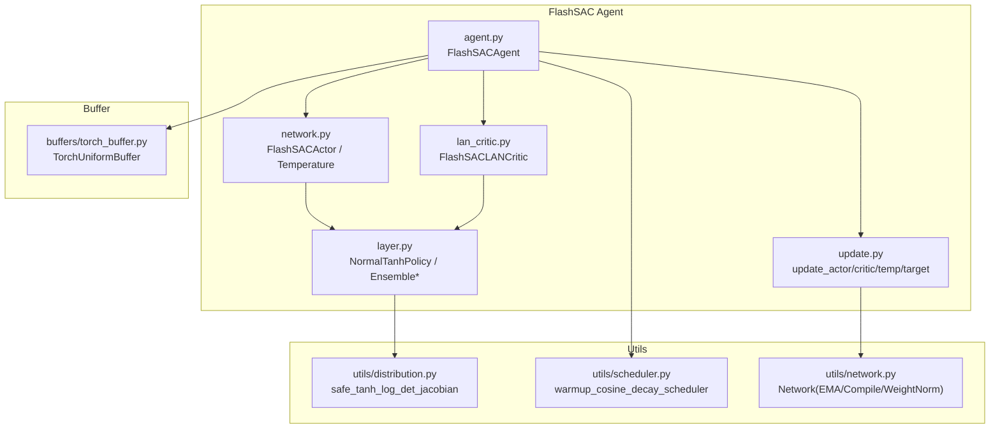
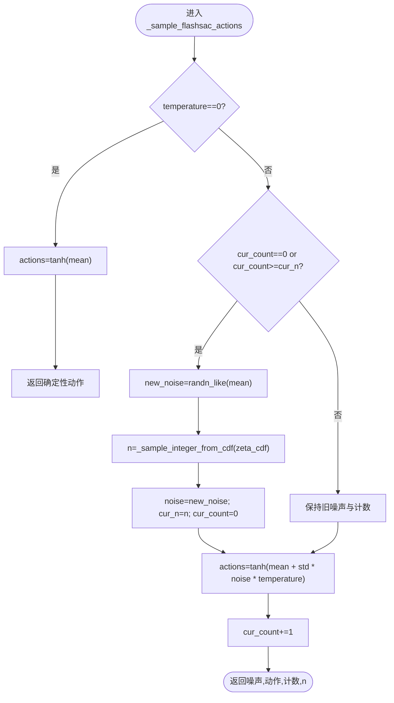
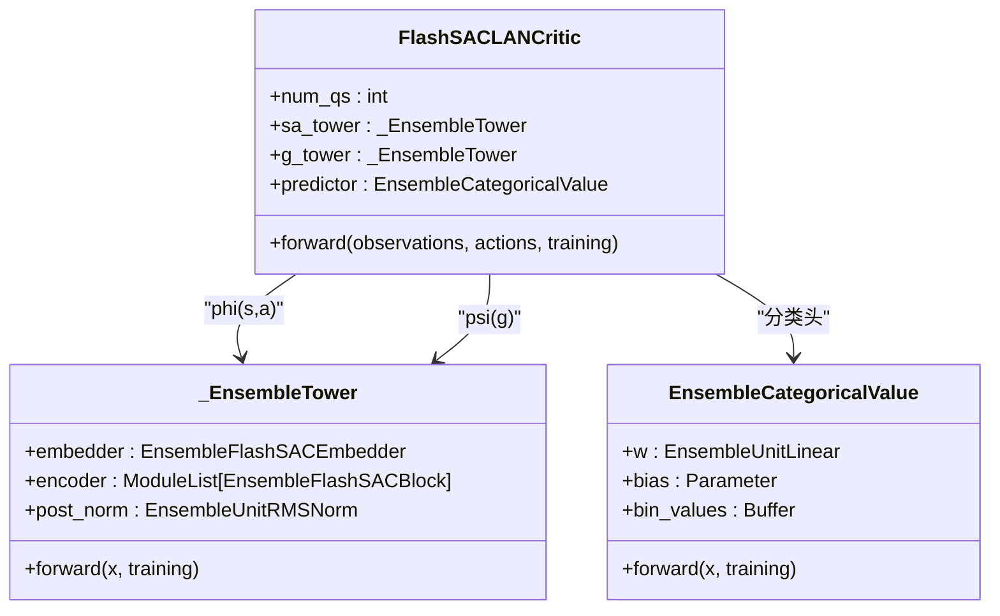
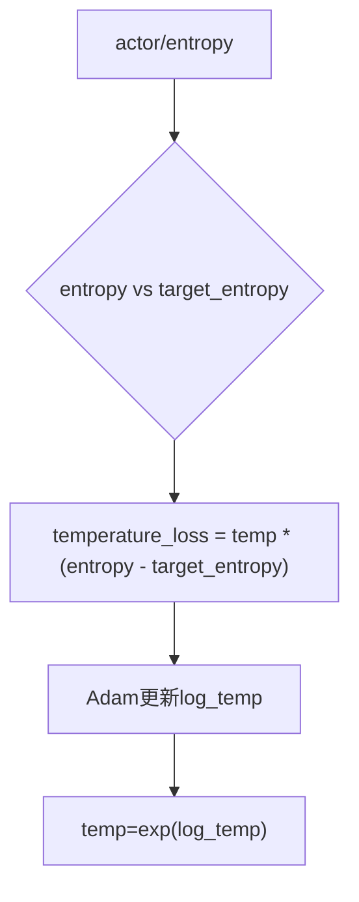
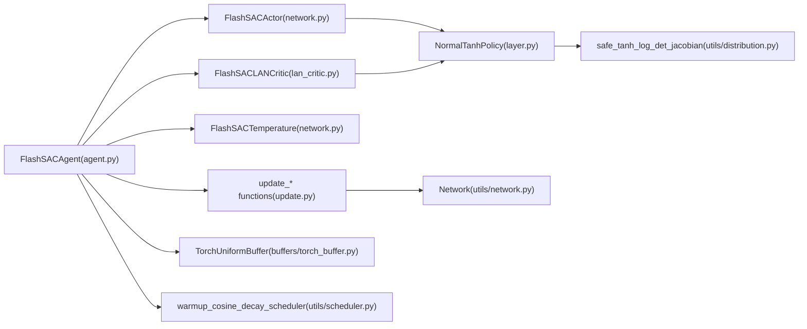

# FlashSAC算法实现

<cite>
**本文引用的文件**   
- [agent.py](file://hardware/flash_rl/agents/flashSAC/agent.py)
- [lan_critic.py](file://hardware/flash_rl/agents/flashSAC/lan_critic.py)
- [network.py](file://hardware/flash_rl/agents/flashSAC/network.py)
- [update.py](file://hardware/flash_rl/agents/flashSAC/update.py)
- [layer.py](file://hardware/flash_rl/agents/flashSAC/layer.py)
- [distribution.py](file://hardware/flash_rl/agents/utils/distribution.py)
- [scheduler.py](file://hardware/flash_rl/agents/utils/scheduler.py)
- [network.py](file://hardware/flash_rl/agents/utils/network.py)
- [torch_buffer.py](file://hardware/flash_rl/buffers/torch_buffer.py)
- [base_agent.py](file://hardware/flash_rl/agents/base_agent.py)
</cite>

## 目录
1. [引言](#引言)
2. [项目结构](#项目结构)
3. [核心组件](#核心组件)
4. [架构总览](#架构总览)
5. [详细组件分析](#详细组件分析)
6. [依赖关系分析](#依赖关系分析)
7. [性能与优化](#性能与优化)
8. [故障排查指南](#故障排查指南)
9. [结论](#结论)
10. [附录：数学推导与代码对应](#附录数学推导与代码对应)

## 引言
本技术文档面向FlashSAC算法的工程实现，系统阐述其作为连续动作空间SAC变体的核心原理与工程细节。重点包括：
- Actor-Critic架构设计（Actor输出正态分布参数，Critic采用分位数分类器）
- 温度参数自适应机制（基于目标熵的自调节）
- Zeta分布噪声采样策略（在训练步内重复使用噪声以降低方差）
- LAN Critic双塔结构（状态-动作塔与目标塔对齐，平方差输入到分类头）
- 网络初始化、优化器配置与学习率调度（Warmup+余弦衰减）
- 奖励归一化、经验回放缓冲、EMA目标网络更新
- 完整数学公式与代码实现的映射关系
- 超参数调优指南与性能优化技巧

## 项目结构
该仓库将FlashSAC实现集中在硬件侧RL子模块中，关键路径如下：
- agents/flashSAC：Agent主类、网络定义、层组件、更新逻辑
- agents/utils：通用工具（安全tanh对数雅可比、学习率调度、Network封装）
- buffers：TorchUniformBuffer经验回放缓冲
- base_agent：抽象基类接口



图表来源
- [agent.py:335-421](file://hardware/flash_rl/agents/flashSAC/agent.py#L335-L421)
- [network.py:18-56](file://hardware/flash_rl/agents/flashSAC/network.py#L18-L56)
- [lan_critic.py:41-66](file://hardware/flash_rl/agents/flashSAC/lan_critic.py#L41-L66)
- [layer.py:111-161](file://hardware/flash_rl/agents/flashSAC/layer.py#L111-L161)
- [update.py:81-319](file://hardware/flash_rl/agents/flashSAC/update.py#L81-L319)
- [distribution.py:7-14](file://hardware/flash_rl/agents/utils/distribution.py#L7-L14)
- [scheduler.py:38-60](file://hardware/flash_rl/agents/utils/scheduler.py#L38-L60)
- [network.py:22-99](file://hardware/flash_rl/agents/utils/network.py#L22-L99)
- [torch_buffer.py:31-183](file://hardware/flash_rl/buffers/torch_buffer.py#L31-L183)

章节来源
- [agent.py:335-421](file://hardware/flash_rl/agents/flashSAC/agent.py#L335-L421)
- [torch_buffer.py:31-183](file://hardware/flash_rl/buffers/torch_buffer.py#L31-L183)

## 核心组件
- FlashSACAgent：协调Actor、Critic、Target Critic、Temperature、Replay Buffer、Reward Normalizer；负责采样、训练循环、保存加载。
- FlashSACActor：残差块+RMS后归一化，输出正态分布均值和标准差，经tanh约束到动作空间。
- FlashSACLANCritic：双塔结构（phi(s,a)与psi(g)），计算(u=(phi-psi)^2)并输入EnsembleCategoricalValue得到分位数概率分布。
- FlashSACTemperature：可学习的温度参数log_temp，exp映射到温度值。
- update_*：分别实现Actor/Critic/Temperature/Target网络的梯度更新与EMA软更新。
- TorchUniformBuffer：支持n-step回报的经验回放缓冲，设备友好，环形存储。
- Network封装：统一持有网络、优化器、调度器，提供compile、weight normalization、EMA更新。

章节来源
- [agent.py:335-565](file://hardware/flash_rl/agents/flashSAC/agent.py#L335-L565)
- [network.py:18-115](file://hardware/flash_rl/agents/flashSAC/network.py#L18-L115)
- [lan_critic.py:41-66](file://hardware/flash_rl/agents/flashSAC/lan_critic.py#L41-L66)
- [update.py:81-319](file://hardware/flash_rl/agents/flashSAC/update.py#L81-L319)
- [torch_buffer.py:31-183](file://hardware/flash_rl/buffers/torch_buffer.py#L31-L183)
- [network.py:22-99](file://hardware/flash_rl/agents/utils/network.py#L22-L99)

## 架构总览
FlashSAC采用Actor-Critic框架，其中：
- Actor输出连续动作的正态分布参数，通过tanh映射到[-1,1]。
- Critic采用分位数分类器（Categorical Value Head），预测Q值的离散概率分布，并通过期望计算标量Q。
- 温度参数自适应，以目标熵为基准动态调整探索强度。
- 目标网络采用EMA软更新，提升稳定性。
- 支持不对称观察空间：Actor仅接收部分观测通道，Critic接收全观测。

```mermaid
sequenceDiagram
participant Env as "环境"
participant Agent as "FlashSACAgent"
participant Actor as "FlashSACActor"
participant Critic as "FlashSACLANCritic"
participant Temp as "FlashSACTemperature"
participant Buffer as "TorchUniformBuffer"
Env->>Agent : 观测obs
Agent->>Actor : 前向(mean,std)
Actor-->>Agent : mean,std
Agent->>Agent : 采样action= tanh(mean + std * noise * temp)
Agent->>Env : action
Env-->>Agent : reward,next_obs,done
Agent->>Buffer : add(transition)
Agent->>Agent : update()
Agent->>Critic : 计算target probs (含actor entropy)
Agent->>Actor : 更新策略(熵正则+BC可选)
Agent->>Temp : 根据entropy与target_entropy更新温度
```

图表来源
- [agent.py:423-516](file://hardware/flash_rl/agents/flashSAC/agent.py#L423-L516)
- [update.py:81-319](file://hardware/flash_rl/agents/flashSAC/update.py#L81-L319)
- [torch_buffer.py:141-183](file://hardware/flash_rl/buffers/torch_buffer.py#L141-L183)

## 详细组件分析

### Actor设计与Zeta噪声采样
- Actor由Embedder+Residual Blocks+RMS Norm+NormalTanhPolicy组成，输出mean/std，经tanh约束。
- Zeta分布噪声采样：
  - 预计算截断Zeta分布的CDF（mu控制幂律指数，max_n限制最大重复次数）。
  - 每次采样时按Zeta分布抽取整数n，并在n步内重复使用同一噪声向量，减少方差。
  - 当计数达到n或重置条件满足时，重新从Zeta分布采样新的n并生成新噪声。



图表来源
- [agent.py:199-256](file://hardware/flash_rl/agents/flashSAC/agent.py#L199-L256)

章节来源
- [agent.py:199-256](file://hardware/flash_rl/agents/flashSAC/agent.py#L199-L256)
- [network.py:18-56](file://hardware/flash_rl/agents/flashSAC/network.py#L18-L56)
- [layer.py:111-161](file://hardware/flash_rl/agents/flashSAC/layer.py#L111-L161)

### LAN Critic双塔结构与分位数分类头
- LAN Critic将观测分为state列与goal列：
  - phi(s,a)塔：拼接state观测与动作，经过嵌入、残差块、RMS后归一化。
  - psi(g)塔：仅处理goal观测，结构同phi但更浅。
  - 计算u=(phi-psi)^2，输入EnsembleCategoricalValue得到num_bins维的对数概率，期望值为标量Q。
- 双塔对齐思想：通过最小化(phi-psi)^2的分布误差，使目标表征与状态-动作表征对齐，提高价值估计稳定性。



图表来源
- [lan_critic.py:41-66](file://hardware/flash_rl/agents/flashSAC/lan_critic.py#L41-L66)
- [layer.py:236-296](file://hardware/flash_rl/agents/flashSAC/layer.py#L236-L296)

章节来源
- [lan_critic.py:13-66](file://hardware/flash_rl/agents/flashSAC/lan_critic.py#L13-L66)
- [layer.py:268-296](file://hardware/flash_rl/agents/flashSAC/layer.py#L268-L296)

### 温度参数自适应机制
- 目标熵temp_target_entropy由动作维度与目标标准差决定。
- 温度网络log_temp可学习，loss为温度乘以(当前熵-目标熵)的平均值。
- 温度用于缩放Actor输出的log_prob，从而在策略梯度中引入熵正则项。



图表来源
- [update.py:290-319](file://hardware/flash_rl/agents/flashSAC/update.py#L290-L319)
- [agent.py:354-356](file://hardware/flash_rl/agents/flashSAC/agent.py#L354-L356)

章节来源
- [update.py:290-319](file://hardware/flash_rl/agents/flashSAC/update.py#L290-L319)
- [agent.py:354-356](file://hardware/flash_rl/agents/flashSAC/agent.py#L354-L356)

### 网络初始化与权重归一化
- Actor、Critic、Target Critic、Temperature均通过统一的Network封装管理。
- 初始化后调用normalize_parameters()对UnitLinear/UnitBatchNorm/UnitRMSNorm等执行权重归一化，稳定训练。
- Weight Normalization在每次优化步骤后执行，确保参数范数约束。

章节来源
- [agent.py:83-196](file://hardware/flash_rl/agents/flashSAC/agent.py#L83-L196)
- [layer.py:10-77](file://hardware/flash_rl/agents/flashSAC/layer.py#L10-L77)
- [network.py:22-99](file://hardware/flash_rl/agents/utils/network.py#L22-L99)

### 优化器配置与学习率调度
- 所有网络使用Adam优化器，启用fused优化（CUDA可用时）。
- 学习率调度采用Warmup+余弦衰减：
  - Warmup阶段线性从init_value增长到peak_value。
  - 之后余弦衰减至end_value，直至decay_steps。
- LambdaLR包装调度函数，按step比例缩放实际学习率。

章节来源
- [agent.py:90-112](file://hardware/flash_rl/agents/flashSAC/agent.py#L90-L112)
- [scheduler.py:38-60](file://hardware/flash_rl/agents/utils/scheduler.py#L38-L60)

### 经验回放与n-step回报
- TorchUniformBuffer维护环形缓冲区，支持n-step回报累积。
- add()时将最近n步累积reward与next_observation写入缓冲区。
- sample()随机采样batch，包含observation、action、reward、terminated、truncated、next_observation。

章节来源
- [torch_buffer.py:31-183](file://hardware/flash_rl/buffers/torch_buffer.py#L31-L183)

## 依赖关系分析
FlashSAC各模块之间的依赖关系如下：



图表来源
- [agent.py:335-421](file://hardware/flash_rl/agents/flashSAC/agent.py#L335-L421)
- [network.py:18-115](file://hardware/flash_rl/agents/flashSAC/network.py#L18-L115)
- [lan_critic.py:41-66](file://hardware/flash_rl/agents/flashSAC/lan_critic.py#L41-L66)
- [update.py:81-319](file://hardware/flash_rl/agents/flashSAC/update.py#L81-L319)
- [layer.py:111-161](file://hardware/flash_rl/agents/flashSAC/layer.py#L111-L161)
- [distribution.py:7-14](file://hardware/flash_rl/agents/utils/distribution.py#L7-L14)
- [scheduler.py:38-60](file://hardware/flash_rl/agents/utils/scheduler.py#L38-L60)
- [network.py:22-99](file://hardware/flash_rl/agents/utils/network.py#L22-L99)
- [torch_buffer.py:31-183](file://hardware/flash_rl/buffers/torch_buffer.py#L31-L183)

## 性能与优化
- AMP混合精度：通过GradScaler与autocast降低显存占用并加速训练。
- torch.compile：对网络forward与关键函数（如_get_mean_and_std、_build_truncated_zeta_cdf、_select_min_q_log_probs）进行编译优化。
- Weight Normalization：在每步优化后对参数进行归一化，提升训练稳定性。
- EMA目标网络：使用foreach_lerp_高效更新目标网络参数。
- Fused Adam：在CUDA环境下启用fused优化器以提升吞吐。
- 奖励归一化：可选的RewardNormalizer对reward进行标准化，改善收敛性。

章节来源
- [agent.py:389-390](file://hardware/flash_rl/agents/flashSAC/agent.py#L389-L390)
- [agent.py:121-124](file://hardware/flash_rl/agents/flashSAC/agent.py#L121-L124)
- [update.py:104-147](file://hardware/flash_rl/agents/flashSAC/update.py#L104-L147)
- [network.py:57-88](file://hardware/flash_rl/agents/utils/network.py#L57-L88)

## 故障排查指南
- 数值不稳定：
  - 检查safe_tanh_log_det_jacobian是否被正确调用，避免tanh变换导致的log_prob溢出。
  - 确认UnitRMSNorm/UnitBatchNorm的normalize_parameters是否在优化后调用。
- 训练不收敛：
  - 调整温度目标熵temp_target_sigma与temp_initial_value。
  - 检查学习率调度参数（warmup_steps、decay_steps、peak_value、end_value）。
  - 验证Critic的min_v/max_v范围是否合理。
- 内存不足：
  - 关闭AMP或降低batch size。
  - 禁用torch.compile或选择更保守的compile_mode。
- 设备相关错误：
  - 确认device_type与buffer_device_type设置一致。
  - 检查CUDA版本与torch.compile兼容性。

章节来源
- [distribution.py:7-14](file://hardware/flash_rl/agents/utils/distribution.py#L7-L14)
- [layer.py:10-77](file://hardware/flash_rl/agents/flashSAC/layer.py#L10-L77)
- [agent.py:325-332](file://hardware/flash_rl/agents/flashSAC/agent.py#L325-L332)

## 结论
FlashSAC在经典SAC基础上引入了多项工程与理论改进：Zeta分布噪声采样提升样本效率，LAN Critic双塔结构增强价值估计稳定性，分位数分类头提供更鲁棒的Q估计，温度自适应与EMA目标网络保障训练稳定。配合AMP、compile、weight normalization等技术，整体训练效率高且易于扩展。

## 附录：数学推导与代码对应

### 熵正则化与策略梯度
- 策略损失：L_pi = E_{a~pi}[ log pi(a|s) * tau - Q(s,a) ]
- 代码对应：
  - actor_loss = (log_probs * temp_value - q).mean()
  - entropy = -log_probs.mean()

章节来源
- [update.py:104-164](file://hardware/flash_rl/agents/flashSAC/update.py#L104-L164)

### 目标Q值更新（分位数分类）
- 目标分布：P*(v) ∝ exp(Q(s',a')/tau) 投影到bins
- 代码对应：
  - target_bin_values = reward + gamma * (bin_values - actor_entropy) * (1-done)
  - target_probs通过scatter_add分配至lower/upper bins

章节来源
- [update.py:32-78](file://hardware/flash_rl/agents/flashSAC/update.py#L32-L78)

### 温度自适应
- 目标熵：H_target = d_a * 0.5 * log(2πeσ^2)
- 温度损失：L_tau = τ * (E[H(pi)] - H_target)
- 代码对应：
  - temp_target_entropy = 0.5 * action_dim * log(2πe * σ^2)
  - temperature_loss = temp_value * (entropy.detach() - target_entropy).mean()

章节来源
- [agent.py:354-356](file://hardware/flash_rl/agents/flashSAC/agent.py#L354-L356)
- [update.py:290-319](file://hardware/flash_rl/agents/flashSAC/update.py#L290-L319)

### Zeta分布噪声采样
- 概率质量函数：P(n) ∝ n^{-μ}, n∈{1,...,N}
- 代码对应：
  - pmf = ns ** (-mu); cdf = cumsum(pmf)
  - n = argmax(u < cdf) + 1

章节来源
- [agent.py:199-219](file://hardware/flash_rl/agents/flashSAC/agent.py#L199-L219)

### LAN Critic双塔对齐
- 目标：最小化D(P_phi || P_psi)，其中u=(φ(s,a)-ψ(g))^2
- 代码对应：
  - phi = sa_tower(state||action)
  - psi = g_tower(goal)
  - predictor((phi-psi)^2)

章节来源
- [lan_critic.py:41-66](file://hardware/flash_rl/agents/flashSAC/lan_critic.py#L41-L66)

### 超参数调优指南
- 温度相关：
  - temp_initial_value：初始探索强度，建议0.01~0.1
  - temp_target_sigma：影响目标熵大小，σ越大目标熵越高，鼓励探索
- 网络结构：
  - actor_num_blocks、critic_num_blocks：控制模型容量
  - critic_num_bins：分位数数量，越多越精细但计算开销大
- 学习率：
  - learning_rate_peak：峰值学习率，通常1e-3~3e-4
  - warmup_step/decay_step：warmup短促，decay覆盖主要训练期
- 噪声采样：
  - actor_noise_zeta_mu：μ越小重尾越强，重复次数更长
  - actor_noise_zeta_max：限制最大重复次数，防止长期停滞

章节来源
- [agent.py:30-81](file://hardware/flash_rl/agents/flashSAC/agent.py#L30-L81)
