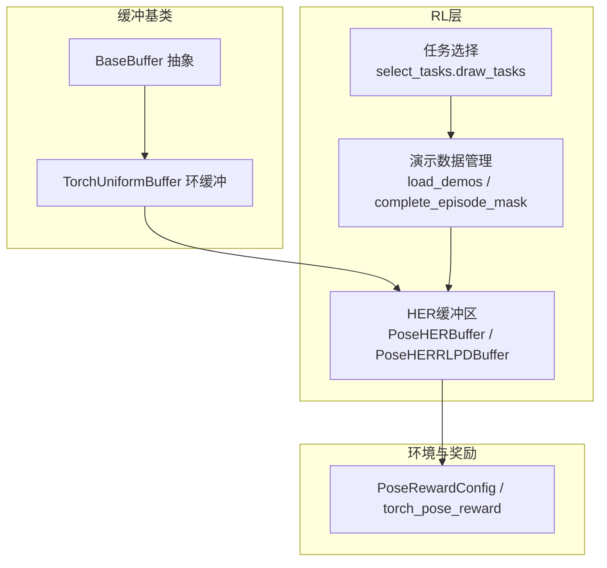
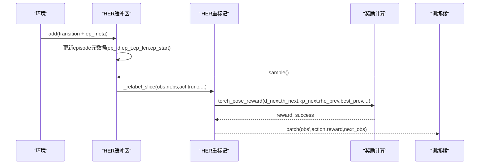
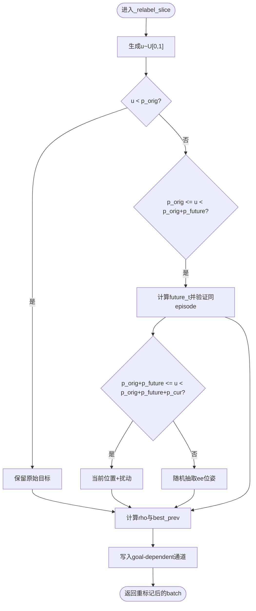
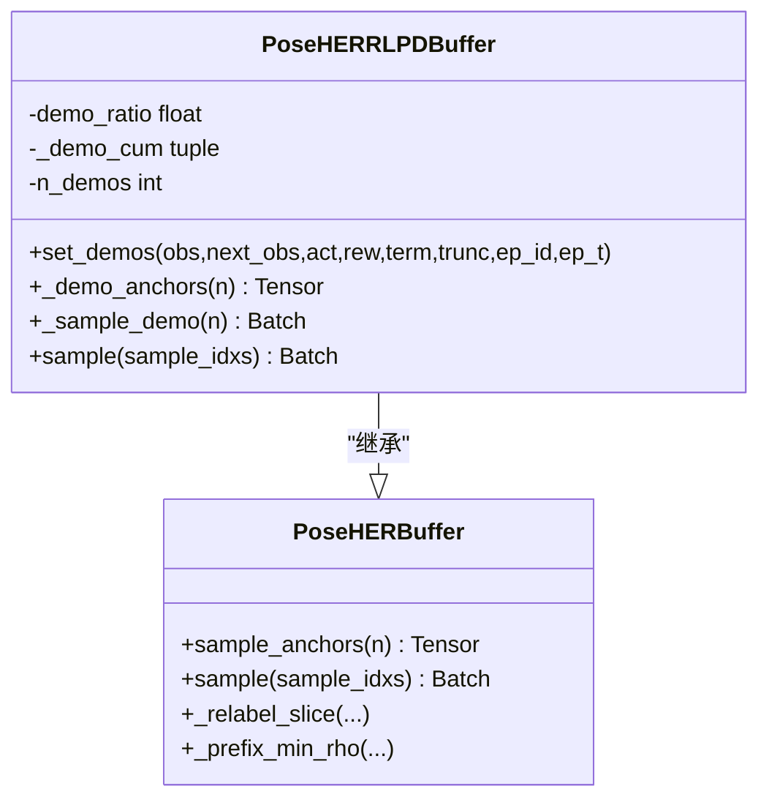
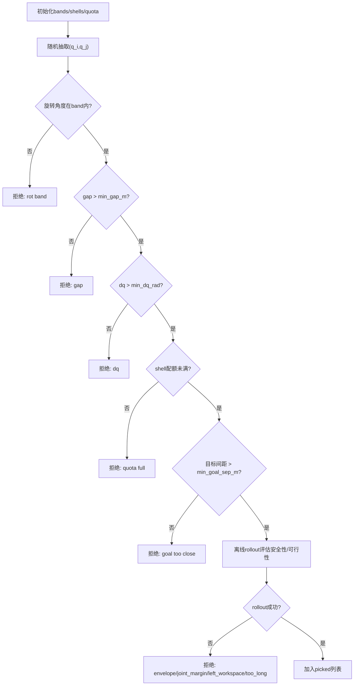
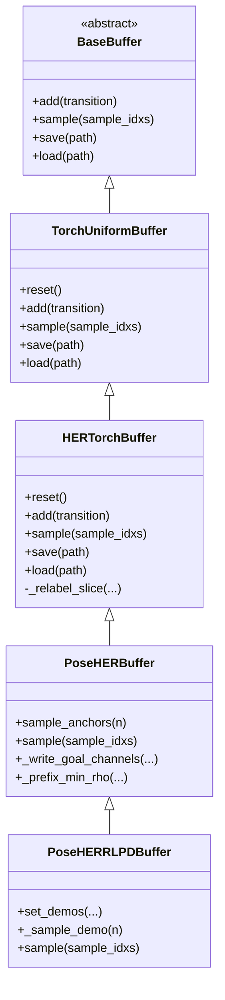
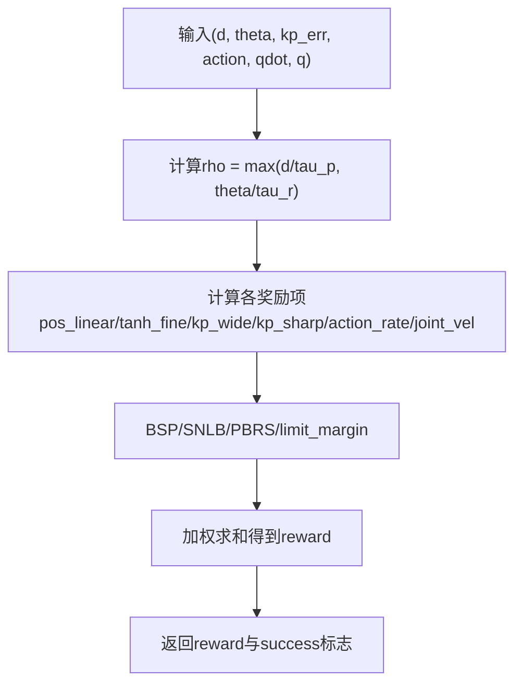
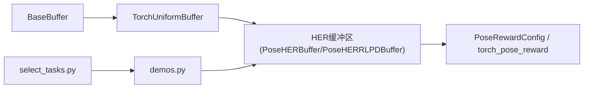

# HER经验回放机制

<cite>
**本文引用的文件**   
- [her.py](file://hardware/policyik_hw/rl/her.py)
- [demos.py](file://hardware/policyik_hw/rl/demos.py)
- [select_tasks.py](file://hardware/policyik_hw/select_tasks.py)
- [base_buffer.py](file://hardware/flash_rl/buffers/base_buffer.py)
- [torch_buffer.py](file://hardware/flash_rl/buffers/torch_buffer.py)
- [reward.py](file://hardware/policyik_hw/envs/reward.py)
</cite>

## 目录
1. [引言](#引言)
2. [项目结构](#项目结构)
3. [核心组件](#核心组件)
4. [架构总览](#架构总览)
5. [详细组件分析](#详细组件分析)
6. [依赖关系分析](#依赖关系分析)
7. [性能与实现要点](#性能与实现要点)
8. [故障排查指南](#故障排查指南)
9. [结论](#结论)
10. [附录：数学原理与公式](#附录数学原理与公式)

## 引言
本文件面向PolicyIK中的Hindsight Experience Replay（HER）机制，系统性解释其核心思想、在Pose任务上的具体实现、缓冲区数据结构与采样策略，以及与演示数据混合训练、任务选择算法的协同方式。HER通过“ hindsight goal relabeling ”将失败轨迹重新标记为成功，从而在稀疏奖励环境下显著提升学习效率；在PolicyIK中，HER被扩展为支持6-D位姿目标、动作重缩放、近锚点采样、演示数据混合等工程化能力。

## 项目结构
本项目中与HER相关的代码主要分布在以下模块：
- hardware/policyik_hw/rl/her.py：HER缓冲区的核心实现，包括在线环缓冲、未来目标重标记、演示数据混合、近锚点采样、位姿相关通道写入与奖励计算。
- hardware/policyik_hw/rl/demos.py：演示数据的加载、完整性校验与环境接口一致性检查。
- hardware/policyik_hw/select_tasks.py：从工作空间点云中筛选大旋转角度的演示任务，保证任务多样性与安全性。
- hardware/flash_rl/buffers/base_buffer.py：通用缓冲抽象接口。
- hardware/flash_rl/buffers/torch_buffer.py：基于PyTorch张量的均匀采样环缓冲实现。
- hardware/policyik_hw/envs/reward.py：位姿奖励配置与批量奖励函数，HER在重标记后使用此奖励进行训练信号生成。

**图表来源**
- [her.py:39-516](file://hardware/policyik_hw/rl/her.py#L39-L516)
- [demos.py:10-80](file://hardware/policyik_hw/rl/demos.py#L10-L80)
- [select_tasks.py:70-114](file://hardware/policyik_hw/select_tasks.py#L70-L114)
- [base_buffer.py:11-69](file://hardware/flash_rl/buffers/base_buffer.py#L11-L69)
- [torch_buffer.py:31-236](file://hardware/flash_rl/buffers/torch_buffer.py#L31-L236)
- [reward.py:23-184](file://hardware/policyik_hw/envs/reward.py#L23-L184)

**章节来源**
- [her.py:39-516](file://hardware/policyik_hw/rl/her.py#L39-L516)
- [demos.py:10-80](file://hardware/policyik_hw/rl/demos.py#L10-L80)
- [select_tasks.py:70-114](file://hardware/policyik_hw/select_tasks.py#L70-L114)
- [base_buffer.py:11-69](file://hardware/flash_rl/buffers/base_buffer.py#L11-L69)
- [torch_buffer.py:31-236](file://hardware/flash_rl/buffers/torch_buffer.py#L31-L236)
- [reward.py:23-184](file://hardware/policyik_hw/envs/reward.py#L23-L184)

## 核心组件
- HERConfig：定义HER目标源概率分布（原始目标、未来目标、当前位姿扰动目标、随机目标），并进行概率和为1的校验。
- HERTorchBuffer：继承自TorchUniformBuffer，增加每episode元数据（ep_id、ep_t、ep_len、ep_start）、按行追加transition、以及基于累积概率的目标选择逻辑。
- PoseHERBuffer：在HER基础上引入位姿布局layout、奖励配置rew_cfg、近锚点采样、rho最佳历史前缀最小值缓存、以及goal-dependent通道重写（goal_pos、goal_rot、err_pos、kp_err、rho_best等）。
- PoseHERRLPDBuffer：在PoseHERBuffer之上增加冻结演示存储，支持按demo_ratio比例混合在线与演示样本，并独立配置演示目标源概率。
- demos.py：提供演示数据加载、完整性校验（完整episode）、环境接口差异检查（硬/软差异）。
- select_tasks.py：从工作空间点云中选择具有大旋转角度、安全可达的任务对，输出结构化任务清单。
- reward.py：PoseRewardConfig与torch_pose_reward，提供位姿误差度量、rho指标、多分量奖励组合与观测通道构造。

**章节来源**
- [her.py:22-516](file://hardware/policyik_hw/rl/her.py#L22-L516)
- [demos.py:10-80](file://hardware/policyik_hw/rl/demos.py#L10-L80)
- [select_tasks.py:19-114](file://hardware/policyik_hw/select_tasks.py#L19-L114)
- [reward.py:23-184](file://hardware/policyik_hw/envs/reward.py#L23-L184)

## 架构总览
HER在PolicyIK中的整体流程如下：
- 数据采集阶段：机器人执行任务，产生(observation, action, reward, terminated, truncated, next_observation)序列，同时记录episode元信息(ep_id, ep_t)。
- 演示数据准备：从演示文件中加载完整episode，校验环境参数与奖励参数的一致性，过滤不完整episode。
- 任务选择阶段：从工作空间点云中筛选具备大旋转角度、关节距离足够、包络安全、步数限制内的任务对，形成多样化演示任务集。
- 训练阶段：HER缓冲区在线追加transition，并在采样时根据HERConfig的概率分布对目标进行relabeling（未来目标、当前扰动、随机、原始），同时可混合演示数据以加速学习。

**图表来源**
- [her.py:79-151](file://hardware/policyik_hw/rl/her.py#L79-L151)
- [her.py:314-411](file://hardware/policyik_hw/rl/her.py#L314-L411)
- [reward.py:157-184](file://hardware/policyik_hw/envs/reward.py#L157-L184)

**章节来源**
- [her.py:79-151](file://hardware/policyik_hw/rl/her.py#L79-L151)
- [her.py:314-411](file://hardware/policyik_hw/rl/her.py#L314-L411)
- [reward.py:157-184](file://hardware/policyik_hw/envs/reward.py#L157-L184)

## 详细组件分析

### HER目标源概率与重标记策略
HERConfig定义了四类目标源的概率：
- p_orig：保留原始目标（episode初始goal）。
- p_future：未来目标（沿episode时间轴向前采样ee位姿作为新goal）。
- p_cur：当前位姿附近扰动（在当前位置附近添加位置/旋转噪声）。
- p_rand：随机目标（从缓冲区中随机抽取一条观测的ee位姿作为goal）。

_relabel_slice中依据累积概率cum选择目标类型，并对不同目标类型分别处理：
- 未来目标：根据指数偏移offset = ceil(log(u)/log(gamma))确定未来时刻future_t，若仍在同一episode内则采用该时刻的ee位姿作为新goal。
- 当前扰动：以near_zero_frac概率保持原位姿，否则在位置与旋转上添加高斯扰动。
- 随机目标：从src_obs中随机抽取ee位姿。
- force_orig：当episode长度未完全记录或边界情况时强制使用原始目标。

**图表来源**
- [her.py:314-411](file://hardware/policyik_hw/rl/her.py#L314-L411)

**章节来源**
- [her.py:22-52](file://hardware/policyik_hw/rl/her.py#L22-L52)
- [her.py:314-411](file://hardware/policyik_hw/rl/her.py#L314-L411)

### 演示数据混合机制
PoseHERRLPDBuffer在采样时按比例混合在线与演示数据：
- demo_ratio：控制演示样本在batch中的占比。
- demo_p_orig/demo_p_future/demo_p_cur/demo_p_rand：演示数据内部的目标源概率。
- set_demos：接收演示数据数组，校验维度、episode连续性、完整性（terminated/truncated），构建块级元数据（block_id、start、len）。
- _sample_demo：对演示数据进行独立的HER重标记，不强制使用stored_reward（use_stored_for_orig=False）。
- sample：若无演示数据或demo_ratio=0，则退化为在线采样；否则按比例拼接在线与演示样本。

**图表来源**
- [her.py:413-516](file://hardware/policyik_hw/rl/her.py#L413-L516)

**章节来源**
- [her.py:413-516](file://hardware/policyik_hw/rl/her.py#L413-L516)
- [demos.py:43-80](file://hardware/policyik_hw/rl/demos.py#L43-L80)

### 任务选择算法
select_tasks.py从工作空间点云中筛选高质量演示任务：
- 旋转带（rot bands）：按旋转角度区间分层（如60-90、90-120、120-180度）。
- 径向壳（radial shells）：按目标距工作空间中心的距离分层。
- 配额（quota）：每个(stratum)分配固定数量的任务，确保覆盖均衡。
- 拒绝条件：旋转角度不在范围内、起点终点距离过小、关节空间距离过小、已接受目标过近、包络/关节限位不安全、到达步数过长。
- 离线rollout：以增益1、完美跟踪的方式模拟从q_start到q_goal的轨迹，评估安全性与可行性。

**图表来源**
- [select_tasks.py:70-114](file://hardware/policyik_hw/select_tasks.py#L70-L114)

**章节来源**
- [select_tasks.py:19-114](file://hardware/policyik_hw/select_tasks.py#L19-L114)

### 缓冲区数据结构与采样策略
- TorchUniformBuffer：环形缓冲存储observation、next_observation、action、reward、terminated、truncated，支持n-step过渡与设备无关的张量操作。
- HERTorchBuffer：在基础缓冲之上维护episode元数据，支持按行追加transition，并在采样时调用_relabel_slice进行HER重标记。
- PoseHERBuffer：额外维护row-wise rho与next pose缓存，支持近锚点采样（near_anchor_frac/near_anchor_rho），并重写goal-dependent通道（goal_pos、goal_rot、err_pos、kp_err、rho_best等）。
- PoseHERRLPDBuffer：冻结演示数据存储，支持演示目标源概率与近锚点采样，并按demo_ratio混合在线与演示样本。

**图表来源**
- [base_buffer.py:11-69](file://hardware/flash_rl/buffers/base_buffer.py#L11-L69)
- [torch_buffer.py:31-236](file://hardware/flash_rl/buffers/torch_buffer.py#L31-L236)
- [her.py:39-516](file://hardware/policyik_hw/rl/her.py#L39-L516)

**章节来源**
- [base_buffer.py:11-69](file://hardware/flash_rl/buffers/base_buffer.py#L11-L69)
- [torch_buffer.py:31-236](file://hardware/flash_rl/buffers/torch_buffer.py#L31-L236)
- [her.py:39-516](file://hardware/policyik_hw/rl/her.py#L39-L516)

### 奖励设计与rho指标
PoseRewardConfig定义了位姿奖励的多项权重与阈值，torch_pose_reward提供批量化的奖励计算：
- 位置线性项、tanh精细项、关键点误差宽/窄项、动作变化率、关节速度惩罚。
- BSP（Best Success Progress）、SNLB（Success Nonlinear Benefit）、PBRS（Potential-Based Reward Shaping）等高级项。
- 极限裕度惩罚（limit_margin）在接近关节限位时施加。
- rho指标综合位置与旋转误差，用于衡量当前状态与目标的接近程度，并用于构造rho_best观测通道。

**图表来源**
- [reward.py:157-184](file://hardware/policyik_hw/envs/reward.py#L157-L184)

**章节来源**
- [reward.py:23-184](file://hardware/policyik_hw/envs/reward.py#L23-L184)

## 依赖关系分析
- PolicyIK的HER实现依赖于flash_rl的缓冲抽象与TorchUniformBuffer，确保设备无关与高效张量操作。
- HER在重标记后使用envs/reward.py中的torch_pose_reward计算训练信号，因此奖励配置与HER的参数（如rho_obs_d0、kp_size）需保持一致。
- 演示数据加载与任务选择为HER提供高质量的先验数据，提升稀疏奖励下的收敛速度与稳定性。

**图表来源**
- [base_buffer.py:11-69](file://hardware/flash_rl/buffers/base_buffer.py#L11-L69)
- [torch_buffer.py:31-236](file://hardware/flash_rl/buffers/torch_buffer.py#L31-L236)
- [her.py:39-516](file://hardware/policyik_hw/rl/her.py#L39-L516)
- [reward.py:23-184](file://hardware/policyik_hw/envs/reward.py#L23-L184)
- [demos.py:10-80](file://hardware/policyik_hw/rl/demos.py#L10-L80)
- [select_tasks.py:70-114](file://hardware/policyik_hw/select_tasks.py#L70-L114)

**章节来源**
- [base_buffer.py:11-69](file://hardware/flash_rl/buffers/base_buffer.py#L11-L69)
- [torch_buffer.py:31-236](file://hardware/flash_rl/buffers/torch_buffer.py#L31-L236)
- [her.py:39-516](file://hardware/policyik_hw/rl/her.py#L39-L516)
- [reward.py:23-184](file://hardware/policyik_hw/envs/reward.py#L23-L184)
- [demos.py:10-80](file://hardware/policyik_hw/rl/demos.py#L10-L80)
- [select_tasks.py:70-114](file://hardware/policyik_hw/select_tasks.py#L70-L114)

## 性能与实现要点
- 设备优化：TorchUniformBuffer在CPU设备上启用pin_memory以提升数据传输效率；所有张量统一转换为float32以避免精度不一致。
- 内存布局：HER缓冲区维护row-wise rho与next pose缓存，避免重复计算；_prefix_min_rho使用前缀最小值缓存减少重复遍历。
- 采样效率：HER通过累积概率快速选择目标类型；近锚点采样通过候选池与阈值筛选提高样本质量。
- 演示混合：演示数据冻结存储，避免训练过程中污染；按demo_ratio混合在线与演示样本，平衡探索与利用。

[本节为一般性指导，无需特定文件引用]

## 故障排查指南
- 演示数据维度不匹配：确保演示数据的observation宽度与缓冲区一致，action维度与缓冲区一致。
- 演示episode不完整：complete_episode_mask会过滤未terminated或未truncated的episode，需在加载前清理。
- 环境接口不一致：interface_diff会报告env与reward参数的硬差异，导致演示数据被拒绝；需确保录制与运行环境一致。
- HER概率配置错误：HERConfig.validate会检查概率和是否为1且p_orig>0，配置错误将抛出异常。
- 缓冲区加载元数据缺失：HER元数据(.her文件)必须存在，否则load会报错。

**章节来源**
- [demos.py:60-80](file://hardware/policyik_hw/rl/demos.py#L60-L80)
- [her.py:31-37](file://hardware/policyik_hw/rl/her.py#L31-L37)
- [her.py:140-151](file://hardware/policyik_hw/rl/her.py#L140-L151)

## 结论
HER在PolicyIK中通过未来目标重标记、当前扰动目标、随机目标与原始目标的概率混合，有效提升了稀疏奖励环境下的学习效率。结合演示数据混合与任务选择算法，系统能够在真实机器人训练中稳定收敛。其核心优势在于：
- 灵活的目标源概率配置，适应不同任务难度与探索需求。
- 高效的缓冲区设计与批处理奖励计算，支持大规模并行训练。
- 严谨的数据校验与任务筛选，确保训练数据的质量与多样性。

[本节为总结性内容，无需特定文件引用]

## 附录：数学原理与公式
- rho指标：rho = max(d/τ_p, θ/τ_r)，其中d为位置误差，θ为旋转误差，τ_p与τ_r为尺度参数。
- 未来目标偏移：offset = ceil(log(u)/log(γ))，其中u~U[0,1]，γ为折扣因子。
- 动作重缩放：a_rel = clamp(a * ratio, -1, 1)，ratio由action_gain(d0, th0)/action_gain(d_obs, th_obs)计算，确保重标记后的动作幅度合理。
- 奖励组合：reward = Σ w_i * term_i，包含位置线性、tanh精细、关键点误差、动作变化率、关节速度、BSP、SNLB、PBRS、limit_margin等项。

[本节为概念性说明，无需特定文件引用]