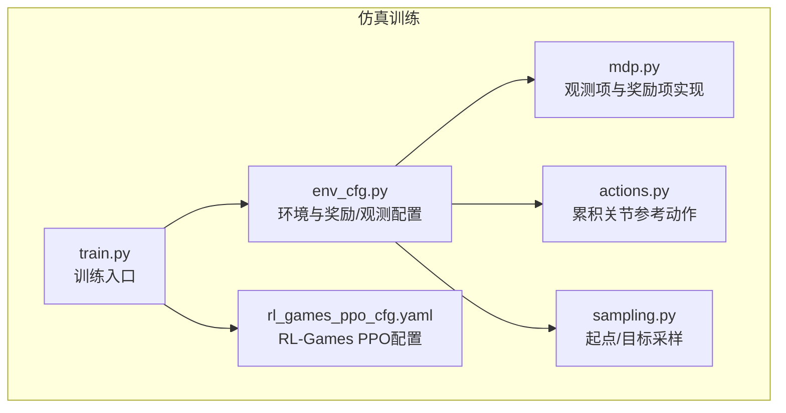
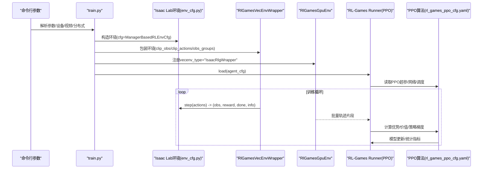
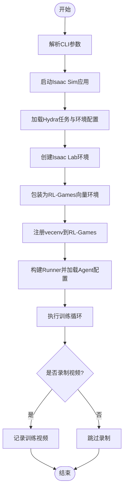
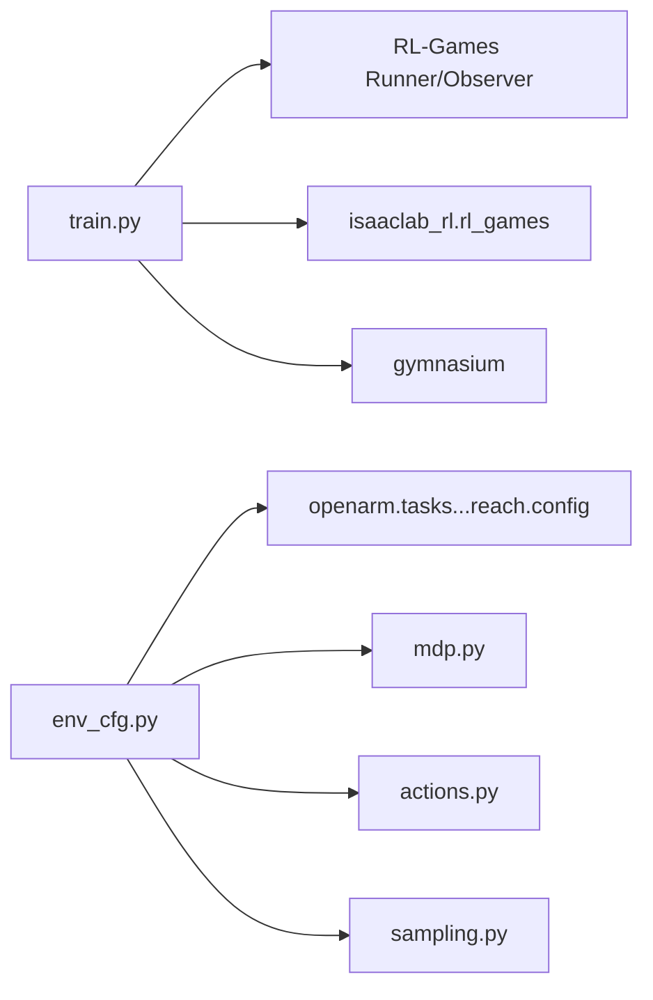

# PPO仿真训练配置

<cite>
**本文引用的文件**   
- [simulation/policyik_sim/tasks/agents/rl_games_ppo_cfg.yaml](file://simulation/policyik_sim/tasks/agents/rl_games_ppo_cfg.yaml)
- [simulation/policyik_sim/train.py](file://simulation/policyik_sim/train.py)
- [simulation/policyik_sim/tasks/env_cfg.py](file://simulation/policyik_sim/tasks/env_cfg.py)
- [simulation/policyik_sim/tasks/mdp.py](file://simulation/policyik_sim/tasks/mdp.py)
- [simulation/policyik_sim/tasks/actions.py](file://simulation/policyik_sim/tasks/actions.py)
- [simulation/policyik_sim/tasks/sampling.py](file://simulation/policyik_sim/tasks/sampling.py)
</cite>

## 目录
1. [引言](#引言)
2. [项目结构](#项目结构)
3. [核心组件](#核心组件)
4. [架构总览](#架构总览)
5. [详细组件分析](#详细组件分析)
6. [依赖关系分析](#依赖关系分析)
7. [性能与训练特性](#性能与训练特性)
8. [故障排查指南](#故障排查指南)
9. [结论](#结论)
10. [附录：参数调优建议与监控指标](#附录参数调优建议与监控指标)

## 引言
本文面向在Isaac Lab环境中使用RL-Games框架进行PPO仿真实训的工程师与研究者，系统梳理PolicyIK任务的PPO配置、网络与训练超参、环境初始化与数据流、策略更新流程，并给出收敛性分析与性能评估方法。文档同时说明仿真预训练对真实机器人训练的衔接方式，并提供可操作的参数调优建议与监控指标清单。

## 项目结构
本项目在simulation目录下提供PolicyIK的RL任务定义、训练入口与RL-Games配置文件；hardware目录为真实机器人部署相关代码，不在本文重点范围内。

图表来源
- [simulation/policyik_sim/train.py:103-218](file://simulation/policyik_sim/train.py#L103-L218)
- [simulation/policyik_sim/tasks/env_cfg.py:27-132](file://simulation/policyik_sim/tasks/env_cfg.py#L27-L132)
- [simulation/policyik_sim/tasks/agents/rl_games_ppo_cfg.yaml:1-81](file://simulation/policyik_sim/tasks/agents/rl_games_ppo_cfg.yaml#L1-L81)

章节来源
- [simulation/policyik_sim/train.py:17-100](file://simulation/policyik_sim/train.py#L17-L100)
- [simulation/policyik_sim/tasks/env_cfg.py:1-25](file://simulation/policyik_sim/tasks/env_cfg.py#L1-L25)

## 核心组件
- RL-Games PPO配置：定义算法名称、网络结构、训练超参、设备与日志路径等。
- Isaac Lab环境配置：定义观测、奖励、命令、动作、场景与求解器参数。
- MDP模块：实现关键观测项（末端位姿误差、关键点偏移、误差历史）与奖励项（关键点跟踪、势能整形、回退惩罚、停留奖励、关节裕度、改进奖励）。
- 动作模块：累积关节参考动作，按误差自适应缩放步长，保证稳定探索与精细控制。
- 采样模块：从池化数据中均匀采样初始位形与目标位姿，支持可选方向采样。
- 训练入口：启动Isaac Sim、注册RL-Games环境、加载配置、运行训练与记录视频/W&B。

章节来源
- [simulation/policyik_sim/tasks/agents/rl_games_ppo_cfg.yaml:1-81](file://simulation/policyik_sim/tasks/agents/rl_games_ppo_cfg.yaml#L1-L81)
- [simulation/policyik_sim/tasks/env_cfg.py:27-132](file://simulation/policyik_sim/tasks/env_cfg.py#L27-L132)
- [simulation/policyik_sim/tasks/mdp.py:37-232](file://simulation/policyik_sim/tasks/mdp.py#L37-L232)
- [simulation/policyik_sim/tasks/actions.py:15-76](file://simulation/policyik_sim/tasks/actions.py#L15-L76)
- [simulation/policyik_sim/tasks/sampling.py:19-69](file://simulation/policyik_sim/tasks/sampling.py#L19-L69)
- [simulation/policyik_sim/train.py:103-218](file://simulation/policyik_sim/train.py#L103-L218)

## 架构总览
下图展示RL-Games Runner与Isaac Lab环境的交互流程，以及PolicyIK任务的关键子模块如何参与数据采集与策略更新。

图表来源
- [simulation/policyik_sim/train.py:179-218](file://simulation/policyik_sim/train.py#L179-L218)
- [simulation/policyik_sim/tasks/agents/rl_games_ppo_cfg.yaml:44-81](file://simulation/policyik_sim/tasks/agents/rl_games_ppo_cfg.yaml#L44-L81)

## 详细组件分析

### RL-Games PPO配置（rl_games_ppo_cfg.yaml）
- 算法与模型
  - 算法名：a2c_continuous（RL-Games中的连续动作PPO实现）
  - 模型名：continuous_a2c_logstd
  - 网络：actor_critic，非分离式；MLP两层[256, 256]，激活ELU；固定方差sigma初始化值为0
- 训练配置（config段）
  - 设备：cuda:0；多GPU关闭；混合精度关闭
  - 归一化：输入与值函数均启用；优势归一化开启；value_bootstrap开启
  - 学习率：1e-3；调度策略adaptive（legacy）；KL阈值0.01
  - 训练轮次：max_epochs=13000；保存策略save_best_after=200，save_frequency=100
  - 采样与批次：horizon_length=24；minibatch_size=24576；mini_epochs=5
  - 正则与裁剪：entropy_coef=0.01；grad_norm=1.0；e_clip=0.2；critic_coef=2；clip_value=True；bounds_loss_coef=0.0001
- 环境包装裁剪：clip_observations=100.0；clip_actions=100.0

要点解读
- horizon_length×num_actors≈minibatch_size，确保每步更新有足够样本；本配置下num_actors由环境自动注入。
- adaptive学习率+KL阈值用于稳定PPO更新，避免策略分布突变。
- 固定sigma简化了探索方差的学习，配合熵系数维持探索。

章节来源
- [simulation/policyik_sim/tasks/agents/rl_games_ppo_cfg.yaml:11-81](file://simulation/policyik_sim/tasks/agents/rl_games_ppo_cfg.yaml#L11-L81)

### Isaac Lab环境配置（env_cfg.py）
- 任务继承自OpenArm Reach任务，重写观测、奖励、命令与动作以适配PolicyIK。
- 训练模式
  - 起点/目标：分别使用TRAIN_START_POOL与TRAIN_GOAL_POOL池化数据
  - 观测：包含goal_position、keypoint_offsets、position/orientation_coarse/fine、error_history、command_state、actions等（约54维）
  - 奖励：end_effector_keypoint_tracking（宽核）、backslide_penalty、potential_shaping、dwell、joint_margin、improvement等
  - 动作：AccumulatedJointReferenceAction，带误差自适应增益g_min与位置/方向斜坡
- 仿真求解器：solver_position_iteration_count=32提升稳定性

章节来源
- [simulation/policyik_sim/tasks/env_cfg.py:27-132](file://simulation/policyik_sim/tasks/env_cfg.py#L27-L132)

### MDP观测与奖励（mdp.py）
- 观测项
  - goal_position_obs：基座坐标系下的目标位置
  - keypoint_offset_obs：末端三个关键点相对于目标的偏移（9维）
  - ee_position_error_obs / ee_orientation_error_obs：末端位置/姿态误差（归一化裁剪）
  - error_history_obs：基于容忍度的误差历史状态（两通道）
  - command_state_obs：上一时刻动作保留的关节参考与当前关节之差
- 奖励项
  - keypoint_error_tanh：关键点跟踪核函数，平滑且零和约束
  - potential_shaping：势能整形，加速回报传播
  - backslide_penalty：回退惩罚，抑制退化
  - dwell_reward：达到容差即给正奖励
  - joint_margin_cost：关节软限裕度惩罚，保护硬件
  - improvement_reward：相对最佳状态的单调改进奖励

复杂度与数值稳定性
- 大量张量运算向量化，时间复杂度O(N_env)
- 通过clamp/tanh/容差门控保证数值稳定与奖励有界

章节来源
- [simulation/policyik_sim/tasks/mdp.py:37-232](file://simulation/policyik_sim/tasks/mdp.py#L37-L232)

### 累积关节参考动作（actions.py）
- 设计思想：将策略输出解释为“累积关节参考增量”，结合误差自适应增益，使远距离粗调、近距离微调更自然。
- 关键逻辑
  - _gain：根据末端位置误差与姿态误差计算增益g∈[g_min,1]
  - process_actions：维护内部目标z，按delta=g·scale·action更新，并受软限裁剪
- 优点：降低策略输出的尺度敏感性，提高训练稳定性与泛化能力

章节来源
- [simulation/policyik_sim/tasks/actions.py:15-76](file://simulation/policyik_sim/tasks/actions.py#L15-L76)

### 起点/目标采样（sampling.py）
- reset_joints_from_pool：从池化文件中随机抽取初始关节角，置零速度
- PoolPoseCommand：从池化文件中抽取目标位姿（位置+可选方向），支持use_sampled_orientation
- 缓存机制：对池化数据与关节ID做全局缓存，减少IO与重复计算

章节来源
- [simulation/policyik_sim/tasks/sampling.py:19-69](file://simulation/policyik_sim/tasks/sampling.py#L19-L69)

### 训练入口与流程（train.py）
- 启动Isaac Sim AppLauncher，解析CLI参数（视频、设备、分布式、检查点、W&B追踪等）
- 合并Hydra任务配置与环境配置，设置log_dir、dump env/agent配置到日志目录
- 构造环境→单智能体转换（如需要）→可选RecordVideo→RlGamesVecEnvWrapper包装→注册RL-Games vecenv→Runner加载配置→训练循环
- 支持断点续训与W&B实验追踪

图表来源
- [simulation/policyik_sim/train.py:67-100](file://simulation/policyik_sim/train.py#L67-L100)
- [simulation/policyik_sim/train.py:103-218](file://simulation/policyik_sim/train.py#L103-L218)
- [simulation/policyik_sim/train.py:220-246](file://simulation/policyik_sim/train.py#L220-L246)

章节来源
- [simulation/policyik_sim/train.py:17-256](file://simulation/policyik_sim/train.py#L17-L256)

## 依赖关系分析
- train.py依赖isaaclab_rl.rl_games提供的RlGamesVecEnvWrapper/RlGamesGpuEnv与RL-Games Runner
- env_cfg.py依赖openarm_isaac_lab的基础Reach任务，并在其上扩展PolicyIK的观测/奖励/动作
- mdp.py与actions.py为纯PyTorch实现，无外部强依赖
- sampling.py依赖NumPy与Isaac Lab命令接口

图表来源
- [simulation/policyik_sim/train.py:79-100](file://simulation/policyik_sim/train.py#L79-L100)
- [simulation/policyik_sim/tasks/env_cfg.py:13-20](file://simulation/policyik_sim/tasks/env_cfg.py#L13-L20)

章节来源
- [simulation/policyik_sim/train.py:79-100](file://simulation/policyik_sim/train.py#L79-L100)
- [simulation/policyik_sim/tasks/env_cfg.py:13-20](file://simulation/policyik_sim/tasks/env_cfg.py#L13-L20)

## 性能与训练特性
- 并行与环境批处理
  - num_actors由环境unwrapped.num_envs注入，horizon_length=24，minibatch_size=24576，mini_epochs=5，适合GPU高吞吐训练
- 数值稳定与归一化
  - normalize_input/normalize_value/normalize_advantage全开，有助于稳定PPO优化
  - clip_observations/clip_actions=100.0防止异常值导致梯度爆炸
- 探索与正则
  - fixed_sigma=True且sigma_init=0，配合entropy_coef=0.01保持基础探索
  - bounds_loss_coef=0.0001约束动作边界，增强鲁棒性
- 训练时长与保存
  - max_epochs=13000，save_best_after=200，save_frequency=100，便于长期训练与模型选择

章节来源
- [simulation/policyik_sim/tasks/agents/rl_games_ppo_cfg.yaml:44-81](file://simulation/policyik_sim/tasks/agents/rl_games_ppo_cfg.yaml#L44-L81)
- [simulation/policyik_sim/train.py:208-218](file://simulation/policyik_sim/train.py#L208-L218)

## 故障排查指南
- 设备与分布式
  - 若出现CUDA设备不匹配，检查args_cli.device与agent_cfg.params.config.device一致性；分布式模式下需同步env_cfg.sim.device
- 检查点续训
  - 传入--checkpoint后，train.py会自动设置load_checkpoint=True与load_path；确认路径有效且与当前配置兼容
- W&B追踪
  - 启用--track时需指定--wandb-entity；首次运行会写入env_cfg与agent_cfg到W&B
- 视频录制
  - --video会强制enable_cameras；注意磁盘空间与I/O开销
- 环境维度与观测组
  - 若自定义观测组，确保obs_groups与concate_obs_groups与RL-Games期望一致

章节来源
- [simulation/policyik_sim/train.py:118-136](file://simulation/policyik_sim/train.py#L118-L136)
- [simulation/policyik_sim/train.py:154-159](file://simulation/policyik_sim/train.py#L154-L159)
- [simulation/policyik_sim/train.py:186-196](file://simulation/policyik_sim/train.py#L186-L196)
- [simulation/policyik_sim/train.py:224-246](file://simulation/policyik_sim/train.py#L224-L246)

## 结论
PolicyIK在Isaac Lab上通过RL-Games实现了稳定的PPO训练。其关键优势包括：
- 精心设计的观测与奖励体系，兼顾探索效率与任务导向
- 累积关节参考动作与误差自适应增益，提升训练稳定性与控制精度
- 完善的归一化与自适应学习率机制，保障大规模并行训练收敛
- 与真实机器人训练的衔接路径清晰：仿真预训练产出策略权重，可在硬件侧通过相同动作/观测接口进行微调或迁移

## 附录：参数调优建议与监控指标

### 参数调优建议
- 网络与探索
  - 若训练初期不稳定，可适当增大entropy_coef至0.02~0.05，或临时放宽kl_threshold
  - 若策略过早收敛，可暂时关闭fixed_sigma，让网络学习方差
- 学习率与调度
  - 若损失震荡，降低learning_rate至5e-4，或缩短lr_schedule周期
  - 若收敛缓慢，逐步提高learning_rate或增大mini_epochs
- 批次与并行
  - minibatch_size过小会导致梯度噪声大，可按num_actors×horizon_length调整
  - 增加num_actors可提升吞吐，但需显存充足
- 奖励与观测
  - 若任务难以学会，适当增大improvement_reward权重或放宽tolerance参数
  - 若动作抖动，增大bounds_loss_coef或减小动作尺度scale

### 训练监控指标
- 策略与价值
  - policy_loss/value_loss/entropy/kl_divergence
- 环境指标
  - episode_reward_mean/episode_len_mean/success_rate（可通过info字段统计）
- 资源与性能
  - GPU利用率/显存占用/帧率（FPS）
- 可视化
  - 训练视频（RecordVideo）与W&B曲线（--track）

### 与真实机器人训练的衔接
- 动作接口：硬件侧复用AccumulatedJointReferenceAction语义，将策略输出映射为关节参考增量
- 观测接口：对齐env_cfg.py定义的观测序列（goal_position/keypoint_offsets/coarse-fine errors/error_history/command_state/actions）
- 预训练策略：在硬件上进行少量在线微调（例如降低学习率、缩小动作尺度），以提升域适应效果