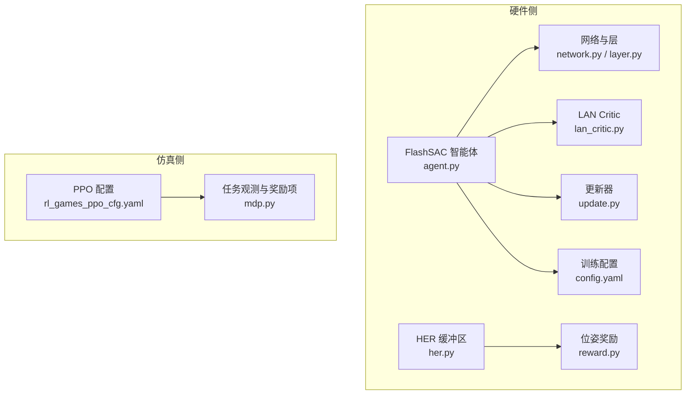
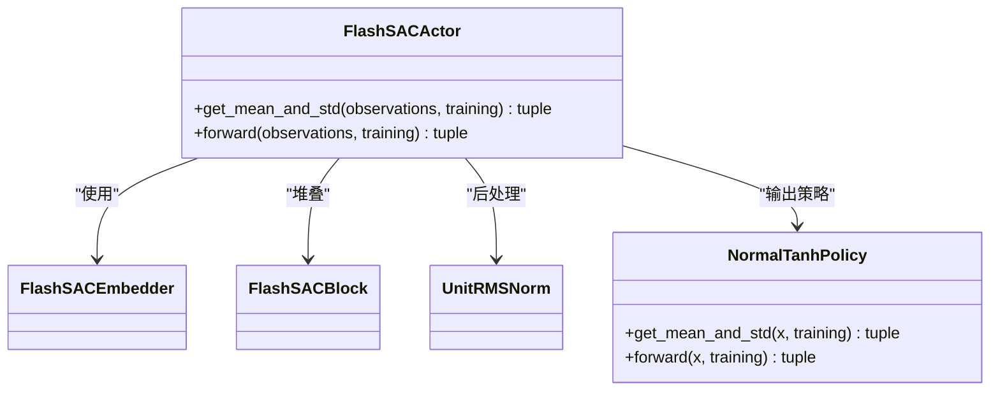
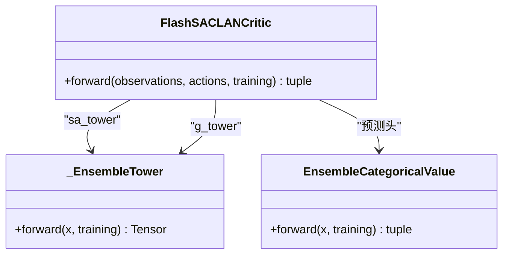
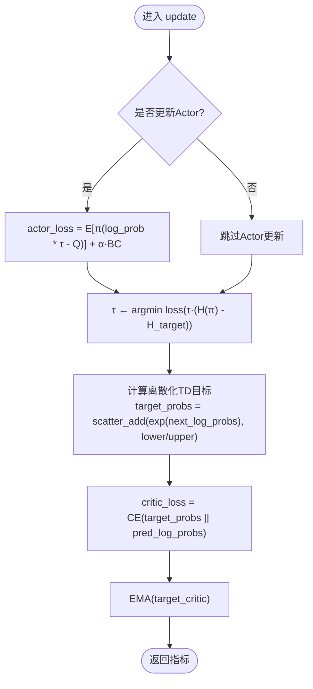
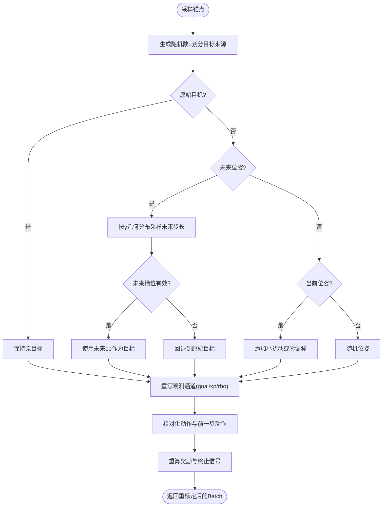
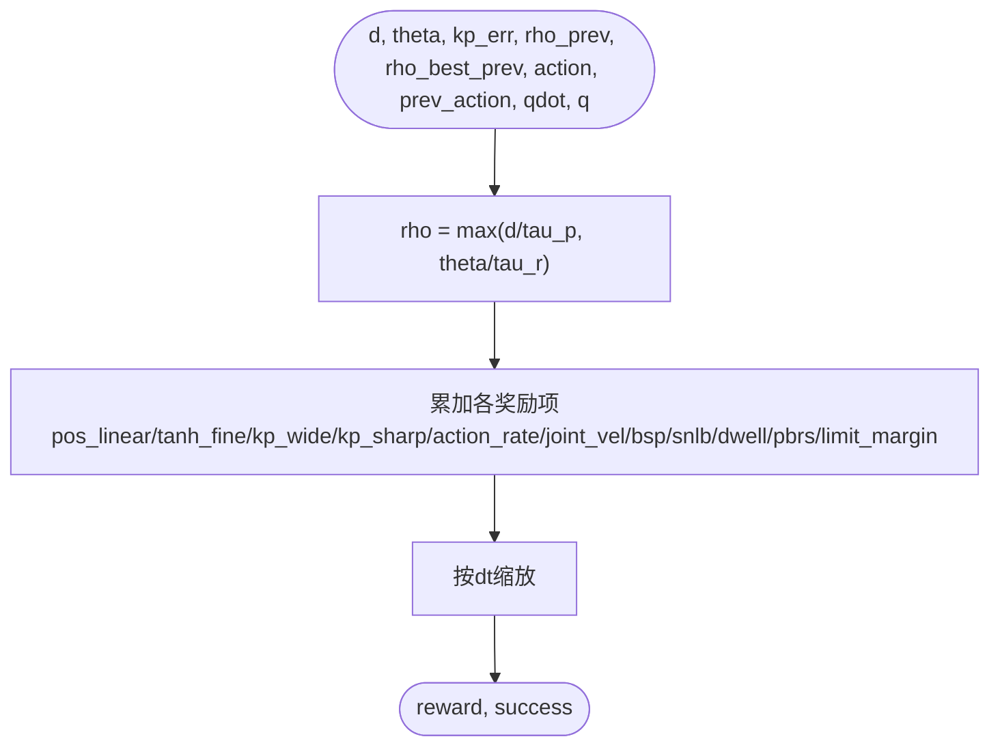
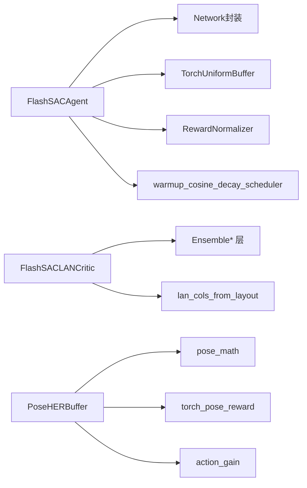
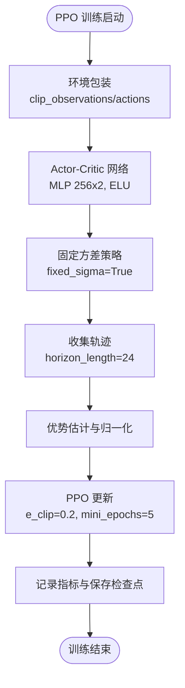

# 强化学习算法

<cite>
**本文引用的文件**   
- [agent.py](file://hardware/flash_rl/agents/flashSAC/agent.py)
- [network.py](file://hardware/flash_rl/agents/flashSAC/network.py)
- [layer.py](file://hardware/flash_rl/agents/flashSAC/layer.py)
- [lan_critic.py](file://hardware/flash_rl/agents/flashSAC/lan_critic.py)
- [update.py](file://hardware/flash_rl/agents/flashSAC/update.py)
- [her.py](file://hardware/policyik_hw/rl/her.py)
- [reward.py](file://hardware/policyik_hw/envs/reward.py)
- [config.yaml](file://hardware/config.yaml)
- [rl_games_ppo_cfg.yaml](file://simulation/policyik_sim/tasks/agents/rl_games_ppo_cfg.yaml)
- [mdp.py](file://simulation/policyik_sim/tasks/mdp.py)
</cite>

## 目录
1. [引言](#引言)
2. [项目结构](#项目结构)
3. [核心组件](#核心组件)
4. [架构总览](#架构总览)
5. [详细组件分析](#详细组件分析)
6. [依赖关系分析](#依赖关系分析)
7. [性能与实现特性](#性能与实现特性)
8. [超参数调优指南](#超参数调优指南)
9. [收敛性与稳定性分析](#收敛性与稳定性分析)
10. [仿真PPO配置与优化策略](#仿真ppo配置与优化策略)
11. [故障排查指南](#故障排查指南)
12. [结论](#结论)

## 引言
本技术文档围绕 PolicyIK 在真实机器人上使用的强化学习算法展开，重点包括：
- FlashSAC：面向连续动作空间的 SAC 变体，包含离散化价值分布、双塔对齐 Critic、温度自适应与噪声重复采样等。
- HER（Hindsight Experience Replay）：面向六维位姿目标的 hindsight 重标定，结合演示回放与近锚点采样。
- PPO：在 Isaac Lab 仿真环境中的 rl_games 配置与训练策略。

文档将给出算法原理、网络架构、更新流程、HER 机制、PPO 配置、超参数调优建议、收敛性分析与代码对应关系，帮助读者从高层概念到具体实现全面理解。

## 项目结构
PolicyIK 的强化学习相关代码主要分布在以下路径：
- hardware/flash_rl/agents/flashSAC：FlashSAC 智能体、网络、层、更新逻辑。
- hardware/policyik_hw/rl/her.py：HER 缓冲区与重标定逻辑。
- hardware/policyik_hw/envs/reward.py：位姿奖励函数与通道构造。
- simulation/policyik_sim/tasks/agents/rl_games_ppo_cfg.yaml：仿真 PPO 配置。
- simulation/policyik_sim/tasks/mdp.py：仿真任务观测与奖励项。
- hardware/config.yaml：真实臂实验的训练与 HER 超参。



**图表来源**
- [agent.py:335-565](file://hardware/flash_rl/agents/flashSAC/agent.py#L335-L565)
- [network.py:18-115](file://hardware/flash_rl/agents/flashSAC/network.py#L18-L115)
- [layer.py:10-297](file://hardware/flash_rl/agents/flashSAC/layer.py#L10-L297)
- [lan_critic.py:13-67](file://hardware/flash_rl/agents/flashSAC/lan_critic.py#L13-L67)
- [update.py:81-319](file://hardware/flash_rl/agents/flashSAC/update.py#L81-L319)
- [her.py:22-517](file://hardware/policyik_hw/rl/her.py#L22-L517)
- [reward.py:23-184](file://hardware/policyik_hw/envs/reward.py#L23-L184)
- [rl_games_ppo_cfg.yaml:1-81](file://simulation/policyik_sim/tasks/agents/rl_games_ppo_cfg.yaml#L1-L81)
- [mdp.py:1-232](file://simulation/policyik_sim/tasks/mdp.py#L1-L232)

**章节来源**
- [agent.py:335-565](file://hardware/flash_rl/agents/flashSAC/agent.py#L335-L565)
- [config.yaml:107-149](file://hardware/config.yaml#L107-L149)
- [rl_games_ppo_cfg.yaml:1-81](file://simulation/policyik_sim/tasks/agents/rl_games_ppo_cfg.yaml#L1-L81)

## 核心组件
- FlashSAC 智能体：负责与环境交互、缓冲管理、奖励归一化、动作采样与网络更新调度。
- FlashSACActor：输出正态分布均值与标准差，经 tanh 映射到连续动作空间。
- FlashSACLANCritic：基于状态-动作塔与目标塔的平方差输入分类头，输出离散化价值分布。
- 温度网络：自适应调节探索强度以匹配目标熵。
- 更新模块：分别更新 Actor、Critic、Target Critic 与温度，支持 AMP 与编译加速。
- HER 缓冲区：在线轨迹与演示混合，按概率选择原始目标、未来位姿、当前位姿或随机位姿进行重标定。
- 位姿奖励：组合位置误差、姿态误差、关键点跟踪、动作平滑、关节速度惩罚、回退惩罚、停留奖励、势函数塑形与软限惩罚。
- 仿真 PPO：使用 rl_games 的 a2c_continuous 算法，固定方差策略与 MLP 网络。

**章节来源**
- [agent.py:30-81](file://hardware/flash_rl/agents/flashSAC/agent.py#L30-L81)
- [network.py:18-115](file://hardware/flash_rl/agents/flashSAC/network.py#L18-L115)
- [lan_critic.py:41-67](file://hardware/flash_rl/agents/flashSAC/lan_critic.py#L41-L67)
- [update.py:81-319](file://hardware/flash_rl/agents/flashSAC/update.py#L81-L319)
- [her.py:22-517](file://hardware/policyik_hw/rl/her.py#L22-L517)
- [reward.py:23-184](file://hardware/policyik_hw/envs/reward.py#L23-L184)
- [rl_games_ppo_cfg.yaml:1-81](file://simulation/policyik_sim/tasks/agents/rl_games_ppo_cfg.yaml#L1-L81)

## 架构总览
FlashSAC 采用“Actor + 双塔对齐 Critic + 温度自适应”的结构；Critic 使用离散化价值分布（Categorical Value），并通过最小 Q 选择与 N 步回报构建目标分布。HER 通过在线缓冲区与演示库混合采样，对位姿目标进行重标定并重新计算奖励与观测通道。仿真侧使用 rl_games 的 PPO，采用共享 Actor-Critic 网络与固定方差策略。

```mermaid
sequenceDiagram
participant Env as "环境"
participant Agent as "FlashSACAgent"
participant Buffer as "TorchUniformBuffer"
participant HER as "PoseHERBuffer"
participant Actor as "FlashSACActor"
participant Critic as "FlashSACLANCritic"
participant Temp as "FlashSACTemperature"
Env->>Agent : 提供观测
Agent->>Actor : 前向得到均值/标准差
Agent->>Agent : 噪声重复采样(齐塔分布)
Agent-->>Env : 返回动作
Env-->>Agent : 返回新观测/奖励/终止信号
Agent->>Buffer : 写入过渡
Agent->>HER : 可选重标定(位姿目标)
Agent->>Critic : 计算离散化Q分布
Agent->>Temp : 根据熵调整温度
Agent->>Actor : 更新策略(含BC正则)
Agent->>Critic : 更新价值分布(最小Q+TD目标)
Agent->>Critic : EMA更新目标网络
```

**图表来源**
- [agent.py:423-516](file://hardware/flash_rl/agents/flashSAC/agent.py#L423-L516)
- [update.py:81-319](file://hardware/flash_rl/agents/flashSAC/update.py#L81-L319)
- [her.py:314-411](file://hardware/policyik_hw/rl/her.py#L314-L411)

## 详细组件分析

### FlashSACActor 与策略分布
- 结构：Embedder → Residual Blocks → RMSNorm → NormalTanhPolicy。
- NormalTanhPolicy 输出正态分布的均值与标准差，经 rsample 与 tanh 映射到动作空间，并对 log_prob 做 Jacobian 校正。
- 支持 get_mean_and_std 接口，便于在采样时仅计算统计量而不执行完整 forward。



**图表来源**
- [network.py:18-57](file://hardware/flash_rl/agents/flashSAC/network.py#L18-L57)
- [layer.py:79-161](file://hardware/flash_rl/agents/flashSAC/layer.py#L79-L161)

**章节来源**
- [network.py:18-57](file://hardware/flash_rl/agents/flashSAC/network.py#L18-L57)
- [layer.py:111-161](file://hardware/flash_rl/agents/flashSAC/layer.py#L111-L161)

### FlashSACLANCritic 与离散化价值分布
- 双塔结构：状态-动作塔 φ(s,a) 与目标塔 ψ(g)，输入为 (φ - ψ)^2。
- 分类头 EnsembleCategoricalValue 输出每个桶的对数概率，期望值用于 Q 估计。
- 双 Q 集成：num_qs=2，批内并行计算，减少内存开销。



**图表来源**
- [lan_critic.py:41-67](file://hardware/flash_rl/agents/flashSAC/lan_critic.py#L41-L67)
- [layer.py:268-297](file://hardware/flash_rl/agents/flashSAC/layer.py#L268-L297)

**章节来源**
- [lan_critic.py:13-67](file://hardware/flash_rl/agents/flashSAC/lan_critic.py#L13-L67)
- [layer.py:268-297](file://hardware/flash_rl/agents/flashSAC/layer.py#L268-L297)

### 更新流程与数学对应
- Actor 更新：最大化 Q 减去温度乘以 log_prob，可选 BC 正则项。
- Critic 更新：基于最小 Q 的选择与离散化 TD 目标，交叉熵损失。
- 温度更新：使策略熵接近目标熵。
- Target Critic：EMA 更新。



**图表来源**
- [update.py:81-319](file://hardware/flash_rl/agents/flashSAC/update.py#L81-L319)

**章节来源**
- [update.py:81-319](file://hardware/flash_rl/agents/flashSAC/update.py#L81-L319)

### HER 机制与位姿目标重标定
- 目标来源概率：原始目标 p_orig、未来位姿 p_future、当前位姿 p_cur、随机位姿 p_rand。
- 重标定过程：根据 γ 几何分布采样未来步长，选择有效未来槽位；若无效则回退到原始目标。
- 观测通道重写：goal_pos、goal_rot、err_pos、kp_err、rho_best 等通道根据新目标重新计算。
- 动作相对化：根据 action_gain 增益比缩放动作与前一步动作，保证在不同位姿误差下的动作尺度一致。
- 奖励重算：使用 torch_pose_reward 基于新目标计算 reward 与 terminated。



**图表来源**
- [her.py:314-411](file://hardware/policyik_hw/rl/her.py#L314-L411)

**章节来源**
- [her.py:22-517](file://hardware/policyik_hw/rl/her.py#L22-L517)
- [reward.py:157-184](file://hardware/policyik_hw/envs/reward.py#L157-L184)

### 位姿奖励设计
- 位置误差线性项与 tanh 精细项。
- 关键点跟踪宽/窄核。
- 动作变化率与关节速度惩罚。
- 回退惩罚（BSPL）、成功邻域边界（SNLB）、停留奖励（Dwell）。
- 势函数塑形（PBRs）与软限惩罚（Limit Margin）。
- 可缩放时间步 dt。



**图表来源**
- [reward.py:157-184](file://hardware/policyik_hw/envs/reward.py#L157-L184)

**章节来源**
- [reward.py:23-184](file://hardware/policyik_hw/envs/reward.py#L23-L184)

## 依赖关系分析
- FlashSACAgent 依赖：
  - Network 封装：统一 optimizer/scheduler/compile/ema 管理。
  - TorchUniformBuffer：均匀采样回放缓冲。
  - RewardNormalizer：指数移动平均式奖励归一化。
  - warmup_cosine_decay_scheduler：学习率预热与余弦衰减。
- FlashSACLANCritic 依赖：
  - Ensemble* 层：批内并行双 Q 计算。
  - lan_cols_from_layout：根据观察布局拆分 state/goal 列。
- HER 依赖：
  - pose_math：位姿变换与角度计算。
  - reward：位姿奖励与通道构造。
  - envs.pose_env.action_gain：动作增益函数。



**图表来源**
- [agent.py:11-27](file://hardware/flash_rl/agents/flashSAC/agent.py#L11-L27)
- [lan_critic.py:13-22](file://hardware/flash_rl/agents/flashSAC/lan_critic.py#L13-L22)
- [her.py:15-18](file://hardware/policyik_hw/rl/her.py#L15-L18)

**章节来源**
- [agent.py:11-27](file://hardware/flash_rl/agents/flashSAC/agent.py#L11-L27)
- [lan_critic.py:13-22](file://hardware/flash_rl/agents/flashSAC/lan_critic.py#L13-L22)
- [her.py:15-18](file://hardware/policyik_hw/rl/her.py#L15-L18)

## 性能与实现特性
- AMP（自动混合精度）：在 actor/critic 更新中使用 autocast 与 GradScaler。
- torch.compile：对关键函数（如 _build_truncated_zeta_cdf、_sample_integer_from_cdf、_select_min_q_log_probs、_compute_categorical_td_target）进行编译优化。
- 权重归一化：UnitLinear/UnitRMSNorm 等层在初始化与每次优化后执行 normalize_parameters，稳定训练。
- 噪声重复采样：基于截断齐塔分布的整数 n 控制噪声重复次数，降低高频噪声抖动。
- 目标网络 EMA：使用 ema_update_parameters 进行软更新。

**章节来源**
- [update.py:14-78](file://hardware/flash_rl/agents/flashSAC/update.py#L14-L78)
- [agent.py:199-256](file://hardware/flash_rl/agents/flashSAC/agent.py#L199-L256)
- [layer.py:10-77](file://hardware/flash_rl/agents/flashSAC/layer.py#L10-L77)

## 超参数调优指南
以下为关键超参数及其作用与建议：

- 折扣因子与N步回报
  - gamma：折扣因子，影响长期回报估计。
  - n_step：N步回报长度，提升信用分配效率。
  - 建议：gamma ∈ [0.95, 0.99]，n_step ∈ [1, 5]。

- 网络结构与容量
  - actor_num_blocks、actor_hidden_dim：Actor 深度与宽度。
  - critic_num_blocks、critic_hidden_dim：Critic 深度与宽度。
  - critic_num_bins：离散化桶数量，越大越精细但计算更重。
  - 建议：blocks ∈ [2, 4]，hidden_dim ∈ [128, 256]，bins ∈ [101, 201]。

- 温度与目标熵
  - temp_initial_value、temp_target_sigma、temp_target_entropy：初始温度与目标熵。
  - 建议：sigma ∈ [0.1, 0.5]，目标熵随动作维度自动计算。

- 学习率与调度
  - learning_rate_init/peak/end、warmup_step/decay_step：预热与余弦衰减。
  - 建议：peak ∈ [1e-4, 3e-4]，warmup_step ∈ [1000, 5000]，decay_step ∈ [50000, 150000]。

- 缓冲与批次
  - buffer_max_length、buffer_min_length、sample_batch_size：回放缓冲大小与采样批次。
  - 建议：max_length ∈ [1e5, 1e6]，batch_size ∈ [512, 2048]。

- HER 目标来源概率
  - p_orig、p_future、p_cur、p_rand：各类目标来源比例。
  - near_zero_frac、near_anchor_frac、near_anchor_rho：近零/近锚点采样。
  - 建议：p_orig≈0.4，p_future≈0.4，p_cur≈0.2，p_rand≈0；near_zero_frac∈[0.5, 0.9]，near_anchor_frac∈[0.5, 0.9]。

- 奖励归一化
  - normalize_reward、normalized_G_max：是否启用奖励归一化与最大累积回报。
  - 建议：启用归一化，G_max ∈ [3.0, 10.0]。

- 仿真 PPO
  - horizon_length、minibatch_size、mini_epochs、e_clip、entropy_coef、critic_coef。
  - 建议：horizon_length ∈ [16, 32]，minibatch_size ∈ [16384, 32768]，mini_epochs ∈ [3, 5]，e_clip ∈ [0.1, 0.3]。

**章节来源**
- [config.yaml:107-149](file://hardware/config.yaml#L107-L149)
- [rl_games_ppo_cfg.yaml:44-81](file://simulation/policyik_sim/tasks/agents/rl_games_ppo_cfg.yaml#L44-L81)

## 收敛性与稳定性分析
- Actor 更新稳定性：
  - 使用最小 Q 避免过估计，配合离散化分布减少价值估计偏差。
  - BC 正则项在早期阶段有助于利用先验演示数据，防止策略退化。
- Critic 更新稳定性：
  - 双塔对齐 Critic 通过 (φ - ψ)^2 输入，增强目标表征一致性。
  - 离散化 TD 目标使用 scatter_add 分配概率质量，数值稳定。
- 温度自适应：
  - 目标熵随动作维度与 sigma 自动设定，确保探索与利用平衡。
- HER 稳定性：
  - 近锚点采样与近零偏移提高重标定样本质量。
  - 动作相对化与增益缩放保证不同位姿误差下的动作尺度一致。
- 奖励设计：
  - 多组件奖励（位置、姿态、关键点、平滑、回退、停留、势函数塑形、软限）提供密集且稳定的信号。
  - 时间步缩放 dt 保证不同频率下的奖励可比性。

**章节来源**
- [update.py:81-319](file://hardware/flash_rl/agents/flashSAC/update.py#L81-L319)
- [lan_critic.py:41-67](file://hardware/flash_rl/agents/flashSAC/lan_critic.py#L41-L67)
- [her.py:314-411](file://hardware/policyik_hw/rl/her.py#L314-L411)
- [reward.py:157-184](file://hardware/policyik_hw/envs/reward.py#L157-L184)

## 仿真PPO配置与优化策略
- 算法与模型：a2c_continuous 与 continuous_a2c_logstd，共享 Actor-Critic 网络。
- 策略分布：固定方差（fixed_sigma=True），σ 初始化为常数，简化探索。
- 网络结构：MLP 两层 256 单元，ELU 激活。
- 训练设置：
  - 输入与值归一化（normalize_input/value）。
  - 优势归一化（normalize_advantage）。
  - KL 阈值与自适应学习率调度。
  - 梯度裁剪与熵系数。
  - 子批量大小与 mini epochs。
  - 价值函数 clip 与动作边界损失。



**图表来源**
- [rl_games_ppo_cfg.yaml:1-81](file://simulation/policyik_sim/tasks/agents/rl_games_ppo_cfg.yaml#L1-L81)

**章节来源**
- [rl_games_ppo_cfg.yaml:1-81](file://simulation/policyik_sim/tasks/agents/rl_games_ppo_cfg.yaml#L1-L81)

## 故障排查指南
- 设备与编译：
  - 确认 device_type 与 CUDA 可用性；use_compile 模式根据 PyTorch 版本自动解析。
  - 若出现编译错误，尝试关闭 use_compile 或切换 compile_mode。
- AMP 与 GradScaler：
  - 若出现溢出或 NaN，检查 use_amp 与 grad_scaler 配置；必要时降低学习率或禁用 AMP。
- 缓冲与采样：
  - 确保 buffer_min_length 足够大后再开始训练；HER 要求 n_step==1。
  - 检查 demo_ratio 与演示数据完整性（ep_t 序列与终止信号）。
- 奖励与观测：
  - 验证 reward 配置参数合法性（tau_*、std_*、cap_* 等）。
  - 检查 observation 布局是否覆盖所有通道（state/goal 列）。
- 日志与检查点：
  - 确认 save_dir 与 checkpoint_at 配置；加载时注意 load_optimizer 与 load_reward_normalizer。

**章节来源**
- [agent.py:325-333](file://hardware/flash_rl/agents/flashSAC/agent.py#L325-L333)
- [her.py:42-46](file://hardware/policyik_hw/rl/her.py#L42-L46)
- [reward.py:60-73](file://hardware/policyik_hw/envs/reward.py#L60-L73)
- [lan_critic.py:13-22](file://hardware/flash_rl/agents/flashSAC/lan_critic.py#L13-L22)

## 结论
PolicyIK 的强化学习管线以 FlashSAC 为核心，结合 HER 与精心设计的位姿奖励，在真实机器人上实现了稳健的位姿到达任务。仿真侧使用 rl_games 的 PPO，提供高效的基线与对比平台。通过合理的超参数调优、稳定性保障与性能优化（AMP、编译、权重归一化），系统能够在复杂环境中取得良好收敛与泛化能力。