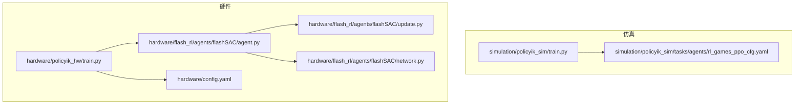
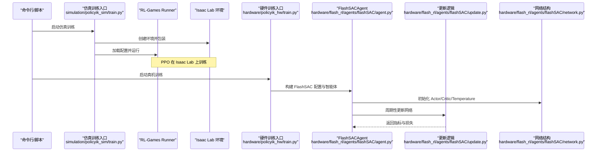
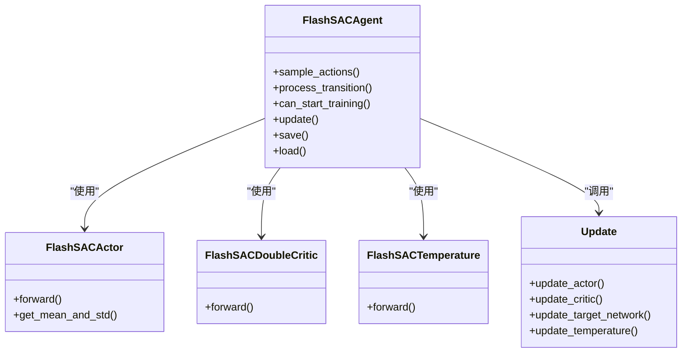
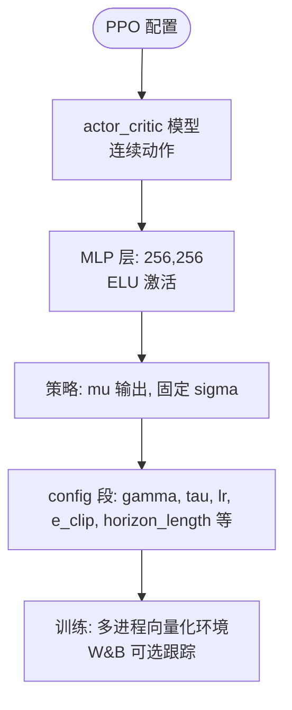
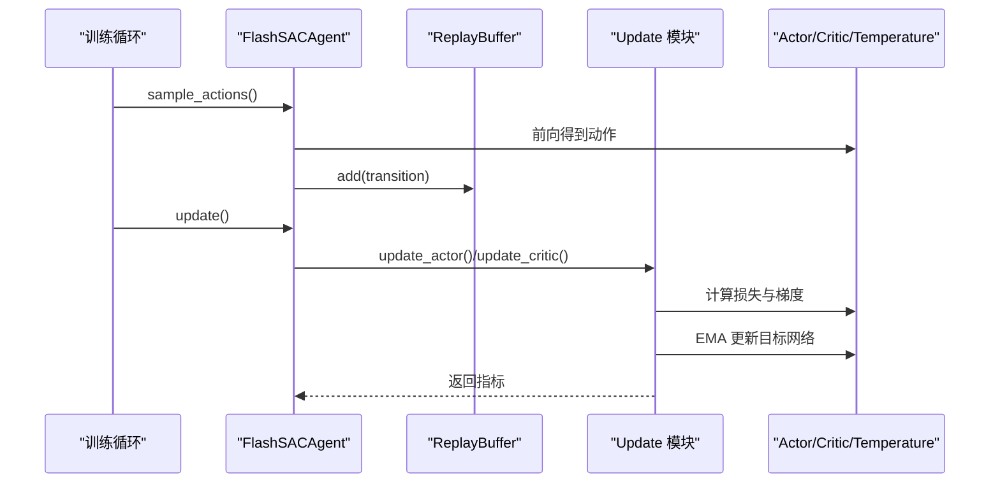
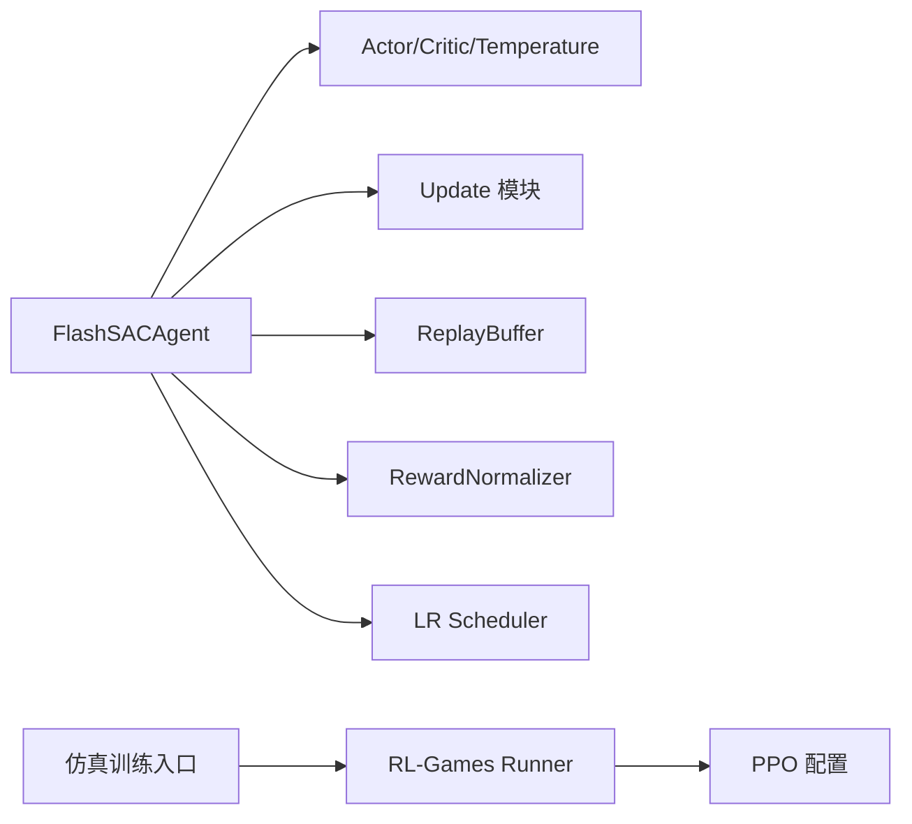
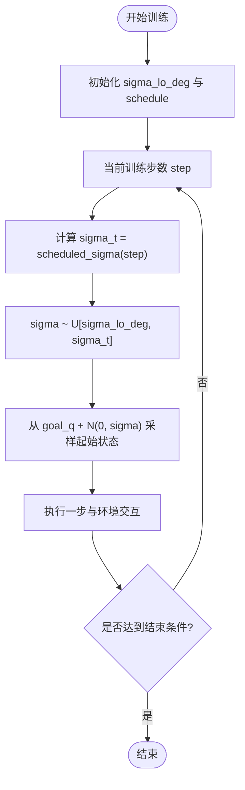

# 算法对比与优化策略

<cite>
**本文引用的文件**   
- [hardware/flash_rl/agents/flashSAC/agent.py](file://hardware/flash_rl/agents/flashSAC/agent.py)
- [hardware/flash_rl/agents/flashSAC/update.py](file://hardware/flash_rl/agents/flashSAC/update.py)
- [hardware/flash_rl/agents/flashSAC/network.py](file://hardware/flash_rl/agents/flashSAC/network.py)
- [hardware/policyik_hw/train.py](file://hardware/policyik_hw/train.py)
- [hardware/config.yaml](file://hardware/config.yaml)
- [simulation/policyik_sim/tasks/agents/rl_games_ppo_cfg.yaml](file://simulation/policyik_sim/tasks/agents/rl_games_ppo_cfg.yaml)
- [simulation/policyik_sim/train.py](file://simulation/policyik_sim/train.py)
- [hardware/README.md](file://hardware/README.md)
- [README.md](file://README.md)
</cite>

## 目录
1. [引言](#引言)
2. [项目结构](#项目结构)
3. [核心组件](#核心组件)
4. [架构总览](#架构总览)
5. [详细组件分析](#详细组件分析)
6. [依赖关系分析](#依赖关系分析)
7. [性能与基准](#性能与基准)
8. [课程学习策略](#课程学习策略)
9. [超参数调优方法](#超参数调优方法)
10. [训练常见问题与排错](#训练常见问题与排错)
11. [结论](#结论)

## 引言
本文件面向强化学习在机械臂高精度逆解任务中的算法对比与优化。仓库同时包含：
- 仿真环境下的 PPO（基于 rl_games）训练流程与配置；
- 真机环境下的 FlashSAC（含 HER、演示数据混合、课程学习）训练流程与配置。

目标是在收敛速度、样本效率、稳定性等维度对 FlashSAC 与 PPO 进行系统比较，并总结课程学习、奖励设计、观察空间、超参搜索与训练排错的最佳实践。

## 项目结构
本项目分为仿真与硬件两条主线：
- simulation：Isaac Lab + rl_games 的 PPO 训练入口与任务注册；
- hardware：OpenArm 真机上的 FlashSAC 实现、HER、演示数据、课程学习与评估脚本。

**图示来源**
- [simulation/policyik_sim/train.py:103-218](file://simulation/policyik_sim/train.py#L103-L218)
- [simulation/policyik_sim/tasks/agents/rl_games_ppo_cfg.yaml:1-81](file://simulation/policyik_sim/tasks/agents/rl_games_ppo_cfg.yaml#L1-L81)
- [hardware/policyik_hw/train.py:137-157](file://hardware/policyik_hw/train.py#L137-L157)
- [hardware/flash_rl/agents/flashSAC/agent.py:335-421](file://hardware/flash_rl/agents/flashSAC/agent.py#L335-L421)
- [hardware/flash_rl/agents/flashSAC/update.py:81-319](file://hardware/flash_rl/agents/flashSAC/update.py#L81-L319)
- [hardware/flash_rl/agents/flashSAC/network.py:18-115](file://hardware/flash_rl/agents/flashSAC/network.py#L18-L115)
- [hardware/config.yaml:100-153](file://hardware/config.yaml#L100-L153)

**章节来源**
- [README.md:35-52](file://README.md#L35-L52)
- [hardware/README.md:1-10](file://hardware/README.md#L1-L10)

## 核心组件
- FlashSAC 智能体：Actor-Critic 架构，离散值分布 Critic（分箱），温度自适应，EMA 目标网络，可选 AMP 与 torch.compile，支持奖励归一化与异步更新周期。
- PPO（rl_games）：连续动作 A2C/PPO 配置，固定方差策略，KL 阈值控制步长，优势归一化，多进程向量化环境。
- 课程学习：起始点扰动标准差随训练进度递增，结合任务池比例调度。
- HER 与演示数据：在线 HER 与离线演示混合采样，提升稀疏奖励下的探索与收敛。

**章节来源**
- [hardware/flash_rl/agents/flashSAC/agent.py:30-80](file://hardware/flash_rl/agents/flashSAC/agent.py#L30-L80)
- [hardware/flash_rl/agents/flashSAC/update.py:81-319](file://hardware/flash_rl/agents/flashSAC/update.py#L81-L319)
- [simulation/policyik_sim/tasks/agents/rl_games_ppo_cfg.yaml:1-81](file://simulation/policyik_sim/tasks/agents/rl_games_ppo_cfg.yaml#L1-L81)
- [hardware/config.yaml:100-153](file://hardware/config.yaml#L100-L153)

## 架构总览
下图展示仿真 PPO 与硬件 FlashSAC 的训练主流程与关键模块交互。

**图示来源**
- [simulation/policyik_sim/train.py:103-218](file://simulation/policyik_sim/train.py#L103-L218)
- [hardware/policyik_hw/train.py:137-157](file://hardware/policyik_hw/train.py#L137-L157)
- [hardware/flash_rl/agents/flashSAC/agent.py:335-421](file://hardware/flash_rl/agents/flashSAC/agent.py#L335-L421)
- [hardware/flash_rl/agents/flashSAC/update.py:81-319](file://hardware/flash_rl/agents/flashSAC/update.py#L81-L319)
- [hardware/flash_rl/agents/flashSAC/network.py:18-115](file://hardware/flash_rl/agents/flashSAC/network.py#L18-L115)

## 详细组件分析

### FlashSAC 智能体与训练循环
- 配置类集中管理网络结构、学习率调度、缓冲区和训练开关。
- 初始化阶段：
  - 构造 Actor、双塔 Critic、目标 Critic（EMA）、温度网络；
  - 设置 warmup+cosine 学习率调度；
  - 可选 AMP 与 torch.compile 加速；
  - 奖励归一器（指数加权统计）。
- 采样与更新：
  - 使用 Zeta 分布重复噪声策略，减少高频抖动；
  - 按 actor_update_period 交替更新 Actor 与 Critic；
  - Critic 采用分箱分布 TD 目标，最小 Q 选择，熵正则项参与目标；
  - 温度网络根据目标熵自适应调节。

**图示来源**
- [hardware/flash_rl/agents/flashSAC/agent.py:335-516](file://hardware/flash_rl/agents/flashSAC/agent.py#L335-L516)
- [hardware/flash_rl/agents/flashSAC/network.py:18-115](file://hardware/flash_rl/agents/flashSAC/network.py#L18-L115)
- [hardware/flash_rl/agents/flashSAC/update.py:81-319](file://hardware/flash_rl/agents/flashSAC/update.py#L81-L319)

**章节来源**
- [hardware/flash_rl/agents/flashSAC/agent.py:30-80](file://hardware/flash_rl/agents/flashSAC/agent.py#L30-L80)
- [hardware/flash_rl/agents/flashSAC/agent.py:335-516](file://hardware/flash_rl/agents/flashSAC/agent.py#L335-L516)
- [hardware/flash_rl/agents/flashSAC/update.py:81-319](file://hardware/flash_rl/agents/flashSAC/update.py#L81-L319)
- [hardware/flash_rl/agents/flashSAC/network.py:18-115](file://hardware/flash_rl/agents/flashSAC/network.py#L18-L115)

### PPO（rl_games）配置要点
- 模型为连续动作 A2C/PPO，策略输出均值与固定方差；
- 输入与值函数归一化，优势归一化；
- KL 阈值、梯度裁剪、熵系数、clip 范围等稳定训练的常用开关；
- 通过配置文件集中管理，训练脚本负责注入环境变量与日志路径。

**图示来源**
- [simulation/policyik_sim/tasks/agents/rl_games_ppo_cfg.yaml:14-81](file://simulation/policyik_sim/tasks/agents/rl_games_ppo_cfg.yaml#L14-L81)
- [simulation/policyik_sim/train.py:103-218](file://simulation/policyik_sim/train.py#L103-L218)

**章节来源**
- [simulation/policyik_sim/tasks/agents/rl_games_ppo_cfg.yaml:1-81](file://simulation/policyik_sim/tasks/agents/rl_games_ppo_cfg.yaml#L1-L81)
- [simulation/policyik_sim/train.py:103-218](file://simulation/policyik_sim/train.py#L103-L218)

### 训练流程时序（FlashSAC）

**图示来源**
- [hardware/flash_rl/agents/flashSAC/agent.py:423-516](file://hardware/flash_rl/agents/flashSAC/agent.py#L423-L516)
- [hardware/flash_rl/agents/flashSAC/update.py:81-319](file://hardware/flash_rl/agents/flashSAC/update.py#L81-L319)

## 依赖关系分析
- FlashSAC 智能体依赖：
  - 网络结构（Actor/Critic/Temperature）；
  - 更新逻辑（Actor/Critic/Temperature 更新与目标网络 EMA）；
  - 缓冲区（Uniform Replay Buffer）；
  - 奖励归一化器；
  - 学习率调度器（warmup+cosine）。
- PPO 依赖：
  - rl_games Runner；
  - Isaac Lab 环境与向量化封装；
  - 配置文件驱动的网络与训练超参。

**图示来源**
- [hardware/flash_rl/agents/flashSAC/agent.py:335-421](file://hardware/flash_rl/agents/flashSAC/agent.py#L335-L421)
- [hardware/flash_rl/agents/flashSAC/update.py:81-319](file://hardware/flash_rl/agents/flashSAC/update.py#L81-L319)
- [simulation/policyik_sim/train.py:103-218](file://simulation/policyik_sim/train.py#L103-L218)
- [simulation/policyik_sim/tasks/agents/rl_games_ppo_cfg.yaml:1-81](file://simulation/policyik_sim/tasks/agents/rl_games_ppo_cfg.yaml#L1-L81)

**章节来源**
- [hardware/flash_rl/agents/flashSAC/agent.py:335-421](file://hardware/flash_rl/agents/flashSAC/agent.py#L335-L421)
- [simulation/policyik_sim/train.py:103-218](file://simulation/policyik_sim/train.py#L103-L218)

## 性能与基准
- 仿真侧（PPO）：
  - 训练 13,000 个 epoch，最终对最近 20 个检查点进行指数加权平均作为发布策略；
  - 评估协议定义严格与宽松两类成功阈值（位置与姿态误差）。
- 硬件侧（FlashSAC）：
  - 在线训练 120,000 步，每 10,000 步保存检查点与回放缓冲区；
  - 评估 60 个固定任务，指标包括 held/reached 与中位误差。

这些基准为对比两种算法在不同场景下的表现提供了统一度量基础。

**章节来源**
- [README.md:91-106](file://README.md#L91-L106)
- [hardware/README.md:62-85](file://hardware/README.md#L62-L85)

## 课程学习策略
仓库在硬件侧实现了“反向课程”（Reverse Curriculum）：
- 起始点从目标构型附近以正态扰动采样，标准差 sigma 随训练进度递增；
- 任务池比例也随训练阶段变化，逐步引入更多难例；
- 该策略有助于从易到难渐进学习，提高探索质量与收敛稳定性。

**图示来源**
- [hardware/config.yaml:100-105](file://hardware/config.yaml#L100-L105)
- [hardware/policyik_hw/envs/workspace.py:215-243](file://hardware/policyik_hw/envs/workspace.py#L215-L243)

**章节来源**
- [hardware/config.yaml:100-105](file://hardware/config.yaml#L100-L105)
- [hardware/policyik_hw/envs/workspace.py:215-243](file://hardware/policyik_hw/envs/workspace.py#L215-L243)

## 超参数调优方法
仓库未内置网格搜索或贝叶斯优化框架，但提供了可组合的超参入口与调度器：
- 学习率调度：warmup+cosine 衰减，支持 init/peak/end/warmup_steps/decay_steps；
- 训练开关：AMP、torch.compile、权重归一化、EMA 目标网络；
- 算法超参：gamma、n_step、critic_bins、actor/critic 深度与宽度、actor_update_period、温度初始值与目标熵；
- 建议的系统性方法：
  - 基线优先：先固定随机种子与数据流，再调整学习率与网络规模；
  - 分层搜索：先粗粒度（网络深度/宽度、lr 峰值），后细粒度（entropy_coef、tau、bins）；
  - 自动化：可将 config.yaml 与 rl_games_ppo_cfg.yaml 字段暴露为可调参数，接入 Optuna/Hyperopt 等外部工具进行贝叶斯优化；
  - 验证：以仿真与硬件两套基准分别评估，避免过拟合单一平台。

**章节来源**
- [hardware/flash_rl/agents/utils/scheduler.py:38-60](file://hardware/flash_rl/agents/utils/scheduler.py#L38-L60)
- [hardware/config.yaml:107-128](file://hardware/config.yaml#L107-L128)
- [simulation/policyik_sim/tasks/agents/rl_games_ppo_cfg.yaml:44-81](file://simulation/policyik_sim/tasks/agents/rl_games_ppo_cfg.yaml#L44-L81)

## 训练常见问题与排错
- 梯度爆炸
  - 现象：Loss 发散、NaN 出现、策略输出异常大。
  - 排查：启用梯度裁剪（PPO 配置中有 grad_norm 与 truncate_grads），检查 AMP 缩放因子与数值稳定性；确认权重归一化已启用。
  - 参考：PPO 配置中的梯度相关开关；FlashSAC 的 AMP 与权重归一化。
- 模式崩溃
  - 现象：策略退化为确定性动作，熵下降过快。
  - 排查：检查温度网络目标熵与初始温度；适当增大 entropy_coef（PPO）或 temp_initial_value（FlashSAC）；降低 critic 更新频率或增大 critic_bins 以平滑价值估计。
- 探索不足
  - 现象：长期无法到达目标，成功率低。
  - 排查：开启或增强课程学习（增大 sigma 增长速率）；增加 HER 比例或演示数据比例；增大 action_scale 或降低 max_joint_delta 限制以鼓励更大探索。
- 不稳定与震荡
  - 现象：指标上下波动，难以收敛。
  - 排查：减小 learning_rate_peak 或使用更长的 warmup；增大 horizon_length（PPO）或 mini_epochs；确保优势归一化与值函数归一化开启。

**章节来源**
- [simulation/policyik_sim/tasks/agents/rl_games_ppo_cfg.yaml:60-81](file://simulation/policyik_sim/tasks/agents/rl_games_ppo_cfg.yaml#L60-L81)
- [hardware/flash_rl/agents/flashSAC/agent.py:390-421](file://hardware/flash_rl/agents/flashSAC/agent.py#L390-L421)
- [hardware/flash_rl/agents/flashSAC/update.py:81-319](file://hardware/flash_rl/agents/flashSAC/update.py#L81-L319)

## 结论
- 仿真侧使用 PPO（rl_games）提供稳定、可复现的训练管线，适合大规模并行与快速迭代；
- 硬件侧使用 FlashSAC（含 HER、演示数据、课程学习）更适合真实机器人在线学习，具备更强的探索与鲁棒性；
- 课程学习在硬件侧显著改善从易到难的渐进学习过程，配合 HER 与演示数据能显著提升稀疏奖励任务的收敛速度与成功率；
- 超参方面，建议以学习率调度与网络规模为骨架，再以熵/温度、bins、horizon_length 等为微调旋钮，并结合外部自动化工具进行系统化搜索；
- 实践中应同时关注梯度稳定性、探索充分性与策略多样性，依据平台特性（仿真 vs 真机）选择合适的算法与配置。