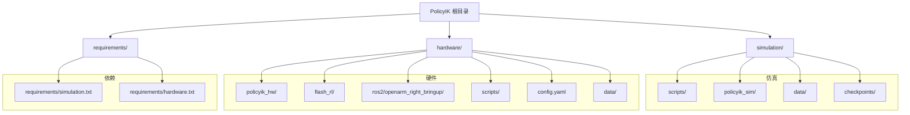
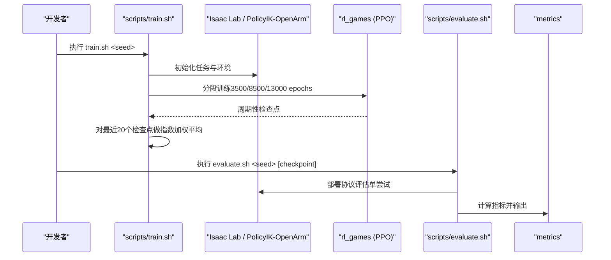
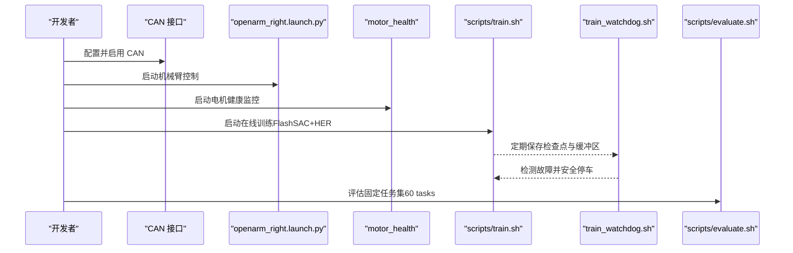

# 快速开始

<cite>
**本文引用的文件**   
- [README.md](file://README.md)
- [hardware/README.md](file://hardware/README.md)
- [simulation/install.sh](file://simulation/install.sh)
- [hardware/install.sh](file://hardware/install.sh)
- [requirements/simulation.txt](file://requirements/simulation.txt)
- [requirements/hardware.txt](file://requirements/hardware.txt)
- [simulation/scripts/train.sh](file://simulation/scripts/train.sh)
- [simulation/scripts/evaluate.sh](file://simulation/scripts/evaluate.sh)
- [hardware/scripts/train.sh](file://hardware/scripts/train.sh)
- [hardware/scripts/evaluate.sh](file://hardware/scripts/evaluate.sh)
- [hardware/config.yaml](file://hardware/config.yaml)
</cite>

## 目录
1. [简介](#简介)
2. [项目结构](#项目结构)
3. [仿真环境快速开始](#仿真环境快速开始)
4. [真实机器人环境快速开始](#真实机器人环境快速开始)
5. [训练与评估流程](#训练与评估流程)
6. [依赖与环境配置详解](#依赖与环境配置详解)
7. [常见问题与故障排除](#常见问题与故障排除)
8. [安装验证测试](#安装验证测试)
9. [结论](#结论)

## 简介
PolicyIK 是一个用于机械臂高精度逆运动学的目标条件强化学习策略。它可以在 Isaac Lab 仿真中通过 PPO 训练，并可直接在物理 OpenArm 上在线训练（FlashSAC + HER）。本指南面向新手开发者，提供从环境准备到第一次训练、评估的完整命令流程，以及常见问题的解决方案和验证方法。

## 项目结构
仓库包含两个主要运行路径：
- simulation：基于 Isaac Lab 的仿真训练与评估
- hardware：基于 ROS 2 的真实 OpenArm 训练与评估

**图表来源**
- [README.md:35-52](file://README.md#L35-L52)

**章节来源**
- [README.md:35-52](file://README.md#L35-L52)

## 仿真环境快速开始
以下流程在 `simulation/` 目录下执行。

### 前置条件
- Python 3.11
- Conda
- NVIDIA GPU 驱动与 CUDA 工具链（Isaac Sim 需要）

### 安装步骤
1. 克隆仓库并进入仿真目录
   - `git clone https://github.com/Tinaliu0123/PolicyIK.git`
   - `cd PolicyIK/simulation`
2. 创建并激活 Conda 环境
   - `conda create -n policyik python=3.11`
   - `conda activate policyik`
3. 运行安装脚本
   - `bash install.sh`

说明：
- 安装脚本会安装 PyTorch、Isaac Sim、IsaacLab、OpenArm Isaac Lab 扩展，并安装仿真所需的 Python 依赖。
- 脚本设置环境变量以接受 NVIDIA Omniverse 许可协议。

**章节来源**
- [README.md:58-69](file://README.md#L58-L69)
- [simulation/install.sh:1-18](file://simulation/install.sh#L1-L18)

### 首次评估
- 使用已发布的策略进行单尝试评估：
  - `bash scripts/evaluate.sh 1 checkpoints/policyik_s1.pth`

输出：
- 将轨迹写入 `outputs/eval/s1/`
- 打印评估指标

**章节来源**
- [README.md:83-89](file://README.md#L83-L89)
- [simulation/scripts/evaluate.sh:1-23](file://simulation/scripts/evaluate.sh#L1-L23)

### 首次训练
- 训练一个随机种子（PPO，三段累计 13,000 个 epoch）：
  - `bash scripts/train.sh 1`

输出：
- 日志与检查点保存在 `logs/rl_games/policyik_s1/`
- 最终对最近 20 个检查点进行指数加权平均，保存为 `checkpoint_average.pth`

**章节来源**
- [README.md:91-97](file://README.md#L91-L97)
- [simulation/scripts/train.sh:1-26](file://simulation/scripts/train.sh#L1-L26)

## 真实机器人环境快速开始
以下流程在连接 OpenArm 的计算机上执行，工作目录为 `hardware/`。

### 前置条件
- Ubuntu 24.04
- ROS 2 Jazzy
- CAN 接口（用于 OpenArm 电机通信）

### 安装步骤
1. 创建 ROS 2 工作空间并克隆仓库
   - `mkdir -p ~/openarm_ws/src && cd ~/openarm_ws/src`
   - `git clone https://github.com/Tinaliu0123/PolicyIK.git`
   - `cd PolicyIK/hardware`
2. 运行安装脚本
   - `bash install.sh`
3. 激活虚拟环境与 ROS 2 工作空间
   - `source .venv/bin/activate`

说明：
- 安装脚本会构建 bringup 包，拉取指定版本的 OpenArm 相关包，并安装 Python 依赖。
- `.venv` 激活时会自动 source ROS 2 工作空间，每次新终端都需要重新激活。

**章节来源**
- [hardware/README.md:5-19](file://hardware/README.md#L5-L19)
- [hardware/install.sh:1-30](file://hardware/install.sh#L1-L30)

### 机器人准备
- 启动 CAN 接口并拉起机械臂
  - `sudo ip link set <iface> type can bitrate 1000000 fd off`
  - `sudo ip link set <iface> up`
  - `ros2 launch openarm_right_bringup openarm_right.launch.py can_interface:=<iface>`
- 启动电机监控
  - `python3 -m policyik_hw.robot.motor_health --iface <iface>`

注意：
- 重力前馈假设机械臂基座 z 轴朝下；若安装方向不同，请先修改重力向量。
- 训练与评估会在找不到控制器管理器或检测到多个控制器时停止。

**章节来源**
- [hardware/README.md:20-41](file://hardware/README.md#L20-L41)

### 在线训练与评估
- 训练（FlashSAC + HER，120,000 步）：
  - `bash scripts/train.sh`
- 启动故障看门狗：
  - `bash scripts/train_watchdog.sh runs/policyik`
- 评估：
  - `bash scripts/evaluate.sh runs/policyik`

**章节来源**
- [hardware/README.md:20-30](file://hardware/README.md#L20-L30)
- [hardware/scripts/train.sh:1-14](file://hardware/scripts/train.sh#L1-L14)
- [hardware/scripts/evaluate.sh:1-19](file://hardware/scripts/evaluate.sh#L1-L19)

## 训练与评估流程

### 仿真训练与评估序列

**图表来源**
- [simulation/scripts/train.sh:1-26](file://simulation/scripts/train.sh#L1-L26)
- [simulation/scripts/evaluate.sh:1-23](file://simulation/scripts/evaluate.sh#L1-L23)

### 真实机器人训练与评估序列

**图表来源**
- [hardware/README.md:20-41](file://hardware/README.md#L20-L41)
- [hardware/scripts/train.sh:1-14](file://hardware/scripts/train.sh#L1-L14)
- [hardware/scripts/evaluate.sh:1-19](file://hardware/scripts/evaluate.sh#L1-L19)

## 依赖与环境配置详解

### 仿真环境依赖
- Python 3.11
- PyTorch 2.7.0（CUDA 12.8 wheel）
- Isaac Sim 5.1.0（含扩展缓存）
- IsaacLab v2.3.2
- OpenArm Isaac Lab 扩展（指定提交）
- NumPy 1.26.0、SciPy 1.15.3

安装脚本行为：
- 安装 PyTorch 与 Isaac Sim
- 克隆并安装 IsaacLab 的 rl_games 扩展
- 克隆并安装 openarm_isaac_lab 扩展
- 安装 requirements/simulation.txt

**章节来源**
- [simulation/install.sh:1-18](file://simulation/install.sh#L1-L18)
- [requirements/simulation.txt:1-3](file://requirements/simulation.txt#L1-L3)

### 硬件环境依赖
- Python 3.12（ROS 2 Jazzy 系统 Python）
- ROS 2 Jazzy（Ubuntu 24.04）
- rclpy、sensor_msgs、std_msgs（来自 ros-jazzy-ros-base）
- PyKDL（python3-pykdl）
- PyYAML（python3-yaml）
- openarm_description（Apache-2.0，需在 ROS 路径中）
- torch 2.12.0、gymnasium 1.2.3、urdf_parser_py、numpy

安装脚本行为：
- 拉取指定版本的 openarm_can、openarm_ros2、openarm_description
- 使用 rosdep 安装依赖并 colcon 构建 bringup 包
- 创建带 system-site-packages 的 .venv，并在激活时自动 source ROS 2 工作空间
- 安装 requirements/hardware.txt

**章节来源**
- [hardware/install.sh:1-30](file://hardware/install.sh#L1-L30)
- [requirements/hardware.txt:1-10](file://requirements/hardware.txt#L1-L10)

## 常见问题与故障排除

### 仿真环境
- 许可证问题
  - 现象：Isaac Sim 提示未接受许可协议
  - 解决：确保环境变量 `OMNI_KIT_ACCEPT_EULA=YES` 已设置（安装脚本与训练/评估脚本均已设置）
- 导入路径问题
  - 现象：无法找到 openarm_isaac_lab 的资源
  - 解决：确保 `PYTHONPATH` 包含 `third_party/openarm_isaac_lab`（脚本已设置）
- 性能与并行
  - 建议：使用 `--num_envs 4096` 提升训练吞吐（默认已在训练脚本中设置）

**章节来源**
- [simulation/scripts/train.sh:1-26](file://simulation/scripts/train.sh#L1-L26)
- [simulation/scripts/evaluate.sh:1-23](file://simulation/scripts/evaluate.sh#L1-L23)

### 真实机器人
- CAN 接口未启用或速率不匹配
  - 现象：无法连接到机械臂
  - 解决：先执行 `ip link set ... type can bitrate 1000000 fd off` 与 `ip link set ... up`
- 重力方向不一致
  - 现象：机械臂姿态异常或训练不稳定
  - 解决：根据实际安装方向修改 `gravity_node.py` 中的重力向量
- 控制器管理器异常
  - 现象：训练或评估直接退出
  - 解决：确保仅有一个控制器管理器且可被识别
- 电机故障
  - 现象：训练中断或机械臂卡住
  - 解决：查看电机监控输出，必要时重启电机节点；使用看门狗自动检测并安全停车

**章节来源**
- [hardware/README.md:32-41](file://hardware/README.md#L32-L41)

## 安装验证测试

### 仿真环境验证
- 快速评估发布策略
  - `bash scripts/evaluate.sh 1 checkpoints/policyik_s1.pth`
- 预期结果
  - 生成 `outputs/eval/s1/single.npz` 等输出文件
  - 控制台打印评估指标（位置误差与姿态误差阈值：严格 1 mm / 0.2°，粗略 1 cm / 2°）

**章节来源**
- [README.md:83-106](file://README.md#L83-L106)
- [simulation/scripts/evaluate.sh:1-23](file://simulation/scripts/evaluate.sh#L1-L23)

### 真实机器人验证
- 基础链路验证
  - 启动 bringup 与电机监控后，确认 `/forward_position_controller/commands` 可接收指令
- 训练与评估
  - `bash scripts/train.sh`
  - `bash scripts/evaluate.sh runs/policyik`
- 预期结果
  - 训练每 10,000 步保存检查点与缓冲区
  - 评估输出 `<run>/<checkpoint>_metrics.json`，包含 held/reached/median errors 等指标

**章节来源**
- [hardware/README.md:62-85](file://hardware/README.md#L62-L85)
- [hardware/scripts/evaluate.sh:1-19](file://hardware/scripts/evaluate.sh#L1-L19)

## 结论
按照本指南完成环境准备后，你可以在仿真环境中快速运行第一个评估与训练示例，也可以在真实 OpenArm 上进行在线训练与评估。遇到问题时，优先检查 CAN 接口、ROS 2 工作空间激活、Isaac Sim 许可与依赖版本。建议在首次运行前执行“安装验证测试”以确保一切就绪。
