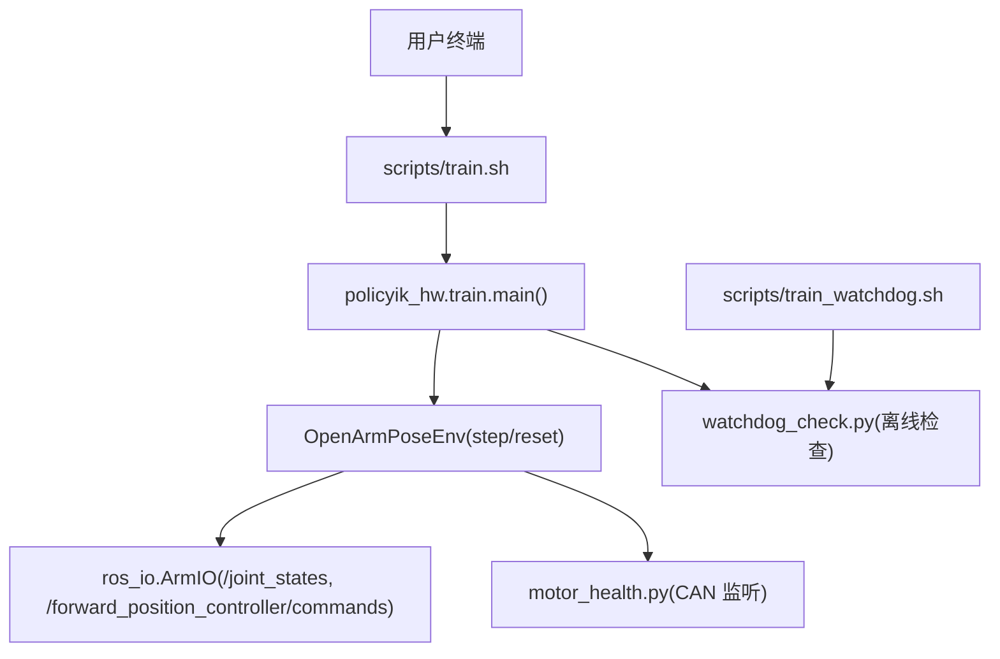
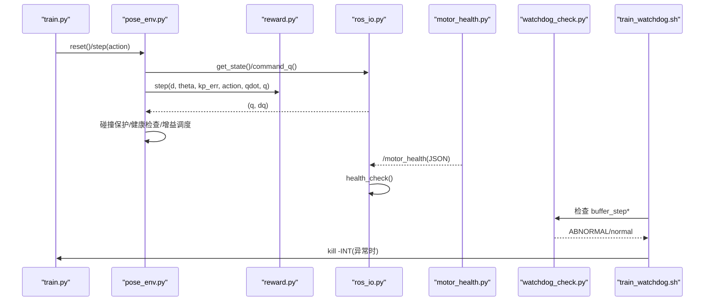
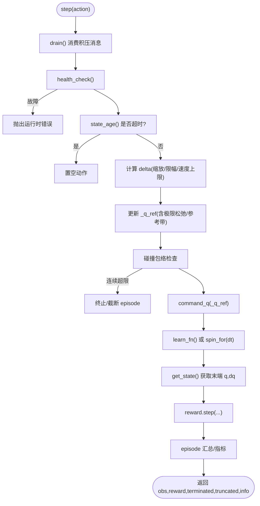
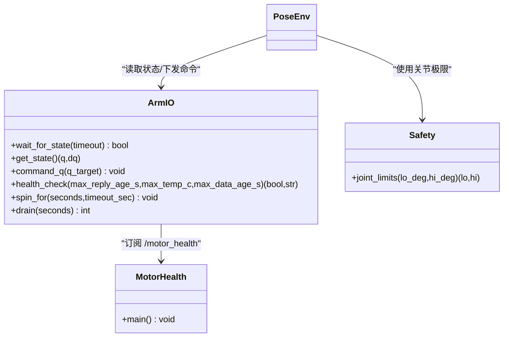
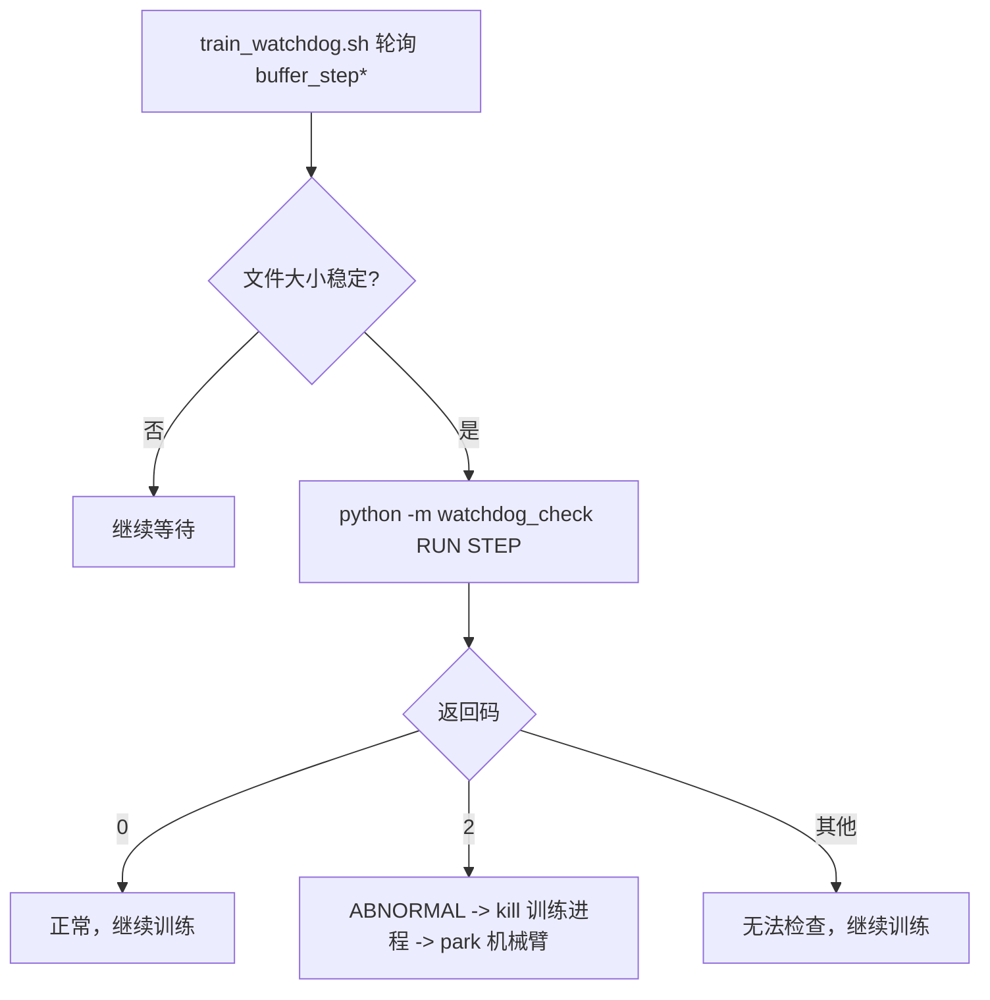
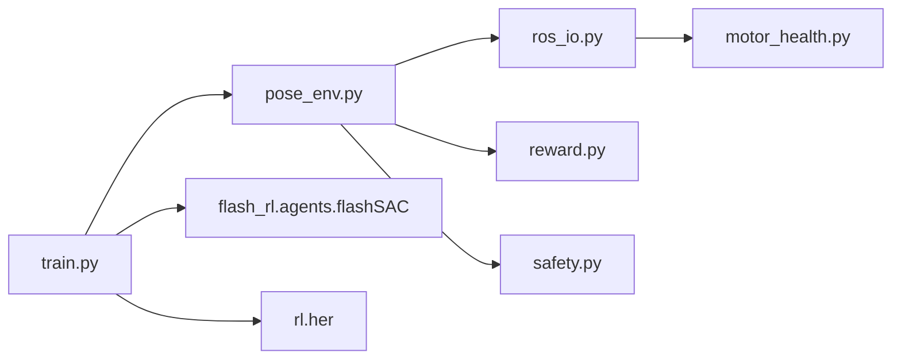

# 故障排除

<cite>
**本文引用的文件**   
- [README.md](file://README.md)
- [hardware/README.md](file://hardware/README.md)
- [hardware/config.yaml](file://hardware/config.yaml)
- [hardware/policyik_hw/train.py](file://hardware/policyik_hw/train.py)
- [hardware/policyik_hw/watchdog_check.py](file://hardware/policyik_hw/watchdog_check.py)
- [hardware/scripts/train_watchdog.sh](file://hardware/scripts/train_watchdog.sh)
- [hardware/scripts/train.sh](file://hardware/scripts/train.sh)
- [hardware/scripts/evaluate.sh](file://hardware/scripts/evaluate.sh)
- [hardware/policyik_hw/envs/pose_env.py](file://hardware/policyik_hw/envs/pose_env.py)
- [hardware/policyik_hw/envs/reward.py](file://hardware/policyik_hw/envs/reward.py)
- [hardware/policyik_hw/robot/motor_health.py](file://hardware/policyik_hw/robot/motor_health.py)
- [hardware/policyik_hw/robot/safety.py](file://hardware/policyik_hw/robot/safety.py)
- [hardware/policyik_hw/robot/ros_io.py](file://hardware/policyik_hw/robot/ros_io.py)
</cite>

## 目录
1. [简介](#简介)
2. [项目结构与运行入口](#项目结构与运行入口)
3. [核心组件与职责](#核心组件与职责)
4. [系统架构总览](#系统架构总览)
5. [详细组件分析](#详细组件分析)
6. [依赖关系分析](#依赖关系分析)
7. [性能与瓶颈定位](#性能与瓶颈定位)
8. [常见故障与排查清单](#常见故障与排查清单)
9. [训练不收敛诊断](#训练不收敛诊断)
10. [日志、监控与诊断工具使用指南](#日志监控与诊断工具使用指南)
11. [预防措施与最佳实践](#预防措施与最佳实践)
12. [结论](#结论)

## 简介
本指南面向 PolicyIK 真实机械臂（OpenArm）的部署、训练与评估阶段，聚焦“环境安装问题、硬件连接故障、训练不收敛、性能瓶颈、电机通信失败、传感器数据异常、安全系统触发”等典型场景。文档基于仓库中的真实实现，提供可操作的诊断步骤、关键日志字段解释、以及预防建议，帮助快速定位并解决问题。

## 项目结构与运行入口
- 真实机器人相关代码位于 hardware 目录，包含：
  - policyik_hw：环境、奖励、ROS 接口、训练主循环、看门狗检查等
  - flash_rl：FlashSAC 算法实现
  - ros2/openarm_right_bringup：启动 OpenArm 控制栈
  - scripts：训练、评估、看门狗脚本
- 顶层 README 给出仿真与真机的总体说明；hardware/README.md 给出真机安装、快速开始、机器人设置、演示、训练与评估流程。

**图表来源**
- [hardware/scripts/train.sh:1-14](file://hardware/scripts/train.sh#L1-L14)
- [hardware/policyik_hw/train.py:271-437](file://hardware/policyik_hw/train.py#L271-L437)
- [hardware/policyik_hw/envs/pose_env.py:206-544](file://hardware/policyik_hw/envs/pose_env.py#L206-L544)
- [hardware/policyik_hw/robot/ros_io.py:1-149](file://hardware/policyik_hw/robot/ros_io.py#L1-L149)
- [hardware/policyik_hw/robot/motor_health.py:1-78](file://hardware/policyik_hw/robot/motor_health.py#L1-L78)
- [hardware/policyik_hw/watchdog_check.py:1-57](file://hardware/policyik_hw/watchdog_check.py#L1-L57)
- [hardware/scripts/train_watchdog.sh:1-60](file://hardware/scripts/train_watchdog.sh#L1-L60)

**章节来源**
- [README.md:35-52](file://README.md#L35-L52)
- [hardware/README.md:1-85](file://hardware/README.md#L1-L85)

## 核心组件与职责
- 环境与奖励
  - pose_env：定义 OpenArm 6 自由度位姿到达环境，负责状态采样、动作缩放、碰撞保护、健康检查、重置与步进逻辑。
  - reward：定义密集奖励函数，包括位置误差、姿态误差、关键点误差、动作平滑、关节速度惩罚、边界裕度、PBRS 等。
- 硬件 I/O
  - ros_io：订阅 /joint_states，发布前向位置控制器命令；集成 motor_health 健康检查；提供等待状态、命令发送、心跳统计等能力。
  - motor_health：通过 CAN 总线只读监听电机状态帧，解析错误码、温度、消息年龄，并发布到 ROS 主题。
  - safety：定义带安全裕度的关节极限。
- 训练与监控
  - train：构建 FlashSAC 智能体、回放缓冲、HER、演示数据加载、训练主循环、指标记录、断点续训。
  - watchdog_check：对最近缓冲区行进行“卡滞/链路丢失”等异常检测。
  - train_watchdog.sh：周期性检查新保存的 buffer_step*，异常时停止训练进程并将机械臂回泊。

**章节来源**
- [hardware/policyik_hw/envs/pose_env.py:206-544](file://hardware/policyik_hw/envs/pose_env.py#L206-L544)
- [hardware/policyik_hw/envs/reward.py:23-184](file://hardware/policyik_hw/envs/reward.py#L23-L184)
- [hardware/policyik_hw/robot/ros_io.py:1-149](file://hardware/policyik_hw/robot/ros_io.py#L1-L149)
- [hardware/policyik_hw/robot/motor_health.py:1-78](file://hardware/policyik_hw/robot/motor_health.py#L1-L78)
- [hardware/policyik_hw/robot/safety.py:1-28](file://hardware/policyik_hw/robot/safety.py#L1-L28)
- [hardware/policyik_hw/train.py:132-178](file://hardware/policyik_hw/train.py#L132-L178)
- [hardware/policyik_hw/watchdog_check.py:1-57](file://hardware/policyik_hw/watchdog_check.py#L1-L57)
- [hardware/scripts/train_watchdog.sh:1-60](file://hardware/scripts/train_watchdog.sh#L1-L60)

## 系统架构总览
下图展示从训练主循环到机械臂控制的完整调用链，以及健康与安全监控路径。

**图表来源**
- [hardware/policyik_hw/train.py:374-427](file://hardware/policyik_hw/train.py#L374-L427)
- [hardware/policyik_hw/envs/pose_env.py:386-508](file://hardware/policyik_hw/envs/pose_env.py#L386-L508)
- [hardware/policyik_hw/envs/reward.py:106-146](file://hardware/policyik_hw/envs/reward.py#L106-L146)
- [hardware/policyik_hw/robot/ros_io.py:87-106](file://hardware/policyik_hw/robot/ros_io.py#L87-L106)
- [hardware/policyik_hw/robot/motor_health.py:39-66](file://hardware/policyik_hw/robot/motor_health.py#L39-L66)
- [hardware/policyik_hw/watchdog_check.py:10-52](file://hardware/policyik_hw/watchdog_check.py#L10-L52)
- [hardware/scripts/train_watchdog.sh:18-50](file://hardware/scripts/train_watchdog.sh#L18-L50)

## 详细组件分析

### 环境与步进流程（pose_env）
- 关键行为
  - 健康检查：若 motor_health 未就绪或出现电机故障，抛出运行时错误并附带当前关节角度。
  - 状态冻结保护：当 /joint_states 持续发布相同值且需求非零，判定 CAN 读取停滞，提示重启 CAN 接口与重起 launch。
  - 碰撞保护：连续多步被碰撞包络拒绝则终止或截断 episode，并打印最小间隙。
  - 动作缩放与限幅：按误差动态缩放动作幅度，限制最大关节位移与速度。
  - 参考轨迹松弛：在关节极限附近允许参考越界一定角度以缓解跟踪滞后。
- 调试要点
  - 关注 “MOTOR HEALTH FAULT”、“joint state FROZEN”、“collision guard blocked” 三类异常信息。
  - 通过 timing_summary 查看有效频率与中位耗时，判断是否因学习回调阻塞导致控制周期拉长。

**图表来源**
- [hardware/policyik_hw/envs/pose_env.py:386-508](file://hardware/policyik_hw/envs/pose_env.py#L386-L508)

**章节来源**
- [hardware/policyik_hw/envs/pose_env.py:206-544](file://hardware/policyik_hw/envs/pose_env.py#L206-L544)

### 奖励函数（reward）
- 关键项
  - 位置线性项、精细 tanh 项、关键点误差宽/窄项、动作变化率惩罚、关节速度惩罚。
  - PBRS（Potential-Based Reward Shaping）、SNLB、停留奖励、边界裕度惩罚。
  - rho_of 将位置与姿态误差归一化为标量风险，用于成功判定与观测通道。
- 调试要点
  - 若训练不稳定，优先检查 tau_p、tau_r_deg、kp_size、w_* 权重是否合理。
  - pbrs_gamma 必须与 agent.gamma 一致，否则初始化即报错。

**章节来源**
- [hardware/policyik_hw/envs/reward.py:23-184](file://hardware/policyik_hw/envs/reward.py#L23-L184)

### 硬件 I/O 与健康（ros_io、motor_health、safety）
- ros_io
  - 预检：启动前检查 controller_manager 数量，禁止双栈冲突；提示缺少 gravity 节点会导致下垂。
  - 健康检查：综合电机错误码、CAN 回复年龄、温度、重复禁用计数，返回 ok/None/false 及原因。
  - 状态等待与命令发布：等待 /joint_states 就绪，发布前向位置指令。
- motor_health
  - 解析 CAN 帧，映射错误码名称，输出每个电机的错误、温度、消息年龄、接收计数。
  - 控制台每若干秒打印一行摘要，异常关节会标注 ATTENTION。
- safety
  - 提供带 2° 安全裕度的关节极限，供环境裁剪策略空间。

**图表来源**
- [hardware/policyik_hw/robot/ros_io.py:19-149](file://hardware/policyik_hw/robot/ros_io.py#L19-L149)
- [hardware/policyik_hw/robot/motor_health.py:1-78](file://hardware/policyik_hw/robot/motor_health.py#L1-L78)
- [hardware/policyik_hw/robot/safety.py:1-28](file://hardware/policyik_hw/robot/safety.py#L1-L28)
- [hardware/policyik_hw/envs/pose_env.py:206-544](file://hardware/policyik_hw/envs/pose_env.py#L206-L544)

**章节来源**
- [hardware/policyik_hw/robot/ros_io.py:1-149](file://hardware/policyik_hw/robot/ros_io.py#L1-L149)
- [hardware/policyik_hw/robot/motor_health.py:1-78](file://hardware/policyik_hw/robot/motor_health.py#L1-L78)
- [hardware/policyik_hw/robot/safety.py:1-28](file://hardware/policyik_hw/robot/safety.py#L1-L28)

### 训练主循环与断点续训（train）
- 关键行为
  - 构建 FlashSAC 智能体与 HER 回放缓冲，加载演示数据与任务池。
  - 训练循环：随机探索期后由智能体采样动作，env.step 推进，process_transition 写入缓冲，定时保存 checkpoint 与 buffer。
  - 指标记录：metrics.jsonl、episodes.jsonl、console.log，summary.json 包含时序统计。
  - 断点续训：支持 --init-from、--init-buffer、--step-offset，自动校验观测维度与环境接口一致性。
- 调试要点
  - 若恢复时报错，检查 config.json 中的 env/reward/layout 是否与当前配置一致。
  - 观察 steps_per_s、n_upd_step_per_step、n_upd_reset 等计时指标，定位学习回调开销。

**章节来源**
- [hardware/policyik_hw/train.py:26-178](file://hardware/policyik_hw/train.py#L26-L178)
- [hardware/policyik_hw/train.py:181-229](file://hardware/policyik_hw/train.py#L181-L229)
- [hardware/policyik_hw/train.py:271-437](file://hardware/policyik_hw/train.py#L271-L437)

### 看门狗与异常检测（watchdog_check、train_watchdog.sh）
- watchdog_check
  - 从 buffer_step* 或最终 buffer 中取最近窗口行，检测“关节卡滞”（lead 大但 dq 小）与“多关节同时卡滞”（链路丢包特征）。
  - 结合 episodes.jsonl 最近 10/30 条的最小距离中位数，判断接近距离是否坍塌。
  - 返回正常/异常退出码，供外部脚本处理。
- train_watchdog.sh
  - 轮询 run 目录下新的 buffer_step*，稳定后执行 watchdog_check。
  - 异常时向训练进程发送 SIGINT，等待退出后调用 park 将机械臂回泊；可设置 WATCHDOG_NO_HOME=1 跳过回泊。

**图表来源**
- [hardware/scripts/train_watchdog.sh:18-50](file://hardware/scripts/train_watchdog.sh#L18-L50)
- [hardware/policyik_hw/watchdog_check.py:10-52](file://hardware/policyik_hw/watchdog_check.py#L10-L52)

**章节来源**
- [hardware/policyik_hw/watchdog_check.py:1-57](file://hardware/policyik_hw/watchdog_check.py#L1-L57)
- [hardware/scripts/train_watchdog.sh:1-60](file://hardware/scripts/train_watchdog.sh#L1-L60)

## 依赖关系分析
- 模块耦合
  - train 依赖 pose_env、reward、flash_rl、her、demos、kinematics。
  - pose_env 依赖 ros_io、safety、workspace、reward。
  - ros_io 依赖 rclpy、sensor_msgs、std_msgs，并订阅 motor_health。
  - motor_health 独立于 ROS（可选），直接操作 CAN socket。
- 外部依赖
  - ROS 2 Jazzy、openarm_right_bringup、controller_manager、/joint_states、/forward_position_controller/commands。
  - CAN 总线接口（如 can1），波特率与 fd 参数需正确设置。

**图表来源**
- [hardware/policyik_hw/train.py:132-178](file://hardware/policyik_hw/train.py#L132-L178)
- [hardware/policyik_hw/envs/pose_env.py:206-254](file://hardware/policyik_hw/envs/pose_env.py#L206-L254)
- [hardware/policyik_hw/robot/ros_io.py:1-149](file://hardware/policyik_hw/robot/ros_io.py#L1-L149)
- [hardware/policyik_hw/robot/motor_health.py:1-78](file://hardware/policyik_hw/robot/motor_health.py#L1-L78)

**章节来源**
- [hardware/policyik_hw/train.py:132-178](file://hardware/policyik_hw/train.py#L132-L178)
- [hardware/policyik_hw/envs/pose_env.py:206-254](file://hardware/policyik_hw/envs/pose_env.py#L206-L254)
- [hardware/policyik_hw/robot/ros_io.py:1-149](file://hardware/policyik_hw/robot/ros_io.py#L1-L149)
- [hardware/policyik_hw/robot/motor_health.py:1-78](file://hardware/policyik_hw/robot/motor_health.py#L1-L78)

## 性能与瓶颈定位
- 控制周期
  - 声明 dt = 1/control_hz；实际有效频率由 timing_summary.effective_hz 估算。
  - 若 effective_hz 明显低于 control_hz，检查 learn_fn 是否过长、IO spin_for 是否被抢占。
- 训练吞吐
  - 观察 steps_per_s、n_upd_step_per_step、n_upd_reset、est_update_s。
  - 若 n_upd_step_per_step 过高或 est_update_s 过大，考虑降低 batch_size、utd 或关闭 use_compile。
- 硬件侧
  - motor_health 的 age_s 与 n_rx 可反映 CAN 延迟与丢包；温度 tmos/trotor 接近阈值需降速或停机冷却。
- 日志与指标
  - metrics.jsonl 中的 term_means 可分解各奖励项贡献，辅助调参。
  - episodes.jsonl 中的 sigma_deg、settled_success、strict_settled、min_dist 等用于评估收敛质量。

**章节来源**
- [hardware/policyik_hw/envs/pose_env.py:525-535](file://hardware/policyik_hw/envs/pose_env.py#L525-L535)
- [hardware/policyik_hw/train.py:192-229](file://hardware/policyik_hw/train.py#L192-L229)
- [hardware/policyik_hw/robot/motor_health.py:52-66](file://hardware/policyik_hw/robot/motor_health.py#L52-L66)

## 常见故障与排查清单

### 环境安装与启动
- 症状
  - 找不到 controller_manager 或存在多个 controller_manager。
  - 缺少 gravity 节点，机械臂下垂。
- 诊断
  - 运行前预检会列出 ROS 节点并判断 controller_manager 数量；缺失或多余都会报错或警告。
- 解决
  - 确保仅启动一个 openarm_right_bringup；必要时杀掉旧进程。
  - 确认 gravity_node 已启动；若安装方向不同，修改 gravity_node.py 中的 GRAVITY。

**章节来源**
- [hardware/policyik_hw/robot/ros_io.py:19-50](file://hardware/policyik_hw/robot/ros_io.py#L19-L50)
- [hardware/README.md:35-41](file://hardware/README.md#L35-L41)

### CAN 总线与电机通信
- 症状
  - motor_health 无数据或所有关节报 SILENT。
  - 关节反复报告 DISABLED。
  - 关节温度过高（≥60°C）。
- 诊断
  - motor_health 通过 CAN 原始套接字监听，打印每个关节的错误码、温度、消息年龄、接收计数。
  - ros_io.health_check 会依据 age_s、err、温度、重复禁用计数返回 false 或 None。
- 解决
  - 检查 ip link 设置与 CAN 接口名是否正确；确保 CAN 驱动与内核模块可用。
  - 重启 CAN 接口与 bringup launch；重新启用电机。
  - 若温度过高，暂停训练并冷却机械臂。

**章节来源**
- [hardware/policyik_hw/robot/motor_health.py:12-66](file://hardware/policyik_hw/robot/motor_health.py#L12-L66)
- [hardware/policyik_hw/robot/ros_io.py:87-106](file://hardware/policyik_hw/robot/ros_io.py#L87-L106)
- [hardware/README.md:20-30](file://hardware/README.md#L20-L30)

### 传感器数据异常（/joint_states）
- 症状
  - 环境报 “joint state FROZEN”，/joint_states 持续发布相同值。
- 诊断
  - pose_env.step 检测到 q 长时间不变且需求非零，判定 CAN 读取停滞。
- 解决
  - 停止 bringup launch，down/up CAN 接口，再重新启动。
  - 检查是否有其他节点占用 /joint_states 或覆盖数据。

**章节来源**
- [hardware/policyik_hw/envs/pose_env.py:404-423](file://hardware/policyik_hw/envs/pose_env.py#L404-L423)

### 安全系统触发（碰撞保护/关节极限）
- 症状
  - 环境打印 “collision guard blocked ... envelope slack ...”，episode 被终止或截断。
- 诊断
  - 碰撞包络检查发现目标关节配置超出安全范围，连续多步拒绝命令。
- 解决
  - 调整 workspace 配置（self_clearance、link_bounds_from、post_clear 等）。
  - 降低动作尺度或增大 ref_limit_relax_deg，避免在极限处频繁阻塞。
  - 检查 home_pose_deg 与 joint_lo/hi 是否合理。

**章节来源**
- [hardware/policyik_hw/envs/pose_env.py:447-501](file://hardware/policyik_hw/envs/pose_env.py#L447-L501)
- [hardware/config.yaml:4-72](file://hardware/config.yaml#L4-L72)

### 训练不收敛
- 可能原因
  - 奖励权重不合理（例如 w_pos_linear、w_kp_wide/sharp、w_action_rate、w_joint_vel）。
  - curriculum 的 sigma 增长过快或 rho_floor 不合适。
  - HER 比例不当（p_orig/future/cur/rand）或 near_sigma/near_anchor 参数不匹配任务尺度。
  - 演示数据与当前 reward 不一致，导致缓冲混入噪声。
- 诊断
  - 观察 episodes.jsonl 的 settled_success、strict_settled、sigma_deg、min_dist。
  - 检查 metrics.jsonl 的 term_means，定位主导奖励项。
  - 核对 demos.meta 与 config.yaml 的一致性。
- 解决
  - 逐步放宽 curriculum 的 sigma 增长；适当提高 rho_floor。
  - 调整 HER 比例与 near_sigma_p_m/near_sigma_r_deg。
  - 重新录制演示或修正 reward 权重。

**章节来源**
- [hardware/policyik_hw/train.py:192-229](file://hardware/policyik_hw/train.py#L192-L229)
- [hardware/config.yaml:100-149](file://hardware/config.yaml#L100-L149)
- [hardware/README.md:53-64](file://hardware/README.md#L53-L64)

### 性能瓶颈
- 现象
  - effective_hz 低、steps_per_s 低、est_update_s 高。
- 诊断
  - 检查 pose_env.timing_summary 与 train 日志中的 timing 字段。
  - 确认 learn_fn 是否过长；必要时减少 utd 或关闭 use_compile。
- 解决
  - 优化学习回调；分离高频 IO 与低频学习。
  - 调整 batch_size、buffer_min、utd 等超参。

**章节来源**
- [hardware/policyik_hw/envs/pose_env.py:525-535](file://hardware/policyik_hw/envs/pose_env.py#L525-L535)
- [hardware/policyik_hw/train.py:192-229](file://hardware/policyik_hw/train.py#L192-L229)

## 训练不收敛诊断
- 步骤
  - 检查 episodes.jsonl 中 sigma_deg 与 settled_success/strict_settled 的变化趋势。
  - 查看 metrics.jsonl 的 term_means，确认是否存在某一项主导负奖励。
  - 验证 demo 与 reward 配置一致性；必要时重新生成演示。
  - 调整 curriculum.schedule 与 rho_floor，使初始难度更平缓。
  - 调整 HER 参数，使近邻重标签更贴近任务尺度。
- 快速回归
  - 使用已发布的 checkpoint 进行评估，确认硬件链路正常后再微调训练。

**章节来源**
- [hardware/policyik_hw/train.py:192-229](file://hardware/policyik_hw/train.py#L192-L229)
- [hardware/config.yaml:100-149](file://hardware/config.yaml#L100-L149)
- [hardware/README.md:62-85](file://hardware/README.md#L62-L85)

## 日志、监控与诊断工具使用指南
- 训练日志
  - runs/<name>/metrics.jsonl：每步指标（回报、误差、成功率、计时、缓冲大小等）。
  - runs/<name>/episodes.jsonl：每集指标（ret、l、final_dist、min_dist、final_ang_deg、settled_success、strict_settled、term_means、sigma_deg 等）。
  - runs/<name>/console.log：标准输出/错误重定向。
  - runs/<name>/summary.json：完成步数、墙钟时间、timing 统计。
- 看门狗日志
  - runs/<name>/watchdog.log：周期性检查结果、异常信息与处理动作。
- 电机健康
  - 终端输出：motor_health 每若干秒打印关节错误码与温度，异常关节标注 ATTENTION。
  - ROS 主题：/motor_health（String，JSON），包含 err、err_name、tmos、trotor、age_s、n_rx。
- 评估
  - evaluate.sh 对 60 个任务分三档 gap-bin 评估，关闭碰撞保护，最后用 metrics 汇总 held/reached/median errors。

**章节来源**
- [hardware/policyik_hw/train.py:84-107](file://hardware/policyik_hw/train.py#L84-L107)
- [hardware/policyik_hw/train.py:251-260](file://hardware/policyik_hw/train.py#L251-L260)
- [hardware/scripts/train_watchdog.sh:1-60](file://hardware/scripts/train_watchdog.sh#L1-L60)
- [hardware/policyik_hw/robot/motor_health.py:52-66](file://hardware/policyik_hw/robot/motor_health.py#L52-L66)
- [hardware/scripts/evaluate.sh:1-19](file://hardware/scripts/evaluate.sh#L1-L19)

## 预防措施与最佳实践
- 启动前
  - 确保仅有一个 controller_manager 运行；gravity 节点已启动。
  - 正确设置 CAN 接口与波特率；确认 motor_health 能收到数据。
- 训练中
  - 始终运行 train_watchdog.sh，以便在异常时自动停止训练并回泊机械臂。
  - 定期查看 metrics.jsonl 与 episodes.jsonl，关注 settled_success、strict_settled、min_dist 与 term_means。
  - 若 effective_hz 下降，及时优化学习回调或降低训练强度。
- 硬件维护
  - 关注电机温度与错误码；出现 overcurrent/overtemp/comms lost 等立即停机检查。
  - 避免长时间在关节极限附近工作，适当调整 workspace 与动作尺度。
- 配置管理
  - 保持 config.yaml 与演示元数据一致；恢复训练时校验 layout 与 env/reward 一致性。
  - 谨慎调整 curriculum 与 HER 参数，采用渐进式变更与对照实验。

**章节来源**
- [hardware/README.md:20-41](file://hardware/README.md#L20-L41)
- [hardware/scripts/train_watchdog.sh:1-60](file://hardware/scripts/train_watchdog.sh#L1-L60)
- [hardware/policyik_hw/train.py:181-189](file://hardware/policyik_hw/train.py#L181-L189)
- [hardware/config.yaml:4-72](file://hardware/config.yaml#L4-L72)

## 结论
PolicyIK 的真实机器人管线通过严格的健康检查、碰撞保护与看门狗机制，显著降低了硬件风险。遇到故障时，应优先确认 ROS 控制栈与 CAN 通信是否正常，随后根据日志与指标定位环境、奖励或训练超参问题。遵循本指南的诊断流程与最佳实践，可有效缩短排障时间并提升训练稳定性。