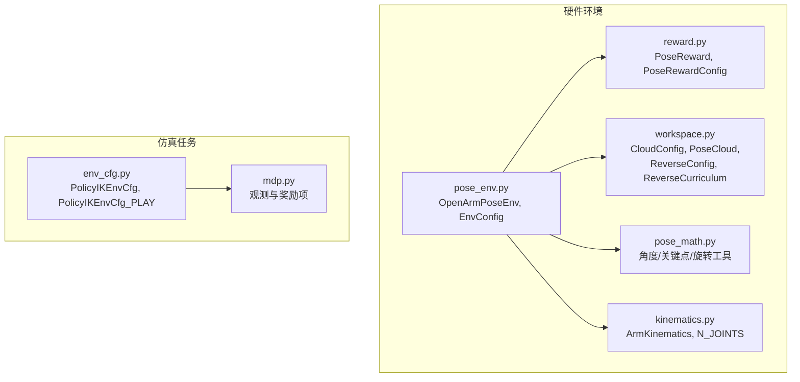
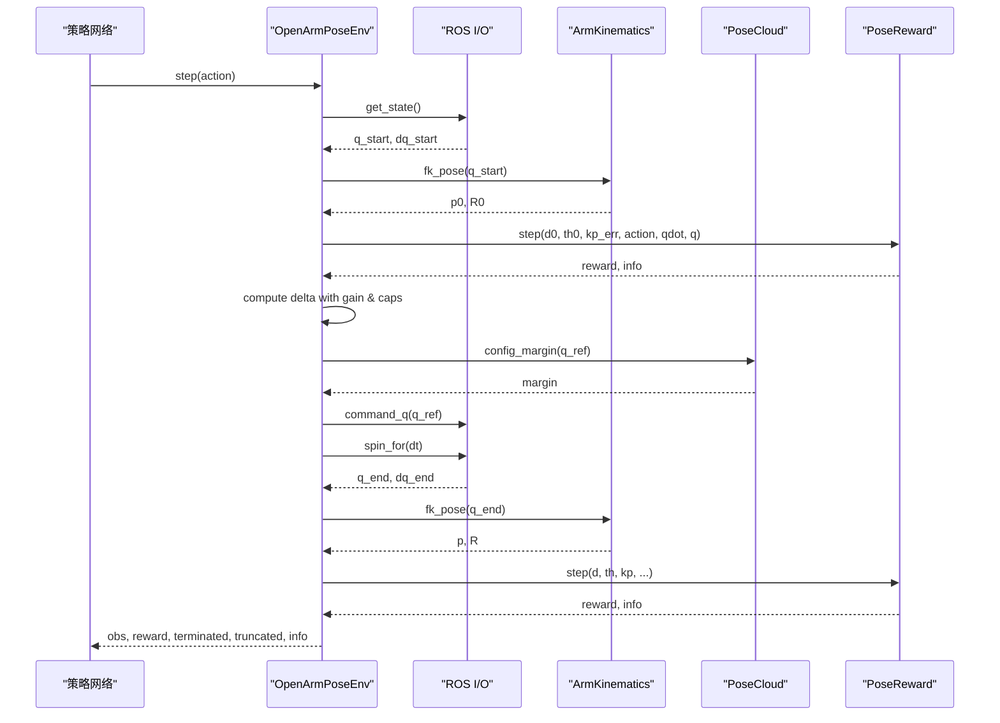
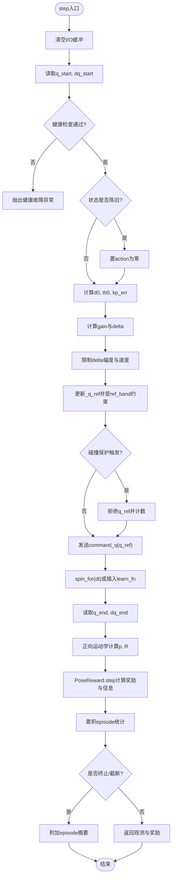
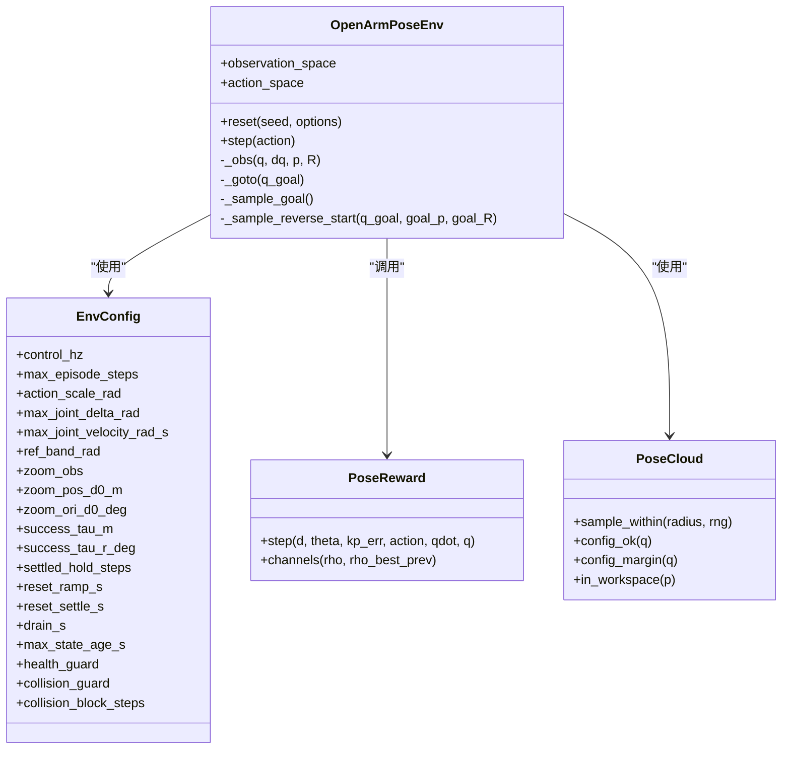
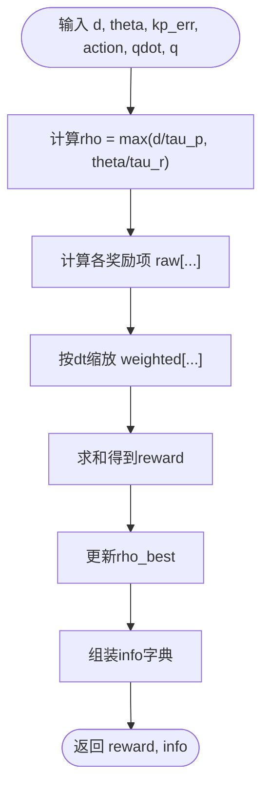
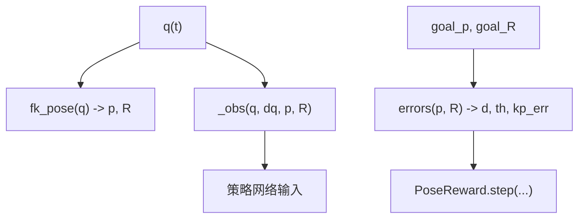
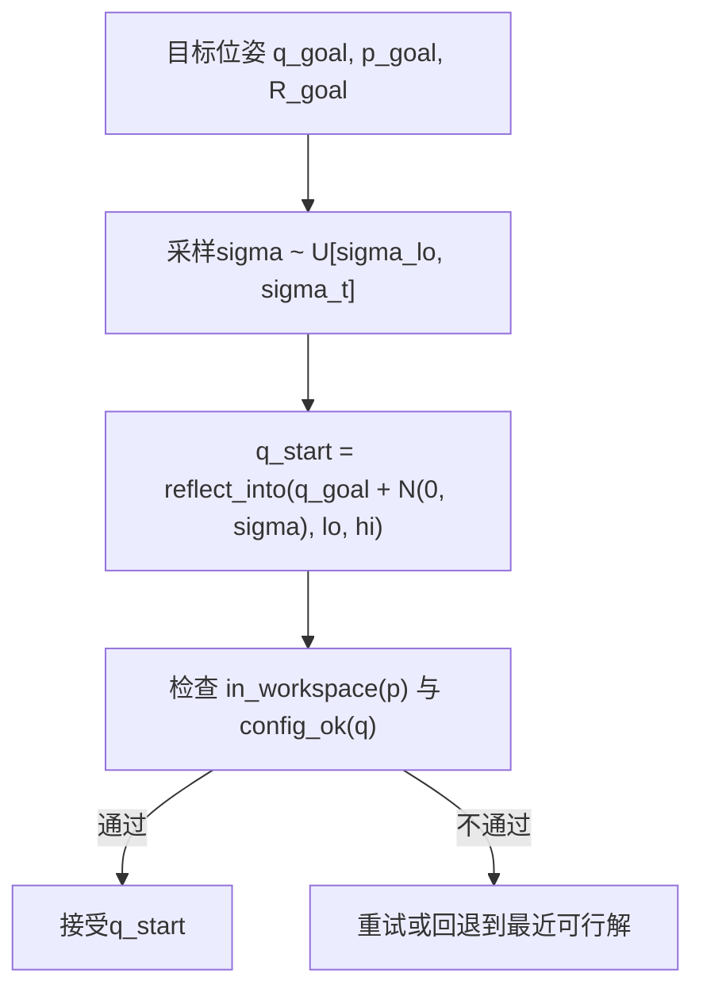
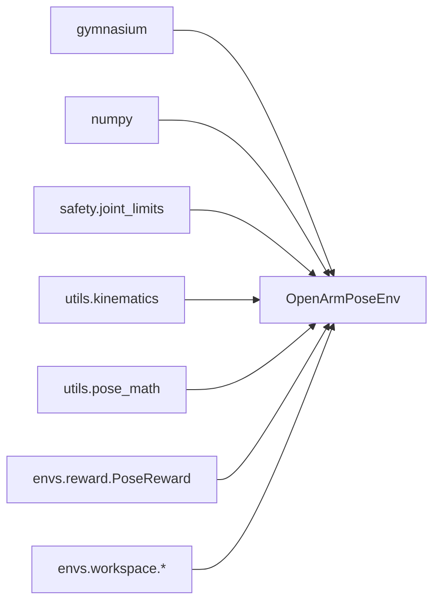

# OpenArm环境实现

<cite>
**本文引用的文件**   
- [pose_env.py](file://hardware/policyik_hw/envs/pose_env.py)
- [reward.py](file://hardware/policyik_hw/envs/reward.py)
- [workspace.py](file://hardware/policyik_hw/envs/workspace.py)
- [pose_math.py](file://hardware/policyik_hw/utils/pose_math.py)
- [kinematics.py](file://hardware/policyik_hw/utils/kinematics.py)
- [env_cfg.py](file://simulation/policyik_sim/tasks/env_cfg.py)
- [mdp.py](file://simulation/policyik_sim/tasks/mdp.py)
</cite>

## 目录
1. [引言](#引言)
2. [项目结构](#项目结构)
3. [核心组件](#核心组件)
4. [架构总览](#架构总览)
5. [详细组件分析](#详细组件分析)
6. [依赖关系分析](#依赖关系分析)
7. [性能与实时性](#性能与实时性)
8. [故障排查指南](#故障排查指南)
9. [结论](#结论)
10. [附录：API参考与使用示例](#附录api参考与使用示例)

## 引言
本技术文档围绕OpenArm机械臂的6自由度位姿到达任务，系统性解析硬件侧Gymnasium环境实现。重点包括：
- OpenArmPoseEnv类对Gymnasium环境的完整实现
- 观察空间构建、动作空间设计与缩放策略
- 环境配置参数EnvConfig的作用机制与校验逻辑
- PoseReward奖励函数体系的设计原理与实现细节
- 状态管理、轨迹跟踪、误差计算等核心算法
- 环境初始化、重置、步进等方法的API说明
- 仿真侧PolicyIK任务的观测与奖励项对照
- 实际使用示例与调试技巧

## 项目结构
本项目在硬件侧提供真实机械臂控制的环境实现，在仿真侧提供基于Isaac Lab的任务配置与MDP项。关键路径如下：
- 硬件环境：hardware/policyik_hw/envs/pose_env.py（主环境）、reward.py（奖励）、workspace.py（工作区与课程学习）
- 工具库：hardware/policyik_hw/utils/pose_math.py（姿态数学）、kinematics.py（正运动学）
- 仿真任务：simulation/policyik_sim/tasks/env_cfg.py（任务配置）、mdp.py（观测与奖励项）

**图表来源**
- [pose_env.py:206-253](file://hardware/policyik_hw/envs/pose_env.py#L206-L253)
- [reward.py:23-149](file://hardware/policyik_hw/envs/reward.py#L23-L149)
- [workspace.py:14-251](file://hardware/policyik_hw/envs/workspace.py#L14-L251)
- [pose_math.py:12-58](file://hardware/policyik_hw/utils/pose_math.py#L12-L58)
- [kinematics.py:81-128](file://hardware/policyik_hw/utils/kinematics.py#L81-L128)
- [env_cfg.py:121-132](file://simulation/policyik_sim/tasks/env_cfg.py#L121-L132)
- [mdp.py:37-231](file://simulation/policyik_sim/tasks/mdp.py#L37-L231)

**章节来源**
- [pose_env.py:1-18](file://hardware/policyik_hw/envs/pose_env.py#L1-L18)
- [env_cfg.py:1-25](file://simulation/policyik_sim/tasks/env_cfg.py#L1-L25)

## 核心组件
- OpenArmPoseEnv：实现Gymnasium环境接口，封装真实机械臂交互、状态更新、碰撞保护、课程学习与奖励计算。
- EnvConfig：环境配置数据类，包含工作区、安全边界、动作缩放、噪声、成功判定、复位时序、健康与碰撞守卫等大量选项。
- PoseReward/PoseRewardConfig：密集奖励系统，包含位置线性项、细粒度tanh项、关键点跟踪项、动作平滑、关节速度惩罚、回退惩罚、停留奖励、PBRS势函数整形、关节软限边距惩罚等。
- Workspace模块：PoseCloud生成可达工作区样本；ReverseCurriculum/ReverseConfig实现“反向起始”课程学习策略。
- 工具模块：pose_math提供旋转表示、角度差、关键点误差；kinematics提供基于URDF的正运动学与连杆点集。

**章节来源**
- [pose_env.py:21-43](file://hardware/policyik_hw/envs/pose_env.py#L21-L43)
- [pose_env.py:46-158](file://hardware/policyik_hw/envs/pose_env.py#L46-L158)
- [reward.py:23-149](file://hardware/policyik_hw/envs/reward.py#L23-L149)
- [workspace.py:14-251](file://hardware/policyik_hw/envs/workspace.py#L14-L251)
- [pose_math.py:12-58](file://hardware/policyik_hw/utils/pose_math.py#L12-L58)
- [kinematics.py:81-128](file://hardware/policyik_hw/utils/kinematics.py#L81-L128)

## 架构总览
OpenArmPoseEnv作为Gymnasium环境的核心，协调以下子系统：
- 运动学：ArmKinematics通过URDF链计算末端位姿与连杆点集
- 工作区：PoseCloud维护可达位姿云，支持采样与约束检查
- 奖励：PoseReward根据当前误差、历史最佳rho、动作与关节速度等计算密集奖励
- 课程学习：ReverseCurriculum按步数调度起始扰动sigma，提升训练稳定性
- I/O层：通过ROS接口读取关节状态并发送目标关节指令，同时执行空闲等待与健康检测

**图表来源**
- [pose_env.py:386-508](file://hardware/policyik_hw/envs/pose_env.py#L386-L508)
- [kinematics.py:104-112](file://hardware/policyik_hw/utils/kinematics.py#L104-L112)
- [workspace.py:122-144](file://hardware/policyik_hw/envs/workspace.py#L122-L144)
- [reward.py:106-149](file://hardware/policyik_hw/envs/reward.py#L106-L149)

## 详细组件分析

### OpenArmPoseEnv与环境接口
- 继承gym.Env，定义observation_space为Box(-inf, inf, (obs_dim,))，action_space为Box(-1, 1, (N_JOINTS,))
- 内部布局build_layout将观测向量切分为多个语义字段：q、dq、ee_pos、ee_rot、goal_pos、goal_rot、err_pos、kp_err、可选zoom通道、rho_best、prev_action、ref_lead
- 初始化阶段：
  - 校验EnvConfig
  - 设置dt=1/control_hz，注入到奖励配置
  - 从joint_limits获取关节上下界，构造PoseReward
  - 构建PoseCloud与ReverseCurriculum（若提供）
  - 连接ROS I/O，等待/joint_states可用
- reset(options=None)：
  - 若options包含q_start/goal_p/goal_R则直接设定
  - 否则通过ReverseCurriculum采样目标位姿与反向起始构型
  - 调用_goto平滑移动到起始构型
  - 初始化参考关节_q_ref、上一动作_prev_action、时间步_t、碰撞计数等
  - 返回初始观测
- step(action)：
  - 清理I/O缓冲，读取关节状态
  - 健康守卫：若health_check失败则抛出异常或警告
  - 状态冻结检测：若连续多帧无变化且需求非零，抛出异常提示CAN读停滞
  - 计算当前误差d0、th0，应用增益action_gain得到delta
  - 限制delta幅度与速度上限，更新_q_ref并受ref_band约束
  - 碰撞保护：若config_margin(q_ref)<0则拒绝该步并计数
  - 发送command_q(q_ref)，并在learn_fn存在时插入学习回调
  - 读取新状态，计算误差与奖励，累积episode统计信息
  - 终止条件：超过max_episode_steps、连续碰撞阻塞达到collision_block_steps（可terminate或truncated）
  - 返回观测、奖励、terminated、truncated、info

**图表来源**
- [pose_env.py:386-508](file://hardware/policyik_hw/envs/pose_env.py#L386-L508)

**章节来源**
- [pose_env.py:206-253](file://hardware/policyik_hw/envs/pose_env.py#L206-L253)
- [pose_env.py:324-347](file://hardware/policyik_hw/envs/pose_env.py#L324-L347)
- [pose_env.py:386-508](file://hardware/policyik_hw/envs/pose_env.py#L386-L508)

### 观察空间构建与动作空间设计
- 观察维度由build_layout动态决定，基础字段包括：
  - q(7)、dq(7)、ee_pos(3)、ee_rot(6)
  - goal_pos(3)、goal_rot(6)、err_pos(3)、kp_err(9)
  - 可选zoom_pos_k(3)、zoom_ori_k(3)用于多尺度误差通道
  - rho_best(2)来自奖励系统的最佳rho与改进信号
  - 可选prev_action(7)、ref_lead(7)
- 动作空间为[-1, 1]^7，实际增量delta = gain * action * action_scale_rad，再受max_joint_delta_rad与速度上限限制
- 增益函数action_gain根据距离d与角度th进行自适应缩放，可在cfg.gain_schedule启用时按范围插值

**图表来源**
- [pose_env.py:21-43](file://hardware/policyik_hw/envs/pose_env.py#L21-L43)
- [pose_env.py:46-158](file://hardware/policyik_hw/envs/pose_env.py#L46-L158)
- [pose_env.py:206-253](file://hardware/policyik_hw/envs/pose_env.py#L206-L253)
- [workspace.py:52-195](file://hardware/policyik_hw/envs/workspace.py#L52-L195)

**章节来源**
- [pose_env.py:21-43](file://hardware/policyik_hw/envs/pose_env.py#L21-L43)
- [pose_env.py:160-165](file://hardware/policyik_hw/envs/pose_env.py#L160-L165)
- [pose_env.py:269-289](file://hardware/policyik_hw/envs/pose_env.py#L269-L289)

### 环境配置参数EnvConfig详解
EnvConfig集中管理环境与任务行为的关键超参，主要分组如下：
- 工作区与几何约束：r_goal、cloud_samples、cloud_halfwidth_deg、cloud_seed、centre_m、min_base_dist_m、link/tool坐标边界、self_clearance、post/shoulder/left_arm障碍等
- 控制与时序：control_hz、max_episode_steps、reset_ramp_s、reset_settle_s、drain_s、max_state_age_s、reset_ramp_hz
- 动作与跟踪：action_scale_rad、max_joint_delta_rad、max_joint_velocity_rad_s、ref_band_rad、ref_limit_relax_deg
- 观测增强：zoom_obs、zoom_pos_d0_m、zoom_ori_d0_deg、obs_prev_action、obs_ref_lead、obs_noise_q_rad、obs_noise_dq_rad_s
- 成功判定与课程：success_tau_m、success_tau_r_deg、settled_hold_steps、goal_jitter_deg
- 安全与健壮性：health_guard、health_required、collision_guard、collision_terminate、collision_block_steps、frozen_demand_rad、frozen_state_steps、min_post_learn_spin_s

validate方法对这些参数进行一致性检查，例如：
- control_hz与max_episode_steps必须为正
- ref_limit_relax_deg必须在[0, 5]
- zoom scales必须为正
- gain_schedule相关区间需满足lo < hi
- success tolerances必须为正
- noise bounds必须为非负

**章节来源**
- [pose_env.py:46-158](file://hardware/policyik_hw/envs/pose_env.py#L46-L158)

### 奖励函数系统PoseReward
PoseReward提供密集奖励，核心思想是将位置误差、方向误差、关键点跟踪、动作平滑、关节速度、回退惩罚、停留奖励、PBRS势函数整形与关节软限边距惩罚加权组合。
- 输入：d（位置误差）、theta（角度误差）、kp_err（关键点平均距离）、action、qdot、q
- 输出：标量奖励与info字典（包含raw、weighted、rho、rho_best、success等）
- 重要子项：
  - pos_linear：线性位置惩罚
  - tanh_fine：细粒度tanh奖励，鼓励接近目标
  - kp_wide/kp_sharp：关键点跟踪宽/窄核，强调不同尺度的对齐
  - action_rate：动作变化平方和，抑制抖动
  - joint_vel：关节速度平方和，抑制高速
  - bsp：回退惩罚，当rho比历史best更差时惩罚
  - snlb：改进奖励，基于U(rho)=0.5*(1+tanh((1-rho)/tau_u))的非负改进
  - dwell：当rho<=dwell_rho时给予停留奖励
  - pbrs：PBRS势函数整形，F=gamma*Phi_t - Phi_{t-1}，Phi=-min(cap, rho)
  - limit_margin：关节软限边距惩罚，仅在rho>limit_gate_rho时生效

此外，PoseReward还提供channels(rho, rho_best_prev)用于观测中的rho_best通道，以及torch版本供HER批量计算。

**图表来源**
- [reward.py:106-149](file://hardware/policyik_hw/envs/reward.py#L106-L149)

**章节来源**
- [reward.py:23-149](file://hardware/policyik_hw/envs/reward.py#L23-L149)

### 状态管理、轨迹跟踪与误差计算
- 状态管理：
  - _q_ref：累积参考关节角，受ref_band与关节上下界约束
  - _prev_action：记录上一动作，用于action_rate与观测
  - _rho_state：(rho, best_prev)用于rho_best通道
  - _q_last、_q_frozen：检测关节状态冻结
  - _n_collision_blocks、_consec_blocks：碰撞阻塞计数
- 轨迹跟踪：
  - 通过fk_pose(q)计算末端位姿(p, R)
  - errors(p, R)计算位置误差d、角度误差th、关键点误差kp_err
  - angle_between与rotvec_body用于旋转度量
- 误差计算：
  - keypoint_error基于三个关键点沿EE轴偏移kp_size的平均欧氏距离
  - rot6d_from_R将旋转矩阵编码为6D向量用于观测

**图表来源**
- [pose_env.py:258-267](file://hardware/policyik_hw/envs/pose_env.py#L258-L267)
- [pose_env.py:269-289](file://hardware/policyik_hw/envs/pose_env.py#L269-L289)
- [pose_math.py:22-58](file://hardware/policyik_hw/utils/pose_math.py#L22-L58)

**章节来源**
- [pose_env.py:258-289](file://hardware/policyik_hw/envs/pose_env.py#L258-L289)
- [pose_math.py:22-58](file://hardware/policyik_hw/utils/pose_math.py#L22-L58)

### 工作区与课程学习
- PoseCloud：
  - 基于home构型附近随机采样或全空间采样，过滤满足工作区约束的位姿
  - 维护(q, p, R)三元组并按|p-centre|排序，支持sample_within(radius)
  - 提供config_ok与config_margin用于自碰撞与外部障碍检查
- ReverseCurriculum：
  - 以目标位姿为中心，按sigma~U[sigma_lo, sigma_t]扰动起始构型
  - sigma_t随运行进度按schedule递增，提升探索与收敛平衡
  - 通过_sample_reverse_start确保起始构型满足工作区与配置约束

**图表来源**
- [workspace.py:52-195](file://hardware/policyik_hw/envs/workspace.py#L52-L195)
- [workspace.py:207-251](file://hardware/policyik_hw/envs/workspace.py#L207-L251)
- [pose_env.py:349-384](file://hardware/policyik_hw/envs/pose_env.py#L349-L384)

**章节来源**
- [workspace.py:52-195](file://hardware/policyik_hw/envs/workspace.py#L52-L195)
- [workspace.py:207-251](file://hardware/policyik_hw/envs/workspace.py#L207-L251)
- [pose_env.py:349-384](file://hardware/policyik_hw/envs/pose_env.py#L349-L384)

### 仿真侧PolicyIK任务对照
仿真侧PolicyIKEnvCfg与PolicyIKEnvCfg_PLAY基于openarm_isaac_lab的reach任务扩展，定义了：
- 命令与观测：goal_position_obs、keypoint_offset_obs、ee_position_error_obs、ee_orientation_error_obs、error_history_obs、command_state_obs
- 奖励项：keypoint_error_tanh、backslide_penalty、potential_shaping、dwell_reward、joint_margin_cost、improvement_reward
- 动作：AccumulatedJointReferenceActionCfg，带误差依赖缩放与最小增益

这些项与硬件侧PoseReward的设计理念一致，但实现于Torch张量上，便于并行训练与HER回放。

**章节来源**
- [env_cfg.py:27-112](file://simulation/policyik_sim/tasks/env_cfg.py#L27-L112)
- [mdp.py:37-231](file://simulation/policyik_sim/tasks/mdp.py#L37-L231)

## 依赖关系分析
OpenArmPoseEnv依赖以下模块：
- gymnasium：环境接口与spaces
- numpy：数值计算
- safety.joint_limits：关节上下界交集
- utils.kinematics.N_JOINTS与ArmKinematics：正运动学与链段点数
- utils.pose_math：角度差、关键点误差、旋转编码
- envs.reward.PoseReward：奖励计算
- envs.workspace.PoseCloud/ReverseCurriculum：工作区与课程学习

**图表来源**
- [pose_env.py:1-18](file://hardware/policyik_hw/envs/pose_env.py#L1-L18)
- [pose_env.py:206-253](file://hardware/policyik_hw/envs/pose_env.py#L206-L253)

**章节来源**
- [pose_env.py:1-18](file://hardware/policyik_hw/envs/pose_env.py#L1-L18)
- [pose_env.py:206-253](file://hardware/policyik_hw/envs/pose_env.py#L206-L253)

## 性能与实时性
- 控制频率：control_hz决定dt，影响奖励缩放scale_by_dt与步进时序
- 步进耗时：timing_summary提供declared_dt_s、step_wall_median_s、effective_hz等指标
- 空闲等待：_spin_idle支持idle_fn与min_post_learn_spin_s，保证学习回调与硬件交互的时间预算
- 碰撞保护：config_margin与collision_block_steps避免危险构型，必要时truncated或terminated
- 状态冻结检测：frozen_state_steps与frozen_demand_rad防止CAN读停滞导致的假反馈

建议：
- 合理设置control_hz与drain_s，避免I/O堆积
- 调整max_joint_delta_rad与max_joint_velocity_rad_s以匹配机械臂能力
- 启用gain_schedule与zoom_obs以提升近目标的精细控制
- 监控timing_summary与effective_hz，确保闭环实时性

**章节来源**
- [pose_env.py:525-535](file://hardware/policyik_hw/envs/pose_env.py#L525-L535)
- [pose_env.py:314-322](file://hardware/policyik_hw/envs/pose_env.py#L314-L322)
- [pose_env.py:404-423](file://hardware/policyik_hw/envs/pose_env.py#L404-L423)

## 故障排查指南
常见问题与处理：
- 无/joint_states：初始化时等待超时，检查bringup launch是否运行
- 电机健康故障：health_check返回False时抛出异常，需停机检查并重启
- 关节状态冻结：连续多帧q不变且需求非零，提示CAN读停滞，需重启CAN接口与launch
- 碰撞保护触发：连续多步config_margin<0导致truncated或terminated，检查工作区与obstacle配置
- 关节上下界为空：joint_lo_deg与joint_hi_deg交集为空，检查URDF与配置
- 工作区样本不足：PoseCloud样本数少于min_entries，调整cloud_samples或约束范围

定位方法：
- 打印env_cfg.validate错误信息
- 查看info中episode摘要（final_dist、final_ang_deg、settled_success、strict_settled、term_means）
- 使用timing_summary评估闭环延迟
- 在collect_demos或evaluate脚本中调整env_cfg参数（如关闭噪声、禁用碰撞守卫）

**章节来源**
- [pose_env.py:239-244](file://hardware/policyik_hw/envs/pose_env.py#L239-L244)
- [pose_env.py:393-423](file://hardware/policyik_hw/envs/pose_env.py#L393-L423)
- [pose_env.py:488-508](file://hardware/policyik_hw/envs/pose_env.py#L488-L508)
- [pose_env.py:510-523](file://hardware/policyik_hw/envs/pose_env.py#L510-L523)

## 结论
OpenArmPoseEnv提供了面向真实机械臂的高保真位姿到达环境，结合PoseReward密集奖励、PoseCloud工作区约束与ReverseCurriculum课程学习，形成稳定高效的训练闭环。其模块化设计使硬件与仿真侧任务配置可对齐，便于迁移与对比。通过合理的EnvConfig调参与故障排查流程，用户可在真实设备上获得可靠的策略训练与评估体验。

## 附录：API参考与使用示例

### OpenArmPoseEnv API
- 初始化
  - __init__(cfg: EnvConfig, rew_cfg: PoseRewardConfig, curr_cfg=None, io=None)
  - 作用：校验配置、设置dt、构建奖励与工作区、连接ROS I/O、创建observation/action spaces
- reset
  - reset(*, seed=None, options=None)
  - options支持q_start、goal_p、goal_R；若无curriculum则必须提供
  - 返回：(obs, {})
- step
  - step(action)
  - 输入：7维动作[-1, 1]
  - 返回：(obs, reward, terminated, truncated, info)
- 辅助方法
  - pose(q)：FK计算末端位姿
  - errors(p, R)：误差计算(d, th, kp_err)
  - timing_summary()：步进耗时统计
  - close()：释放资源

**章节来源**
- [pose_env.py:206-253](file://hardware/policyik_hw/envs/pose_env.py#L206-L253)
- [pose_env.py:324-347](file://hardware/policyik_hw/envs/pose_env.py#L324-L347)
- [pose_env.py:386-508](file://hardware/policyik_hw/envs/pose_env.py#L386-L508)
- [pose_env.py:525-544](file://hardware/policyik_hw/envs/pose_env.py#L525-L544)

### EnvConfig常用选项
- 控制与时序：control_hz、max_episode_steps、reset_ramp_s、reset_settle_s、drain_s、max_state_age_s
- 动作与跟踪：action_scale_rad、max_joint_delta_rad、max_joint_velocity_rad_s、ref_band_rad、ref_limit_relax_deg
- 观测增强：zoom_obs、zoom_pos_d0_m、zoom_ori_d0_deg、obs_prev_action、obs_ref_lead、obs_noise_q_rad、obs_noise_dq_rad_s
- 成功判定：success_tau_m、success_tau_r_deg、settled_hold_steps
- 安全与健壮性：health_guard、health_required、collision_guard、collision_terminate、collision_block_steps、frozen_demand_rad、frozen_state_steps、min_post_learn_spin_s

**章节来源**
- [pose_env.py:46-158](file://hardware/policyik_hw/envs/pose_env.py#L46-L158)

### PoseReward与PoseRewardConfig
- PoseRewardConfig常用权重：w_pos_linear、w_tanh_fine、w_kp_wide、w_kp_sharp、w_action_rate、w_joint_vel、w_bsp、w_snlb、w_dwell、w_pbrs、w_limit_margin
- 阈值与尺度：tau_p、tau_r_deg、tau_u、kp_size、bsp_cap、pbrs_cap、pbrs_gamma、limit_eps、limit_gate_rho、dwell_rho、rho_obs_d0、scale_by_dt、dt
- PoseReward.step返回reward与info，channels提供rho_best观测通道

**章节来源**
- [reward.py:23-149](file://hardware/policyik_hw/envs/reward.py#L23-L149)

### 使用示例（思路描述）
- 训练流程：
  - 构造EnvConfig与PoseRewardConfig，设置control_hz、max_episode_steps、动作缩放与奖励权重
  - 构造ReverseConfig并传入ReverseCurriculum，设置sigma schedule与total_steps
  - 实例化OpenArmPoseEnv(cfg, rew_cfg, curr_cfg)
  - 循环调用reset与step，收集(obs, reward, terminated, truncated, info)
  - 使用env.timing_summary()评估闭环延迟
- 评估流程：
  - 关闭观测噪声与碰撞守卫（可选），设置max_episode_steps
  - 加载策略网络，逐任务评估并汇总episode摘要

注意：具体代码实现请参考hardware/policyik_hw/train.py与evaluate.py中对EnvConfig与OpenArmPoseEnv的使用方式。

**章节来源**
- [pose_env.py:206-253](file://hardware/policyik_hw/envs/pose_env.py#L206-L253)
- [pose_env.py:525-544](file://hardware/policyik_hw/envs/pose_env.py#L525-L544)
