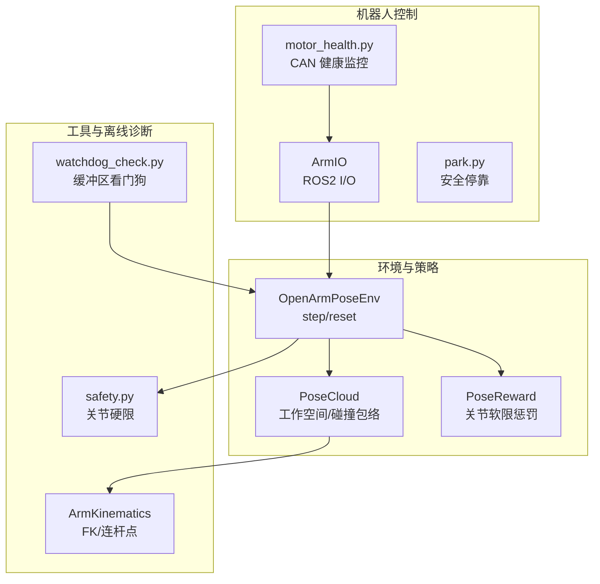
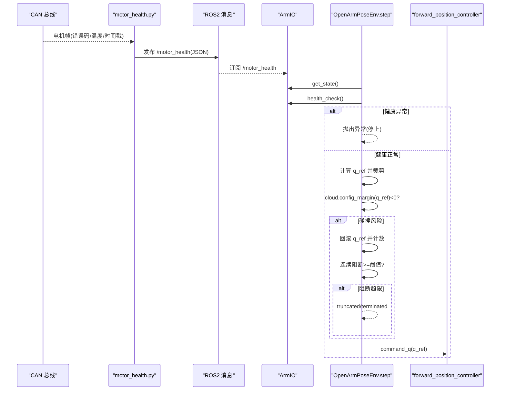
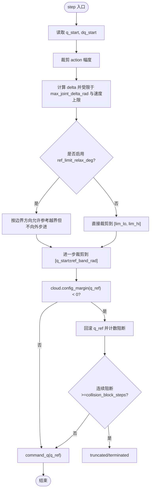
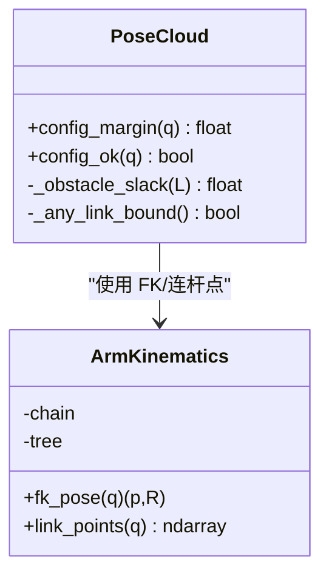
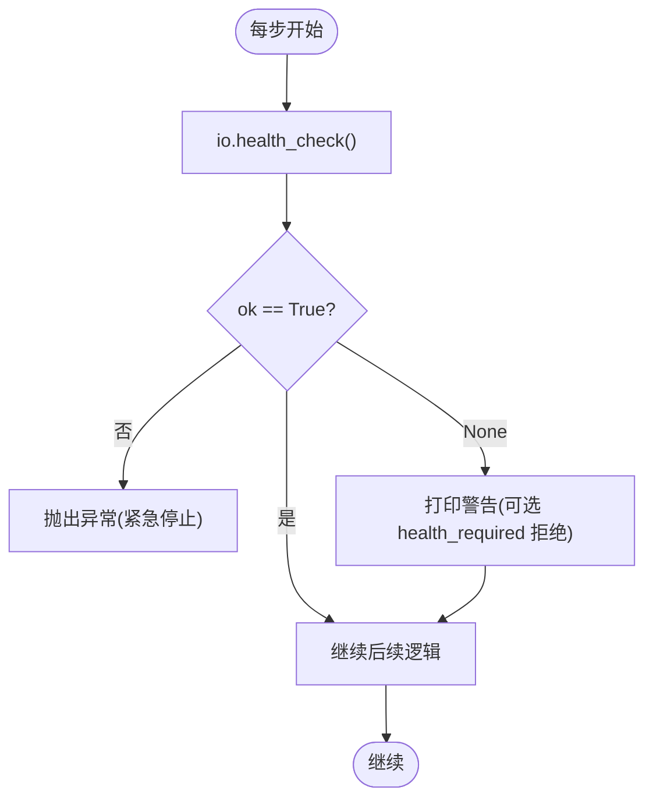
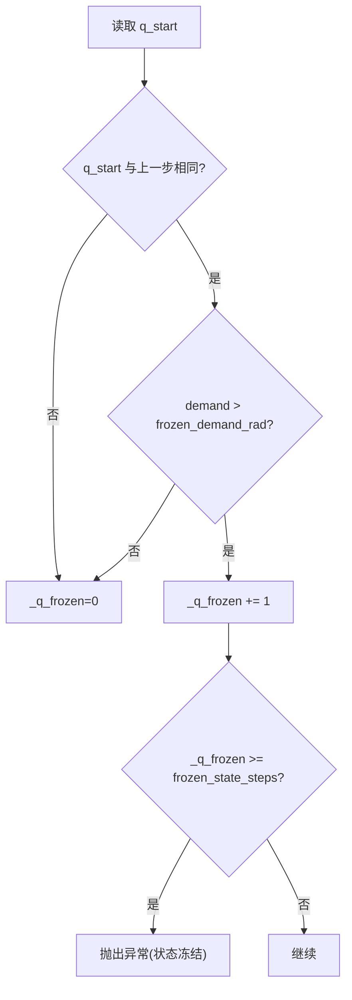
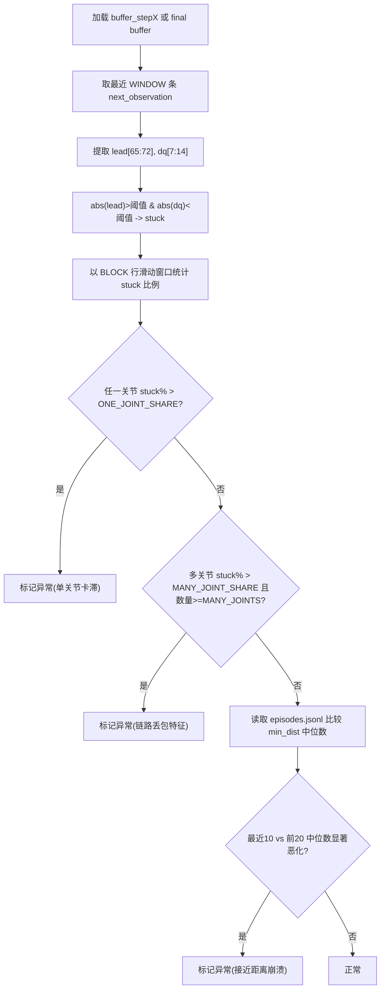
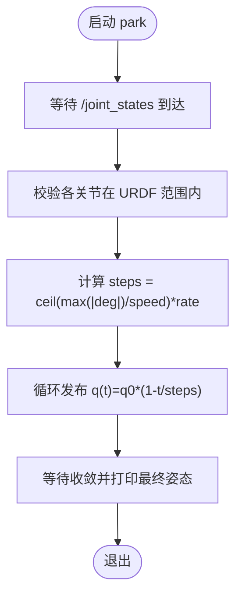
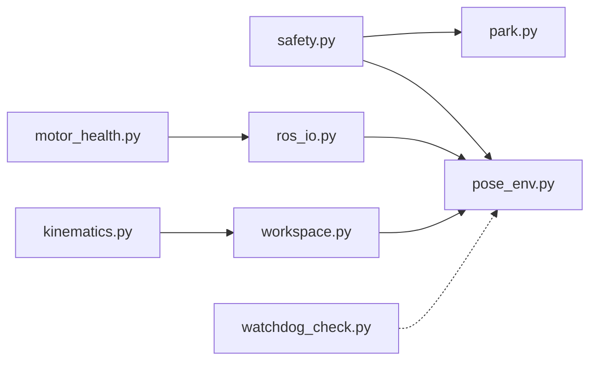

# 安全机制

<cite>
**本文引用的文件**   
- [safety.py](file://hardware/policyik_hw/robot/safety.py)
- [ros_io.py](file://hardware/policyik_hw/robot/ros_io.py)
- [motor_health.py](file://hardware/policyik_hw/robot/motor_health.py)
- [park.py](file://hardware/policyik_hw/robot/park.py)
- [watchdog_check.py](file://hardware/policyik_hw/watchdog_check.py)
- [kinematics.py](file://hardware/policyik_hw/utils/kinematics.py)
- [workspace.py](file://hardware/policyik_hw/envs/workspace.py)
- [pose_env.py](file://hardware/policyik_hw/envs/pose_env.py)
- [reward.py](file://hardware/policyik_hw/envs/reward.py)
</cite>

## 目录
1. [引言](#引言)
2. [项目结构](#项目结构)
3. [核心组件](#核心组件)
4. [架构总览](#架构总览)
5. [详细组件分析](#详细组件分析)
6. [依赖关系分析](#依赖关系分析)
7. [性能与实时性考量](#性能与实时性考量)
8. [故障排查指南](#故障排查指南)
9. [结论](#结论)
10. [附录：配置项速查](#附录配置项速查)

## 引言
本技术文档聚焦于硬件侧的安全机制系统，覆盖关节限制检查、碰撞检测、紧急停止、看门狗监控、异常处理与状态恢复、以及安全日志记录等关键能力。该系统围绕 OpenArm 右臂的 ROS 2 控制栈构建，通过 CAN 总线读取电机健康状态，结合运动学模型与环境约束进行在线安全检查，并在训练或演示过程中提供可配置的防护策略与回退行为。

## 项目结构
安全相关代码主要分布在 hardware/policyik_hw 下：
- robot 子模块负责与真实机械臂交互、电机健康监控与安全回退动作
- utils/kinematics 提供正解与连杆点集，用于碰撞包络计算
- envs 子模块提供环境层的安全策略（关节软限、速度/加速度限制、碰撞保护）
- watchdog_check.py 提供离线训练缓冲区的故障检测脚本

**图表来源** 
- [ros_io.py:53-149](file://hardware/policyik_hw/robot/ros_io.py#L53-L149)
- [motor_health.py:12-78](file://hardware/policyik_hw/robot/motor_health.py#L12-L78)
- [park.py:11-66](file://hardware/policyik_hw/robot/park.py#L11-L66)
- [pose_env.py:206-544](file://hardware/policyik_hw/envs/pose_env.py#L206-L544)
- [workspace.py:52-175](file://hardware/policyik_hw/envs/workspace.py#L52-L175)
- [kinematics.py:81-129](file://hardware/policyik_hw/utils/kinematics.py#L81-L129)
- [watchdog_check.py:10-57](file://hardware/policyik_hw/watchdog_check.py#L10-L57)
- [safety.py:1-28](file://hardware/policyik_hw/robot/safety.py#L1-L28)

**章节来源**
- [ros_io.py:53-149](file://hardware/policyik_hw/robot/ros_io.py#L53-L149)
- [pose_env.py:206-544](file://hardware/policyik_hw/envs/pose_env.py#L206-L544)
- [workspace.py:52-175](file://hardware/policyik_hw/envs/workspace.py#L52-L175)
- [kinematics.py:81-129](file://hardware/policyik_hw/utils/kinematics.py#L81-L129)
- [watchdog_check.py:10-57](file://hardware/policyik_hw/watchdog_check.py#L10-L57)
- [safety.py:1-28](file://hardware/policyik_hw/robot/safety.py#L1-L28)

## 核心组件
- 关节限制检查：基于 URDF 的硬限制与安全裕度，支持用户自定义扇区交集；在环境层对参考轨迹进行软限与速度/步幅限制。
- 碰撞检测：通过 PoseCloud 的 config_margin/config_ok 计算连杆包络、工具点包络、自折叠间隙与障碍物距离，返回最小安全裕度。
- 紧急停止与回退：当电机健康异常、状态停滞或连续碰撞被阻断时，抛出异常终止当前步骤；提供 park 脚本将手臂平滑降至零位。
- 看门狗机制：运行时由 ArmIO.health_check 与 pose_env.step 中的 health_guard/frozen_state_steps 组合实现；离线由 watchdog_check.py 分析训练缓冲区，检测“卡滞”和“链路丢包”。
- 安全策略配置：EnvConfig 暴露大量开关与阈值，包括 collision_guard/collision_terminate、health_guard/health_required、ref_limit_relax_deg、max_joint_delta_rad、max_joint_velocity_rad_s 等。
- 异常处理与恢复：step 中检测到异常会抛出 RuntimeError；close 中尝试保持当前命令并销毁节点；park 提供独立安全停靠流程。
- 安全日志记录：collect_demos 等入口记录 guard_blocks/truncated_by_guard 等指标；env 输出碰撞阻断日志与 episode summary。

**章节来源**
- [safety.py:1-28](file://hardware/policyik_hw/robot/safety.py#L1-L28)
- [workspace.py:122-175](file://hardware/policyik_hw/envs/workspace.py#L122-L175)
- [pose_env.py:386-508](file://hardware/policyik_hw/envs/pose_env.py#L386-L508)
- [park.py:11-66](file://hardware/policyik_hw/robot/park.py#L11-L66)
- [watchdog_check.py:10-57](file://hardware/policyik_hw/watchdog_check.py#L10-L57)
- [reward.py:106-146](file://hardware/policyik_hw/envs/reward.py#L106-L146)

## 架构总览
下图展示从传感器到执行器的安全闭环：CAN 健康数据经 motor_health.py 发布至 /motor_health，ArmIO 订阅并聚合；环境层在每步调用 health_check 与碰撞检查，必要时阻断参考轨迹或终止回合；park 作为独立安全程序，可将所有关节平滑归零。

**图表来源** 
- [motor_health.py:20-78](file://hardware/policyik_hw/robot/motor_health.py#L20-L78)
- [ros_io.py:80-133](file://hardware/policyik_hw/robot/ros_io.py#L80-L133)
- [pose_env.py:386-508](file://hardware/policyik_hw/envs/pose_env.py#L386-L508)

## 详细组件分析

### 关节限制检查与软限策略
- 硬限制：safety.py 定义 URDF 关节范围并叠加 2° 安全裕度；joint_limits 可与用户扇区取交集，得到 lo/hi。
- 参考轨迹裁剪：pose_env.step 中对 delta 施加 max_joint_delta_rad 与速度上限；若启用 ref_limit_relax_deg，则在关节处于边界时允许参考短暂越界但拒绝继续向外步进。
- 奖励软限：reward.py 根据 q 到 lo/hi 的相对裕度计算 limit_margin 惩罚，仅在 rho > limit_gate_rho 时生效，鼓励远离边界。

**图表来源** 
- [pose_env.py:425-459](file://hardware/policyik_hw/envs/pose_env.py#L425-L459)
- [safety.py:20-28](file://hardware/policyik_hw/robot/safety.py#L20-L28)
- [reward.py:131-136](file://hardware/policyik_hw/envs/reward.py#L131-L136)

**章节来源**
- [safety.py:1-28](file://hardware/policyik_hw/robot/safety.py#L1-L28)
- [pose_env.py:425-459](file://hardware/policyik_hw/envs/pose_env.py#L425-L459)
- [reward.py:106-146](file://hardware/policyik_hw/envs/reward.py#L106-L146)

### 碰撞检测与包络约束
- 工作空间与包络：PoseCloud 使用 ArmKinematics.link_points 获取连杆原点与工具点，计算连杆包络、工具点包络、自折叠间隙与障碍物距离，返回最小安全裕度。
- 配置开关：self_clearance_m、link_min/max_*、tool_min/max_*、post_clear_m、shoulder_clear_m、left_arm_clear_m 等参数决定哪些约束生效。
- 在线防护：pose_env.step 在每次更新 q_ref 后调用 config_margin；若为负则回滚并计数；连续阻断超过 collision_block_steps 触发截断或终止。

**图表来源** 
- [workspace.py:122-175](file://hardware/policyik_hw/envs/workspace.py#L122-L175)
- [kinematics.py:81-129](file://hardware/policyik_hw/utils/kinematics.py#L81-L129)

**章节来源**
- [workspace.py:52-175](file://hardware/policyik_hw/envs/workspace.py#L52-L175)
- [kinematics.py:81-129](file://hardware/policyik_hw/utils/kinematics.py#L81-L129)
- [pose_env.py:447-459](file://hardware/policyik_hw/envs/pose_env.py#L447-L459)

### 电机健康监控与紧急停止
- 健康数据源：motor_health.py 监听 CAN 帧，解析错误码、温度、接收年龄，并以 JSON 形式发布 /motor_health。
- 运行时检查：ArmIO.health_check 校验最近一次健康数据的时效、错误码、温度与重复 DISABLED 次数；返回 (ok, reason)。
- 策略集成：pose_env.step 在 health_guard=True 时调用 health_check；False 直接抛异常终止；None 且未警告则打印警告并可设置 health_required 强制拒绝运行。

**图表来源** 
- [motor_health.py:20-78](file://hardware/policyik_hw/robot/motor_health.py#L20-L78)
- [ros_io.py:87-106](file://hardware/policyik_hw/robot/ros_io.py#L87-L106)
- [pose_env.py:393-403](file://hardware/policyik_hw/envs/pose_env.py#L393-L403)

**章节来源**
- [motor_health.py:12-78](file://hardware/policyik_hw/robot/motor_health.py#L12-L78)
- [ros_io.py:80-106](file://hardware/policyik_hw/robot/ros_io.py#L80-L106)
- [pose_env.py:393-403](file://hardware/policyik_hw/envs/pose_env.py#L393-L403)

### 状态停滞检测与恢复
- 停滞判定：若 q_start 连续 frozen_state_steps 步保持不变且 demanded 超出 frozen_demand_rad，视为 CAN 读停滞（仅重发最后一帧）。
- 恢复建议：提示重启 bringup launch、上下电 CAN 接口后重试；同时关闭控制器栈以避免双控冲突（check_single_control_stack）。

**图表来源** 
- [pose_env.py:407-423](file://hardware/policyik_hw/envs/pose_env.py#L407-L423)
- [ros_io.py:19-50](file://hardware/policyik_hw/robot/ros_io.py#L19-L50)

**章节来源**
- [pose_env.py:407-423](file://hardware/policyik_hw/envs/pose_env.py#L407-L423)
- [ros_io.py:19-50](file://hardware/policyik_hw/robot/ros_io.py#L19-L50)

### 看门狗机制与工作模式
- 在线看门狗：ArmIO.health_check 与 pose_env.step 的组合，确保电机健康、数据新鲜度与状态不冻结。
- 离线看门狗：watchdog_check.py 读取训练缓冲区最后 WINDOW 条 next_observation，提取 lead 角与关节速度，统计“卡滞”比例；若单关节卡滞比例过高或多关节同时卡滞，判定为异常；同时对比最近 10 与之前 20 个 episode 的 min_dist 中位数，判断接近距离是否崩溃。

**图表来源** 
- [watchdog_check.py:10-57](file://hardware/policyik_hw/watchdog_check.py#L10-L57)

**章节来源**
- [watchdog_check.py:10-57](file://hardware/policyik_hw/watchdog_check.py#L10-L57)

### 安全停靠与紧急回退
- park.py 订阅 /joint_states，验证当前关节位于 URDF 范围内，然后以最大速度限制将各关节线性插值到 0（悬挂直下），期间持续发布命令并等待确认。
- 该脚本可作为独立安全程序，在异常退出或维护场景下确保机械臂回到安全姿态。

**图表来源** 
- [park.py:11-66](file://hardware/policyik_hw/robot/park.py#L11-L66)
- [safety.py:4-17](file://hardware/policyik_hw/robot/safety.py#L4-L17)

**章节来源**
- [park.py:11-66](file://hardware/policyik_hw/robot/park.py#L11-L66)
- [safety.py:4-17](file://hardware/policyik_hw/robot/safety.py#L4-L17)

### 异常处理流程与状态恢复
- 异常类型：
  - 电机健康异常：抛出异常并停止
  - 状态冻结：抛出异常并提示 CAN 接口问题
  - 碰撞连续阻断：truncated 或 terminated（取决于 collision_terminate）
- 恢复方式：
  - 重启 bringup launch 与 CAN 接口
  - 使用 park 脚本安全停靠
  - 调整 EnvConfig 参数（如增大 collision_block_steps、降低 ref_limit_relax_deg）

**章节来源**
- [pose_env.py:393-508](file://hardware/policyik_hw/envs/pose_env.py#L393-L508)
- [park.py:11-66](file://hardware/policyik_hw/robot/park.py#L11-L66)

### 安全日志记录与评估指标
- 运行时日志：
  - 碰撞阻断日志：包含 q、envelope slack、episode 终止原因
  - 健康警告：无 /motor_health 或数据陈旧时的警告信息
- 评估指标：
  - episode summary 包含 final_dist、min_dist、settled_success、strict_settled、collision_blocked_out、sigma_deg、term_means
  - timing_summary 包含 step_wall_median_s、effective_hz 等

**章节来源**
- [pose_env.py:498-535](file://hardware/policyik_hw/envs/pose_env.py#L498-L535)

## 依赖关系分析
- 低耦合高内聚：
  - safety.py 仅提供硬限常量与交集函数，被 envs 与 park 复用
  - kinematics.py 提供纯数学 FK 与点集，被 workspace 与 envs 使用
  - ros_io.py 封装 ROS2 I/O 与健康检查，被 envs 调用
  - motor_health.py 独立运行，仅通过 ROS2 消息与上层交互
  - watchdog_check.py 独立离线脚本，不依赖运行时
- 潜在环依赖：
  - envs/workspace.py 依赖 utils/kinematics.py，无反向依赖
  - envs/pose_env.py 依赖 robot/safety.py 与 envs/workspace.py，无反向依赖
  - robot/park.py 依赖 robot/safety.py，无反向依赖

**图表来源** 
- [safety.py:1-28](file://hardware/policyik_hw/robot/safety.py#L1-L28)
- [kinematics.py:81-129](file://hardware/policyik_hw/utils/kinematics.py#L81-L129)
- [workspace.py:52-175](file://hardware/policyik_hw/envs/workspace.py#L52-L175)
- [ros_io.py:53-149](file://hardware/policyik_hw/robot/ros_io.py#L53-L149)
- [motor_health.py:12-78](file://hardware/policyik_hw/robot/motor_health.py#L12-L78)
- [watchdog_check.py:10-57](file://hardware/policyik_hw/watchdog_check.py#L10-L57)
- [pose_env.py:206-544](file://hardware/policyik_hw/envs/pose_env.py#L206-L544)

**章节来源**
- [pose_env.py:206-544](file://hardware/policyik_hw/envs/pose_env.py#L206-L544)
- [workspace.py:52-175](file://hardware/policyik_hw/envs/workspace.py#L52-L175)
- [ros_io.py:53-149](file://hardware/policyik_hw/robot/ros_io.py#L53-L149)
- [motor_health.py:12-78](file://hardware/policyik_hw/robot/motor_health.py#L12-L78)
- [watchdog_check.py:10-57](file://hardware/policyik_hw/watchdog_check.py#L10-L57)
- [safety.py:1-28](file://hardware/policyik_hw/robot/safety.py#L1-L28)

## 性能与实时性考量
- 控制频率：EnvConfig.control_hz 决定 dt；timing_summary 提供 effective_hz 与 step_wall 分位数，便于评估实际周期抖动。
- 碰撞检查开销：config_margin 涉及连杆点集与距离计算，建议在仿真阶段预采样 PoseCloud 以减少在线计算压力。
- 健康检查开销：health_check 轻量，但需保证 /motor_health 数据新鲜；若 health_required=False，应谨慎避免长时间无健康数据运行。
- 卡顿与丢包：watchdog_check.py 的 STUCK_LEAD_DEG、STUCK_DQ、BLOCK、WINDOW 等参数影响检测灵敏度；建议根据实际工况调参。

[本节为通用指导，不直接分析具体文件]

## 故障排查指南
- 双控制器冲突：
  - 现象：多个 controller_manager 节点导致机械臂跳变
  - 处理：使用 check_single_control_stack 检查并杀掉旧进程，确保仅一个控制栈运行
- 电机健康异常：
  - 现象：ERR 非 0/1、温度超温、SILENT 超时、重复 DISABLED
  - 处理：检查 CAN 接口、供电与接线；必要时重启 bringup 与 motor_health 进程
- 状态冻结：
  - 现象：/joint_states 持续发布但 q 不变
  - 处理：重启 bringup launch，重新上下电 CAN 接口
- 碰撞阻断频繁：
  - 现象：连续阻断触发 truncated/terminated
  - 处理：增大 collision_block_steps、减小 action_scale_rad 或 ref_limit_relax_deg，优化策略或任务难度
- 离线看门狗报警：
  - 现象：缓冲区出现单关节卡滞或多关节同时卡滞，或接近距离崩溃
  - 处理：检查策略稳定性、环境噪声、观测噪声与 reward 权重

**章节来源**
- [ros_io.py:19-50](file://hardware/policyik_hw/robot/ros_io.py#L19-L50)
- [ros_io.py:87-106](file://hardware/policyik_hw/robot/ros_io.py#L87-L106)
- [pose_env.py:407-508](file://hardware/policyik_hw/envs/pose_env.py#L407-L508)
- [watchdog_check.py:10-57](file://hardware/policyik_hw/watchdog_check.py#L10-L57)

## 结论
该安全机制系统通过多层防护（关节硬限、参考软限、速度/步幅限制、碰撞包络、电机健康监控、状态冻结检测）与离线看门狗共同构成完整的安全闭环。EnvConfig 提供了丰富的策略开关与阈值，使系统在保障安全的前提下具备灵活的可配置性与可扩展性。配合 park 安全停靠与详细的日志与指标，可在真实硬件环境中稳定运行并快速定位问题。

[本节为总结性内容，不直接分析具体文件]

## 附录：配置项速查
- 关节限制与参考策略
  - joint_lo_deg/joint_hi_deg：与 URDF 硬限取交集的用户扇区
  - ref_limit_relax_deg：边界处参考越界容差（度）
  - max_joint_delta_rad：每步最大关节增量
  - max_joint_velocity_rad_s：速度上限（rad/s）
  - ref_band_rad：参考相对当前位置的带域
- 碰撞与包络
  - collision_tool_z_m：工具点碰撞包络偏移
  - self_clearance_m：自折叠最小间隙
  - link_min/max_x/y/z_m：连杆包络边界
  - tool_min/max_x/y/z_m：工具点包络边界
  - post_clear_m/shoulder_clear_m/left_arm_clear_m：障碍物间隙
- 健康与冻结
  - health_guard：是否启用健康检查
  - health_required：无健康数据是否拒绝运行
  - frozen_demand_rad：冻结判定需求阈值
  - frozen_state_steps：冻结判定步数
- 碰撞阻断
  - collision_guard：是否启用碰撞检查
  - collision_terminate：阻断后是否终止回合
  - collision_block_steps：连续阻断阈值

**章节来源**
- [pose_env.py:46-131](file://hardware/policyik_hw/envs/pose_env.py#L46-L131)
- [workspace.py:14-49](file://hardware/policyik_hw/envs/workspace.py#L14-L49)
