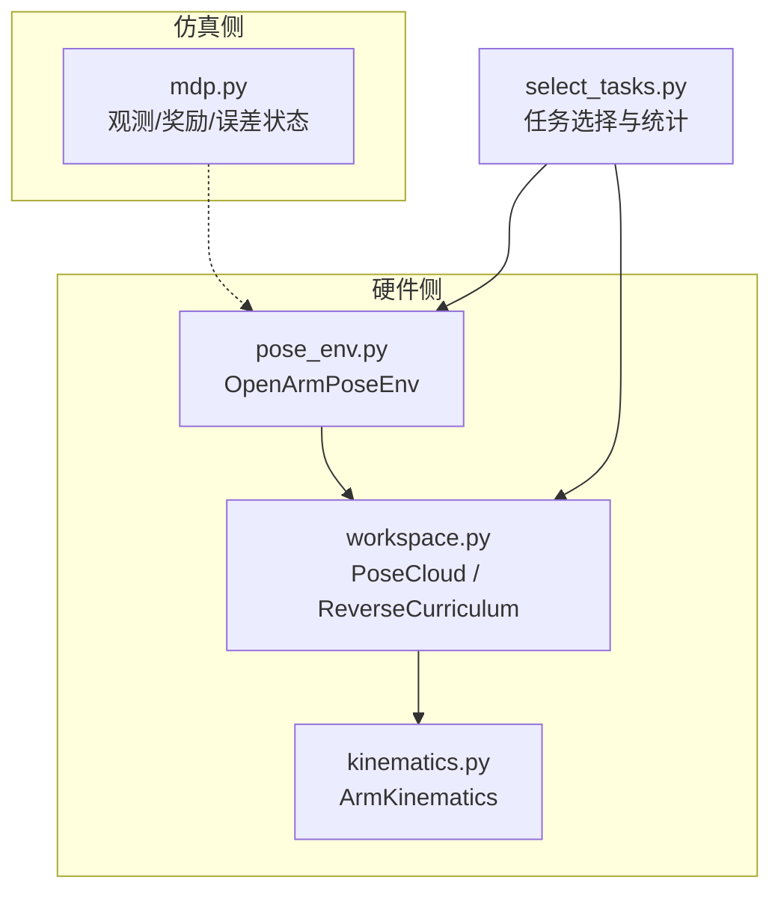
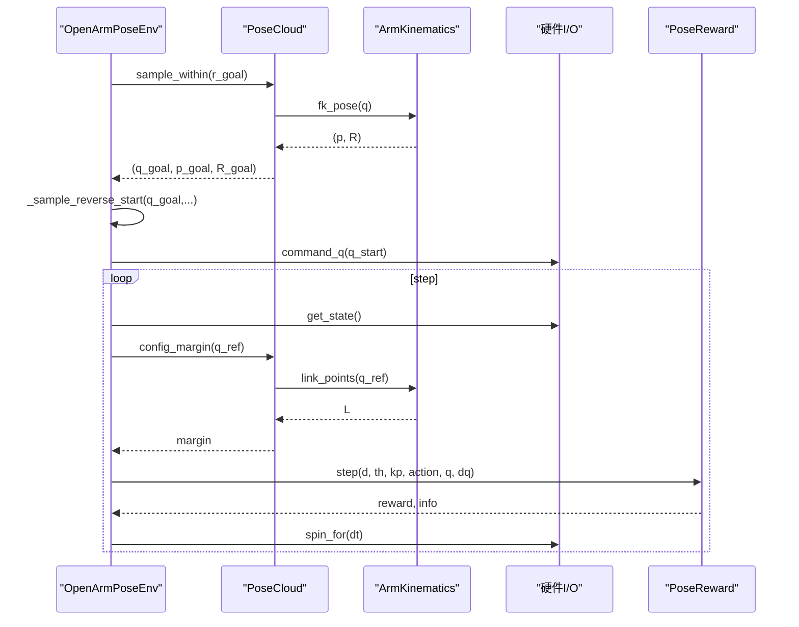
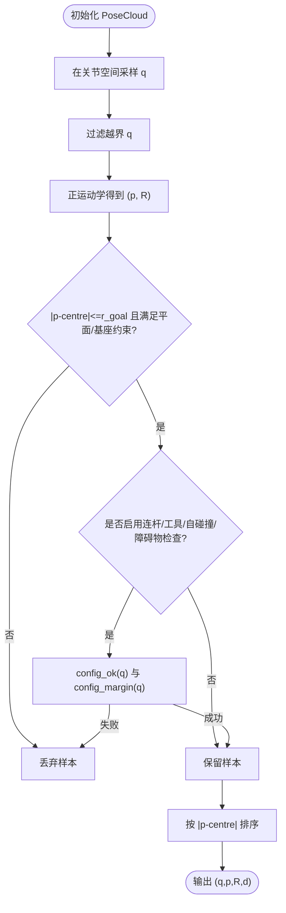
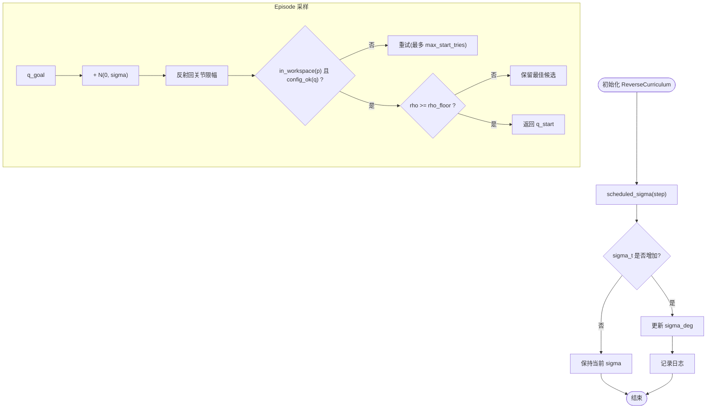
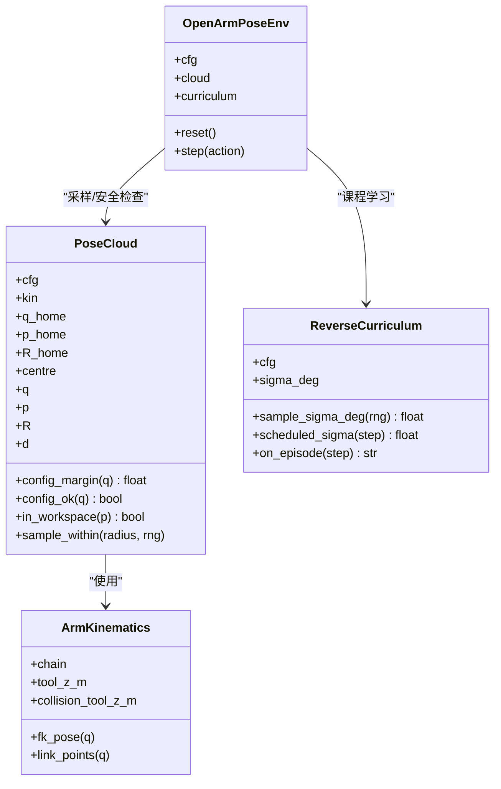

# 工作空间管理

<cite>
**本文引用的文件**   
- [workspace.py](file://hardware/policyik_hw/envs/workspace.py)
- [pose_env.py](file://hardware/policyik_hw/envs/pose_env.py)
- [kinematics.py](file://hardware/policyik_hw/utils/kinematics.py)
- [mdp.py](file://simulation/policyik_sim/tasks/mdp.py)
- [select_tasks.py](file://hardware/policyik_hw/select_tasks.py)
</cite>

## 目录
1. [引言](#引言)
2. [项目结构](#项目结构)
3. [核心组件](#核心组件)
4. [架构总览](#架构总览)
5. [详细组件分析](#详细组件分析)
6. [依赖关系分析](#依赖关系分析)
7. [性能与可视化](#性能与可视化)
8. [故障排查指南](#故障排查指南)
9. [结论](#结论)

## 引言
本技术文档围绕“工作空间管理系统”展开，重点解释 PoseCloud 类的工作原理、CloudConfig 配置参数的作用与调优方法、ReverseCurriculum 课程学习机制的实现原理，以及工作空间边界约束、自碰撞检测、工具碰撞处理等安全机制。同时给出工作空间可视化的思路与性能优化建议，并总结实际部署中的常见问题与解决方案。该系统用于在真实机械臂环境中进行位姿可达性采样、碰撞包络检查与逆运动学策略训练，支撑从仿真到硬件的端到端流程。

## 项目结构
本项目在工作空间管理与机器人控制方面涉及以下关键模块：
- 工作空间与课程学习：hardware/policyik_hw/envs/workspace.py
- 真实环境接口与训练循环：hardware/policyik_hw/envs/pose_env.py
- 正运动学与URDF链：hardware/policyik_hw/utils/kinematics.py
- 仿真任务观测与奖励（含误差状态与历史）：simulation/policyik_sim/tasks/mdp.py
- 任务选择与统计报告：hardware/policyik_hw/select_tasks.py

图表来源
- [workspace.py:52-195](file://hardware/policyik_hw/envs/workspace.py#L52-L195)
- [pose_env.py:206-254](file://hardware/policyik_hw/envs/pose_env.py#L206-L254)
- [kinematics.py:81-128](file://hardware/policyik_hw/utils/kinematics.py#L81-L128)
- [mdp.py:115-188](file://simulation/policyik_sim/tasks/mdp.py#L115-L188)
- [select_tasks.py:152-171](file://hardware/policyik_hw/select_tasks.py#L152-L171)

章节来源
- [workspace.py:1-252](file://hardware/policyik_hw/envs/workspace.py#L1-L252)
- [pose_env.py:1-544](file://hardware/policyik_hw/envs/pose_env.py#L1-L544)
- [kinematics.py:1-129](file://hardware/policyik_hw/utils/kinematics.py#L1-L129)
- [mdp.py:1-232](file://simulation/policyik_sim/tasks/mdp.py#L1-L232)
- [select_tasks.py:117-171](file://hardware/policyik_hw/select_tasks.py#L117-L171)

## 核心组件
- PoseCloud：基于关节空间采样与正运动学构建可达位姿云，提供工作空间成员判定、配置安全边距计算、按距离排序的快速采样。
- CloudConfig：定义工作空间半径、采样数量、关节半宽、中心点、各轴/工具/连杆边界、自碰撞间隙、障碍物裕度等参数。
- ReverseCurriculum：反向课程学习，以目标位姿为中心生成初始位姿，并按计划逐步增大扰动方差 sigma。
- OpenArmPoseEnv：Gymnasium 环境，集成 PoseCloud、课程学习、奖励函数、硬件 I/O 与安全保护。
- ArmKinematics：基于 URDF 的正运动学，支持末端工具偏移与碰撞工具点。
- mdp.py：仿真任务观测与奖励项，包括位置/姿态误差、关键点跟踪、误差历史与势函数 shaping。

章节来源
- [workspace.py:14-195](file://hardware/policyik_hw/envs/workspace.py#L14-L195)
- [workspace.py:207-252](file://hardware/policyik_hw/envs/workspace.py#L207-L252)
- [pose_env.py:46-254](file://hardware/policyik_hw/envs/pose_env.py#L46-L254)
- [kinematics.py:81-128](file://hardware/policyik_hw/utils/kinematics.py#L81-L128)
- [mdp.py:37-188](file://simulation/policyik_sim/tasks/mdp.py#L37-L188)

## 架构总览
系统通过 OpenArmPoseEnv 驱动真实机械臂，使用 PoseCloud 预构建可达位姿云，并在 reset 阶段根据 ReverseCurriculum 生成起点与目标；step 中执行动作、更新参考关节角、进行碰撞安全检查、调用奖励函数并返回观测。仿真侧的 mdp.py 提供可复现的观测与奖励实现，便于离线评估与对比。

图表来源
- [pose_env.py:324-384](file://hardware/policyik_hw/envs/pose_env.py#L324-L384)
- [pose_env.py:386-508](file://hardware/policyik_hw/envs/pose_env.py#L386-L508)
- [workspace.py:52-195](file://hardware/policyik_hw/envs/workspace.py#L52-L195)
- [kinematics.py:104-128](file://hardware/policyik_hw/utils/kinematics.py#L104-L128)

## 详细组件分析

### PoseCloud 工作原理
PoseCloud 负责：
- 在关节空间内采样 q，过滤越界样本，并通过正运动学得到 (p, R)。
- 以 centre 为球心、r_goal 为半径的工作空间筛选，并应用基座最小距离、XYZ 平面切割等约束。
- 可选地应用连杆包络、工具包络、自碰撞间隙与障碍物裕度检查。
- 将 home 位姿加入并按 |p - centre| 排序，支持按半径快速采样。

图表来源
- [workspace.py:52-98](file://hardware/policyik_hw/envs/workspace.py#L52-L98)
- [workspace.py:122-175](file://hardware/policyik_hw/envs/workspace.py#L122-L175)
- [workspace.py:177-195](file://hardware/policyik_hw/envs/workspace.py#L177-L195)

#### 工作空间成员判定
in_workspace 判断点 p 是否在球体与多个平面切割区域内，确保：
- 距离 centre 不超过 r_goal
- 距原点不小于 min_base_dist_m
- z >= min_z_m，x >= min_x_m，y 在 [min_y_m, max_y_m]

章节来源
- [workspace.py:177-185](file://hardware/policyik_hw/envs/workspace.py#L177-L185)

#### 配置安全边距与自碰撞检测
config_margin 计算当前配置 q 的安全边距，考虑：
- 连杆包络：各轴方向的最小/最大坐标限制
- 工具包络：末端 tip 的 XYZ 范围与基座距离
- 自碰撞：所有连杆点与原点构成的点集两两距离，排除相邻段，要求大于 self_clearance_m
- 障碍物裕度：post/left_arm/shoulder 三类障碍物的最小距离减去 clearance

config_ok 是布尔版本，用于快速判定 q 是否合法。

章节来源
- [workspace.py:122-175](file://hardware/policyik_hw/envs/workspace.py#L122-L175)

#### 快速按半径采样
_d_within 利用已排序的距离数组 d 二分查找索引，_n_within 返回可用样本数，sample_within 随机选取一个索引返回 (q, p, R)。

章节来源
- [workspace.py:187-195](file://hardware/policyik_hw/envs/workspace.py#L187-L195)

### CloudConfig 配置参数与调优
CloudConfig 的关键字段与作用：
- r_goal：工作空间球半径，决定目标采样范围
- n_samples：关节空间采样数量，越大覆盖越好但构建更慢
- joint_halfwidth_deg：home 附近局部采样半宽；为 0 时退化为全局均匀采样
- seed：随机种子，保证可重复
- centre_m：工作空间中心，默认取 home 末端位姿
- min_base_dist_m：避免太靠近基座
- link_min/max_*：连杆包络边界
- tool_min/max_*：工具包络边界
- collision_tool_z_m：启用碰撞工具点检查
- self_clearance_m/self_pair_min_gap：自碰撞间隙与跳过相邻段
- post_clear_m/post_xz/post_from：柱状障碍物约束
- shoulder_clear_m/shoulder_z_range：肩部区域约束
- left_arm_clear_m/left_arm_xz：左臂（或另一侧）约束

调优建议：
- 若构建 PoseCloud 过慢，可降低 n_samples 或缩小 joint_halfwidth_deg
- 若目标分布过于集中，增大 r_goal 或扩大 centre_m 偏移
- 若频繁触发安全拦截，适当放宽 link/tool 边界或减小 clearance
- 若存在特定障碍物，设置 post/left_arm/shoulder 相关参数

章节来源
- [workspace.py:14-49](file://hardware/policyik_hw/envs/workspace.py#L14-L49)
- [pose_env.py:168-196](file://hardware/policyik_hw/envs/pose_env.py#L168-L196)

### ReverseCurriculum 课程学习机制
ReverseCurriculum 的核心思想：
- 以目标位姿 q_goal 为中心，按 N(0, sigma) 生成初始位姿 q_start
- sigma 在 [sigma_lo_deg, sigma_t] 之间均匀采样，sigma_t 随训练进度按 schedule 递增
- on_episode 在每个 episode 开始时更新 sigma_t，并记录变化日志
- 环境在 _sample_reverse_start 中多次尝试采样，直到满足 in_workspace 与 config_ok，且 rho >= rho_floor

图表来源
- [workspace.py:198-252](file://hardware/policyik_hw/envs/workspace.py#L198-L252)
- [pose_env.py:364-384](file://hardware/policyik_hw/envs/pose_env.py#L364-L384)

章节来源
- [workspace.py:198-252](file://hardware/policyik_hw/envs/workspace.py#L198-L252)
- [pose_env.py:364-384](file://hardware/policyik_hw/envs/pose_env.py#L364-L384)

### 工作空间边界约束、自碰撞检测、工具碰撞处理
- 工作空间边界：由 r_goal、centre_m、min_base_dist_m、XYZ 平面切割共同定义
- 自碰撞检测：通过 link_points 获取所有连杆点，计算点集间距离，排除相邻段，要求大于 self_clearance_m
- 工具碰撞处理：当 collision_tool_z_m > 0 时，额外检查末端 tip 的 XYZ 范围与基座距离
- 外部障碍物：post/left_arm/shoulder 三类约束通过 _obstacle_slack 计算最小距离

章节来源
- [workspace.py:100-175](file://hardware/policyik_hw/envs/workspace.py#L100-L175)
- [kinematics.py:114-128](file://hardware/policyik_hw/utils/kinematics.py#L114-L128)

### 环境安全机制与错误处理
OpenArmPoseEnv 在 step 中执行多重安全保护：
- 健康检查：motor health fault 直接报错
- 状态冻结检测：连续多步关节状态不变则报错
- 碰撞保护：若 config_margin < 0，回滚 q_ref 并计数；连续超过 collision_block_steps 则截断或终止 episode
- 状态过期保护：若 /joint_states 超时，置零动作

章节来源
- [pose_env.py:386-508](file://hardware/policyik_hw/envs/pose_env.py#L386-L508)

### 仿真任务观测与奖励（mdp.py）
mdp.py 提供：
- 目标位置观测、关键点偏移观测
- 末端位置/姿态误差观测（归一化裁剪）
- 误差历史与势函数 shaping，鼓励持续改进
- 关节软限惩罚，防止接近极限

这些观测与奖励可与 PoseCloud 生成的工作空间配合，形成一致的评估体系。

章节来源
- [mdp.py:37-188](file://simulation/policyik_sim/tasks/mdp.py#L37-L188)

## 依赖关系分析
- PoseCloud 依赖 ArmKinematics 进行正运动学与连杆点计算
- OpenArmPoseEnv 依赖 PoseCloud 与 ReverseCurriculum 完成目标与起点采样
- select_tasks.py 使用 PoseCloud 进行任务选择与统计报告
- mdp.py 提供仿真侧观测与奖励，便于离线评估

图表来源
- [workspace.py:52-195](file://hardware/policyik_hw/envs/workspace.py#L52-L195)
- [kinematics.py:81-128](file://hardware/policyik_hw/utils/kinematics.py#L81-L128)
- [pose_env.py:206-254](file://hardware/policyik_hw/envs/pose_env.py#L206-L254)

章节来源
- [workspace.py:52-195](file://hardware/policyik_hw/envs/workspace.py#L52-L195)
- [kinematics.py:81-128](file://hardware/policyik_hw/utils/kinematics.py#L81-L128)
- [pose_env.py:206-254](file://hardware/policyik_hw/envs/pose_env.py#L206-L254)

## 性能与可视化

### 性能优化建议
- 降低 n_samples 或缩小 joint_halfwidth_deg 以减少 PoseCloud 构建时间
- 合理设置 min_entries，避免过小的有效样本导致异常
- 仅在需要时启用连杆/工具/自碰撞/障碍物检查，减少每步开销
- 使用 cloud_config 映射 EnvConfig 到 CloudConfig，避免重复配置
- 在硬件侧，调整 control_hz 与 reset_ramp_hz，平衡实时性与平滑性
- 使用 timing_summary 监控 step_wall 中位数与 P90，定位瓶颈

章节来源
- [workspace.py:14-49](file://hardware/policyik_hw/envs/workspace.py#L14-L49)
- [pose_env.py:46-130](file://hardware/policyik_hw/envs/pose_env.py#L46-L130)
- [pose_env.py:525-535](file://hardware/policyik_hw/envs/pose_env.py#L525-L535)

### 工作空间可视化方法
- 使用 PoseCloud.p 与 PoseCloud.R 绘制末端位姿云，颜色可按 d 或旋转角度着色
- 在三维图中叠加工作空间球体（centre, r_goal）、XYZ 切割平面、工具包络盒
- 标注障碍物：post/left_arm/shoulder 的圆柱或区域
- 使用 select_tasks.py 的输出统计（旋转带、壳层、voxel 覆盖率）辅助评估任务分布

章节来源
- [workspace.py:52-98](file://hardware/policyik_hw/envs/workspace.py#L52-L98)
- [select_tasks.py:117-171](file://hardware/policyik_hw/select_tasks.py#L117-L171)

## 故障排查指南
- 电机健康故障：health_check 返回 False 时立即停止，检查 CAN 总线与电源
- 关节状态冻结：连续多步 q 不变，需重启 CAN 接口与 bringup
- 碰撞保护触发：查看 config_margin 负值与具体约束（连杆/工具/自碰撞/障碍物），调整 CloudConfig
- 工作空间过小：检查 r_goal、centre_m、XYZ 切割与 min_base_dist_m，确保 home 位姿在内部
- 课程学习不收敛：调整 ReverseConfig.schedule、sigma_lo_deg、rho_floor、max_start_tries

章节来源
- [pose_env.py:386-508](file://hardware/policyik_hw/envs/pose_env.py#L386-L508)
- [workspace.py:122-175](file://hardware/policyik_hw/envs/workspace.py#L122-L175)
- [workspace.py:198-252](file://hardware/policyik_hw/envs/workspace.py#L198-L252)

## 结论
PoseCloud 通过关节空间采样与正运动学构建可达位姿云，结合多维边界约束与安全检查，为 PolicyIK 提供了稳定可靠的工作空间基础。ReverseCurriculum 以目标为中心逐步增大初始扰动，帮助策略从易到难学习。OpenArmPoseEnv 将 PoseCloud、课程学习与硬件 I/O 整合，提供完整的环境接口。通过合理调优 CloudConfig 与 ReverseConfig，并结合 mdp.py 的观测与奖励，可在仿真与硬件上实现一致的训练与评估流程。性能方面建议按需启用安全检查、控制采样规模，并使用 timing_summary 监控运行效率。可视化方面可利用 PoseCloud 的点云与统计报告辅助调试与任务设计。