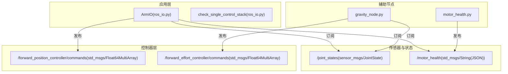
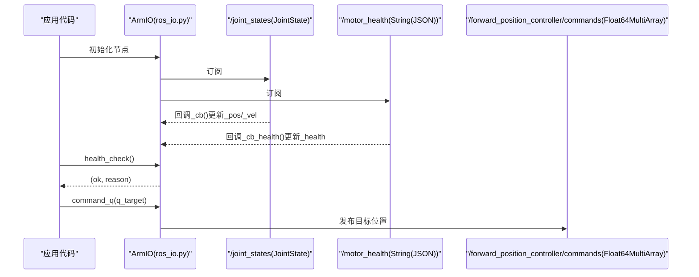
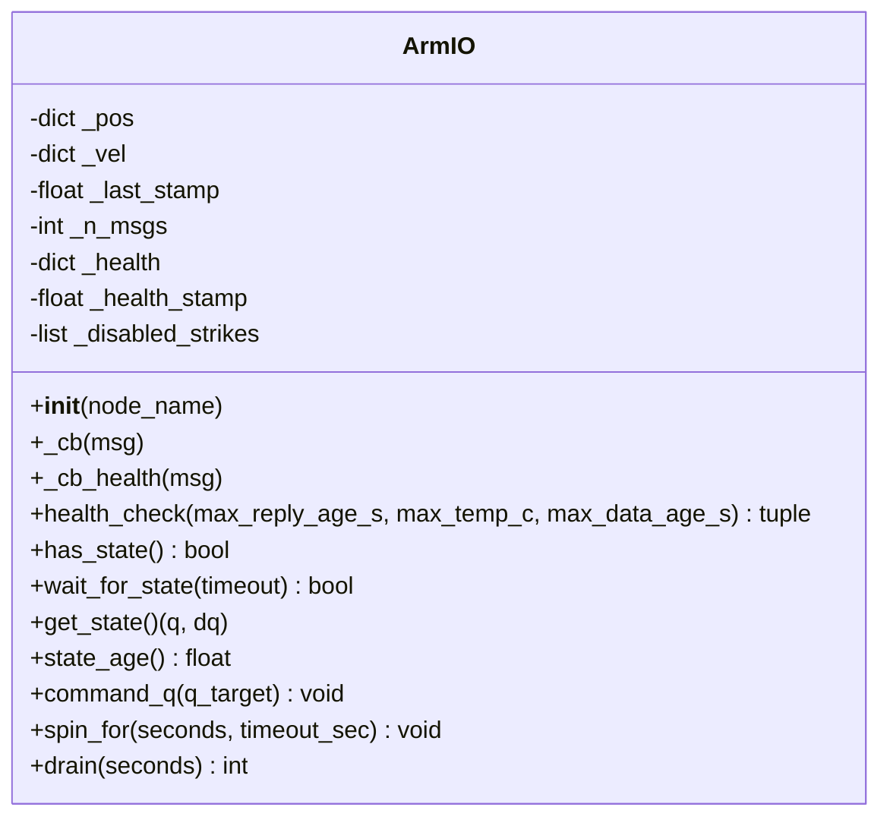
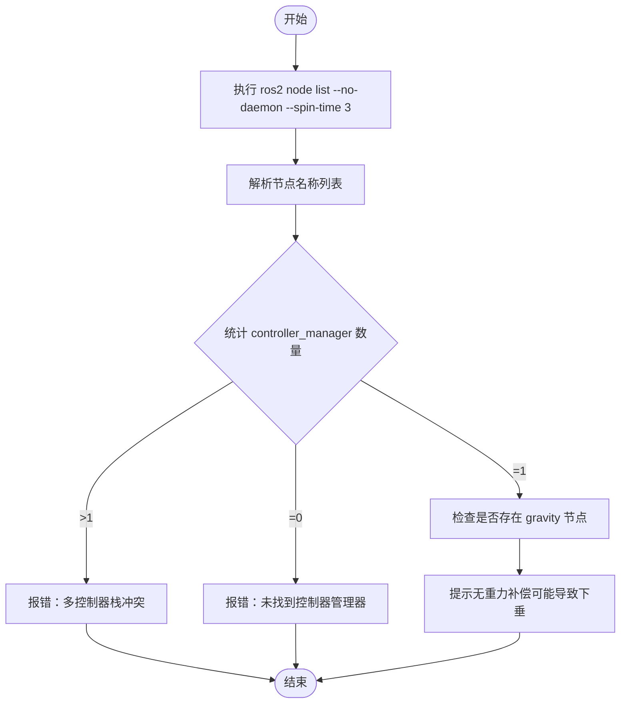
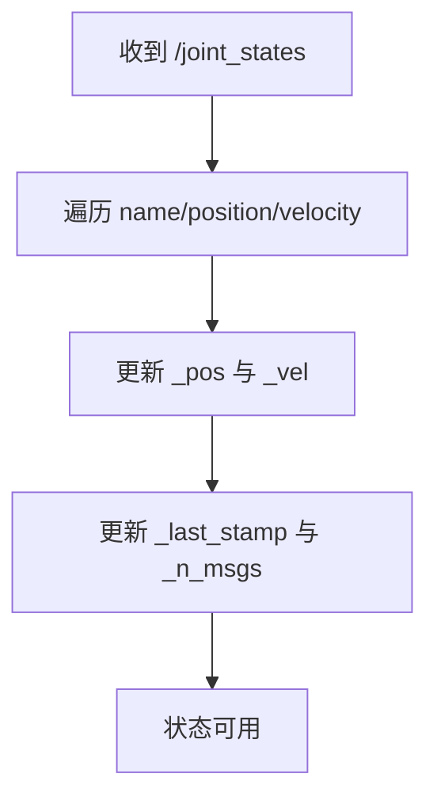
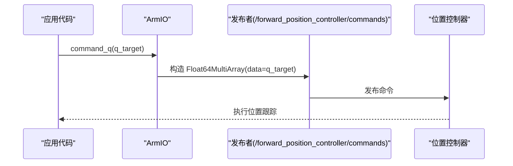
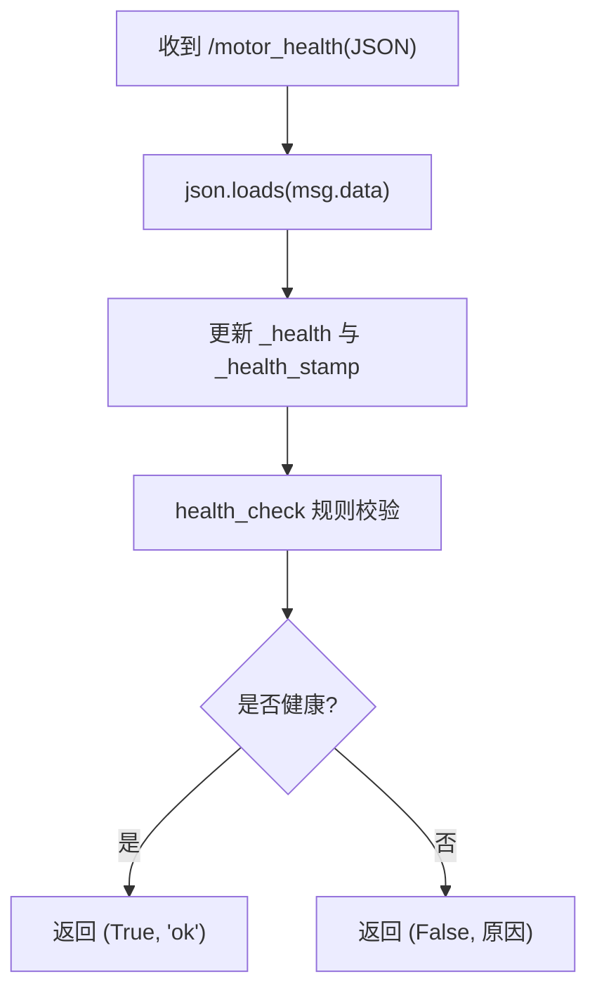
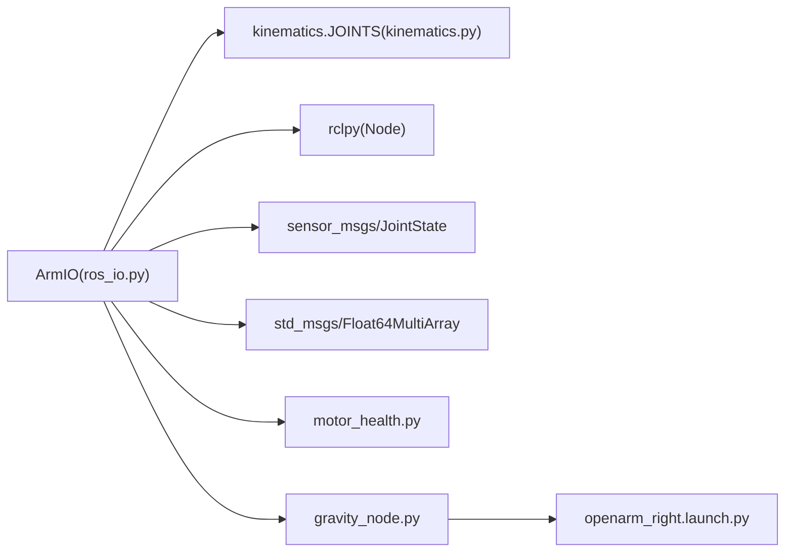

# ROS 2通信接口

<cite>
**本文引用的文件**   
- [ros_io.py](file://hardware/policyik_hw/robot/ros_io.py)
- [kinematics.py](file://hardware/policyik_hw/utils/kinematics.py)
- [motor_health.py](file://hardware/policyik_hw/robot/motor_health.py)
- [gravity_node.py](file://hardware/ros2/openarm_right_bringup/scripts/gravity_node.py)
- [openarm_right.launch.py](file://hardware/ros2/openarm_right_bringup/launch/openarm_right.launch.py)
</cite>

## 目录
1. [简介](#简介)
2. [项目结构](#项目结构)
3. [核心组件](#核心组件)
4. [架构总览](#架构总览)
5. [详细组件分析](#详细组件分析)
6. [依赖关系分析](#依赖关系分析)
7. [性能与实时性考虑](#性能与实时性考虑)
8. [故障诊断指南](#故障诊断指南)
9. [结论](#结论)
10. [附录：API使用示例](#附录api使用示例)

## 简介
本技术文档聚焦于硬件侧的ROS 2通信接口，围绕ArmIO类展开，系统说明节点初始化、话题订阅与发布机制、JointState消息读取处理、位置控制命令发送流程，以及控制器栈安全检查check_single_control_stack的实现逻辑。同时给出实时回调处理、消息队列管理与延迟优化策略，并提供状态获取、命令发送、健康检查等完整API使用示例与常见问题诊断方法。

## 项目结构
与ROS 2通信相关的核心代码位于hardware目录下：
- hardware/policyik_hw/robot/ros_io.py：实现ArmIO节点与控制器栈检查函数
- hardware/policyik_hw/utils/kinematics.py：提供关节名常量JOINTS及运动学工具
- hardware/policyik_hw/robot/motor_health.py：电机健康监控节点，发布/motor_health
- hardware/ros2/openarm_right_bringup/scripts/gravity_node.py：重力前馈补偿节点
- hardware/ros2/openarm_right_bringup/launch/openarm_right.launch.py：机器人启动配置（URDF与控制器参数注入）

图表来源
- [ros_io.py:53-70](file://hardware/policyik_hw/robot/ros_io.py#L53-L70)
- [gravity_node.py:73-95](file://hardware/ros2/openarm_right_bringup/scripts/gravity_node.py#L73-L95)
- [motor_health.py:26-33](file://hardware/policyik_hw/robot/motor_health.py#L26-L33)

章节来源
- [ros_io.py:1-149](file://hardware/policyik_hw/robot/ros_io.py#L1-L149)
- [kinematics.py:12-18](file://hardware/policyik_hw/utils/kinematics.py#L12-L18)
- [motor_health.py:1-78](file://hardware/policyik_hw/robot/motor_health.py#L1-L78)
- [gravity_node.py:1-118](file://hardware/ros2/openarm_right_bringup/scripts/gravity_node.py#L1-L118)
- [openarm_right.launch.py:84-106](file://hardware/ros2/openarm_right_bringup/launch/openarm_right.launch.py#L84-L106)

## 核心组件
- ArmIO：继承自rclpy.node.Node，负责订阅/joint_states与/motor_health，并发布位置控制命令到/forward_position_controller/commands。提供状态读取、等待状态、命令发送、健康检查、回调轮询与队列排空等方法。
- check_single_control_stack：在启动前通过ros2 node list检测controller_manager数量，确保仅有一个控制器栈运行，避免CAN总线冲突。
- motor_health.py：独立节点，监听CAN总线并周期性发布/motor_health JSON消息，包含错误码、温度、最近接收时间等信息。
- gravity_node.py：订阅/joint_states，基于URDF计算重力力矩G(q)，并发布到/forward_effort_controller/commands进行重力前馈补偿。
- openarm_right.launch.py：加载URDF并注入控制增益参数，配置CAN接口与ros2_control。

章节来源
- [ros_io.py:19-50](file://hardware/policyik_hw/robot/ros_io.py#L19-L50)
- [ros_io.py:53-149](file://hardware/policyik_hw/robot/ros_io.py#L53-L149)
- [motor_health.py:12-78](file://hardware/policyik_hw/robot/motor_health.py#L12-L78)
- [gravity_node.py:52-95](file://hardware/ros2/openarm_right_bringup/scripts/gravity_node.py#L52-L95)
- [openarm_right.launch.py:84-106](file://hardware/ros2/openarm_right_bringup/launch/openarm_right.launch.py#L84-L106)

## 架构总览
整体通信架构由三个主要部分组成：
- 状态输入：/joint_states由底层驱动或仿真环境发布，ArmIO订阅该话题以获取各关节位置与速度。
- 健康监控：motor_health.py从CAN总线解析电机状态，发布/motor_health；ArmIO订阅该话题进行健康检查。
- 控制输出：ArmIO向/forward_position_controller/commands发布目标关节位置；gravity_node.py向/forward_effort_controller/commands发布重力前馈力矩。

图表来源
- [ros_io.py:53-149](file://hardware/policyik_hw/robot/ros_io.py#L53-L149)
- [motor_health.py:26-33](file://hardware/policyik_hw/robot/motor_health.py#L26-L33)

## 详细组件分析

### ArmIO类：节点初始化、订阅与发布
- 初始化：创建订阅者订阅/joint_states与/motor_health，创建发布者用于/forward_position_controller/commands。内部维护位置字典_pos、速度字典_vel、最后更新时间_last_stamp、消息计数_n_msgs与健康数据_health及其时间戳。
- 回调处理：_cb将JointState中的name/position/velocity映射到内部字典，并更新时间戳与计数；_cb_health解析JSON字符串为健康字典并更新时间戳。
- 状态访问：has_state检查所有JOINTS是否已收到；get_state返回按JOINTS顺序排列的位置与速度数组；state_age返回最新状态年龄。
- 命令发送：command_q将目标位置数组转换为Float64MultiArray并发布。
- 回调调度：spin_for按墙钟时间循环调用rclpy.spin_once；drain在限定时间内非阻塞地处理积压消息并返回处理的消息数。

图表来源
- [ros_io.py:53-149](file://hardware/policyik_hw/robot/ros_io.py#L53-L149)

章节来源
- [ros_io.py:53-149](file://hardware/policyik_hw/robot/ros_io.py#L53-L149)

### check_single_control_stack：单一控制器栈检查
- 功能：防止多个controller_manager同时运行导致CAN总线冲突。
- 实现：通过subprocess调用ros2 node list，统计包含controller_manager的节点数量。若数量为0或大于1，则抛出错误或打印警告；若为1，进一步检查是否存在gravity节点并提示机械臂可能下垂的风险。
- 返回值：成功时返回True；失败时根据raise_on_fail决定是否抛出异常。

图表来源
- [ros_io.py:19-50](file://hardware/policyik_hw/robot/ros_io.py#L19-L50)

章节来源
- [ros_io.py:19-50](file://hardware/policyik_hw/robot/ros_io.py#L19-L50)

### JointState消息读取与处理
- 订阅话题：/joint_states，消息类型为sensor_msgs.msg.JointState。
- 回调逻辑：遍历msg.name、msg.position、msg.velocity，将每个关节的名称与其位置和速度写入内部字典，并更新时间戳与消息计数。
- 状态聚合：get_state按JOINTS顺序构建位置向量与速度向量，缺失的速度默认取0.0。

图表来源
- [ros_io.py:73-78](file://hardware/policyik_hw/robot/ros_io.py#L73-L78)
- [kinematics.py:12-18](file://hardware/policyik_hw/utils/kinematics.py#L12-L18)

章节来源
- [ros_io.py:73-78](file://hardware/policyik_hw/robot/ros_io.py#L73-L78)
- [kinematics.py:12-18](file://hardware/policyik_hw/utils/kinematics.py#L12-L18)

### 位置控制命令发送流程
- 发布话题：/forward_position_controller/commands，消息类型为std_msgs.msg.Float64MultiArray。
- 命令构造：command_q将numpy数组转换为Python浮点列表，封装为Float64MultiArray并发布。
- 控制链路：上层应用调用ArmIO.command_q，底层控制器接收并执行位置跟踪。

图表来源
- [ros_io.py:130-133](file://hardware/policyik_hw/robot/ros_io.py#L130-L133)

章节来源
- [ros_io.py:130-133](file://hardware/policyik_hw/robot/ros_io.py#L130-L133)

### 健康检查与电机状态监控
- 订阅话题：/motor_health，消息类型为std_msgs.msg.String，内容为JSON字符串。
- 解析逻辑：_cb_health尝试解析JSON，更新_health与_health_stamp；解析失败则忽略。
- 健康规则：health_check检查最近回复时间、错误码、温度、连续DISABLED计数等，返回(ok, reason)。
- 外部节点：motor_health.py监听CAN总线，解析帧并发布/motor_health。

图表来源
- [ros_io.py:80-106](file://hardware/policyik_hw/robot/ros_io.py#L80-L106)
- [motor_health.py:26-33](file://hardware/policyik_hw/robot/motor_health.py#L26-L33)
- [motor_health.py:52-66](file://hardware/policyik_hw/robot/motor_health.py#L52-L66)

章节来源
- [ros_io.py:80-106](file://hardware/policyik_hw/robot/ros_io.py#L80-L106)
- [motor_health.py:12-78](file://hardware/policyik_hw/robot/motor_health.py#L12-L78)

### 实时回调处理、消息队列管理与延迟优化
- 回调调度：spin_for与drain均基于rclpy.spin_once，前者按墙钟时间循环，后者在非阻塞模式下快速处理积压消息。
- 消息计数：_n_msgs用于统计已处理的JointState数量，drain返回差值以衡量积压处理量。
- 延迟优化建议：
  - 缩短spin_once超时时间以提升回调响应速度。
  - 在高频率场景下优先使用drain进行批量处理，减少主循环阻塞。
  - 合理设置队列深度（当前为10），避免消息丢失或内存增长。
  - 对健康检查与状态读取进行节流，避免频繁JSON解析与字典操作。

章节来源
- [ros_io.py:136-149](file://hardware/policyik_hw/robot/ros_io.py#L136-L149)

## 依赖关系分析
- ArmIO依赖：
  - rclpy与Node：ROS 2节点框架
  - sensor_msgs.msg.JointState：关节状态消息
  - std_msgs.msg.Float64MultiArray：控制命令消息
  - utils.kinematics.JOINTS：关节名称常量
- 外部依赖：
  - motor_health.py：发布/motor_health
  - gravity_node.py：订阅/joint_states并发布重力前馈
  - openarm_right.launch.py：配置URDF与控制增益

图表来源
- [ros_io.py:1-16](file://hardware/policyik_hw/robot/ros_io.py#L1-L16)
- [kinematics.py:12-18](file://hardware/policyik_hw/utils/kinematics.py#L12-L18)
- [motor_health.py:26-33](file://hardware/policyik_hw/robot/motor_health.py#L26-L33)
- [gravity_node.py:73-95](file://hardware/ros2/openarm_right_bringup/scripts/gravity_node.py#L73-L95)
- [openarm_right.launch.py:84-106](file://hardware/ros2/openarm_right_bringup/launch/openarm_right.launch.py#L84-L106)

章节来源
- [ros_io.py:1-16](file://hardware/policyik_hw/robot/ros_io.py#L1-L16)
- [kinematics.py:12-18](file://hardware/policyik_hw/utils/kinematics.py#L12-L18)
- [motor_health.py:26-33](file://hardware/policyik_hw/robot/motor_health.py#L26-L33)
- [gravity_node.py:73-95](file://hardware/ros2/openarm_right_bringup/scripts/gravity_node.py#L73-L95)
- [openarm_right.launch.py:84-106](file://hardware/ros2/openarm_right_bringup/launch/openarm_right.launch.py#L84-L106)

## 性能与实时性考虑
- 回调频率：JointState通常以较高频率发布，ArmIO._cb应尽可能轻量，避免复杂计算。
- 消息队列：队列深度10可缓冲短时突发，但过高会导致延迟增加；应根据实际带宽调整。
- 健康检查：JSON解析与字典访问在高频场景下可能成为瓶颈，建议降低检查频率或缓存结果。
- 控制命令：command_q每次构造新消息对象，建议在高频控制回路中复用消息对象以减少分配开销。
- 重力前馈：gravity_node.py以固定周期发布，需确保与位置控制器的控制周期匹配，避免相位滞后。

[本节为通用性能指导，不直接分析具体文件]

## 故障诊断指南
- 多控制器栈冲突：
  - 现象：启动时报错或机械臂异常抖动。
  - 排查：运行ros2 node list确认controller_manager数量；确保仅有一个实例运行。
  - 参考：check_single_control_stack逻辑。
- 无关节状态：
  - 现象：has_state返回False，wait_for_state超时。
  - 排查：确认/joint_states是否发布；检查驱动或仿真环境是否正常。
- 电机健康异常：
  - 现象：health_check返回错误原因，如“SILENT”、“motor fault”、“temperature >= ...”。
  - 排查：检查motor_health.py是否运行；查看CAN总线连接与错误码；关注温度阈值。
- 重力补偿缺失：
  - 现象：机械臂在无负载情况下下垂。
  - 排查：确认gravity_node.py是否启动；检查/forward_effort_controller/commands是否有数据。
- 控制命令未生效：
  - 现象：command_q发布后机械臂不动作。
  - 排查：确认/forward_position_controller/commands被订阅；检查控制器是否处于正确模式。

章节来源
- [ros_io.py:19-50](file://hardware/policyik_hw/robot/ros_io.py#L19-L50)
- [ros_io.py:108-117](file://hardware/policyik_hw/robot/ros_io.py#L108-L117)
- [ros_io.py:87-106](file://hardware/policyik_hw/robot/ros_io.py#L87-L106)
- [gravity_node.py:73-95](file://hardware/ros2/openarm_right_bringup/scripts/gravity_node.py#L73-L95)

## 结论
ArmIO作为硬件侧ROS 2通信的核心接口，提供了稳定的关节状态读取、电机健康检查与位置控制命令发布能力。配合check_single_control_stack可在启动阶段规避控制器栈冲突风险。通过合理的回调调度与消息队列管理，可在保证实时性的前提下提升系统稳定性。结合motor_health.py与gravity_node.py，形成完整的状态监控与前馈补偿闭环，满足工业级机械臂的控制需求。

[本节为总结性内容，不直接分析具体文件]

## 附录：API使用示例
以下为常见用法示例（描述性步骤，不包含代码片段）：

- 初始化与等待状态
  - 创建ArmIO实例，指定节点名。
  - 调用wait_for_state(timeout=8.0)等待所有JOINTS的状态到达。
  - 若超时返回False，检查/joint_states是否发布。

- 获取状态
  - 调用get_state()返回(q, dq)，单位为rad与rad/s。
  - 使用state_age()判断状态新鲜度，超过阈值视为过期。

- 发送位置命令
  - 构造目标位置数组q_target（长度为JOINTS数量）。
  - 调用command_q(q_target)发布到/forward_position_controller/commands。

- 健康检查
  - 调用health_check(max_reply_age_s=0.5, max_temp_c=60.0, max_data_age_s=1.0)。
  - 返回(ok, reason)，ok为True表示健康；否则根据reason定位问题。

- 控制器栈检查
  - 在应用启动前调用check_single_control_stack(raise_on_fail=True)。
  - 若返回False或抛出异常，检查controller_manager数量与gravity节点状态。

- 回调调度与队列排空
  - 在主循环中定期调用spin_for(seconds=0.01)处理回调。
  - 在需要快速清空积压时使用drain(seconds=0.02)并检查返回的消息数。

章节来源
- [ros_io.py:53-149](file://hardware/policyik_hw/robot/ros_io.py#L53-L149)
- [kinematics.py:12-18](file://hardware/policyik_hw/utils/kinematics.py#L12-L18)
