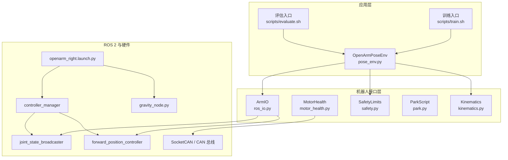
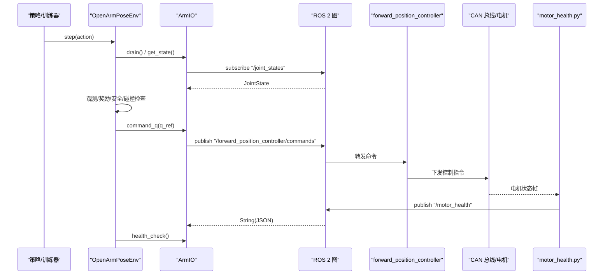
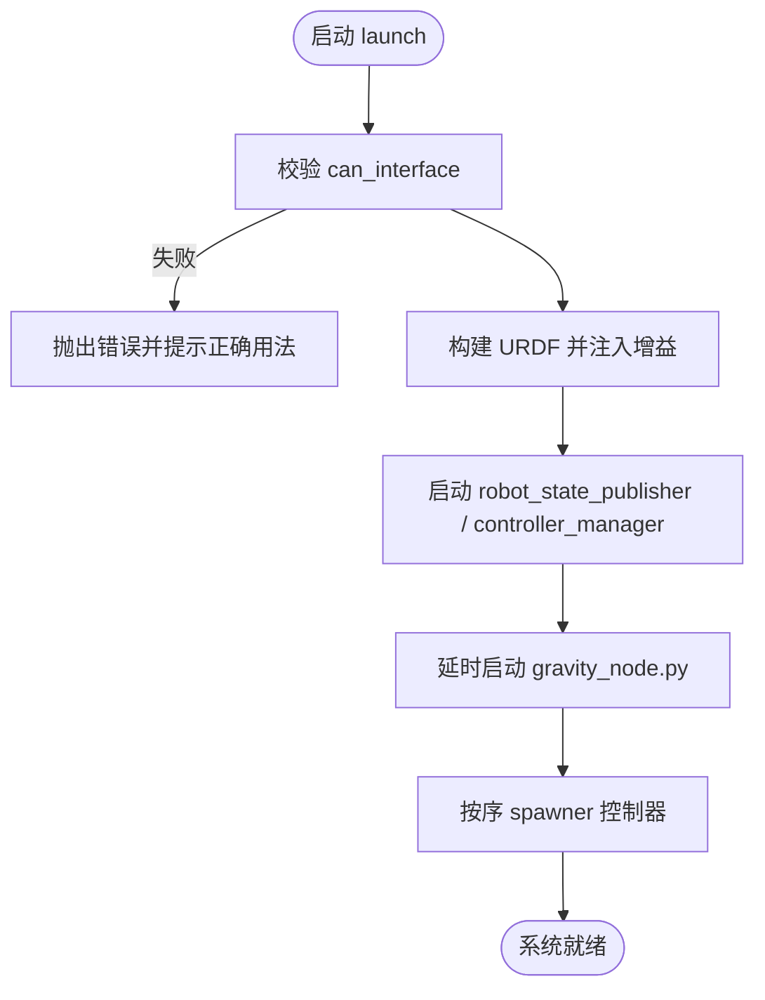
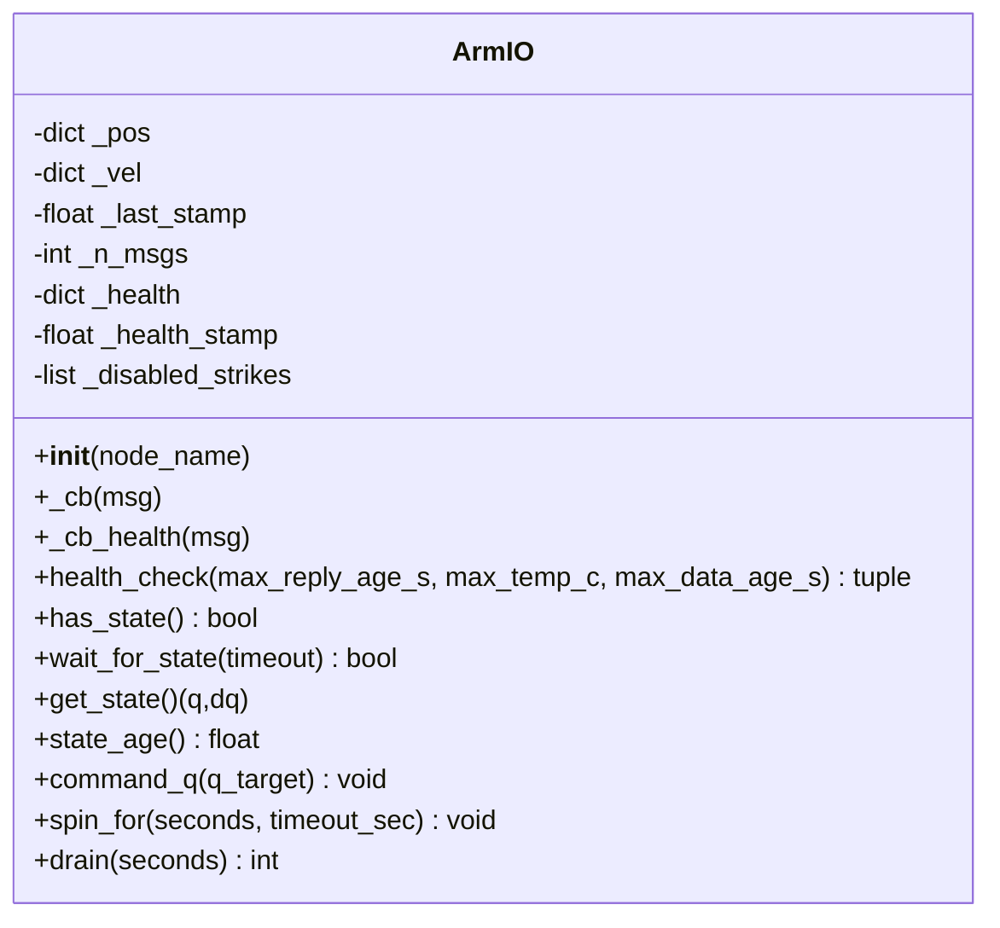
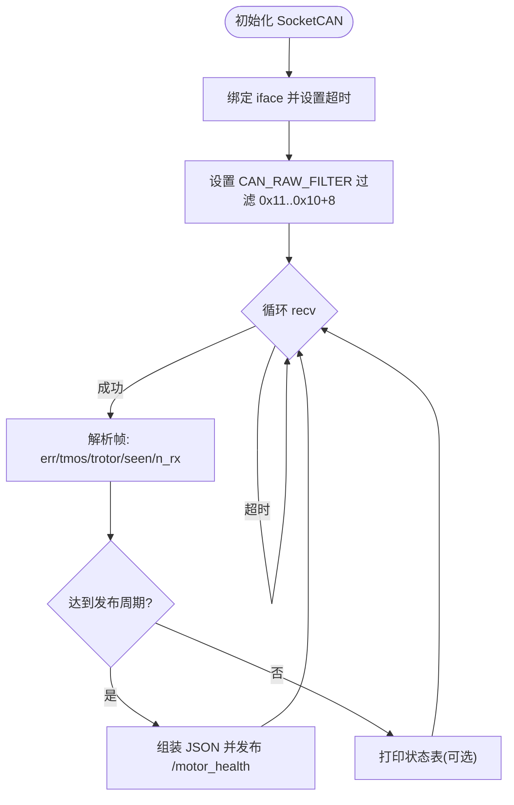
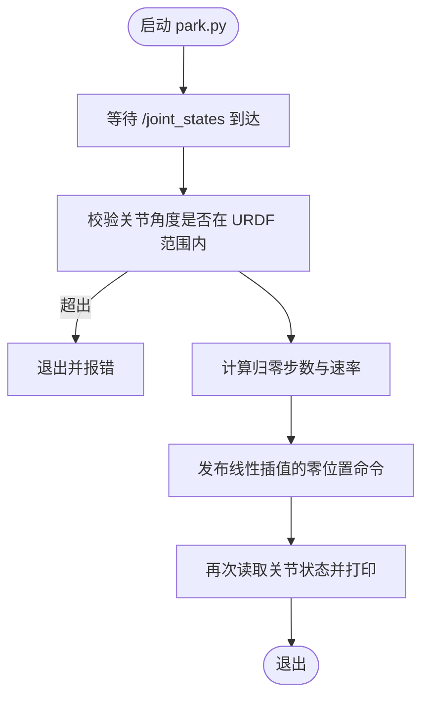
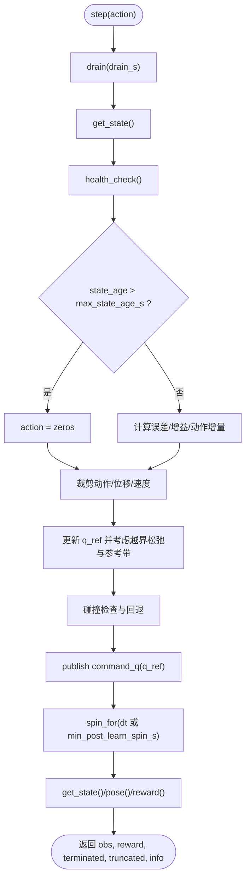
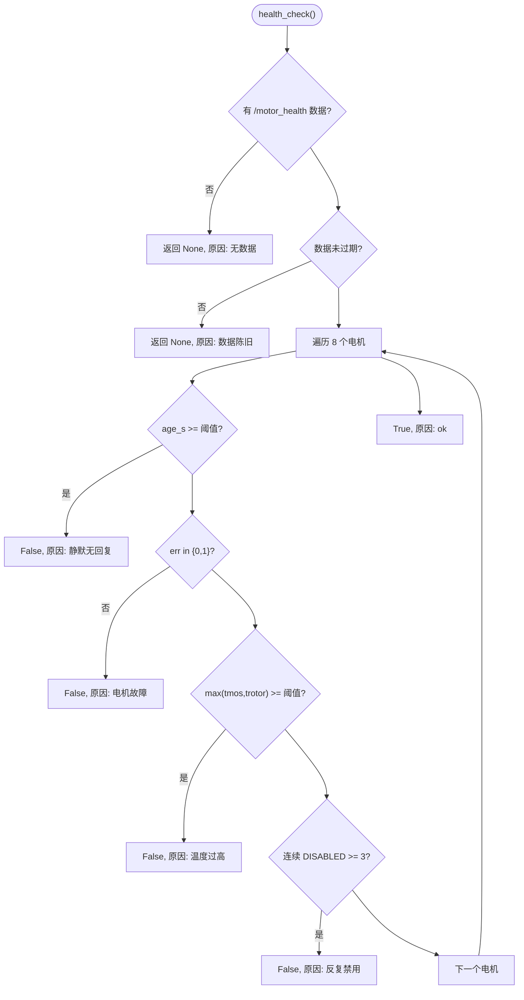
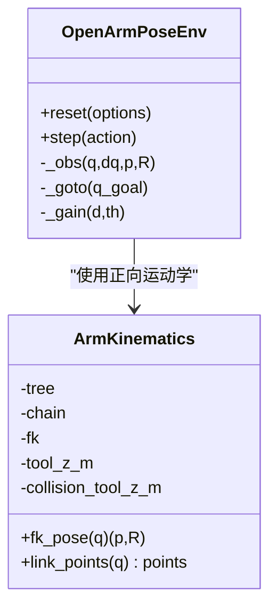
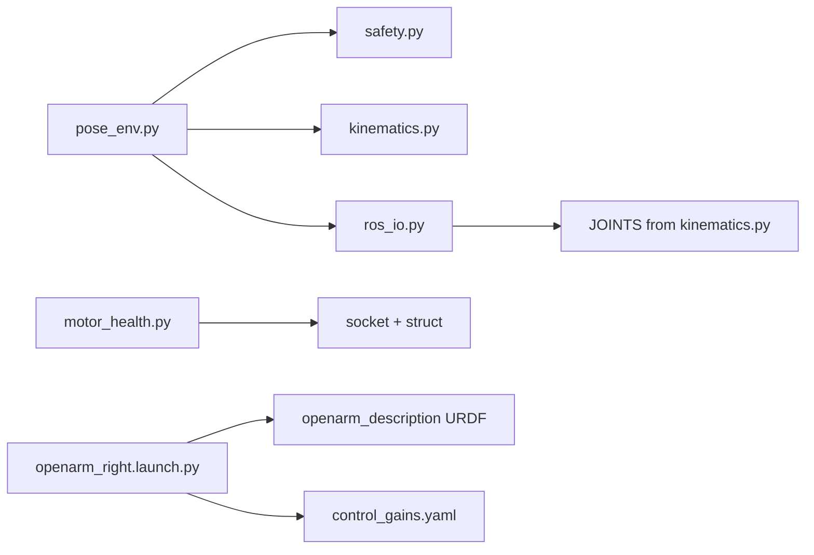

# 机器人接口层

<cite>
**本文引用的文件**   
- [ros_io.py](file://hardware/policyik_hw/robot/ros_io.py)
- [motor_health.py](file://hardware/policyik_hw/robot/motor_health.py)
- [safety.py](file://hardware/policyik_hw/robot/safety.py)
- [park.py](file://hardware/policyik_hw/robot/park.py)
- [pose_env.py](file://hardware/policyik_hw/envs/pose_env.py)
- [kinematics.py](file://hardware/policyik_hw/utils/kinematics.py)
- [openarm_right.launch.py](file://hardware/ros2/openarm_right_bringup/launch/openarm_right.launch.py)
- [README.md](file://hardware/README.md)
- [config.yaml](file://hardware/config.yaml)
- [train.sh](file://hardware/scripts/train.sh)
- [evaluate.sh](file://hardware/scripts/evaluate.sh)
</cite>

## 目录
1. [引言](#引言)
2. [项目结构](#项目结构)
3. [核心组件](#核心组件)
4. [架构总览](#架构总览)
5. [详细组件分析](#详细组件分析)
6. [依赖关系分析](#依赖关系分析)
7. [性能与实时性](#性能与实时性)
8. [故障诊断与恢复](#故障诊断与恢复)
9. [结论](#结论)
10. [附录：配置与调试指南](#附录配置与调试指南)

## 引言
本技术文档面向“机器人接口层”，聚焦真实 OpenArm 右臂的 ROS 2 通信、CAN 总线硬件交互、电机健康监控、关节安全限制、实时控制循环以及训练/评估流程。目标读者包括需要理解从高层策略到底层 CAN 帧的完整数据流与控制链路的工程师，也包括希望快速上手并排查常见问题的使用者。

## 项目结构
该仓库将“真实机器人”相关代码放在 `hardware/` 下，关键目录与职责如下：
- `policyik_hw/robot/`：ROS 2 I/O、电机健康监控、关节安全限制、停机归位脚本。
- `policyik_hw/envs/`：基于 Gymnasium 的真实机械臂环境，封装控制循环、观测构建、奖励与安全门控。
- `policyik_hw/utils/`：运动学工具（URDF 解析、KDL 正解）。
- `ros2/openarm_right_bringup/`：ROS 2 launch 包，负责启动控制器、加载 URDF、注入增益参数、启动重力前馈节点。
- `scripts/`：训练、评估、演示采集等命令行入口。
- `config.yaml`：训练与评估的配置中心，包含控制频率、动作尺度、碰撞与冻结检测阈值等。

**图表来源**
- [openarm_right.launch.py:109-140](file://hardware/ros2/openarm_right_bringup/launch/openarm_right.launch.py#L109-L140)
- [pose_env.py:206-254](file://hardware/policyik_hw/envs/pose_env.py#L206-L254)
- [ros_io.py:53-70](file://hardware/policyik_hw/robot/ros_io.py#L53-L70)
- [motor_health.py:12-38](file://hardware/policyik_hw/robot/motor_health.py#L12-L38)

**章节来源**
- [README.md:1-41](file://hardware/README.md#L1-L41)
- [openarm_right.launch.py:1-141](file://hardware/ros2/openarm_right_bringup/launch/openarm_right.launch.py#L1-L141)

## 核心组件
- ArmIO：ROS 2 节点，订阅 `/joint_states`，发布 `/forward_position_controller/commands`，同时订阅 `/motor_health` 用于健康检查。
- MotorHealth：独立进程，通过 SocketCAN 读取电机状态帧，聚合错误码、温度、响应延迟，并以 JSON 字符串形式发布到 `/motor_health`。
- Safety：定义关节物理极限与安全裕度，供环境与停机脚本使用。
- Park：将 7 个关节平滑归零的安全脚本，用于异常或手动停止后让机械臂自然下垂。
- OpenArmPoseEnv：Gymnasium 环境，封装控制步长、观测构造、奖励计算、碰撞保护、状态冻结检测、健康门控。
- Kinematics：基于 URDF 和 PyKDL 的正向运动学，提供末端位姿与连杆点集。
- openarm_right.launch.py：启动 controller_manager、joint_state_broadcaster、forward_position_controller、gripper_controller 与 gravity_node，并校验 CAN 接口。

**章节来源**
- [ros_io.py:1-149](file://hardware/policyik_hw/robot/ros_io.py#L1-L149)
- [motor_health.py:1-78](file://hardware/policyik_hw/robot/motor_health.py#L1-L78)
- [safety.py:1-28](file://hardware/policyik_hw/robot/safety.py#L1-L28)
- [park.py:1-66](file://hardware/policyik_hw/robot/park.py#L1-L66)
- [pose_env.py:1-544](file://hardware/policyik_hw/envs/pose_env.py#L1-L544)
- [kinematics.py:1-129](file://hardware/policyik_hw/utils/kinematics.py#L1-L129)
- [openarm_right.launch.py:1-141](file://hardware/ros2/openarm_right_bringup/launch/openarm_right.launch.py#L1-L141)

## 架构总览
系统采用“策略/环境 + 机器人接口 + ROS 2 控制栈 + CAN 硬件”的分层架构：
- 策略侧通过 Gymnasium 环境调用 `step()`，在每一步中读取最新关节状态、计算观测与奖励、生成增量动作，并发布目标位置命令。
- 机器人接口层将 ROS 2 消息转换为 NumPy 向量，并提供健康检查、状态新鲜度判断、命令发布。
- ROS 2 bringup 负责启动控制器管理器、关节状态广播器、位置控制器与重力补偿节点；所有控制器共享同一 CAN 总线。
- 电机健康监控作为只读监听者，不发送控制指令，仅解析 CAN 帧并上报健康信息。

**图表来源**
- [pose_env.py:386-468](file://hardware/policyik_hw/envs/pose_env.py#L386-L468)
- [ros_io.py:73-133](file://hardware/policyik_hw/robot/ros_io.py#L73-L133)
- [motor_health.py:20-59](file://hardware/policyik_hw/robot/motor_health.py#L20-L59)
- [openarm_right.launch.py:114-140](file://hardware/ros2/openarm_right_bringup/launch/openarm_right.launch.py#L114-L140)

## 详细组件分析

### ROS 2 通信与节点管理
- 启动流程由 `openarm_right.launch.py` 完成：
  - 校验 `can_interface` 是否为有效的 USB gs_usb 适配器且已 up。
  - 通过 xacro 处理 URDF，并将 `control_gains.yaml` 中的 kp/kd 注入到 hardware block。
  - 启动 `robot_state_publisher`、`controller_manager`，并在延时后启动 `gravity_node.py`。
  - 依次 spawner `joint_state_broadcaster`、`forward_position_controller`、`forward_effort_controller`、`gripper_controller`。
- 预检查函数会拒绝存在多个 `controller_manager` 的情况，避免同一 CAN 总线上多控制栈冲突导致机械臂异常跳动。

**图表来源**
- [openarm_right.launch.py:60-140](file://hardware/ros2/openarm_right_bringup/launch/openarm_right.launch.py#L60-L140)

**章节来源**
- [openarm_right.launch.py:33-81](file://hardware/ros2/openarm_right_bringup/launch/openarm_right.launch.py#L33-L81)
- [openarm_right.launch.py:84-140](file://hardware/ros2/openarm_right_bringup/launch/openarm_right.launch.py#L84-L140)
- [ros_io.py:19-50](file://hardware/policyik_hw/robot/ros_io.py#L19-L50)

### 话题订阅与消息传递
- ArmIO 订阅 `/joint_states`，回调中将每个关节的位置与速度缓存为字典，并记录最后收到时间戳与消息计数。
- 发布端使用 `Float64MultiArray` 向 `/forward_position_controller/commands` 发布 7 维目标位置。
- 健康消息订阅 `/motor_health`，解析 JSON 字符串，更新内部健康状态与时间戳。

**图表来源**
- [ros_io.py:53-149](file://hardware/policyik_hw/robot/ros_io.py#L53-L149)

**章节来源**
- [ros_io.py:53-149](file://hardware/policyik_hw/robot/ros_io.py#L53-L149)

### CAN 总线通信协议与电机健康监控
- motor_health.py 使用 Python socket 直接绑定 SocketCAN 接口，过滤 ID 范围 `0x11` 到 `0x10+N_MOTORS`，以只读方式接收电机状态帧。
- 帧格式为固定长度，解析出错误码、MOS 温度、转子温度，并维护每电机的最近接收时间与接收计数。
- 每隔 `1/rate` 秒聚合一次状态，生成 JSON 消息，字段包括：
  - `stamp`：发布时间
  - `err`：各电机电机错误码
  - `err_name`：错误码可读名称映射
  - `tmos`：MOS 温度
  - `trotor`：转子温度
  - `age_s`：距上次收到的时间
  - `n_rx`：累计接收次数
- 控制台输出周期性表格，便于现场观察电机状态与健康告警。

**图表来源**
- [motor_health.py:12-66](file://hardware/policyik_hw/robot/motor_health.py#L12-L66)

**章节来源**
- [motor_health.py:1-78](file://hardware/policyik_hw/robot/motor_health.py#L1-L78)

### 关节安全限制与停机归位
- safety.py 定义了 7 个关节的物理极限，并增加 2 度的安全裕度，导出 `LIM_LO` 与 `LIM_HI`。
- park.py 是一个独立脚本，订阅 `/joint_states`，验证当前关节角度在 URDF 范围内，然后以最大角速度上限对 7 个关节进行线性插值归零，最终退出。
- 该脚本可用于训练或评估过程中出现异常时，确保机械臂回到安全姿态。

**图表来源**
- [park.py:11-61](file://hardware/policyik_hw/robot/park.py#L11-L61)
- [safety.py:4-17](file://hardware/policyik_hw/robot/safety.py#L4-L17)

**章节来源**
- [safety.py:1-28](file://hardware/policyik_hw/robot/safety.py#L1-L28)
- [park.py:1-66](file://hardware/policyik_hw/robot/park.py#L1-L66)

### 实时控制循环与延迟处理
- OpenArmPoseEnv.step() 在每个控制周期内：
  - 先 drain 一段时间以消化积压的 `/joint_states`。
  - 读取最新关节状态，执行健康检查与状态新鲜度检查。
  - 若状态过旧，则将该步动作置零，避免对陈旧状态发令。
  - 检测“关节状态冻结”：当连续若干步关节位置不变而仍有新消息时，认为 CAN 读取停滞，抛出运行时错误。
  - 根据误差动态缩放动作幅度，限制最大关节位移与速度，考虑参考轨迹越界松弛与参考带约束。
  - 碰撞保护：若参考位置进入碰撞包络，回退到上一参考位置并计数阻塞步数；连续阻塞超过阈值则截断或终止 episode。
  - 发布命令后，根据是否接入学习回调决定 spin 时长，保证控制周期稳定。
  - 收集观测、奖励、成功判定与统计信息。

**图表来源**
- [pose_env.py:386-508](file://hardware/policyik_hw/envs/pose_env.py#L386-L508)

**章节来源**
- [pose_env.py:206-544](file://hardware/policyik_hw/envs/pose_env.py#L206-L544)

### MotorHealth 监控系统与健康判断逻辑
- ArmIO.health_check() 对 `/motor_health` 数据进行以下判断：
  - 若无数据或数据过期，返回未知状态与原因。
  - 对每个电机：
    - 若响应年龄超过阈值，判定为“静默无回复”。
    - 若错误码非 enabled/disabled，判定为电机故障。
    - 若 MOS 或转子温度超过阈值，判定为过热。
    - 若连续多次报告 DISABLED，判定为反复禁用（忽略命令，需重启）。
- 这些规则使上层环境能在发现潜在危险时立即中止训练或评估，防止硬件损坏。

**图表来源**
- [ros_io.py:87-106](file://hardware/policyik_hw/robot/ros_io.py#L87-L106)
- [motor_health.py:5-7](file://hardware/policyik_hw/robot/motor_health.py#L5-L7)

**章节来源**
- [ros_io.py:80-106](file://hardware/policyik_hw/robot/ros_io.py#L80-L106)
- [motor_health.py:1-78](file://hardware/policyik_hw/robot/motor_health.py#L1-L78)

### 运动学与观测构建
- kinematics.py 从 URDF 构建 KDL 树与链，提供：
  - `fk_pose(q)`：末端位姿（位置与旋转矩阵），支持沿 link7 z 轴偏移的工具点。
  - `link_points(q)`：各连杆原点与工具/碰撞工具点坐标。
- pose_env.py 在 `_obs()` 中拼接观测向量，包括：
  - 关节位置与速度、末端位置与旋转向量、目标位置与旋转、误差与关键点误差。
  - 可选的 zoom 观测（按距离与角度缩放误差）。
  - 历史动作与参考超前项。
  - 奖励通道与 rho 状态。

**图表来源**
- [kinematics.py:81-129](file://hardware/policyik_hw/utils/kinematics.py#L81-L129)
- [pose_env.py:269-289](file://hardware/policyik_hw/envs/pose_env.py#L269-L289)

**章节来源**
- [kinematics.py:1-129](file://hardware/policyik_hw/utils/kinematics.py#L1-L129)
- [pose_env.py:206-347](file://hardware/policyik_hw/envs/pose_env.py#L206-L347)

## 依赖关系分析
- 环境依赖：
  - `policyik_hw.envs.pose_env` 依赖 `policyik_hw.robot.safety`、`policyik_hw.utils.kinematics`、`policyik_hw.robot.ros_io`。
- 接口层依赖：
  - `ros_io.py` 依赖 `sensor_msgs.msg.JointState`、`std_msgs.msg.Float64MultiArray`、`std_msgs.msg.String`，并通过 `utils.kinematics.JOINTS` 对齐关节顺序。
- 健康监控依赖：
  - `motor_health.py` 依赖 Python socket 与 struct，仅在启用 ROS 时依赖 rclpy。
- Launch 依赖：
  - `openarm_right.launch.py` 依赖 `openarm_description` 的 URDF 与 `config/control_gains.yaml`。

**图表来源**
- [pose_env.py:12-16](file://hardware/policyik_hw/envs/pose_env.py#L12-L16)
- [ros_io.py:11-14](file://hardware/policyik_hw/robot/ros_io.py#L11-L14)
- [motor_health.py:1-3](file://hardware/policyik_hw/robot/motor_health.py#L1-L3)
- [openarm_right.launch.py:84-106](file://hardware/ros2/openarm_right_bringup/launch/openarm_right.launch.py#L84-L106)

**章节来源**
- [pose_env.py:1-18](file://hardware/policyik_hw/envs/pose_env.py#L1-L18)
- [ros_io.py:1-16](file://hardware/policyik_hw/robot/ros_io.py#L1-L16)
- [motor_health.py:1-3](file://hardware/policyik_hw/robot/motor_health.py#L1-L3)
- [openarm_right.launch.py:84-106](file://hardware/ros2/openarm_right_bringup/launch/openarm_right.launch.py#L84-L106)

## 性能与实时性
- 控制频率：
  - `config.yaml` 中 `env.control_hz` 默认 10 Hz，环境据此计算 dt 与步进周期。
  - 评估脚本注释指出评估步长为 8.13 Hz（约 0.123 s），用于指标计算。
- 观测与奖励：
  - 观测维度由 `build_layout()` 动态构建，包含关节、末端、目标、误差、zoom 观测、rho 与历史动作等。
  - 奖励通道与 PBRS 潜在函数在 `PoseReward` 中实现，结合误差与关节速度等项。
- 时序保障：
  - 环境在 `learn_fn` 存在时，优先执行学习回调，再补足剩余时间以保证控制周期。
  - `min_post_learn_spin_s` 保证最小 spin 时间，避免回调过长导致控制抖动。
- 性能监控：
  - `timing_summary()` 返回声明 dt、中位数耗时、P90 耗时与有效频率，便于评估实时性。

**章节来源**
- [config.yaml:40-45](file://hardware/config.yaml#L40-L45)
- [evaluate.sh:17-18](file://hardware/scripts/evaluate.sh#L17-L18)
- [pose_env.py:21-43](file://hardware/policyik_hw/envs/pose_env.py#L21-L43)
- [pose_env.py:461-467](file://hardware/policyik_hw/envs/pose_env.py#L461-L467)
- [pose_env.py:525-535](file://hardware/policyik_hw/envs/pose_env.py#L525-L535)

## 故障诊断与恢复
常见问题与定位方法：
- 没有 `/joint_states`：
  - 检查 bringup launch 是否运行，控制器是否成功 spawner。
  - 确认 CAN 接口已 up 且 bitrate 正确。
- 多个 `controller_manager`：
  - 使用 `check_single_control_stack()` 或 `ros2 node list` 检查，杀掉多余实例。
- CAN 读取停滞（关节状态冻结）：
  - 环境检测到连续若干步关节位置不变但仍有新消息，会抛出运行时错误，提示重新 bring down/up CAN 接口并重启 launch。
- 电机健康故障：
  - 查看 `/motor_health` 的 `err_name`、`age_s`、`tmos`、`trotor`，定位具体电机与故障类型。
  - 若反复 DISABLED，需重启相关进程以重新启用。
- 温度过高：
  - 若 MOS 或转子温度超过阈值，环境会中止训练/评估，需冷却后再继续。
- 碰撞保护触发：
  - 连续碰撞阻塞会导致 episode 截断或终止，检查参考轨迹与环境配置，必要时调整 `ref_limit_relax_deg` 或工作空间包络。

恢复步骤建议：
- 停止训练/评估，使用 `park.py` 将机械臂归零。
- 检查 CAN 接口状态与驱动，必要时重启接口与 launch。
- 重新启动 `motor_health.py` 与训练/评估脚本。

**章节来源**
- [ros_io.py:19-50](file://hardware/policyik_hw/robot/ros_io.py#L19-L50)
- [pose_env.py:404-423](file://hardware/policyik_hw/envs/pose_env.py#L404-L423)
- [motor_health.py:55-66](file://hardware/policyik_hw/robot/motor_health.py#L55-L66)
- [park.py:35-61](file://hardware/policyik_hw/robot/park.py#L35-L61)

## 结论
机器人接口层通过清晰的层次化设计，将高层策略与底层硬件解耦：
- ROS 2 通信负责状态读取与命令发布。
- CAN 总线只读监控提供电机健康与温度信息。
- 安全限制与碰撞保护确保机械臂在合理范围内运行。
- 实时控制循环通过动作缩放、参考轨迹约束与最小 spin 时间保障稳定性。
- 训练与评估脚本提供可复现的工作流，配合健康监控可在异常时自动保护硬件。

## 附录：配置与调试指南
- 安装与启动：
  - 按照 README 说明安装 bringup 包与 Python 依赖，激活虚拟环境。
  - 设置 CAN 接口并启动 bringup launch，指定 `can_interface`。
  - 启动 `motor_health.py`，选择正确的 iface 与发布频率。
- 训练与评估：
  - 使用 `scripts/train.sh` 启动训练，Ctrl-C 一次保存 checkpoint 与 buffer。
  - 使用 `scripts/evaluate.sh` 对 60 个任务进行评估，关闭碰撞保护以测量性能。
- 常用调试命令：
  - `ros2 node list`：检查节点与控制器管理器数量。
  - `ros2 topic echo /joint_states`：查看关节状态。
  - `ros2 topic echo /motor_health`：查看电机健康 JSON。
  - `ros2 topic pub /forward_position_controller/commands std_msgs/msg/Float64MultiArray "{data: [0.0]*7}"`：临时发布零位置（谨慎使用）。
- 配置要点：
  - `config.yaml` 中的 `control_hz`、`action_scale_rad`、`max_joint_delta_rad`、`max_joint_velocity_rad_s`、`ref_limit_relax_deg`、`frozen_state_steps`、`max_state_age_s` 等参数直接影响实时性与安全性。
  - `control_gains.yaml` 中的 kp/kd 影响控制器响应与稳定性。

**章节来源**
- [README.md:5-41](file://hardware/README.md#L5-L41)
- [train.sh:1-14](file://hardware/scripts/train.sh#L1-L14)
- [evaluate.sh:1-19](file://hardware/scripts/evaluate.sh#L1-L19)
- [config.yaml:40-71](file://hardware/config.yaml#L40-L71)
