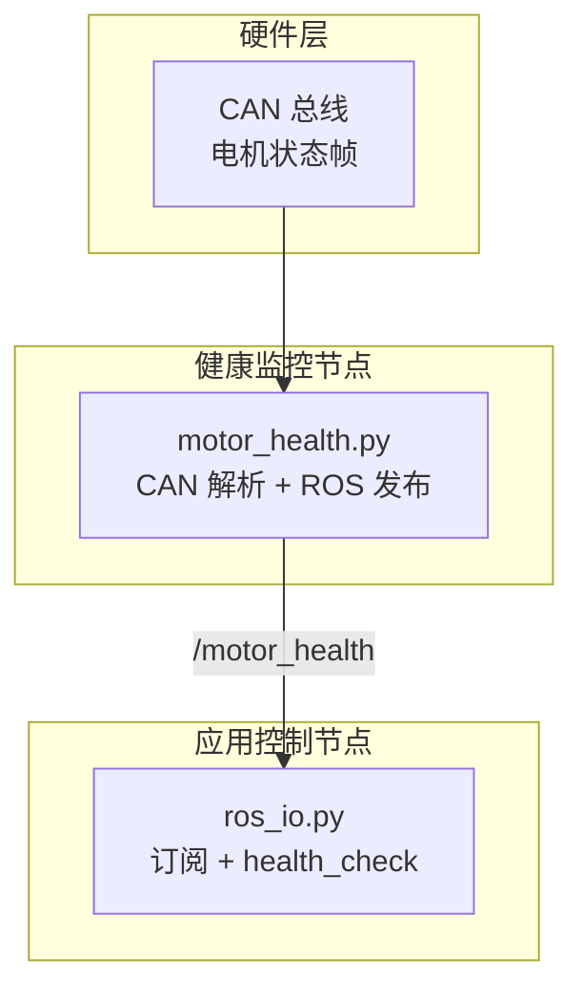
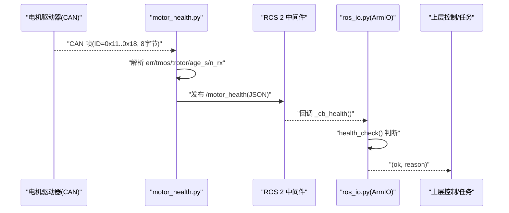
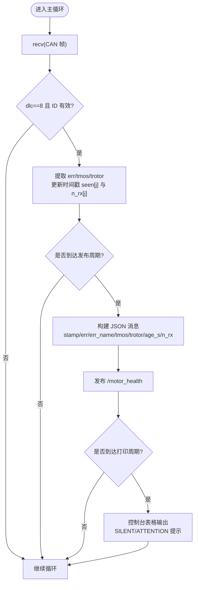
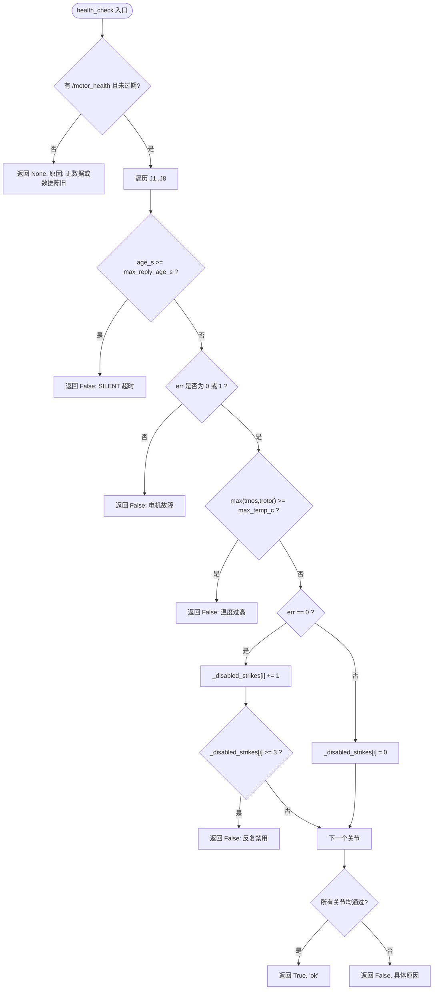
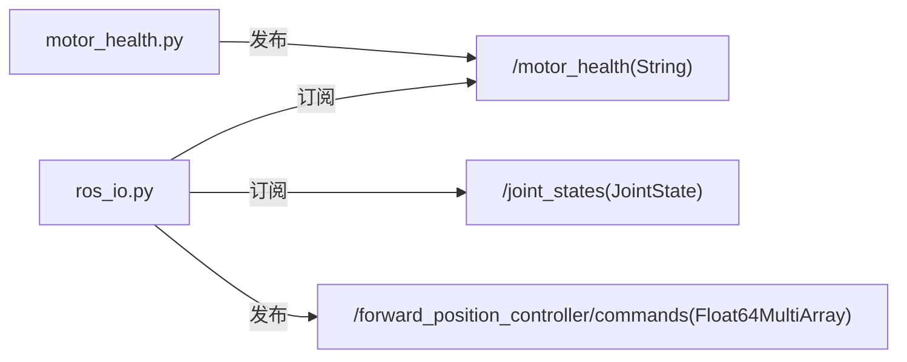

# 电机健康监控

<cite>
**本文引用的文件**   
- [motor_health.py](file://hardware/policyik_hw/robot/motor_health.py)
- [ros_io.py](file://hardware/policyik_hw/robot/ros_io.py)
</cite>

## 目录
1. [简介](#简介)
2. [项目结构](#项目结构)
3. [核心组件](#核心组件)
4. [架构总览](#架构总览)
5. [详细组件分析](#详细组件分析)
6. [依赖关系分析](#依赖关系分析)
7. [性能与实时性](#性能与实时性)
8. [故障诊断与应急处理](#故障诊断与应急处理)
9. [结论](#结论)
10. [附录：使用指南](#附录使用指南)

## 简介
本技术文档围绕“电机健康监控系统”展开，重点解释 CAN 总线数据解析、电机状态监测与健康评估算法。系统由两部分组成：
- motor_health.py：只读监听 CAN 总线，解析各关节电机的错误码、温度与响应时间，并以 ROS 2 话题 /motor_health 发布结构化健康数据。
- ros_io.py：订阅 /motor_health，实现 health_check 健康检查逻辑，包括超时检测、温度阈值、错误状态识别以及 DISABLED 状态的连续计数与自动恢复策略。

该方案为上层控制提供安全门控，避免在电机异常或通信中断时下发指令，同时支持运维人员快速定位问题并执行预防性维护。

## 项目结构
与本主题直接相关的代码位于 hardware/policyik_hw/robot 目录下：
- motor_health.py：CAN 接收、帧解析、ROS 发布、控制台打印。
- ros_io.py：订阅 /motor_health，封装 health_check 等接口供上层调用。

图表来源
- [motor_health.py:20-24](file://hardware/policyik_hw/robot/motor_health.py#L20-L24)
- [motor_health.py:52-59](file://hardware/policyik_hw/robot/motor_health.py#L52-L59)
- [ros_io.py:66-70](file://hardware/policyik_hw/robot/ros_io.py#L66-L70)

章节来源
- [motor_health.py:1-78](file://hardware/policyik_hw/robot/motor_health.py#L1-L78)
- [ros_io.py:1-149](file://hardware/policyik_hw/robot/ros_io.py#L1-L149)

## 核心组件
- Motor Health Monitor（motor_health.py）
  - 功能：通过原始 CAN Socket 监听特定 ID 范围，解析错误码、MOS 温度、转子温度，计算每路电机的响应年龄，周期性以 JSON 形式发布到 /motor_health。
  - 关键输出字段：err、err_name、tmos、trotor、age_s、n_rx、stamp。
- ArmIO 健康检查（ros_io.py）
  - 功能：订阅 /motor_health，实现 health_check(max_reply_age_s, max_temp_c, max_data_age_s)，返回 (ok, reason)。
  - 安全机制：超时检测、错误码过滤、温度阈值、DISABLED 连续计数与自动恢复。

章节来源
- [motor_health.py:5-9](file://hardware/policyik_hw/robot/motor_health.py#L5-L9)
- [motor_health.py:40-59](file://hardware/policyik_hw/robot/motor_health.py#L40-L59)
- [ros_io.py:80-106](file://hardware/policyik_hw/robot/ros_io.py#L80-L106)

## 架构总览
下图展示从 CAN 总线到 ROS 2 健康数据的端到端流程，以及上层对 health_check 的调用关系。

图表来源
- [motor_health.py:20-24](file://hardware/policyik_hw/robot/motor_health.py#L20-L24)
- [motor_health.py:42-48](file://hardware/policyik_hw/robot/motor_health.py#L42-L48)
- [motor_health.py:52-59](file://hardware/policyik_hw/robot/motor_health.py#L52-L59)
- [ros_io.py:80-85](file://hardware/policyik_hw/robot/ros_io.py#L80-L85)
- [ros_io.py:87-106](file://hardware/policyik_hw/robot/ros_io.py#L87-L106)

## 详细组件分析

### CAN 总线数据解析（motor_health.py）
- 监听方式：使用 AF_CAN/SOCK_RAW 绑定指定 CAN 接口，设置非阻塞超时，并通过过滤器匹配 0x11..0x18 共 8 个电机 ID。
- 帧格式：固定长度 16 字节的 CAN 帧，载荷 8 字节；按大端序解析出 can_id、dlc、data。
- 关键字段解析：
  - 错误码：data[0] >> 4，映射 ERR_NAMES 表（如 disabled/enabled/overvoltage/undervoltage/overcurrent/MOS overtemp/rotor overtemp/comms lost/overload）。
  - 温度：data[6] 为 MOS 温度，data[7] 为转子温度。
  - 响应年龄 age_s：基于最近一次收到该电机帧的时间戳计算。
- 发布频率：按参数 rate 周期发布 JSON 消息，包含 stamp、err、err_name、tmos、trotor、age_s、n_rx。
- 控制台输出：定期打印各关节状态，标注 SILENT 与 ATTENTION 提示。

图表来源
- [motor_health.py:40-66](file://hardware/policyik_hw/robot/motor_health.py#L40-L66)

章节来源
- [motor_health.py:20-24](file://hardware/policyik_hw/robot/motor_health.py#L20-L24)
- [motor_health.py:42-48](file://hardware/policyik_hw/robot/motor_health.py#L42-L48)
- [motor_health.py:52-66](file://hardware/policyik_hw/robot/motor_health.py#L52-L66)

### 健康检查逻辑（ros_io.py）
health_check(max_reply_age_s=0.5, max_temp_c=60.0, max_data_age_s=1.0) 的判断流程如下：
- 数据新鲜度校验：若未收到 /motor_health 或数据过期（超过 max_data_age_s），返回 None 表示不可用。
- 逐关节遍历（J1..J8）：
  - 超时检测：若某关节 age_s >= max_reply_age_s，判定为 SILENT（无 CAN 回复）。
  - 错误状态识别：若 err 不在 {0, 1}（即非 disabled/enabled），判定为电机故障。
  - 温度阈值：若 tmos 或 trotor 任一 >= max_temp_c，判定为过热。
  - DISABLED 连续计数：当 err == 0（disabled）时，_disabled_strikes[i] 自增；否则清零。若连续 >= 3 次，判定为反复禁用，拒绝下发命令。
- 全部通过则返回 True，“ok”。

图表来源
- [ros_io.py:87-106](file://hardware/policyik_hw/robot/ros_io.py#L87-L106)

章节来源
- [ros_io.py:80-106](file://hardware/policyik_hw/robot/ros_io.py#L80-L106)

### 关键监控指标说明
- 温度监控：
  - tmos：MOS 管温度，反映功率级热状态。
  - trotor：转子温度，反映机械侧热状态。
  - 默认阈值 60°C，可配置。
- 错误码检测：
  - 仅允许 0(disabled)、1(enabled) 为正常态。
  - 其他值（过压、欠压、过流、MOS 过温、转子过温、通信丢失、过载）均视为故障。
- 响应时间分析：
  - age_s：当前时间与最近一次收到该电机帧的时间差。
  - 默认阈值 0.5s，用于检测通信中断或丢包。
- DISABLED 连续计数与自动恢复：
  - 每次检测到 err==0 时计数器加一，遇到非 0 时清零。
  - 连续 3 次及以上判定为反复禁用，阻止命令下发；重启 motor_health 节点可重置计数。

章节来源
- [motor_health.py:5-7](file://hardware/policyik_hw/robot/motor_health.py#L5-L7)
- [motor_health.py:54-56](file://hardware/policyik_hw/robot/motor_health.py#L54-L56)
- [ros_io.py:95-105](file://hardware/policyik_hw/robot/ros_io.py#L95-L105)

## 依赖关系分析
- motor_health.py 依赖：
  - socket、struct、time、numpy、json、rclpy（可选）。
  - 操作系统 CAN 驱动与 CAN 接口（如 can1）。
- ros_io.py 依赖：
  - rclpy、sensor_msgs、std_msgs、numpy。
  - 订阅 /motor_health 与 /joint_states，发布位置命令。

图表来源
- [motor_health.py:26-33](file://hardware/policyik_hw/robot/motor_health.py#L26-L33)
- [motor_health.py:57-59](file://hardware/policyik_hw/robot/motor_health.py#L57-L59)
- [ros_io.py:63-70](file://hardware/policyik_hw/robot/ros_io.py#L63-L70)
- [ros_io.py:130-133](file://hardware/policyik_hw/robot/ros_io.py#L130-L133)

章节来源
- [motor_health.py:20-33](file://hardware/policyik_hw/robot/motor_health.py#L20-L33)
- [ros_io.py:63-70](file://hardware/policyik_hw/robot/ros_io.py#L63-L70)

## 性能与实时性
- CAN 接收：
  - 非阻塞 recv 配合 settimeout(0.05)，避免阻塞主循环。
  - 过滤器仅匹配 8 个电机 ID，降低无关报文开销。
- 发布频率：
  - 默认 20Hz，可通过 --rate 调整。
- 内存与计算：
  - 使用 numpy 数组存储 8 路电机状态，计算 age_s 采用向量化操作。
- 建议：
  - 在高负载场景下适当提高 rate，确保 age_s 阈值合理。
  - 若 CAN 总线拥塞，需检查滤波器与节点优先级。

章节来源
- [motor_health.py:20-24](file://hardware/policyik_hw/robot/motor_health.py#L20-L24)
- [motor_health.py:52-56](file://hardware/policyik_hw/robot/motor_health.py#L52-L56)

## 故障诊断与应急处理
常见故障类型与处理步骤：
- SILENT（通信超时）
  - 现象：age_s >= max_reply_age_s。
  - 排查：检查 CAN 接口、线缆、终端电阻、驱动供电。
  - 应急：暂停控制，确认通信恢复后再启用。
- 电机故障（ERR 非 0/1）
  - 现象：err 为过压、欠压、过流、MOS 过温、转子过温、通信丢失、过载。
  - 排查：查看具体错误码，检查电源质量、散热、机械卡滞。
  - 应急：停机冷却或复位驱动器，必要时更换部件。
- 温度过高
  - 现象：tmos 或 trotor >= 60°C。
  - 排查：改善散热、降低负载或占空比。
  - 应急：立即降载或停机，待温度回落。
- 反复禁用（DISABLED 连续计数）
  - 现象：_disabled_strikes[i] >= 3。
  - 排查：检查使能信号、控制器状态、安全互锁。
  - 应急：修复后重启 motor_health 节点以重置计数。

章节来源
- [ros_io.py:95-105](file://hardware/policyik_hw/robot/ros_io.py#L95-L105)
- [motor_health.py:5-7](file://hardware/policyik_hw/robot/motor_health.py#L5-L7)

## 结论
本健康监控系统通过 CAN 总线解析与 ROS 2 集成，提供了可靠的电机状态观测与安全门控。health_check 方法实现了超时、温度、错误码与 DISABLED 连续计数的综合判断，能够有效防止异常工况下的危险动作。结合控制台输出与日志，运维人员可以快速定位问题并采取预防措施，保障机器人运行安全。

## 附录：使用指南
- 启动 motor_health 节点
  - 参数：--iface（CAN 接口）、--rate（发布频率）、--print-every（控制台打印周期）、--no-ros（仅控制台模式）。
  - 输出：/motor_health 话题，JSON 格式。
- 订阅与使用
  - 在 ArmIO 中订阅 /motor_health，调用 health_check() 获取 (ok, reason)。
  - 在上层控制逻辑中，根据返回值决定是否下发命令。
- 健康状态查询
  - 通过 /motor_health 的 err_name、tmos、trotor、age_s 字段进行可视化与告警。
- 故障诊断
  - 依据 health_check 返回的原因字符串快速定位问题关节与类型。
- 预防性维护
  - 定期观察温度趋势与 n_rx 计数，提前发现潜在退化。
  - 对频繁触发 DISABLED 的关节进行电气与机械检查。

章节来源
- [motor_health.py:12-18](file://hardware/policyik_hw/robot/motor_health.py#L12-L18)
- [motor_health.py:52-59](file://hardware/policyik_hw/robot/motor_health.py#L52-L59)
- [ros_io.py:87-106](file://hardware/policyik_hw/robot/ros_io.py#L87-L106)