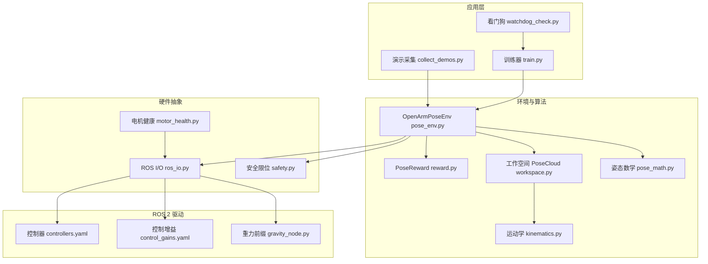
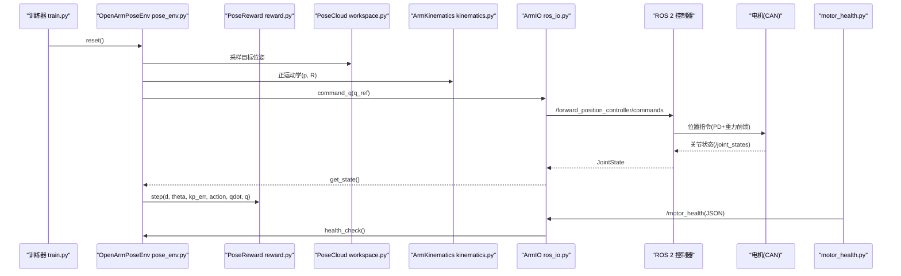
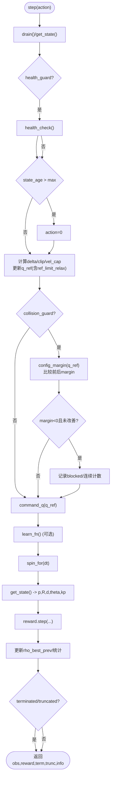
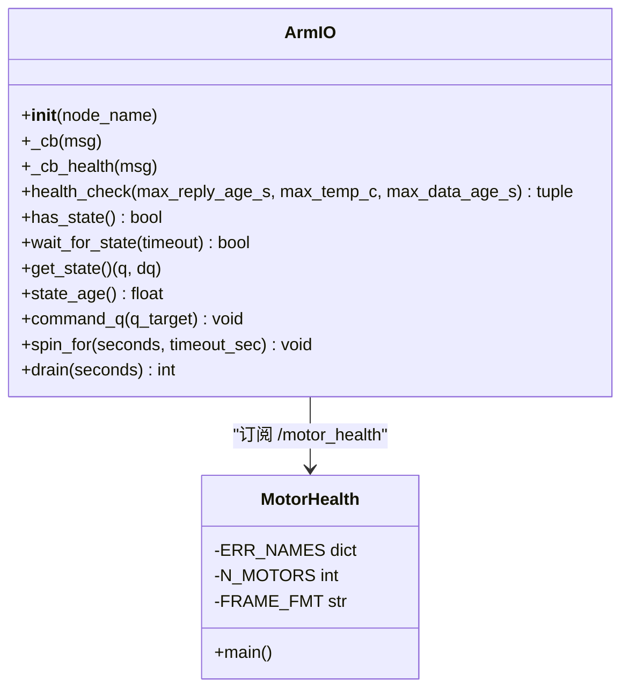
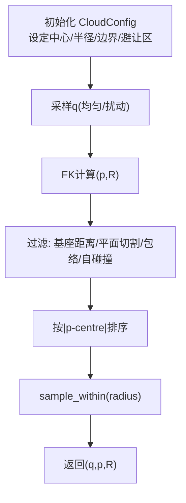
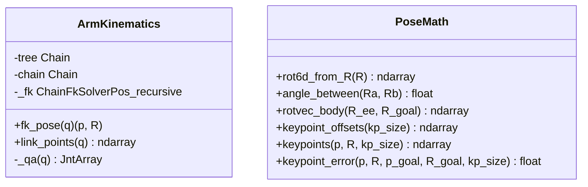
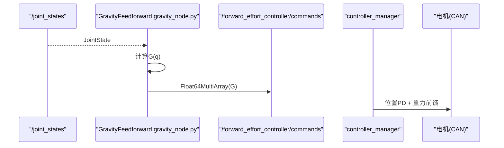
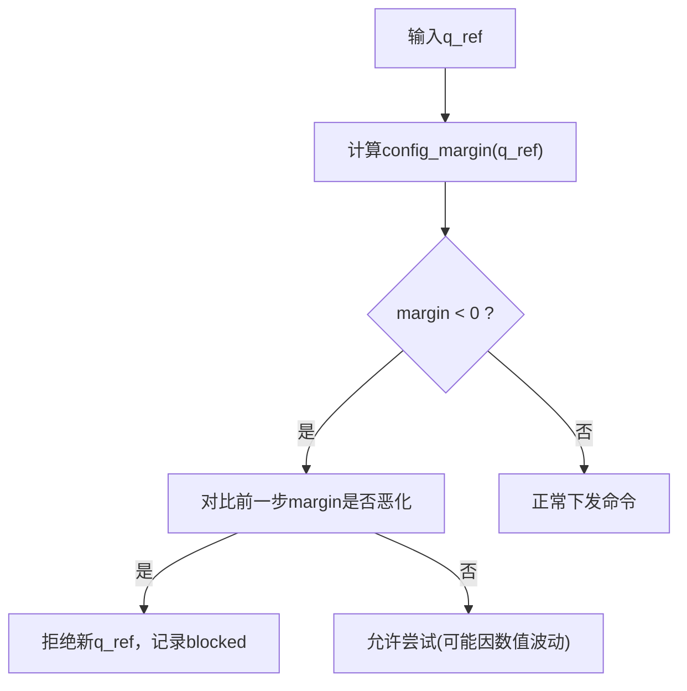
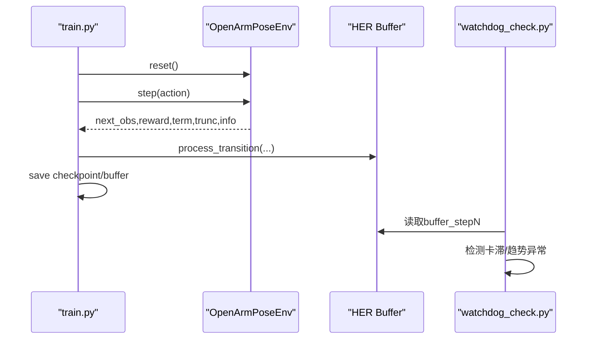
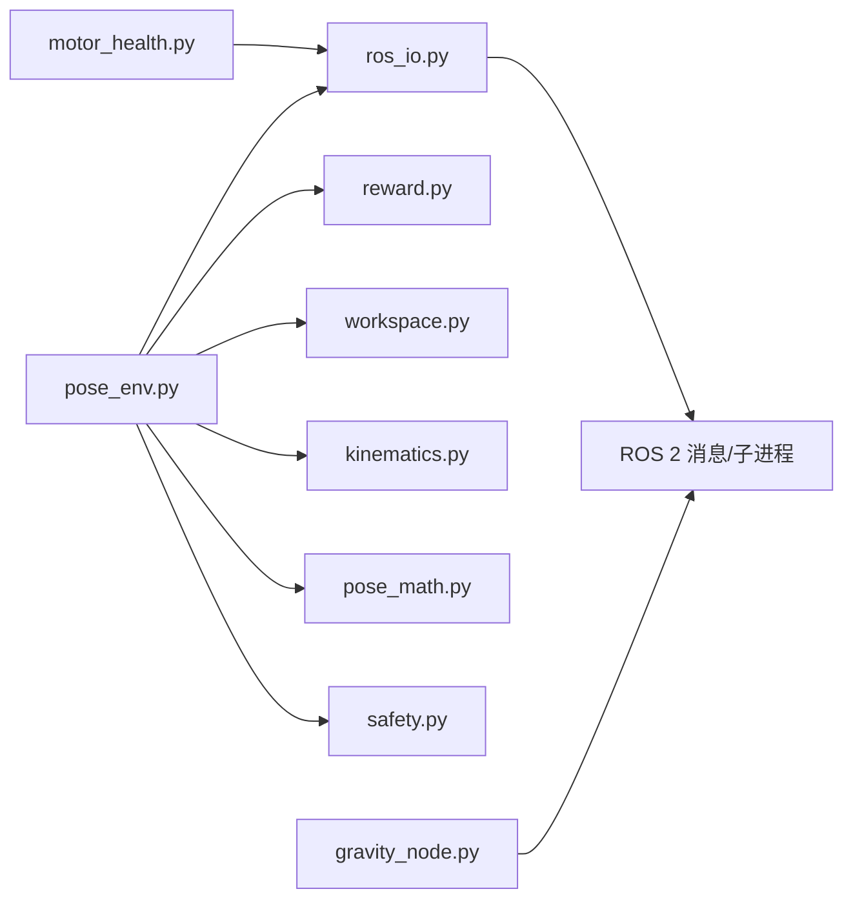

# 真实机器人系统

<cite>
**本文引用的文件**   
- [hardware/README.md](file://hardware/README.md)
- [hardware/config.yaml](file://hardware/config.yaml)
- [hardware/policyik_hw/robot/ros_io.py](file://hardware/policyik_hw/robot/ros_io.py)
- [hardware/policyik_hw/robot/safety.py](file://hardware/policyik_hw/robot/safety.py)
- [hardware/policyik_hw/robot/motor_health.py](file://hardware/policyik_hw/robot/motor_health.py)
- [hardware/policyik_hw/utils/kinematics.py](file://hardware/policyik_hw/utils/kinematics.py)
- [hardware/policyik_hw/utils/pose_math.py](file://hardware/policyik_hw/utils/pose_math.py)
- [hardware/policyik_hw/envs/workspace.py](file://hardware/policyik_hw/envs/workspace.py)
- [hardware/policyik_hw/envs/pose_env.py](file://hardware/policyik_hw/envs/pose_env.py)
- [hardware/policyik_hw/envs/reward.py](file://hardware/policyik_hw/envs/reward.py)
- [hardware/ros2/openarm_right_bringup/scripts/gravity_node.py](file://hardware/ros2/openarm_right_bringup/scripts/gravity_node.py)
- [hardware/ros2/openarm_right_bringup/config/control_gains.yaml](file://hardware/ros2/openarm_right_bringup/config/control_gains.yaml)
- [hardware/ros2/openarm_right_bringup/config/controllers.yaml](file://hardware/ros2/openarm_right_bringup/config/controllers.yaml)
- [hardware/policyik_hw/watchdog_check.py](file://hardware/policyik_hw/watchdog_check.py)
- [hardware/policyik_hw/collect_demos.py](file://hardware/policyik_hw/collect_demos.py)
- [hardware/policyik_hw/train.py](file://hardware/policyik_hw/train.py)
</cite>

## 目录
1. [简介](#简介)
2. [项目结构](#项目结构)
3. [核心组件](#核心组件)
4. [架构总览](#架构总览)
5. [详细组件分析](#详细组件分析)
6. [依赖关系分析](#依赖关系分析)
7. [性能与实时性](#性能与实时性)
8. [故障排查指南](#故障排查指南)
9. [结论](#结论)
10. [附录：硬件配置与参数说明](#附录硬件配置与参数说明)

## 简介
本技术文档面向真实机器人系统，围绕 OpenArm 机械臂的 ROS 2 接口实现、CAN 总线通信、电机健康监控、碰撞检测与安全机制、工作空间管理与轨迹规划、以及训练与评估流程进行系统化说明。重点覆盖以下方面：
- 底层硬件交互：通过 ROS 2 订阅关节状态、发布位置指令；通过 CAN 原始套接字读取电机状态帧并广播至 /motor_health。
- 安全机制：关节限位、碰撞包络检查、电机健康监控（温度、错误码、通信超时）、冻结状态检测、紧急停止与停机保护。
- 控制与规划：前馈重力补偿、PD 位置控制、动作增益调度、参考轨迹限幅与速度限制、逆起始课程学习。
- 数据流与训练：FlashSAC + HER + 演示回放，在线采集演示、训练、评估与看门狗检查。

## 项目结构
本项目在 hardware 目录下提供真实机械臂的训练与评估代码，包含：
- policyik_hw：环境、奖励、工具库、ROS I/O、安全与电机健康监控、训练与演示采集脚本。
- ros2/openarm_right_bringup：ROS 2 bringup 包，包含控制器配置、重力前馈节点与控制增益。
- data：任务定义、演示数据与元信息。
- scripts：一键安装、训练、评估与看门狗脚本。

**图表来源**
- [hardware/policyik_hw/train.py:271-437](file://hardware/policyik_hw/train.py#L271-L437)
- [hardware/policyik_hw/collect_demos.py:21-240](file://hardware/policyik_hw/collect_demos.py#L21-L240)
- [hardware/policyik_hw/envs/pose_env.py:206-544](file://hardware/policyik_hw/envs/pose_env.py#L206-L544)
- [hardware/policyik_hw/envs/reward.py:85-184](file://hardware/policyik_hw/envs/reward.py#L85-L184)
- [hardware/policyik_hw/envs/workspace.py:52-196](file://hardware/policyik_hw/envs/workspace.py#L52-L196)
- [hardware/policyik_hw/utils/kinematics.py:81-129](file://hardware/policyik_hw/utils/kinematics.py#L81-L129)
- [hardware/policyik_hw/utils/pose_math.py:12-125](file://hardware/policyik_hw/utils/pose_math.py#L12-L125)
- [hardware/policyik_hw/robot/ros_io.py:53-149](file://hardware/policyik_hw/robot/ros_io.py#L53-L149)
- [hardware/policyik_hw/robot/safety.py:1-28](file://hardware/policyik_hw/robot/safety.py#L1-L28)
- [hardware/policyik_hw/robot/motor_health.py:12-78](file://hardware/policyik_hw/robot/motor_health.py#L12-L78)
- [hardware/ros2/openarm_right_bringup/config/controllers.yaml:1-47](file://hardware/ros2/openarm_right_bringup/config/controllers.yaml#L1-L47)
- [hardware/ros2/openarm_right_bringup/config/control_gains.yaml:17-44](file://hardware/ros2/openarm_right_bringup/config/control_gains.yaml#L17-L44)
- [hardware/ros2/openarm_right_bringup/scripts/gravity_node.py:52-118](file://hardware/ros2/openarm_right_bringup/scripts/gravity_node.py#L52-L118)

**章节来源**
- [hardware/README.md:1-85](file://hardware/README.md#L1-L85)

## 核心组件
- 环境与环境配置：OpenArmPoseEnv 封装了 6D 位姿到达任务、观测构建、奖励计算、碰撞与健康管理、动作限幅与速度限制、参考轨迹更新等。
- 奖励函数：PoseReward 提供密集奖励，包括位置误差、关键点误差、动作平滑、关节速度惩罚、PBRS、停留奖励、限位裕度等。
- 工作空间与课程：PoseCloud 基于 URDF 和正运动学生成可达位姿云，支持自碰撞、障碍物包络、肩肘约束等；ReverseCurriculum 提供逆起始课程。
- 运动学与姿态数学：ArmKinematics 使用 PyKDL 从 URDF 构建链式机构，提供 FK、连杆点集；pose_math 提供旋转矩阵、轴角、关键点误差等工具。
- ROS I/O：ArmIO 订阅 /joint_states，发布 /forward_position_controller/commands，并提供电机健康检查接口。
- 电机健康监控：motor_health.py 通过 CAN 原始套接字监听电机状态帧，解析错误码与温度，并以 JSON 形式发布到 /motor_health。
- 安全与限位：safety.py 提供带安全裕度的关节限位。
- 重力前馈：gravity_node.py 根据 URDF 与重力向量计算重力扭矩，叠加到位置 PD 控制上。
- 控制器与增益：controllers.yaml 定义控制器类型与接口；control_gains.yaml 为各关节 PD 增益。

**章节来源**
- [hardware/policyik_hw/envs/pose_env.py:206-544](file://hardware/policyik_hw/envs/pose_env.py#L206-L544)
- [hardware/policyik_hw/envs/reward.py:85-184](file://hardware/policyik_hw/envs/reward.py#L85-L184)
- [hardware/policyik_hw/envs/workspace.py:52-196](file://hardware/policyik_hw/envs/workspace.py#L52-L196)
- [hardware/policyik_hw/utils/kinematics.py:81-129](file://hardware/policyik_hw/utils/kinematics.py#L81-L129)
- [hardware/policyik_hw/utils/pose_math.py:12-125](file://hardware/policyik_hw/utils/pose_math.py#L12-L125)
- [hardware/policyik_hw/robot/ros_io.py:53-149](file://hardware/policyik_hw/robot/ros_io.py#L53-L149)
- [hardware/policyik_hw/robot/motor_health.py:12-78](file://hardware/policyik_hw/robot/motor_health.py#L12-L78)
- [hardware/policyik_hw/robot/safety.py:1-28](file://hardware/policyik_hw/robot/safety.py#L1-L28)
- [hardware/ros2/openarm_right_bringup/scripts/gravity_node.py:52-118](file://hardware/ros2/openarm_right_bringup/scripts/gravity_node.py#L52-L118)
- [hardware/ros2/openarm_right_bringup/config/controllers.yaml:1-47](file://hardware/ros2/openarm_right_bringup/config/controllers.yaml#L1-L47)
- [hardware/ros2/openarm_right_bringup/config/control_gains.yaml:17-44](file://hardware/ros2/openarm_right_bringup/config/control_gains.yaml#L17-L44)

## 架构总览
下图展示从训练器到机械臂控制回路的整体数据流与组件交互。

**图表来源**
- [hardware/policyik_hw/train.py:371-437](file://hardware/policyik_hw/train.py#L371-L437)
- [hardware/policyik_hw/envs/pose_env.py:324-508](file://hardware/policyik_hw/envs/pose_env.py#L324-L508)
- [hardware/policyik_hw/envs/reward.py:106-146](file://hardware/policyik_hw/envs/reward.py#L106-L146)
- [hardware/policyik_hw/envs/workspace.py:52-196](file://hardware/policyik_hw/envs/workspace.py#L52-L196)
- [hardware/policyik_hw/utils/kinematics.py:104-129](file://hardware/policyik_hw/utils/kinematics.py#L104-L129)
- [hardware/policyik_hw/robot/ros_io.py:119-133](file://hardware/policyik_hw/robot/ros_io.py#L119-L133)
- [hardware/policyik_hw/robot/motor_health.py:20-60](file://hardware/policyik_hw/robot/motor_health.py#L20-L60)

## 详细组件分析

### 组件A：OpenArmPoseEnv（环境）
- 功能要点：
  - 构建观测：包含关节位置/速度、末端位姿、目标位姿、误差、关键点误差、缩放观测、rho 通道、上一动作、参考领先等。
  - 动作处理：按增益调度与步长/速度限制裁剪，更新参考轨迹，考虑参考限位松弛与参考带。
  - 碰撞检测：每步计算 config_margin，若连续多步被阻挡则截断或终止。
  - 健康检查：可选启用 /motor_health 校验，异常时抛出错误或警告。
  - 冻结状态检测：当关节状态长时间不变但命令变化时，判定 CAN 读停滞并报错。
  - 重置流程：ramp 移动到起始位姿，等待稳定后进入 episode。

**图表来源**
- [hardware/policyik_hw/envs/pose_env.py:386-508](file://hardware/policyik_hw/envs/pose_env.py#L386-L508)

**章节来源**
- [hardware/policyik_hw/envs/pose_env.py:206-544](file://hardware/policyik_hw/envs/pose_env.py#L206-L544)

### 组件B：ROS I/O 与电机健康监控
- ArmIO：
  - 订阅 /joint_states，缓存关节位置与速度，提供 get_state、wait_for_state、state_age、command_q 等方法。
  - 订阅 /motor_health（JSON），解析 err、err_name、tmos、trotor、age_s、n_rx，并进行健康检查（超时、错误码、温度、DISABLED 重复）。
  - 预检 check_single_control_stack：确保仅有一个 controller_manager 运行，避免双栈冲突导致机械臂抖动。
- motor_health.py：
  - 通过 AF_CAN 原始套接字监听 CAN 总线上的电机状态帧（ID 范围 0x11..0x17），解析错误码与温度，周期性发布 /motor_health。
  - 控制台输出每个电机的状态摘要，便于调试。

**图表来源**
- [hardware/policyik_hw/robot/ros_io.py:19-149](file://hardware/policyik_hw/robot/ros_io.py#L19-L149)
- [hardware/policyik_hw/robot/motor_health.py:12-78](file://hardware/policyik_hw/robot/motor_health.py#L12-L78)

**章节来源**
- [hardware/policyik_hw/robot/ros_io.py:19-149](file://hardware/policyik_hw/robot/ros_io.py#L19-L149)
- [hardware/policyik_hw/robot/motor_health.py:12-78](file://hardware/policyik_hw/robot/motor_health.py#L12-L78)

### 组件C：工作空间与碰撞包络
- PoseCloud：
  - 基于 ArmKinematics 的正运动学，从 home 附近采样大量关节构型，计算末端位姿并按距离排序。
  - 支持多种包络约束：连杆边界、工具点边界、自碰撞最小间距、肩部/左臂/立柱避让区域等。
  - 提供 config_ok、config_margin、in_workspace、sample_within 等方法用于训练时的目标与起始采样。
- ReverseCurriculum：
  - 以 goal_q + N(0, sigma) 作为起始位姿，sigma 随训练进度按 schedule 增长，提升探索能力。

**图表来源**
- [hardware/policyik_hw/envs/workspace.py:52-196](file://hardware/policyik_hw/envs/workspace.py#L52-L196)

**章节来源**
- [hardware/policyik_hw/envs/workspace.py:52-196](file://hardware/policyik_hw/envs/workspace.py#L52-L196)

### 组件D：运动学与姿态数学
- ArmKinematics：
  - 从 URDF 构建 KDL Tree/Chain，提供 FK 与连杆点集（含 tool_z 与 collision_tool_z 偏移）。
- pose_math：
  - 提供旋转矩阵与轴角转换、角度差、关键点偏移与误差计算，同时提供 torch 版本供 HER 缓冲使用。

**图表来源**
- [hardware/policyik_hw/utils/kinematics.py:81-129](file://hardware/policyik_hw/utils/kinematics.py#L81-L129)
- [hardware/policyik_hw/utils/pose_math.py:12-125](file://hardware/policyik_hw/utils/pose_math.py#L12-L125)

**章节来源**
- [hardware/policyik_hw/utils/kinematics.py:81-129](file://hardware/policyik_hw/utils/kinematics.py#L81-L129)
- [hardware/policyik_hw/utils/pose_math.py:12-125](file://hardware/policyik_hw/utils/pose_math.py#L12-L125)

### 组件E：重力前馈与控制器
- gravity_node.py：
  - 订阅 /joint_states，使用 KDL ChainDynParam 计算重力扭矩 G(q)，发布到 /forward_effort_controller/commands。
  - 支持 Ctrl-C 释放（发布零力矩），保证位置 PD 单独持稳。
- controllers.yaml：
  - 定义 controller_manager 更新频率、joint_state_broadcaster、forward_position_controller、forward_effort_controller、gripper_controller。
- control_gains.yaml：
  - 为各关节设置 kp/kd，配合重力前馈优化位置控制性能。

**图表来源**
- [hardware/ros2/openarm_right_bringup/scripts/gravity_node.py:52-118](file://hardware/ros2/openarm_right_bringup/scripts/gravity_node.py#L52-L118)
- [hardware/ros2/openarm_right_bringup/config/controllers.yaml:1-47](file://hardware/ros2/openarm_right_bringup/config/controllers.yaml#L1-L47)
- [hardware/ros2/openarm_right_bringup/config/control_gains.yaml:17-44](file://hardware/ros2/openarm_right_bringup/config/control_gains.yaml#L17-L44)

**章节来源**
- [hardware/ros2/openarm_right_bringup/scripts/gravity_node.py:52-118](file://hardware/ros2/openarm_right_bringup/scripts/gravity_node.py#L52-L118)
- [hardware/ros2/openarm_right_bringup/config/controllers.yaml:1-47](file://hardware/ros2/openarm_right_bringup/config/controllers.yaml#L1-L47)
- [hardware/ros2/openarm_right_bringup/config/control_gains.yaml:17-44](file://hardware/ros2/openarm_right_bringup/config/control_gains.yaml#L17-L44)

### 组件F：安全与限位
- safety.py：
  - 定义带 2° 安全裕度的关节限位，并提供 joint_limits 方法以与自定义扇区交集。
- 环境中的碰撞检测：
  - 每步计算 config_margin，若连续多步被阻挡则触发截断或终止，防止自碰撞或越界。

**图表来源**
- [hardware/policyik_hw/envs/pose_env.py:447-459](file://hardware/policyik_hw/envs/pose_env.py#L447-L459)
- [hardware/policyik_hw/envs/workspace.py:122-175](file://hardware/policyik_hw/envs/workspace.py#L122-L175)
- [hardware/policyik_hw/robot/safety.py:1-28](file://hardware/policyik_hw/robot/safety.py#L1-L28)

**章节来源**
- [hardware/policyik_hw/robot/safety.py:1-28](file://hardware/policyik_hw/robot/safety.py#L1-L28)
- [hardware/policyik_hw/envs/pose_env.py:447-459](file://hardware/policyik_hw/envs/pose_env.py#L447-L459)
- [hardware/policyik_hw/envs/workspace.py:122-175](file://hardware/policyik_hw/envs/workspace.py#L122-L175)

### 组件G：训练与评估
- train.py：
  - 构建 FlashSAC Agent 与 HER 缓冲，加载演示数据与任务池，执行在线训练，定期保存 checkpoint 与 buffer。
  - 集成 curriculum 与 task pool 比例调度，记录指标与时间统计。
- collect_demos.py：
  - 通过环境执行脚本化大旋转演示，记录观测、动作、奖励、终止/截断标志等，输出 .npz 与元信息。
- watchdog_check.py：
  - 检查最近缓冲区行是否存在“卡滞”迹象（lead 大但 dq 小），判断单关节或多关节卡滞，结合最近 episodes 的最小距离趋势报警。

**图表来源**
- [hardware/policyik_hw/train.py:371-437](file://hardware/policyik_hw/train.py#L371-L437)
- [hardware/policyik_hw/collect_demos.py:131-231](file://hardware/policyik_hw/collect_demos.py#L131-L231)
- [hardware/policyik_hw/watchdog_check.py:10-57](file://hardware/policyik_hw/watchdog_check.py#L10-L57)

**章节来源**
- [hardware/policyik_hw/train.py:271-437](file://hardware/policyik_hw/train.py#L271-L437)
- [hardware/policyik_hw/collect_demos.py:21-240](file://hardware/policyik_hw/collect_demos.py#L21-L240)
- [hardware/policyik_hw/watchdog_check.py:10-57](file://hardware/policyik_hw/watchdog_check.py#L10-L57)

## 依赖关系分析
- 组件耦合：
  - OpenArmPoseEnv 强依赖 ArmIO、PoseReward、PoseCloud、ArmKinematics、pose_math、safety。
  - ArmIO 依赖 ROS 2 消息与子进程调用（ros2 node list）。
  - motor_health.py 独立于 ROS（可关闭 ROS 模式），直接操作 CAN 套接字。
  - gravity_node.py 依赖 URDF 与 KDL，发布 effort 命令。
- 外部依赖：
  - ROS 2 Jazzy、openarm_description、PyKDL、urdf_parser_py、numpy、torch、gymnasium。
- 潜在循环依赖：
  - 无直接循环导入；模块间通过明确接口传递数据。

**图表来源**
- [hardware/policyik_hw/envs/pose_env.py:206-544](file://hardware/policyik_hw/envs/pose_env.py#L206-L544)
- [hardware/policyik_hw/robot/ros_io.py:53-149](file://hardware/policyik_hw/robot/ros_io.py#L53-L149)
- [hardware/policyik_hw/envs/reward.py:85-184](file://hardware/policyik_hw/envs/reward.py#L85-L184)
- [hardware/policyik_hw/envs/workspace.py:52-196](file://hardware/policyik_hw/envs/workspace.py#L52-L196)
- [hardware/policyik_hw/utils/kinematics.py:81-129](file://hardware/policyik_hw/utils/kinematics.py#L81-L129)
- [hardware/policyik_hw/utils/pose_math.py:12-125](file://hardware/policyik_hw/utils/pose_math.py#L12-L125)
- [hardware/policyik_hw/robot/safety.py:1-28](file://hardware/policyik_hw/robot/safety.py#L1-L28)
- [hardware/policyik_hw/robot/motor_health.py:12-78](file://hardware/policyik_hw/robot/motor_health.py#L12-L78)
- [hardware/ros2/openarm_right_bringup/scripts/gravity_node.py:52-118](file://hardware/ros2/openarm_right_bringup/scripts/gravity_node.py#L52-L118)

**章节来源**
- [hardware/policyik_hw/envs/pose_env.py:206-544](file://hardware/policyik_hw/envs/pose_env.py#L206-L544)
- [hardware/policyik_hw/robot/ros_io.py:53-149](file://hardware/policyik_hw/robot/ros_io.py#L53-L149)
- [hardware/policyik_hw/envs/reward.py:85-184](file://hardware/policyik_hw/envs/reward.py#L85-L184)
- [hardware/policyik_hw/envs/workspace.py:52-196](file://hardware/policyik_hw/envs/workspace.py#L52-L196)
- [hardware/policyik_hw/utils/kinematics.py:81-129](file://hardware/policyik_hw/utils/kinematics.py#L81-L129)
- [hardware/policyik_hw/utils/pose_math.py:12-125](file://hardware/policyik_hw/utils/pose_math.py#L12-L125)
- [hardware/policyik_hw/robot/safety.py:1-28](file://hardware/policyik_hw/robot/safety.py#L1-L28)
- [hardware/policyik_hw/robot/motor_health.py:12-78](file://hardware/policyik_hw/robot/motor_health.py#L12-L78)
- [hardware/ros2/openarm_right_bringup/scripts/gravity_node.py:52-118](file://hardware/ros2/openarm_right_bringup/scripts/gravity_node.py#L52-L118)

## 性能与实时性
- 控制频率：
  - 控制器管理器 update_rate 设置为 100 Hz，环境控制周期 dt = 1/control_hz（默认 10 Hz）。
- 动作限幅：
  - action_scale_rad 与 max_joint_delta_rad、max_joint_velocity_rad_s 共同限制步长与速度，避免过大冲击。
- 参考轨迹：
  - ref_limit_relax_deg 允许参考越过硬限位而测量值仍在范围内，缓解跟踪滞后；ref_band_rad 限制参考与测量的偏差带。
- 增益调度：
  - gain_schedule 根据位置误差与角度误差动态调整动作增益，提高收敛速度与稳定性。
- 观测噪声：
  - obs_noise_q_rad 与 obs_noise_dq_rad_s 注入噪声，增强鲁棒性。
- 时间统计：
  - env.timing_summary 提供 step_wall 中位数与 P90、有效频率等指标，便于调优。

[本节为通用指导，不直接分析具体文件]

## 故障排查指南
- 双控制栈冲突：
  - 现象：机械臂抖动或不稳定。
  - 原因：存在多个 controller_manager。
  - 解决：确保仅启动一个 openarm_right.launch.py，并使用 check_single_control_stack 预检。
- 电机健康异常：
  - 现象：/motor_health 缺失或 stale，错误码非 0/1，温度过高，DISABLED 重复出现。
  - 解决：检查 CAN 接口与 bitrate，重启 motor_health.py，必要时重启 CAN 接口与 bringup。
- 关节状态冻结：
  - 现象：/joint_states 持续发布但 q 不变，环境报 frozen state。
  - 解决：停止 launch，down/up CAN 接口，重新拉起 bringup。
- 重力前馈缺失：
  - 现象：机械臂下垂或姿态不稳。
  - 解决：确认 gravity_node.py 已启动且 robot_description 正确；根据安装方向调整 GRAVITY。
- 碰撞频繁截断：
  - 现象：episode 被 collision guard 截断。
  - 解决：调整 workspace 包络参数（self_clearance_m、post_clear_m、shoulder_clear_m 等），或降低动作幅度。
- 训练指标退化：
  - 现象：最近 episodes 的最小距离显著上升。
  - 解决：运行 watchdog_check.py 检查缓冲区卡滞迹象，检查硬件与通信链路。

**章节来源**
- [hardware/policyik_hw/robot/ros_io.py:19-50](file://hardware/policyik_hw/robot/ros_io.py#L19-L50)
- [hardware/policyik_hw/robot/ros_io.py:87-106](file://hardware/policyik_hw/robot/ros_io.py#L87-L106)
- [hardware/policyik_hw/envs/pose_env.py:404-423](file://hardware/policyik_hw/envs/pose_env.py#L404-L423)
- [hardware/ros2/openarm_right_bringup/scripts/gravity_node.py:76-99](file://hardware/ros2/openarm_right_bringup/scripts/gravity_node.py#L76-L99)
- [hardware/policyik_hw/watchdog_check.py:10-57](file://hardware/policyik_hw/watchdog_check.py#L10-L57)

## 结论
本系统通过 ROS 2 与 CAN 总线实现了 OpenArm 机械臂的高可靠控制回路，结合工作空间包络、碰撞检测、电机健康监控与重力前馈，提供了安全的在线学习与评估平台。训练流程集成 FlashSAC、HER 与演示回放，具备完善的日志、看门狗与故障恢复机制。通过合理配置控制增益、动作限幅与包络参数，可在真实环境中实现稳定高效的 6D 位姿到达任务。

[本节为总结性内容，不直接分析具体文件]

## 附录：硬件配置与参数说明
- 安装与启动：
  - 使用 install.sh 构建 bringup 包并安装 Python 依赖；激活 .venv 后启动 bringup、motor_health、训练与评估。
- 机器人安装方向：
  - 重力前馈的 GRAVITY 需根据安装方向设置；默认假设 base z 轴向下。
- 关键配置文件：
  - config.yaml：训练与评估的环境、奖励、课程、代理、HER、演示、日志等参数。
  - controllers.yaml：控制器类型与接口定义。
  - control_gains.yaml：各关节 PD 增益。
  - gravity_node.py：重力向量与发布频率。
- 常用参数类别：
  - 环境：r_goal、centre_m、cloud_samples、joint_lo/hi_deg、tool_z_m、collision_tool_z_m、min_x/y/z_m、self_clearance_m、post_clear_m、shoulder_clear_m、left_arm_clear_m、home_pose_deg、control_hz、max_episode_steps、action_scale_rad、max_joint_delta_rad、max_joint_velocity_rad_s、ref_band_rad、ref_limit_relax_deg、gain_schedule/gain_min/gain_d_lo/d_gain_hi/gain_th_lo/gain_th_hi、zoom_obs/zoom_pos_d0_m/zoom_ori_d0_deg、obs_prev_action/obs_ref_lead、obs_noise_q_rad/obs_noise_dq_rad_s、goal_jitter_deg、success_tau_m/success_tau_r_deg/settled_hold_steps、reset_ramp_s/reset_settle_s/drain_s/max_state_age_s、health_guard/health_required、collision_guard/collision_terminate/collision_block_steps/frozen_demand_rad/frozen_state_steps/min_post_learn_spin_s/reset_ramp_hz。
  - 奖励：tau_p、tau_r_deg、tau_u、kp_size、w_pos_linear/w_tanh_fine/std_tanh_fine/w_kp_wide/std_kp_wide/w_kp_sharp/std_kp_sharp/w_action_rate/w_joint_vel/w_bsp/bsp_cap/w_snlb/w_dwell/dwell_rho/w_pbrs/pbrs_cap/pbrs_gamma/w_limit_margin/limit_eps/limit_gate_rho/rho_obs_d0/scale_by_dt/dt。
  - 课程：sigma_lo_deg、schedule、rho_floor、max_start_tries。
  - 代理：total_steps、checkpoint_at、seed、gamma、tau、lr、batch_size、buffer_min、utd、use_compile、random_warmup、actor_num_blocks/actor_hidden_dim、critic_num_blocks/critic_hidden_dim/critic_num_bins、actor_update_period、reward_g_max、normalize_reward、temp_target_sigma。
  - HER：p_orig/p_future/p_cur/p_rand、near_sigma_p_m/near_sigma_r_deg/near_zero_frac/near_anchor_frac/near_anchor_rho。
  - 演示：file/ratio/p_orig/p_future/p_cur/near_anchor_frac/task_pool/task_pool_frac_schedule。
  - 日志：every/window/save_dir。
  - 采集：env.collision_block_steps/collision_terminate。

**章节来源**
- [hardware/README.md:5-41](file://hardware/README.md#L5-L41)
- [hardware/config.yaml:1-160](file://hardware/config.yaml#L1-L160)
- [hardware/ros2/openarm_right_bringup/config/controllers.yaml:1-47](file://hardware/ros2/openarm_right_bringup/config/controllers.yaml#L1-L47)
- [hardware/ros2/openarm_right_bringup/config/control_gains.yaml:17-44](file://hardware/ros2/openarm_right_bringup/config/control_gains.yaml#L17-L44)
- [hardware/ros2/openarm_right_bringup/scripts/gravity_node.py:12-17](file://hardware/ros2/openarm_right_bringup/scripts/gravity_node.py#L12-L17)
