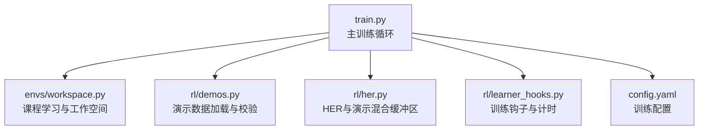
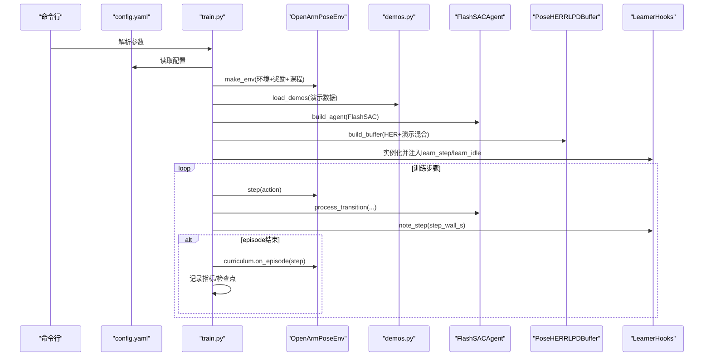
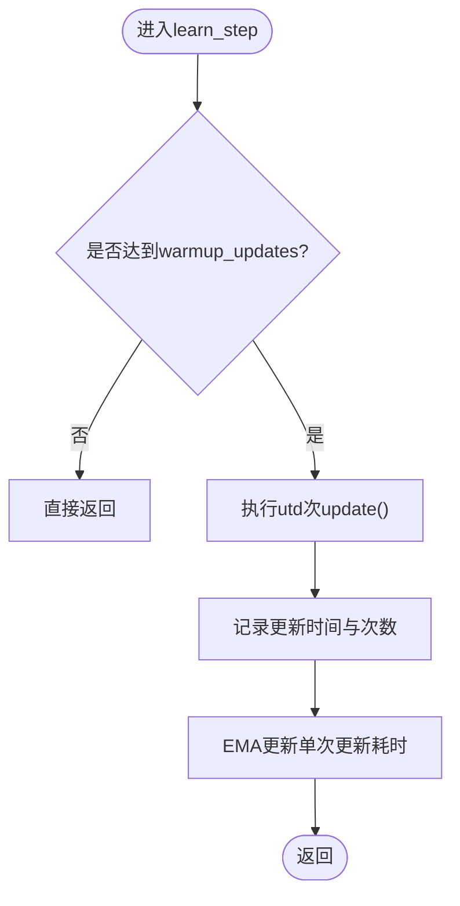
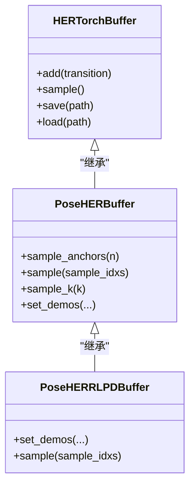
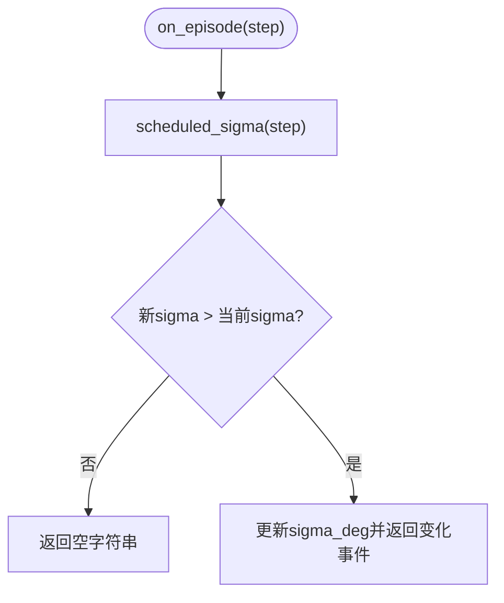
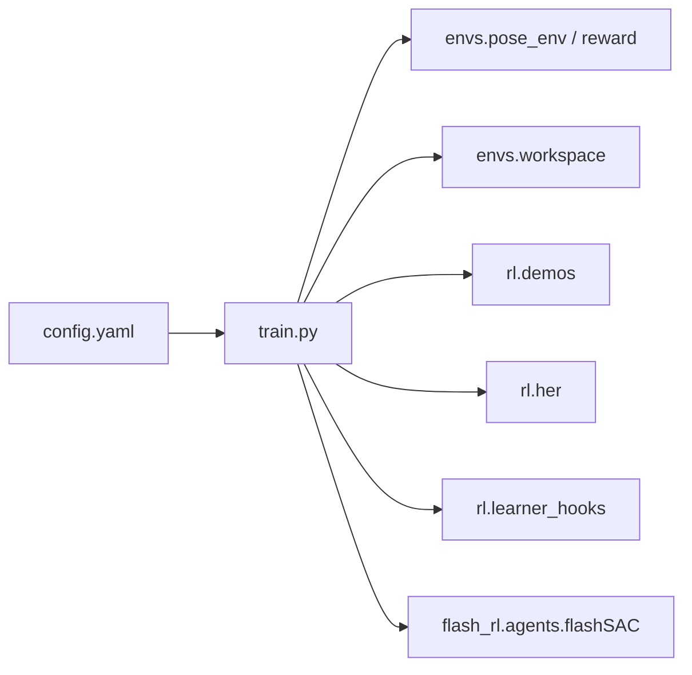

# 在线训练流程

<cite>
**本文引用的文件**   
- [hardware/policyik_hw/train.py](file://hardware/policyik_hw/train.py)
- [hardware/policyik_hw/rl/learner_hooks.py](file://hardware/policyik_hw/rl/learner_hooks.py)
- [hardware/config.yaml](file://hardware/config.yaml)
- [hardware/policyik_hw/rl/demos.py](file://hardware/policyik_hw/rl/demos.py)
- [hardware/policyik_hw/envs/workspace.py](file://hardware/policyik_hw/envs/workspace.py)
- [hardware/policyik_hw/rl/her.py](file://hardware/policyik_hw/rl/her.py)
</cite>

## 目录
1. [引言](#引言)
2. [项目结构](#项目结构)
3. [核心组件](#核心组件)
4. [架构总览](#架构总览)
5. [详细组件分析](#详细组件分析)
6. [依赖关系分析](#依赖关系分析)
7. [性能与调优](#性能与调优)
8. [故障排查指南](#故障排查指南)
9. [结论](#结论)

## 引言
本文面向PolicyIK在真实机械臂上的在线训练流程，重点解释主训练循环train.py的执行路径、演示数据加载与校验、代理与环境构建、回放缓冲区管理、LearnerHooks的梯度更新与计时机制、课程学习调度策略，以及训练过程的监控与性能调优建议。目标是帮助读者在不深入源码的情况下理解整体工作流，并在实际部署中高效调试与优化。

## 项目结构
本项目硬件侧的关键代码位于hardware/policyik_hw目录：
- train.py：在线训练入口，负责参数解析、环境初始化、演示数据加载、代理与缓冲区构建、训练主循环、日志与检查点保存。
- rl/learner_hooks.py：将梯度更新嵌入到控制周期与重置窗口，提供进度统计与计时。
- rl/demos.py：演示数据加载与接口一致性校验。
- envs/workspace.py：可达工作空间、碰撞包络与课程学习（起始位姿扰动）调度。
- rl/her.py：基于HER的姿态目标重标定与混合演示回放缓冲区。
- config.yaml：训练配置，包括环境、奖励、课程学习、代理、HER、演示、日志等。

图表来源
- [hardware/policyik_hw/train.py:271-437](file://hardware/policyik_hw/train.py#L271-L437)
- [hardware/policyik_hw/envs/workspace.py:198-251](file://hardware/policyik_hw/envs/workspace.py#L198-L251)
- [hardware/policyik_hw/rl/demos.py:60-81](file://hardware/policyik_hw/rl/demos.py#L60-L81)
- [hardware/policyik_hw/rl/her.py:39-517](file://hardware/policyik_hw/rl/her.py#L39-L517)
- [hardware/policyik_hw/rl/learner_hooks.py:7-78](file://hardware/policyik_hw/rl/learner_hooks.py#L7-L78)
- [hardware/config.yaml:100-153](file://hardware/config.yaml#L100-L153)

章节来源
- [hardware/policyik_hw/train.py:271-437](file://hardware/policyik_hw/train.py#L271-L437)
- [hardware/config.yaml:1-160](file://hardware/config.yaml#L1-160)

## 核心组件
- 主训练循环（train.py main）：解析配置、构建环境与奖励、加载演示与任务池、构建FlashSAC代理与HER缓冲区、注册LearnerHooks、执行step循环、记录指标与检查点、清理资源。
- LearnerHooks：在每步和空闲期调用agent.update，统计更新时间、估计单次更新耗时EMA、输出episode级计时摘要。
- 演示数据（demos.py）：校验演示文件的键、维度、完整性与接口一致性，拒绝不匹配的配置。
- HER缓冲区（her.py）：实现姿态目标的HER重标定（原目标、未来、当前扰动、随机），并与演示数据按比例混合采样；支持近锚点采样与rho前缀最小值加速。
- 课程学习（workspace.py）：按运行比例逐步提升起始位姿扰动的sigma_t，并打印变化事件。

章节来源
- [hardware/policyik_hw/train.py:132-179](file://hardware/policyik_hw/train.py#L132-L179)
- [hardware/policyik_hw/rl/learner_hooks.py:7-78](file://hardware/policyik_hw/rl/learner_hooks.py#L7-L78)
- [hardware/policyik_hw/rl/demos.py:60-81](file://hardware/policyik_hw/rl/demos.py#L60-L81)
- [hardware/policyik_hw/rl/her.py:39-517](file://hardware/policyik_hw/rl/her.py#L39-L517)
- [hardware/policyik_hw/envs/workspace.py:231-251](file://hardware/policyik_hw/envs/workspace.py#L231-L251)

## 架构总览
下图展示在线训练的整体数据与控制流：命令行与配置文件驱动，环境初始化后加载演示与任务池，构建FlashSAC代理与HER缓冲区，注册LearnerHooks，进入step循环，采集转移、写入缓冲区、按需更新网络，并在episode结束时更新课程学习参数，周期性记录指标与保存检查点。

图表来源
- [hardware/policyik_hw/train.py:271-437](file://hardware/policyik_hw/train.py#L271-L437)
- [hardware/policyik_hw/rl/demos.py:60-81](file://hardware/policyik_hw/rl/demos.py#L60-L81)
- [hardware/policyik_hw/rl/her.py:413-517](file://hardware/policyik_hw/rl/her.py#L413-L517)
- [hardware/policyik_hw/envs/workspace.py:231-251](file://hardware/policyik_hw/envs/workspace.py#L231-L251)

## 详细组件分析

### 主训练循环（train.py）
- 参数解析与配置合并：
  - 支持--total-steps、--checkpoint-at、--init-from、--init-buffer、--step-offset、--device等。
  - resolve对agent.demos进行概率归一化与路径展开，并解析task_pool_frac_schedule。
- 环境构建：
  - make_env创建EnvConfig、PoseRewardConfig与ReverseCurriculum，构造OpenArmPoseEnv。
  - 若从断点恢复，根据step_offset设置curriculum.sigma_deg以对齐课程进度。
- 演示与任务池：
  - load_demos校验演示数据的键、观测维度、完整episode与接口一致性。
  - load_task_pool加载任务池，用于训练期间动态切换起始/目标。
- 代理与缓冲区：
  - build_agent构建FlashSACAgent与FlashSACConfig，包含奖励归一化、学习率、网络结构、温度系数、编译选项等。
  - build_buffer构建PoseHERRLPDBuffer，传入HER概率、near-anchor参数、增益配置、演示混合比例等。
- 训练主循环：
  - 随机探索阶段（random_warmup或can_start_training未满足）使用环境动作采样。
  - 正常阶段通过agent.sample_actions生成动作，env.step推进，process_transition写入缓冲区。
  - hooks.note_step记录步时间，hooks.last_info聚合最近一次更新的指标。
  - episode结束时收集info中的episode字段，更新课程学习，追加到eps并记录。
  - 周期性log_row汇总指标，print_row输出控制台信息，checkpoint_at触发save_all。
- 资源清理：
  - finally块保存最终检查点与缓冲区，写summary.json，关闭logger与环境，必要时关闭ROS。

关键路径参考
- 参数解析与配置合并：[hardware/policyik_hw/train.py:26-72](file://hardware/policyik_hw/train.py#L26-L72)
- 代理构建：[hardware/policyik_hw/train.py:132-157](file://hardware/policyik_hw/train.py#L132-L157)
- 缓冲区构建：[hardware/policyik_hw/train.py:160-179](file://hardware/policyik_hw/train.py#L160-L179)
- 环境构建：[hardware/policyik_hw/train.py:232-248](file://hardware/policyik_hw/train.py#L232-L248)
- 主循环：[hardware/policyik_hw/train.py:373-428](file://hardware/policyik_hw/train.py#L373-L428)

章节来源
- [hardware/policyik_hw/train.py:26-72](file://hardware/policyik_hw/train.py#L26-L72)
- [hardware/policyik_hw/train.py:132-179](file://hardware/policyik_hw/train.py#L132-L179)
- [hardware/policyik_hw/train.py:232-248](file://hardware/policyik_hw/train.py#L232-L248)
- [hardware/policyik_hw/train.py:373-428](file://hardware/policyik_hw/train.py#L373-L428)

### LearnerHooks的作用机制
- 目的：在控制周期内（每步）与重置窗口（空闲期）执行梯度更新，同时统计更新时间与估计单次更新耗时。
- 关键方法：
  - learn_step：每步调用，按utd批量更新，累计n_step_upd与t_step_upd，更新last_info。
  - learn_idle：在预算时间内尽可能多次更新，按预估耗时估算每次可执行的k次更新，避免阻塞控制周期。
  - pop_episode_timing：返回episode级别的计时摘要，包括每步更新耗时、更新次数、重置窗口更新总时、步时间均值、估计单次更新耗时等。
- EMA估计：_fold维护单次更新耗时的指数移动平均，用于预算分配。

图表来源
- [hardware/policyik_hw/rl/learner_hooks.py:50-59](file://hardware/policyik_hw/rl/learner_hooks.py#L50-L59)

章节来源
- [hardware/policyik_hw/rl/learner_hooks.py:7-78](file://hardware/policyik_hw/rl/learner_hooks.py#L7-L78)

### 演示数据加载与校验（demos.py）
- 校验内容：
  - 必需键存在（observation、action、reward、terminated、truncated、next_observation、ep_id、ep_t）。
  - 观测维度与当前环境一致。
  - 每个episode必须完整（最后一步为terminated或truncated）。
  - 接口一致性：比较记录的env与reward键与当前配置，硬冲突直接拒绝，软差异仅提示。
- 输出：返回清洗后的数组与软差异列表。

章节来源
- [hardware/policyik_hw/rl/demos.py:1-81](file://hardware/policyik_hw/rl/demos.py#L1-L81)

### HER与演示混合缓冲区（her.py）
- PoseHERBuffer：
  - 支持HER目标重标定：原目标、未来目标、当前扰动目标、随机目标，按概率混合。
  - near-anchor采样：优先选择rho接近阈值的样本，提高难例质量。
  - rho前缀最小值：计算历史最优rho通道，增强奖励信号。
  - 重写goal相关观测通道，包括误差、关键点误差、缩放观测与rho_best。
- PoseHERRLPDBuffer：
  - 冻结演示存储，按demo_ratio与演示HER概率混合采样。
  - 当在线缓冲区为空时，完全从演示采样；否则按比例混合。
  - 支持演示数据的near-anchor采样与校验。

图表来源
- [hardware/policyik_hw/rl/her.py:39-157](file://hardware/policyik_hw/rl/her.py#L39-L157)
- [hardware/policyik_hw/rl/her.py:158-412](file://hardware/policyik_hw/rl/her.py#L158-L412)
- [hardware/policyik_hw/rl/her.py:413-517](file://hardware/policyik_hw/rl/her.py#L413-L517)

章节来源
- [hardware/policyik_hw/rl/her.py:39-517](file://hardware/policyik_hw/rl/her.py#L39-L517)

### 课程学习调度（workspace.py）
- ReverseCurriculum：
  - 初始sigma_deg由schedule的第一个值决定。
  - sample_sigma_deg在[sigma_lo_deg, sigma_deg]均匀采样，作为起始位姿扰动范围。
  - scheduled_sigma按运行比例查表获取sigma_t。
  - on_episode在episode结束时检查是否需要提升sigma_deg，并返回变化事件字符串。
- schedule_value：分段常数函数，按run fraction取值。

图表来源
- [hardware/policyik_hw/envs/workspace.py:231-251](file://hardware/policyik_hw/envs/workspace.py#L231-L251)
- [hardware/policyik_hw/envs/workspace.py:198-204](file://hardware/policyik_hw/envs/workspace.py#L198-L204)

章节来源
- [hardware/policyik_hw/envs/workspace.py:198-251](file://hardware/policyik_hw/envs/workspace.py#L198-L251)

## 依赖关系分析
- train.py依赖：
  - envs.pose_env与envs.reward：环境与奖励配置。
  - envs.workspace：课程学习与工作空间工具。
  - rl.demos：演示数据加载与校验。
  - rl.her：HER与演示混合缓冲区。
  - rl.learner_hooks：训练钩子。
  - flash_rl.agents.flashSAC：FlashSAC代理与配置。
- 配置依赖：
  - agent.total_steps、buffer_size、utd、batch_size等影响缓冲区大小与更新频率。
  - her与demos的概率配置影响目标重标定与演示混合。
  - curriculum.schedule与sigma_lo_deg影响课程难度渐进。

图表来源
- [hardware/policyik_hw/train.py:132-179](file://hardware/policyik_hw/train.py#L132-L179)
- [hardware/config.yaml:100-153](file://hardware/config.yaml#L100-L153)

章节来源
- [hardware/policyik_hw/train.py:132-179](file://hardware/policyik_hw/train.py#L132-L179)
- [hardware/config.yaml:100-153](file://hardware/config.yaml#L100-L153)

## 性能与调优
- GPU利用率优化：
  - 合理设置agent.batch_size与utd，使GPU在单步内获得足够并行度。
  - 启用use_compile（默认true）以减少Python开销，但需确保模型图稳定。
  - 调整HER采样与near-anchor参数，减少无效样本带来的计算浪费。
- 内存管理：
  - buffer_size=total_steps+step_offset，避免过大导致OOM；过小则影响稳定性。
  - 演示数据与在线缓冲区共享设备类型，尽量保持与GPU一致以减少拷贝。
- 训练节奏：
  - random_warmup提供初始探索，避免过早收敛。
  - log.every与window控制指标聚合粒度，平衡日志体积与监控实时性。
- 课程学习：
  - 根据任务难度调整curriculum.schedule，使sigma_t渐进提升，避免初期过难导致无法学习。
  - 观察on_episode输出的sigma变化，确认课程进度符合预期。
- 监控方法：
  - 控制台输出包含wall_s、ret、final_dist、settled_success、critic loss、temperature/value、timing等。
  - metrics.jsonl与episodes.jsonl提供结构化指标，便于离线分析与可视化。
  - summary.json包含steps_completed、global_steps_completed、wall_s与timing摘要。

章节来源
- [hardware/policyik_hw/train.py:192-229](file://hardware/policyik_hw/train.py#L192-L229)
- [hardware/policyik_hw/train.py:251-268](file://hardware/policyik_hw/train.py#L251-L268)
- [hardware/config.yaml:107-153](file://hardware/config.yaml#L107-L153)

## 故障排查指南
- 演示数据被拒绝：
  - 检查演示文件是否存在且包含必需键。
  - 核对观测维度与当前环境一致。
  - 确认每个episode完整（最后一步terminated或truncated）。
  - 对比记录的env与reward键与当前配置，硬冲突会直接拒绝。
- 检查点恢复失败：
  - 确保--init-from与--init-buffer配对，且--step-offset>=0。
  - 检查检查点的obs_dim与当前layout一致，接口无差异。
- 课程学习异常：
  - 验证curriculum.schedule格式：分数严格递增、起始为0、值小于1；sigma非负且非递减。
  - 若从断点恢复，确保env.curriculum.sigma_deg与step_offset对齐。
- 训练不稳定：
  - 调整agent.random_warmup与buffer_min，确保有足够探索与缓冲。
  - 降低utd或batch_size，避免单步更新过多导致梯度震荡。
  - 检查HER概率与near-anchor参数，避免过多随机目标导致噪声过大。

章节来源
- [hardware/policyik_hw/rl/demos.py:60-81](file://hardware/policyik_hw/rl/demos.py#L60-L81)
- [hardware/policyik_hw/train.py:181-189](file://hardware/policyik_hw/train.py#L181-L189)
- [hardware/policyik_hw/envs/workspace.py:215-228](file://hardware/policyik_hw/envs/workspace.py#L215-L228)

## 结论
PolicyIK的在线训练流程以train.py为核心，串联环境、演示、HER缓冲区与LearnerHooks，形成闭环的实时学习管道。通过合理的配置与监控，可以在真实机械臂上稳定地训练出高鲁棒性的逆运动学策略。课程学习提供渐进难度，HER与演示混合提升样本效率，LearnerHooks保证控制周期内的训练节奏。实践中应重点关注演示数据一致性、缓冲区容量、GPU利用率与课程学习进度，以获得最佳训练效果。
