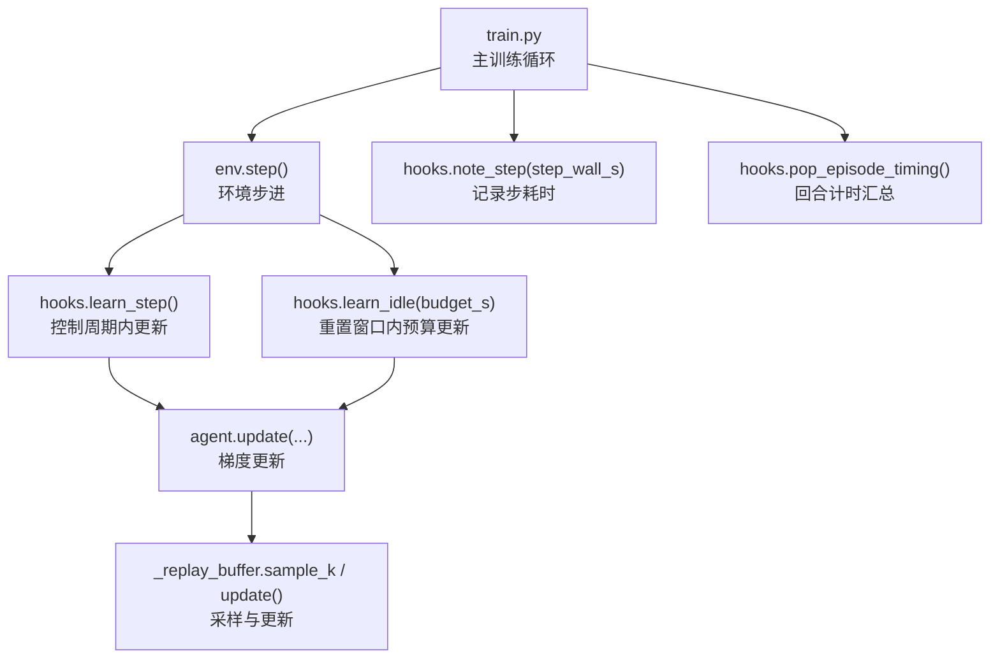
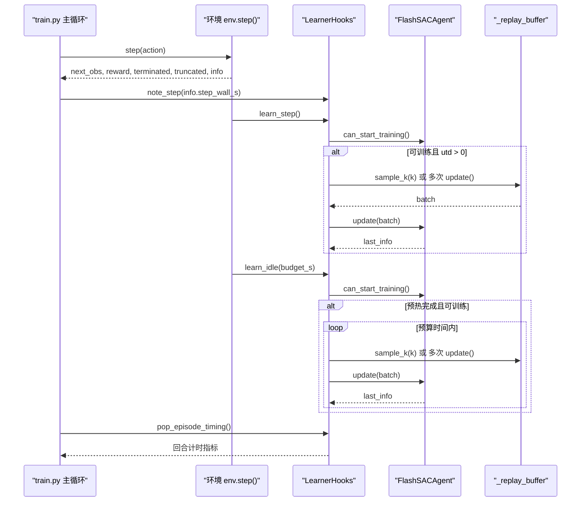
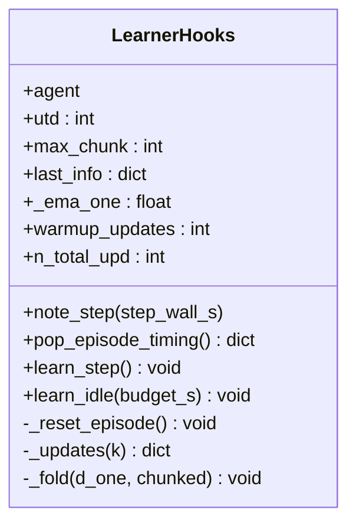
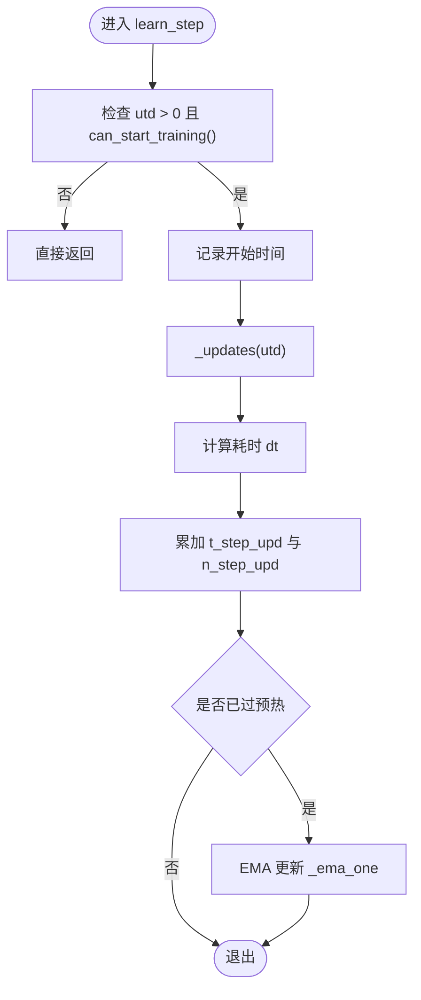
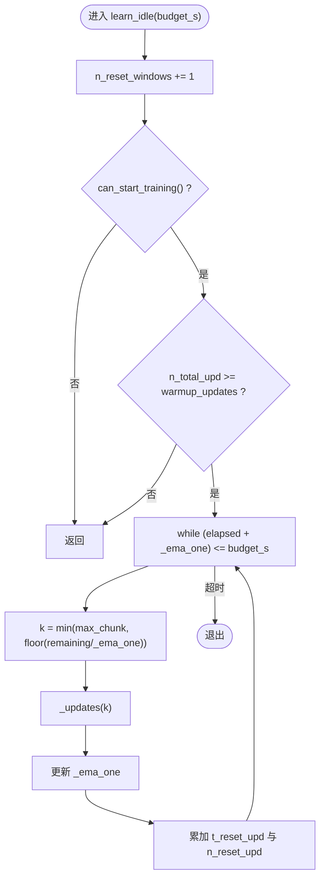
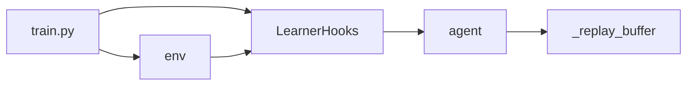

# 学习器钩子系统

<cite>
**本文引用的文件**   
- [learner_hooks.py](file://hardware/policyik_hw/rl/learner_hooks.py)
- [train.py](file://hardware/policyik_hw/train.py)
</cite>

## 目录
1. [简介](#简介)
2. [项目结构](#项目结构)
3. [核心组件](#核心组件)
4. [架构总览](#架构总览)
5. [详细组件分析](#详细组件分析)
6. [依赖关系分析](#依赖关系分析)
7. [性能与资源管理](#性能与资源管理)
8. [扩展机制与最佳实践](#扩展机制与最佳实践)
9. [故障排查指南](#故障排查指南)
10. [结论](#结论)

## 简介
本文件面向 PolicyIK 硬件训练管线中的“学习器钩子系统”，聚焦 LearnerHooks 类的设计目标、运行机制与扩展方式。该系统将梯度更新（agent.update）无缝嵌入到真实机械臂控制循环中，在正常控制步和重置窗口内分别执行批量或预算化的参数更新，并通过指数移动平均估计单次更新时间，从而自适应地分配计算预算。同时，系统提供每步计时统计、断点信息透传等能力，便于监控、分析与调试。

## 项目结构
与学习器钩子直接相关的代码位于以下两个文件：
- hardware/policyik_hw/rl/learner_hooks.py：定义 LearnerHooks 类及其内部逻辑
- hardware/policyik_hw/train.py：构建环境、代理与回放缓冲区，并将 LearnerHooks 注入环境回调

图示来源
- [train.py:362-399](file://hardware/policyik_hw/train.py#L362-L399)
- [learner_hooks.py:35-77](file://hardware/policyik_hw/rl/learner_hooks.py#L35-L77)

章节来源
- [train.py:271-437](file://hardware/policyik_hw/train.py#L271-L437)
- [learner_hooks.py:1-78](file://hardware/policyik_hw/rl/learner_hooks.py#L1-L78)

## 核心组件
- LearnerHooks：封装了“何时更新”“更新多少”“如何估计时间”“如何统计”的核心逻辑，并暴露 learn_step() 与 learn_idle() 作为环境的回调接口。
- train.py：负责实例化 LearnerHooks，将其绑定到 env.learn_fn 与 env.idle_fn，并在训练循环中调用 hooks.note_step() 与 hooks.pop_episode_timing() 以收集指标。

章节来源
- [learner_hooks.py:7-77](file://hardware/policyik_hw/rl/learner_hooks.py#L7-L77)
- [train.py:362-399](file://hardware/policyik_hw/train.py#L362-L399)

## 架构总览
下图展示了从训练主循环到环境步进、再到钩子触发与代理更新的完整时序。

图示来源
- [train.py:362-399](file://hardware/policyik_hw/train.py#L362-L399)
- [learner_hooks.py:35-77](file://hardware/policyik_hw/rl/learner_hooks.py#L35-L77)

## 详细组件分析

### LearnerHooks 设计要点
- 初始化参数
  - agent：被包装的强化学习代理，提供 can_start_training()、update() 以及 _replay_buffer 访问。
  - utd：每次控制步期望执行的更新次数（updates per timestep）。
  - est_update_s：初始的单次更新时间估计值，用于后续自适应预算分配。
  - warmup_updates：预热期所需的最小更新次数，期间不进入 idle 预算更新，避免冷启动阶段不稳定。
- 关键状态
  - n_total_upd：累计更新次数，用于判断是否结束预热。
  - last_info：最近一次更新的指标字典，供上层日志聚合。
  - _ema_one：单次更新耗时的指数移动平均估计。
  - 回合级计时变量：t_step_upd、n_step_upd、t_reset_upd、n_reset_upd、n_reset_windows、step_wall_sum、n_step_wall。
- 核心方法
  - note_step(step_wall_s)：记录环境单步墙钟时间，过滤 NaN。
  - pop_episode_timing()：输出回合维度的计时指标并重置计数器。
  - _updates(k)：根据回放缓冲区的实现选择批量采样或直接循环调用 update()，累加 n_total_upd。
  - _fold(d_one, chunked)：对单次更新耗时做 EMA 平滑；当批量更新时乘以系数以补偿开销。
  - learn_step()：控制周期内的批量更新入口。
  - learn_idle(budget_s)：重置窗口内的预算化更新入口。

图示来源
- [learner_hooks.py:7-77](file://hardware/policyik_hw/rl/learner_hooks.py#L7-L77)

章节来源
- [learner_hooks.py:7-77](file://hardware/policyik_hw/rl/learner_hooks.py#L7-L77)

### learn_step() 行为解析
- 功能
  - 在环境每个控制步被调用，尝试执行 utd 次更新。
  - 若 utd <= 0 或代理尚未达到可训练状态，则直接返回。
  - 记录本次更新耗时，并累积到 t_step_upd 与 n_step_upd。
  - 预热完成后，使用 EMA 更新单次更新时间估计。
- 异步与批量
  - 通过 _updates(utd) 统一处理批量与逐次更新。
  - 若回放缓冲区支持 sample_k(k)，则按批次采样并依次更新；否则循环调用 update()。
- 资源管理
  - 仅在 can_start_training() 为真时进行更新，避免冷启动阶段的不稳定。
  - 预热期内不进行 idle 预算更新，确保模型先积累足够经验。

图示来源
- [learner_hooks.py:50-59](file://hardware/policyik_hw/rl/learner_hooks.py#L50-L59)

章节来源
- [learner_hooks.py:50-59](file://hardware/policyik_hw/rl/learner_hooks.py#L50-L59)

### learn_idle() 行为解析
- 功能
  - 在环境重置窗口（例如 ramp step 或 settle）内被调用，利用剩余预算 budget_s 执行尽可能多的更新。
  - 若代理不可训练或未达到预热要求，则跳过。
  - 基于 _ema_one 估算单次更新耗时，动态决定每次批大小 k，上限为 max_chunk。
  - 累计 reset 窗口的更新时间与更新次数，并持续刷新 EMA。
- 预算控制
  - 循环条件保证 (当前耗时 + 预估下一次更新时间) 不超过 budget_s。
  - 通过 remaining / _ema_one 估算本轮可执行的更新次数，并与 max_chunk 取最小值。
- 资源管理
  - 预热前不进入 idle 更新，避免早期不稳定。
  - 仅当 can_start_training() 为真时才允许更新。

图示来源
- [learner_hooks.py:61-77](file://hardware/policyik_hw/rl/learner_hooks.py#L61-L77)

章节来源
- [learner_hooks.py:61-77](file://hardware/policyik_hw/rl/learner_hooks.py#L61-L77)

### 指标与统计
- note_step(step_wall_s)：记录环境单步墙钟时间，忽略 NaN。
- pop_episode_timing()：输出回合维度指标，包括：
  - upd_step_s_per_step：每步的平均更新时间
  - n_upd_step_per_step：每步的平均更新次数
  - upd_reset_s：重置窗口内累计更新时间
  - n_upd_reset：重置窗口内累计更新次数
  - n_reset_windows：重置窗口数量
  - step_wall_s_mean：平均步耗时
  - est_update_s：单次更新时间的 EMA 估计
- train.py 将这些指标合并到 episode 行，并进一步聚合到 metrics.jsonl 与控制台输出。

章节来源
- [learner_hooks.py:22-33](file://hardware/policyik_hw/rl/learner_hooks.py#L22-L33)
- [train.py:192-229](file://hardware/policyik_hw/train.py#L192-L229)
- [train.py:391-399](file://hardware/policyik_hw/train.py#L391-L399)

## 依赖关系分析
- LearnerHooks 依赖 agent 提供的：
  - can_start_training()：决定是否允许训练
  - update(...)：执行梯度更新
  - _replay_buffer：访问回放缓冲区，可能包含 sample_k() 批量采样接口
- train.py 将 LearnerHooks 注入环境：
  - env.learn_fn = hooks.learn_step
  - env.idle_fn = hooks.learn_idle
- 训练循环中：
  - hooks.note_step(info.get("step_wall_s", nan))
  - hooks.pop_episode_timing() 在回合结束时被调用

图示来源
- [train.py:362-399](file://hardware/policyik_hw/train.py#L362-L399)
- [learner_hooks.py:35-77](file://hardware/policyik_hw/rl/learner_hooks.py#L35-L77)

章节来源
- [train.py:362-399](file://hardware/policyik_hw/train.py#L362-L399)
- [learner_hooks.py:35-77](file://hardware/policyik_hw/rl/learner_hooks.py#L35-L77)

## 性能与资源管理
- 自适应预算
  - 通过 EMA 估计单次更新时间，结合预算 budget_s 动态调整批大小 k，避免超出时间预算。
- 预热保护
  - 预热期内禁止 idle 更新，减少冷启动阶段的波动。
- 批量优化
  - 若回放缓冲区支持 sample_k(k)，优先批量采样以减少 Python 层循环开销。
- 统计降噪
  - EMA 平滑单次更新耗时，提高预算分配的稳定性。
- I/O 与日志
  - 训练循环定期聚合指标并写入文件，避免频繁磁盘写造成抖动。

章节来源
- [learner_hooks.py:46-77](file://hardware/policyik_hw/rl/learner_hooks.py#L46-L77)
- [train.py:192-229](file://hardware/policyik_hw/train.py#L192-L229)

## 扩展机制与最佳实践

### 添加新的监控指标
- 在 LearnerHooks 中新增字段与方法，例如：
  - 新增属性：如 self.n_gpu_mem_mb、self.last_loss_grad_norm 等
  - 在 _updates(k) 中从 agent.update() 返回值或代理内部状态提取新指标，写入 self.last_info
  - 在 pop_episode_timing() 中汇总并返回新指标
- 在 train.py 中：
  - 将新指标纳入 TIMING_KEYS 或新增键名集合
  - 在 log_row() 中将 last_info 的新键写入 metrics.jsonl 与控制台输出

章节来源
- [learner_hooks.py:22-33](file://hardware/policyik_hw/rl/learner_hooks.py#L22-L33)
- [train.py:192-229](file://hardware/policyik_hw/train.py#L192-L229)

### 添加性能分析工具
- 在 _updates(k) 中插入轻量级计时或事件标记（例如记录 GPU kernel 启动时间），但需避免引入显著开销。
- 在 _fold() 中区分不同路径（CPU/GPU、batch/single）的权重，以便更精确的 EMA 估计。
- 在 train.py 中增加可选的性能分析开关，仅在需要时启用。

章节来源
- [learner_hooks.py:35-48](file://hardware/policyik_hw/rl/learner_hooks.py#L35-L48)

### 添加调试功能
- 在 learn_step()/learn_idle() 中加入条件断点或日志输出，打印当前 n_total_upd、_ema_one、budget_s、k 等关键状态。
- 在 pop_episode_timing() 中输出更多诊断字段，如各阶段耗时占比。
- 在 train.py 中增加 --debug 选项，控制是否输出详细日志。

章节来源
- [learner_hooks.py:50-77](file://hardware/policyik_hw/rl/learner_hooks.py#L50-L77)
- [train.py:362-399](file://hardware/policyik_hw/train.py#L362-L399)

### 错误处理
- 注意 note_step() 中对 NaN 的过滤，避免污染统计。
- 在 _updates(k) 中捕获异常并降级为逐次更新或跳过更新，保证训练鲁棒性。
- 在 train.py 中捕获 replay buffer 加载或演示数据不一致的错误，给出明确提示。

章节来源
- [learner_hooks.py:22-24](file://hardware/policyik_hw/rl/learner_hooks.py#L22-L24)
- [train.py:298-321](file://hardware/policyik_hw/train.py#L298-L321)

### 内存管理
- 控制 batch 大小与 utd，避免一次性占用过多显存。
- 若回放缓冲区支持 sample_k(k)，合理设置 k 以平衡吞吐与内存。
- 在长时间训练中定期清理临时对象，避免累积。

章节来源
- [learner_hooks.py:35-44](file://hardware/policyik_hw/rl/learner_hooks.py#L35-L44)

### 使用示例与最佳实践
- 基本用法
  - 在 train.py 中创建 LearnerHooks(agent, utd=...)，并将其绑定到 env.learn_fn 与 env.idle_fn。
  - 在环境步进后调用 hooks.note_step(info.get("step_wall_s", nan))。
  - 在回合结束时调用 hooks.pop_episode_timing() 并写入日志。
- 预热策略
  - 设置 warmup_updates 以避免冷启动阶段的不稳定。
- 预算调参
  - 根据硬件延迟调整 est_update_s 与 max_chunk，使 idle 更新更贴合实际。
- 指标采集
  - 将 last_info 中的损失、熵、温度等指标合并到 metrics.jsonl，便于离线分析。

章节来源
- [train.py:362-399](file://hardware/policyik_hw/train.py#L362-L399)
- [learner_hooks.py:8-15](file://hardware/policyik_hw/rl/learner_hooks.py#L8-L15)

## 故障排查指南
- 现象：idle 更新未执行
  - 检查 agent.can_start_training() 是否为真
  - 检查 n_total_upd 是否已达到 warmup_updates
  - 检查 budget_s 是否过小导致循环立即退出
- 现象：est_update_s 异常大或小
  - 检查 _updates(k) 是否走批量路径（chunked=True）
  - 检查硬件负载变化是否导致耗时波动
- 现象：指标缺失或 NaN
  - 确认 note_step() 传入的 step_wall_s 非 NaN
  - 确认 pop_episode_timing() 在回合结束时被调用
- 现象：训练不稳定
  - 增大 warmup_updates
  - 降低 utd 或 batch 大小
  - 调整 est_update_s 使其更接近真实耗时

章节来源
- [learner_hooks.py:50-77](file://hardware/policyik_hw/rl/learner_hooks.py#L50-L77)
- [train.py:391-399](file://hardware/policyik_hw/train.py#L391-L399)

## 结论
LearnerHooks 通过简洁而稳健的机制，将梯度更新安全地嵌入到真实机械臂的控制循环中。其核心在于：
- 在控制步执行固定数量的更新
- 在重置窗口内基于预算自适应地执行更新
- 用 EMA 估计单次更新时间，提升预算分配的稳定性
- 提供丰富的计时与指标统计，便于监控与分析

通过扩展 LearnerHooks 与 train.py 的集成点，可以方便地加入新的监控指标、性能分析工具与调试功能，同时保持系统的鲁棒性与高性能。
