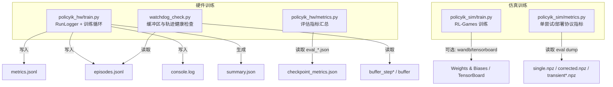
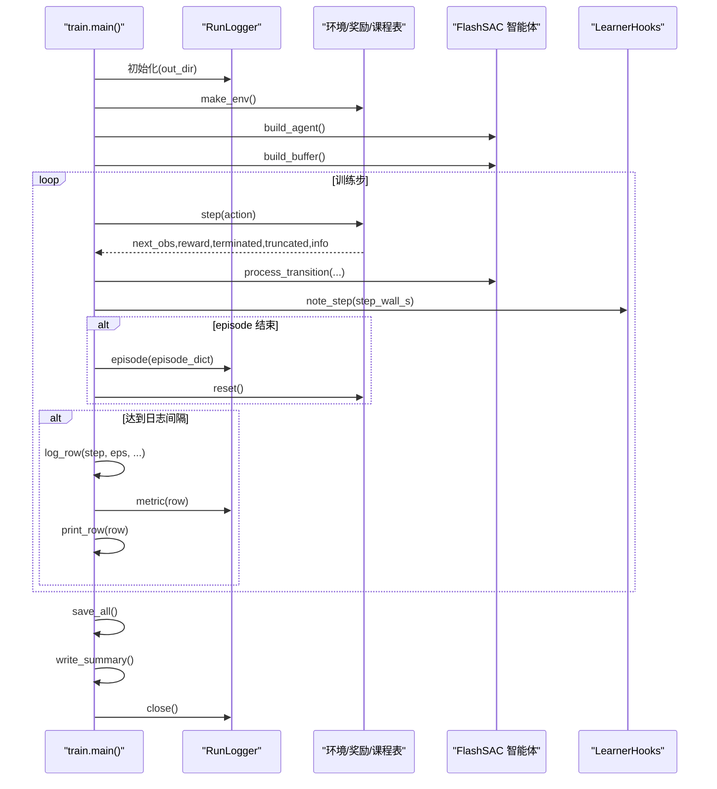
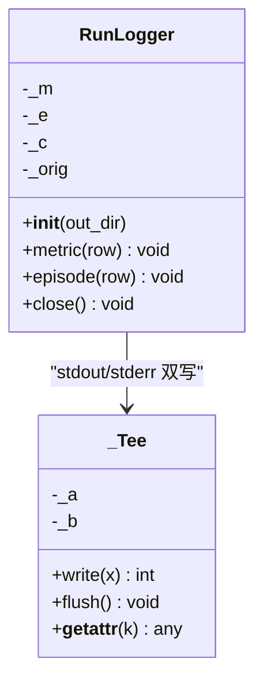
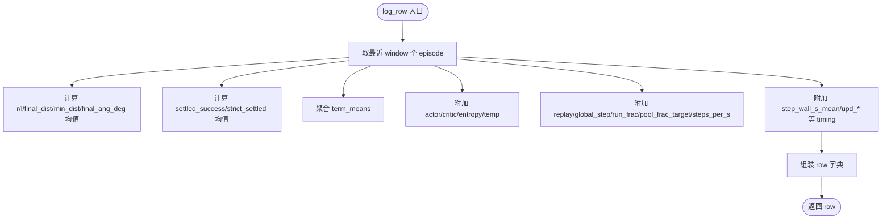
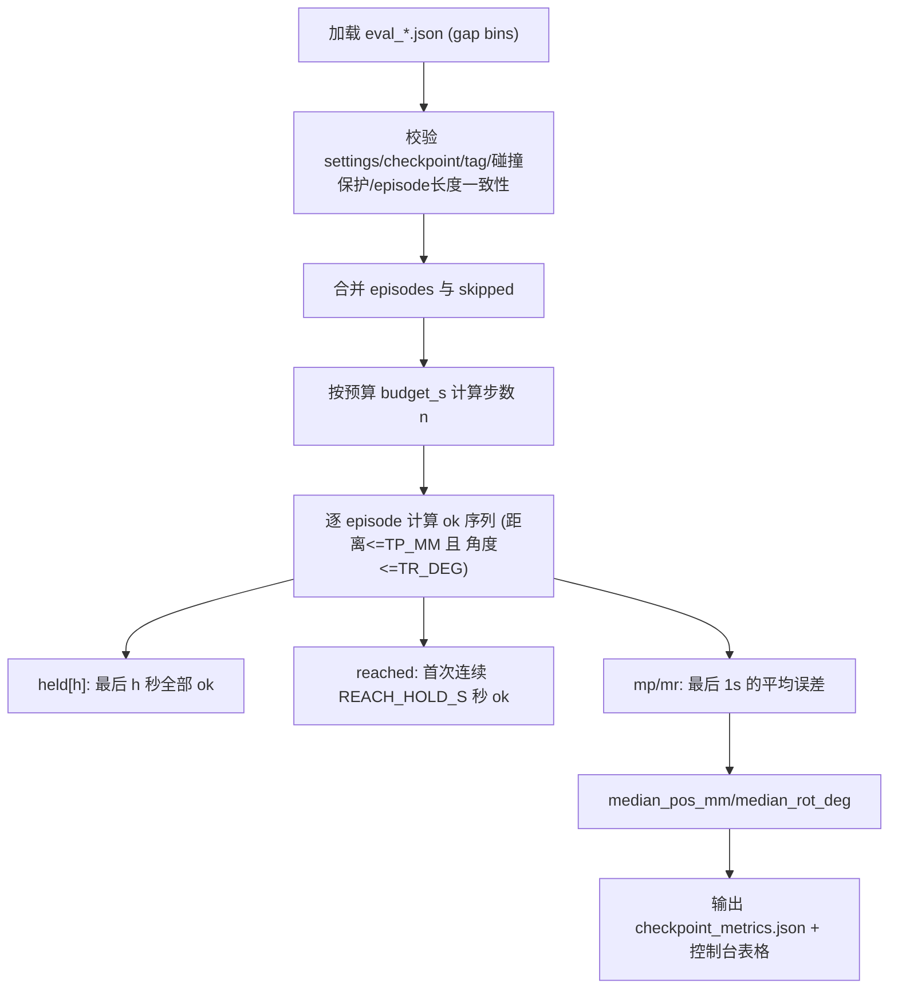
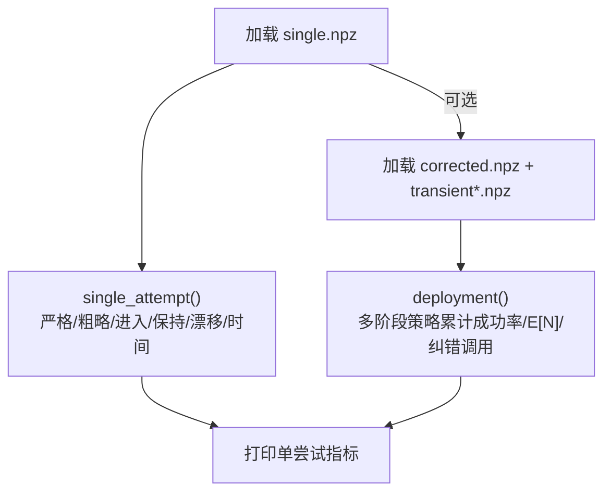
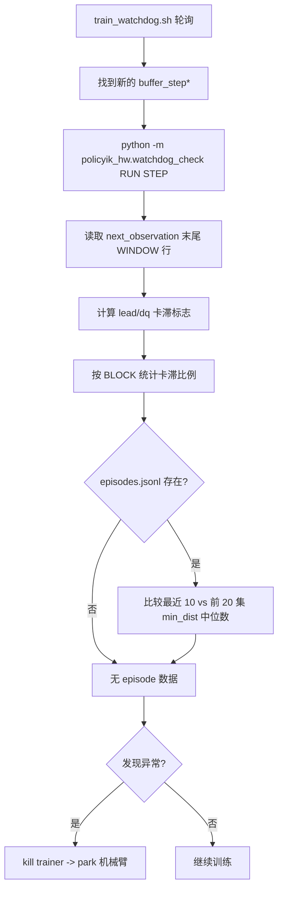
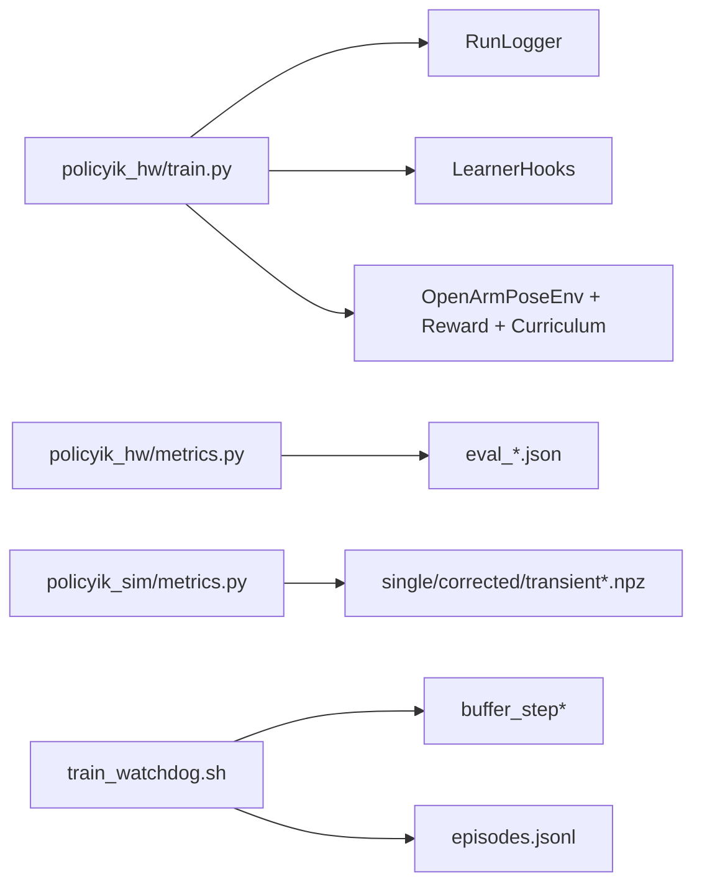

# 监控与日志系统

<cite>
**本文引用的文件**   
- [hardware/policyik_hw/train.py](file://hardware/policyik_hw/train.py)
- [hardware/policyik_hw/watchdog_check.py](file://hardware/policyik_hw/watchdog_check.py)
- [hardware/policyik_hw/metrics.py](file://hardware/policyik_hw/metrics.py)
- [simulation/policyik_sim/metrics.py](file://simulation/policyik_sim/metrics.py)
- [hardware/scripts/train.sh](file://hardware/scripts/train.sh)
- [hardware/scripts/train_watchdog.sh](file://hardware/scripts/train_watchdog.sh)
- [simulation/scripts/evaluate.sh](file://simulation/scripts/evaluate.sh)
</cite>

## 目录
1. [引言](#引言)
2. [项目结构](#项目结构)
3. [核心组件](#核心组件)
4. [架构总览](#架构总览)
5. [详细组件分析](#详细组件分析)
6. [依赖关系分析](#依赖关系分析)
7. [性能考量](#性能考量)
8. [故障排查指南](#故障排查指南)
9. [结论](#结论)
10. [附录：日志字段与示例解读](#附录日志字段与示例解读)

## 引言
本文件面向 PolicyIK 的监控与日志系统，重点解释训练侧 RunLogger 的设计与行为、三类关键日志（metrics.jsonl、episodes.jsonl、console.log）的结构与用途，以及训练指标的计算方法。同时给出实时日志输出格式说明、日志分析与可视化工具的使用指南，并提供具体日志示例与分析案例，帮助读者进行性能诊断、问题排查与结果分析。

## 项目结构
PolicyIK 在硬件与仿真两条训练路径上分别实现监控与评估：
- 硬件训练路径使用 policyik_hw.train 中的 RunLogger 统一写入 metrics.jsonl、episodes.jsonl 与 console.log，并生成 summary.json。
- 仿真训练路径基于 RL-Games，通常通过 Weights & Biases 或 TensorBoard 记录；评估阶段则产出 npz 数据并由 simulation/policyik_sim/metrics.py 计算部署协议指标。
- 硬件评估阶段由 hardware/policyik_hw/metrics.py 汇总不同 gap-bin 的 held/reached/误差等指标。
- watchdog 脚本与 watchdog_check.py 对训练过程进行健康检查，读取 buffer 与 episodes.jsonl 判断异常。

图表来源
- [hardware/policyik_hw/train.py:84-127](file://hardware/policyik_hw/train.py#L84-L127)
- [hardware/policyik_hw/train.py:251-260](file://hardware/policyik_hw/train.py#L251-L260)
- [hardware/policyik_hw/metrics.py:19-28](file://hardware/policyik_hw/metrics.py#L19-L28)
- [simulation/policyik_sim/metrics.py:106-148](file://simulation/policyik_sim/metrics.py#L106-L148)
- [hardware/policyik_hw/watchdog_check.py:10-52](file://hardware/policyik_hw/watchdog_check.py#L10-L52)

章节来源
- [hardware/policyik_hw/train.py:84-127](file://hardware/policyik_hw/train.py#L84-L127)
- [hardware/policyik_hw/train.py:251-260](file://hardware/policyik_hw/train.py#L251-L260)
- [hardware/policyik_hw/metrics.py:19-28](file://hardware/policyik_hw/metrics.py#L19-L28)
- [simulation/policyik_sim/metrics.py:106-148](file://simulation/policyik_sim/metrics.py#L106-L148)
- [hardware/policyik_hw/watchdog_check.py:10-52](file://hardware/policyik_hw/watchdog_check.py#L10-L52)

## 核心组件
- RunLogger：负责统一创建与关闭日志文件，将训练指标与每集 episode 信息以 JSON Lines 格式追加写入，并将终端 stdout/stderr 双写到 console.log。
- log_row/print_row：聚合最近窗口内的 episode 统计，构造 metrics.jsonl 的行，并以人类可读格式打印到控制台。
- write_summary/save_all：训练结束时保存 summary.json 与模型/缓冲区的最终快照。
- watchdog_check：周期性检查最新 buffer 与 episodes.jsonl，检测关节卡滞、接近距离退化等异常。
- hardware/policyik_hw/metrics.py：从多个 gap-bin 的 eval_*.json 中汇总 held/reached/中位误差等指标，输出 checkpoint_metrics.json。
- simulation/policyik_sim/metrics.py：从仿真评估 dump 计算单尝试与部署协议指标，包括严格/粗略成功率、进入时间、漂移、E[N] 等。

章节来源
- [hardware/policyik_hw/train.py:84-127](file://hardware/policyik_hw/train.py#L84-L127)
- [hardware/policyik_hw/train.py:192-229](file://hardware/policyik_hw/train.py#L192-L229)
- [hardware/policyik_hw/train.py:251-268](file://hardware/policyik_hw/train.py#L251-L268)
- [hardware/policyik_hw/watchdog_check.py:10-52](file://hardware/policyik_hw/watchdog_check.py#L10-L52)
- [hardware/policyik_hw/metrics.py:56-78](file://hardware/policyik_hw/metrics.py#L56-L78)
- [simulation/policyik_sim/metrics.py:33-48](file://simulation/policyik_sim/metrics.py#L33-L48)

## 架构总览
下图展示训练主流程与日志写入时序：

图表来源
- [hardware/policyik_hw/train.py:271-437](file://hardware/policyik_hw/train.py#L271-L437)
- [hardware/policyik_hw/train.py:84-127](file://hardware/policyik_hw/train.py#L84-L127)
- [hardware/policyik_hw/train.py:192-229](file://hardware/policyik_hw/train.py#L192-L229)

## 详细组件分析

### RunLogger 设计与行为
- 职责
  - 创建并维护三个文件句柄：metrics.jsonl、episodes.jsonl、console.log。
  - 将 stdout/stderr 重定向到 _Tee，使终端输出与 console.log 同步。
  - 提供 metric()/episode()/close() 接口，确保每条记录立即 flush，避免崩溃丢失。
- 文件约定
  - metrics.jsonl：每行一个 JSON 对象，包含步骤、时间、回合数、近期平均指标、学习率相关项、回放缓冲大小、吞吐等。
  - episodes.jsonl：每行一个 JSON 对象，描述一集 episode 的完整轨迹与统计。
  - console.log：人类可读的训练进度、性能指标、系统状态。
- 生命周期
  - 在 main() 中创建 logger，训练结束后在 finally 块中调用 close()，恢复原始 stdout/stderr。

图表来源
- [hardware/policyik_hw/train.py:84-127](file://hardware/policyik_hw/train.py#L84-L127)

章节来源
- [hardware/policyik_hw/train.py:84-127](file://hardware/policyik_hw/train.py#L84-L127)

### 训练指标收集与计算方法
- 指标聚合函数 log_row
  - 从最近 window 个 episode 中计算均值：r、l、final_dist、min_dist、final_ang_deg。
  - 计算 rate 类指标：settled_success、strict_settled。
  - 聚合 term_means（来自环境的终止时刻统计）。
  - 附加 agent 内部信息：actor/loss、critic/loss、actor/entropy、temperature/value。
  - 附加回放缓冲规模、全局步数、运行进度、池任务比例、steps_per_s。
  - 附加 timing 指标：step_wall_s_mean、upd_step_s_per_step、n_upd_step_per_step、upd_reset_s、n_upd_reset、est_update_s。
- 控制台输出 print_row
  - 格式化显示当前步、累计时间、回合数、回报、最终距离(mm)、最终角度(deg)、严格/粗略稳定成功率、critic loss、温度参数。
  - 第二行显示 timing 与池任务比例目标值。

图表来源
- [hardware/policyik_hw/train.py:192-215](file://hardware/policyik_hw/train.py#L192-L215)

章节来源
- [hardware/policyik_hw/train.py:192-229](file://hardware/policyik_hw/train.py#L192-L229)

### 硬件评估指标（held/reached/中位误差）
- 输入
  - run_dir 下的 eval_*.json（按 gap_bin 分 medium/long/extended），每个文件包含 episodes 与 skipped。
- 处理
  - 根据预算时间 budget_s 与评估频率 eval_hz 计算步数 n。
  - 对每集 episode 的 per_step.d_m（毫米）与 per_step.theta_deg（度）应用阈值 TP_MM=1.0mm、TR_DEG=0.2°。
  - 计算 held：在 HOLDS_S=(1,2,3,5)s 内是否持续满足阈值。
  - 计算 reached：首次连续 REACH_HOLD_S=0.5s 满足阈值的 episode 计数。
  - 计算 median_pos_mm、median_rot_deg：最后 1s 的中位误差。
- 输出
  - 输出 checkpoint_metrics.json，并在控制台打印表格形式的指标。

图表来源
- [hardware/policyik_hw/metrics.py:31-53](file://hardware/policyik_hw/metrics.py#L31-L53)
- [hardware/policyik_hw/metrics.py:56-78](file://hardware/policyik_hw/metrics.py#L56-L78)
- [hardware/policyik_hw/metrics.py:81-109](file://hardware/policyik_hw/metrics.py#L81-L109)

章节来源
- [hardware/policyik_hw/metrics.py:19-28](file://hardware/policyik_hw/metrics.py#L19-L28)
- [hardware/policyik_hw/metrics.py:56-78](file://hardware/policyik_hw/metrics.py#L56-L78)
- [hardware/policyik_hw/metrics.py:81-109](file://hardware/policyik_hw/metrics.py#L81-L109)

### 仿真评估指标（单尝试与部署协议）
- 单尝试指标 single_attempt
  - 严格/粗略成功率、进入率、保持率、进入后未保持率、进入时间、末端漂移（微米/度）、位置/角度均值与中位数。
- 部署协议 deployment
  - 多阶段策略：单尝试 → 误差修正目标 → 若干瞬态目标。
  - 累计严格/粗略成功率、执行次数期望 E[N]、错误修正调用次数与成功救援次数。
- 输出
  - 控制台打印各指标均值与标准差，便于跨种子比较。

图表来源
- [simulation/policyik_sim/metrics.py:33-48](file://simulation/policyik_sim/metrics.py#L33-L48)
- [simulation/policyik_sim/metrics.py:51-96](file://simulation/policyik_sim/metrics.py#L51-L96)
- [simulation/policyik_sim/metrics.py:106-148](file://simulation/policyik_sim/metrics.py#L106-L148)

章节来源
- [simulation/policyik_sim/metrics.py:33-48](file://simulation/policyik_sim/metrics.py#L33-L48)
- [simulation/policyik_sim/metrics.py:51-96](file://simulation/policyik_sim/metrics.py#L51-L96)
- [simulation/policyik_sim/metrics.py:106-148](file://simulation/policyik_sim/metrics.py#L106-L148)

### 运行时健康检查（watchdog）
- 触发方式
  - train_watchdog.sh 定时轮询新保存的 buffer_step*，调用 watchdog_check.py 检查最近 5000 行。
- 检查逻辑
  - 从 next_observation 提取 lead（关节角）与 dq（速度），判定“卡滞”条件。
  - 统计每 BLOCK 行的卡滞比例，若单关节或多数关节出现异常，标记 ABNORMAL。
  - 若 episodes.jsonl 存在，比较最近 10 集与之前 20 集的 min_dist 中位数，若显著退化也标记异常。
- 处置
  - 检测到 ABNORMAL 时，向 trainer 发送 Ctrl-C，等待退出后执行 park 归位。

图表来源
- [hardware/scripts/train_watchdog.sh:1-59](file://hardware/scripts/train_watchdog.sh#L1-L59)
- [hardware/policyik_hw/watchdog_check.py:10-52](file://hardware/policyik_hw/watchdog_check.py#L10-L52)

章节来源
- [hardware/scripts/train_watchdog.sh:1-59](file://hardware/scripts/train_watchdog.sh#L1-L59)
- [hardware/policyik_hw/watchdog_check.py:10-52](file://hardware/policyik_hw/watchdog_check.py#L10-L52)

## 依赖关系分析
- 训练主程序依赖
  - RunLogger 用于日志持久化。
  - LearnerHooks 提供 learn_step/learn_idle 回调，更新 last_info 与 episode timing。
  - env.curriculum 提供 sigma 调度与 on_episode 事件。
- 评估与指标
  - hardware/policyik_hw/metrics.py 依赖 eval_*.json 与 task_file。
  - simulation/policyik_sim/metrics.py 依赖 single.npz/corrected.npz/transient*.npz。
- 守护进程
  - train_watchdog.sh 依赖 buffer_step* 与 episodes.jsonl。

图表来源
- [hardware/policyik_hw/train.py:271-437](file://hardware/policyik_hw/train.py#L271-L437)
- [hardware/policyik_hw/metrics.py:81-109](file://hardware/policyik_hw/metrics.py#L81-L109)
- [simulation/policyik_sim/metrics.py:106-148](file://simulation/policyik_sim/metrics.py#L106-L148)
- [hardware/scripts/train_watchdog.sh:1-59](file://hardware/scripts/train_watchdog.sh#L1-L59)

章节来源
- [hardware/policyik_hw/train.py:271-437](file://hardware/policyik_hw/train.py#L271-L437)
- [hardware/policyik_hw/metrics.py:81-109](file://hardware/policyik_hw/metrics.py#L81-L109)
- [simulation/policyik_sim/metrics.py:106-148](file://simulation/policyik_sim/metrics.py#L106-L148)
- [hardware/scripts/train_watchdog.sh:1-59](file://hardware/scripts/train_watchdog.sh#L1-L59)

## 性能考量
- 日志写入开销
  - RunLogger 对每条 metric/episode 都 flush，保证可靠性但可能带来一定 I/O 开销。建议结合 log.every 控制日志频率。
- 指标窗口
  - log_row 使用最近 window 个 episode 计算均值，窗口越大越平滑但响应慢；可根据训练节奏调整。
- 评估频率
  - hardware/policyik_hw/metrics.py 使用 eval_hz 将预算时间转换为步数，需与训练有效步频一致以获得准确指标。
- 守护检查粒度
  - watchdog_check 使用 WINDOW=5000 与 BLOCK 分段统计，兼顾灵敏度与稳定性；可据此调参以适配不同硬件噪声水平。

[本节为通用指导，不直接分析具体文件]

## 故障排查指南
- 常见问题定位
  - 指标缺失或 NaN：检查 episodes.jsonl 是否存在、window 内是否有有效 episode；确认 log.every 设置合理。
  - 终端输出与 console.log 不一致：确认 RunLogger 已正确替换 stdout/stderr，且 _Tee 的 flush 被调用。
  - 评估指标异常：核对 eval_hz 是否与训练有效步频匹配；检查 eval_*.json 的 settings 是否一致。
  - 守护报警 ABNORMAL：查看 watchdog.log 与 episodes.jsonl 的 min_dist 趋势，必要时回滚到上一个 clean checkpoint。
- 快速命令
  - 启动硬件训练：bash hardware/scripts/train.sh
  - 启动守护检查：bash hardware/scripts/train_watchdog.sh <run_dir> [poll_s]
  - 硬件评估指标汇总：python -m policyik_hw.metrics --run <run_dir> --checkpoint <ckpt> --task-file <tasks.json>
  - 仿真评估指标汇总：bash simulation/scripts/evaluate.sh <seed> [checkpoint]

章节来源
- [hardware/scripts/train.sh:1-13](file://hardware/scripts/train.sh#L1-L13)
- [hardware/scripts/train_watchdog.sh:1-59](file://hardware/scripts/train_watchdog.sh#L1-L59)
- [hardware/policyik_hw/metrics.py:81-109](file://hardware/policyik_hw/metrics.py#L81-L109)
- [simulation/scripts/evaluate.sh:1-22](file://simulation/scripts/evaluate.sh#L1-L22)

## 结论
PolicyIK 的监控与日志系统围绕 RunLogger 构建，提供高可靠性的 metrics.jsonl、episodes.jsonl 与 console.log 输出，配合 log_row/print_row 形成清晰的训练进度与性能视图。硬件与仿真两条路径分别提供针对性的评估指标工具，支持从单尝试到部署协议的全面分析。watchdog 机制进一步保障长时间训练的稳定性与安全。通过本文档的字段说明、流程图与示例，读者可以快速上手日志分析、性能诊断与问题排查。

[本节为总结性内容，不直接分析具体文件]

## 附录：日志字段与示例解读

### metrics.jsonl 字段说明（节选）
- step：当前训练步。
- wall_s：自训练开始以来的累计时间（秒）。
- n_episodes：累计完成的 episode 数量。
- new_episodes：本轮新增 episode 数量。
- r/l：回报与长度（来自 episode 统计）。
- final_dist/min_dist：最终/最小距离误差（米）。
- final_ang_deg：最终角度误差（度）。
- settled_success/strict_settled：粗略/严格稳定成功率。
- term_means：终止时刻的环境统计。
- actor/loss、critic/loss、actor/entropy、temperature/value：智能体内部损失与熵、温度。
- replay：回放缓冲大小。
- global_step：全局步数（含 step_offset）。
- run_frac：运行进度。
- pool_frac_target：池任务比例目标。
- steps_per_s：每秒步数。
- step_wall_s_mean、upd_step_s_per_step、n_upd_step_per_step、upd_reset_s、n_upd_reset、est_update_s：timing 指标。
- pool_frac：实际池任务比例。

章节来源
- [hardware/policyik_hw/train.py:192-229](file://hardware/policyik_hw/train.py#L192-L229)

### episodes.jsonl 字段说明（节选）
- trial_id：任务标识。
- l：episode 长度（步数）。
- r：episode 回报。
- final_dist/min_dist：最终/最小距离误差（米）。
- final_ang_deg：最终角度误差（度）。
- terminated：是否正常终止。
- from_pool：是否来自任务池。
- sigma_after：课程表 sigma 值。
- step/wall_s：episode 结束时的训练步与累计时间。
- 其他 timing 字段：由 hooks.pop_episode_timing() 注入。

章节来源
- [hardware/policyik_hw/train.py:395-410](file://hardware/policyik_hw/train.py#L395-L410)

### console.log 输出解读
- 第一行：[步/总步 g全局步] 累计时间(分钟) ep 回合数 ret 回报 d_fin 最终距离(mm) th_fin 最终角度(deg) strict settled 严格稳定率 coarse settled 粗略稳定率 critic critic损失 temp 温度。
- 第二行：timing step 步耗时(s) updates per step 每次步更新次数 updates per reset 每次重置更新次数 pool 池任务比例(target 目标比例)。

章节来源
- [hardware/policyik_hw/train.py:218-229](file://hardware/policyik_hw/train.py#L218-L229)

### 示例与案例分析
- 案例一：训练收敛与稳定
  - 观察 metrics.jsonl 中 settled_success/strict_settled 上升，final_dist/min_dist 下降，final_ang_deg 下降。
  - console.log 中 critic/loss 下降，temp 趋于稳定，steps_per_s 平稳。
- 案例二：关节卡滞检测
  - watchdog.log 中出现 ABNORMAL，指出某关节在高比例行中处于“指令领先但速度接近零”的状态。
  - episodes.jsonl 中 min_dist 中位数在最近 10 集显著高于之前 20 集，提示接近距离退化。
- 案例三：硬件评估指标
  - checkpoint_metrics.json 中 reached 与 held 随预算时间增长而提升，median_pos_mm/median_rot_deg 反映最终精度。
- 案例四：仿真部署协议
  - simulation/policyik_sim/metrics.py 输出中，strict/coarse 成功率逐步提升，E[N] 表示平均执行尝试次数，error-corrected goal 的调用与救援次数体现纠错有效性。

章节来源
- [hardware/policyik_hw/watchdog_check.py:10-52](file://hardware/policyik_hw/watchdog_check.py#L10-L52)
- [hardware/policyik_hw/metrics.py:81-109](file://hardware/policyik_hw/metrics.py#L81-L109)
- [simulation/policyik_sim/metrics.py:106-148](file://simulation/policyik_sim/metrics.py#L106-L148)
