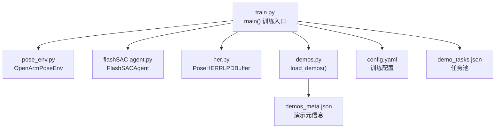
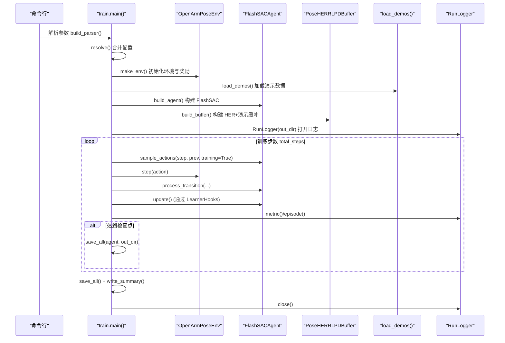
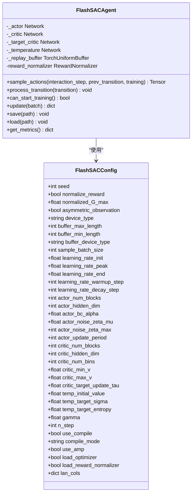
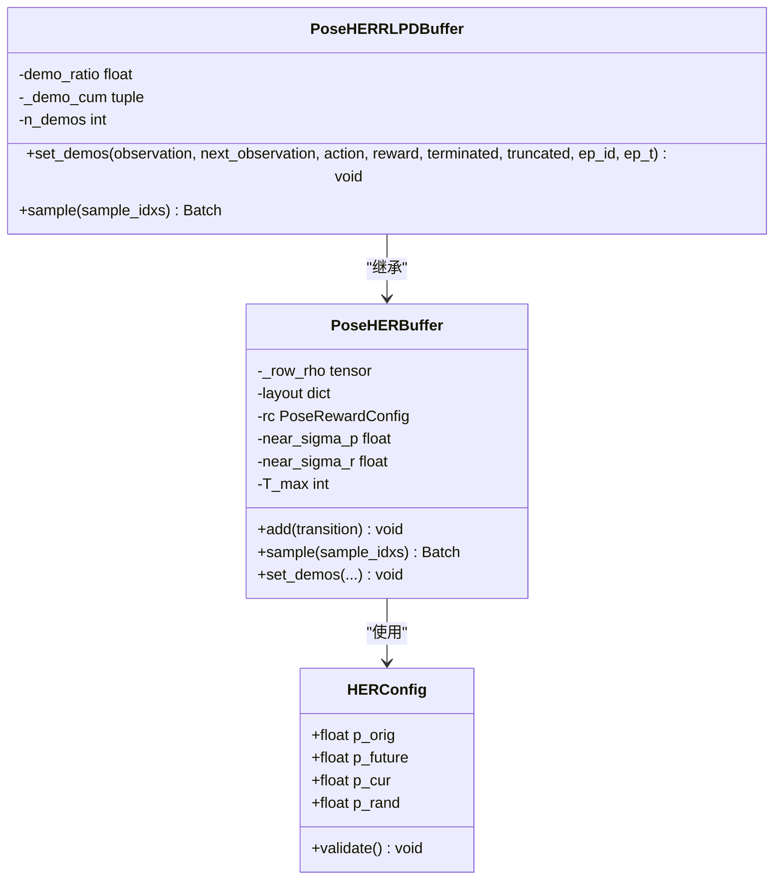
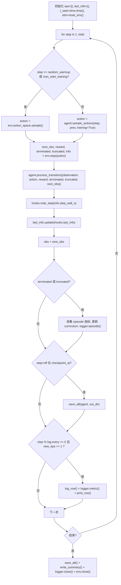
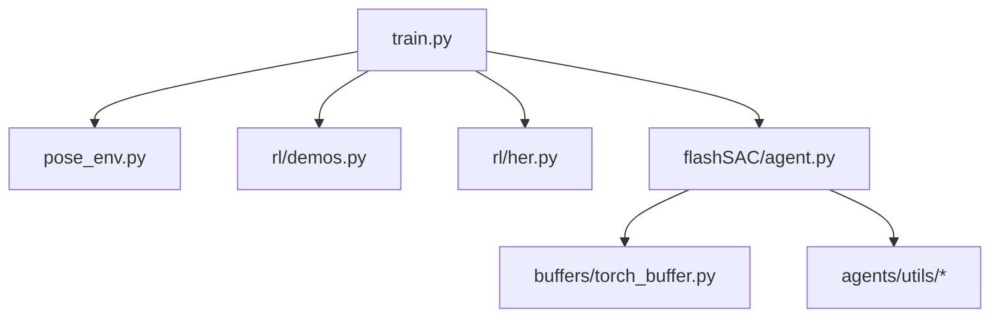

# 训练循环核心

<cite>
**本文引用的文件**   
- [hardware/policyik_hw/train.py](file://hardware/policyik_hw/train.py)
- [hardware/flash_rl/agents/flashSAC/agent.py](file://hardware/flash_rl/agents/flashSAC/agent.py)
- [hardware/config.yaml](file://hardware/config.yaml)
- [hardware/data/demo_tasks.json](file://hardware/data/demo_tasks.json)
- [hardware/data/demos_meta.json](file://hardware/data/demos_meta.json)
- [hardware/policyik_hw/rl/her.py](file://hardware/policyik_hw/rl/her.py)
- [hardware/policyik_hw/rl/demos.py](file://hardware/policyik_hw/rl/demos.py)
- [hardware/policyik_hw/envs/pose_env.py](file://hardware/policyik_hw/envs/pose_env.py)
</cite>

## 目录
1. [引言](#引言)
2. [项目结构](#项目结构)
3. [核心组件](#核心组件)
4. [架构总览](#架构总览)
5. [详细组件分析](#详细组件分析)
6. [依赖关系分析](#依赖关系分析)
7. [性能与监控](#性能与监控)
8. [故障排查指南](#故障排查指南)
9. [结论](#结论)

## 引言
本文聚焦 PolicyIK 在真实机械臂上的在线训练循环，围绕 `main()` 函数展开，系统解释命令行参数解析、配置加载、环境初始化、演示数据加载、FlashSAC 代理构建、HER 缓冲区装配、训练主循环的动作采样与环境交互、经验存储、策略更新，以及指标记录、检查点保存等关键机制。文档同时给出面向实际使用的配置参数说明和可视化流程图，帮助读者快速理解并安全地扩展训练流程。

## 项目结构
PolicyIK 的硬件训练入口位于 `hardware/policyik_hw/train.py`，其核心依赖包括：
- 环境与奖励：`envs/pose_env.py`、`envs/reward.py`、`envs/workspace.py`
- HER 与演示缓冲：`rl/her.py`、`rl/demos.py`
- FlashSAC 代理：`flash_rl/agents/flashSAC/agent.py`
- 全局配置：`config.yaml`
- 任务池与演示元信息：`data/demo_tasks.json`、`data/demos_meta.json`

**图表来源**
- [hardware/policyik_hw/train.py:271-436](file://hardware/policyik_hw/train.py#L271-L436)
- [hardware/policyik_hw/envs/pose_env.py:206-544](file://hardware/policyik_hw/envs/pose_env.py#L206-L544)
- [hardware/flash_rl/agents/flashSAC/agent.py:335-565](file://hardware/flash_rl/agents/flashSAC/agent.py#L335-L565)
- [hardware/policyik_hw/rl/her.py:39-517](file://hardware/policyik_hw/rl/her.py#L39-L517)
- [hardware/policyik_hw/rl/demos.py:60-81](file://hardware/policyik_hw/rl/demos.py#L60-L81)
- [hardware/config.yaml:1-160](file://hardware/config.yaml#L1-L160)

**章节来源**
- [hardware/policyik_hw/train.py:271-436](file://hardware/policyik_hw/train.py#L271-L436)
- [hardware/config.yaml:1-160](file://hardware/config.yaml#L1-L160)

## 核心组件
- 训练入口与调度：`train.py` 中的 `build_parser()`、`resolve()`、`make_env()`、`build_agent()`、`build_buffer()`、`log_row()`、`save_all()`、`main()`
- 环境接口：`pose_env.py` 中的 `OpenArmPoseEnv`、`EnvConfig`、`action_gain()`、`build_layout()`
- HER 与演示缓冲：`her.py` 中的 `HERConfig`、`PoseHERBuffer`、`PoseHERRLPDBuffer`；`demos.py` 中的 `load_demos()`
- FlashSAC 代理：`agent.py` 中的 `FlashSACConfig`、`FlashSACAgent`、网络初始化与更新逻辑

**章节来源**
- [hardware/policyik_hw/train.py:26-157](file://hardware/policyik_hw/train.py#L26-L157)
- [hardware/policyik_hw/envs/pose_env.py:21-43](file://hardware/policyik_hw/envs/pose_env.py#L21-L43)
- [hardware/policyik_hw/envs/pose_env.py:206-544](file://hardware/policyik_hw/envs/pose_env.py#L206-L544)
- [hardware/policyik_hw/rl/her.py:22-517](file://hardware/policyik_hw/rl/her.py#L22-L517)
- [hardware/policyik_hw/rl/demos.py:60-81](file://hardware/policyik_hw/rl/demos.py#L60-L81)
- [hardware/flash_rl/agents/flashSAC/agent.py:30-81](file://hardware/flash_rl/agents/flashSAC/agent.py#L30-L81)
- [hardware/flash_rl/agents/flashSAC/agent.py:335-565](file://hardware/flash_rl/agents/flashSAC/agent.py#L335-L565)

## 架构总览
下图展示从命令行到训练主循环的整体调用链，包括参数解析、配置合并、环境创建、演示加载、代理与缓冲构建、信号处理、日志与检查点保存。

**图表来源**
- [hardware/policyik_hw/train.py:26-38](file://hardware/policyik_hw/train.py#L26-L38)
- [hardware/policyik_hw/train.py:41-72](file://hardware/policyik_hw/train.py#L41-L72)
- [hardware/policyik_hw/train.py:232-248](file://hardware/policyik_hw/train.py#L232-L248)
- [hardware/policyik_hw/train.py:295-321](file://hardware/policyik_hw/train.py#L295-L321)
- [hardware/policyik_hw/train.py:323-364](file://hardware/policyik_hw/train.py#L323-L364)
- [hardware/policyik_hw/train.py:373-427](file://hardware/policyik_hw/train.py#L373-L427)
- [hardware/policyik_hw/train.py:425-432](file://hardware/policyik_hw/train.py#L425-L432)

## 详细组件分析

### 训练入口 main() 执行流程
`main()` 是训练的核心调度器，负责：
- 解析命令行参数（`--config`、`--name`、`--total-steps`、`--checkpoint-at`、`--init-from`、`--init-buffer`、`--step-offset`、`--urdf`、`--device`）
- 加载并解析配置文件（`config.yaml`），应用命令行覆盖（`resolve()`）
- 设置 URDF 路径、设备选择（CPU/CUDA/auto）
- 初始化环境（`make_env()`）、构建观察布局（`build_layout()`）
- 加载演示数据（`load_demos()`）与任务池（`load_task_pool()`）
- 构建 FlashSAC 代理（`build_agent()`）与 HER 缓冲（`build_buffer()`）
- 可选地从检查点恢复代理与缓冲
- 注册 SIGINT 信号处理，启动训练循环
- 每步动作采样、环境交互、经验存储、策略更新
- 周期性记录指标与 episode 信息，定时保存检查点
- 结束时统一保存模型与缓冲，输出总结信息

```mermaid
flowchart TD
Start(["进入 main()"]) --> Parse["解析参数 build_parser()"]
Parse --> LoadCfg["加载 config.yaml 并 resolve()"]
LoadCfg --> SetURDF["设置 URDF 路径"]
SetURDF --> Device["选择设备 auto/cpu/cuda"]
Device --> MakeEnv["make_env() 初始化环境"]
MakeEnv --> BuildLayout["build_layout() 构建观察列布局"]
BuildLayout --> LoadDemos["load_demos() 加载演示数据"]
LoadDemos --> LoadPool["load_task_pool() 加载任务池"]
LoadPool --> BuildAgent["build_agent() 构建 FlashSAC"]
BuildAgent --> BuildBuffer["build_buffer() 构建 HER 缓冲"]
BuildBuffer --> MaybeResume{"是否 --init-from/--init-buffer?"}
MaybeResume --> |是| Resume["check_resume() + agent.load() + buffer.load()"]
MaybeResume --> |否| InitOutDir["创建输出目录与 config.json"]
Resume --> InitOutDir
InitOutDir --> Logger["RunLogger 初始化日志"]
Logger --> Signal["注册 SIGINT 处理"]
Signal --> Loop["for step in range(1, total+1)"]
Loop --> Sample["agent.sample_actions()"]
Sample --> StepEnv["env.step(action)"]
StepEnv --> Store["agent.process_transition()"]
Store --> Update["hooks.learn_step() -> agent.update()"]
Update --> LogCheck{"是否到达记录或停止条件?"}
LogCheck --> |是| LogRow["log_row() + logger.metric()"]
LogCheck --> |否| NextStep["下一步"]
LogRow --> NextStep
NextStep --> Checkpoint{"是否 checkpoint_at?"}
Checkpoint --> |是| SaveAll["save_all()"]
Checkpoint --> |否| Continue["继续循环"]
SaveAll --> Continue
Continue --> EndLoop{"结束? "}
EndLoop --> |否| Loop
EndLoop --> |是| FinalSave["save_all() + write_summary() + logger.close() + env.close()"]
FinalSave --> End(["退出"])
```

**图表来源**
- [hardware/policyik_hw/train.py:26-38](file://hardware/policyik_hw/train.py#L26-L38)
- [hardware/policyik_hw/train.py:41-72](file://hardware/policyik_hw/train.py#L41-L72)
- [hardware/policyik_hw/train.py:271-321](file://hardware/policyik_hw/train.py#L271-L321)
- [hardware/policyik_hw/train.py:323-364](file://hardware/policyik_hw/train.py#L323-L364)
- [hardware/policyik_hw/train.py:373-427](file://hardware/policyik_hw/train.py#L373-L427)
- [hardware/policyik_hw/train.py:425-432](file://hardware/policyik_hw/train.py#L425-L432)

**章节来源**
- [hardware/policyik_hw/train.py:26-38](file://hardware/policyik_hw/train.py#L26-L38)
- [hardware/policyik_hw/train.py:41-72](file://hardware/policyik_hw/train.py#L41-L72)
- [hardware/policyik_hw/train.py:271-436](file://hardware/policyik_hw/train.py#L271-L436)

### 命令行参数与配置解析
- 参数定义：`build_parser()` 提供 `--config`、`--name`、`--total-steps`、`--checkpoint-at`、`--init-from`、`--init-buffer`、`--step-offset`、`--urdf`、`--device`
- 配置合并：`resolve()` 将命令行覆盖写入 `cfg["agent"]` 与 `cfg["demos"]`，例如：
  - `total_steps`、`checkpoint_at`、`buffer_size`、`gamma`、`step_offset`
  - 演示概率归一化与绝对路径转换
  - 任务池分数调度校验与解析
- 设备选择：根据 `args.device` 与 CUDA 可用性决定 `cuda` 或 `cpu`

典型使用示例（以自然语言描述）：
- 指定配置文件与运行名称：`python train.py --config config.yaml --name pose_01`
- 设置总步数与检查点间隔：`--total-steps 120000 --checkpoint-at 10000,20000,...`
- 从检查点恢复：`--init-from runs/.../checkpoint --init-buffer runs/.../buffer`
- 指定设备：`--device cuda` 或 `--device cpu`

**章节来源**
- [hardware/policyik_hw/train.py:26-38](file://hardware/policyik_hw/train.py#L26-L38)
- [hardware/policyik_hw/train.py:41-72](file://hardware/policyik_hw/train.py#L41-L72)
- [hardware/policyik_hw/train.py:271-287](file://hardware/policyik_hw/train.py#L271-L287)

### 环境初始化与观察布局
- 环境构造：`make_env()` 基于 `EnvConfig` 与 `PoseRewardConfig` 创建 `OpenArmPoseEnv`，并根据课程表设置 sigma
- 观察布局：`build_layout()` 生成各通道切片，如关节角、速度、末端位姿、目标位姿、误差、关键点误差、缩放通道、历史动作、参考前馈等
- 空间定义：`observation_space` 为 Box，`action_space` 为 [-1, 1] 的 7 维向量

关键要点：
- `control_hz` 控制步进频率，`max_episode_steps` 控制单集长度
- `zoom_obs` 启用位置与姿态缩放通道
- `obs_prev_action` 与 `obs_ref_lead` 决定是否包含历史动作与参考前馈

**章节来源**
- [hardware/policyik_hw/train.py:232-248](file://hardware/policyik_hw/train.py#L232-L248)
- [hardware/policyik_hw/envs/pose_env.py:21-43](file://hardware/policyik_hw/envs/pose_env.py#L21-L43)
- [hardware/policyik_hw/envs/pose_env.py:206-237](file://hardware/policyik_hw/envs/pose_env.py#L206-L237)

### 演示数据加载与任务池
- 演示加载：`load_demos()` 读取 `.npz` 与 `_meta.json`，校验观测维度、完整集标记、接口一致性（硬差异拒绝，软差异提示）
- 任务池：`load_task_pool()` 读取 `demo_tasks.json`，要求每个任务包含 `q_start`、`goal_p`、`goal_R`
- 元信息：`demos_meta.json` 记录采集时的环境与奖励参数，用于与当前运行对比

注意事项：
- 若演示是在不同动作律或观测下采集的，会直接拒绝
- 仅保留完整 episode（最后一步 terminated 或 truncated）

**章节来源**
- [hardware/policyik_hw/train.py:75-81](file://hardware/policyik_hw/train.py#L75-L81)
- [hardware/policyik_hw/train.py:295-308](file://hardware/policyik_hw/train.py#L295-L308)
- [hardware/policyik_hw/rl/demos.py:60-81](file://hardware/policyik_hw/rl/demos.py#L60-L81)
- [hardware/data/demos_meta.json:1-75](file://hardware/data/demos_meta.json#L1-L75)
- [hardware/data/demo_tasks.json:1-800](file://hardware/data/demo_tasks.json#L1-L800)

### FlashSAC 代理构建与网络结构
`build_agent()` 将 `cfg["agent"]` 映射为 `FlashSACConfig`，并实例化 `FlashSACAgent`。关键配置项包括：
- 随机种子、奖励归一化、G_max、异步观测、设备类型
- 缓冲区大小、最小长度、采样批次大小
- 学习率（初始/峰值/结束）、预热步数、衰减步数
- Actor 块数、隐藏维度、BC 正则系数、噪声分布参数、更新周期
- Critic 块数、隐藏维度、分箱数量、值范围、目标网络 tau
- 温度参数初始值、目标熵、折扣因子 gamma、n-step
- 编译优化、AMP、是否加载优化器与奖励归一化
- LAN 列映射：`lan_cols_from_layout(env.layout)`

网络初始化细节：
- Actor：`FlashSACActor`，Adam 优化器，LambdaLR 学习率调度，权重归一化，可选 torch.compile
- Critic：`FlashSACLANCritic`，双塔结构（state/goal 列由 LAN 配置），EMA 目标网络
- Temperature：自适应温度参数，带学习率调度
- RewardNormalizer：可选，按 gamma 与 G_max 统计 RMS

**图表来源**
- [hardware/flash_rl/agents/flashSAC/agent.py:30-81](file://hardware/flash_rl/agents/flashSAC/agent.py#L30-L81)
- [hardware/flash_rl/agents/flashSAC/agent.py:335-565](file://hardware/flash_rl/agents/flashSAC/agent.py#L335-L565)

**章节来源**
- [hardware/policyik_hw/train.py:132-157](file://hardware/policyik_hw/train.py#L132-L157)
- [hardware/flash_rl/agents/flashSAC/agent.py:30-81](file://hardware/flash_rl/agents/flashSAC/agent.py#L30-L81)
- [hardware/flash_rl/agents/flashSAC/agent.py:335-565](file://hardware/flash_rl/agents/flashSAC/agent.py#L335-L565)

### HER 缓冲区与演示混合
`build_buffer()` 构建 `PoseHERRLPDBuffer`，结合在线环缓冲与冻结演示存储：
- HER 配置：`HERConfig(p_orig, p_future, p_cur, p_rand)`
- 演示混合：`demo_ratio`、`demo_p_orig/future/cur/rand`、`demo_near_anchor_frac`
- 近锚点采样：基于 rho 阈值筛选接近目标的行
- 重标定：对 observation 的目标相关通道重写，计算 reward 与 terminated

**图表来源**
- [hardware/policyik_hw/rl/her.py:22-517](file://hardware/policyik_hw/rl/her.py#L22-L517)

**章节来源**
- [hardware/policyik_hw/train.py:160-178](file://hardware/policyik_hw/train.py#L160-L178)
- [hardware/policyik_hw/rl/her.py:22-517](file://hardware/policyik_hw/rl/her.py#L22-L517)

### 训练主循环执行逻辑
训练主循环在 `main()` 中实现，核心步骤如下：
- 动作采样：若处于随机预热或未满足可训练条件，则随机采样；否则调用 `agent.sample_actions(step, prev_transition=prev, training=True)`
- 环境交互：`env.step(action)` 返回 `next_obs, reward, terminated, truncated, info`
- 经验存储：`agent.process_transition(...)` 将过渡存入缓冲，并更新奖励归一化统计
- 策略更新：通过 `LearnerHooks.learn_step()` 触发 `agent.update()`，按 `actor_update_period` 交替更新 Actor 与 Critic
- Episode 结束：收集 episode 指标，更新课程表 sigma，记录到 logger
- 检查点保存：当 `step + off` 命中 `checkpoint_at` 时保存模型与缓冲
- 指标记录：周期性计算均值、速率、计时统计，写入 `metrics.jsonl` 与 `console.log`

**图表来源**
- [hardware/policyik_hw/train.py:362-427](file://hardware/policyik_hw/train.py#L362-L427)

**章节来源**
- [hardware/policyik_hw/train.py:362-427](file://hardware/policyik_hw/train.py#L362-L427)

### 监控与日志记录机制
- 指标记录：`log_row()` 聚合最近窗口内的指标（回报、距离、角度、成功率、策略损失、温度等），并附加回放缓冲大小、全局步数、运行进度、池比例、计时统计
- 控制台输出：`print_row()` 格式化打印每轮统计
- 文件输出：`RunLogger` 打开 `metrics.jsonl`、`episodes.jsonl`、`console.log`，并重定向 stdout/stderr
- 总结信息：`write_summary()` 输出完成步数、总时长、时序统计（中位数、P90、有效频率）
- 检查点保存：`save_all()` 保存模型与缓冲，命名包含后缀（如 `_stepN`）

**章节来源**
- [hardware/policyik_hw/train.py:84-129](file://hardware/policyik_hw/train.py#L84-L129)
- [hardware/policyik_hw/train.py:192-229](file://hardware/policyik_hw/train.py#L192-L229)
- [hardware/policyik_hw/train.py:251-268](file://hardware/policyik_hw/train.py#L251-L268)
- [hardware/policyik_hw/train.py:323-328](file://hardware/policyik_hw/train.py#L323-L328)

## 依赖关系分析
- `train.py` 依赖：
  - `envs.pose_env`：环境与奖励配置、观察布局
  - `rl.demos`：演示数据加载与接口校验
  - `rl.her`：HER 缓冲与演示混合
  - `flash_rl.agents.flashSAC.agent`：FlashSAC 代理与网络
  - `utils.kinematics`：机器人运动学常量
- `agent.py` 依赖：
  - `flash_rl.buffers.torch_buffer`：基础缓冲
  - `flash_rl.agents.utils.*`：网络封装、奖励归一化、学习率调度
  - `torch`：优化器、调度器、编译、AMP

**图表来源**
- [hardware/policyik_hw/train.py:16-18](file://hardware/policyik_hw/train.py#L16-L18)
- [hardware/policyik_hw/train.py:132-157](file://hardware/policyik_hw/train.py#L132-L157)
- [hardware/flash_rl/agents/flashSAC/agent.py:11-27](file://hardware/flash_rl/agents/flashSAC/agent.py#L11-L27)

**章节来源**
- [hardware/policyik_hw/train.py:16-18](file://hardware/policyik_hw/train.py#L16-L18)
- [hardware/flash_rl/agents/flashSAC/agent.py:11-27](file://hardware/flash_rl/agents/flashSAC/agent.py#L11-L27)

## 性能与监控
- 计时统计：`step_wall_s_mean`、`n_upd_step_per_step`、`n_upd_reset`、`upd_reset_s`、`est_update_s`
- 有效频率：通过 `timing_summary()` 计算中位数步耗时与有效 Hz
- 课程表进度：`run_frac()` 与 `pool_frac_now()` 驱动任务池比例与 sigma 调度
- 编译优化：`use_compile` 与 `compile_mode` 自动选择最优模式（依据 PyTorch 版本）
- AMP：`use_amp` 启用混合精度加速

建议：
- 合理设置 `batch_size`、`utd`（updates per step）与 `actor_update_period`
- 开启 `use_compile` 以提升推理与训练速度
- 调整 `temp_target_sigma` 与 `normalize_reward` 稳定训练

**章节来源**
- [hardware/policyik_hw/train.py:20-23](file://hardware/policyik_hw/train.py#L20-L23)
- [hardware/policyik_hw/train.py:251-260](file://hardware/policyik_hw/train.py#L251-L260)
- [hardware/policyik_hw/train.py:341-349](file://hardware/policyik_hw/train.py#L341-L349)
- [hardware/flash_rl/agents/flashSAC/agent.py:325-333](file://hardware/flash_rl/agents/flashSAC/agent.py#L325-L333)

## 故障排查指南
常见问题与定位方法：
- 演示接口不一致：`demos.py` 比较记录与当前环境的硬差异字段，若不一致直接拒绝
- 演示不完整：仅保留最后一步 terminated/truncated 的 episode
- 观察维度不匹配：`load_demos()` 校验 demo 观测宽度与当前环境一致
- 作业池任务缺失关键字段：`load_task_pool()` 要求每个任务包含 `q_start`、`goal_p`、`goal_R`
- 设备不可用：`--device auto` 在无 CUDA 时回退 CPU
- 信号中断：SIGINT 第一次提示“完成当前步后保存”，第二次强制退出

排查建议：
- 检查 `config.yaml` 中 `env` 与 `reward` 是否与 `demos_meta.json` 一致
- 确认 `demo_tasks.json` 格式正确
- 查看 `console.log` 与 `metrics.jsonl` 获取运行时错误与指标异常
- 使用 `--init-from` 与 `--init-buffer` 恢复训练时，确保布局与接口兼容

**章节来源**
- [hardware/policyik_hw/rl/demos.py:32-40](file://hardware/policyik_hw/rl/demos.py#L32-L40)
- [hardware/policyik_hw/rl/demos.py:43-57](file://hardware/policyik_hw/rl/demos.py#L43-L57)
- [hardware/policyik_hw/train.py:75-81](file://hardware/policyik_hw/train.py#L75-L81)
- [hardware/policyik_hw/train.py:271-321](file://hardware/policyik_hw/train.py#L271-L321)
- [hardware/policyik_hw/train.py:330-339](file://hardware/policyik_hw/train.py#L330-L339)

## 结论
PolicyIK 的训练循环以 `train.py` 为核心，串联环境、演示、HER 缓冲与 FlashSAC 代理，形成完整的在线强化学习流水线。通过灵活的命令行参数与 YAML 配置，用户可便捷地控制训练规模、检查点策略、设备选择与演示混合比例。HER 与演示数据的结合增强了样本效率与稳定性，而完善的日志与监控机制便于追踪训练动态与性能瓶颈。建议在调试阶段优先验证演示接口一致性与任务池格式，再逐步调优超参数以获得稳定收敛。