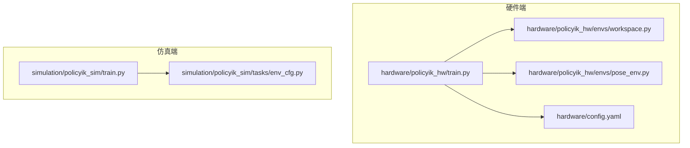
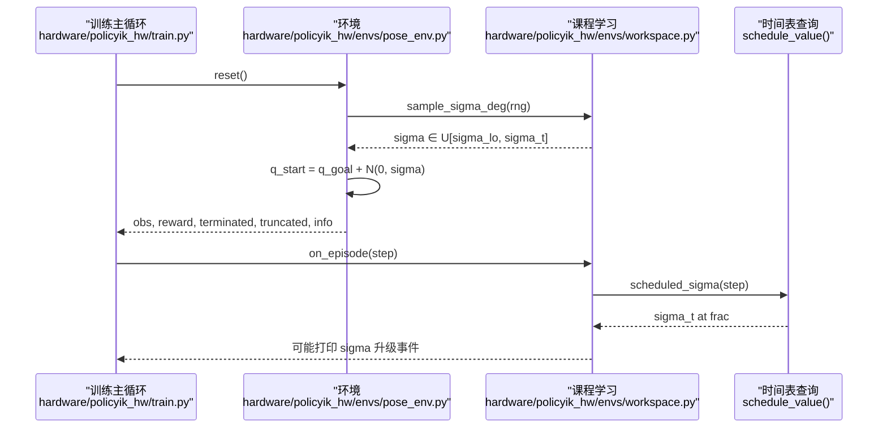
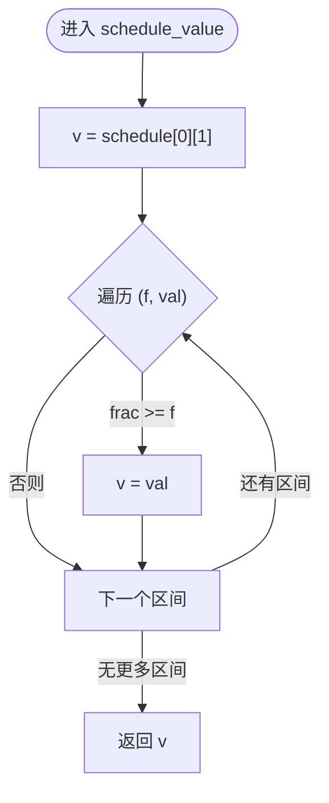
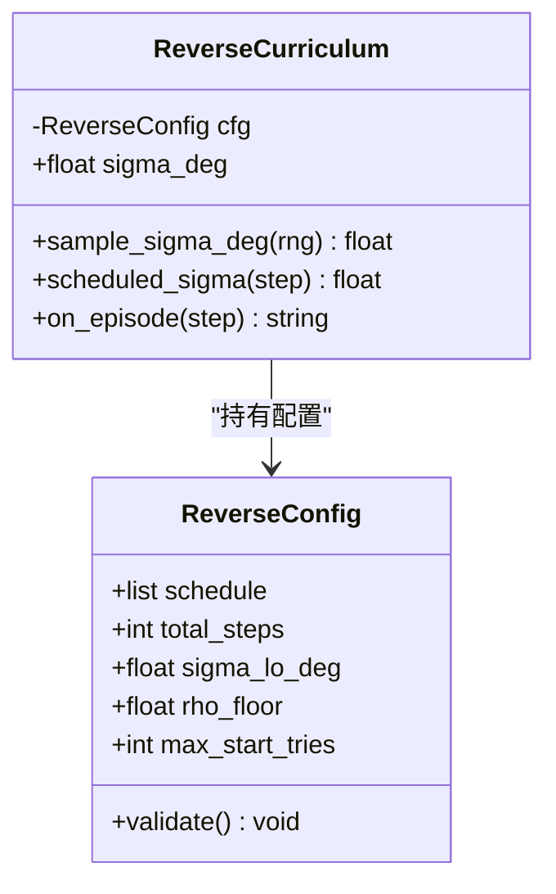
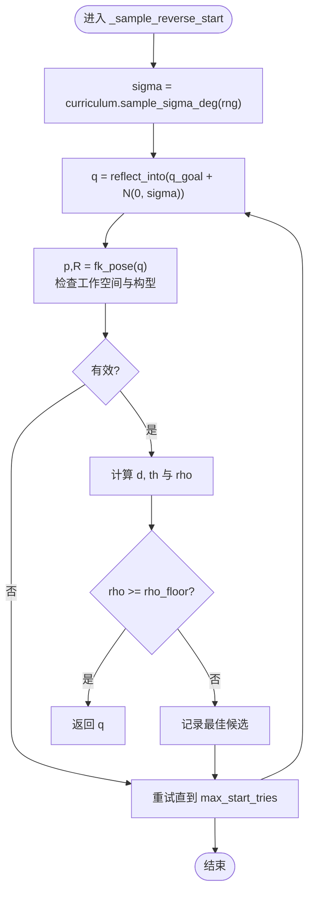
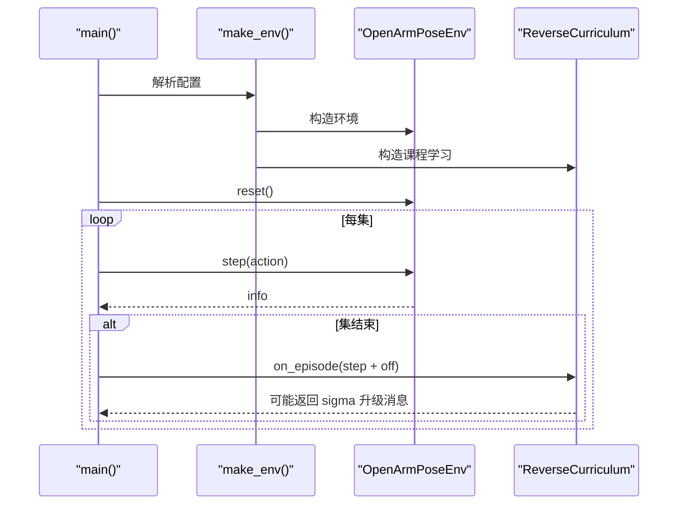
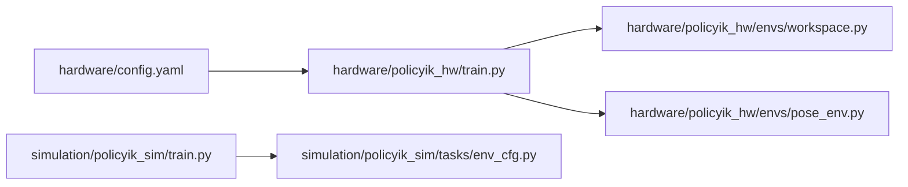

# 课程学习调度

<cite>
**本文引用的文件**   
- [workspace.py](file://hardware/policyik_hw/envs/workspace.py)
- [train.py](file://hardware/policyik_hw/train.py)
- [config.yaml](file://hardware/config.yaml)
- [pose_env.py](file://hardware/policyik_hw/envs/pose_env.py)
- [env_cfg.py](file://simulation/policyik_sim/tasks/env_cfg.py)
- [train.py](file://simulation/policyik_sim/train.py)
</cite>

## 目录
1. [引言](#引言)
2. [项目结构](#项目结构)
3. [核心组件](#核心组件)
4. [架构总览](#架构总览)
5. [详细组件分析](#详细组件分析)
6. [依赖关系分析](#依赖关系分析)
7. [性能与稳定性考虑](#性能与稳定性考虑)
8. [故障排查指南](#故障排查指南)
9. [结论](#结论)
10. [附录：配置示例与调参建议](#附录配置示例与调参建议)

## 引言
本文面向 PolicyIK 的课程学习调度机制，重点解释其在逆运动学控制中的价值，并深入剖析 schedule_value() 函数、ReverseCurriculum 的 sigma_deg 动态调整机制，以及训练过程中的噪声注入、探索策略与收敛控制。文档同时给出不同任务难度的配置建议、收敛条件调优方法与训练稳定性保障实践，并提供具体配置示例与效果对比思路，帮助读者在真实机械臂与仿真环境中稳定复现高精度位姿跟踪能力。

## 项目结构
PolicyIK 包含硬件端与仿真端两套训练流程：
- 硬件端使用 FlashSAC + HER，结合演示数据与任务池，通过 ReverseCurriculum 对“反向起始位形”的噪声规模进行课程式提升。
- 仿真端基于 Isaac Lab 与 RL-Games，提供 PoseIK 任务定义与环境配置，便于快速验证算法与超参数。

**图表来源**
- [train.py:232-248](file://hardware/policyik_hw/train.py#L232-L248)
- [workspace.py:198-251](file://hardware/policyik_hw/envs/workspace.py#L198-L251)
- [pose_env.py:364-384](file://hardware/policyik_hw/envs/pose_env.py#L364-L384)
- [config.yaml:100-105](file://hardware/config.yaml#L100-L105)
- [train.py:103-245](file://simulation/policyik_sim/train.py#L103-L245)
- [env_cfg.py:27-132](file://simulation/policyik_sim/tasks/env_cfg.py#L27-L132)

**章节来源**
- [train.py:232-248](file://hardware/policyik_hw/train.py#L232-L248)
- [workspace.py:198-251](file://hardware/policyik_hw/envs/workspace.py#L198-L251)
- [config.yaml:100-105](file://hardware/config.yaml#L100-L105)
- [train.py:103-245](file://simulation/policyik_sim/train.py#L103-L245)
- [env_cfg.py:27-132](file://simulation/policyik_sim/tasks/env_cfg.py#L27-L132)

## 核心组件
- schedule_value(): 分段常数时间表的查询函数，根据运行进度比例返回当前难度值。
- ReverseConfig / ReverseCurriculum: 课程学习配置与运行时调度器，维护 sigma_deg 的上界并按步更新。
- pose_env._sample_reverse_start(): 以目标位形的关节角为基准，叠加高斯噪声生成起始位形，并通过 rho 阈值过滤不可用样本。
- train.make_env(): 组装环境、奖励与课程学习配置，并在恢复训练时从检查点继续课程进度。

这些组件共同构成“由易到难”的起始位形分布：早期 sigma 较小，靠近目标；随训练推进 sigma 上限逐步增大，迫使策略学会从更远距离和更大姿态偏差中收敛到目标。

**章节来源**
- [workspace.py:198-251](file://hardware/policyik_hw/envs/workspace.py#L198-L251)
- [pose_env.py:364-384](file://hardware/policyik_hw/envs/pose_env.py#L364-L384)
- [train.py:232-248](file://hardware/policyik_hw/train.py#L232-L248)

## 架构总览
课程学习在硬件端的调用链如下：
- 训练主循环读取配置，构建环境与课程学习对象。
- 每集结束后，调用 on_episode(step) 计算新的 sigma_t，若提升则更新 sigma_deg。
- 采样起始位形时，按当前 sigma_deg 与 sigma_lo_deg 均匀采样 sigma，再向目标位形加噪声。

**图表来源**
- [train.py:351-410](file://hardware/policyik_hw/train.py#L351-L410)
- [workspace.py:231-251](file://hardware/policyik_hw/envs/workspace.py#L231-L251)
- [workspace.py:198-204](file://hardware/policyik_hw/envs/workspace.py#L198-L204)
- [pose_env.py:364-384](file://hardware/policyik_hw/envs/pose_env.py#L364-L384)

## 详细组件分析

### schedule_value() 的工作原理
schedule_value(schedule, frac) 实现一个“分段常数”的时间表：输入为 [[fraction, value], ...] 形式的列表，输出为给定运行进度 frac ∈ [0,1) 对应的值。其逻辑是顺序扫描所有区间，保留最后一个满足 frac >= fraction 的值。

- 数学模型：v(frac) = max{value_i | fraction_i <= frac}，等价于阶梯函数。
- 复杂度：O(K)，K 为分段数；通常 K 很小（如 2~5），开销可忽略。
- 适用性：适合离散阶段式难度提升，例如“前 50% 训练使用低难度，后 50% 切换到高难度”。

**图表来源**
- [workspace.py:198-204](file://hardware/policyik_hw/envs/workspace.py#L198-L204)

**章节来源**
- [workspace.py:198-204](file://hardware/policyik_hw/envs/workspace.py#L198-L204)

### ReverseCurriculum 与 sigma_deg 的动态调整
ReverseCurriculum 负责：
- 初始化 sigma_deg 为 schedule 的第一个值。
- 每集结束时，根据 step 与 total_steps 计算 frac，调用 scheduled_sigma(step) 得到新的 sigma_t。
- 如果 sigma_t 严格大于当前 sigma_deg，则更新 sigma_deg 并返回升级日志。

关键特性：
- sigma 的实际取值范围：U[sigma_lo_deg, sigma_t]，sigma_lo_deg 是最小噪声下限，保证初始探索不会过小。
- 单调非递减：schedule 中的 sigma 必须为正且非递减，确保难度只增不减。
- 校验规则：分数段必须从 0 开始、严格递增且小于 1；sigma 必须为正且非递减；total_steps 必须为正。

**图表来源**
- [workspace.py:207-251](file://hardware/policyik_hw/envs/workspace.py#L207-L251)

**章节来源**
- [workspace.py:207-251](file://hardware/policyik_hw/envs/workspace.py#L207-L251)

### 噪声注入与探索策略：_sample_reverse_start()
该函数用于生成“反向起始位形”：
- 以目标位形的关节角 q_goal 为中心，叠加零均值高斯噪声，标准差为当前 sigma_deg。
- 将采样结果反射回关节限位内，避免越界。
- 通过工作空间与构型约束检查（workspace 与 config_ok）过滤无效样本。
- 使用 rho 阈值（rho_floor）筛选接近目标的样本；若未命中，则回退到最佳候选或随机采样。

**图表来源**
- [pose_env.py:364-384](file://hardware/policyik_hw/envs/pose_env.py#L364-L384)
- [workspace.py:192-195](file://hardware/policyik_hw/envs/workspace.py#L192-L195)

**章节来源**
- [pose_env.py:364-384](file://hardware/policyik_hw/envs/pose_env.py#L364-L384)
- [workspace.py:192-195](file://hardware/policyik_hw/envs/workspace.py#L192-L195)

### 训练主循环中的课程学习集成
- make_env() 构造 ReverseConfig 并传入 OpenArmPoseEnv。
- 若从检查点恢复训练，会设置 env.curriculum.sigma_deg 为 scheduled_sigma(step_offset)，确保课程进度连续。
- 每集结束后，调用 on_episode(step + off) 获取可能的 sigma 升级事件，并记录 sigma_after 指标。

**图表来源**
- [train.py:232-248](file://hardware/policyik_hw/train.py#L232-L248)
- [train.py:395-410](file://hardware/policyik_hw/train.py#L395-L410)

**章节来源**
- [train.py:232-248](file://hardware/policyik_hw/train.py#L232-L248)
- [train.py:395-410](file://hardware/policyik_hw/train.py#L395-L410)

## 依赖关系分析
- hardware/policyik_hw/train.py 依赖 workspace.schedule_value 与 ReverseConfig/ReverseCurriculum。
- hardware/policyik_hw/envs/pose_env.py 依赖 ReverseCurriculum 的 sample_sigma_deg 与 on_episode。
- hardware/config.yaml 提供 curriculum.schedule、sigma_lo_deg、rho_floor、max_start_tries 等关键参数。
- simulation 侧的 env_cfg.py 定义了观测、奖励与动作层，但不直接参与课程学习调度；它展示了 PolicyIK 在仿真中的任务结构与观察空间设计。

**图表来源**
- [train.py:16-17](file://hardware/policyik_hw/train.py#L16-L17)
- [train.py:232-248](file://hardware/policyik_hw/train.py#L232-L248)
- [config.yaml:100-105](file://hardware/config.yaml#L100-L105)
- [train.py:103-245](file://simulation/policyik_sim/train.py#L103-L245)
- [env_cfg.py:27-132](file://simulation/policyik_sim/tasks/env_cfg.py#L27-L132)

**章节来源**
- [train.py:16-17](file://hardware/policyik_hw/train.py#L16-L17)
- [train.py:232-248](file://hardware/policyik_hw/train.py#L232-L248)
- [config.yaml:100-105](file://hardware/config.yaml#L100-L105)
- [train.py:103-245](file://simulation/policyik_sim/train.py#L103-L245)
- [env_cfg.py:27-132](file://simulation/policyik_sim/tasks/env_cfg.py#L27-L132)

## 性能与稳定性考虑
- 分段常数时间表简单高效，但过于陡峭的跳跃可能导致策略震荡。建议采用多段渐进提升（例如 0→0.3→0.6→0.9），平滑过渡。
- sigma_lo_deg 不宜过小，否则初期探索不足；也不宜过大，否则难以建立基础能力。默认 2.0° 是一个稳健起点。
- rho_floor 控制“可接受起始质量”的门槛；过高会导致可用样本稀少，训练缓慢；过低则起始太容易，课程效果弱。
- max_start_tries 影响采样效率；过大会增加每集重置成本，过小可能导致频繁回退到随机采样。
- 在恢复训练时，务必使用 scheduled_sigma(step_offset) 初始化 sigma_deg，以保证课程连续性。

[本节为通用指导，不直接分析具体文件]

## 故障排查指南
- 课程分数非法：schedule 的分数必须从 0 开始、严格递增且小于 1；否则会触发 ValueError。
- sigma 非法：schedule 中的 sigma 必须为正且非递减；sigma_lo_deg 必须小于等于第一个 sigma。
- total_steps 缺失或为非正：课程需要明确的总步数以计算 frac。
- 恢复训练报错：若 step_offset > 0 但未提供 init_from 与 init_buffer，会拒绝启动。
- 任务池分数非法：task_pool_frac_schedule 同样要求分数从 0 开始、严格递增且小于 1，值必须在 [0,1]。

**章节来源**
- [workspace.py:215-228](file://hardware/policyik_hw/envs/workspace.py#L215-L228)
- [train.py:65-72](file://hardware/policyik_hw/train.py#L65-L72)
- [train.py:48-55](file://hardware/policyik_hw/train.py#L48-L55)

## 结论
PolicyIK 的课程学习通过 ReverseCurriculum 与 schedule_value() 实现了“由易到难”的起始位形分布控制。sigma_deg 的动态提升使策略逐步适应更大的初始误差，从而提升逆运动学控制的鲁棒性与精度。配合合理的 rho_floor、max_start_tries 与分段时间表，可在真实机械臂与仿真环境中获得稳定高效的训练体验。

[本节为总结，不直接分析具体文件]

## 附录：配置示例与调参建议

### 默认配置（硬件端）
- curriculum.sigma_lo_deg: 2.0
- curriculum.schedule: [[0.0, 10.0], [0.5, 20.0]]
- curriculum.rho_floor: 10.0
- curriculum.max_start_tries: 20

含义：
- 训练前半段 sigma_t=10.0°，后半段 sigma_t=20.0°。
- 起始位形 q_start ~ U[q_goal ± sigma]，sigma ∈ U[2.0°, sigma_t]。
- 仅接受 rho ≥ 10.0 的起始位形，否则重试或回退。

**章节来源**
- [config.yaml:100-105](file://hardware/config.yaml#L100-L105)

### 不同任务难度的设置建议
- 简单任务（宽泛工作空间、宽松姿态）：
  - sigma_lo_deg: 2.0–3.0
  - schedule: [[0.0, 10.0], [0.5, 15.0]]
  - rho_floor: 8–12
  - max_start_tries: 15–20
- 中等任务（受限工作空间、较严姿态）：
  - sigma_lo_deg: 2.0–2.5
  - schedule: [[0.0, 10.0], [0.3, 15.0], [0.7, 20.0]]
  - rho_floor: 10–15
  - max_start_tries: 20–30
- 困难任务（狭窄工作空间、严格姿态）：
  - sigma_lo_deg: 1.5–2.0
  - schedule: [[0.0, 8.0], [0.4, 14.0], [0.8, 20.0]]
  - rho_floor: 12–18
  - max_start_tries: 20–40

### 收敛条件的调优方法
- 监控 sigma_after 曲线：应平稳上升，不应出现长时间停滞或剧烈抖动。
- 监控 settled_success 与 strict_settled：两者应随训练逐步提升；若 sigma 提升后指标下降，说明难度跳跃过快。
- 监控 term_means：关注位置与姿态误差项是否随 sigma 提升而保持可控。
- 若训练不稳定：
  - 降低 sigma 提升速度（增加分段、减小每段增量）。
  - 提高 rho_floor 以过滤更差的起始位形。
  - 适当增大 max_start_tries 以提升有效样本率。

### 训练稳定性保障措施
- 始终使用 scheduled_sigma(step_offset) 初始化 sigma_deg，确保恢复训练时课程连续。
- 合理设置 random_warmup，避免策略尚未具备基本能力就进入高难度。
- 使用演示数据与 HER 混合采样，增强早期信号与稀疏目标覆盖。
- 在仿真端验证超参数后再迁移到真实机械臂，减少风险。

### 效果对比分析思路
- 对比不同 schedule 的 sigma_after 曲线与最终成功率：
  - 两段 vs 三段 vs 四段：观察收敛速度与稳定性。
- 对比不同 sigma_lo_deg：
  - 较低 sigma_lo 可能提升后期性能，但前期收敛慢。
- 对比不同 rho_floor：
  - 较高 rho_floor 提升样本质量，但可能降低训练速度。
- 对比不同 max_start_tries：
  - 较大值提升有效样本率，但增加每集重置成本。

[本节为实践指导，不直接分析具体文件]