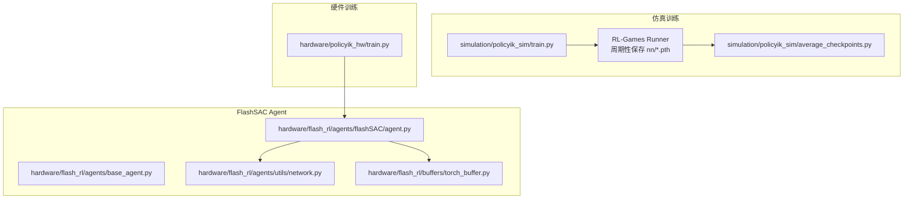
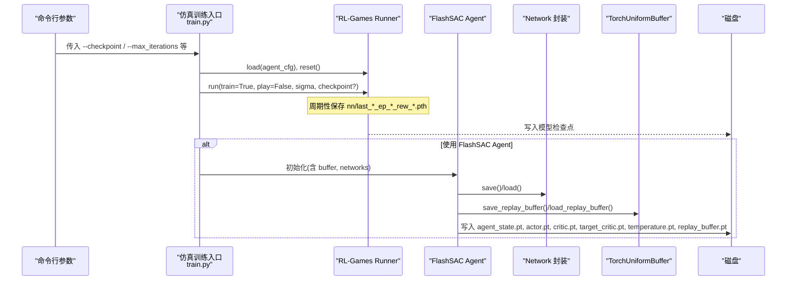
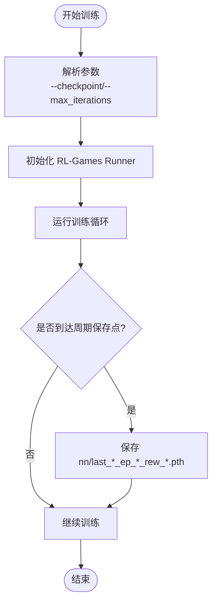
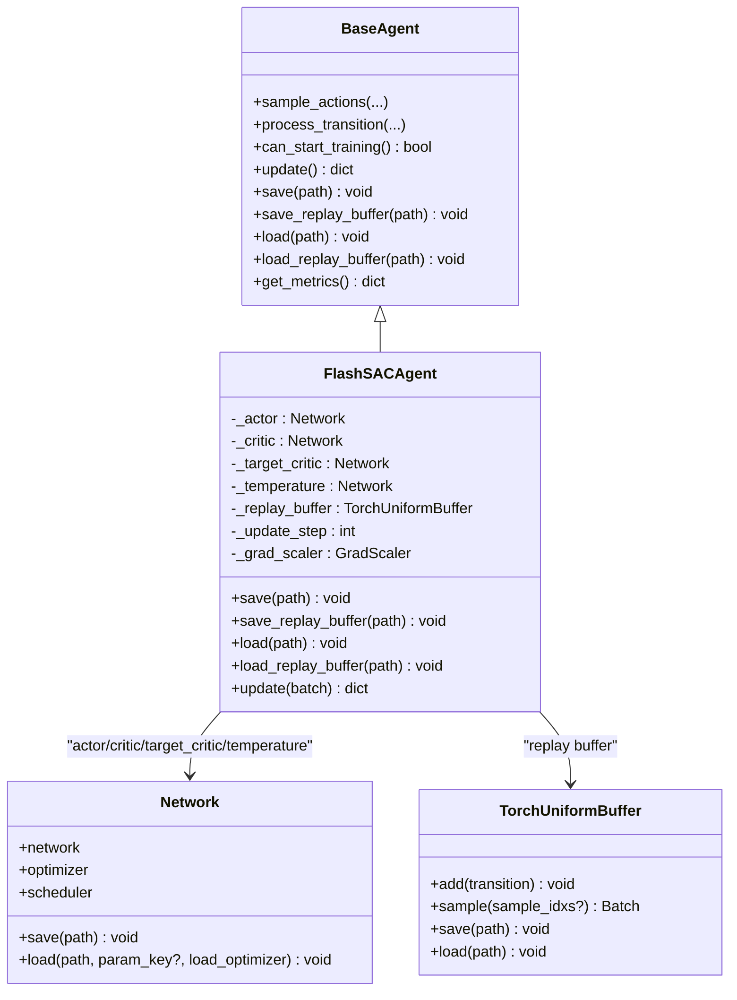
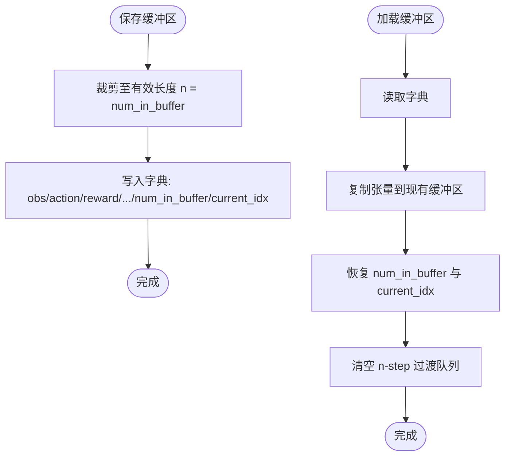
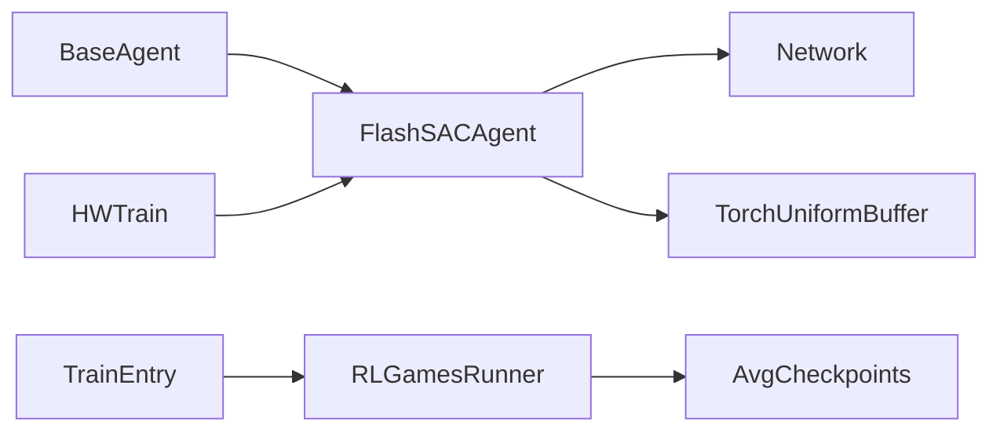

# 检查点管理

<cite>
**本文引用的文件**   
- [simulation/policyik_sim/train.py](file://simulation/policyik_sim/train.py)
- [hardware/flash_rl/agents/base_agent.py](file://hardware/flash_rl/agents/base_agent.py)
- [hardware/flash_rl/agents/flashSAC/agent.py](file://hardware/flash_rl/agents/flashSAC/agent.py)
- [hardware/flash_rl/buffers/base_buffer.py](file://hardware/flash_rl/buffers/base_buffer.py)
- [hardware/flash_rl/buffers/torch_buffer.py](file://hardware/flash_rl/buffers/torch_buffer.py)
- [hardware/flash_rl/agents/utils/network.py](file://hardware/flash_rl/agents/utils/network.py)
- [simulation/policyik_sim/average_checkpoints.py](file://simulation/policyik_sim/average_checkpoints.py)
- [hardware/policyik_hw/train.py](file://hardware/policyik_hw/train.py)
</cite>

## 目录
1. [简介](#简介)
2. [项目结构](#项目结构)
3. [核心组件](#核心组件)
4. [架构总览](#架构总览)
5. [详细组件分析](#详细组件分析)
6. [依赖关系分析](#依赖关系分析)
7. [性能与存储特性](#性能与存储特性)
8. [版本管理与迁移策略](#版本管理与迁移策略)
9. [最佳实践：压缩、备份与恢复](#最佳实践压缩备份与恢复)
10. [故障排除指南](#故障排除指南)
11. [结论](#结论)

## 简介
本文件面向 PolicyIK 的检查点管理系统，系统性说明训练过程中检查点的自动保存机制、文件格式与存储结构；详述如何恢复训练状态（模型权重、经验回放缓冲区、训练进度）；提供跨版本兼容与迁移策略；并给出压缩、备份与恢复的最佳实践和常见问题排查。

本项目包含两条主要训练路径：
- 仿真端使用 RL-Games Runner 进行训练，周期性保存模型检查点。
- 硬件端基于 FlashSAC Agent 实现自定义的模型与缓冲区的持久化接口，支持完整的训练状态恢复。

## 项目结构
与检查点相关的代码分布在以下模块：
- 仿真训练入口：负责解析参数、加载配置、启动 RL-Games Runner，并在需要时传入 checkpoint 以恢复训练。
- FlashSAC Agent：定义模型的保存/加载、经验回放缓冲区的保存/加载、以及训练步数等元数据。
- 网络封装：统一保存/加载网络参数、优化器与调度器状态。
- 经验回放缓冲区：PyTorch 张量实现的均匀采样缓冲区，具备 save/load 能力。
- 检查点平均工具：对 RL-Games 周期性检查点进行加权平均，生成部署策略。
- 硬件训练脚本：在加载预训练检查点前进行环境接口兼容性校验。

图表来源
- [simulation/policyik_sim/train.py:103-245](file://simulation/policyik_sim/train.py#L103-L245)
- [simulation/policyik_sim/average_checkpoints.py:16-55](file://simulation/policyik_sim/average_checkpoints.py#L16-L55)
- [hardware/flash_rl/agents/flashSAC/agent.py:518-561](file://hardware/flash_rl/agents/flashSAC/agent.py#L518-L561)
- [hardware/flash_rl/agents/utils/network.py:123-177](file://hardware/flash_rl/agents/utils/network.py#L123-L177)
- [hardware/flash_rl/buffers/torch_buffer.py:185-232](file://hardware/flash_rl/buffers/torch_buffer.py#L185-L232)
- [hardware/policyik_hw/train.py:181-189](file://hardware/policyik_hw/train.py#L181-L189)

章节来源
- [simulation/policyik_sim/train.py:103-245](file://simulation/policyik_sim/train.py#L103-L245)
- [hardware/flash_rl/agents/flashSAC/agent.py:518-561](file://hardware/flash_rl/agents/flashSAC/agent.py#L518-L561)
- [hardware/flash_rl/buffers/torch_buffer.py:185-232](file://hardware/flash_rl/buffers/torch_buffer.py#L185-L232)
- [hardware/flash_rl/agents/utils/network.py:123-177](file://hardware/flash_rl/agents/utils/network.py#L123-L177)
- [simulation/policyik_sim/average_checkpoints.py:16-55](file://simulation/policyik_sim/average_checkpoints.py#L16-L55)
- [hardware/policyik_hw/train.py:181-189](file://hardware/policyik_hw/train.py#L181-L189)

## 核心组件
- BaseAgent 抽象接口：定义了 agent 的 save/save_replay_buffer/load/load_replay_buffer 等关键方法，确保所有 agent 具有一致的检查点能力。
- FlashSACAgent：具体实现了 actor/critic/target_critic/temperature 网络的保存与加载，以及经验回放缓冲区的持久化，同时维护 update_step 与 GradScaler 状态。
- Network 封装：统一保存/加载网络参数、优化器与调度器状态，并提供可选的参数子集加载与设备映射。
- TorchUniformBuffer：PyTorch 张量实现的均匀采样缓冲区，save/load 包含观测、动作、奖励、终止标志、截断标志、next_observation 及环形缓冲索引等元数据。
- RL-Games Runner：由仿真训练入口调用，周期性保存模型检查点到 logs/<config>/<run>/nn/last_*.pth。
- average_checkpoints.py：对 RL-Games 周期性检查点进行指数加权平均，输出部署用的聚合策略。
- 硬件训练脚本：在加载预训练检查点前校验环境与奖励接口的兼容性。

章节来源
- [hardware/flash_rl/agents/base_agent.py:11-83](file://hardware/flash_rl/agents/base_agent.py#L11-L83)
- [hardware/flash_rl/agents/flashSAC/agent.py:335-565](file://hardware/flash_rl/agents/flashSAC/agent.py#L335-L565)
- [hardware/flash_rl/agents/utils/network.py:123-177](file://hardware/flash_rl/agents/utils/network.py#L123-L177)
- [hardware/flash_rl/buffers/torch_buffer.py:31-236](file://hardware/flash_rl/buffers/torch_buffer.py#L31-L236)
- [simulation/policyik_sim/train.py:103-245](file://simulation/policyik_sim/train.py#L103-L245)
- [simulation/policyik_sim/average_checkpoints.py:16-55](file://simulation/policyik_sim/average_checkpoints.py#L16-L55)
- [hardware/policyik_hw/train.py:181-189](file://hardware/policyik_hw/train.py#L181-L189)

## 架构总览
下图展示从训练入口到检查点保存与恢复的整体流程，包括 RL-Games 周期检查点与 FlashSAC 自定义检查点两种路径。

图表来源
- [simulation/policyik_sim/train.py:103-245](file://simulation/policyik_sim/train.py#L103-L245)
- [hardware/flash_rl/agents/flashSAC/agent.py:518-561](file://hardware/flash_rl/agents/flashSAC/agent.py#L518-L561)
- [hardware/flash_rl/agents/utils/network.py:123-177](file://hardware/flash_rl/agents/utils/network.py#L123-L177)
- [hardware/flash_rl/buffers/torch_buffer.py:185-232](file://hardware/flash_rl/buffers/torch_buffer.py#L185-L232)

## 详细组件分析

### 仿真训练入口与 RL-Games 检查点
- 训练入口解析命令行参数，包括 --checkpoint、--sigma、--max_iterations 等，并将 checkpoint 路径注入 agent_cfg 以便 Runner 恢复训练。
- RL-Games Runner 在训练过程中周期性保存模型检查点，文件命名遵循 last_<name>_ep_<epoch>_rew_<reward>.pth，保存在 logs/<config>/<run>/nn/ 目录下。
- average_checkpoints.py 通过正则匹配特定 epoch 的检查点，按指数衰减权重进行参数平均，输出聚合后的部署策略。

图表来源
- [simulation/policyik_sim/train.py:103-245](file://simulation/policyik_sim/train.py#L103-L245)
- [simulation/policyik_sim/average_checkpoints.py:16-55](file://simulation/policyik_sim/average_checkpoints.py#L16-L55)

章节来源
- [simulation/policyik_sim/train.py:103-245](file://simulation/policyik_sim/train.py#L103-L245)
- [simulation/policyik_sim/average_checkpoints.py:16-55](file://simulation/policyik_sim/average_checkpoints.py#L16-L55)

### FlashSAC Agent 检查点与恢复
FlashSACAgent 提供了完整的检查点能力：
- 保存：actor.pt、critic.pt、target_critic.pt、temperature.pt、reward_normalizer.pt（可选）、agent_state.pt（包含 update_step 与 grad_scaler 状态）。
- 加载：根据配置决定是否加载优化器与调度器状态；可选择仅加载部分参数键；若启用 reward normalizer，则一并恢复其统计信息。
- 经验回放缓冲区：save_replay_buffer/load_replay_buffer 将缓冲区内容（observation/action/reward/terminated/truncated/next_observation 与环形缓冲索引）持久化。

图表来源
- [hardware/flash_rl/agents/base_agent.py:11-83](file://hardware/flash_rl/agents/base_agent.py#L11-L83)
- [hardware/flash_rl/agents/flashSAC/agent.py:335-565](file://hardware/flash_rl/agents/flashSAC/agent.py#L335-L565)
- [hardware/flash_rl/agents/utils/network.py:123-177](file://hardware/flash_rl/agents/utils/network.py#L123-L177)
- [hardware/flash_rl/buffers/torch_buffer.py:31-236](file://hardware/flash_rl/buffers/torch_buffer.py#L31-L236)

章节来源
- [hardware/flash_rl/agents/base_agent.py:11-83](file://hardware/flash_rl/agents/base_agent.py#L11-L83)
- [hardware/flash_rl/agents/flashSAC/agent.py:518-561](file://hardware/flash_rl/agents/flashSAC/agent.py#L518-L561)
- [hardware/flash_rl/agents/utils/network.py:123-177](file://hardware/flash_rl/agents/utils/network.py#L123-L177)
- [hardware/flash_rl/buffers/torch_buffer.py:185-232](file://hardware/flash_rl/buffers/torch_buffer.py#L185-L232)

### 经验回放缓冲区持久化
TorchUniformBuffer 的 save/load 包含以下字段：
- observation、action、reward、terminated、truncated、next_observation
- num_in_buffer、current_idx（环形缓冲位置）
- 注意：n-step 过渡队列（_n_step_transitions）不持久化，最多丢失 (n_step - 1) 条过渡，影响可忽略。

图表来源
- [hardware/flash_rl/buffers/torch_buffer.py:185-232](file://hardware/flash_rl/buffers/torch_buffer.py#L185-L232)

章节来源
- [hardware/flash_rl/buffers/torch_buffer.py:185-232](file://hardware/flash_rl/buffers/torch_buffer.py#L185-L232)

### 网络封装与优化器/调度器状态
Network.save 保存：
- network_state_dict
- optimizer_state_dict（可选）
- scheduler_state_dict（可选）
- update_step

Network.load 支持：
- 指定 param_key 仅加载部分参数
- 控制是否加载优化器与调度器状态
- 自动处理编译前缀匹配与设备映射

章节来源
- [hardware/flash_rl/agents/utils/network.py:123-177](file://hardware/flash_rl/agents/utils/network.py#L123-L177)

## 依赖关系分析
- FlashSACAgent 依赖 BaseAgent 定义的接口契约，确保统一的检查点 API。
- FlashSACAgent 内部组合多个 Network 实例（actor/critic/target_critic/temperature），并通过 TorchUniformBuffer 管理经验数据。
- 仿真训练入口通过 RL-Games Runner 间接产生周期性检查点，average_checkpoints.py 依赖这些文件的命名约定。
- 硬件训练脚本在加载预训练检查点前进行环境与奖励接口一致性校验，避免跨环境差异导致的错误。

图表来源
- [hardware/flash_rl/agents/base_agent.py:11-83](file://hardware/flash_rl/agents/base_agent.py#L11-L83)
- [hardware/flash_rl/agents/flashSAC/agent.py:335-565](file://hardware/flash_rl/agents/flashSAC/agent.py#L335-L565)
- [hardware/flash_rl/agents/utils/network.py:123-177](file://hardware/flash_rl/agents/utils/network.py#L123-L177)
- [hardware/flash_rl/buffers/torch_buffer.py:31-236](file://hardware/flash_rl/buffers/torch_buffer.py#L31-L236)
- [simulation/policyik_sim/train.py:103-245](file://simulation/policyik_sim/train.py#L103-L245)
- [simulation/policyik_sim/average_checkpoints.py:16-55](file://simulation/policyik_sim/average_checkpoints.py#L16-L55)
- [hardware/policyik_hw/train.py:181-189](file://hardware/policyik_hw/train.py#L181-L189)

章节来源
- [hardware/flash_rl/agents/base_agent.py:11-83](file://hardware/flash_rl/agents/base_agent.py#L11-L83)
- [hardware/flash_rl/agents/flashSAC/agent.py:335-565](file://hardware/flash_rl/agents/flashSAC/agent.py#L335-L565)
- [hardware/flash_rl/agents/utils/network.py:123-177](file://hardware/flash_rl/agents/utils/network.py#L123-L177)
- [hardware/flash_rl/buffers/torch_buffer.py:31-236](file://hardware/flash_rl/buffers/torch_buffer.py#L31-L236)
- [simulation/policyik_sim/train.py:103-245](file://simulation/policyik_sim/train.py#L103-L245)
- [simulation/policyik_sim/average_checkpoints.py:16-55](file://simulation/policyik_sim/average_checkpoints.py#L16-L55)
- [hardware/policyik_hw/train.py:181-189](file://hardware/policyik_hw/train.py#L181-L189)

## 性能与存储特性
- 检查点大小：FlashSAC 包含多个网络与优化器/调度器状态，体积较大；建议按需选择是否保存优化器状态（load_optimizer 控制）。
- 缓冲区 I/O：TorchUniformBuffer 使用 PyTorch 张量直接持久化，避免额外序列化开销；但需注意设备映射与 dtype 一致性。
- 环形缓冲：current_idx 指示写入位置，加载时需保证目标缓冲区的 max_length 与源一致，否则可能触发异常或需要旋转对齐（当前未实现自动旋转）。
- RL-Games 周期性检查点：按 epoch 保存，便于后期聚合与回退；average_checkpoints.py 使用指数衰减权重，更重视近期检查点。

[本节为通用指导，不直接分析具体文件]

## 版本管理与迁移策略
- 参数键匹配：Network.load 使用 _match_compile_prefix 对 state_dict 键进行匹配，提升在不同编译模式下的兼容性。
- 部分参数加载：支持 param_key 过滤，便于迁移时仅加载相关层参数（例如冻结某些层或微调特定分支）。
- 优化器/调度器状态：可通过 load_optimizer 控制是否恢复优化器与调度器状态，避免不同框架或版本间的状态不兼容。
- 环境接口校验：硬件训练脚本在加载预训练检查点前比较观测维度与环境/奖励接口差异，防止跨环境迁移导致的不一致。
- RL-Games 检查点聚合：average_checkpoints.py 要求每个 epoch 仅存在一个匹配文件，若缺失或多出会报错，便于发现版本漂移。

章节来源
- [hardware/flash_rl/agents/utils/network.py:123-177](file://hardware/flash_rl/agents/utils/network.py#L123-L177)
- [hardware/policyik_hw/train.py:181-189](file://hardware/policyik_hw/train.py#L181-L189)
- [simulation/policyik_sim/average_checkpoints.py:16-55](file://simulation/policyik_sim/average_checkpoints.py#L16-L55)

## 最佳实践：压缩、备份与恢复
- 压缩
  - 对 FlashSAC 检查点目录（actor.pt、critic.pt、target_critic.pt、temperature.pt、reward_normalizer.pt、agent_state.pt、replay_buffer.pt）进行归档压缩，减少传输与存储成本。
  - 对 RL-Games 周期性检查点（nn/last_*_ep_*_rew_*.pth）可按 epoch 分段归档，便于选择性恢复。
- 备份
  - 建议保留最近若干周期的检查点与对应的配置文件（env.yaml、agent.yaml），确保可复现性。
  - 对经验回放缓冲区单独备份，避免训练中断后丢失大量交互数据。
- 恢复
  - FlashSAC：先加载模型权重（必要时选择是否加载优化器/调度器），再加载 agent_state.pt 恢复 update_step 与 GradScaler，最后加载 replay_buffer.pt 恢复缓冲区。
  - RL-Games：通过 --checkpoint 传入 last_*_ep_*_rew_*.pth 路径，Runner 会自动恢复训练。
- 迁移
  - 优先使用 Network.load 的部分参数加载功能，仅迁移必要层；对优化器/调度器状态谨慎恢复，避免版本不兼容。
  - 在硬件环境中，务必先执行接口一致性校验，再进行权重加载。

[本节为通用指导，不直接分析具体文件]

## 故障排除指南
- 找不到周期性检查点
  - 现象：average_checkpoints.py 报 FileNotFoundError，提示某 epoch 期望一个检查点但找到多个或零个。
  - 排查：确认 logs/<config>/<run>/nn/ 下是否存在 last_*_ep_<epoch>_rew_*.pth，且命名符合预期。
- 缓冲区加载异常
  - 现象：加载 replay_buffer.pt 时报错，提示环形缓冲 current_idx 与 num_in_buffer 不一致。
  - 排查：确保目标缓冲区的 max_length 与源一致；若不一致，需手动对齐或重新收集数据。
- 优化器/调度器状态缺失
  - 现象：加载时警告“load_optimizer=True 但优化器或调度器为空”。
  - 排查：确认检查点是否包含对应状态；如仅需权重迁移，设置 load_optimizer=False。
- 环境接口不兼容
  - 现象：硬件训练脚本在加载预训练检查点时报错，指出观测维度或环境/奖励接口差异。
  - 排查：核对 config.json 中的 env/reward 定义与当前环境一致；必要时重新训练或调整接口。

章节来源
- [simulation/policyik_sim/average_checkpoints.py:16-55](file://simulation/policyik_sim/average_checkpoints.py#L16-L55)
- [hardware/flash_rl/buffers/torch_buffer.py:205-232](file://hardware/flash_rl/buffers/torch_buffer.py#L205-L232)
- [hardware/flash_rl/agents/utils/network.py:123-177](file://hardware/flash_rl/agents/utils/network.py#L123-L177)
- [hardware/policyik_hw/train.py:181-189](file://hardware/policyik_hw/train.py#L181-L189)

## 结论
PolicyIK 的检查点管理覆盖了两条训练路径：RL-Games 周期性模型检查点与 FlashSAC 自定义完整训练状态检查点。前者适合快速回退与聚合部署策略，后者适合精确恢复训练进度与经验数据。通过统一的 BaseAgent 接口、Network 封装与 TorchUniformBuffer 持久化，系统具备良好的可扩展性与兼容性。结合压缩、备份与恢复的最佳实践，以及版本迁移与故障排除指南，可在实际工程中稳定地管理检查点生命周期。