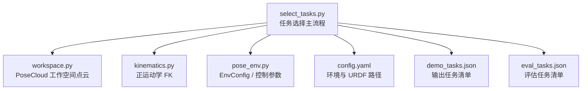
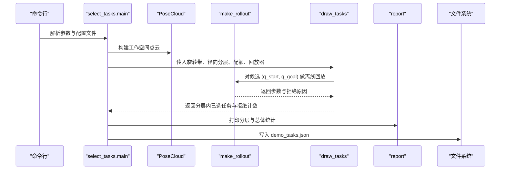
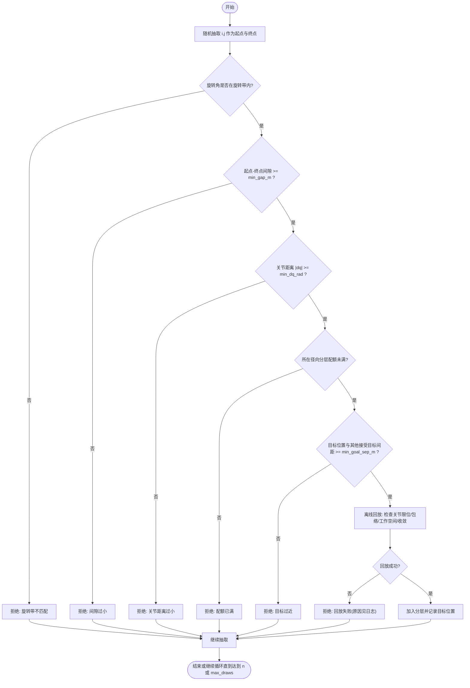
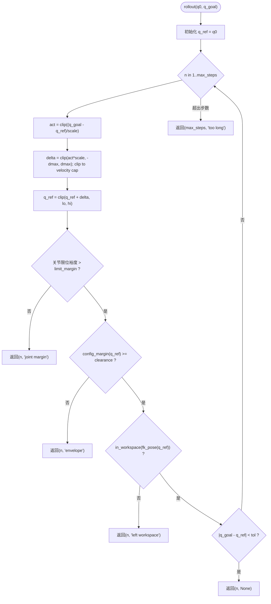
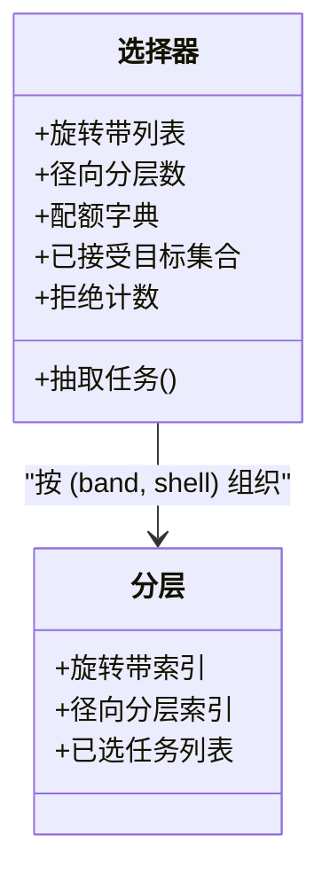
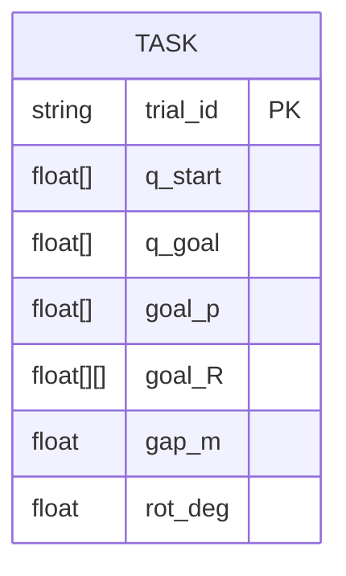
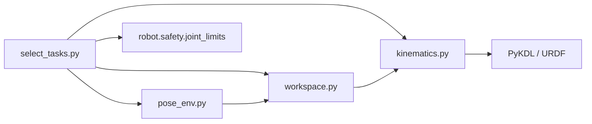

# 任务选择策略

<cite>
**本文引用的文件**   
- [select_tasks.py](file://hardware/policyik_hw/select_tasks.py)
- [kinematics.py](file://hardware/policyik_hw/utils/kinematics.py)
- [pose_env.py](file://hardware/policyik_hw/envs/pose_env.py)
- [workspace.py](file://hardware/policyik_hw/envs/workspace.py)
- [config.yaml](file://hardware/config.yaml)
- [demo_tasks.json](file://hardware/data/demo_tasks.json)
- [eval_tasks.json](file://hardware/data/eval_tasks.json)
</cite>

## 目录
1. [引言](#引言)
2. [项目结构](#项目结构)
3. [核心组件](#核心组件)
4. [架构总览](#架构总览)
5. [详细组件分析](#详细组件分析)
6. [依赖关系分析](#依赖关系分析)
7. [性能与复杂度](#性能与复杂度)
8. [任务配置说明](#任务配置说明)
9. [使用示例](#使用示例)
10. [任务质量评估指标](#任务质量评估指标)
11. [故障排查](#故障排查)
12. [结论](#结论)

## 引言
本文件为 PolicyIK 硬件侧“演示任务选择”模块提供完整技术文档，聚焦于 `hardware/policyik_hw/select_tasks.py`。该脚本从预构建的可达工作空间点云（PoseCloud）中，按旋转角度区间、目标径向分层等维度进行分层抽样，并通过离线轨迹回放与安全约束筛选，生成适合当前训练阶段的演示任务集合。其目标是：
- 保证任务在旋转难度上的覆盖度；
- 保证目标位姿在工作空间中的分布多样性；
- 保证关节运动学可行性、避障裕度与可追踪性；
- 输出结构化 JSON 供后续采集与训练流程使用。

## 项目结构
与任务选择相关的代码与数据分布如下：
- 选择逻辑入口：`hardware/policyik_hw/select_tasks.py`
- 机器人正运动学与 URDF 解析：`hardware/policyik_hw/utils/kinematics.py`
- 环境配置与工作空间点云：`hardware/policyik_hw/envs/pose_env.py`、`hardware/policyik_hw/envs/workspace.py`
- 硬件实验配置：`hardware/config.yaml`
- 生成的演示任务集：`hardware/data/demo_tasks.json`
- 评估任务集：`hardware/data/eval_tasks.json`

**图表来源**
- [select_tasks.py:152-199](file://hardware/policyik_hw/select_tasks.py#L152-L199)
- [workspace.py:52-99](file://hardware/policyik_hw/envs/workspace.py#L52-L99)
- [kinematics.py:81-112](file://hardware/policyik_hw/utils/kinematics.py#L81-L112)
- [pose_env.py:46-158](file://hardware/policyik_hw/envs/pose_env.py#L46-L158)
- [config.yaml:1-72](file://hardware/config.yaml#L1-L72)

**章节来源**
- [select_tasks.py:1-41](file://hardware/policyik_hw/select_tasks.py#L1-L41)
- [config.yaml:1-72](file://hardware/config.yaml#L1-L72)

## 核心组件
- 命令行参数与默认值：定义采样数量、旋转带、径向分层、安全阈值、最大尝试次数等。
- 离线回放器 `make_rollout`：以单位增益对动作律进行离线仿真，模拟从起始位姿到目标位姿的逐步逼近过程，并检查关节限位、碰撞包络、工作空间成员资格与收敛性。
- 任务抽取器 `draw_tasks`：基于随机配对起点与终点，计算旋转角、间隙、关节距离，并按“旋转带 × 径向分层”配额进行分层抽样，同时维护已接受目标的去重与分散性。
- 报告函数 `report`：统计各分层内的中位数旋转、间隙、步数，以及整体任务的百分位数与体素覆盖率。
- 主流程 `main`：加载配置、构建 PoseCloud、划分分层与配额、调用抽取器、汇总并写入 JSON。

**章节来源**
- [select_tasks.py:19-41](file://hardware/policyik_hw/select_tasks.py#L19-L41)
- [select_tasks.py:44-67](file://hardware/policyik_hw/select_tasks.py#L44-L67)
- [select_tasks.py:70-114](file://hardware/policyik_hw/select_tasks.py#L70-L114)
- [select_tasks.py:117-150](file://hardware/policyik_hw/select_tasks.py#L117-L150)
- [select_tasks.py:152-199](file://hardware/policyik_hw/select_tasks.py#L152-L199)

## 架构总览
任务选择的整体流程如下：

**图表来源**
- [select_tasks.py:152-199](file://hardware/policyik_hw/select_tasks.py#L152-L199)
- [select_tasks.py:44-67](file://hardware/policyik_hw/select_tasks.py#L44-L67)
- [select_tasks.py:70-114](file://hardware/policyik_hw/select_tasks.py#L70-L114)
- [select_tasks.py:117-150](file://hardware/policyik_hw/select_tasks.py#L117-L150)

## 详细组件分析

### 任务生成与筛选算法
任务生成采用“随机配对 + 分层配额 + 离线回放验证”的策略：
1. 从 PoseCloud 中随机抽取两个不同索引的构型作为起点和终点。
2. 计算两末端姿态之间的旋转角，落入指定旋转带才进入后续筛选。
3. 计算起点与终点的笛卡尔间隙，低于阈值则拒绝。
4. 计算关节空间 L2 距离，低于阈值则拒绝。
5. 根据终点距工作空间中心的距离，映射到径向分层，若该分层配额已满则拒绝。
6. 若已有接受的目标位置，检查新目标是否过于接近，低于阈值则拒绝。
7. 调用离线回放器验证轨迹可行性与安全性，失败则记录拒绝原因。
8. 通过全部检查后，将任务加入对应分层，并记录目标位置用于后续分散性检查。

**图表来源**
- [select_tasks.py:70-114](file://hardware/policyik_hw/select_tasks.py#L70-L114)

**章节来源**
- [select_tasks.py:70-114](file://hardware/policyik_hw/select_tasks.py#L70-L114)

### 离线回放器与安全性检查
`make_rollout` 构造一个离线回放函数，模拟从 `q_start` 向 `q_goal` 的逐步逼近：
- 每步计算参考增量，并进行幅度与速度限幅。
- 更新参考位姿并裁剪至关节限位。
- 检查每个中间位姿的关节限位裕度、碰撞包络裕度、末端是否在工作空间内。
- 当误差足够小则视为成功，否则超过最大步数则判定为“过长”。

**图表来源**
- [select_tasks.py:44-67](file://hardware/policyik_hw/select_tasks.py#L44-L67)

**章节来源**
- [select_tasks.py:44-67](file://hardware/policyik_hw/select_tasks.py#L44-L67)

### 分层与配额机制
- 旋转带：由用户指定的旋转边界切分为多个区间，例如“60-90°”、“90-120°”等。
- 径向分层：以工作空间中心为原点，将终点距中心的距离均匀划分为若干层。
- 配额分配：将期望总数 `n` 平均分配到所有“旋转带 × 径向分层”组合，余数向前分配给前几个分层，确保总数精确。

**图表来源**
- [select_tasks.py:165-171](file://hardware/policyik_hw/select_tasks.py#L165-L171)
- [select_tasks.py:70-114](file://hardware/policyik_hw/select_tasks.py#L70-L114)

**章节来源**
- [select_tasks.py:165-171](file://hardware/policyik_hw/select_tasks.py#L165-L171)
- [select_tasks.py:70-114](file://hardware/policyik_hw/select_tasks.py#L70-L114)

### 多样性与覆盖度保证
- 旋转覆盖：通过多段旋转带强制覆盖不同难度区间。
- 空间覆盖：通过径向分层与最小目标间距限制，避免目标聚集。
- 体素覆盖率：在报告中统计被任务目标占据的 5cm 体素数量相对于整个工作空间可用体素的比例，衡量空间覆盖度。

**章节来源**
- [select_tasks.py:117-150](file://hardware/policyik_hw/select_tasks.py#L117-L150)

### 任务数据结构与输出格式
输出的演示任务 JSON 包含以下字段：
- `trial_id`：任务标识符，形如 `<prefix>-<index>-rot<deg>`。
- `q_start`：起始关节角数组。
- `q_goal`：目标关节角数组。
- `goal_p`：目标末端位置。
- `goal_R`：目标末端方向（3×3 矩阵）。
- `gap_m`：起点与终点的笛卡尔间隙。
- `rot_deg`：起点与终点之间的旋转角度。
- 内部还记录 `dq_rad` 与 `approach_steps`，但输出时仅保留上述关键键。

**图表来源**
- [select_tasks.py:14](file://hardware/policyik_hw/select_tasks.py#L14)
- [select_tasks.py:195-199](file://hardware/policyik_hw/select_tasks.py#L195-L199)

**章节来源**
- [select_tasks.py:14](file://hardware/policyik_hw/select_tasks.py#L14)
- [select_tasks.py:195-199](file://hardware/policyik_hw/select_tasks.py#L195-L199)

## 依赖关系分析
- `select_tasks.py` 依赖：
  - `utils.kinematics.ArmKinematics`：用于末端位姿正解与连杆点获取。
  - `envs.pose_env.EnvConfig`：控制参数、动作缩放、速度限幅等。
  - `envs.workspace.PoseCloud`：工作空间点云、构型合法性检查、末端工作空间成员判断。
  - `robot.safety.joint_limits`：关节限位转换。
- 外部依赖：
  - PyKDL 与 urdf_parser_py：URDF 解析与 KDL 链式正运动学。
  - numpy、yaml、argparse、json：数值计算、配置读取、命令行解析与序列化。

**图表来源**
- [select_tasks.py:12-163](file://hardware/policyik_hw/select_tasks.py#L12-L163)
- [kinematics.py:81-112](file://hardware/policyik_hw/utils/kinematics.py#L81-L112)
- [workspace.py:52-99](file://hardware/policyik_hw/envs/workspace.py#L52-L99)
- [pose_env.py:46-158](file://hardware/policyik_hw/envs/pose_env.py#L46-L158)

**章节来源**
- [select_tasks.py:12-163](file://hardware/policyik_hw/select_tasks.py#L12-L163)
- [kinematics.py:81-112](file://hardware/policyik_hw/utils/kinematics.py#L81-L112)
- [workspace.py:52-99](file://hardware/policyik_hw/envs/workspace.py#L52-L99)
- [pose_env.py:46-158](file://hardware/policyik_hw/envs/pose_env.py#L46-L158)

## 性能与复杂度
- 时间复杂度：
  - 每次抽取涉及常数时间的几何与向量运算。
  - 离线回放最多执行 `max_steps` 次迭代，每次迭代包含少量向量操作与一次正运动学调用。
  - 总体复杂度约为 O(D × S)，其中 D 为最大抽取次数，S 为回放步数上限。
- 空间复杂度：
  - 主要存储 PoseCloud 的构型、位置与方向数组，规模由 `cloud_samples` 决定。
  - 已接受目标集合与分层任务列表随任务数量线性增长。
- 优化建议：
  - 调整 `min_goal_sep_m` 与旋转带宽度以平衡覆盖率与抽取效率。
  - 合理设置 `max_steps` 与 `max_draws`，避免过多无效尝试。
  - 使用更精细的旋转带与分层粒度提升多样性，但会增加配额管理开销。

[本节为通用性能讨论，不直接分析具体文件]

## 任务配置说明
### 命令行参数
- `--config`：环境配置文件路径，默认指向 `config.yaml`。
- `--n`：期望选择的演示任务数量。
- `--out`：输出 JSON 路径，默认写入 `data/demo_tasks.json`。
- `--seed`：随机种子，保证结果可复现。
- `--rot-bands`：旋转带边界，逗号分隔，形成 N-1 个区间。
- `--shells`：径向分层数量。
- `--min-gap-m`：拒绝起点与终点间隙小于该值的任务。
- `--min-goal-sep-m`：拒绝目标位置与已接受目标太近的任务。
- `--limit-margin`：要求每个中间位姿距离任意关节限位至少该角度。
- `--clearance`：要求每个中间位姿的碰撞包络裕度至少该米数。
- `--max-steps`：拒绝需要超过该步数的任务。
- `--max-draws`：最大抽取尝试次数。
- `--min-dq-rad`：拒绝关节空间距离小于该值的任务。
- `--id-prefix`：任务 ID 前缀。
- `--urdf`：自定义 URDF 路径。
- `--dry-run`：仅打印信息，不选择或写入任务。

**章节来源**
- [select_tasks.py:19-41](file://hardware/policyik_hw/select_tasks.py#L19-L41)

### 环境与 URDF 配置
- `config.yaml` 中的 `env` 部分定义了工作空间半径、中心、关节限位、工具偏移、碰撞包络、控制频率、动作缩放、观察噪声、成功容差等。
- `demos.task_pool` 与 `task_pool_frac_schedule` 用于训练阶段的任务池混合比例调度，与选择脚本的输出配合使用。

**章节来源**
- [config.yaml:1-72](file://hardware/config.yaml#L1-L72)
- [config.yaml:140-149](file://hardware/config.yaml#L140-L149)

### 自定义任务添加方法
- 若需扩展任务类型或增加新的筛选条件，可在 `draw_tasks` 中添加新的过滤分支，并在 `REJECT_KEYS` 中登记拒绝类别。
- 若需新增分层维度，可扩展配额字典的结构与报告输出。
- 若需支持更多任务字段，修改 `TASK_KEYS` 与输出序列化逻辑。

**章节来源**
- [select_tasks.py:14-16](file://hardware/policyik_hw/select_tasks.py#L14-L16)
- [select_tasks.py:70-114](file://hardware/policyik_hw/select_tasks.py#L70-L114)
- [select_tasks.py:195-199](file://hardware/policyik_hw/select_tasks.py#L195-L199)

## 使用示例
- 基本运行：
  - 使用默认配置选择 150 个演示任务，输出到 `hardware/data/demo_tasks.json`。
- 调整旋转带与分层：
  - 通过 `--rot-bands` 与 `--shells` 控制难度与空间覆盖粒度。
- 提高多样性：
  - 增大 `--min-goal-sep-m` 以避免目标聚集。
- 严格安全性：
  - 调大 `--limit-margin` 与 `--clearance`，确保中间位姿远离关节限位与碰撞包络。
- 快速验证：
  - 使用 `--dry-run` 仅查看参数与统计，不写入任务。

**章节来源**
- [select_tasks.py:19-41](file://hardware/policyik_hw/select_tasks.py#L19-L41)
- [select_tasks.py:152-199](file://hardware/policyik_hw/select_tasks.py#L152-L199)

## 任务质量评估指标
- 分层统计：
  - 每个“旋转带 × 径向分层”内的任务数量、配额、旋转中位数、间隙中位数、步数中位数。
- 总体统计：
  - 旋转角度的第 10、50、90 百分位数。
  - 间隙的第 10、50、90 百分位数。
  - 逼近步数的第 50、90 百分位数。
  - 关节空间距离的最小值、第 50、90 百分位数。
  - 目标体素覆盖率：被任务目标占据的 5cm 体素数量占工作空间可用体素数量的百分比。
- 拒绝统计：
  - 各类拒绝原因的计数，便于诊断参数设置是否过严或过松。

**章节来源**
- [select_tasks.py:117-150](file://hardware/policyik_hw/select_tasks.py#L117-L150)

## 故障排查
- 未选满任务：
  - 提示“NOT FULL”，建议提高 `--max-draws`、放宽 `--min-goal-sep-m` 或扩大旋转带。
- 回放失败原因：
  - “joint margin”：中间位姿接近关节限位。
  - “envelope”：碰撞包络裕度不足。
  - “left workspace”：末端离开工作空间。
  - “too long”：未在最大步数内收敛。
- 目标过近：
  - 调整 `--min-goal-sep-m` 以增加目标分散性。
- 关节距离过小：
  - 调整 `--min-dq-rad` 以提升任务难度与多样性。
- URDF 或 ROS 环境异常：
  - 确认 URDF 路径正确，ROS2 bringup 正常运行，关节状态发布正常。

**章节来源**
- [select_tasks.py:117-150](file://hardware/policyik_hw/select_tasks.py#L117-L150)
- [select_tasks.py:152-199](file://hardware/policyik_hw/select_tasks.py#L152-L199)

## 结论
`select_tasks.py` 通过分层抽样、离线回放验证与多维度安全约束，从预构建的工作空间点云中智能选择高质量演示任务。其设计兼顾了任务难度覆盖、空间多样性与运动学可行性，并通过详细的统计报告帮助使用者调参与诊断。结合 `config.yaml` 与环境配置，用户可根据实际硬件与训练需求灵活定制任务生成策略。
