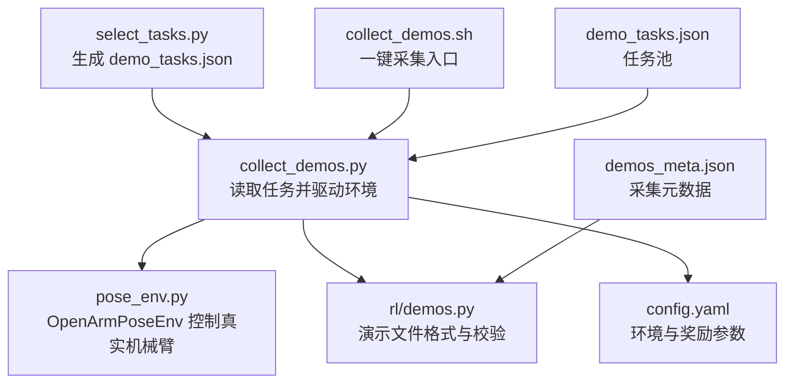
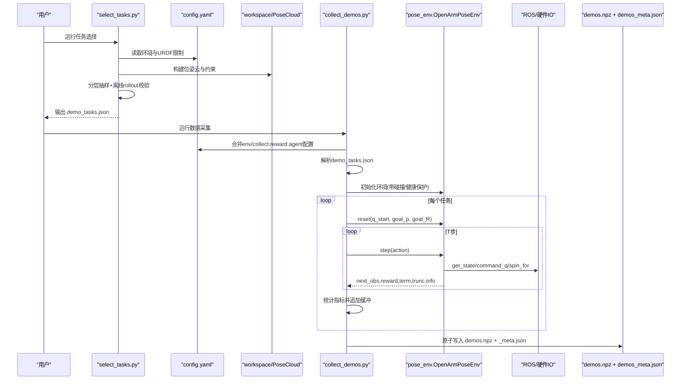
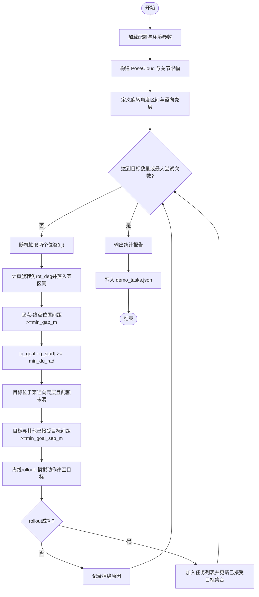
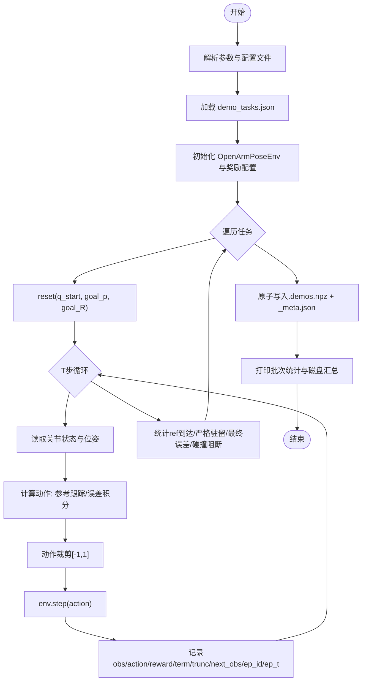
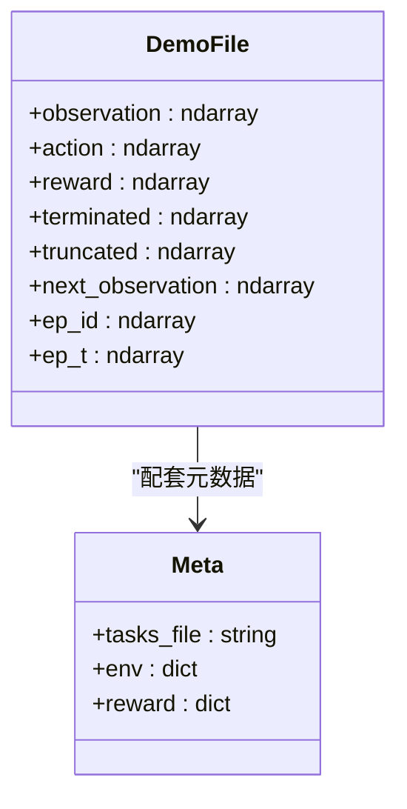
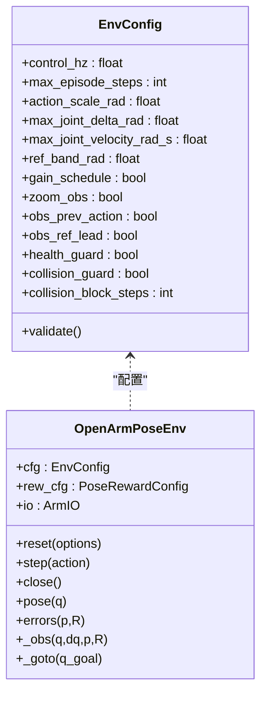
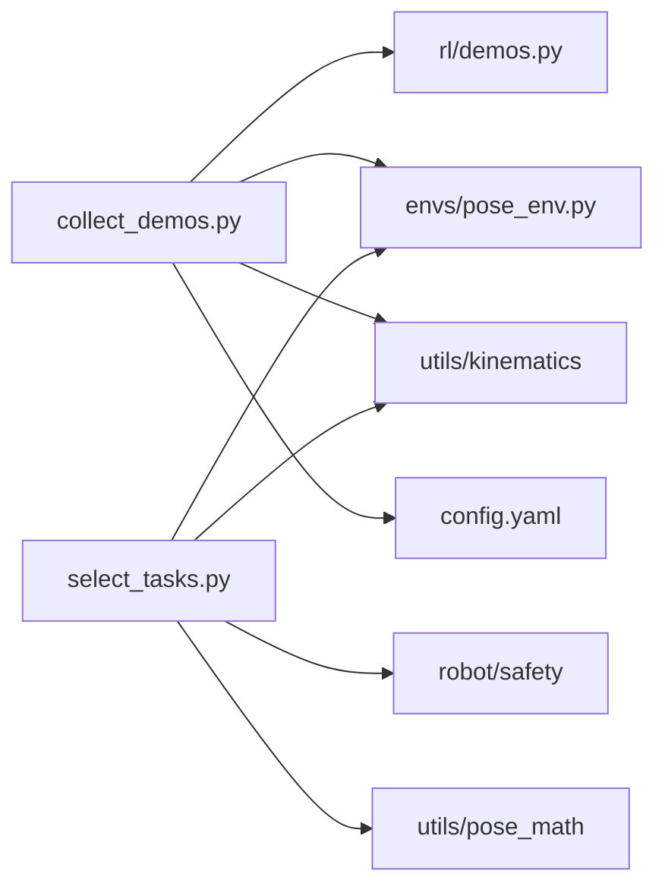

# 演示数据收集

<cite>
**本文引用的文件**   
- [collect_demos.py](file://hardware/policyik_hw/collect_demos.py)
- [select_tasks.py](file://hardware/policyik_hw/select_tasks.py)
- [demos.py](file://hardware/policyik_hw/rl/demos.py)
- [pose_env.py](file://hardware/policyik_hw/envs/pose_env.py)
- [config.yaml](file://hardware/config.yaml)
- [collect_demos.sh](file://hardware/scripts/collect_demos.sh)
- [demo_tasks.json](file://hardware/data/demo_tasks.json)
- [demos_meta.json](file://hardware/data/demos_meta.json)
</cite>

## 目录
1. [简介](#简介)
2. [项目结构](#项目结构)
3. [核心组件](#核心组件)
4. [架构总览](#架构总览)
5. [详细组件分析](#详细组件分析)
6. [依赖关系分析](#依赖关系分析)
7. [性能与时间特性](#性能与时间特性)
8. [故障排查指南](#故障排查指南)
9. [结论](#结论)
10. [附录：使用示例与最佳实践](#附录使用示例与最佳实践)

## 简介
本文件面向 PolicyIK 的“真实机械臂演示数据收集”流程，重点说明以下目标：
- 如何使用 collect_demos.py 在真实 OpenArm 右臂上采集大旋转演示轨迹；
- 演示数据的存储格式、元数据校验与完整性检查；
- select_tasks.py 的任务选择机制，如何从工作空间位姿云中选择覆盖度好、安全且可执行的演示任务；
- 数据采集质量评估方法，确保后续训练能稳定受益；
- 实际使用示例与常见问题解决方案。

## 项目结构
与演示数据收集直接相关的代码与配置分布如下：
- 任务选择脚本：hardware/policyik_hw/select_tasks.py
- 数据采集脚本：hardware/policyik_hw/collect_demos.py
- 演示文件与接口校验工具：hardware/policyik_hw/rl/demos.py
- 真实环境封装（含观测、奖励、碰撞保护等）：hardware/policyik_hw/envs/pose_env.py
- 硬件实验配置：hardware/config.yaml
- 一键采集 Shell：hardware/scripts/collect_demos.sh
- 预生成任务清单：hardware/data/demo_tasks.json
- 已采集演示元数据：hardware/data/demos_meta.json

**图表来源**
- [select_tasks.py:152-199](file://hardware/policyik_hw/select_tasks.py#L152-L199)
- [collect_demos.py:21-121](file://hardware/policyik_hw/collect_demos.py#L21-L121)
- [pose_env.py:206-252](file://hardware/policyik_hw/envs/pose_env.py#L206-L252)
- [demos.py:10-40](file://hardware/policyik_hw/rl/demos.py#L10-L40)
- [config.yaml:1-160](file://hardware/config.yaml#L1-L160)
- [collect_demos.sh:1-11](file://hardware/scripts/collect_demos.sh#L1-L11)

**章节来源**
- [select_tasks.py:1-41](file://hardware/policyik_hw/select_tasks.py#L1-L41)
- [collect_demos.py:1-33](file://hardware/policyik_hw/collect_demos.py#L1-L33)
- [pose_env.py:1-19](file://hardware/policyik_hw/envs/pose_env.py#L1-L19)
- [demos.py:1-17](file://hardware/policyik_hw/rl/demos.py#L1-L17)
- [config.yaml:1-160](file://hardware/config.yaml#L1-L160)
- [collect_demos.sh:1-11](file://hardware/scripts/collect_demos.sh#L1-L11)

## 核心组件
- 任务选择器 select_tasks.py：从工作空间位姿云中采样起始/目标位姿对，按旋转角度区间与径向壳层进行分层配额抽样，并通过离线回放验证可达性与安全性，输出结构化任务清单。
- 数据采集器 collect_demos.py：加载任务清单，初始化真实环境，执行“参考跟踪 + 误差积分驻留”的分段动作律，记录观测、动作、奖励、终止/截断标志、下一观测、episode 与步号，并以原子方式写入 .npz 与 _meta.json。
- 演示校验 rl/demos.py：定义演示数组键名、关键环境/奖励键名，提供完整 episode 掩码、接口差异比较、以及加载时的严格校验。
- 真实环境 pose_env.py：封装 OpenArm 真实关节状态读取、前向运动学、位姿误差计算、增益调度、碰撞包络保护、健康监控、观测构造与奖励通道。
- 配置 config.yaml：集中管理工作空间、关节限幅、控制频率、动作缩放、观测缩放、重置与安全参数、奖励权重、HER 与课程学习超参、演示混合策略等。
- 脚本 collect_demos.sh：封装 Python 模块调用，便于在真实机器人环境中快速启动采集。

**章节来源**
- [select_tasks.py:44-114](file://hardware/policyik_hw/select_tasks.py#L44-L114)
- [collect_demos.py:125-212](file://hardware/policyik_hw/collect_demos.py#L125-L212)
- [demos.py:10-80](file://hardware/policyik_hw/rl/demos.py#L10-L80)
- [pose_env.py:206-508](file://hardware/policyik_hw/envs/pose_env.py#L206-L508)
- [config.yaml:1-160](file://hardware/config.yaml#L1-L160)
- [collect_demos.sh:1-11](file://hardware/scripts/collect_demos.sh#L1-L11)

## 架构总览
下图展示从任务选择到数据采集再到存储与校验的整体流程。

**图表来源**
- [select_tasks.py:152-199](file://hardware/policyik_hw/select_tasks.py#L152-L199)
- [collect_demos.py:35-121](file://hardware/policyik_hw/collect_demos.py#L35-L121)
- [pose_env.py:324-508](file://hardware/policyik_hw/envs/pose_env.py#L324-L508)

## 详细组件分析

### 任务选择机制（select_tasks.py）
select_tasks.py 的目标是从工作空间位姿云中选择一组“大旋转”演示任务，保证：
- 旋转角度分布覆盖多个区间；
- 目标位姿在工作空间内均匀分布；
- 关节距离足够大，避免退化样本；
- 通过离线 rollout 验证可达性、包络安全、关节限幅与步骤上限；
- 目标位姿之间保持最小间距，提升覆盖度。

关键流程如下：

要点说明：
- 分层配额：将旋转角度区间与径向壳层组合为 strata，平均分配配额，剩余名额依次分配给前面的 stratum，保证各层都有样本。
- 拒绝原因分类：包括旋转区间不匹配、起点-终点太近、关节距离太小、配额已满、目标过密、rollout 失败（关节限幅、包络越界、离开工作空间、超过最大步数）。
- 离线 rollout：以增益为 1 的理想跟踪模拟，逐步推进参考关节角，同时施加关节增量、速度、限幅、包络与工作空间约束，若无法在 max_steps 内到达则拒绝。
- 输出字段：trial_id、q_start、q_goal、goal_p、goal_R、gap_m、rot_deg，供 collect_demos.py 直接使用。

**图表来源**
- [select_tasks.py:44-114](file://hardware/policyik_hw/select_tasks.py#L44-L114)
- [select_tasks.py:117-199](file://hardware/policyik_hw/select_tasks.py#L117-L199)

**章节来源**
- [select_tasks.py:14-41](file://hardware/policyik_hw/select_tasks.py#L14-L41)
- [select_tasks.py:44-114](file://hardware/policyik_hw/select_tasks.py#L44-L114)
- [select_tasks.py:117-199](file://hardware/policyik_hw/select_tasks.py#L117-L199)

### 数据采集流程（collect_demos.py）
collect_demos.py 负责：
- 解析命令行参数与配置文件；
- 加载 select_tasks.py 输出的任务清单；
- 初始化真实环境（包含碰撞与健康保护）；
- 对每个任务执行“参考跟踪 + 误差积分驻留”的动作律；
- 记录 episode 级与 transition 级数据；
- 原子写入 .npz 与 _meta.json，支持中断恢复与增量追加。

主要步骤如下：

关键点：
- 动作律：在未到达参考目标前，使用基于误差与增益的参考跟踪；到达参考后切换到误差积分驻留模式，提高末端精度。
- 安全与健壮性：
  - 碰撞保护：连续多步被碰撞包络阻挡会触发截断或终止；
  - 健康监控：电机健康异常时抛出错误；
  - 中断恢复：捕获 KeyboardInterrupt 或异常，保存已完成 episode，下次运行自动跳过不完整 episode。
- 输出文件：
  - demos.npz：observation、action、reward、terminated、truncated、next_observation、ep_id、ep_t；
  - demos_meta.json：tasks_file、env、reward，用于后续加载时的接口一致性校验。

**图表来源**
- [collect_demos.py:21-121](file://hardware/policyik_hw/collect_demos.py#L21-L121)
- [collect_demos.py:125-212](file://hardware/policyik_hw/collect_demos.py#L125-L212)

**章节来源**
- [collect_demos.py:1-33](file://hardware/policyik_hw/collect_demos.py#L1-L33)
- [collect_demos.py:35-121](file://hardware/policyik_hw/collect_demos.py#L35-L121)
- [collect_demos.py:125-212](file://hardware/policyik_hw/collect_demos.py#L125-L212)

### 演示数据存储与校验（rl/demos.py）
演示文件由两部分组成：
- demos.npz：包含 episode 与 transition 级别的张量数组；
- demos_meta.json：记录采集时的任务清单文件名、环境配置与奖励配置。

校验规则：
- 必需键：observation、action、reward、terminated、truncated、next_observation、ep_id、ep_t；
- 观测维度必须与当前环境一致；
- 仅保留完整 episode（最后一个 step 必须是 terminated 或 truncated）；
- 环境键与部分奖励键必须与当前运行配置一致，否则拒绝加载；
- 其他奖励键的差异仅作为软警告，不影响加载。

**图表来源**
- [demos.py:10-40](file://hardware/policyik_hw/rl/demos.py#L10-L40)
- [demos.py:43-80](file://hardware/policyik_hw/rl/demos.py#L43-L80)

**章节来源**
- [demos.py:10-40](file://hardware/policyik_hw/rl/demos.py#L10-L40)
- [demos.py:43-80](file://hardware/policyik_hw/rl/demos.py#L43-L80)

### 真实环境与控制（pose_env.py）
OpenArmPoseEnv 提供：
- 观测构造：包含关节、角速度、末端位姿、目标位姿、误差、关键点误差、缩放观测、rho 历史、上一动作、参考超前项等；
- 动作执行：根据增益调度与动作缩放、关节增量与速度限制、参考限幅松弛与参考带约束，更新参考关节角并下发命令；
- 安全保护：碰撞包络检测、连续阻挡计数、健康监控、状态冻结检测；
- 奖励通道：位置与姿态误差、动作速率、关节速度、边界惩罚、停留奖励、PBRS 潜在函数等；
- Episode 摘要：最终误差、是否严格驻留、碰撞阻断标记、sigma 等。

**图表来源**
- [pose_env.py:46-158](file://hardware/policyik_hw/envs/pose_env.py#L46-L158)
- [pose_env.py:206-508](file://hardware/policyik_hw/envs/pose_env.py#L206-L508)

**章节来源**
- [pose_env.py:46-158](file://hardware/policyik_hw/envs/pose_env.py#L46-L158)
- [pose_env.py:206-508](file://hardware/policyik_hw/envs/pose_env.py#L206-L508)

## 依赖关系分析
- collect_demos.py 依赖：
  - rl/demos.py：演示文件键名、元数据路径、接口差异比较、完整 episode 掩码；
  - envs/pose_env.py：OpenArmPoseEnv、EnvConfig、PoseRewardConfig；
  - utils/kinematics：URDF 路径设置；
  - hardware/config.yaml：环境与奖励参数；
  - ROS/硬件 IO：rclpy、ArmIO（通过 pose_env 内部导入）。
- select_tasks.py 依赖：
  - utils/kinematics：URDF 路径设置；
  - envs/pose_env.py：EnvConfig、cloud_config；
  - robot/safety：joint_limits；
  - utils/pose_math：angle_between。

**图表来源**
- [collect_demos.py:14-15](file://hardware/policyik_hw/collect_demos.py#L14-L15)
- [select_tasks.py:12-12](file://hardware/policyik_hw/select_tasks.py#L12-L12)
- [pose_env.py:12-16](file://hardware/policyik_hw/envs/pose_env.py#L12-L16)

**章节来源**
- [collect_demos.py:14-15](file://hardware/policyik_hw/collect_demos.py#L14-L15)
- [select_tasks.py:12-12](file://hardware/policyik_hw/select_tasks.py#L12-L12)
- [pose_env.py:12-16](file://hardware/policyik_hw/envs/pose_env.py#L12-L16)

## 性能与时间特性
- 控制频率：config.yaml 中 control_hz=10Hz，每步 dt=0.1s；
- 最大步数：max_episode_steps=150，单 episode 最长约 15s；
- 估计时间：collect_demos.py 根据任务数、reset_ramp_s、reset_settle_s 估算机械臂总耗时；
- 观测噪声：obs_noise_q_rad 与 obs_noise_dq_rad_s 引入轻微扰动，增强鲁棒性；
- 碰撞保护：collision_block_steps 控制连续阻挡阈值，避免频繁截断；
- 健康监控：health_guard 与 health_required 控制电机健康检查行为。

[本节为通用指导，不直接分析具体文件]

## 故障排查指南
常见问题与解决建议：
- 无 /joint_states 或 ROS 未启动：
  - 现象：初始化环境时报错等待 joint_states；
  - 处理：确认 bringup launch 已运行，ROS 节点正常发布 /joint_states。
- 电机健康异常：
  - 现象：step 中抛出 MOTOR HEALTH FAULT；
  - 处理：停止采集，检查电机状态与 CAN 通信，重启相关服务后再试。
- 关节状态冻结：
  - 现象：连续多步关节状态不变，抛出 FROZEN 错误；
  - 处理：检查 CAN 接口是否卡死，重启 CAN 与相关节点。
- 碰撞阻断过多：
  - 现象：大量 episode 被 collision guard 截断；
  - 处理：调整 self_pair_min_gap、link_bounds_from、self_clearance_m 等参数，或重新生成任务清单。
- 演示文件缺失或不兼容：
  - 现象：加载 demos.npz 报错缺少键或维度不一致；
  - 处理：使用 --overwrite 或更换输出路径，确保 demos_meta.json 与当前配置一致。
- 任务选择未填满：
  - 现象：select_tasks.py 输出不足 n 个任务；
  - 处理：增大 --max-draws、放宽 --min-goal-sep-m、扩大旋转区间或增加 shells。

**章节来源**
- [pose_env.py:239-244](file://hardware/policyik_hw/envs/pose_env.py#L239-L244)
- [pose_env.py:393-423](file://hardware/policyik_hw/envs/pose_env.py#L393-L423)
- [pose_env.py:447-508](file://hardware/policyik_hw/envs/pose_env.py#L447-L508)
- [demos.py:60-80](file://hardware/policyik_hw/rl/demos.py#L60-L80)
- [select_tasks.py:117-199](file://hardware/policyik_hw/select_tasks.py#L117-L199)

## 结论
PolicyIK 的演示数据收集流程通过 select_tasks.py 与 collect_demos.py 协同工作，实现了从工作空间位姿云中选择高质量、覆盖度好的大旋转任务，并在真实机械臂上执行稳健的动作律，产出符合严格校验规范的演示数据。该流程具备中断恢复、增量追加、安全保护与质量统计能力，能够为后续训练提供可靠的数据基础。

[本节为总结性内容，不直接分析具体文件]

## 附录：使用示例与最佳实践

### 任务选择示例
- 基本用法：
  - 运行 select_tasks.py，默认输出到 data/demo_tasks.json，选择 150 个任务；
  - 可通过 --n、--rot-bands、--shells、--min-gap-m、--min-goal-sep-m、--limit-margin、--clearance、--max-steps、--max-draws、--min-dq-rad、--id-prefix、--urdf、--dry-run 等参数调整。
- 推荐参数：
  - 若输出不足，优先增大 --max-draws；
  - 若目标过于密集，增大 --min-goal-sep-m；
  - 若旋转覆盖不足，调整 --rot-bands；
  - 若 rollout 失败较多，放宽 --clearance 或降低 --limit-margin。

**章节来源**
- [select_tasks.py:19-41](file://hardware/policyik_hw/select_tasks.py#L19-L41)
- [select_tasks.py:152-199](file://hardware/policyik_hw/select_tasks.py#L152-L199)

### 数据采集示例
- 基本用法：
  - 使用 collect_demos.sh 一键启动，默认读取 data/demo_tasks.json，输出到 data/demos.npz；
  - 支持 --dry-run 预览计划而不移动机械臂；
  - 支持 --start 与 --n 切片采集；
  - 支持 --overwrite 覆盖已有输出。
- 推荐实践：
  - 首次运行先 --dry-run 确认任务与参数；
  - 中断后可再次运行同一命令继续采集；
  - 定期检查 demos_meta.json 是否与当前 config.yaml 一致。

**章节来源**
- [collect_demos.sh:1-11](file://hardware/scripts/collect_demos.sh#L1-L11)
- [collect_demos.py:21-33](file://hardware/policyik_hw/collect_demos.py#L21-L33)
- [collect_demos.py:178-212](file://hardware/policyik_hw/collect_demos.py#L178-L212)

### 数据质量检查清单
- 完整性：
  - demos.npz 包含所有必需键；
  - demos_meta.json 存在且 tasks_file 与 demo_tasks.json 一致；
  - 仅保留完整 episode。
- 一致性：
  - 环境键与部分奖励键与当前运行配置一致；
  - 观测维度与当前环境一致。
- 有效性：
  - 统计“到达参考”“严格驻留”比例；
  - 最终误差与角度在可接受范围；
  - 碰撞阻断比例较低。

**章节来源**
- [demos.py:10-40](file://hardware/policyik_hw/rl/demos.py#L10-L40)
- [demos.py:43-80](file://hardware/policyik_hw/rl/demos.py#L43-L80)
- [collect_demos.py:214-235](file://hardware/policyik_hw/collect_demos.py#L214-L235)
