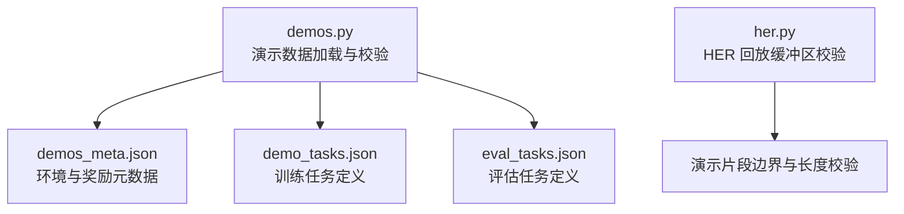
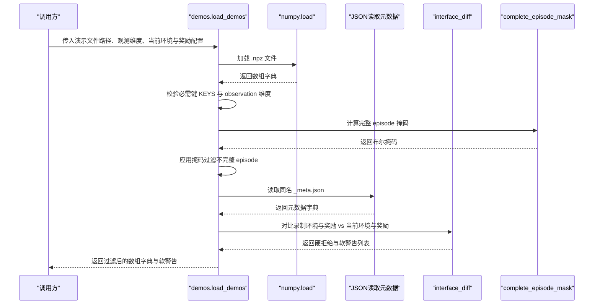
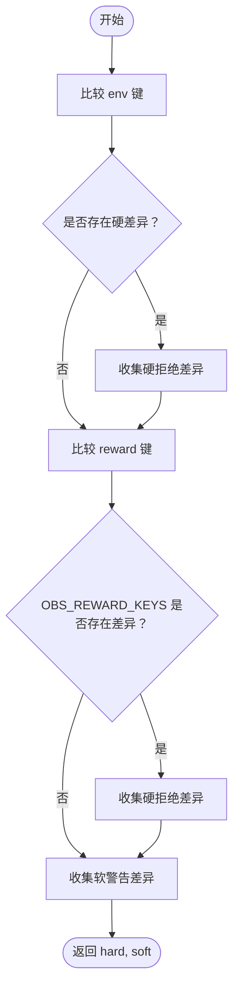
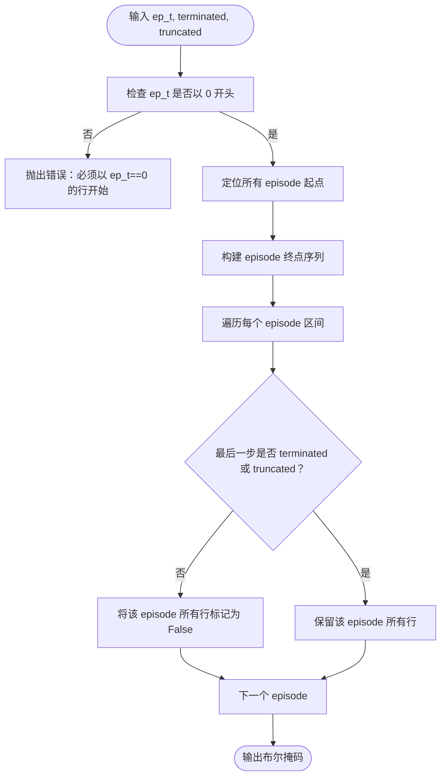
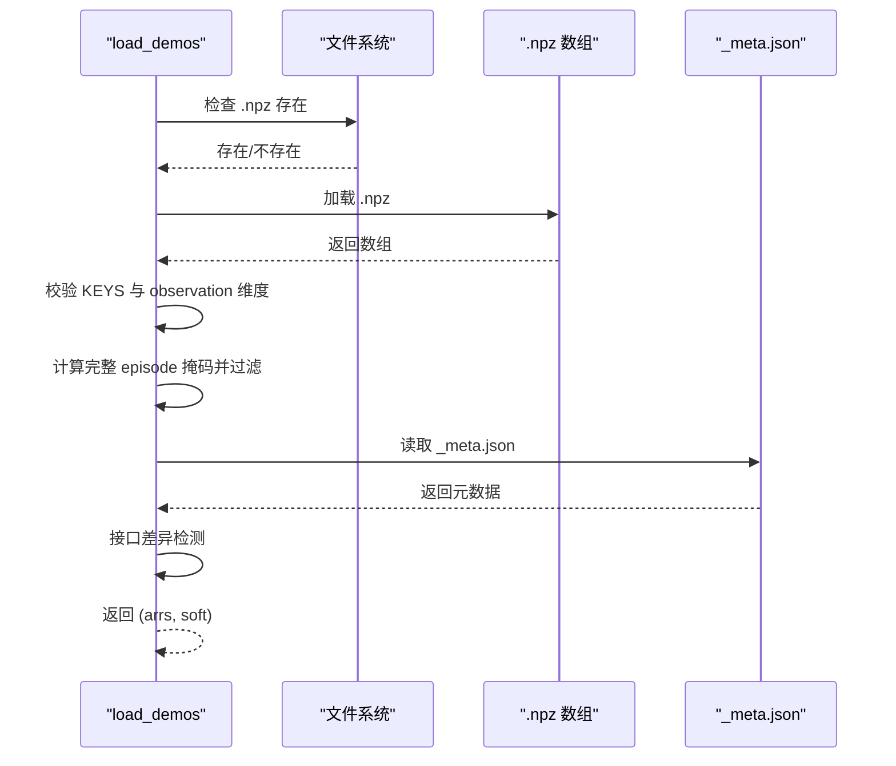
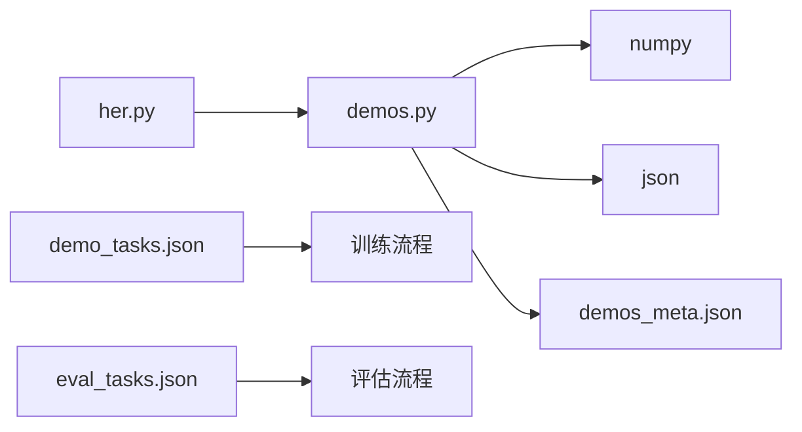

# 演示数据管理

<cite>
**本文引用的文件**   
- [demos.py](file://hardware/policyik_hw/rl/demos.py)
- [demos_meta.json](file://hardware/data/demos_meta.json)
- [demo_tasks.json](file://hardware/data/demo_tasks.json)
- [eval_tasks.json](file://hardware/data/eval_tasks.json)
- [her.py](file://hardware/policyik_hw/rl/her.py)
</cite>

## 目录
1. [简介](#简介)
2. [项目结构](#项目结构)
3. [核心组件](#核心组件)
4. [架构总览](#架构总览)
5. [详细组件分析](#详细组件分析)
6. [依赖关系分析](#依赖关系分析)
7. [性能与复杂度](#性能与复杂度)
8. [故障排查指南](#故障排查指南)
9. [结论](#结论)
10. [附录：数据处理API参考与最佳实践](#附录数据处理api参考与最佳实践)

## 简介
本文件为 PolicyIK 硬件侧演示数据管理系统提供完整文档，聚焦于演示数据的存储格式、数据结构设计、元数据管理与数据验证机制。重点说明以下内容：
- 演示数据文件的字段约定（KEYS）
- 环境差异检测与接口一致性校验
- 基于 episode 掩码的数据完整性检查
- 版本兼容性与数据迁移建议
- 数据处理 API 参考与使用最佳实践

该模块通过“数据文件 + 元数据”的成对形式组织演示数据，并在加载时进行强约束校验，确保训练与评估流程使用的数据与环境配置一致。

## 项目结构
与演示数据管理直接相关的文件分布如下：
- hardware/policyik_hw/rl/demos.py：演示数据加载、校验与元数据路径工具
- hardware/data/demos_meta.json：演示数据集的环境与奖励参数元数据
- hardware/data/demo_tasks.json：用于训练的演示任务定义
- hardware/data/eval_tasks.json：用于评估的任务定义
- hardware/policyik_hw/rl/her.py：HER 回放缓冲区中对演示片段边界与长度的二次校验逻辑

图表来源
- [demos.py:1-80](file://hardware/policyik_hw/rl/demos.py#L1-L80)
- [demos_meta.json:1-75](file://hardware/data/demos_meta.json#L1-L75)
- [demo_tasks.json:1-800](file://hardware/data/demo_tasks.json#L1-L800)
- [eval_tasks.json:1-800](file://hardware/data/eval_tasks.json#L1-L800)
- [her.py:455-468](file://hardware/policyik_hw/rl/her.py#L455-L468)

章节来源
- [demos.py:1-80](file://hardware/policyik_hw/rl/demos.py#L1-L80)
- [demos_meta.json:1-75](file://hardware/data/demos_meta.json#L1-L75)
- [demo_tasks.json:1-800](file://hardware/data/demo_tasks.json#L1-L800)
- [eval_tasks.json:1-800](file://hardware/data/eval_tasks.json#L1-L800)
- [her.py:455-468](file://hardware/policyik_hw/rl/her.py#L455-L468)

## 核心组件
- 演示数据键集合 KEYS：定义 .npz 文件中必须存在的数组键名
- 环境键集合 ENV_KEYS：定义与动作律和观测构造相关的环境参数键
- 观测/奖励关键键 OBS_REWARD_KEYS：定义影响策略行为的关键奖励/观测参数
- 元数据路径工具 meta_path：根据 .npz 路径推导对应的 _meta.json 路径
- 标准化比较 norm：将任意可序列化对象经 JSON 往返后比较，消除类型差异
- 环境记录 env_record：从当前环境字典中抽取受控键并标准化
- 接口差异检测 interface_diff：对比录制时的环境与奖励设置与当前运行设置，返回硬拒绝与软警告两类差异
- 完整 Episode 掩码 complete_episode_mask：过滤掉不完整的 episode 行
- 演示加载 load_demos：加载 .npz 与 _meta.json，执行维度、完整性与接口一致性校验

章节来源
- [demos.py:10-16](file://hardware/policyik_hw/rl/demos.py#L10-L16)
- [demos.py:19-40](file://hardware/policyik_hw/rl/demos.py#L19-L40)
- [demos.py:43-80](file://hardware/policyik_hw/rl/demos.py#L43-L80)

## 架构总览
演示数据加载与校验的整体流程如下：

图表来源
- [demos.py:60-80](file://hardware/policyik_hw/rl/demos.py#L60-L80)
- [demos.py:43-57](file://hardware/policyik_hw/rl/demos.py#L43-L57)
- [demos.py:32-40](file://hardware/policyik_hw/rl/demos.py#L32-L40)

## 详细组件分析

### 演示数据键与存储格式
- .npz 文件必须包含以下键：observation, action, reward, terminated, truncated, next_observation, ep_id, ep_t
- observation 必须是二维数组，第二维需与调用方传入的观测维度一致
- ep_t 用于标识每个时间步所属的 episode 及其在该 episode 内的相对时间索引
- terminated/truncated 表示 episode 是否以终止或截断结束

章节来源
- [demos.py:10-10](file://hardware/policyik_hw/rl/demos.py#L10-L10)
- [demos.py:64-70](file://hardware/policyik_hw/rl/demos.py#L64-L70)

### 元数据结构与版本兼容性
- demos_meta.json 包含 tasks_file、env、reward 三部分
- env 子字典描述动作律与观测构造相关的环境参数，如增益调度、关节范围、控制频率等
- reward 子字典描述奖励函数权重与超参，如位置/姿态误差权重、动作平滑项、PBRS 相关参数等
- 在加载演示数据时，会对比录制时的 env/reward 与当前运行环境的对应键值，若存在“硬键”差异则直接拒绝

章节来源
- [demos_meta.json:1-75](file://hardware/data/demos_meta.json#L1-L75)
- [demos.py:12-16](file://hardware/policyik_hw/rl/demos.py#L12-L16)
- [demos.py:32-40](file://hardware/policyik_hw/rl/demos.py#L32-L40)

### 环境差异检测与接口一致性
- interface_diff 将录制环境与奖励设置与当前运行设置逐项比较
- 分为两类差异：
  - 硬拒绝差异：ENV_KEYS 与 OBS_REWARD_KEYS 中的键不一致
  - 软警告差异：其他 reward 键不一致（排除 dt），仅提示但不阻止加载
- 该机制保证策略训练所依赖的动作律与观测构造保持一致，避免跨配置混用导致的行为漂移

图表来源
- [demos.py:32-40](file://hardware/policyik_hw/rl/demos.py#L32-L40)

章节来源
- [demos.py:32-40](file://hardware/policyik_hw/rl/demos.py#L32-L40)

### Episode 掩码生成与数据完整性检查
- complete_episode_mask 依据 ep_t 划分 episode 区间，并检查每个 episode 的最后一步是否为 terminated 或 truncated
- 若某 episode 未正常结束，则该 episode 的所有行将被标记为 False，从而被过滤
- 同时要求 ep_t 必须以 0 开头，否则抛出错误

图表来源
- [demos.py:43-57](file://hardware/policyik_hw/rl/demos.py#L43-L57)

章节来源
- [demos.py:43-57](file://hardware/policyik_hw/rl/demos.py#L43-L57)

### 演示加载主流程
load_demos 负责串联上述步骤：
1. 检查 .npz 文件存在性
2. 加载 .npz 并校验必需键 KEYS
3. 校验 observation 维度
4. 计算并应用完整 episode 掩码
5. 读取同名 _meta.json
6. 执行接口差异检测，若存在硬差异则拒绝
7. 返回过滤后的数组字典与软警告列表

图表来源
- [demos.py:60-80](file://hardware/policyik_hw/rl/demos.py#L60-L80)

章节来源
- [demos.py:60-80](file://hardware/policyik_hw/rl/demos.py#L60-L80)

### HER 回放缓冲区的补充校验
- her.py 在构建回放缓冲区时对演示片段的边界与长度进行额外校验
- 包括：ep_t 必须从 0 连续递增；episode 长度不得超过最大步数；episode 末尾必须终止或截断
- 这些校验与 demos.complete_episode_mask 形成双重保障，确保进入缓冲区的片段质量

章节来源
- [her.py:455-468](file://hardware/policyik_hw/rl/her.py#L455-L468)

## 依赖关系分析
- demos.py 依赖 numpy 与 json 标准库
- demos.py 与 demos_meta.json 通过同名路径关联
- demo_tasks.json 与 eval_tasks.json 作为任务定义文件，供上层训练/评估流程使用
- her.py 复用演示片段边界语义，对 ep_t 连续性、长度与终止状态进行二次校验

图表来源
- [demos.py:1-80](file://hardware/policyik_hw/rl/demos.py#L1-L80)
- [demos_meta.json:1-75](file://hardware/data/demos_meta.json#L1-L75)
- [demo_tasks.json:1-800](file://hardware/data/demo_tasks.json#L1-L800)
- [eval_tasks.json:1-800](file://hardware/data/eval_tasks.json#L1-L800)
- [her.py:455-468](file://hardware/policyik_hw/rl/her.py#L455-L468)

章节来源
- [demos.py:1-80](file://hardware/policyik_hw/rl/demos.py#L1-L80)
- [her.py:455-468](file://hardware/policyik_hw/rl/her.py#L455-L468)

## 性能与复杂度
- 完整 episode 掩码计算的时间复杂度约为 O(N)，其中 N 为演示行数；空间复杂度为 O(N) 用于布尔掩码
- 接口差异检测的时间复杂度与 ENV_KEYS 与 reward 键数量线性相关
- 整体加载流程的主要开销在于 .npz 读取与 JSON 解析，属于 I/O 密集型操作

[本节为通用性能讨论，不涉及具体代码片段]

## 故障排查指南
常见问题与处理建议：
- 缺少演示文件或元数据
  - 现象：FileNotFoundError 或无法打开 _meta.json
  - 处理：确认 .npz 与同名 _meta.json 在同一目录且文件名匹配
- 演示文件缺少必需键
  - 现象：ValueError 指出缺失的 KEYS
  - 处理：检查数据采集脚本是否正确写入 observation, action, reward, terminated, truncated, next_observation, ep_id, ep_t
- observation 维度不匹配
  - 现象：ValueError 指出 observation 宽度与期望维度不符
  - 处理：核对 obs_dim 参数与采集时的观测构造一致
- 没有完整 episode
  - 现象：ValueError 指出无完整 episode
  - 处理：检查 terminated/truncated 是否在 episode 末尾正确置位；必要时重新采集或清洗数据
- 接口不一致导致拒绝
  - 现象：ValueError 列出 env/reward 键的差异
  - 处理：对齐当前运行环境与奖励配置与 demos_meta.json 中的录制配置；若仅为软警告差异，可忽略但需注意潜在影响
- HER 缓冲区校验失败
  - 现象：ValueError 指出 ep_t 不连续、episode 过长或未终止
  - 处理：在加载前使用 complete_episode_mask 清洗数据，并确保 episode 长度不超过 T_max

章节来源
- [demos.py:60-80](file://hardware/policyik_hw/rl/demos.py#L60-L80)
- [her.py:455-468](file://hardware/policyik_hw/rl/her.py#L455-L468)

## 结论
PolicyIK 的演示数据管理通过严格的键约定、元数据绑定与接口一致性校验，确保训练与评估所用数据与环境配置一致。episode 掩码机制有效剔除不完整片段，配合 HER 缓冲区的二次校验，形成可靠的数据质量保障体系。建议在数据采集与预处理阶段遵循本文档的规范，以降低训练过程中的不稳定因素。

[本节为总结性内容，不涉及具体代码片段]

## 附录：数据处理API参考与最佳实践

### API 参考
- meta_path(path)
  - 功能：根据 .npz 路径推导对应的 _meta.json 路径
  - 输入：字符串路径
  - 输出：字符串路径
- norm(x)
  - 功能：将对象经 JSON 往返后比较，消除类型差异
  - 输入：任意可序列化对象
  - 输出：标准化后的对象
- env_record(env)
  - 功能：从环境字典中抽取受控键并标准化
  - 输入：环境字典
  - 输出：标准化后的环境子字典
- interface_diff(env_a, env_b, rew_a, rew_b)
  - 功能：对比录制与当前环境/奖励设置，返回硬拒绝与软警告差异
  - 输入：两个环境与奖励字典
  - 输出：(hard, soft) 差异列表
- complete_episode_mask(ep_t, terminated, truncated)
  - 功能：生成布尔掩码，保留完整 episode 的行
  - 输入：episode 时间索引、终止标志、截断标志
  - 输出：布尔数组
- load_demos(path, obs_dim, run_env, run_reward)
  - 功能：加载演示数据，执行完整性与接口一致性校验
  - 输入：演示文件路径、观测维度、当前环境与奖励配置
  - 输出：过滤后的数组字典与软警告列表

章节来源
- [demos.py:19-80](file://hardware/policyik_hw/rl/demos.py#L19-L80)

### 最佳实践
- 数据采集规范
  - 确保每个 episode 以 ep_t=0 开始并以 terminated 或 truncated 结束
  - 保持 observation 维度与训练配置一致
  - 记录并保存 demos_meta.json，确保 env/reward 键与采集时一致
- 数据预处理
  - 使用 complete_episode_mask 清洗不完整 episode
  - 在导入 HER 缓冲区前再次校验 ep_t 连续性与 episode 长度
- 版本与迁移
  - 当更新 env/reward 配置时，优先调整当前运行配置以匹配已有演示数据
  - 若必须变更录制配置，应重新采集演示数据或使用迁移脚本重建元数据
- 调试建议
  - 打印 interface_diff 的 hard/soft 列表，快速定位差异键
  - 检查 demos_meta.json 的 env/reward 是否与当前配置一致

[本节为通用指导，不涉及具体代码片段]