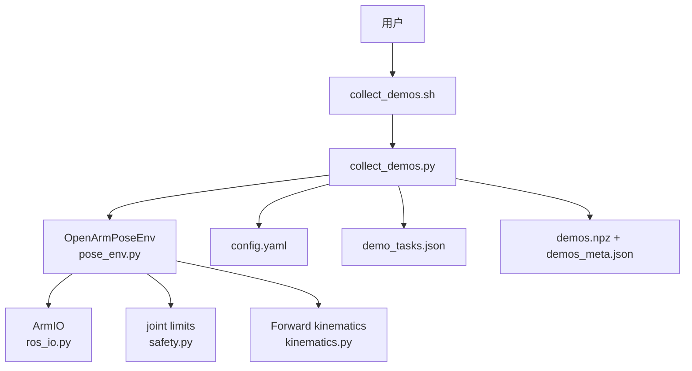
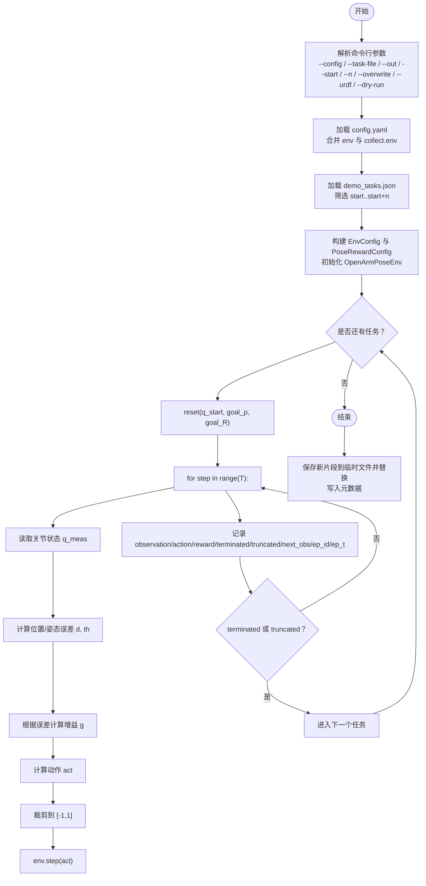
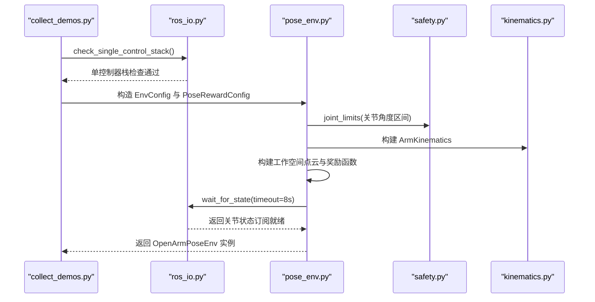
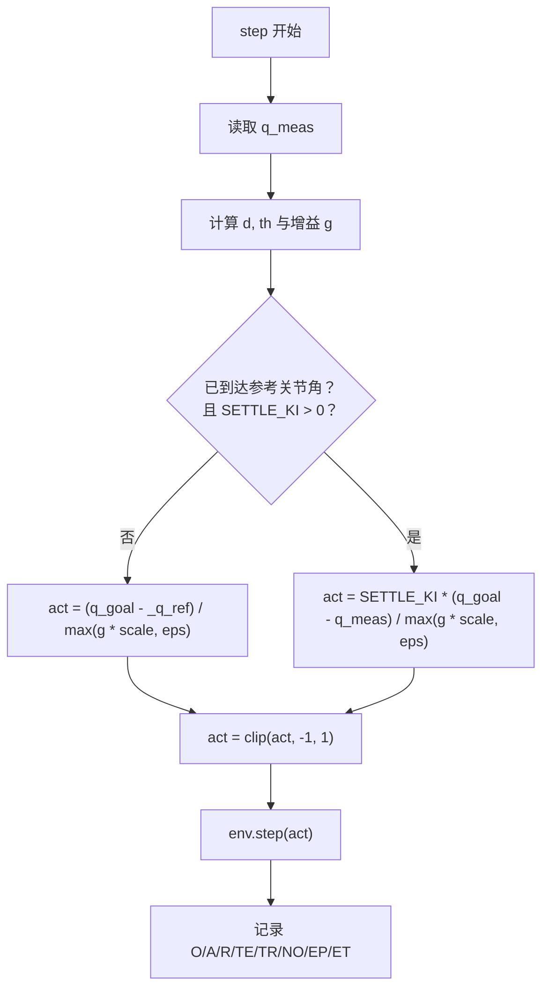
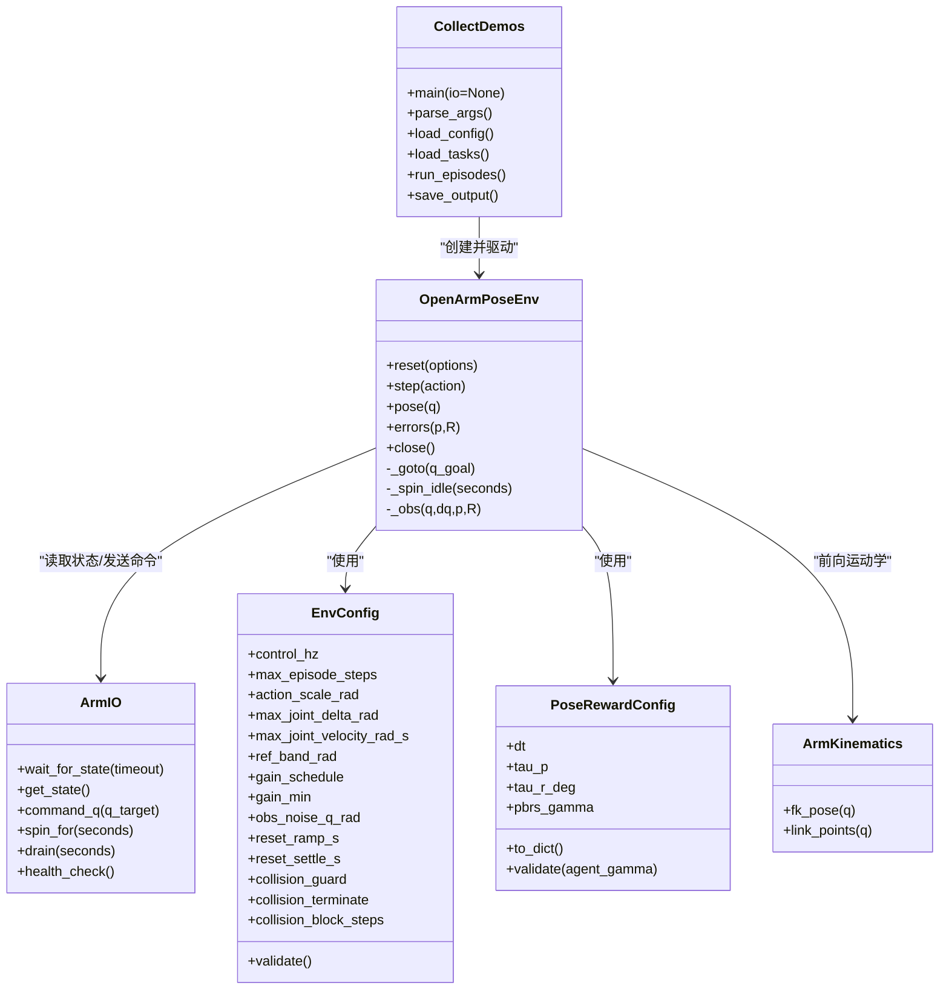

# 演示数据采集脚本

<cite>
**本文引用的文件**   
- [collect_demos.py](file://hardware/policyik_hw/collect_demos.py)
- [collect_demos.sh](file://hardware/scripts/collect_demos.sh)
- [config.yaml](file://hardware/config.yaml)
- [demo_tasks.json](file://hardware/data/demo_tasks.json)
- [demos_meta.json](file://hardware/data/demos_meta.json)
- [pose_env.py](file://hardware/policyik_hw/envs/pose_env.py)
- [ros_io.py](file://hardware/policyik_hw/robot/ros_io.py)
- [safety.py](file://hardware/policyik_hw/robot/safety.py)
- [kinematics.py](file://hardware/policyik_hw/utils/kinematics.py)
</cite>

## 目录
1. [简介](#简介)
2. [项目结构与入口](#项目结构与入口)
3. [核心功能与采集流程](#核心功能与采集流程)
4. [命令行参数与环境配置](#命令行参数与环境配置)
5. [环境初始化与安全机制](#环境初始化与安全机制)
6. [动作轨迹生成与状态记录](#动作轨迹生成与状态记录)
7. [输出数据与元数据](#输出数据与元数据)
8. [实际使用示例](#实际使用示例)
9. [参数调优指南](#参数调优指南)
10. [常见问题与故障排查](#常见问题与故障排查)
11. [依赖关系与架构总览](#依赖关系与架构总览)
12. [结论](#结论)

## 简介
本文件为 PolicyIK 真实机械臂演示数据采集脚本 `create_demos`（对应仓库中的 `hardware/policyik_hw/collect_demos.py`）提供完整、可操作的技术文档。该脚本通过训练环境驱动真实 OpenArm 右臂，执行“预设大角度旋转”的参考关节角轨迹，引导机械臂到达目标位姿，并记录完整的观测、动作、奖励、终止/截断标志、下一观测、 episode 编号与时间步等状态转移序列。

脚本的核心设计要点包括：
- 基于任务文件读取起始关节角、目标位姿、旋转角度和间隙距离。
- 在每步计算参考关节角误差，并在接近参考后切换为基于测量关节角的稳定控制。
- 通过增益调度、动作幅度限制、速度限制、碰撞保护与健康检查保障安全。
- 支持中断恢复、增量写入、元数据校验与任务切片运行。

## 项目结构与入口
采集脚本位于硬件模块中，并提供一个 Bash 启动脚本作为统一入口。



**图表来源**   
- [collect_demos.sh:1-11](file://hardware/scripts/collect_demos.sh#L1-L11)
- [collect_demos.py:21-33](file://hardware/policyik_hw/collect_demos.py#L21-L33)
- [pose_env.py:206-252](file://hardware/policyik_hw/envs/pose_env.py#L206-L252)
- [ros_io.py:53-65](file://hardware/policyik_hw/robot/ros_io.py#L53-L65)
- [safety.py:1-28](file://hardware/policyik_hw/robot/safety.py#L1-L28)
- [kinematics.py:81-112](file://hardware/policyik_hw/utils/kinematics.py#L81-L112)

**章节来源**   
- [collect_demos.sh:1-11](file://hardware/scripts/collect_demos.sh#L1-L11)
- [collect_demos.py:21-33](file://hardware/policyik_hw/collect_demos.py#L21-L33)

## 核心功能与采集流程
采集脚本的主要职责是：
1. 解析命令行参数与配置文件。
2. 加载任务列表，确定要采集的任务范围。
3. 初始化训练环境与奖励配置。
4. 对每个任务执行固定步数的闭环控制循环。
5. 记录每一步的状态转移，并在异常或中断时安全保存已完成片段。
6. 输出 `.npz` 演示数据与 `.json` 元数据，便于后续训练与复现。



**图表来源**   
- [collect_demos.py:21-33](file://hardware/policyik_hw/collect_demos.py#L21-L33)
- [collect_demos.py:35-50](file://hardware/policyik_hw/collect_demos.py#L35-L50)
- [collect_demos.py:112-124](file://hardware/policyik_hw/collect_demos.py#L112-L124)
- [collect_demos.py:131-177](file://hardware/policyik_hw/collect_demos.py#L131-L177)
- [collect_demos.py:194-212](file://hardware/policyik_hw/collect_demos.py#L194-L212)

**章节来源**   
- [collect_demos.py:21-33](file://hardware/policyik_hw/collect_demos.py#L21-L33)
- [collect_demos.py:131-177](file://hardware/policyik_hw/collect_demos.py#L131-L177)
- [collect_demos.py:194-212](file://hardware/policyik_hw/collect_demos.py#L194-L212)

## 命令行参数与环境配置
### 命令行参数
| 参数 | 类型 | 默认值 | 含义 |
|---|---|---|---|
| `--config` | 字符串 | `config.yaml` | 配置文件路径 |
| `--task-file` | 必填 | 无 | 由任务选择脚本生成的演示任务文件路径 |
| `--out` | 字符串 | 任务文件所在目录下的 `demos.npz` | 输出演示数据文件路径 |
| `--start` | 整数 | 自动从已有数据的最后任务继续 | 第一个任务索引 |
| `--n` | 整数 | 剩余全部任务 | 从 `--start` 起采集的任务数量 |
| `--overwrite` | 布尔 | 关闭 | 覆盖已存在的输出文件 |
| `--urdf` | 字符串 | 从 `openarm_description` 包获取 | 指定 OpenArm v1 URDF 路径 |
| `--dry-run` | 布尔 | 关闭 | 仅打印计划，不移动机械臂 |

### 关键配置项
配置文件 `config.yaml` 包含环境、奖励、课程学习、代理、HER、演示数据与采集相关设置。采集脚本会合并 `env` 与 `collect.env`，并将 `agent.gamma` 注入奖励配置的 `pbrs_gamma`。

重点采集相关字段包括：
- 控制频率 `control_hz`
- 最大步数 `max_episode_steps`
- 动作尺度 `action_scale_rad`
- 关节增量上限 `max_joint_delta_rad`
- 关节速度上限 `max_joint_velocity_rad_s`
- 参考带宽度 `ref_band_rad`
- 增益调度开关与范围
- 观察噪声
- 重置斜坡时间与稳定时间
- 碰撞保护与终止策略
- 采集阶段碰撞处理参数

**章节来源**   
- [collect_demos.py:21-33](file://hardware/policyik_hw/collect_demos.py#L21-L33)
- [collect_demos.py:35-50](file://hardware/policyik_hw/collect_demos.py#L35-L50)
- [config.yaml:4-72](file://hardware/config.yaml#L4-L72)
- [config.yaml:155-160](file://hardware/config.yaml#L155-L160)

## 环境初始化与安全机制
### 环境初始化
采集脚本在需要时初始化 ROS 2，并通过 `check_single_control_stack` 确保只有一个控制器栈运行，避免 CAN 总线冲突。随后构造 `EnvConfig` 与 `PoseRewardConfig`，并创建 `OpenArmPoseEnv`。

环境初始化过程包括：
- 验证配置合法性。
- 等待 `/joint_states` 可用。
- 建立前向运动学模型。
- 初始化工作空间点云与碰撞包络。
- 初始化奖励函数与观察布局。



**图表来源**   
- [collect_demos.py:112-124](file://hardware/policyik_hw/collect_demos.py#L112-L124)
- [ros_io.py:19-50](file://hardware/policyik_hw/robot/ros_io.py#L19-L50)
- [pose_env.py:206-252](file://hardware/policyik_hw/envs/pose_env.py#L206-L252)
- [safety.py:20-28](file://hardware/policyik_hw/robot/safety.py#L20-L28)
- [kinematics.py:81-112](file://hardware/policyik_hw/utils/kinematics.py#L81-L112)

### 安全机制
采集过程中的安全机制分为多层：
1. **控制器栈检查**：防止多个 `controller_manager` 同时运行导致机械臂失控。
2. **电机健康检查**：读取 `/motor_health`，检测无响应、错误码、温度过高与反复禁用。
3. **关节状态冻结检测**：当 `/joint_states` 长时间不变且存在命令需求时抛出异常。
4. **关节极限保护**：通过 `safety.joint_limits` 与配置中的关节区间交集得到硬限幅。
5. **碰撞保护**：基于工作空间点云与包络检查参考关节角；连续超出阈值则截断或终止 episode。
6. **动作与速度限制**：对动作进行缩放、裁剪、增量限制与速度限制。
7. **中断安全**：捕获 `KeyboardInterrupt` 与一般异常，丢弃未完成 episode 的尾部帧，下次运行自动重做。

**章节来源**   
- [ros_io.py:19-50](file://hardware/policyik_hw/robot/ros_io.py#L19-L50)
- [ros_io.py:87-106](file://hardware/policyik_hw/robot/ros_io.py#L87-L106)
- [pose_env.py:386-508](file://hardware/policyik_hw/envs/pose_env.py#L386-L508)
- [safety.py:1-28](file://hardware/policyik_hw/robot/safety.py#L1-L28)
- [collect_demos.py:178-199](file://hardware/policyik_hw/collect_demos.py#L178-L199)

## 动作轨迹生成与状态记录
### 参考轨迹策略
脚本在每个任务内维护一个参考关节角 `_q_ref`。采集逻辑如下：
- 如果尚未到达参考关节角，或者稳定增益系数 `SETTLE_KI` 被禁用，则使用参考关节角误差驱动动作。
- 如果已经到达参考关节角，则切换到基于测量关节角误差的稳定模式，以较小的积分增益收敛。
- 动作最终被裁剪到 `[-1, 1]`，再由环境内部转换为关节增量。



**图表来源**   
- [collect_demos.py:137-156](file://hardware/policyik_hw/collect_demos.py#L137-L156)

### 状态转移记录
每步调用 `env.step(action)` 后，脚本记录：
- `observation`：当前观测向量。
- `action`：标准化动作。
- `reward`：标量奖励。
- `terminated`：是否因成功或碰撞终止。
- `truncated`：是否因步数上限或碰撞保护截断。
- `next_observation`：下一步观测。
- `ep_id`：episode 编号。
- `ep_t`：episode 内时间步。

此外，脚本还记录任务级统计信息，例如参考到达步数、严格收敛首次步数、严格停留比例、最终误差、碰撞保护触发次数等。

**章节来源**   
- [collect_demos.py:152-177](file://hardware/policyik_hw/collect_demos.py#L152-L177)

## 输出数据与元数据
### 演示数据文件
默认输出为 `<任务文件所在目录>/demos.npz`，可通过 `--out` 指定。数据结构包含：
- `observation`
- `action`
- `reward`
- `terminated`
- `truncated`
- `next_observation`
- `ep_id`
- `ep_t`

若已有输出文件且未启用 `--overwrite`，脚本会：
- 校验必需键是否存在。
- 校验元数据是否存在。
- 校验任务文件是否一致。
- 校验环境与奖励接口是否一致。
- 删除不完整 episode 的数据行，并从最后一个完整 episode 之后继续。

### 元数据文件
元数据文件名为 `demos_meta.json`，记录：
- 使用的任务文件名称。
- 环境配置快照。
- 奖励配置快照，包括折扣因子 `pbrs_gamma` 与时间步长 `dt`。

这保证了未来复现或训练时能够确认数据收集时的环境与奖励一致性。

**章节来源**   
- [collect_demos.py:52-77](file://hardware/policyik_hw/collect_demos.py#L52-L77)
- [collect_demos.py:202-212](file://hardware/policyik_hw/collect_demos.py#L202-L212)
- [demos_meta.json:1-75](file://hardware/data/demos_meta.json#L1-L75)

## 实际使用示例
以下示例假设已在正确的工作目录下执行，并已安装硬件依赖与 ROS 2 环境。

### 基本采集
```bash
bash hardware/scripts/collect_demos.sh
```
该命令会采集 `data/demo_tasks.json` 中剩余的全部任务，并将结果追加到 `data/demos.npz`。

### 只读计划
```bash
bash hardware/scripts/collect_demos.sh --dry-run
```
该命令不会初始化机械臂，也不会移动任何关节，仅打印计划与估计时间。

### 切片采集
```bash
bash hardware/scripts/collect_demos.sh --start 40 --n 10
```
该命令从第 40 个任务开始，采集接下来的 10 个任务。

### 覆盖已有输出
```bash
bash hardware/scripts/collect_demos.sh --overwrite
```
该命令忽略已有 `demos.npz`，从头重新采集。

### 自定义 URDF
```bash
bash hardware/scripts/collect_demos.sh --urdf /path/to/openarm_v1.urdf
```
该命令使用指定的 URDF 文件替代默认包中的 URDF。

**章节来源**   
- [collect_demos.sh:1-11](file://hardware/scripts/collect_demos.sh#L1-L11)
- [collect_demos.py:21-33](file://hardware/policyik_hw/collect_demos.py#L21-L33)

## 参数调优指南
### 控制与稳定性
| 参数 | 推荐关注点 | 调整建议 |
|---|---|---|
| `control_hz` | 控制频率 | 过低会导致延迟增大；过高可能增加系统负载 |
| `max_episode_steps` | 每 episode 最大步数 | 应大于预期轨迹步数，避免过早截断 |
| `action_scale_rad` | 动作幅度尺度 | 过大易震荡；过小收敛慢 |
| `max_joint_delta_rad` | 单步关节增量上限 | 用于限制突发大动作 |
| `max_joint_velocity_rad_s` | 关节速度上限 | 用于保护电机与传动 |
| `ref_band_rad` | 参考关节角跟踪带 | 过窄可能导致频繁拒绝参考更新 |
| `gain_schedule` | 增益调度 | 开启后可在大误差时使用更大增益 |
| `gain_min` | 最小增益 | 影响小误差阶段的精细调节 |

### 观察与奖励
| 参数 | 推荐关注点 | 调整建议 |
|---|---|---|
| `zoom_obs` | 局部放大观察 | 有助于精细收敛 |
| `obs_noise_q_rad` | 关节观测噪声 | 模拟传感器噪声，但不应掩盖真实误差 |
| `tau_p` | 位置收敛阈值 | 越小越严格 |
| `tau_r_deg` | 姿态收敛阈值 | 越小越严格 |
| `w_action_rate` | 动作变化惩罚 | 抑制高频抖动 |
| `w_joint_vel` | 关节速度惩罚 | 抑制高速运动 |
| `settled_hold_steps` | 稳定保持步数 | 用于判断是否真正收敛 |

### 采集阶段特殊配置
采集阶段通过 `collect.env` 覆盖部分环境行为：
- `collision_block_steps`：采集阶段允许更多连续碰撞保护步数，减少误截断。
- `collision_terminate`：采集阶段通常关闭碰撞终止，以便保留更多轨迹样本。

**章节来源**   
- [config.yaml:4-72](file://hardware/config.yaml#L4-L72)
- [config.yaml:155-160](file://hardware/config.yaml#L155-L160)
- [pose_env.py:46-158](file://hardware/policyik_hw/envs/pose_env.py#L46-L158)

## 常见问题与故障排查
### 无法启动或找不到控制器
**现象**：脚本提示没有 `controller_manager` 或检测到多个控制器。  
**原因**：ROS 2 bringup 未启动，或存在残留进程。  
**解决**：
- 使用正确的 launch 文件启动 OpenArm right bringup。
- 检查 `ros2 node list`，确保只有一个 `controller_manager`。
- 杀掉旧进程后重新启动。

**章节来源**   
- [ros_io.py:19-50](file://hardware/policyik_hw/robot/ros_io.py#L19-L50)

### 关节状态长时间不变
**现象**：抛出 `joint state FROZEN` 异常。  
**原因**：CAN 读取卡住，`/joint_states` 重复发布最后一帧。  
**解决**：
- 停止 launch。
- 重启 CAN 接口。
- 重新拉起 bringup。

**章节来源**   
- [pose_env.py:404-423](file://hardware/policyik_hw/envs/pose_env.py#L404-L423)

### 电机健康检查失败
**现象**：报告电机无响应、错误码、温度过高或反复禁用。  
**原因**：电机通信异常、过热、故障或驱动未正常使能。  
**解决**：
- 检查电机连接与供电。
- 降低负载或等待冷却。
- 重启电机驱动与 ROS 节点。

**章节来源**   
- [ros_io.py:87-106](file://hardware/policyik_hw/robot/ros_io.py#L87-L106)

### 输出文件元数据不一致
**现象**：提示输出文件缺少键、缺少元数据、任务文件不同或接口不同。  
**原因**：用不同环境或奖励配置收集的数据混在一起。  
**解决**：
- 使用 `--overwrite` 覆盖旧数据。
- 或使用不同的 `--out` 输出路径。

**章节来源**   
- [collect_demos.py:52-77](file://hardware/policyik_hw/collect_demos.py#L52-L77)

### 采集过程中断
**现象**：按下 Ctrl+C 后脚本保存已完成 episode 并退出。  
**行为**：未完成 episode 的尾部帧会被丢弃，下次运行会自动重做该任务。  
**解决**：直接再次运行相同命令即可续跑。

**章节来源**   
- [collect_demos.py:178-199](file://hardware/policyik_hw/collect_demos.py#L178-L199)

## 依赖关系与架构总览
采集脚本依赖以下核心组件：
- **任务定义**：`demo_tasks.json` 提供每个任务的起始关节角、目标位姿、旋转角度与间隙。
- **环境封装**：`OpenArmPoseEnv` 提供 reset、step、观测、奖励、碰撞保护与运动学。
- **ROS 2 接口**：`ArmIO` 负责订阅 `/joint_states` 并发布位置命令。
- **安全限制**：`safety.joint_limits` 提供带安全裕度的关节极限。
- **运动学**：`kinematics.ArmKinematics` 基于 URDF 计算末端位姿与连杆点。



**图表来源**   
- [collect_demos.py:21-33](file://hardware/policyik_hw/collect_demos.py#L21-L33)
- [pose_env.py:46-158](file://hardware/policyik_hw/envs/pose_env.py#L46-L158)
- [pose_env.py:206-252](file://hardware/policyik_hw/envs/pose_env.py#L206-L252)
- [pose_env.py:386-508](file://hardware/policyik_hw/envs/pose_env.py#L386-L508)
- [ros_io.py:53-149](file://hardware/policyik_hw/robot/ros_io.py#L53-L149)
- [kinematics.py:81-129](file://hardware/policyik_hw/utils/kinematics.py#L81-L129)

## 结论
`collect_demos.py` 是一个面向真实 OpenArm 右臂的演示数据采集工具。它通过训练环境执行预设的大角度旋转参考轨迹，结合增益调度、动作与速度限制、碰撞保护与健康检查，在保证安全的前提下记录高质量的状态转移序列。配合 `demo_tasks.json` 与 `config.yaml`，用户可以灵活地选择任务范围、调整控制参数，并以中断安全的方式完成大规模数据采集。

在实际使用中，建议：
- 先使用 `--dry-run` 验证任务与配置。
- 确保 ROS 2 bringup 与唯一控制器栈正常运行。
- 根据机械臂性能调整 `action_scale_rad`、`max_joint_delta_rad`、`max_joint_velocity_rad_s` 与 `settled_hold_steps`。
- 使用 `--start` 与 `--n` 分批次采集，避免长时间运行中断造成大量数据丢失。
- 训练前检查 `reached STRICT` 与 `strict_settled` 指标，确保演示数据包含足够的末端收敛样本。
