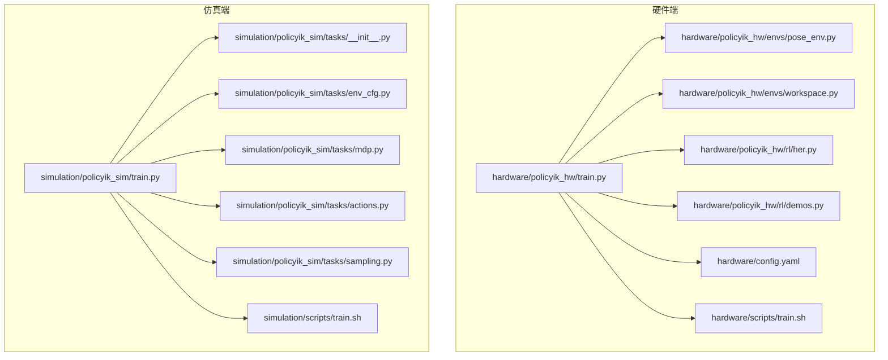
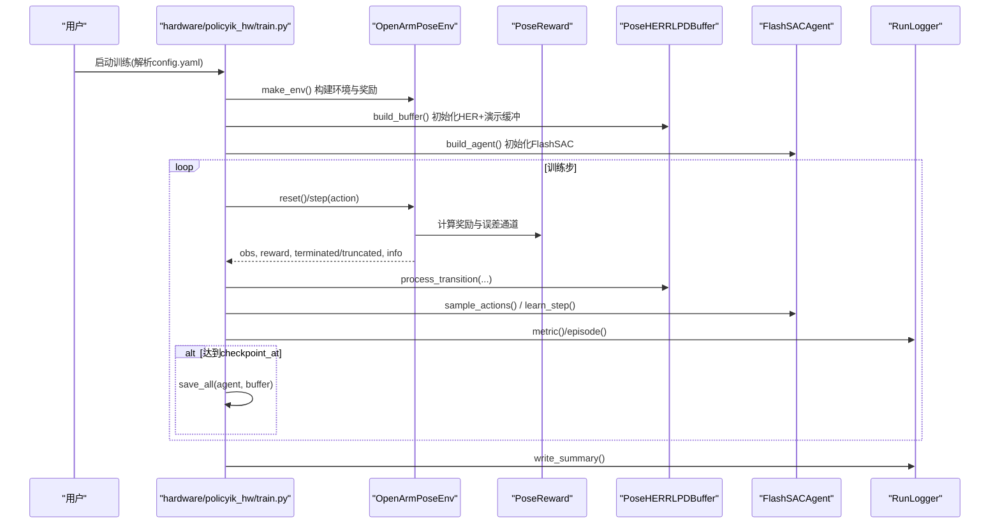
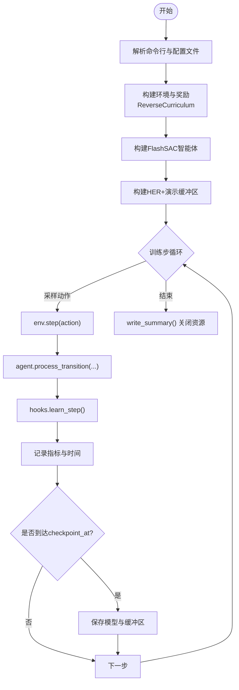
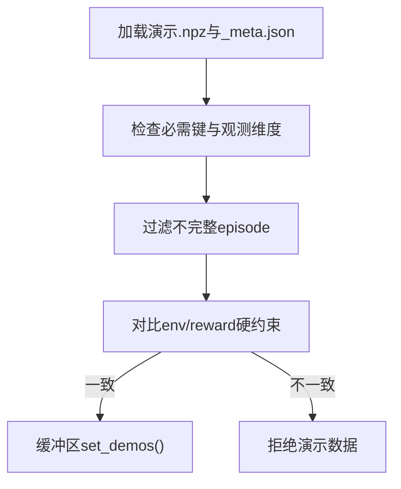
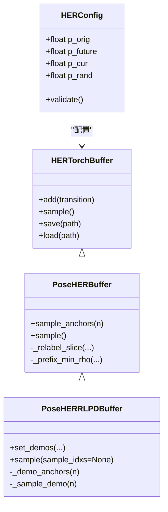
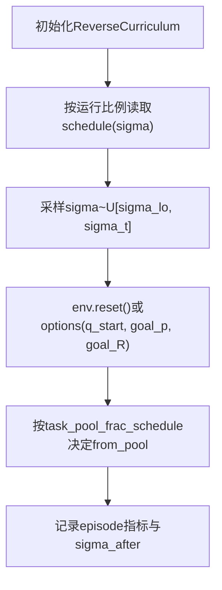
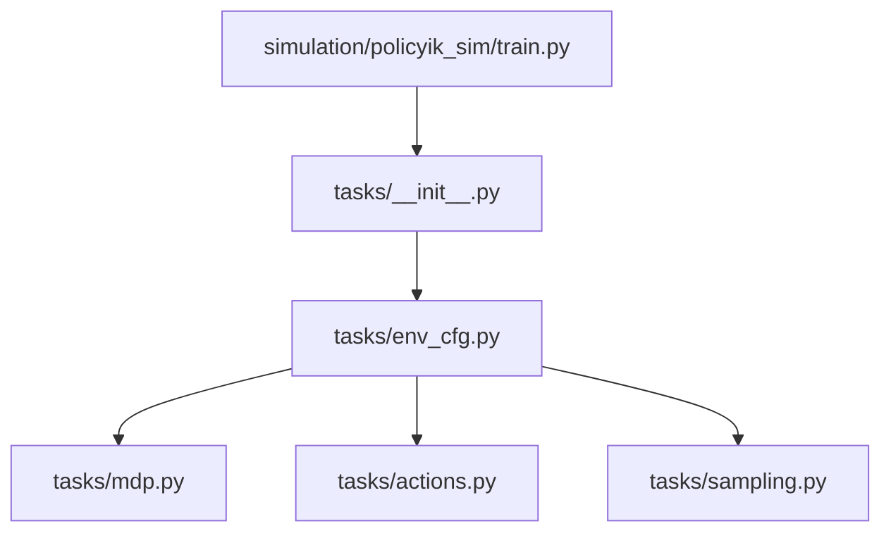
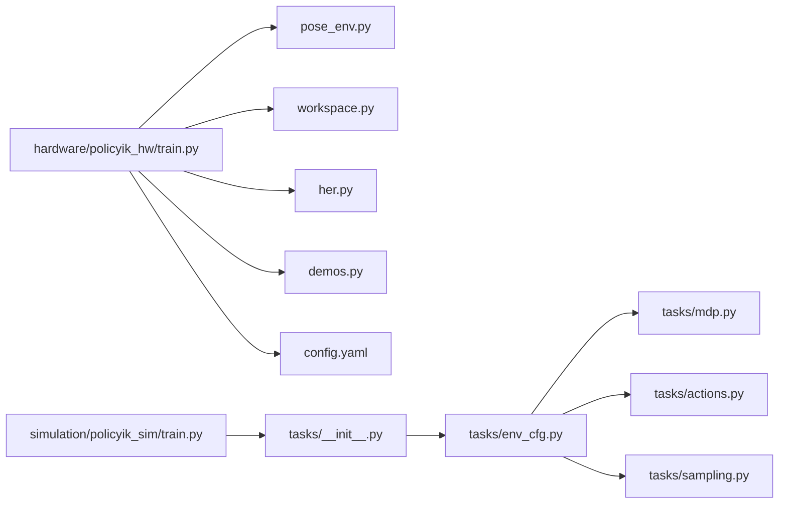

# 训练流程

<cite>
**本文引用的文件**   
- [hardware/policyik_hw/train.py](file://hardware/policyik_hw/train.py)
- [hardware/config.yaml](file://hardware/config.yaml)
- [hardware/scripts/train.sh](file://hardware/scripts/train.sh)
- [hardware/policyik_hw/envs/pose_env.py](file://hardware/policyik_hw/envs/pose_env.py)
- [hardware/policyik_hw/envs/workspace.py](file://hardware/policyik_hw/envs/workspace.py)
- [hardware/policyik_hw/rl/her.py](file://hardware/policyik_hw/rl/her.py)
- [hardware/policyik_hw/rl/demos.py](file://hardware/policyik_hw/rl/demos.py)
- [simulation/policyik_sim/train.py](file://simulation/policyik_sim/train.py)
- [simulation/policyik_sim/tasks/mdp.py](file://simulation/policyik_sim/tasks/mdp.py)
- [simulation/policyik_sim/tasks/env_cfg.py](file://simulation/policyik_sim/tasks/env_cfg.py)
- [simulation/policyik_sim/tasks/actions.py](file://simulation/policyik_sim/tasks/actions.py)
- [simulation/policyik_sim/tasks/sampling.py](file://simulation/policyik_sim/tasks/sampling.py)
- [simulation/policyik_sim/tasks/__init__.py](file://simulation/policyik_sim/tasks/__init__.py)
- [simulation/scripts/train.sh](file://simulation/scripts/train.sh)
</cite>

## 目录
1. [简介](#简介)
2. [项目结构](#项目结构)
3. [核心组件](#核心组件)
4. [架构总览](#架构总览)
5. [详细组件分析](#详细组件分析)
6. [依赖关系分析](#依赖关系分析)
7. [性能与可扩展性](#性能与可扩展性)
8. [故障排查指南](#故障排查指南)
9. [结论](#结论)
10. [附录：配置与超参数调优](#附录配置与超参数调优)

## 简介
本指南面向 PolicyIK 的完整训练流程，覆盖从演示数据收集、任务选择、课程学习调度、在线训练监控到检查点管理的全链路。文档同时解释硬件端（真实机械臂）与仿真端（Isaac Sim + RL-Games）两套训练管道的差异与衔接，并给出两阶段训练策略（仿真预训练 + 真实微调）、日志可视化、进度分析与最佳实践建议。

## 项目结构
PolicyIK 的训练代码分为两条主线：
- 硬件端训练：基于 FlashSAC + HER + 演示回放，直接驱动真实 OpenArm 右臂。
- 仿真端训练：基于 Isaac Lab + RL-Games PPO，提供大规模并行环境用于预训练。

**图表来源**
- [hardware/policyik_hw/train.py:271-437](file://hardware/policyik_hw/train.py#L271-L437)
- [simulation/policyik_sim/train.py:103-245](file://simulation/policyik_sim/train.py#L103-L245)

**章节来源**
- [hardware/policyik_hw/train.py:271-437](file://hardware/policyik_hw/train.py#L271-L437)
- [simulation/policyik_sim/train.py:103-245](file://simulation/policyik_sim/train.py#L103-L245)

## 核心组件
- 硬件端训练入口：解析命令行与配置文件，构建环境、奖励、课程学习、FlashSAC 智能体、HER 缓冲区与演示回放，执行在线训练循环，输出指标与检查点。
- 仿真端训练入口：通过 RL-Games Runner 启动 Isaac Sim 环境，加载任务与环境配置，支持分布式训练、视频录制与 Weights & Biases 跟踪。
- 环境与奖励：硬件端使用 PoseEnv + PoseReward；仿真端使用 ManagerBasedRLEnv + MDP 奖励项（改进奖励、势能塑形、驻留奖励等）。
- 回放与 HER：硬件端 PoseHERRLPDBuffer 将在线经验与冻结演示混合采样，并按概率重标记目标位姿。
- 课程学习：ReverseCurriculum 按运行比例逐步增大起始位姿扰动标准差 sigma。

**章节来源**
- [hardware/policyik_hw/train.py:132-178](file://hardware/policyik_hw/train.py#L132-L178)
- [hardware/policyik_hw/envs/pose_env.py:206-347](file://hardware/policyik_hw/envs/pose_env.py#L206-L347)
- [hardware/policyik_hw/envs/workspace.py:207-251](file://hardware/policyik_hw/envs/workspace.py#L207-L251)
- [hardware/policyik_hw/rl/her.py:39-156](file://hardware/policyik_hw/rl/her.py#L39-L156)
- [simulation/policyik_sim/tasks/env_cfg.py:27-132](file://simulation/policyik_sim/tasks/env_cfg.py#L27-L132)

## 架构总览
下图展示端到端训练流程：从脚本入口到环境步进、奖励计算、HER 重标记、智能体更新、日志与检查点保存。

**图表来源**
- [hardware/policyik_hw/train.py:271-437](file://hardware/policyik_hw/train.py#L271-L437)
- [hardware/policyik_hw/envs/pose_env.py:386-508](file://hardware/policyik_hw/envs/pose_env.py#L386-L508)
- [hardware/policyik_hw/rl/her.py:413-517](file://hardware/policyik_hw/rl/her.py#L413-L517)

## 详细组件分析

### 硬件端训练主循环与监控
- 命令行参数：支持 --config、--name、--total-steps、--checkpoint-at、--init-from、--init-buffer、--step-offset、--urdf、--device 等。
- 配置解析：resolve() 将命令行覆盖写入 cfg，处理绝对路径、task_pool_frac_schedule 校验与 p_rand 归一化。
- 环境构建：make_env() 组装 EnvConfig、PoseRewardConfig、ReverseCurriculum，并注入 curriculum.sigma 的恢复逻辑。
- 智能体构建：build_agent() 映射 FlashSACConfig，包含网络结构、学习率、温度自适应、buffer 大小、设备类型等。
- 缓冲区构建：build_buffer() 设置 HER 概率、near-anchor 采样、zoom 观测切片、demo_ratio 等。
- 训练循环：每步采样动作、步进环境、process_transition、调用 hooks.learn_step/idle_fn 进行 UTD 更新，记录 timing 与 episode 指标。
- 日志与检查点：RunLogger 写 metrics.jsonl、episodes.jsonl、console.log；save_all() 保存模型与 replay buffer；write_summary() 汇总统计。

**图表来源**
- [hardware/policyik_hw/train.py:26-62](file://hardware/policyik_hw/train.py#L26-L62)
- [hardware/policyik_hw/train.py:132-178](file://hardware/policyik_hw/train.py#L132-L178)
- [hardware/policyik_hw/train.py:271-437](file://hardware/policyik_hw/train.py#L271-L437)

**章节来源**
- [hardware/policyik_hw/train.py:26-62](file://hardware/policyik_hw/train.py#L26-L62)
- [hardware/policyik_hw/train.py:132-178](file://hardware/policyik_hw/train.py#L132-L178)
- [hardware/policyik_hw/train.py:271-437](file://hardware/policyik_hw/train.py#L271-L437)

### 演示数据与接口一致性校验
- 演示文件格式：.npz 包含 observation、action、reward、terminated、truncated、next_observation、ep_id、ep_t；配套 _meta.json 记录采集时的 env/reward 设置。
- 完整性校验：load_demos() 检查缺失键、观测维度、完整 episode 掩码；interface_diff() 比较硬约束字段（如 action_scale_rad、control_hz、joint limits 等）与奖励关键参数，不一致则拒绝。
- 与缓冲区集成：PoseHERRLPDBuffer.set_demos() 验证 demo 长度、ep_t 序列、终止状态，并构建演示锚点与 near-anchor 采样。

**图表来源**
- [hardware/policyik_hw/rl/demos.py:28-80](file://hardware/policyik_hw/rl/demos.py#L28-L80)
- [hardware/policyik_hw/rl/her.py:436-478](file://hardware/policyik_hw/rl/her.py#L436-L478)

**章节来源**
- [hardware/policyik_hw/rl/demos.py:28-80](file://hardware/policyik_hw/rl/demos.py#L28-L80)
- [hardware/policyik_hw/rl/her.py:436-478](file://hardware/policyik_hw/rl/her.py#L436-L478)

### HER 重标记与演示混合采样
- HERConfig：定义在线流中原始目标、未来目标、当前目标、随机目标的概率分布，需满足和为 1 且 p_orig > 0。
- HERTorchBuffer：维护 episode 元信息（ep_id、ep_t、ep_len、ep_start），支持 n_step=1 的单步缓存。
- PoseHERBuffer：实现 pose 空间的重标记逻辑，包括近零扰动、near-anchor 采样、rho_best 历史最小值、zoom 观测重写、prev_action 相对化等。
- PoseHERRLPDBuffer：在每次 sample() 时按比例抽取演示样本与在线样本，分别应用不同的重标记概率 cum。

**图表来源**
- [hardware/policyik_hw/rl/her.py:22-38](file://hardware/policyik_hw/rl/her.py#L22-L38)
- [hardware/policyik_hw/rl/her.py:39-156](file://hardware/policyik_hw/rl/her.py#L39-L156)
- [hardware/policyik_hw/rl/her.py:158-412](file://hardware/policyik_hw/rl/her.py#L158-L412)
- [hardware/policyik_hw/rl/her.py:413-517](file://hardware/policyik_hw/rl/her.py#L413-L517)

**章节来源**
- [hardware/policyik_hw/rl/her.py:22-38](file://hardware/policyik_hw/rl/her.py#L22-L38)
- [hardware/policyik_hw/rl/her.py:39-156](file://hardware/policyik_hw/rl/her.py#L39-L156)
- [hardware/policyik_hw/rl/her.py:158-412](file://hardware/policyik_hw/rl/her.py#L158-L412)
- [hardware/policyik_hw/rl/her.py:413-517](file://hardware/policyik_hw/rl/her.py#L413-L517)

### 课程学习与任务池调度
- ReverseCurriculum：根据 schedule 表逐步提升 sigma_deg，并在 episode 结束时打印变化事件；sigma 初始值为 sigma_lo_deg，随运行比例增长。
- task_pool_frac_schedule：控制“来自任务池”的 episode 比例随运行比例递增，从而引入更多多样化 start/goal 组合。
- 任务池：data/task_pool.json 中的每个任务包含 q_start、goal_p、goal_R，reset(options={...}) 可直接指定。

**图表来源**
- [hardware/policyik_hw/envs/workspace.py:207-251](file://hardware/policyik_hw/envs/workspace.py#L207-L251)
- [hardware/policyik_hw/train.py:345-360](file://hardware/policyik_hw/train.py#L345-L360)

**章节来源**
- [hardware/policyik_hw/envs/workspace.py:207-251](file://hardware/policyik_hw/envs/workspace.py#L207-L251)
- [hardware/policyik_hw/train.py:345-360](file://hardware/policyik_hw/train.py#L345-L360)

### 仿真端训练与任务配置
- 训练入口：simulation/policyik_sim/train.py 通过 AppLauncher 启动 Isaac Sim，注册 RL-Games Runner，支持多 GPU、视频录制、W&B 跟踪。
- 任务注册：tasks/__init__.py 注册 PolicyIK-OpenArm 与 Play 模式，指向 env_cfg 与 rl_games_ppo_cfg.yaml。
- 环境配置：tasks/env_cfg.py 定义观察项、奖励项、动作层（累积关节参考 + 误差相关增益）、start/goal 池采样。
- MDP 奖励：tasks/mdp.py 提供改进奖励、势能塑形、驻留奖励、关节裕度惩罚、误差历史观测等。
- 动作层：tasks/actions.py 实现 AccumulatedJointReferenceAction，按误差动态缩放步长。
- 采样：tasks/sampling.py 提供从池子均匀采样 start 构型与 goal 位姿。

**图表来源**
- [simulation/policyik_sim/train.py:103-245](file://simulation/policyik_sim/train.py#L103-L245)
- [simulation/policyik_sim/tasks/__init__.py:1-23](file://simulation/policyik_sim/tasks/__init__.py#L1-L23)
- [simulation/policyik_sim/tasks/env_cfg.py:27-132](file://simulation/policyik_sim/tasks/env_cfg.py#L27-L132)
- [simulation/policyik_sim/tasks/mdp.py:115-232](file://simulation/policyik_sim/tasks/mdp.py#L115-L232)
- [simulation/policyik_sim/tasks/actions.py:15-76](file://simulation/policyik_sim/tasks/actions.py#L15-L76)
- [simulation/policyik_sim/tasks/sampling.py:19-69](file://simulation/policyik_sim/tasks/sampling.py#L19-L69)

**章节来源**
- [simulation/policyik_sim/train.py:103-245](file://simulation/policyik_sim/train.py#L103-L245)
- [simulation/policyik_sim/tasks/__init__.py:1-23](file://simulation/policyik_sim/tasks/__init__.py#L1-L23)
- [simulation/policyik_sim/tasks/env_cfg.py:27-132](file://simulation/policyik_sim/tasks/env_cfg.py#L27-L132)
- [simulation/policyik_sim/tasks/mdp.py:115-232](file://simulation/policyik_sim/tasks/mdp.py#L115-L232)
- [simulation/policyik_sim/tasks/actions.py:15-76](file://simulation/policyik_sim/tasks/actions.py#L15-L76)
- [simulation/policyik_sim/tasks/sampling.py:19-69](file://simulation/policyik_sim/tasks/sampling.py#L19-L69)

## 依赖关系分析
- 硬件端：train.py 依赖 pose_env、workspace、her、demos、config.yaml；通过 rclpy 与 ROS2 交互真实机械臂。
- 仿真端：train.py 依赖 isaaclab、rl_games、policyik_sim.tasks；通过 gymnasium 注册任务。
- 外部依赖：torch、numpy、yaml、json、argparse；仿真端额外依赖 omni、isaaclab、rl_games。

**图表来源**
- [hardware/policyik_hw/train.py:271-437](file://hardware/policyik_hw/train.py#L271-L437)
- [simulation/policyik_sim/train.py:103-245](file://simulation/policyik_sim/train.py#L103-L245)
- [simulation/policyik_sim/tasks/__init__.py:1-23](file://simulation/policyik_sim/tasks/__init__.py#L1-L23)

**章节来源**
- [hardware/policyik_hw/train.py:271-437](file://hardware/policyik_hw/train.py#L271-L437)
- [simulation/policyik_sim/train.py:103-245](file://simulation/policyik_sim/train.py#L103-L245)

## 性能与可扩展性
- 硬件端：
  - 使用 compile 加速（FlashSAC use_compile），UTD（updates per step）提高样本效率。
  - 通过 idle_fn 在环境 spin_for 期间插入学习步骤，减少空转。
  - 可调整 batch_size、buffer_min、gamma、tau、actor/critic 网络规模。
- 仿真端：
  - 支持多 GPU 分布式训练（distributed 标志），num_envs 可设为数千以加速收敛。
  - 可使用 Weights & Biases 跟踪实验，结合 TensorBoard 同步。
  - 视频录制便于调试动作轨迹与任务完成度。

[本节为通用指导，不直接分析具体文件]

## 故障排查指南
- 演示数据被拒绝：
  - 检查 .npz 是否包含必需键，观测维度是否与当前环境一致，episode 是否完整（最后一步 terminated/truncated）。
  - 检查 _meta.json 中的 env/reward 硬约束是否与 config.yaml 一致（如 action_scale_rad、control_hz、joint limits 等）。
- 机械臂通信异常：
  - 若出现 joint state FROZEN 或 MOTOR HEALTH FAULT，检查 CAN 总线、bringup 是否正常运行，必要时重启底层服务。
- 碰撞保护触发：
  - 连续碰撞阻塞会截断或终止 episode，检查 workspace 包络与 link bounds 配置，适当放宽 self_clearance 或 post_clear。
- 课程学习未生效：
  - 确认 curriculum.schedule 分数严格递增且小于 1，sigma 非负递增；检查 total_steps 与 step_offset 是否正确传入。

**章节来源**
- [hardware/policyik_hw/rl/demos.py:60-80](file://hardware/policyik_hw/rl/demos.py#L60-L80)
- [hardware/policyik_hw/envs/pose_env.py:386-508](file://hardware/policyik_hw/envs/pose_env.py#L386-L508)
- [hardware/policyik_hw/envs/workspace.py:215-228](file://hardware/policyik_hw/envs/workspace.py#L215-L228)

## 结论
PolicyIK 提供了完整的硬件与仿真训练管道：硬件端采用 FlashSAC + HER + 演示回放，配合课程学习与任务池调度，适合真实机械臂上的稳健微调；仿真端基于 Isaac Sim + RL-Games PPO，支持大规模并行与分布式训练，适合快速预训练。通过合理的配置与超参数调优，可实现“仿真预训练 + 真实微调”的两阶段策略，显著提升最终部署效果。

[本节为总结性内容，不直接分析具体文件]

## 附录：配置与超参数调优

### 硬件端配置文件结构与含义（hardware/config.yaml）
- env：工作空间包络、关节限制、工具几何、碰撞包络、控制频率、最大步数、动作尺度、观测噪声、成功阈值、重置与安全守卫等。
- reward：位置/旋转误差权重、tanh 细粒度奖励、动作速率与关节速度惩罚、BSP 势能与 cap、PBRS 权重、关节裕度惩罚、dt 缩放等。
- curriculum：起始扰动 sigma 的上下界与 schedule（运行比例 -> sigma），rho_floor 与 max_start_tries 控制起始采样质量。
- agent：FlashSAC 超参，包括 total_steps、checkpoint_at、seed、gamma、tau、lr、batch_size、buffer_min、utd、use_compile、random_warmup、actor/critic 网络结构、critic_num_bins、reward_g_max、normalize_reward、temp_target_sigma。
- her：HER 概率 p_orig/p_future/p_cur/p_rand，near 扰动 sigma 与 zero/near_anchor 比例。
- demos：演示文件路径、ratio、HER-like 概率、near_anchor_frac、task_pool 路径与 task_pool_frac_schedule。
- log：日志间隔 every、窗口 window、保存目录 save_dir。
- collect：演示采集阶段的 collision_block_steps 与 collision_terminate（训练阶段使用 env 段）。

**章节来源**
- [hardware/config.yaml:1-160](file://hardware/config.yaml#L1-L160)

### 超参数调优策略
- 课程学习：
  - 初期 sigma_lo_deg 较小，确保稳定起步；中期逐步增大 sigma_t，扩大探索范围。
  - rho_floor 控制起始采样的最低质量，避免过差的起点导致训练不稳定。
- HER 与演示：
  - p_orig/p_future/p_cur 平衡原始目标与未来/当前目标的比例；p_rand 通常设为 0 以避免无意义目标。
  - demo_ratio 控制演示占比，过大可能抑制在线探索，过小则难以利用先验。
  - near_zero_frac 与 near_anchor_frac 增加高质量样本比例，有助于稳定早期训练。
- 智能体：
  - gamma 影响长期回报估计；tau 控制软更新平滑程度；lr 与 batch_size 共同决定更新稳定性。
  - actor/critic 隐藏层与块数需匹配任务复杂度；critic_num_bins 影响分位数分布拟合精度。
  - normalize_reward 与 reward_g_max 调节奖励尺度，避免梯度爆炸。
- 日志与检查点：
  - checkpoint_at 设置多个全局步数以保留阶段性模型；log.every 控制指标输出频率。

**章节来源**
- [hardware/config.yaml:100-153](file://hardware/config.yaml#L100-L153)
- [hardware/policyik_hw/train.py:132-178](file://hardware/policyik_hw/train.py#L132-L178)

### 两阶段训练策略（仿真预训练 + 真实微调）
- 仿真预训练：
  - 使用 simulation/scripts/train.sh 启动三段式 PPO 训练，自动平均最后若干检查点得到稳健策略。
  - 可通过 --num_envs、--max_iterations、--seed、--wandb-project-name/entity/name 等参数扩展实验。
- 真实微调：
  - 使用 hardware/scripts/train.sh 加载仿真检查点（--init-from）与缓冲区（--init-buffer），设置 --step-offset 与 --total-steps 继续训练。
  - 调整 demos.ratio 与 her.p_* 以增强在线探索；适当降低 sigma 以稳定真实环境行为。

**章节来源**
- [simulation/scripts/train.sh:1-26](file://simulation/scripts/train.sh#L1-L26)
- [hardware/scripts/train.sh:1-14](file://hardware/scripts/train.sh#L1-L14)
- [hardware/policyik_hw/train.py:271-437](file://hardware/policyik_hw/train.py#L271-L437)