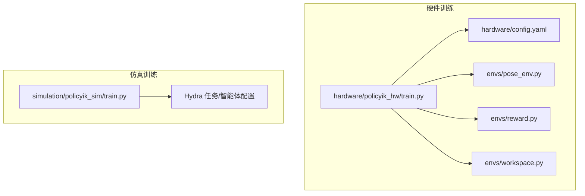
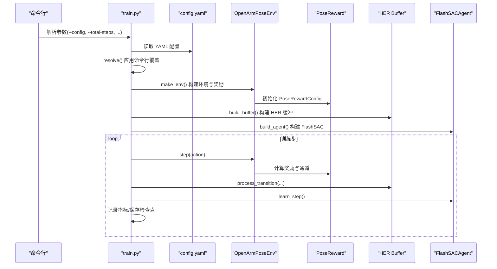
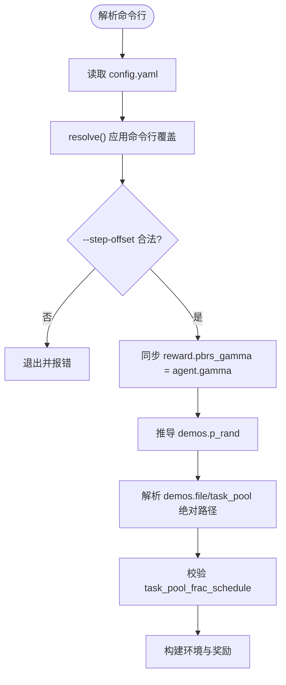
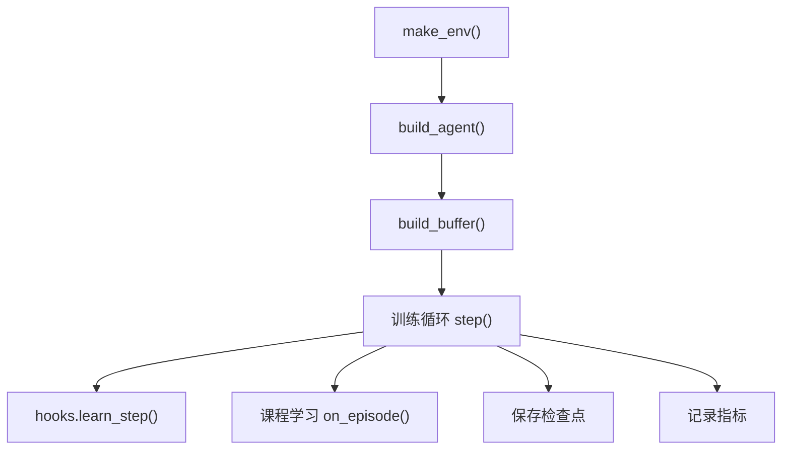
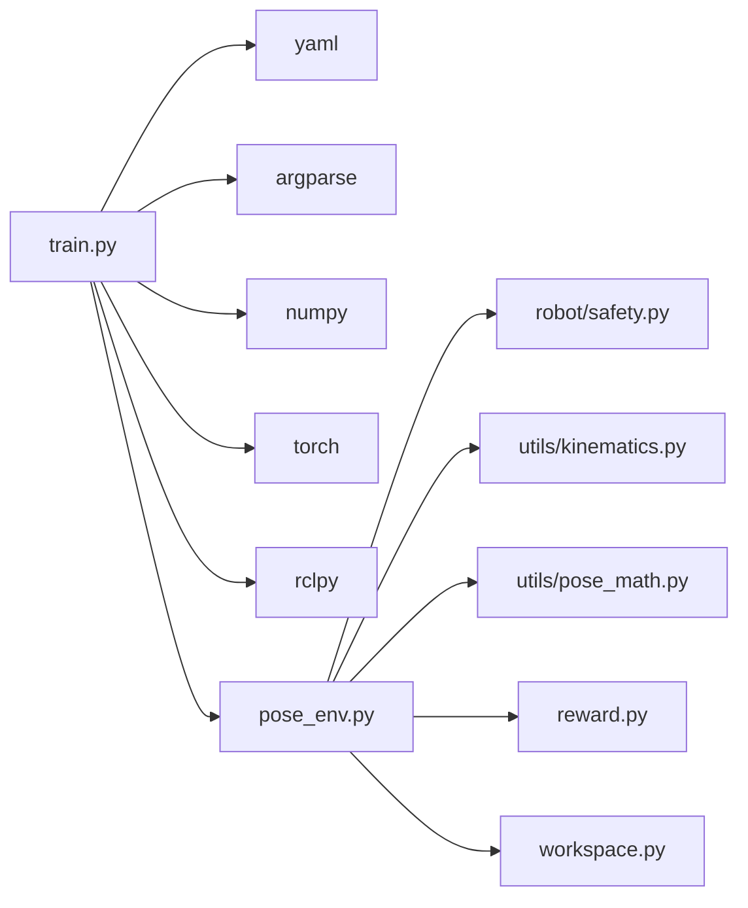

# 训练配置管理

<cite>
**本文引用的文件**   
- [hardware/config.yaml](file://hardware/config.yaml)
- [hardware/policyik_hw/train.py](file://hardware/policyik_hw/train.py)
- [hardware/policyik_hw/envs/pose_env.py](file://hardware/policyik_hw/envs/pose_env.py)
- [hardware/policyik_hw/envs/reward.py](file://hardware/policyik_hw/envs/reward.py)
- [hardware/policyik_hw/envs/workspace.py](file://hardware/policyik_hw/envs/workspace.py)
- [simulation/policyik_sim/train.py](file://simulation/policyik_sim/train.py)
</cite>

## 目录
1. [引言](#引言)
2. [项目结构](#项目结构)
3. [核心组件](#核心组件)
4. [架构总览](#架构总览)
5. [详细组件分析](#详细组件分析)
6. [依赖关系分析](#依赖关系分析)
7. [性能与可复现性](#性能与可复现性)
8. [故障排查指南](#故障排查指南)
9. [结论](#结论)
10. [附录：常用配置模板与最佳实践](#附录常用配置模板与最佳实践)

## 引言
本文面向 PolicyIK 的训练配置系统，目标是帮助读者理解并正确使用 config.yaml 以及命令行参数来驱动真实机械臂与仿真环境中的策略训练。文档将覆盖以下方面：
- config.yaml 的完整结构与字段含义（环境、奖励、算法超参、课程学习、HER、演示数据、日志等）
- 命令行参数的作用、优先级与覆盖规则
- 不同训练场景的配置模板与最佳实践（仿真预训练 vs 真实机器人微调）
- 配置校验机制与常见错误定位方法

## 项目结构
PolicyIK 包含两套训练入口：
- 硬件侧：基于 FlashSAC 的真实 OpenArm 右臂训练脚本，使用 hardware/config.yaml 作为主配置
- 仿真侧：基于 RL-Games 的 Isaac Sim 训练脚本，通过 Hydra 加载任务与智能体配置

**图表来源**
- [hardware/policyik_hw/train.py:26-38](file://hardware/policyik_hw/train.py#L26-L38)
- [simulation/policyik_sim/train.py:27-57](file://simulation/policyik_sim/train.py#L27-L57)

**章节来源**
- [hardware/policyik_hw/train.py:26-38](file://hardware/policyik_hw/train.py#L26-L38)
- [simulation/policyik_sim/train.py:27-57](file://simulation/policyik_sim/train.py#L27-L57)

## 核心组件
- 配置文件：hardware/config.yaml，集中定义环境、奖励、课程学习、智能体、HER、演示数据、日志与采集模式
- 训练入口：hardware/policyik_hw/train.py，解析配置、构建环境与奖励、加载演示与任务池、运行训练循环、保存检查点与指标
- 环境：hardware/policyik_hw/envs/pose_env.py，封装真实机械臂控制、观测构造、碰撞与安全保护、课程学习接口
- 奖励：hardware/policyik_hw/envs/reward.py，实现密集姿态到达奖励、PBRS、停留奖励、关节限位惩罚等
- 工作空间与课程：hardware/policyik_hw/envs/workspace.py，维护可达位姿云、碰撞包络、反向起始课程调度

**章节来源**
- [hardware/config.yaml:1-160](file://hardware/config.yaml#L1-L160)
- [hardware/policyik_hw/train.py:132-178](file://hardware/policyik_hw/train.py#L132-L178)
- [hardware/policyik_hw/envs/pose_env.py:46-158](file://hardware/policyik_hw/envs/pose_env.py#L46-L158)
- [hardware/policyik_hw/envs/reward.py:23-83](file://hardware/policyik_hw/envs/reward.py#L23-L83)
- [hardware/policyik_hw/envs/workspace.py:14-50](file://hardware/policyik_hw/envs/workspace.py#L14-L50)

## 架构总览
硬件训练流程从命令行与配置文件开始，逐步构建环境、奖励、HER 缓冲区与 FlashSAC 智能体，并在训练循环中记录指标、执行课程学习与定期保存检查点。

**图表来源**
- [hardware/policyik_hw/train.py:271-327](file://hardware/policyik_hw/train.py#L271-L327)
- [hardware/policyik_hw/train.py:374-427](file://hardware/policyik_hw/train.py#L374-L427)
- [hardware/policyik_hw/envs/pose_env.py:206-248](file://hardware/policyik_hw/envs/pose_env.py#L206-L248)
- [hardware/policyik_hw/envs/reward.py:85-146](file://hardware/policyik_hw/envs/reward.py#L85-L146)

## 详细组件分析

### 配置文件结构与参数说明
hardware/config.yaml 分为多个顶层段：

- env：环境配置
  - r_goal：目标球半径（米），用于采样目标位姿
  - centre_m：目标球中心坐标（米）
  - cloud_samples / cloud_halfwidth_deg / cloud_seed：位姿云采样规模、关节半宽与随机种子
  - joint_lo_deg / joint_hi_deg：关节上下限（度）
  - tool_z_m / collision_tool_z_m：工具末端 Z 偏移与碰撞检测 Z 偏移
  - min_x_m / min_y_m / max_y_m / min_z_m / min_base_dist_m：工作空间边界约束
  - self_pair_min_gap / link_bounds_from：自碰撞检查的最小连杆间隔与起始连杆索引
  - self_clearance_m：自碰撞最小间距
  - post_clear_m / post_xz / post_from：后方障碍物（如桌面）避让参数
  - shoulder_clear_m / shoulder_z_range：肩部区域避让
  - left_arm_clear_m / left_arm_xz：左臂避让
  - link_min/max_*：连杆包络边界
  - tool_min_*：工具末端包络边界
  - home_pose_deg：初始关节角（度）
  - control_hz / max_episode_steps：控制频率与最大步数
  - action_scale_rad / max_joint_delta_rad / max_joint_velocity_rad_s：动作缩放、最大关节增量与速度限制
  - ref_band_rad / ref_limit_relax_deg：参考带宽度与极限松弛
  - gain_schedule / gain_min / gain_d_lo_m / gain_d_hi_m / gain_th_lo_deg / gain_th_hi_deg：增益调度参数
  - zoom_obs / zoom_pos_d0_m / zoom_ori_d0_deg：局部放大观测尺度
  - obs_prev_action / obs_ref_lead：是否包含上一动作与参考领先项
  - obs_noise_q_rad / obs_noise_dq_rad_s：观测噪声范围
  - goal_jitter_deg：目标扰动
  - success_tau_m / success_tau_r_deg：成功阈值（距离与角度）
  - settled_hold_steps：稳定判定窗口
  - reset_ramp_s / reset_settle_s / reset_ramp_hz：复位斜坡与稳态时间
  - frozen_state_steps / collision_block_steps / collision_terminate：状态冻结保护与碰撞保护

- reward：奖励函数参数
  - tau_p / tau_r_deg / tau_u / kp_size：误差度量与关键点误差尺度
  - w_pos_linear / w_tanh_fine / std_tanh_fine：位置线性与精细 tanh 奖励权重与尺度
  - w_kp_wide / std_kp_wide / w_kp_sharp / std_kp_sharp：关键点误差宽/窄奖励
  - w_action_rate / w_joint_vel：动作变化率与关节速度惩罚
  - w_bsp / bsp_cap：PBRS 改进项与截断
  - w_snlb：SNLB（平滑非负回报）权重
  - w_dwell / dwell_rho：停留奖励与阈值
  - w_pbrs / pbrs_cap / pbrs_gamma：PBRS 权重、截断与折扣
  - w_limit_margin / limit_eps / limit_gate_rho：关节限位惩罚与门控
  - rho_obs_d0：rho 观测归一化尺度
  - scale_by_dt：是否按 dt 缩放奖励

- curriculum：课程学习设置
  - sigma_lo_deg：起始噪声下限（度）
  - schedule：[[运行比例, sigma值], ...] 单调递增且小于 1
  - rho_floor：起始采样的 rho 下界
  - max_start_tries：起始尝试次数上限

- agent：FlashSAC 算法超参
  - total_steps / checkpoint_at / seed：总步数、检查点步数、随机种子
  - gamma / tau / lr：折扣因子、软更新系数、学习率
  - batch_size / buffer_min / utd：批量大小、缓冲最小长度、每步更新次数
  - use_compile：是否启用编译优化
  - random_warmup：随机探索步数
  - actor_num_blocks / actor_hidden_dim / critic_num_blocks / critic_hidden_dim / critic_num_bins：网络结构
  - actor_update_period：Actor 更新周期
  - reward_g_max / normalize_reward：奖励归一化与最大值
  - temp_target_sigma：温度目标标准差

- her：HER 重标记概率
  - p_orig / p_future / p_cur / p_rand：原始/未来/当前/随机重标记概率
  - near_sigma_p_m / near_sigma_r_deg：近邻扰动尺度
  - near_zero_frac / near_anchor_frac / near_anchor_rho：锚点与零样本比例与阈值

- demos：演示数据与任务池
  - file：演示数据路径（相对路径会相对于配置文件目录解析）
  - ratio：演示在批次中的占比
  - p_orig / p_future / p_cur / near_anchor_frac：演示重标记概率与锚点比例
  - task_pool：任务池 JSON 路径
  - task_pool_frac_schedule：任务池混合比例的阶段式调度

- log：日志与输出
  - every / window：指标记录频率与滑动窗口大小
  - save_dir：运行输出目录

- collect：采集演示时的环境配置（覆盖 env.collision_block_steps 与 collision_terminate）

**章节来源**
- [hardware/config.yaml:4-99](file://hardware/config.yaml#L4-L99)
- [hardware/config.yaml:100-149](file://hardware/config.yaml#L100-L149)
- [hardware/config.yaml:150-160](file://hardware/config.yaml#L150-L160)

### 命令行参数与优先级
硬件训练入口支持以下关键命令行参数：
- --config：配置文件路径（默认 config.yaml）
- --name：运行名称（默认 pose_<时间>）
- --total-steps：本次运行段的总步数（覆盖 agent.total_steps）
- --checkpoint-at：逗号分隔的检查点全局步数（覆盖 agent.checkpoint_at）
- --init-from：恢复训练的检查点目录
- --init-buffer：恢复训练的 replay buffer 路径
- --step-offset：恢复训练的全局步偏移（必须与 --init-from 和 --init-buffer 同时使用）
- --urdf：URDF 路径（覆盖默认 openarm_description）
- --device：设备选择 auto/cpu/cuda

优先级规则：
- 命令行参数优先于配置文件
- resolve() 会将命令行覆盖写入 cfg，并做一致性校验（例如 --step-offset 的使用条件）
- 当 --init-from 存在时，random_warmup 被强制为 0
- buffer_size 自动设置为 total_steps + step_offset
- reward.pbrs_gamma 会被同步为 agent.gamma
- demos.p_rand 由 p_orig/p_future/p_cur 推导，若接近 0 则置为 0.0
- demos.file 与 demos.task_pool 的相对路径会相对于配置文件目录解析
- demos.task_pool_frac_schedule 会进行严格校验（分数从 0 开始、严格递增、小于 1；值在 [0,1]）

**图表来源**
- [hardware/policyik_hw/train.py:26-62](file://hardware/policyik_hw/train.py#L26-L62)

**章节来源**
- [hardware/policyik_hw/train.py:26-62](file://hardware/policyik_hw/train.py#L26-L62)

### 环境配置验证
EnvConfig.validate() 对关键参数进行强校验：
- control_hz 与 max_episode_steps 必须大于 0
- reset_ramp_hz 与 min_post_learn_spin_s 必须非负
- settled_hold_steps 不能超过 episode 长度
- ref_limit_relax_deg 必须在 [0, 5]
- zoom 尺度必须为正
- 若启用 gain_schedule，gain_min 必须在 (0, 1]，且增益区间 lo < hi
- success_tau_m / success_tau_r_deg 必须为正
- goal_jitter_deg 必须非负
- 观测噪声必须非负
- 若未启用 obs_prev_action 与 obs_ref_lead，会打印提示（积分器设定值对策略完全不可见）

此外，OpenArmPoseEnv.__init__ 还会：
- 根据 URDF 与关节上下限求交集，若为空则报错
- 初始化 PoseReward 与 PoseCloud，并校验 home 配置与工作空间合法性

**章节来源**
- [hardware/policyik_hw/envs/pose_env.py:132-158](file://hardware/policyik_hw/envs/pose_env.py#L132-L158)
- [hardware/policyik_hw/envs/pose_env.py:206-248](file://hardware/policyik_hw/envs/pose_env.py#L206-L248)

### 奖励函数配置验证
PoseRewardConfig.validate() 校验：
- tau_p / tau_r_deg / tau_u / kp_size 必须为正
- std_tanh_fine / std_kp_wide / std_kp_sharp / bsp_cap / pbrs_cap / limit_eps / dwell_rho 必须为正
- w_bsp / w_snlb / w_dwell / w_pbrs / w_limit_margin 必须非负（符号在项内体现）
- 若启用 scale_by_dt，dt 必须为正
- 若启用 PBRS，pbrs_gamma 必须等于 agent.gamma，否则报错

**章节来源**
- [hardware/policyik_hw/envs/reward.py:60-74](file://hardware/policyik_hw/envs/reward.py#L60-L74)

### 课程学习配置验证
ReverseConfig.validate() 校验：
- schedule 不能为空
- 分数必须从 0 开始、单调递增且小于 1
- sigma 必须为正且单调递增
- total_steps 必须为正
- sigma_lo_deg 必须满足 0 < sigma_lo <= schedule[0][1]
- rho_floor 必须非负，max_start_tries 必须 >= 1

**章节来源**
- [hardware/policyik_hw/envs/workspace.py:215-228](file://hardware/policyik_hw/envs/workspace.py#L215-L228)

### 训练流程与关键逻辑
- 构建环境：make_env() 创建 EnvConfig、PoseRewardConfig 与 ReverseConfig，并进行 validate()
- 构建智能体：build_agent() 映射 agent.* 到 FlashSACConfig
- 构建缓冲：build_buffer() 映射 her.* 与 demos.* 到 PoseHERRLPDBuffer
- 训练循环：process_transition() 与 hooks.learn_step() 协同，按 utd 更新
- 课程学习：env.curriculum.on_episode(step) 触发 sigma 升级
- 检查点：在 checkpoint_at 处保存模型与缓冲
- 日志：RunLogger 输出 metrics.jsonl、episodes.jsonl 与 console.log

**图表来源**
- [hardware/policyik_hw/train.py:232-248](file://hardware/policyik_hw/train.py#L232-L248)
- [hardware/policyik_hw/train.py:374-427](file://hardware/policyik_hw/train.py#L374-L427)

**章节来源**
- [hardware/policyik_hw/train.py:232-248](file://hardware/policyik_hw/train.py#L232-L248)
- [hardware/policyik_hw/train.py:374-427](file://hardware/policyik_hw/train.py#L374-L427)

## 依赖关系分析
- train.py 依赖 yaml、argparse、numpy、torch、rclpy（ROS2）
- 环境依赖 safety.joint_limits、utils.kinematics、utils.pose_math
- 奖励模块独立于环境，但需要关节上下限
- 工作空间模块依赖 ArmKinematics 与 N_JOBS

**图表来源**
- [hardware/policyik_hw/train.py:1-18](file://hardware/policyik_hw/train.py#L1-L18)
- [hardware/policyik_hw/envs/pose_env.py:1-17](file://hardware/policyik_hw/envs/pose_env.py#L1-L17)

**章节来源**
- [hardware/policyik_hw/train.py:1-18](file://hardware/policyik_hw/train.py#L1-L18)
- [hardware/policyik_hw/envs/pose_env.py:1-17](file://hardware/policyik_hw/envs/pose_env.py#L1-L17)

## 性能与可复现性
- 使用 use_compile 可启用 PyTorch 编译以加速训练（需确保训练模式）
- 合理设置 batch_size、utd 与 total_steps 平衡吞吐与稳定性
- 固定 seed 与环境随机种子保证可复现
- 通过 log.every 与 log.window 控制指标粒度与平滑效果
- 在硬件环境中，control_hz 与 min_post_learn_spin_s 影响实际运行频率与时延

**章节来源**
- [hardware/config.yaml:107-128](file://hardware/config.yaml#L107-L128)
- [hardware/config.yaml:150-153](file://hardware/config.yaml#L150-L153)
- [hardware/policyik_hw/envs/pose_env.py:118-130](file://hardware/policyik_hw/envs/pose_env.py#L118-L130)

## 故障排查指南
常见问题与解决思路：
- 命令行参数冲突
  - --step-offset 必须配合 --init-from 与 --init-buffer，否则会退出
  - --checkpoint-at 需提供逗号分隔的正整数列表
- 配置校验失败
  - env.validate() 或 reward.validate() 抛出 ValueError：检查对应字段范围与正负性
  - workspace.ReverseConfig.validate() 报错：检查 schedule 的分数与 sigma 单调性与范围
- 演示数据问题
  - demos.file 或 demos.task_pool 路径解析失败：确认相对路径相对于配置文件目录
  - 演示数据格式不匹配：确保包含 q_start/goal_p/goal_R 字段
- 环境初始化失败
  - URDF 与关节上下限交集为空：检查 joint_lo_deg/joint_hi_deg 与 URDF
  - home 配置不在工作空间或违反连杆包络：调整 centre_m/r_goal/link_min/max_* 等
- 硬件通信问题
  - 无 /joint_states 或 CAN 状态冻结：检查 bringup 启动与 CAN 接口状态
  - 碰撞保护触发：检查 collision_block_steps 与 collision_terminate 设置

**章节来源**
- [hardware/policyik_hw/train.py:41-62](file://hardware/policyik_hw/train.py#L41-L62)
- [hardware/policyik_hw/envs/pose_env.py:132-158](file://hardware/policyik_hw/envs/pose_env.py#L132-L158)
- [hardware/policyik_hw/envs/workspace.py:215-228](file://hardware/policyik_hw/envs/workspace.py#L215-L228)
- [hardware/policyik_hw/envs/reward.py:60-74](file://hardware/policyik_hw/envs/reward.py#L60-L74)

## 结论
PolicyIK 的训练配置系统通过集中式 YAML 与严格的命令行覆盖机制，提供了灵活而稳健的训练控制能力。环境、奖励与课程学习的参数均具备完善的校验逻辑，有助于快速定位配置错误。结合仿真预训练与真实机器人微调的不同策略，用户可以在不同场景中选择合适的配置模板与最佳实践。

## 附录：常用配置模板与最佳实践

### 仿真预训练（Isaac Sim + RL-Games）
- 使用 simulation/policyik_sim/train.py
- 通过 Hydra 加载任务与智能体配置（rl_games_cfg_entry_point）
- 常用命令行参数：
  - --task：任务名
  - --agent：智能体配置入口
  - --num_envs：并行环境数
  - --seed：随机种子
  - --distributed：分布式训练
  - --checkpoint：恢复检查点
  - --sigma：策略初始标准差
  - --max_iterations：训练迭代次数
  - --wandb-project-name / --wandb-entity / --wandb-name：实验追踪

建议：
- 先在小规模 num_envs 上验证任务与智能体配置
- 使用 wandb 跟踪实验，保存 env.yaml 与 agent.yaml
- 在分布式模式下，注意 device 与 rank 的设置

**章节来源**
- [simulation/policyik_sim/train.py:27-57](file://simulation/policyik_sim/train.py#L27-L57)
- [simulation/policyik_sim/train.py:103-160](file://simulation/policyik_sim/train.py#L103-L160)

### 真实机器人微调（OpenArm + FlashSAC）
- 使用 hardware/config.yaml 与 hardware/policyik_hw/train.py
- 推荐步骤：
  - 先在仿真中预训练得到策略
  - 使用 --init-from 与 --init-buffer 恢复检查点与缓冲
  - 设置较小的 total_steps 与较大的 random_warmup 进行在线微调
  - 调整 env.gain_schedule 与 reward.w_dwell 提升稳定性
  - 使用 curriculum.schedule 渐进增加 sigma 以提升鲁棒性

建议：
- 谨慎设置 collision_block_steps 与 collision_terminate，避免频繁终止
- 监控 log.metrics.jsonl 与 episodes.jsonl，关注 settled_success 与 strict_settled
- 若出现关节状态冻结或碰撞保护，检查硬件接口与包络参数

**章节来源**
- [hardware/policyik_hw/train.py:271-327](file://hardware/policyik_hw/train.py#L271-L327)
- [hardware/config.yaml:4-160](file://hardware/config.yaml#L4-L160)