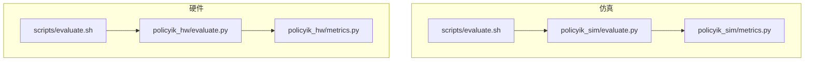
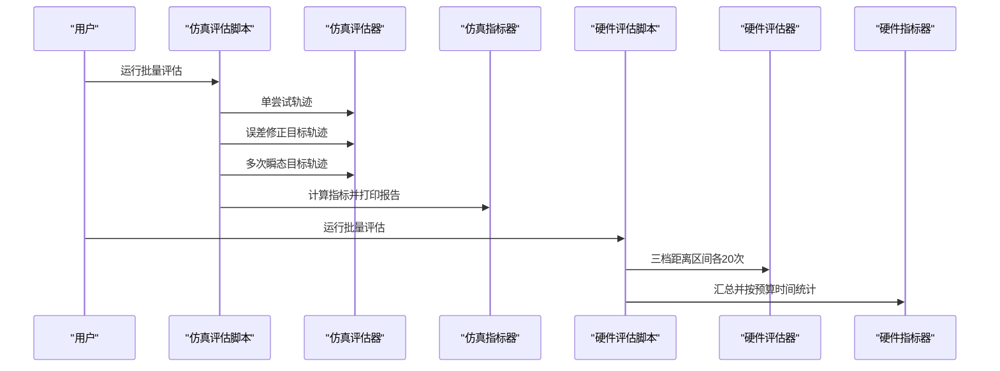
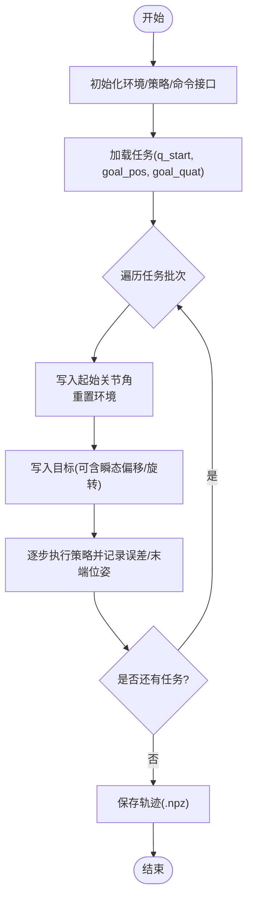
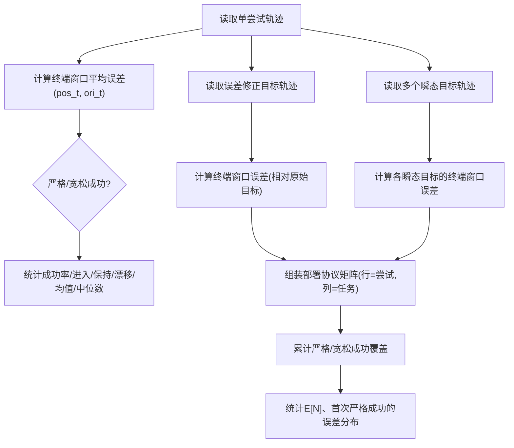
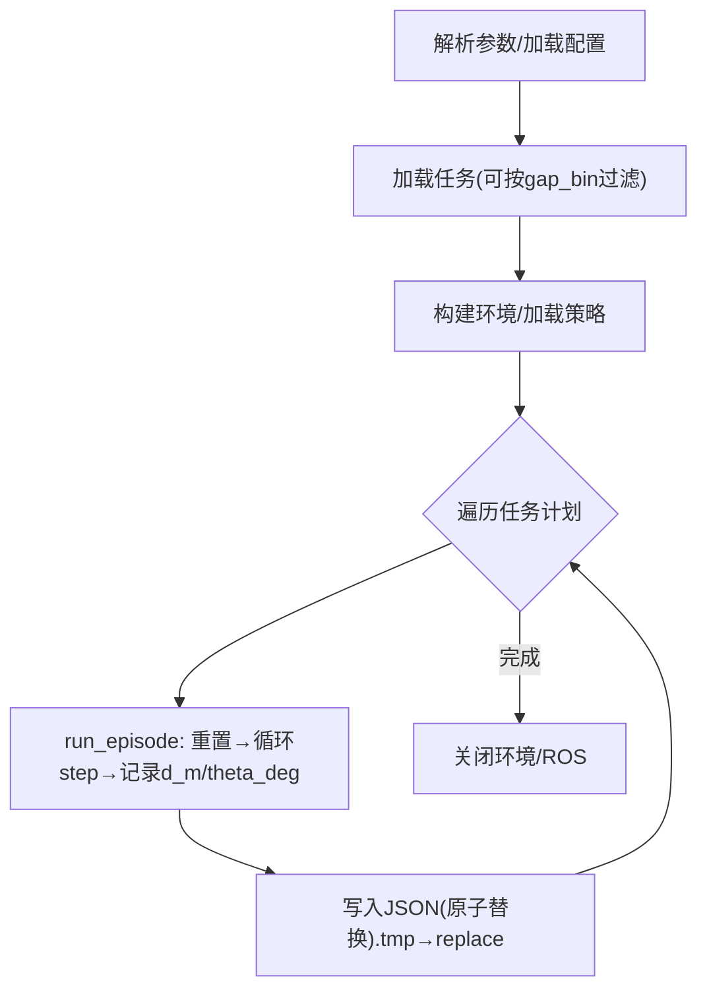
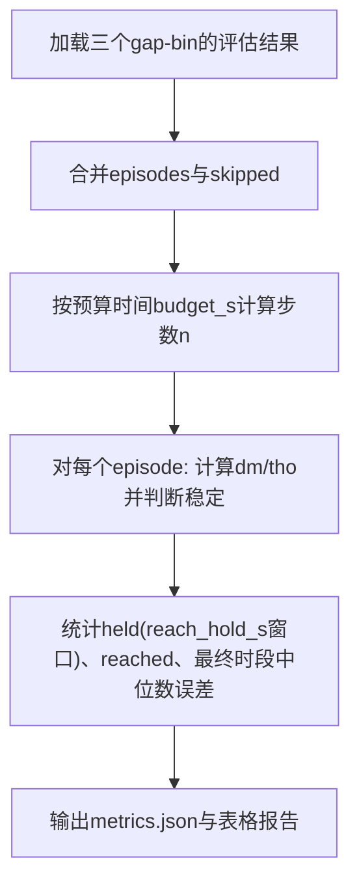
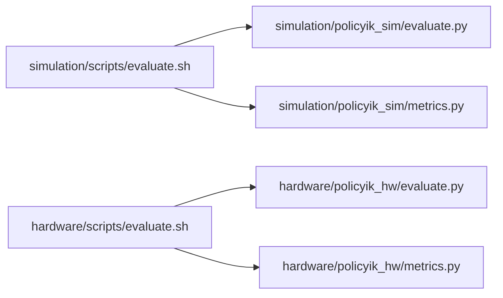

# 评估与指标

<cite>
**本文引用的文件**   
- [README.md](file://README.md)
- [simulation/policyik_sim/evaluate.py](file://simulation/policyik_sim/evaluate.py)
- [simulation/policyik_sim/metrics.py](file://simulation/policyik_sim/metrics.py)
- [simulation/scripts/evaluate.sh](file://simulation/scripts/evaluate.sh)
- [hardware/policyik_hw/evaluate.py](file://hardware/policyik_hw/evaluate.py)
- [hardware/policyik_hw/metrics.py](file://hardware/policyik_hw/metrics.py)
- [hardware/scripts/evaluate.sh](file://hardware/scripts/evaluate.sh)
</cite>

## 目录
1. [引言](#引言)
2. [项目结构](#项目结构)
3. [核心组件](#核心组件)
4. [架构总览](#架构总览)
5. [详细组件分析](#详细组件分析)
6. [依赖关系分析](#依赖关系分析)
7. [性能考量](#性能考量)
8. [故障排查指南](#故障排查指南)
9. [结论](#结论)
10. [附录](#附录)

## 引言
本文件面向 PolicyIK 的评估系统与指标计算，目标是帮助读者理解：
- 评估协议的设计原理与执行流程（仿真与真机两条线）
- 严格标准（1 mm、0.2°）与宽松标准（1 cm、2°）的成功判定条件
- 各项性能指标的计算方法（位置误差、姿态误差、成功率、收敛速度等）
- 批量评估脚本的使用方法、结果可视化与分析报告生成方式
- 基准测试结果解读与模型性能对比分析方法

PolicyIK 在仿真中基于 Isaac Lab 训练与评估，在真实 OpenArm 上直接训练与评估。两者分别提供独立的评估脚本与指标计算模块，但共享“严格/宽松”阈值与“终端窗口平均误差”的核心思想。

## 项目结构
与评估和指标相关的代码主要分布在以下路径：
- 仿真侧
  - simulation/policyik_sim/evaluate.py：单尝试与部署协议下的轨迹采集
  - simulation/policyik_sim/metrics.py：指标计算与报告输出
  - simulation/scripts/evaluate.sh：批量评估流水线
- 硬件侧
  - hardware/policyik_hw/evaluate.py：真机固定任务评估
  - hardware/policyik_hw/metrics.py：按预算时间统计“保持/到达”等指标
  - hardware/scripts/evaluate.sh：三档距离区间的批量评估与汇总

图表来源
- [simulation/scripts/evaluate.sh:1-22](file://simulation/scripts/evaluate.sh#L1-L22)
- [simulation/policyik_sim/evaluate.py:1-192](file://simulation/policyik_sim/evaluate.py#L1-L192)
- [simulation/policyik_sim/metrics.py:1-149](file://simulation/policyik_sim/metrics.py#L1-L149)
- [hardware/scripts/evaluate.sh:1-19](file://hardware/scripts/evaluate.sh#L1-L19)
- [hardware/policyik_hw/evaluate.py:1-177](file://hardware/policyik_hw/evaluate.py#L1-L177)
- [hardware/policyik_hw/metrics.py:1-114](file://hardware/policyik_hw/metrics.py#L1-L114)

章节来源
- [README.md:35-52](file://README.md#L35-L52)

## 核心组件
- 仿真评估器：负责加载策略与环境、写入起始位姿与目标位姿、逐步记录末端位姿与误差，并输出轨迹数据。
- 仿真指标器：基于终端窗口（最后若干步）的平均误差计算严格/宽松成功率、进入时间、漂移、均值/中位数误差等；同时实现部署协议（单次尝试 + 误差修正目标 + 多次瞬态目标）。
- 硬件评估器：在真实机械臂上运行固定任务，记录每步位置与姿态误差，支持断点续跑与跳过任务标记。
- 硬件指标器：将不同起止距离区间（gap-bin）的评估结果合并，按预算时间统计“保持成功数”“到达成功数”，以及最终时段的中位数误差。

章节来源
- [simulation/policyik_sim/evaluate.py:52-185](file://simulation/policyik_sim/evaluate.py#L52-L185)
- [simulation/policyik_sim/metrics.py:33-96](file://simulation/policyik_sim/metrics.py#L33-L96)
- [hardware/policyik_hw/evaluate.py:71-177](file://hardware/policyik_hw/evaluate.py#L71-L177)
- [hardware/policyik_hw/metrics.py:56-114](file://hardware/policyik_hw/metrics.py#L56-L114)

## 架构总览
下图展示了从脚本到评估再到指标计算的端到端流程。仿真侧采用“单尝试 → 误差修正目标 → 多瞬态目标”的部署协议；硬件侧则按三个距离区间分别评估，再统一汇总。

图表来源
- [simulation/scripts/evaluate.sh:1-22](file://simulation/scripts/evaluate.sh#L1-L22)
- [simulation/policyik_sim/evaluate.py:52-185](file://simulation/policyik_sim/evaluate.py#L52-L185)
- [simulation/policyik_sim/metrics.py:106-149](file://simulation/policyik_sim/metrics.py#L106-L149)
- [hardware/scripts/evaluate.sh:1-19](file://hardware/scripts/evaluate.sh#L1-L19)
- [hardware/policyik_hw/evaluate.py:87-177](file://hardware/policyik_hw/evaluate.py#L87-L177)
- [hardware/policyik_hw/metrics.py:81-114](file://hardware/policyik_hw/metrics.py#L81-L114)

## 详细组件分析

### 仿真评估器（policyik_sim.evaluate）
职责
- 初始化 Isaac Lab 环境与 rl_games 包装器
- 加载策略检查点
- 对每个任务设置起始关节角 q_start 与世界坐标系目标 ee_pose
- 可选地注入“瞬态目标”以增强鲁棒性
- 逐步执行策略，记录末端位置/姿态与误差序列
- 输出 .npz 轨迹文件

关键设计要点
- 使用世界坐标系命令 pose_command_w，并在基座更新后刷新缓存
- 冻结目标重采样以保证评估确定性
- 通过 pos_err_fn 与 ori_err_fn 分别计算位置与姿态误差
- 支持批量并行（num_envs）以提升吞吐

图表来源
- [simulation/policyik_sim/evaluate.py:52-185](file://simulation/policyik_sim/evaluate.py#L52-L185)

章节来源
- [simulation/policyik_sim/evaluate.py:52-185](file://simulation/policyik_sim/evaluate.py#L52-L185)

### 仿真指标器（policyik_sim.metrics）
职责
- 从评估输出的 .npz 文件中计算两类指标：
  - 单尝试指标：严格/宽松成功率、进入率、保持率、进入时间、漂移、均值/中位数误差
  - 部署协议指标：累计严格/宽松成功率、执行次数期望 E[N]、首次严格成功或最后一次执行的误差分布
- 定义严格/宽松阈值与终端窗口长度

阈值与参数
- 严格阈值：位置 1 mm、姿态 0.2°
- 宽松阈值：位置 1 cm、姿态 2°
- 终端窗口 TAIL：最后若干步用于计算平均误差
- 策略频率 POLICY_HZ：用于将步数转换为秒
- 瞬态目标数量 N_TRANSIENT：部署协议中的额外尝试次数

核心算法
- 终端窗口平均误差：对最后 TAIL 步的位置/姿态误差求均值
- 严格/宽松成功：终端窗口内位置与姿态误差同时低于阈值
- 进入/保持：任意时刻进入严格区域为“进入”，最后 TAIL 步均保持在严格区域内为“保持”
- 漂移：比较最后一步与窗口起点末端的位移/旋转角度
- 部署协议：
  - 第一步：单尝试
  - 第二步：若终端窗口位置误差小于门限（例如 1 cm），则使用“误差修正目标”再次尝试
  - 后续步骤：依次尝试多个“瞬态目标”
  - 统计覆盖成功、执行次数、首次严格成功时的误差分布

图表来源
- [simulation/policyik_sim/metrics.py:9-16](file://simulation/policyik_sim/metrics.py#L9-L16)
- [simulation/policyik_sim/metrics.py:33-48](file://simulation/policyik_sim/metrics.py#L33-L48)
- [simulation/policyik_sim/metrics.py:51-96](file://simulation/policyik_sim/metrics.py#L51-L96)

章节来源
- [simulation/policyik_sim/metrics.py:9-16](file://simulation/policyik_sim/metrics.py#L9-L16)
- [simulation/policyik_sim/metrics.py:33-96](file://simulation/policyik_sim/metrics.py#L33-L96)
- [simulation/policyik_sim/metrics.py:106-149](file://simulation/policyik_sim/metrics.py#L106-L149)

### 硬件评估器（policyik_hw.evaluate）
职责
- 加载训练配置与任务清单
- 对每个任务执行一次确定性回合，记录每步位置误差 d_m 与姿态误差 theta_deg
- 支持断点续跑、跳过任务标记、碰撞保护开关、URDF 路径指定
- 输出 JSON 结果文件，包含 episodes 与 skipped 列表

关键设计要点
- 任务过滤：可按起止距离 gap_m 进行区间筛选
- 断点续跑：已有结果文件会合并已完成的 trial_id，未完成的继续执行
- 安全：默认启用碰撞保护，可通过参数关闭
- 设备选择：自动检测 CUDA/CPU

图表来源
- [hardware/policyik_hw/evaluate.py:33-45](file://hardware/policyik_hw/evaluate.py#L33-L45)
- [hardware/policyik_hw/evaluate.py:71-84](file://hardware/policyik_hw/evaluate.py#L71-L84)
- [hardware/policyik_hw/evaluate.py:87-177](file://hardware/policyik_hw/evaluate.py#L87-L177)

章节来源
- [hardware/policyik_hw/evaluate.py:33-45](file://hardware/policyik_hw/evaluate.py#L33-L45)
- [hardware/policyik_hw/evaluate.py:71-84](file://hardware/policyik_hw/evaluate.py#L71-L84)
- [hardware/policyik_hw/evaluate.py:87-177](file://hardware/policyik_hw/evaluate.py#L87-L177)

### 硬件指标器（policyik_hw.metrics）
职责
- 读取同一 checkpoint 下三个 gap-bin 的评估结果
- 按预算时间（如 15 s、25 s）统计：
  - held：在预算时间内达到并保持稳定（位置≤1 mm、姿态≤0.2°）的时间段计数
  - reached：在短窗口（如 0.5 s）内达到稳定的任务数
  - 最终时段的中位数位置/姿态误差
- 输出汇总 JSON 与表格化报告

关键设计要点
- 三档距离区间映射：medium / long / extended
- 稳定判定：连续满足严格阈值的持续时间
- 预算转换：eval_hz 将秒转换为步数
- 中断任务计入失败

图表来源
- [hardware/policyik_hw/metrics.py:12-17](file://hardware/policyik_hw/metrics.py#L12-L17)
- [hardware/policyik_hw/metrics.py:31-53](file://hardware/policyik_hw/metrics.py#L31-L53)
- [hardware/policyik_hw/metrics.py:56-78](file://hardware/policyik_hw/metrics.py#L56-L78)
- [hardware/policyik_hw/metrics.py:81-114](file://hardware/policyik_hw/metrics.py#L81-L114)

章节来源
- [hardware/policyik_hw/metrics.py:12-17](file://hardware/policyik_hw/metrics.py#L12-L17)
- [hardware/policyik_hw/metrics.py:31-53](file://hardware/policyik_hw/metrics.py#L31-L53)
- [hardware/policyik_hw/metrics.py:56-78](file://hardware/policyik_hw/metrics.py#L56-L78)
- [hardware/policyik_hw/metrics.py:81-114](file://hardware/policyik_hw/metrics.py#L81-L114)

## 依赖关系分析
- 仿真侧
  - scripts/evaluate.sh 调用 policyik_sim.evaluate 三次（单尝试、误差修正目标、多个瞬态目标），然后调用 policyik_sim.metrics 汇总
  - evaluate.py 依赖 Isaac Lab 环境与 rl_games 包装器，读取任务 npz 并输出轨迹 npz
  - metrics.py 仅依赖 numpy，读取评估输出并计算指标
- 硬件侧
  - scripts/evaluate.sh 循环调用 policyik_hw.evaluate 三次（三个 gap-bin），然后调用 policyik_hw.metrics 汇总
  - evaluate.py 依赖 ROS 2 与 OpenArm 环境，输出 JSON
  - metrics.py 读取 JSON 并汇总

图表来源
- [simulation/scripts/evaluate.sh:1-22](file://simulation/scripts/evaluate.sh#L1-L22)
- [hardware/scripts/evaluate.sh:1-19](file://hardware/scripts/evaluate.sh#L1-L19)

章节来源
- [simulation/scripts/evaluate.sh:1-22](file://simulation/scripts/evaluate.sh#L1-L22)
- [hardware/scripts/evaluate.sh:1-19](file://hardware/scripts/evaluate.sh#L1-L19)

## 性能考量
- 仿真评估
  - 使用 num_envs 并行加速评估，建议根据 GPU 显存与任务规模调整
  - 冻结目标重采样与确定性动作确保评估可复现
  - 终端窗口长度 TAIL 影响稳定性度量，需与策略频率 POLICY_HZ 配合解释时间尺度
- 硬件评估
  - eval_hz 决定预算时间与步数的换算，应使用训练步长倒数（约 8.13 Hz）
  - 碰撞保护可能截断控制指令，建议在评估时关闭（--no-collision-guard）以获得一致的可比性
  - 中断任务会被记录为 skipped，指标器将其视为失败，保证统计无偏

[本节为通用指导，不直接分析具体文件]

## 故障排查指南
常见问题与建议
- 仿真评估无法启动
  - 确认已安装 Isaac Lab 与 rl_games，环境变量 OMNI_KIT_ACCEPT_EULA=YES 已设置
  - 检查 checkpoint 路径与 task_file 是否存在且格式正确
- 指标计算报错
  - 仿真：确保 single.npz、corrected.npz、transient*.npz 齐全
  - 硬件：确保三个 gap-bin 的评估结果都存在且 settings 一致
- 硬件评估中断
  - Ctrl-C 后当前任务被记录为 skipped，重新运行相同命令即可续跑
  - 若 settings 变化（如 max_steps、collision_guard），需要 --overwrite 或 --tag 区分

章节来源
- [hardware/policyik_hw/evaluate.py:127-177](file://hardware/policyik_hw/evaluate.py#L127-L177)
- [hardware/policyik_hw/metrics.py:31-53](file://hardware/policyik_hw/metrics.py#L31-L53)

## 结论
PolicyIK 的评估系统围绕“终端窗口平均误差 + 严格/宽松阈值”展开，既能在仿真中通过部署协议提升鲁棒性，也能在真机上按预算时间衡量“到达/保持”能力。通过统一的脚本与指标工具，用户可以便捷地进行批量评估、结果可视化与跨模型对比。

[本节为总结性内容，不直接分析具体文件]

## 附录

### 评估协议与指标速查
- 严格标准：位置 ≤ 1 mm，姿态 ≤ 0.2°
- 宽松标准：位置 ≤ 1 cm，姿态 ≤ 2°
- 终端窗口：最后若干步（仿真侧 TAIL）
- 仿真部署协议顺序：
  1) 单尝试
  2) 误差修正目标（当终端窗口位置误差 ≤ 1 cm）
  3) 多次瞬态目标（最多 8 次）
- 硬件预算时间：15 s、25 s；稳定判定：位置 ≤ 1 mm，姿态 ≤ 0.2°

章节来源
- [simulation/policyik_sim/metrics.py:9-16](file://simulation/policyik_sim/metrics.py#L9-L16)
- [simulation/policyik_sim/metrics.py:62-96](file://simulation/policyik_sim/metrics.py#L62-L96)
- [hardware/policyik_hw/metrics.py:12-17](file://hardware/policyik_hw/metrics.py#L12-L17)

### 批量评估脚本使用方法
- 仿真
  - 单策略评估：bash simulation/scripts/evaluate.sh <seed> [checkpoint]
  - 多策略汇总：python -m policyik_sim.metrics --seed_dir outputs/eval/s1 --seed_dir outputs/eval/s2 ...
- 硬件
  - 三档距离区间批量评估：bash hardware/scripts/evaluate.sh <run_dir> [checkpoint_dir_name]
  - 指标汇总：由脚本内部自动调用 python -m policyik_hw.metrics --run <run_dir> --checkpoint <checkpoint> --task-file data/eval_tasks.json --eval-hz 8.13

章节来源
- [README.md:99-106](file://README.md#L99-L106)
- [simulation/scripts/evaluate.sh:1-22](file://simulation/scripts/evaluate.sh#L1-L22)
- [hardware/scripts/evaluate.sh:1-19](file://hardware/scripts/evaluate.sh#L1-L19)

### 基准测试结果解读与模型对比
- 仿真
  - 关注 strict/coarse 成功率、entry/containment、entry_time_s、drift_um/deg、pos_mean_mm/median_mm、ori_mean_deg/median_deg
  - 部署协议下观察累计严格/宽松成功覆盖与 E[N]，以及 delivered attempt 的误差分布
- 硬件
  - 关注 held（不同保持时长）、reached、最终时段的中位数位置/姿态误差
  - 比较不同 checkpoint 或不同训练策略在各预算时间下的表现

章节来源
- [simulation/policyik_sim/metrics.py:106-149](file://simulation/policyik_sim/metrics.py#L106-L149)
- [hardware/policyik_hw/metrics.py:81-114](file://hardware/policyik_hw/metrics.py#L81-L114)
