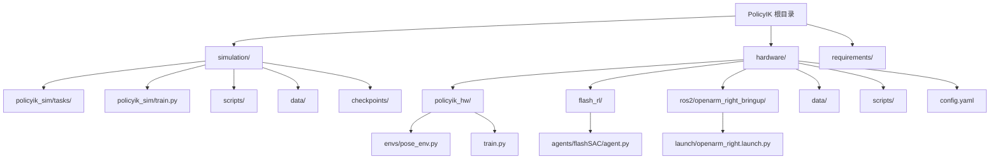
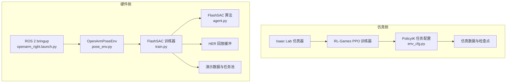
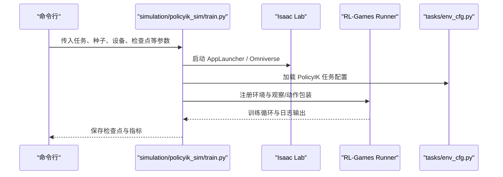
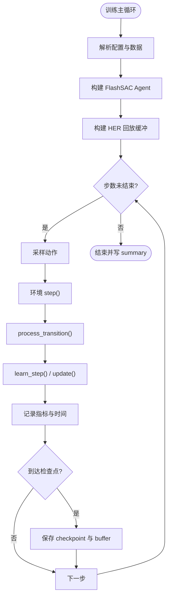
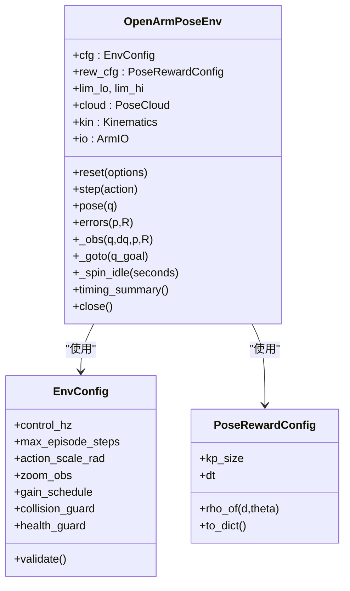
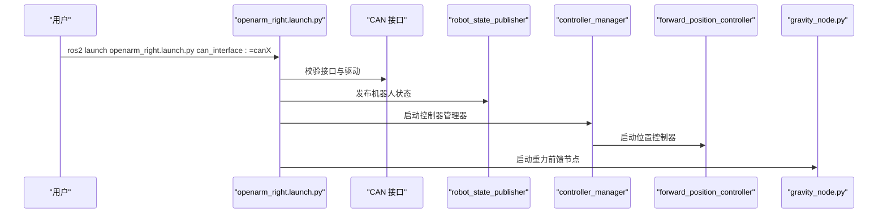
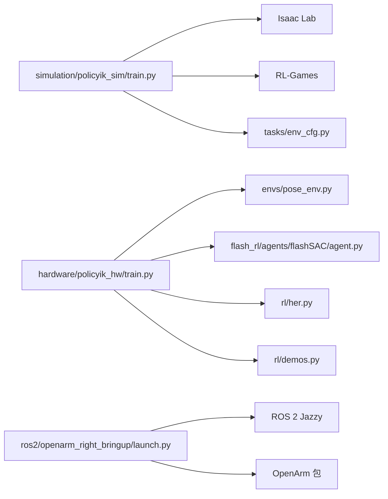

# 项目概述

<cite>
**本文引用的文件**   
- [README.md](file://README.md)
- [hardware/README.md](file://hardware/README.md)
- [simulation/policyik_sim/train.py](file://simulation/policyik_sim/train.py)
- [simulation/policyik_sim/tasks/env_cfg.py](file://simulation/policyik_sim/tasks/env_cfg.py)
- [hardware/policyik_hw/train.py](file://hardware/policyik_hw/train.py)
- [hardware/policyik_hw/envs/pose_env.py](file://hardware/policyik_hw/envs/pose_env.py)
- [hardware/flash_rl/agents/flashSAC/agent.py](file://hardware/flash_rl/agents/flashSAC/agent.py)
- [hardware/ros2/openarm_right_bringup/launch/openarm_right.launch.py](file://hardware/ros2/openarm_right_bringup/launch/openarm_right.launch.py)
- [hardware/scripts/train.sh](file://hardware/scripts/train.sh)
- [hardware/scripts/evaluate.sh](file://hardware/scripts/evaluate.sh)
- [hardware/scripts/train_watchdog.sh](file://hardware/scripts/train_watchdog.sh)
</cite>

## 目录
1. [引言](#引言)
2. [项目结构](#项目结构)
3. [核心组件](#核心组件)
4. [架构总览](#架构总览)
5. [详细组件分析](#详细组件分析)
6. [依赖关系分析](#依赖关系分析)
7. [性能与精度特性](#性能与精度特性)
8. [快速开始指南](#快速开始指南)
9. [故障排查](#故障排查)
10. [结论](#结论)

## 引言
PolicyIK 是一个面向机械臂高精度逆运动学控制的目标条件强化学习方案。其核心目标是在仿真与真实机器人环境中，让策略学会在更广泛的任务上达到并稳定保持末端执行器的完整位姿，位置误差小于 1 mm、姿态误差小于 0.2°。项目在 Isaac Lab 中基于 PPO 训练仿真策略，并在 OpenArm 真机上使用 FlashSAC 与 hindsight experience replay（HER）进行在线训练；同时提供 ROS 2 硬件接口、任务数据、评估脚本与安全监控机制，形成从仿真到真机的完整闭环。

该项目的关键创新点体现在：
- 在 OpenArm 机械臂上实现 1 mm 和 0.2° 的高精度位姿控制，覆盖更多任务。
- 将 Isaac Lab 仿真、RL-Games 训练流程与自定义 PolicyIK 任务配置结合，构建可复现的仿真训练管线。
- 在真机上采用 FlashSAC 算法、HER 回放缓冲、演示数据混合、课程学习与任务池采样，提升长距离位姿控制的稳定性与收敛性。
- 通过 ROS 2 bringup、CAN 总线驱动、控制器管理器与重力前馈节点，提供安全可靠的硬件交互层。

**章节来源**
- [README.md:1-22](file://README.md#L1-L22)

## 项目结构
PolicyIK 仓库按“仿真”和“硬件”两条主线组织代码：
- `simulation/`：Isaac Lab 任务定义、PPO 训练、评估与指标统计。
- `hardware/`：OpenArm 真机环境、FlashSAC 算法、ROS 2 bringup、训练与评估脚本、任务与演示数据。
- `requirements/`：仿真与硬件环境的依赖清单。

**图表来源**
- [README.md:35-52](file://README.md#L35-L52)
- [simulation/policyik_sim/train.py:17-100](file://simulation/policyik_sim/train.py#L17-L100)
- [hardware/policyik_hw/train.py:1-38](file://hardware/policyik_hw/train.py#L1-L38)
- [hardware/policyik_hw/envs/pose_env.py:1-18](file://hardware/policyik_hw/envs/pose_env.py#L1-L18)
- [hardware/flash_rl/agents/flashSAC/agent.py:30-80](file://hardware/flash_rl/agents/flashSAC/agent.py#L30-L80)
- [hardware/ros2/openarm_right_bringup/launch/openarm_right.launch.py:19-30](file://hardware/ros2/openarm_right_bringup/launch/openarm_right.launch.py#L19-L30)

**章节来源**
- [README.md:35-52](file://README.md#L35-L52)

## 核心组件
PolicyIK 的核心由以下模块组成：
- 仿真训练入口：Isaac Lab + RL-Games 的 PPO 训练脚本。
- 仿真任务配置：PolicyIK 在 OpenArm reach 任务上的观测、奖励、动作与环境配置。
- 真机训练入口：FlashSAC + HER + 演示数据的在线训练主循环。
- 真机环境：OpenArmPoseEnv，封装 CAN/ROS 2 状态读取、碰撞保护、奖励计算与课程学习。
- FlashSAC 算法：Actor-Critic 网络、温度参数、回放缓冲与更新流程。
- ROS 2 硬件接口：bringup launch 启动控制器、重力前馈与关节状态发布。

这些组件共同构成“仿真训练 → 策略部署 → 真机训练 → 评估验证”的完整链路。

**章节来源**
- [simulation/policyik_sim/train.py:17-100](file://simulation/policyik_sim/train.py#L17-L100)
- [simulation/policyik_sim/tasks/env_cfg.py:1-25](file://simulation/policyik_sim/tasks/env_cfg.py#L1-L25)
- [hardware/policyik_hw/train.py:1-38](file://hardware/policyik_hw/train.py#L1-L38)
- [hardware/policyik_hw/envs/pose_env.py:1-18](file://hardware/policyik_hw/envs/pose_env.py#L1-L18)
- [hardware/flash_rl/agents/flashSAC/agent.py:30-80](file://hardware/flash_rl/agents/flashSAC/agent.py#L30-L80)
- [hardware/ros2/openarm_right_bringup/launch/openarm_right.launch.py:19-30](file://hardware/ros2/openarm_right_bringup/launch/openarm_right.launch.py#L19-L30)

## 架构总览
PolicyIK 的整体架构分为仿真侧与硬件侧两条路径，并通过统一的任务描述与评估指标衔接。

**图表来源**
- [simulation/policyik_sim/train.py:17-100](file://simulation/policyik_sim/train.py#L17-L100)
- [simulation/policyik_sim/tasks/env_cfg.py:1-25](file://simulation/policyik_sim/tasks/env_cfg.py#L1-L25)
- [hardware/policyik_hw/train.py:1-38](file://hardware/policyik_hw/train.py#L1-L38)
- [hardware/policyik_hw/envs/pose_env.py:1-18](file://hardware/policyik_hw/envs/pose_env.py#L1-L18)
- [hardware/flash_rl/agents/flashSAC/agent.py:30-80](file://hardware/flash_rl/agents/flashSAC/agent.py#L30-L80)
- [hardware/ros2/openarm_right_bringup/launch/openarm_right.launch.py:19-30](file://hardware/ros2/openarm_right_bringup/launch/openarm_right.launch.py#L19-L30)

## 详细组件分析

### 仿真训练入口与任务配置
仿真训练入口负责启动 Isaac Sim、注册 RL-Games 环境、加载策略配置、设置日志与视频录制，并调用 Runner 执行训练或恢复检查点。任务配置则扩展 OpenArm reach 任务，定义：
- 起始位姿与目标位姿的采样池。
- 观测向量：关节差、速度、目标位姿、关键点偏移、粗/细位姿误差、误差历史、命令状态与上一动作。
- 奖励项：关键点跟踪、回退惩罚、势函数塑形、驻留奖励、关节裕度成本、改进奖励等。
- 动作空间：累积关节参考，带误差相关缩放。

**图表来源**
- [simulation/policyik_sim/train.py:17-100](file://simulation/policyik_sim/train.py#L17-L100)
- [simulation/policyik_sim/tasks/env_cfg.py:27-112](file://simulation/policyik_sim/tasks/env_cfg.py#L27-L112)

**章节来源**
- [simulation/policyik_sim/train.py:17-100](file://simulation/policyik_sim/train.py#L17-L100)
- [simulation/policyik_sim/tasks/env_cfg.py:27-112](file://simulation/policyik_sim/tasks/env_cfg.py#L27-L112)

### 真机训练主循环与 FlashSAC 算法
真机训练主循环负责：
- 解析配置、初始化 Kinematics、加载演示数据与任务池。
- 构建 FlashSAC Agent 与 HER 回放缓冲。
- 运行 step 循环：采样动作、与环境交互、记录过渡、触发学习更新、记录指标与定期保存检查点。
- 支持断点续训、随机探索阶段、课程学习与任务池比例调度。

FlashSAC 算法包含：
- Actor-Critic 网络与温度参数。
- 基于 zeta 分布的噪声重复采样。
- 奖励归一化、学习率调度、AMP 与编译优化。
- 回放缓冲管理与批量更新。

**图表来源**
- [hardware/policyik_hw/train.py:271-437](file://hardware/policyik_hw/train.py#L271-L437)
- [hardware/flash_rl/agents/flashSAC/agent.py:335-516](file://hardware/flash_rl/agents/flashSAC/agent.py#L335-L516)

**章节来源**
- [hardware/policyik_hw/train.py:271-437](file://hardware/policyik_hw/train.py#L271-L437)
- [hardware/flash_rl/agents/flashSAC/agent.py:335-516](file://hardware/flash_rl/agents/flashSAC/agent.py#L335-L516)

### 真机环境 OpenArmPoseEnv
OpenArmPoseEnv 是连接策略与真实 OpenArm 的关键环境类，职责包括：
- 构建观测布局与空间定义。
- 管理工作区云、碰撞包络与自碰撞约束。
- 处理关节限位、速度限制、参考轨迹平滑与碰撞保护。
- 计算位姿误差、关键点误差与奖励通道。
- 集成 ROS 2 状态读取、命令发送与空闲等待。
- 支持课程学习、增益调度与错误检测（电机健康、状态冻结、碰撞阻塞）。

**图表来源**
- [hardware/policyik_hw/envs/pose_env.py:21-43](file://hardware/policyik_hw/envs/pose_env.py#L21-L43)
- [hardware/policyik_hw/envs/pose_env.py:46-158](file://hardware/policyik_hw/envs/pose_env.py#L46-L158)
- [hardware/policyik_hw/envs/pose_env.py:206-253](file://hardware/policyik_hw/envs/pose_env.py#L206-L253)
- [hardware/policyik_hw/envs/pose_env.py:386-508](file://hardware/policyik_hw/envs/pose_env.py#L386-L508)

**章节来源**
- [hardware/policyik_hw/envs/pose_env.py:21-43](file://hardware/policyik_hw/envs/pose_env.py#L21-L43)
- [hardware/policyik_hw/envs/pose_env.py:46-158](file://hardware/policyik_hw/envs/pose_env.py#L46-L158)
- [hardware/policyik_hw/envs/pose_env.py:206-253](file://hardware/policyik_hw/envs/pose_env.py#L206-L253)
- [hardware/policyik_hw/envs/pose_env.py:386-508](file://hardware/policyik_hw/envs/pose_env.py#L386-L508)

### ROS 2 硬件接口与 bringup
ROS 2 bringup 负责：
- 校验 CAN 接口（名称、驱动、是否 up）。
- 生成 URDF 并注入电机增益。
- 启动 robot_state_publisher、controller_manager 与控制器 spawner。
- 启动重力前馈节点，使机械臂能保持姿态。

**图表来源**
- [hardware/ros2/openarm_right_bringup/launch/openarm_right.launch.py:60-106](file://hardware/ros2/openarm_right_bringup/launch/openarm_right.launch.py#L60-L106)
- [hardware/ros2/openarm_right_bringup/launch/openarm_right.launch.py:109-141](file://hardware/ros2/openarm_right_bringup/launch/openarm_right.launch.py#L109-L141)

**章节来源**
- [hardware/ros2/openarm_right_bringup/launch/openarm_right.launch.py:60-106](file://hardware/ros2/openarm_right_bringup/launch/openarm_right.launch.py#L60-L106)
- [hardware/ros2/openarm_right_bringup/launch/openarm_right.launch.py:109-141](file://hardware/ros2/openarm_right_bringup/launch/openarm_right.launch.py#L109-L141)

## 依赖关系分析
PolicyIK 的依赖关系可以概括为：
- 仿真侧依赖 Isaac Lab、RL-Games、Hydra 配置与 openarm_isaac_lab 任务基类。
- 硬件侧依赖 ROS 2 Jazzy、OpenArm 包、FlashSAC 算法库、gymnasium 环境与 numpy/torch。
- 训练脚本依赖各自的环境配置与数据文件。
- 评估脚本依赖任务定义与指标计算模块。

**图表来源**
- [simulation/policyik_sim/train.py:17-100](file://simulation/policyik_sim/train.py#L17-L100)
- [hardware/policyik_hw/train.py:1-38](file://hardware/policyik_hw/train.py#L1-L38)
- [hardware/ros2/openarm_right_bringup/launch/openarm_right.launch.py:19-30](file://hardware/ros2/openarm_right_bringup/launch/openarm_right.launch.py#L19-L30)

**章节来源**
- [simulation/policyik_sim/train.py:17-100](file://simulation/policyik_sim/train.py#L17-L100)
- [hardware/policyik_hw/train.py:1-38](file://hardware/policyik_hw/train.py#L1-L38)
- [hardware/ros2/openarm_right_bringup/launch/openarm_right.launch.py:19-30](file://hardware/ros2/openarm_right_bringup/launch/openarm_right.launch.py#L19-L30)

## 性能与精度特性
PolicyIK 的性能与精度主要体现在：
- 仿真评估：在 4,120 个保留任务上测试，成功标准定义为最终 1 秒内平均位置误差小于 1 mm、姿态误差小于 0.2°（严格），或 1 cm、2°（粗略）。
- 真机评估：在 60 个固定任务上测试，指标包括 held（在预算时间内保持误差阈值）、reached（在预算时间内达到误差阈值）、中位数误差等。
- 训练效率：真机训练每 10,000 步保存一次检查点与回放缓冲，watchdog 检查最近步骤是否存在异常并自动停车。

这些指标与行为由仿真与真机评估脚本以及环境内部的状态统计共同保证。

**章节来源**
- [README.md:99-106](file://README.md#L99-L106)
- [hardware/README.md:74-85](file://hardware/README.md#L74-L85)
- [hardware/policyik_hw/envs/pose_env.py:510-535](file://hardware/policyik_hw/envs/pose_env.py#L510-L535)

## 快速开始指南

### 仿真环境安装与快速开始
- 克隆仓库并进入 simulation 目录。
- 创建 conda 环境并激活。
- 运行 install.sh 安装依赖（接受 NVIDIA Omniverse 许可）。
- 使用提供的脚本评估已发布的策略或训练新策略。

示例命令：
- 评估策略：`bash scripts/evaluate.sh 1 checkpoints/policyik_s1.pth`
- 训练策略：`bash scripts/train.sh 1`
- 多策略评估与指标汇总：见 README 中的评估部分。

**章节来源**
- [README.md:54-106](file://README.md#L54-L106)

### 真机环境安装与快速开始
- 准备 ROS 2 Jazzy 与 OpenArm 包。
- 在 hardware 目录下运行 install.sh，构建 bringup 包并安装 Python 依赖。
- 启动 CAN 接口与 bringup，运行电机监控、训练与 watchdog。
- 使用 evaluate.sh 对 60 个任务进行评估。

示例命令：
- 启动机械臂：`ros2 launch openarm_right_bringup openarm_right.launch.py can_interface:=<iface>`
- 电机监控：`python3 -m policyik_hw.robot.motor_health --iface <iface>`
- 训练：`bash scripts/train.sh`
- 评估：`bash scripts/evaluate.sh runs/policyik`

**章节来源**
- [hardware/README.md:5-30](file://hardware/README.md#L5-L30)
- [hardware/scripts/train.sh:1-13](file://hardware/scripts/train.sh#L1-L13)
- [hardware/scripts/evaluate.sh:1-18](file://hardware/scripts/evaluate.sh#L1-L18)

## 故障排查
常见问题与处理建议：
- CAN 接口未正确配置：确保接口名称、驱动与状态正确；若为 onboard CAN 而非 USB CAN，会报错。
- 控制器管理器缺失或存在多个：训练与评估脚本会拒绝启动。
- 电机健康异常：motor_health 监控 CAN 帧，出现 fault 时停止训练并提示。
- 关节状态冻结：当 `/joint_states` 持续发布相同值且需求不为零时，环境会抛出 FROZEN 错误，需重启 CAN 接口与 bringup。
- 碰撞保护触发：连续碰撞保护会导致 episode truncated 或 terminated，需调整工作区或任务。
- Watchdog 检测到 ABNORMAL：自动停止训练进程并将机械臂停至 home 位置。

**章节来源**
- [hardware/ros2/openarm_right_bringup/launch/openarm_right.launch.py:60-82](file://hardware/ros2/openarm_right_bringup/launch/openarm_right.launch.py#L60-L82)
- [hardware/policyik_hw/envs/pose_env.py:393-423](file://hardware/policyik_hw/envs/pose_env.py#L393-L423)
- [hardware/policyik_hw/envs/pose_env.py:447-501](file://hardware/policyik_hw/envs/pose_env.py#L447-L501)
- [hardware/scripts/train_watchdog.sh:1-46](file://hardware/scripts/train_watchdog.sh#L1-L46)

## 结论
PolicyIK 通过仿真与真机两条路径，将强化学习应用于机械臂高精度逆运动学控制。仿真侧利用 Isaac Lab 与 RL-Games 完成高效训练，硬件侧通过 FlashSAC、HER、演示数据与课程学习提升真实环境下的鲁棒性与精度。ROS 2 bringup 与 safety 机制保障了硬件交互的安全性与可维护性。项目不仅提供了完整的代码与数据，还给出了清晰的安装、训练与评估流程，便于研究者与工程师复现与扩展。
