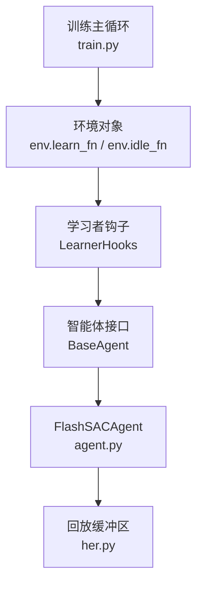
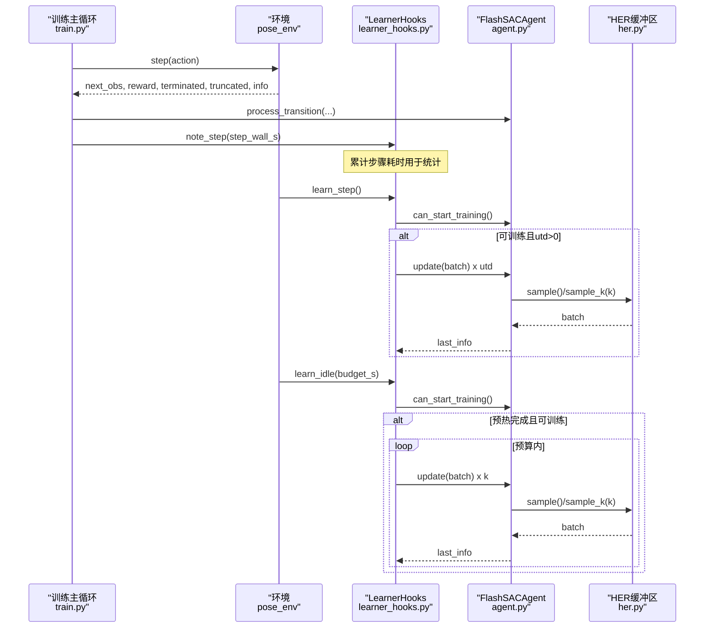
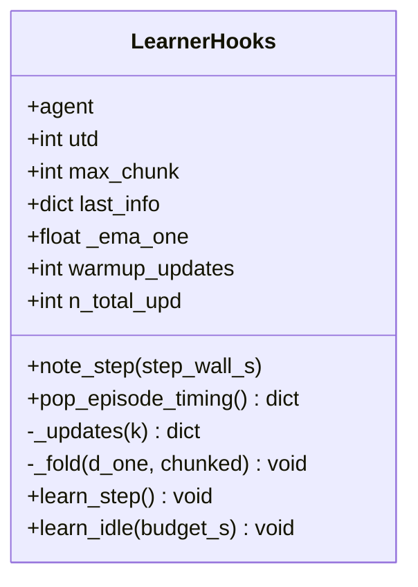
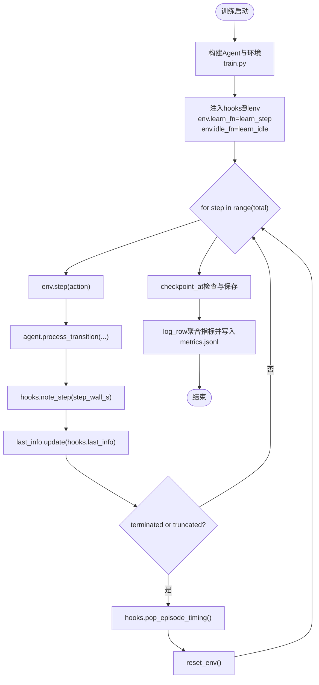
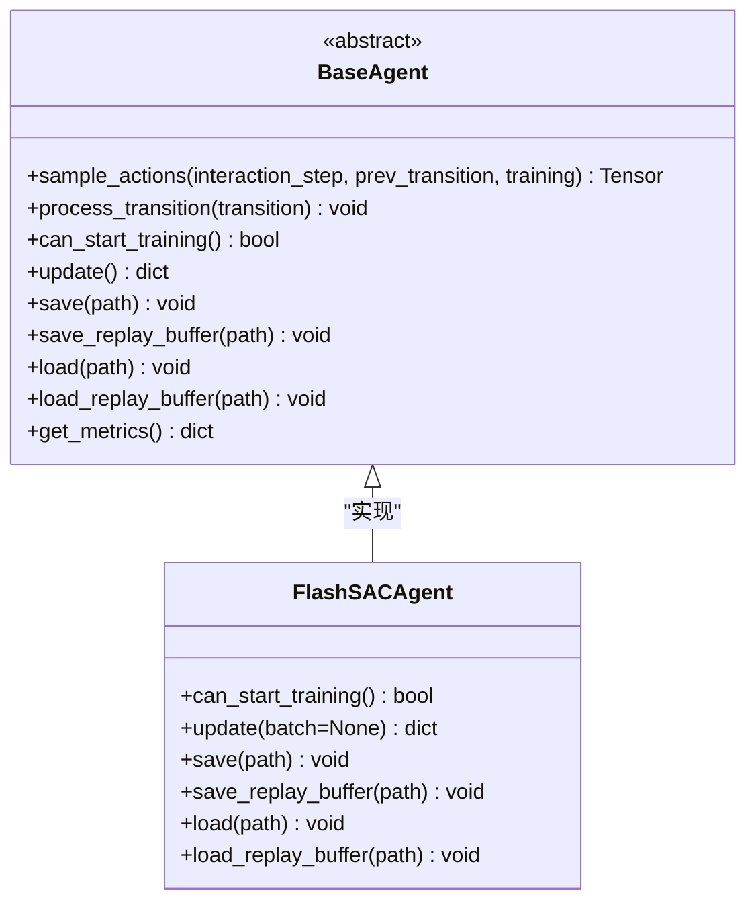
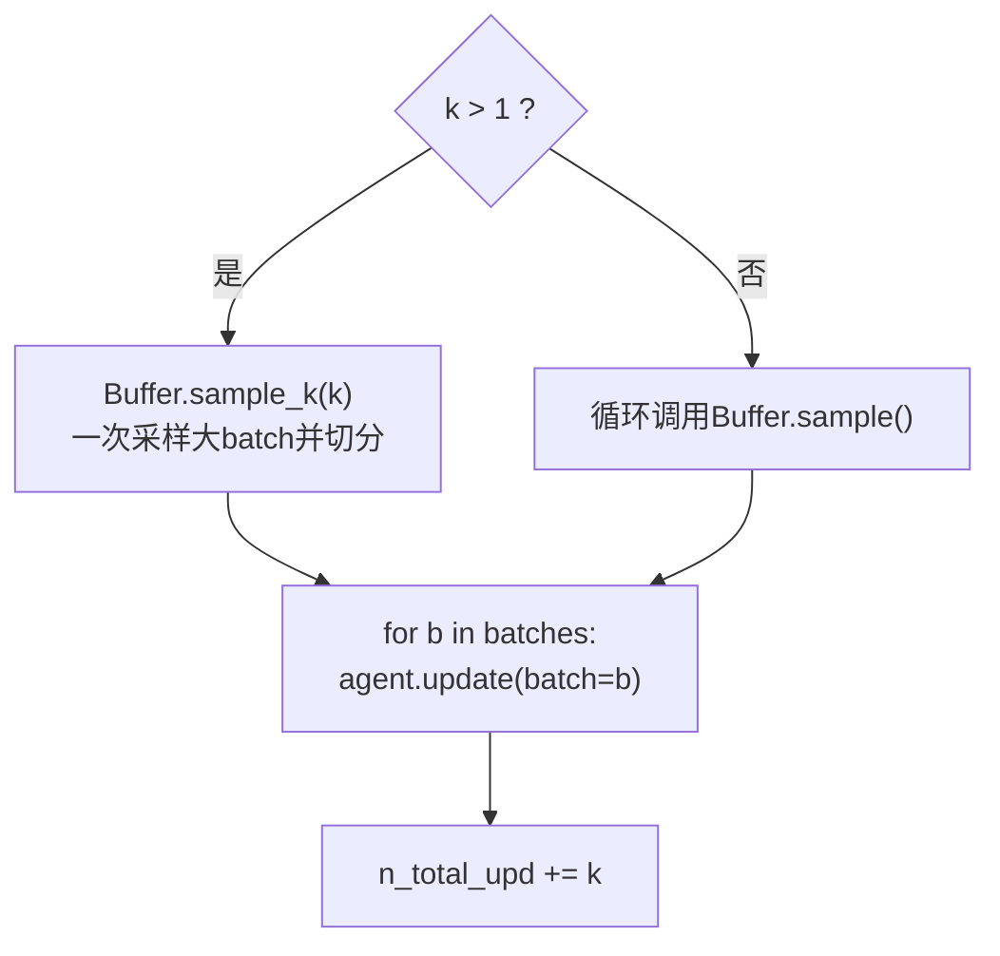
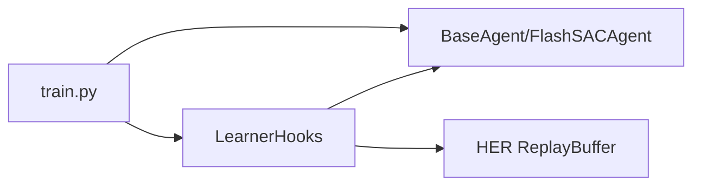
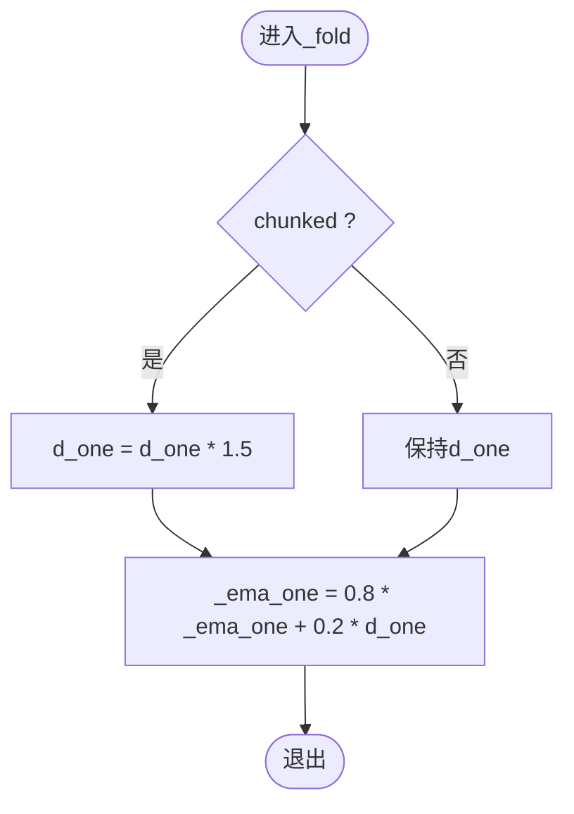
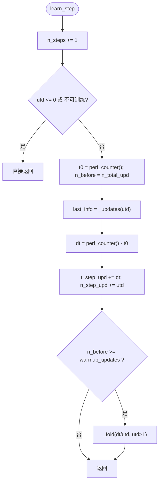
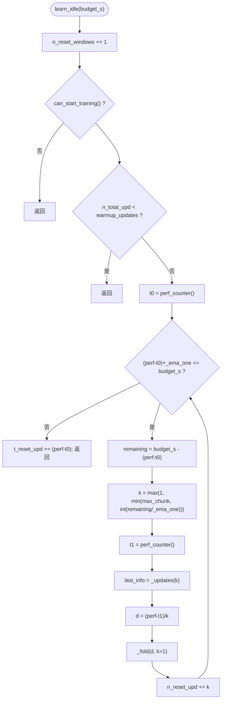

# 学习者钩子系统

<cite>
**本文引用的文件**   
- [learner_hooks.py](file://hardware/policyik_hw/rl/learner_hooks.py)
- [train.py](file://hardware/policyik_hw/train.py)
- [base_agent.py](file://hardware/flash_rl/agents/base_agent.py)
- [agent.py](file://hardware/flash_rl/agents/flashSAC/agent.py)
- [her.py](file://hardware/policyik_hw/rl/her.py)
</cite>

## 目录
1. [引言](#引言)
2. [项目结构](#项目结构)
3. [核心组件](#核心组件)
4. [架构总览](#架构总览)
5. [详细组件分析](#详细组件分析)
6. [依赖关系分析](#依赖关系分析)
7. [性能与预算控制](#性能与预算控制)
8. [自定义钩子开发指南](#自定义钩子开发指南)
9. [故障排查](#故障排查)
10. [结论](#结论)

## 引言
本文件面向PolicyIK学习者钩子系统的使用者与扩展者，系统性解释LearnerHooks类在真实机械臂训练循环中的职责：在控制周期内执行梯度更新、在重置窗口内进行时间预算内的增量学习、估计单次更新时间并输出性能指标。文档重点覆盖以下主题：
- 训练过程中的梯度更新控制与预热机制
- 基于指数移动平均(EMA)的更新时间估计
- learn_step与learn_idle的工作流程
- warmup_updates预热、max_chunk批量更新策略与utd(update per timestep)配置
- 如何集成到训练循环、处理异常与优化性能
- 监控、日志记录与动态参数调整的实践建议

## 项目结构
学习者钩子系统位于硬件训练代码中，主要涉及以下文件：
- learner_hooks.py：定义LearnerHooks类，封装训练时机控制、预算管理与统计
- train.py：构建FlashSAC智能体与环境，注入hooks.learn_step与hooks.learn_idle到环境回调
- base_agent.py：Agent抽象接口，定义can_start_training与update等关键方法
- agent.py：FlashSACAgent实现，提供buffer采样、网络更新与指标返回
- her.py：HER回放缓冲区的sample_k实现，支持一次采样多批次

图表来源
- [train.py:362-364](file://hardware/policyik_hw/train.py#L362-L364)
- [learner_hooks.py:7-77](file://hardware/policyik_hw/rl/learner_hooks.py#L7-L77)
- [base_agent.py:44-50](file://hardware/flash_rl/agents/base_agent.py#L44-L50)
- [agent.py:471-516](file://hardware/flash_rl/agents/flashSAC/agent.py#L471-L516)
- [her.py:301-312](file://hardware/policyik_hw/rl/her.py#L301-L312)

章节来源
- [train.py:271-437](file://hardware/policyik_hw/train.py#L271-L437)
- [learner_hooks.py:1-77](file://hardware/policyik_hw/rl/learner_hooks.py#L1-L77)

## 核心组件
- LearnerHooks：负责在每步控制周期与重置窗口中进行梯度更新，维护EMA估计与计时统计，暴露last_info供上层日志使用
- BaseAgent.update/can_start_training：抽象接口，决定何时可开始训练以及如何进行单步更新
- FlashSACAgent.update：具体实现，从回放缓冲区采样、归一化奖励、调用网络更新函数并返回指标字典
- HER ReplayBuffer.sample_k：当k>1时一次性采样大batch并按批切分，减少重复采样开销

章节来源
- [learner_hooks.py:7-77](file://hardware/policyik_hw/rl/learner_hooks.py#L7-L77)
- [base_agent.py:44-50](file://hardware/flash_rl/agents/base_agent.py#L44-L50)
- [agent.py:471-516](file://hardware/flash_rl/agents/flashSAC/agent.py#L471-L516)
- [her.py:301-312](file://hardware/policyik_hw/rl/her.py#L301-L312)

## 架构总览
下图展示训练主循环如何通过环境回调将LearnerHooks接入训练过程，并在控制周期和重置窗口分别触发梯度更新。

图表来源
- [train.py:362-393](file://hardware/policyik_hw/train.py#L362-L393)
- [learner_hooks.py:50-77](file://hardware/policyik_hw/rl/learner_hooks.py#L50-L77)
- [agent.py:471-516](file://hardware/flash_rl/agents/flashSAC/agent.py#L471-L516)
- [her.py:301-312](file://hardware/policyik_hw/rl/her.py#L301-L312)

## 详细组件分析

### LearnerHooks类
LearnerHooks是训练循环的“钩子”，在两个阶段驱动梯度更新：
- 控制周期阶段：通过learn_step在每个环境step后执行固定数量的更新（utd）
- 重置窗口阶段：通过learn_idle在reset/ramp/settle期间按预算进行增量更新

关键属性与方法：
- __init__：初始化agent、utd、est_update_s（EMA初始值）、warmup_updates、max_chunk等
- _reset_episode：每回合结束时重置计时与计数
- note_step：记录环境step的wall time，用于统计平均步耗时
- pop_episode_timing：汇总本回合的更新耗时、次数、重置窗口统计与EMA估计
- _updates：根据回放缓冲区是否支持sample_k，选择批量或逐次调用agent.update
- _fold：对单次更新耗时做EMA平滑，chunked模式乘以系数以修正批量开销
- learn_step：控制周期更新入口
- learn_idle：重置窗口预算更新入口

图表来源
- [learner_hooks.py:7-77](file://hardware/policyik_hw/rl/learner_hooks.py#L7-L77)

章节来源
- [learner_hooks.py:7-77](file://hardware/policyik_hw/rl/learner_hooks.py#L7-L77)

### 训练主循环集成
训练主循环在构建环境与智能体后，将hooks.learn_step与hooks.learn_idle注入到环境的回调中；每步收集info.step_wall_s并通过hooks.note_step记录；episode结束时调用hooks.pop_episode_timing汇总统计；同时把last_info合并到日志行中。

图表来源
- [train.py:362-428](file://hardware/policyik_hw/train.py#L362-L428)

章节来源
- [train.py:362-428](file://hardware/policyik_hw/train.py#L362-L428)

### 智能体接口与更新实现
- BaseAgent定义了can_start_training与update等抽象方法，确保所有Agent具备统一的训练能力接口
- FlashSACAgent.update从回放缓冲区采样，必要时进行奖励归一化，调用内部_update_networks执行梯度更新，并将张量指标转换为浮点返回

图表来源
- [base_agent.py:11-83](file://hardware/flash_rl/agents/base_agent.py#L11-L83)
- [agent.py:471-516](file://hardware/flash_rl/agents/flashSAC/agent.py#L471-L516)

章节来源
- [base_agent.py:11-83](file://hardware/flash_rl/agents/base_agent.py#L11-L83)
- [agent.py:471-516](file://hardware/flash_rl/agents/flashSAC/agent.py#L471-L516)

### 回放缓冲区批量采样
HER缓冲区实现了sample_k(k)，当k>1时一次性采样大batch并按batch_size切分为k个批次，避免多次重复采样带来的开销。LearnerHooks._updates优先使用该接口以提升吞吐。

图表来源
- [learner_hooks.py:35-44](file://hardware/policyik_hw/rl/learner_hooks.py#L35-L44)
- [her.py:301-312](file://hardware/policyik_hw/rl/her.py#L301-L312)

章节来源
- [learner_hooks.py:35-44](file://hardware/policyik_hw/rl/learner_hooks.py#L35-L44)
- [her.py:301-312](file://hardware/policyik_hw/rl/her.py#L301-L312)

## 依赖关系分析
- LearnerHooks依赖Agent接口与回放缓冲区能力：
  - can_start_training：判断缓冲区是否达到最小长度
  - update：执行网络更新并返回指标
  - sample_k：可选优化路径，提升批量更新效率
- 训练主循环依赖LearnerHooks提供的统计与last_info，用于日志与可视化

图表来源
- [learner_hooks.py:35-77](file://hardware/policyik_hw/rl/learner_hooks.py#L35-L77)
- [train.py:362-428](file://hardware/policyik_hw/train.py#L362-L428)
- [agent.py:471-516](file://hardware/flash_rl/agents/flashSAC/agent.py#L471-L516)
- [her.py:301-312](file://hardware/policyik_hw/rl/her.py#L301-L312)

章节来源
- [learner_hooks.py:35-77](file://hardware/policyik_hw/rl/learner_hooks.py#L35-L77)
- [train.py:362-428](file://hardware/policyik_hw/train.py#L362-L428)

## 性能与预算控制

### 指数移动平均(EMA)估计更新时间
- LearnerHooks._fold对单次更新耗时做EMA平滑，默认权重为0.8与0.2
- 当批量更新(chunked=True)时，对单次耗时乘以1.5系数，以补偿批量调度的额外开销
- EMA初始值由est_update_s提供，便于在未知环境下快速收敛到合理估计

图表来源
- [learner_hooks.py:46-48](file://hardware/policyik_hw/rl/learner_hooks.py#L46-L48)

章节来源
- [learner_hooks.py:46-48](file://hardware/policyik_hw/rl/learner_hooks.py#L46-L48)

### learn_step：控制周期更新
- 每次环境step后调用，若utd<=0或不可训练则跳过
- 记录更新前后时间差dt，累加t_step_upd与n_step_upd
- 仅在超过warmup_updates后才更新EMA，避免预热期噪声影响估计

图表来源
- [learner_hooks.py:50-59](file://hardware/policyik_hw/rl/learner_hooks.py#L50-L59)

章节来源
- [learner_hooks.py:50-59](file://hardware/policyik_hw/rl/learner_hooks.py#L50-L59)

### learn_idle：重置窗口预算更新
- 在reset/ramp/settle阶段，按budget_s预算进行增量更新
- 若不可训练或未达到warmup_updates则跳过
- 循环条件：已用时间+预估单次更新时间<=预算；每次计算剩余预算并估算k=min(max_chunk, int(remaining/_ema_one))
- 批量更新时同样使用_fold修正EMA

图表来源
- [learner_hooks.py:61-77](file://hardware/policyik_hw/rl/learner_hooks.py#L61-L77)

章节来源
- [learner_hooks.py:61-77](file://hardware/policyik_hw/rl/learner_hooks.py#L61-L77)

### 预热机制(warmup_updates)
- 目的：在训练初期避免EMA被不稳定更新耗时污染
- 行为：
  - learn_step仅在n_total_upd>=warmup_updates后更新EMA
  - learn_idle在n_total_upd<warmup_updates时直接跳过预算更新
- 配置：可通过构造参数warmup_updates调整预热步数

章节来源
- [learner_hooks.py:8-15](file://hardware/policyik_hw/rl/learner_hooks.py#L8-L15)
- [learner_hooks.py:58-59](file://hardware/policyik_hw/rl/learner_hooks.py#L58-L59)
- [learner_hooks.py:66-67](file://hardware/policyik_hw/rl/learner_hooks.py#L66-L67)

### 批量更新策略(max_chunk)
- 目的：在预算更新中限制单次批量大小，避免过大batch导致延迟抖动
- 行为：k=max(1, min(max_chunk, int(remaining/_ema_one)))
- 默认max_chunk=8，可根据硬件与延迟特性调整

章节来源
- [learner_hooks.py:10](file://hardware/policyik_hw/rl/learner_hooks.py#L10)
- [learner_hooks.py:71](file://hardware/policyik_hw/rl/learner_hooks.py#L71)

### utd(update per timestep)
- 含义：每个环境step执行的更新次数
- 行为：
  - utd<=0时跳过控制周期更新
  - 通过agent.can_start_training()判断缓冲区是否足够
  - 优先使用Buffer.sample_k(utd)进行批量采样与更新

章节来源
- [learner_hooks.py:8-9](file://hardware/policyik_hw/rl/learner_hooks.py#L8-L9)
- [learner_hooks.py:50-55](file://hardware/policyik_hw/rl/learner_hooks.py#L50-L55)
- [learner_hooks.py:35-44](file://hardware/policyik_hw/rl/learner_hooks.py#L35-L44)

## 自定义钩子开发指南

### 集成到训练循环
- 在训练主循环中创建LearnerHooks实例，传入agent与utd
- 将hooks.learn_step与hooks.learn_idle分别赋值给env.learn_fn与env.idle_fn
- 每步调用hooks.note_step(info.step_wall_s)以记录环境步耗时
- episode结束时调用hooks.pop_episode_timing()获取统计并写入日志

参考路径
- [train.py:362-364](file://hardware/policyik_hw/train.py#L362-L364)
- [train.py:391-393](file://hardware/policyik_hw/train.py#L391-L393)
- [train.py:399-409](file://hardware/policyik_hw/train.py#L399-L409)

### 处理异常与健壮性
- 在hooks._updates中，若回放缓冲区不支持sample_k，则回退到循环调用agent.update
- 在learn_step与learn_idle中，均先检查agent.can_start_training()，避免无效更新
- 在note_step中对NaN进行过滤，保证统计稳健

实践建议
- 在自定义钩子类中保留上述检查逻辑，确保在不同回放缓冲区实现下稳定运行
- 对于外部异常（如设备OOM），建议在调用agent.update处捕获并降级为较小k或跳过本轮更新

参考路径
- [learner_hooks.py:35-44](file://hardware/policyik_hw/rl/learner_hooks.py#L35-L44)
- [learner_hooks.py:50-55](file://hardware/policyik_hw/rl/learner_hooks.py#L50-L55)
- [learner_hooks.py:61-67](file://hardware/policyik_hw/rl/learner_hooks.py#L61-L67)
- [learner_hooks.py:22-24](file://hardware/policyik_hw/rl/learner_hooks.py#L22-L24)

### 性能优化技巧
- 启用Buffer.sample_k(k)以减少重复采样开销
- 合理设置utd与max_chunk，平衡吞吐与延迟
- 调整est_update_s初始值，使EMA更快收敛
- 在warmup_updates之后再进行EMA更新，提高估计稳定性

参考路径
- [learner_hooks.py:8-15](file://hardware/policyik_hw/rl/learner_hooks.py#L8-L15)
- [learner_hooks.py:46-48](file://hardware/policyik_hw/rl/learner_hooks.py#L46-L48)
- [her.py:301-312](file://hardware/policyik_hw/rl/her.py#L301-L312)

### 监控、日志与动态参数调整
- 使用hooks.last_info获取最近一次更新的指标（如actor/loss、critic/loss、temperature/value等）
- 在训练主循环中将last_info合并到日志行，并写入metrics.jsonl
- 根据hooks.pop_episode_timing()输出的统计（如upd_step_s_per_step、n_upd_step_per_step、est_update_s）动态调整utd或max_chunk

参考路径
- [train.py:204-215](file://hardware/policyik_hw/train.py#L204-L215)
- [train.py:391-393](file://hardware/policyik_hw/train.py#L391-L393)
- [train.py:399-409](file://hardware/policyik_hw/train.py#L399-L409)

## 故障排查
常见问题与定位要点：
- 无更新发生：检查utd是否>0，agent.can_start_training()是否为True，缓冲区是否达到最小长度
- 更新耗时异常高：检查是否频繁触发批量更新且k过大，适当降低max_chunk或增大预算
- EMA估计漂移：确认是否在warmup_updates之后才更新EMA，必要时增大warmup_updates
- 统计缺失：确保每步调用hooks.note_step，episode结束时调用hooks.pop_episode_timing

参考路径
- [learner_hooks.py:50-59](file://hardware/policyik_hw/rl/learner_hooks.py#L50-L59)
- [learner_hooks.py:61-77](file://hardware/policyik_hw/rl/learner_hooks.py#L61-L77)
- [learner_hooks.py:22-33](file://hardware/policyik_hw/rl/learner_hooks.py#L22-L33)

## 结论
LearnerHooks在PolicyIK真实机械臂训练中扮演关键角色：它精确控制梯度更新时机，结合EMA估计与预算机制，在保证实时性的前提下最大化学习效率。通过理解learn_step与learn_idle的流程、掌握warmup_updates与max_chunk的作用，并结合utd配置，用户可以在不同硬件平台上获得稳定高效的训练体验。同时，借助hooks.last_info与pop_episode_timing的输出，可实现完善的监控、日志与动态参数调整。
