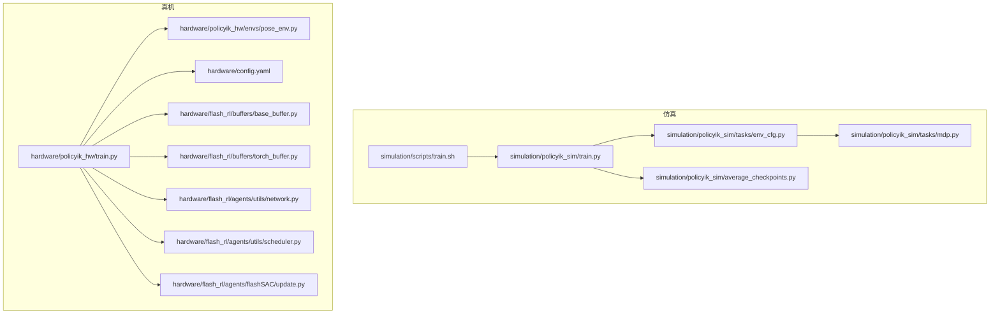
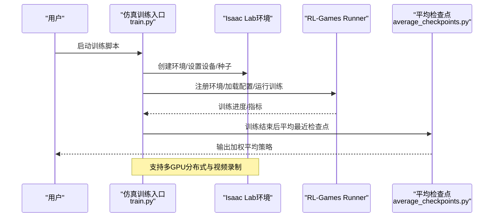
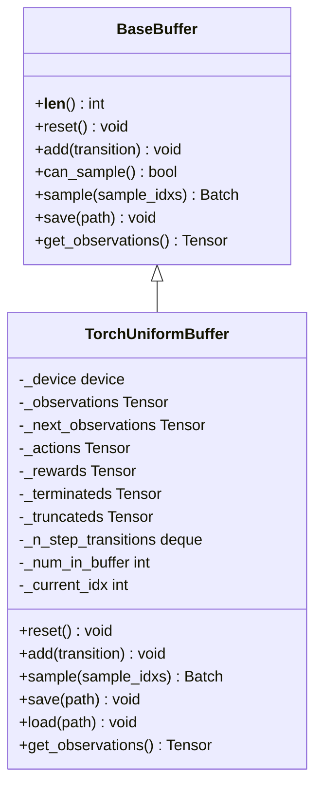
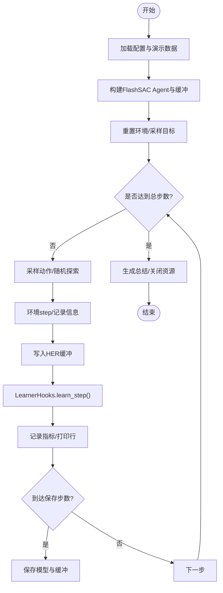
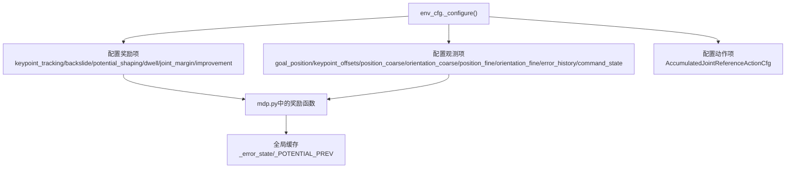
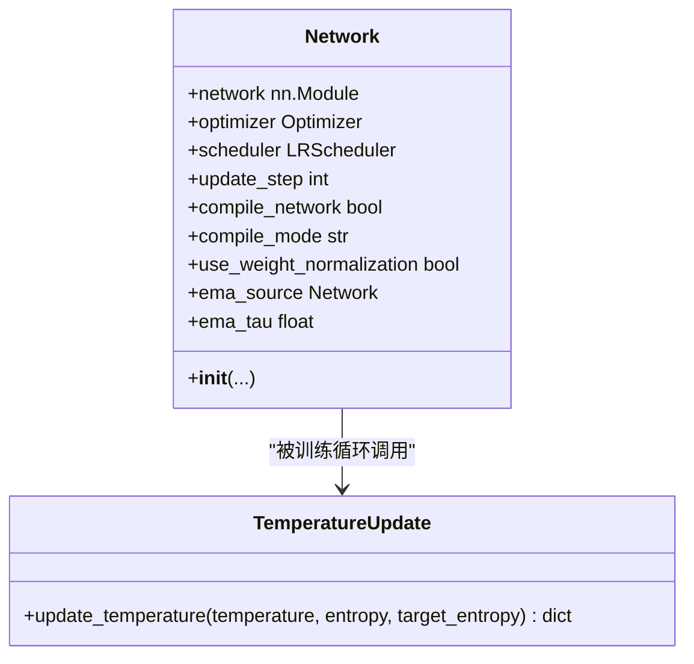
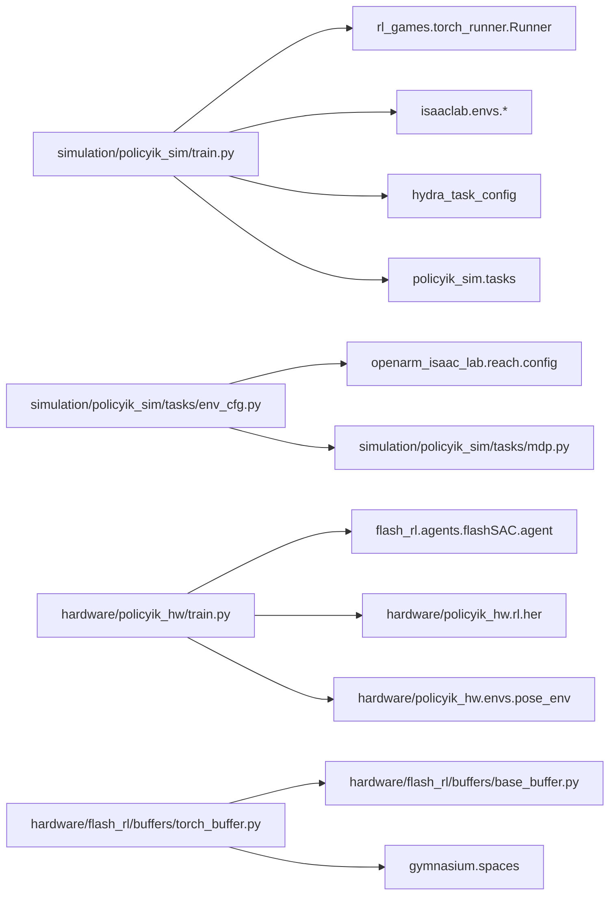

# 性能优化指南

<cite>
**本文引用的文件**   
- [README.md](file://README.md)
- [simulation/policyik_sim/train.py](file://simulation/policyik_sim/train.py)
- [simulation/scripts/train.sh](file://simulation/scripts/train.sh)
- [simulation/policyik_sim/tasks/env_cfg.py](file://simulation/policyik_sim/tasks/env_cfg.py)
- [simulation/policyik_sim/tasks/mdp.py](file://simulation/policyik_sim/tasks/mdp.py)
- [simulation/policyik_sim/average_checkpoints.py](file://simulation/policyik_sim/average_checkpoints.py)
- [hardware/config.yaml](file://hardware/config.yaml)
- [hardware/policyik_hw/train.py](file://hardware/policyik_hw/train.py)
- [hardware/policyik_hw/envs/pose_env.py](file://hardware/policyik_hw/envs/pose_env.py)
- [hardware/policyik_hw/metrics.py](file://hardware/policyik_hw/metrics.py)
- [hardware/flash_rl/buffers/base_buffer.py](file://hardware/flash_rl/buffers/base_buffer.py)
- [hardware/flash_rl/buffers/torch_buffer.py](file://hardware/flash_rl/buffers/torch_buffer.py)
- [hardware/flash_rl/agents/utils/network.py](file://hardware/flash_rl/agents/utils/network.py)
- [hardware/flash_rl/agents/utils/scheduler.py](file://hardware/flash_rl/agents/utils/scheduler.py)
- [hardware/flash_rl/agents/flashSAC/update.py](file://hardware/flash_rl/agents/flashSAC/update.py)
</cite>

## 目录
1. [简介](#简介)
2. [项目结构](#项目结构)
3. [核心组件](#核心组件)
4. [架构总览](#架构总览)
5. [详细组件分析](#详细组件分析)
6. [依赖关系分析](#依赖关系分析)
7. [性能考虑与优化策略](#性能考虑与优化策略)
8. [故障排查指南](#故障排查指南)
9. [结论](#结论)
10. [附录](#附录)

## 简介
本指南面向PolicyIK在仿真与真机训练的性能优化，覆盖内存管理、并行训练、训练速度、仿真加速、基准测试、硬件适配与监控诊断。文档基于仓库中仿真（Isaac Lab + RL-Games）与真机（FlashSAC + HER）两套训练管线，结合缓冲区实现、网络编译、任务配置与环境控制等源码进行系统化说明，并提供可操作的调优建议与可视化流程图。

## 项目结构
PolicyIK包含两条训练路径：
- 仿真端：基于Isaac Lab的任务定义与RL-Games训练入口，支持多GPU分布式训练与视频录制。
- 真机端：基于FlashSAC与HER的在线学习，集成ROS 2接口、安全与碰撞保护、指标统计与日志记录。

图表来源
- [simulation/scripts/train.sh:11-25](file://simulation/scripts/train.sh#L11-L25)
- [simulation/policyik_sim/train.py:103-218](file://simulation/policyik_sim/train.py#L103-L218)
- [simulation/policyik_sim/tasks/env_cfg.py:27-132](file://simulation/policyik_sim/tasks/env_cfg.py#L27-L132)
- [simulation/policyik_sim/tasks/mdp.py:71-232](file://simulation/policyik_sim/tasks/mdp.py#L71-L232)
- [simulation/policyik_sim/average_checkpoints.py:28-59](file://simulation/policyik_sim/average_checkpoints.py#L28-L59)
- [hardware/policyik_hw/train.py:132-178](file://hardware/policyik_hw/train.py#L132-L178)
- [hardware/policyik_hw/envs/pose_env.py:206-544](file://hardware/policyik_hw/envs/pose_env.py#L206-L544)
- [hardware/config.yaml:1-160](file://hardware/config.yaml#L1-L160)
- [hardware/flash_rl/buffers/base_buffer.py:11-69](file://hardware/flash_rl/buffers/base_buffer.py#L11-L69)
- [hardware/flash_rl/buffers/torch_buffer.py:31-236](file://hardware/flash_rl/buffers/torch_buffer.py#L31-L236)
- [hardware/flash_rl/agents/utils/network.py:22-72](file://hardware/flash_rl/agents/utils/network.py#L22-L72)
- [hardware/flash_rl/agents/utils/scheduler.py:11-74](file://hardware/flash_rl/agents/utils/scheduler.py#L11-L74)
- [hardware/flash_rl/agents/flashSAC/update.py:290-319](file://hardware/flash_rl/agents/flashSAC/update.py#L290-L319)

章节来源
- [README.md:35-110](file://README.md#L35-L110)

## 核心组件
- 仿真训练入口：解析参数、初始化Isaac Sim、注册环境、构建RL-Games Runner，支持多GPU与W&B跟踪。
- 真机训练主循环：加载配置、构建环境与奖励、构建FlashSAC Agent与HER缓冲、执行step并记录指标。
- 经验回放缓冲：统一抽象与PyTorch实现，支持pin_memory、n-step过渡、环形缓冲与持久化。
- 网络与调度：封装torch.compile、权重归一化、EMA与学习率调度器。
- 任务与MDP：观测项、奖励项、误差状态缓存与关键姿态点追踪。

章节来源
- [simulation/policyik_sim/train.py:103-218](file://simulation/policyik_sim/train.py#L103-L218)
- [hardware/policyik_hw/train.py:132-178](file://hardware/policyik_hw/train.py#L132-L178)
- [hardware/flash_rl/buffers/base_buffer.py:11-69](file://hardware/flash_rl/buffers/base_buffer.py#L11-L69)
- [hardware/flash_rl/buffers/torch_buffer.py:31-236](file://hardware/flash_rl/buffers/torch_buffer.py#L31-L236)
- [hardware/flash_rl/agents/utils/network.py:22-72](file://hardware/flash_rl/agents/utils/network.py#L22-L72)
- [simulation/policyik_sim/tasks/env_cfg.py:27-132](file://simulation/policyik_sim/tasks/env_cfg.py#L27-L132)
- [simulation/policyik_sim/tasks/mdp.py:71-232](file://simulation/policyik_sim/tasks/mdp.py#L71-L232)

## 架构总览
仿真与真机的训练流程分别由不同框架驱动，但都围绕“环境交互—数据收集—模型更新—评估”的主循环展开。

图表来源
- [simulation/policyik_sim/train.py:103-218](file://simulation/policyik_sim/train.py#L103-L218)
- [simulation/policyik_sim/average_checkpoints.py:28-59](file://simulation/policyik_sim/average_checkpoints.py#L28-L59)

## 详细组件分析

### 经验回放缓冲（TorchUniformBuffer）
- 设计要点
  - 使用预分配张量作为环形缓冲，避免频繁分配与拷贝。
  - 当buffer位于CPU且CUDA可用时启用pin_memory以加速主机到设备传输。
  - 支持n-step返回计算，减少重复计算开销。
  - 提供save/load接口用于断点续训与离线分析。
- 复杂度
  - add/sample为O(1)摊销；n-step过渡为O(n_step)。
- 优化机会
  - 调整max_length与sample_batch_size平衡吞吐与延迟。
  - 合理选择device_type以减少跨设备拷贝。

图表来源
- [hardware/flash_rl/buffers/base_buffer.py:11-69](file://hardware/flash_rl/buffers/base_buffer.py#L11-L69)
- [hardware/flash_rl/buffers/torch_buffer.py:31-236](file://hardware/flash_rl/buffers/torch_buffer.py#L31-L236)

章节来源
- [hardware/flash_rl/buffers/torch_buffer.py:68-101](file://hardware/flash_rl/buffers/torch_buffer.py#L68-L101)
- [hardware/flash_rl/buffers/torch_buffer.py:141-183](file://hardware/flash_rl/buffers/torch_buffer.py#L141-L183)
- [hardware/flash_rl/buffers/torch_buffer.py:185-236](file://hardware/flash_rl/buffers/torch_buffer.py#L185-L236)

### 真机训练主循环与指标
- 训练主循环
  - 根据随机探索或策略采样动作，调用环境step，写入HER缓冲，周期性更新网络。
  - 通过LearnerHooks将learn_step与idle_fn注入环境，实现训练与控制的交错执行。
- 指标与计时
  - 记录每步耗时、更新频率、池子比例、成功率与误差中位数等。
  - 汇总episode级指标并输出JSONL日志。

图表来源
- [hardware/policyik_hw/train.py:271-437](file://hardware/policyik_hw/train.py#L271-L437)
- [hardware/policyik_hw/envs/pose_env.py:386-508](file://hardware/policyik_hw/envs/pose_env.py#L386-L508)
- [hardware/policyik_hw/metrics.py:56-78](file://hardware/policyik_hw/metrics.py#L56-L78)

章节来源
- [hardware/policyik_hw/train.py:132-178](file://hardware/policyik_hw/train.py#L132-L178)
- [hardware/policyik_hw/train.py:271-437](file://hardware/policyik_hw/train.py#L271-L437)
- [hardware/policyik_hw/envs/pose_env.py:386-508](file://hardware/policyik_hw/envs/pose_env.py#L386-L508)
- [hardware/policyik_hw/metrics.py:56-78](file://hardware/policyik_hw/metrics.py#L56-L78)

### 仿真任务与MDP
- 任务配置
  - 使用池化起始位姿与目标位姿，替换默认命令与事件。
  - 训练阶段启用关键点追踪奖励与更严格的运动成本。
  - 观测包含粗/细位置与方向误差、关键点偏移、误差历史与指令状态反馈。
- MDP函数
  - 提供旋转误差、关键点误差、容忍度误差状态、势函数塑形、回退惩罚、驻留奖励与关节裕度成本。
  - 维护全局缓存以降低重复计算。

图表来源
- [simulation/policyik_sim/tasks/env_cfg.py:27-132](file://simulation/policyik_sim/tasks/env_cfg.py#L27-L132)
- [simulation/policyik_sim/tasks/mdp.py:71-232](file://simulation/policyik_sim/tasks/mdp.py#L71-L232)

章节来源
- [simulation/policyik_sim/tasks/env_cfg.py:27-132](file://simulation/policyik_sim/tasks/env_cfg.py#L27-L132)
- [simulation/policyik_sim/tasks/mdp.py:71-232](file://simulation/policyik_sim/tasks/mdp.py#L71-L232)

### 网络编译与温度自适应
- Network封装
  - 支持torch.compile包裹网络前向与权重归一化函数。
  - 处理compile前后state_dict键名差异。
- 温度自适应
  - 基于熵与目标熵的温度网络更新，配合调度器平滑变化。

图表来源
- [hardware/flash_rl/agents/utils/network.py:22-72](file://hardware/flash_rl/agents/utils/network.py#L22-L72)
- [hardware/flash_rl/agents/flashSAC/update.py:290-319](file://hardware/flash_rl/agents/flashSAC/update.py#L290-L319)

章节来源
- [hardware/flash_rl/agents/utils/network.py:22-72](file://hardware/flash_rl/agents/utils/network.py#L22-L72)
- [hardware/flash_rl/agents/flashSAC/update.py:290-319](file://hardware/flash_rl/agents/flashSAC/update.py#L290-L319)

## 依赖关系分析
- 仿真侧
  - train.py依赖AppLauncher、RL-Games、Isaac Lab任务注册与Hydra配置。
  - env_cfg.py依赖openarm_isaac_lab基础任务，扩展PolicyIK特定奖励与观测。
  - mdp.py提供向量化的误差与奖励计算，依赖isaaclab数学工具。
- 真机侧
  - train.py依赖FlashSAC Agent、HER缓冲、Pose环境、ROS IO与安全模块。
  - pose_env.py依赖kinematics、workspace、reward与ROS IO。
  - torch_buffer.py依赖gymnasium空间定义与torch张量操作。

图表来源
- [simulation/policyik_sim/train.py:103-218](file://simulation/policyik_sim/train.py#L103-L218)
- [simulation/policyik_sim/tasks/env_cfg.py:13-20](file://simulation/policyik_sim/tasks/env_cfg.py#L13-L20)
- [simulation/policyik_sim/tasks/mdp.py:1-10](file://simulation/policyik_sim/tasks/mdp.py#L1-L10)
- [hardware/policyik_hw/train.py:132-178](file://hardware/policyik_hw/train.py#L132-L178)
- [hardware/flash_rl/buffers/torch_buffer.py:1-10](file://hardware/flash_rl/buffers/torch_buffer.py#L1-L10)
- [hardware/flash_rl/buffers/base_buffer.py:1-10](file://hardware/flash_rl/buffers/base_buffer.py#L1-L10)

章节来源
- [simulation/policyik_sim/train.py:103-218](file://simulation/policyik_sim/train.py#L103-L218)
- [simulation/policyik_sim/tasks/env_cfg.py:13-20](file://simulation/policyik_sim/tasks/env_cfg.py#L13-L20)
- [simulation/policyik_sim/tasks/mdp.py:1-10](file://simulation/policyik_sim/tasks/mdp.py#L1-L10)
- [hardware/policyik_hw/train.py:132-178](file://hardware/policyik_hw/train.py#L132-L178)
- [hardware/flash_rl/buffers/torch_buffer.py:1-10](file://hardware/flash_rl/buffers/torch_buffer.py#L1-L10)
- [hardware/flash_rl/buffers/base_buffer.py:1-10](file://hardware/flash_rl/buffers/base_buffer.py#L1-L10)

## 性能考虑与优化策略

### 内存管理与缓冲区优化
- 预分配与复用
  - TorchUniformBuffer在reset中一次性分配固定大小的张量，避免动态扩容带来的碎片与GC压力。
  - 使用deque维护n-step过渡窗口，限制最大长度，降低内存占用。
- 设备与传输
  - 当buffer位于CPU且CUDA可用时启用pin_memory，提升异步数据传输效率。
  - 统一dtype映射至float32，减少混合精度导致的额外转换开销。
- 批采样与切片
  - 连续索引时使用slice避免scatter与额外分配；环形写指针采用模运算。
- 持久化
  - save/load仅存储有效数据段与元数据，避免冗余字段。

优化建议
- 根据显存容量调整buffer_max_length与sample_batch_size，确保单卡可容纳完整batch。
- 在CPU/GPU异构环境中优先将buffer置于GPU，减少host-device拷贝。
- 对高频写入路径（add）尽量保持零拷贝，避免中间对象创建。

章节来源
- [hardware/flash_rl/buffers/torch_buffer.py:68-101](file://hardware/flash_rl/buffers/torch_buffer.py#L68-L101)
- [hardware/flash_rl/buffers/torch_buffer.py:141-183](file://hardware/flash_rl/buffers/torch_buffer.py#L141-L183)
- [hardware/flash_rl/buffers/torch_buffer.py:185-236](file://hardware/flash_rl/buffers/torch_buffer.py#L185-L236)

### 垃圾回收调优与大对象缓存
- 大对象缓存
  - mdp.py中使用全局字典缓存误差状态与势能，避免每步重复计算与分配。
- GC友好实践
  - 避免在热路径中创建临时列表或数组；优先使用原地操作与视图。
  - 使用detach().clone()仅在必要时复制张量，减少图保留时间。

优化建议
- 对长生命周期缓存对象进行定期清理或按episode边界重置。
- 在训练循环中避免持有不必要的梯度图引用，及时释放中间变量。

章节来源
- [simulation/policyik_sim/tasks/mdp.py:115-188](file://simulation/policyik_sim/tasks/mdp.py#L115-L188)

### 并行训练配置（多进程同步、GPU内存分配、数据流水线）
- 多GPU分布式
  - train.py在distributed模式下为每个rank设置独立seed与cuda设备，并开启multi_gpu标志。
  - 环境变量RANK/local_rank用于区分进程。
- 环境实例数量
  - 通过--num_envs控制并行环境数，仿真脚本默认4096个环境以提升吞吐。
- 数据流水线
  - RL-Games的vecenv包装器负责批量观测裁剪与动作裁剪，减少Python层开销。

优化建议
- 根据GPU显存与带宽调整num_envs与batch_size，使GPU利用率最大化。
- 使用多节点时确保网络拓扑与NCCL后端配置正确，避免通信瓶颈。

章节来源
- [simulation/policyik_sim/train.py:125-136](file://simulation/policyik_sim/train.py#L125-L136)
- [simulation/scripts/train.sh:11-14](file://simulation/scripts/train.sh#L11-L14)

### 训练速度优化（批大小、学习率调度、网络架构）
- 批大小与UTD
  - FlashSAC配置中包含batch_size与utd（updates per step），增大batch_size可提高稳定性，提高utd可增加样本利用率。
- 学习率调度
  - scheduler.py提供余弦衰减、线性衰减与周期指数衰减等调度器，可按训练阶段切换。
- 网络架构
  - actor/critic隐藏维度与块数在config.yaml中可调；适当减小宽度可提升推理速度，但需权衡收敛性。
- 编译加速
  - Network支持torch.compile，可显著降低前向与权重归一化开销。

优化建议
- 在稳定收敛后启用cosine decay，并在warmup阶段逐步增加学习率。
- 针对小模型场景开启compile，观察首帧编译开销与后续加速收益。

章节来源
- [hardware/config.yaml:107-128](file://hardware/config.yaml#L107-L128)
- [hardware/flash_rl/agents/utils/scheduler.py:11-74](file://hardware/flash_rl/agents/utils/scheduler.py#L11-L74)
- [hardware/flash_rl/agents/utils/network.py:57-72](file://hardware/flash_rl/agents/utils/network.py#L57-L72)

### 仿真加速（物理引擎、渲染、传感器模拟）
- 物理求解迭代
  - env_cfg.py中设置solver_position_iteration_count=32，提高接触求解精度与稳定性。
- 观测与奖励矢量化
  - mdp.py使用torch张量操作，避免Python循环，充分利用GPU并行。
- 渲染与视频
  - train.py支持RecordVideo包装器，按需开启以减少I/O开销。

优化建议
- 在不需要视觉反馈的训练阶段关闭渲染，显著提升吞吐。
- 对高维观测进行降维或选择性通道，减少计算与内存压力。

章节来源
- [simulation/policyik_sim/tasks/env_cfg.py:103-112](file://simulation/policyik_sim/tasks/env_cfg.py#L103-L112)
- [simulation/policyik_sim/tasks/mdp.py:71-232](file://simulation/policyik_sim/tasks/mdp.py#L71-L232)
- [simulation/policyik_sim/train.py:186-199](file://simulation/policyik_sim/train.py#L186-L199)

### 基准测试方法（关键指标、瓶颈分析、效果评估）
- 关键指标
  - 真机metrics统计held/reached计数、中位误差与中断任务数；仿真metrics统计严格/粗略成功率与部署协议表现。
- 瓶颈分析
  - 通过env.timing_summary获取step_wall_median_s与effective_hz，定位环境IO或控制环路瓶颈。
- 效果评估
  - average_checkpoints对最后若干检查点进行指数加权平均，得到更稳健的策略。

优化建议
- 在评估脚本中传入正确的eval_hz，确保时间预算与步数换算一致。
- 对比不同checkpoint的平均结果，选择部署版本。

章节来源
- [hardware/policyik_hw/metrics.py:56-78](file://hardware/policyik_hw/metrics.py#L56-L78)
- [hardware/policyik_hw/envs/pose_env.py:525-535](file://hardware/policyik_hw/envs/pose_env.py#L525-L535)
- [simulation/policyik_sim/average_checkpoints.py:28-59](file://simulation/policyik_sim/average_checkpoints.py#L28-L59)

### 不同硬件平台适配（CPU/GPU、内存限制、分布式）
- CPU/GPU选择
  - train.py自动检测CUDA可用性，或在命令行指定device。
- 内存限制
  - 通过减小buffer_max_length、batch_size与num_envs适应低显存设备。
- 分布式训练
  - 使用AppLauncher与RANK/local_rank环境变量进行多卡/多节点训练。

优化建议
- 在无GPU环境下将buffer_device_type设为cpu，并确保pin_memory关闭以避免无效开销。
- 在多卡训练中均衡各卡的负载，避免某些rank成为瓶颈。

章节来源
- [hardware/policyik_hw/train.py:278-284](file://hardware/policyik_hw/train.py#L278-L284)
- [simulation/policyik_sim/train.py:125-136](file://simulation/policyik_sim/train.py#L125-L136)

### 监控与分析性能数据
- 训练日志
  - RunLogger输出metrics.jsonl与episodes.jsonl，控制台同时打印关键指标。
- 时序统计
  - env.timing_summary提供step中位数、P90与有效Hz，辅助定位慢步骤。
- 指标聚合
  - metrics.py汇总多个评估bin的结果，便于横向比较不同checkpoint。

优化建议
- 定期导出summary.json，跟踪wall时间与steps_per_s趋势。
- 结合W&B或TensorBoard进行长期监控与可视化。

章节来源
- [hardware/policyik_hw/train.py:84-126](file://hardware/policyik_hw/train.py#L84-L126)
- [hardware/policyik_hw/envs/pose_env.py:525-535](file://hardware/policyik_hw/envs/pose_env.py#L525-L535)
- [hardware/policyik_hw/metrics.py:81-113](file://hardware/policyik_hw/metrics.py#L81-L113)

## 故障排查指南
- 关节状态冻结
  - 当joint state长时间不变且仍发布时，环境抛出FROZEN错误，提示CAN读取停滞。
- 碰撞保护触发
  - 连续碰撞阻挡导致episode终止或截断，打印阻塞步数与包络松弛。
- 电机健康告警
  - health_check返回False时立即中止训练，需检查硬件连接与电源。
- 设备与内存不足
  - 调整buffer与batch大小，或切换到CPU模式；确认CUDA可见设备与显存上限。

章节来源
- [hardware/policyik_hw/envs/pose_env.py:404-423](file://hardware/policyik_hw/envs/pose_env.py#L404-L423)
- [hardware/policyik_hw/envs/pose_env.py:447-508](file://hardware/policyik_hw/envs/pose_env.py#L447-L508)
- [hardware/policyik_hw/envs/pose_env.py:393-403](file://hardware/policyik_hw/envs/pose_env.py#L393-L403)

## 结论
PolicyIK在仿真与真机两条训练路径上提供了完善的性能优化基础设施：高效的环形缓冲、矢量化的MDP计算、可选的网络编译与灵活的学习率调度。通过合理配置环境并行数、缓冲大小、批大小与物理求解迭代次数，可在不同硬件平台上获得稳定的训练速度与鲁棒的策略质量。建议结合指标与计时工具持续监控，并根据实际瓶颈进行针对性调优。

## 附录
- 仿真训练脚本示例
  - scripts/train.sh调用train.py，分三段训练并平均最后检查点。
- 真机训练脚本示例
  - scripts/train.sh包装policyik_hw.train，支持从检查点与缓冲恢复训练。

章节来源
- [simulation/scripts/train.sh:11-25](file://simulation/scripts/train.sh#L11-L25)
- [hardware/scripts/train.sh:1-14](file://hardware/scripts/train.sh#L1-L14)