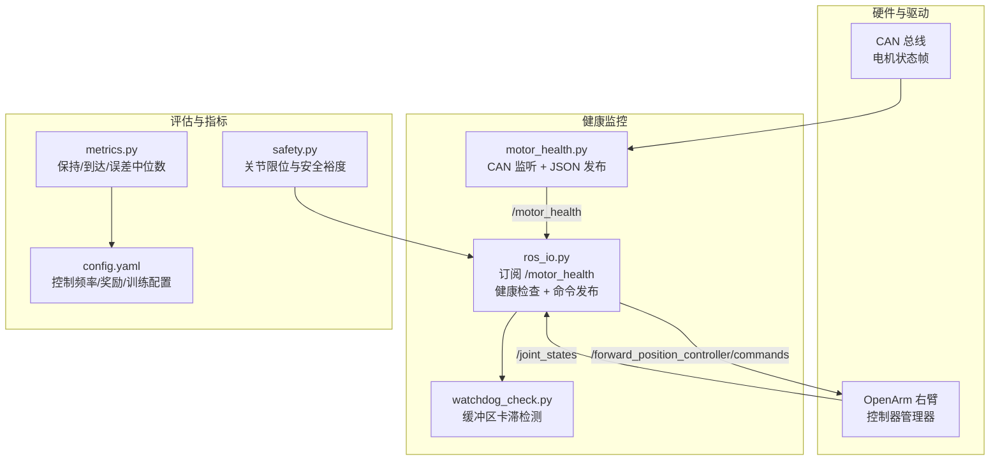
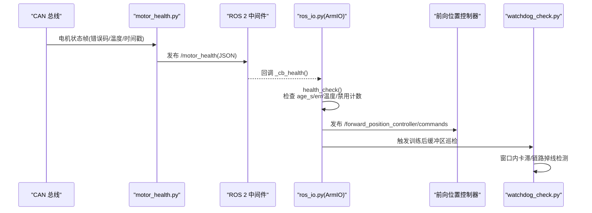
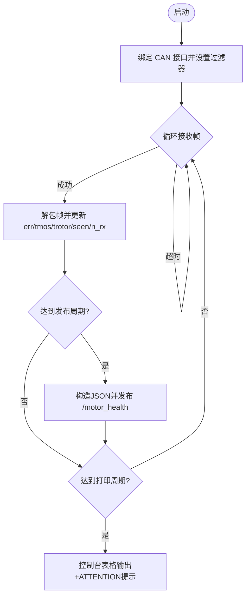
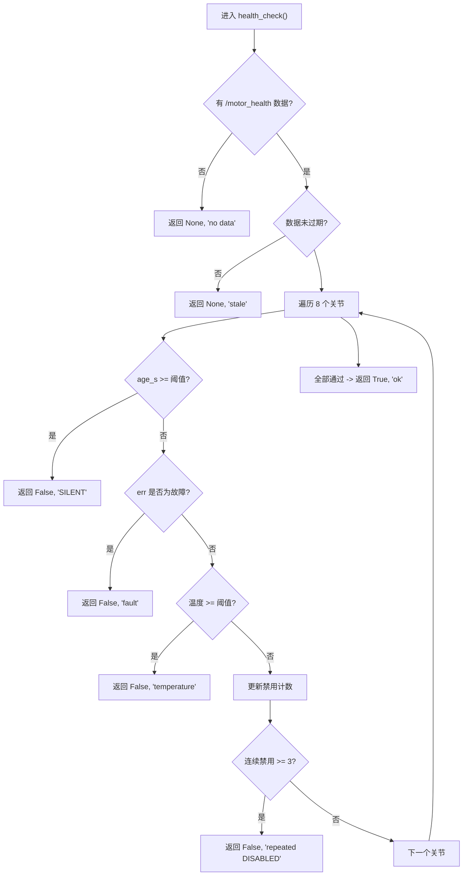
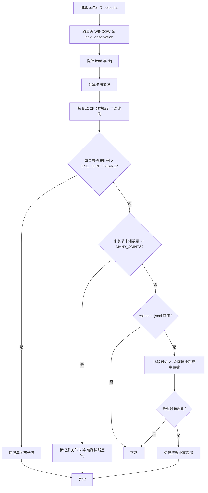
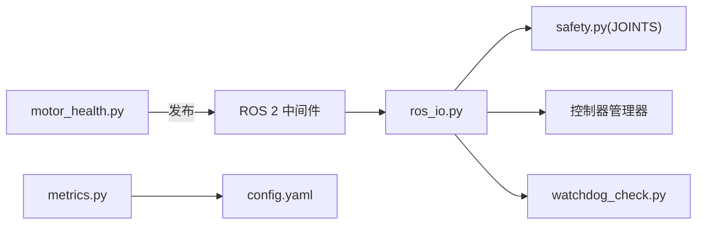

# 电机健康监控

<cite>
**本文引用的文件**   
- [motor_health.py](file://hardware/policyik_hw/robot/motor_health.py)
- [ros_io.py](file://hardware/policyik_hw/robot/ros_io.py)
- [watchdog_check.py](file://hardware/policyik_hw/watchdog_check.py)
- [safety.py](file://hardware/policyik_hw/robot/safety.py)
- [metrics.py](file://hardware/policyik_hw/metrics.py)
- [config.yaml](file://hardware/config.yaml)
- [README.md](file://hardware/README.md)
</cite>

## 目录
1. [引言](#引言)
2. [项目结构](#项目结构)
3. [核心组件](#核心组件)
4. [架构总览](#架构总览)
5. [详细组件分析](#详细组件分析)
6. [依赖关系分析](#依赖关系分析)
7. [性能与可靠性考量](#性能与可靠性考量)
8. [故障排查指南](#故障排查指南)
9. [结论](#结论)
10. [附录：维护场景与集成规范](#附录维护场景与集成规范)

## 引言
本文件为 PolicyIK 硬件侧“电机健康监控系统”的完整技术文档。系统围绕 OpenArm 右臂的 CAN 总线电机状态帧，提供只读的健康监测、ROS 2 发布、运行期安全校验、训练后数据巡检以及任务级指标统计等能力。文档重点覆盖：
- 电机状态监测算法：温度监控、错误码解析、通信超时检测、禁用状态计数
- 预测性维护能力：基于缓冲区轨迹的卡滞检测、最近任务表现退化预警
- 健康指标计算方法：响应延迟、能耗异常（通过动作速率与关节速度惩罚间接体现）、效率衰减率（通过任务保持/到达成功率与误差中位数衡量）
- 寿命预测与维护决策：结合运行日志、缓冲区特征与任务指标的维护建议流程
- 系统集成：与 ROS 2 控制栈、OpenArm bringup、CAN 接口及机器人管理系统的对接规范

## 项目结构
本项目在 hardware 目录下实现真实机械臂的训练、评估与健康监控相关代码。与电机健康监控直接相关的模块包括：
- robot/motor_health.py：从 CAN 读取电机状态帧，解析错误码、温度、通信年龄，并可选地通过 ROS 2 发布
- robot/ros_io.py：订阅 /joint_states 与 /motor_health，执行健康检查并输出位置命令
- policyik_hw/watchdog_check.py：对训练缓冲区的近期观测进行卡滞与链路掉线模式识别
- robot/safety.py：关节限位与安全裕度定义
- metrics.py：评估任务的保持/到达指标与误差中位数统计
- config.yaml：控制频率、噪声、奖励权重、训练步数等关键参数
- README.md：安装、启动、数据与评估说明

**图表来源**
- [motor_health.py:12-73](file://hardware/policyik_hw/robot/motor_health.py#L12-L73)
- [ros_io.py:53-148](file://hardware/policyik_hw/robot/ros_io.py#L53-L148)
- [watchdog_check.py:10-52](file://hardware/policyik_hw/watchdog_check.py#L10-L52)
- [metrics.py:19-113](file://hardware/policyik_hw/metrics.py#L19-L113)
- [config.yaml:39-71](file://hardware/config.yaml#L39-L71)
- [safety.py:4-27](file://hardware/policyik_hw/robot/safety.py#L4-L27)

**章节来源**
- [README.md:1-85](file://hardware/README.md#L1-L85)

## 核心组件
- 电机健康节点 motor_health.py
  - 功能：绑定 CAN 接口，过滤每个电机的状态帧；解析错误码、MOS 温度、转子温度；计算每条消息的“年龄”（最后接收时间差）；按固定频率将结构化数据以 JSON 字符串形式发布到 /motor_health
  - 关键点：错误码映射表、N_MOTORS=8、FRAME_FMT 解包、age_s 与 n_rx 统计、控制台摘要打印
- 机械臂 I/O 节点 ros_io.py
  - 功能：订阅 /joint_states 与 /motor_health；维护关节位置/速度缓存；周期性执行 health_check() 判定是否允许下发命令；发布目标位置到 /forward_position_controller/commands
  - 关键点：health_check() 综合判断通信年龄、错误码、温度上限、连续禁用次数；wait_for_state()/state_age() 用于等待与测量状态新鲜度
- 训练后巡检 watchdog_check.py
  - 功能：加载最近 WINDOW 条缓冲区观测，提取关节角度偏移与速度，检测“卡滞”（大偏差但低速度）与“多关节同时卡滞”（链路掉线签名）；若存在异常则退出码非零
  - 关键点：STUCK_LEAD_DEG、STUCK_DQ、BLOCK 分块统计、ONE_JOINT_SHARE/MANY_JOINTS 阈值
- 安全限制 safety.py
  - 功能：定义 7 个关节的限位与安全裕度，供上层规划或保护逻辑使用
- 任务指标 metrics.py
  - 功能：从 eval_*.json 聚合三个 gap-bin 评估结果，统计不同预算下的“保持”与“到达”数量，以及最终时段的位置/旋转误差中位数
- 配置 config.yaml
  - 功能：控制频率、动作尺度、噪声、奖励权重、训练步数、HER 策略等，影响健康监控与评估指标的基线

**章节来源**
- [motor_health.py:1-78](file://hardware/policyik_hw/robot/motor_health.py#L1-L78)
- [ros_io.py:1-149](file://hardware/policyik_hw/robot/ros_io.py#L1-L149)
- [watchdog_check.py:1-57](file://hardware/policyik_hw/watchdog_check.py#L1-L57)
- [safety.py:1-28](file://hardware/policyik_hw/robot/safety.py#L1-L28)
- [metrics.py:1-114](file://hardware/policyik_hw/metrics.py#L1-L114)
- [config.yaml:1-160](file://hardware/config.yaml#L1-L160)

## 架构总览
下图展示从 CAN 总线到 ROS 2 控制链路的端到端数据流，以及健康监控如何嵌入训练与评估流程。

**图表来源**
- [motor_health.py:20-59](file://hardware/policyik_hw/robot/motor_health.py#L20-L59)
- [ros_io.py:63-106](file://hardware/policyik_hw/robot/ros_io.py#L63-L106)
- [watchdog_check.py:24-51](file://hardware/policyik_hw/watchdog_check.py#L24-L51)

## 详细组件分析

### 电机健康节点 motor_health.py
- 输入与协议
  - 通过 AF_CAN SOCK_RAW 绑定指定 CAN 接口，设置过滤器接收 8 个电机的状态帧
  - 帧格式固定长度，解析出 can_id、dlc、data；仅处理 dlc==8 且 can_id 落在预期范围的数据
- 状态解析
  - 错误码 err[j]：映射到 ERR_NAMES，包含 disabled/enabled/过压/欠压/过流/MOS 过温/转子过温/通信丢失/过载等
  - 温度 tmos[j]/trotor[j]：分别表示 MOS 与转子温度
  - 通信年龄 age_s[j]：当前时间与 last_seen 之差，用于判断“静默”
  - 接收计数 n_rx[j]：累计收到帧数
- 发布与可视化
  - 按 rate Hz 周期发布 JSON 消息到 /motor_health，字段包括 stamp、err、err_name、tmos、trotor、age_s、n_rx
  - 控制台每 print_every 秒打印各关节状态与温度，并在出现异常时提示 ATTENTION
- 生命周期
  - 支持 --no-ros 纯控制台模式；正常模式初始化 rclpy、创建 Node 与发布者；Ctrl-C 优雅关闭

**图表来源**
- [motor_health.py:20-66](file://hardware/policyik_hw/robot/motor_health.py#L20-L66)

**章节来源**
- [motor_health.py:1-78](file://hardware/policyik_hw/robot/motor_health.py#L1-L78)

### 机械臂 I/O 节点 ros_io.py
- 订阅与缓存
  - 订阅 /joint_states，缓存每个关节的名称、位置与速度，记录最后时间戳与消息计数
  - 订阅 /motor_health，反序列化 JSON 为内部字典并更新时间戳
- 健康检查 health_check()
  - 无数据或数据陈旧：返回 (None, reason)
  - 单关节检查：
    - age_s >= max_reply_age_s：通信静默
    - err 不在 {disabled, enabled}：电机故障
    - tmos 或 trotor >= max_temp_c：温度超限
    - 连续 disabled 计数 >= 3：重复禁用
  - 全部通过：返回 (True, "ok")
- 状态获取与控制
  - has_state()/wait_for_state()：确保所有关节名均有值
  - get_state()：返回 q(rad), dq(rad/s)
  - command_q()：发布目标位置数组
  - spin_for()/drain()：非阻塞地处理回调队列

**图表来源**
- [ros_io.py:80-106](file://hardware/policyik_hw/robot/ros_io.py#L80-L106)

**章节来源**
- [ros_io.py:1-149](file://hardware/policyik_hw/robot/ros_io.py#L1-L149)

### 训练后巡检 watchdog_check.py
- 输入
  - 训练运行目录 run 与步骤 step；加载 buffer_step{step} 或 final buffer
- 检测逻辑
  - 取最近 WINDOW 条 next_observation，提取 lead 角偏移与 dq 速度
  - 卡滞判定：abs(lead) > STUCK_LEAD_DEG 且 abs(dq) < STUCK_DQ
  - 分块 BLOCK 统计每块内各关节卡滞比例；若单关节比例超过 ONE_JOINT_SHARE，或多关节同时超过 MANY_JOINT_SHARE 且数量达 MANY_JOINTS，视为异常
  - 可选：若 episodes.jsonl 存在，比较最近 10 与之前 20 条 episode 的最小距离中位数，若显著恶化则标记异常
- 输出
  - 打印窗口统计与异常原因；存在异常时退出码非零

**图表来源**
- [watchdog_check.py:10-51](file://hardware/policyik_hw/watchdog_check.py#L10-L51)

**章节来源**
- [watchdog_check.py:1-57](file://hardware/policyik_hw/watchdog_check.py#L1-L57)

### 安全限制 safety.py
- 定义 7 个关节的原始限位 LIM_RAD，并叠加 MARGIN_RAD 安全裕度得到 LIM_LO/LIM_HI
- joint_limits() 可进一步与用户指定的扇区 [lo_deg, hi_deg] 求交集，用于受限区域运动

**章节来源**
- [safety.py:1-28](file://hardware/policyik_hw/robot/safety.py#L1-L28)

### 任务指标 metrics.py
- 从 run_dir 下匹配 checkpoint 对应的三个 gap-bin 评估文件，校验碰撞守卫关闭与最大步数一致
- 对每个预算 BUDGETS_S，统计：
  - held：在最终 HOLDS_S 秒内持续满足位置与角度容差的任务数
  - reached：在预算时间内任何时刻连续满足容差 REACH_HOLD_S 秒的任务数
  - median_pos_mm/median_rot_deg：最终 1 秒内的位置与角度误差中位数
- 输出 JSON 与控制台表格

**章节来源**
- [metrics.py:1-114](file://hardware/policyik_hw/metrics.py#L1-L114)

## 依赖关系分析
- 运行时依赖
  - CAN 接口与 Linux CAN 套接字：motor_health.py 直接操作 socket.AF_CAN
  - ROS 2：rclpy、std_msgs.msg.String、sensor_msgs.msg.JointState、std_msgs.msg.Float64MultiArray
  - NumPy：数值计算与数组操作
- 模块耦合
  - motor_health.py 与 ros_io.py 通过 /motor_health 松耦合
  - ros_io.py 依赖 safety.py 的 JOINTS 常量（用于 has_state()）
  - watchdog_check.py 独立于运行时，仅依赖训练产物 buffer 与 episodes.jsonl
  - metrics.py 与 config.yaml 共同决定评估指标的计算方式与解释口径

**图表来源**
- [motor_health.py:27-33](file://hardware/policyik_hw/robot/motor_health.py#L27-L33)
- [ros_io.py:14-15](file://hardware/policyik_hw/robot/ros_io.py#L14-L15)
- [metrics.py:31-53](file://hardware/policyik_hw/metrics.py#L31-L53)

**章节来源**
- [motor_health.py:1-78](file://hardware/policyik_hw/robot/motor_health.py#L1-L78)
- [ros_io.py:1-149](file://hardware/policyik_hw/robot/ros_io.py#L1-L149)
- [watchdog_check.py:1-57](file://hardware/policyik_hw/watchdog_check.py#L1-L57)
- [metrics.py:1-114](file://hardware/policyik_hw/metrics.py#L1-L114)
- [config.yaml:1-160](file://hardware/config.yaml#L1-L160)

## 性能与可靠性考量
- 实时性与延迟
  - motor_health.py 的发布频率由 --rate 控制；age_s 反映 CAN 到节点的端到端延迟
  - ros_io.py 的 state_age() 与 wait_for_state() 用于保证关节状态的新鲜度
- 鲁棒性
  - motor_health.py 对 socket.timeout 做吞没处理，避免阻塞
  - ros_io.py 的 health_check() 对多种异常分支给出明确 reason，便于上层快速定位
- 资源占用
  - 仅读取 CAN 帧，不写入，降低对控制回路的干扰
  - 控制台打印周期可调，避免高频 IO 开销
- 可扩展性
  - 通过 /motor_health 的 JSON 结构，其他节点可复用健康数据，无需紧耦合

[本节为通用指导，不直接分析具体文件]

## 故障排查指南
- 无法收到 /motor_health 数据
  - 确认 CAN 接口已 up 且 bitrate 正确
  - 检查 motor_health.py 是否以正确的 --iface 启动
  - 查看 ros_io.py 的 health_check() 返回 reason 是否为 “no /motor_health data”
- 通信静默 SILENT
  - 对应 age_s >= max_reply_age_s；检查 CAN 线路、电机供电与固件
- 电机故障 fault
  - 根据 err_name 与 ERR 码定位：过压/欠压/过流/MOS 过温/转子过温/通信丢失/过载
- 温度过高
  - 当 tmos 或 trotor >= max_temp_c 时触发；检查散热与环境温度
- 重复禁用 repeated DISABLED
  - 连续 disabled 计数 >= 3；需重启或重新使能电机
- 训练后卡滞或链路掉线
  - watchdog_check.py 检测到单关节或多数关节卡滞；检查机械阻力、减速器磨损、编码器信号或 CAN 链路质量
- 任务表现退化
  - metrics.py 输出的 reached/held 下降与误差中位数上升；结合 config.yaml 中的控制频率、噪声与奖励权重调整

**章节来源**
- [ros_io.py:87-106](file://hardware/policyik_hw/robot/ros_io.py#L87-L106)
- [watchdog_check.py:24-51](file://hardware/policyik_hw/watchdog_check.py#L24-L51)
- [metrics.py:56-78](file://hardware/policyik_hw/metrics.py#L56-L78)

## 结论
PolicyIK 的电机健康监控系统以 CAN 只读监听为核心，结合 ROS 2 发布与订阅机制，形成从底层电机状态到上层控制命令的安全闭环。通过健康检查、训练后巡检与任务指标统计，系统能够早期发现通信异常、温度越限、电机故障与机械卡滞，并为维护决策提供量化依据。该设计具备低耦合、高鲁棒性与易扩展的特点，适合集成到机器人管理系统与 ROS 2 生态中。

[本节为总结性内容，不直接分析具体文件]

## 附录：维护场景与集成规范

### 健康指标计算方法
- 温度监控
  - 指标：tmos、trotor；阈值来自 health_check() 的 max_temp_c
  - 解读：任一温度超过阈值即视为热风险，需降载或停机冷却
- 电流分析
  - 通过错误码 overcurrent 与过载 overload 间接反映电流异常；结合 n_rx 与 age_s 判断是否通信层问题
- 振动检测
  - 代码未直接采集振动；可通过 dq 速度与 lead 角偏移的波动性间接推断（需外部传感器补充）
- 磨损评估
  - 通过 watchdog_check.py 的卡滞比例与 metrics.py 的 reached/held 趋势评估机械磨损与传动退化
- 效率衰减率
  - 使用 metrics.py 的 reached/held 随时间的变化率作为效率衰减代理指标
- 响应延迟分析
  - 使用 age_s 与 state_age() 量化从 CAN 到控制器的端到端延迟
- 能耗异常检测
  - 通过 config.yaml 中的 w_action_rate 与 w_joint_vel 奖励项，观察训练过程中动作速率与速度的惩罚增长，间接指示能耗异常

**章节来源**
- [motor_health.py:5-7](file://hardware/policyik_hw/robot/motor_health.py#L5-L7)
- [ros_io.py:87-106](file://hardware/policyik_hw/robot/ros_io.py#L87-L106)
- [watchdog_check.py:24-51](file://hardware/policyik_hw/watchdog_check.py#L24-L51)
- [metrics.py:56-78](file://hardware/policyik_hw/metrics.py#L56-L78)
- [config.yaml:73-98](file://hardware/config.yaml#L73-L98)

### 预测性维护功能
- 性能退化预警
  - 观察 metrics.py 的 reached/held 与误差中位数，若持续恶化则触发预警
- 故障模式识别
  - 基于 watchdog_check.py 的卡滞与链路掉线签名，区分单关节机械卡滞与多关节通信链路问题
- 维护计划生成
  - 结合 health_check() 的 reason 与 n_rx/age_s 趋势，制定预防性更换、校准或润滑计划

**章节来源**
- [watchdog_check.py:24-51](file://hardware/policyik_hw/watchdog_check.py#L24-L51)
- [metrics.py:56-78](file://hardware/policyik_hw/metrics.py#L56-L78)
- [ros_io.py:87-106](file://hardware/policyik_hw/robot/ros_io.py#L87-L106)

### 电机寿命预测模型使用指南
- 数据采集要求
  - 稳定运行期间采集 /motor_health 的 age_s、err、tmos、trotor、n_rx
  - 同步记录 metrics.py 的 reached/held 与误差中位数
  - 记录 config.yaml 的控制频率与奖励权重，以便归一化对比
- 模型参数调优
  - 调整 health_check() 的 max_reply_age_s、max_temp_c、max_data_age_s 以适应不同工况
  - 调整 watchdog_check.py 的 STUCK_LEAD_DEG、STUCK_DQ、ONE_JOINT_SHARE、MANY_JOINTS 以匹配机械特性
- 维护决策支持
  - 当 reached/held 下降且误差中位数上升，同时 age_s 增大或温度升高，优先安排预防性维护
  - 若 watchdog_check.py 报多关节卡滞，优先检查 CAN 链路或主控板

**章节来源**
- [ros_io.py:87-106](file://hardware/policyik_hw/robot/ros_io.py#L87-L106)
- [watchdog_check.py:24-51](file://hardware/policyik_hw/watchdog_check.py#L24-L51)
- [metrics.py:56-78](file://hardware/policyik_hw/metrics.py#L56-L78)

### 实际维护场景示例
- 预防性更换建议
  - 场景：某关节 tmos 长期接近阈值，n_rx 波动增大，reached 缓慢下降
  - 建议：提前更换轴承或减速器，并校准温度传感器
- 故障根因分析
  - 场景：watchdog_check.py 报告多关节卡滞，err_name 出现 comms lost
  - 分析：CAN 链路接触不良或电磁干扰；检查线缆屏蔽与接地
- 维修成本估算
  - 依据故障类型（电气/机械/通信）与停机时长，结合历史维修记录估算备件与人工成本

[本节为概念性示例，不直接分析具体文件]

### 与机器人管理系统集成
- 数据接入
  - 订阅 /motor_health 与 /joint_states，解析 JSON 与 JointState 消息
  - 调用 ros_io.py 的 health_check() 获取 (ok, reason)，决定是否允许下发命令
- 控制接口
  - 通过 /forward_position_controller/commands 发送目标位置
  - 使用 safety.py 的 joint_limits() 约束指令范围
- ROS 2 生态接口规范
  - 节点命名：motor_health、openarm_reach_io
  - 话题：/motor_health(String)、/joint_states(JointState)、/forward_position_controller/commands(Float64MultiArray)
  - 启动顺序：先启动 bringup 与 gravity node，再启动 motor_health.py，最后启动训练/评估脚本

**章节来源**
- [ros_io.py:53-148](file://hardware/policyik_hw/robot/ros_io.py#L53-L148)
- [safety.py:20-27](file://hardware/policyik_hw/robot/safety.py#L20-L27)
- [README.md:20-41](file://hardware/README.md#L20-L41)
