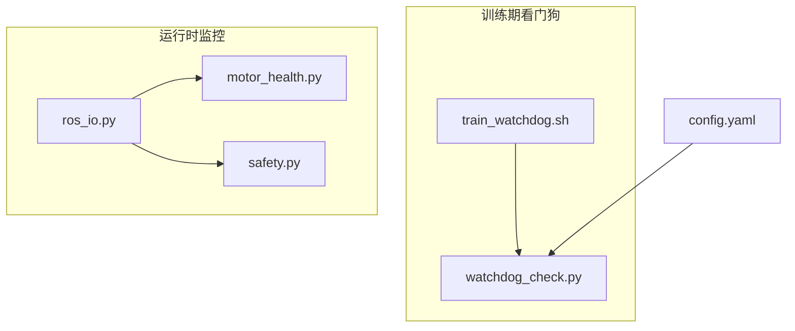
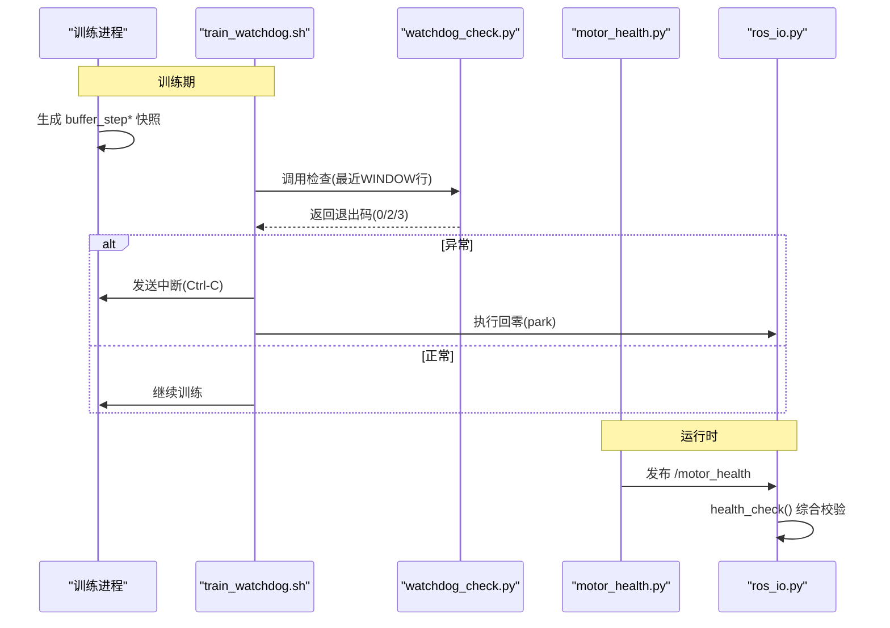
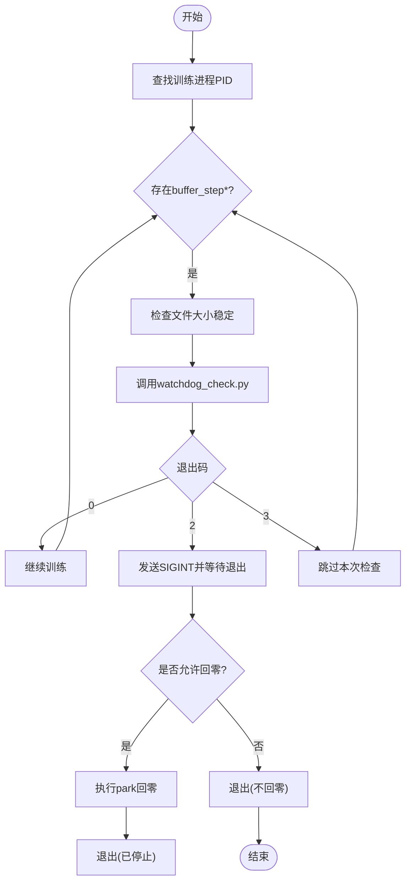
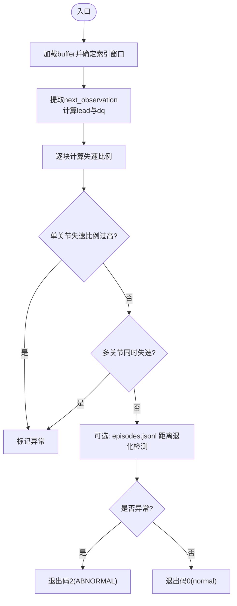
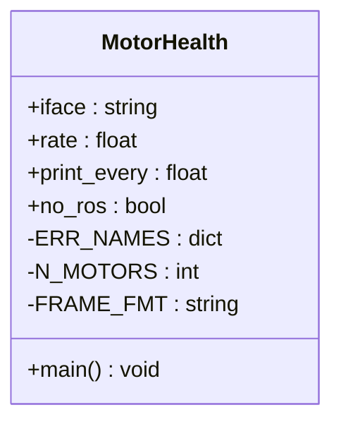
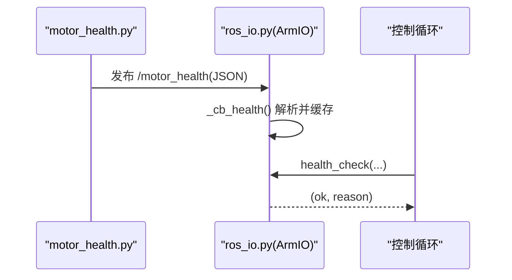
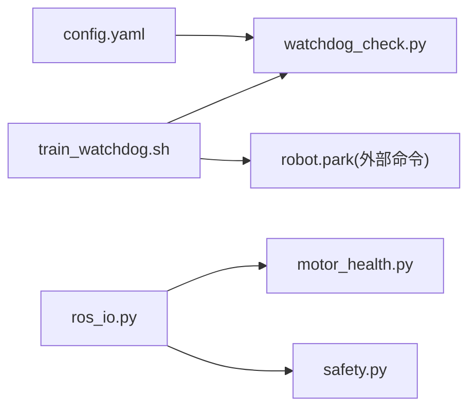

# 看门狗监控系统

<cite>
**本文引用的文件**   
- [watchdog_check.py](file://hardware/policyik_hw/watchdog_check.py)
- [motor_health.py](file://hardware/policyik_hw/robot/motor_health.py)
- [ros_io.py](file://hardware/policyik_hw/robot/ros_io.py)
- [safety.py](file://hardware/policyik_hw/robot/safety.py)
- [config.yaml](file://hardware/config.yaml)
- [train_watchdog.sh](file://hardware/scripts/train_watchdog.sh)
</cite>

## 目录
1. [引言](#引言)
2. [项目结构](#项目结构)
3. [核心组件](#核心组件)
4. [架构总览](#架构总览)
5. [详细组件分析](#详细组件分析)
6. [依赖关系分析](#依赖关系分析)
7. [性能与实时性考虑](#性能与实时性考虑)
8. [故障诊断指南](#故障诊断指南)
9. [结论](#结论)
10. [附录：配置项与阈值参考](#附录配置项与阈值参考)

## 引言
本文件为 PolicyIK 硬件侧“看门狗监控系统”的专业文档，聚焦以下目标：
- 解释看门狗检查机制的实现原理，包括训练缓冲区的异常检测、电机健康监控、通信链路状态与健康检查。
- 说明如何配置监控阈值、设置告警规则与恢复策略（自动停止训练、机械臂回零）。
- 描述系统健康检查流程：硬件状态验证、通信链路监控、资源使用监测。
- 提供故障诊断工具使用方法：日志分析、指标收集、错误追踪。
- 给出实际应用场景示例：机械臂运动异常检测、传感器数据验证、系统资源耗尽保护。
- 指导如何自定义监控规则和处理逻辑，以及与其他系统组件的集成方式。

## 项目结构
与看门狗相关的代码主要位于 hardware 子模块中，关键文件如下：
- 训练期看门狗脚本：scripts/train_watchdog.sh
- 训练缓冲区异常检测：policyik_hw/watchdog_check.py
- 电机健康监控：policyik_hw/robot/motor_health.py
- 机器人 I/O 与健康检查：policyik_hw/robot/ros_io.py
- 关节安全边界：policyik_hw/robot/safety.py
- 环境与训练参数：hardware/config.yaml

图表来源
- [train_watchdog.sh:1-59](file://hardware/scripts/train_watchdog.sh#L1-L59)
- [watchdog_check.py:1-57](file://hardware/policyik_hw/watchdog_check.py#L1-L57)
- [motor_health.py:1-78](file://hardware/policyik_hw/robot/motor_health.py#L1-L78)
- [ros_io.py:1-149](file://hardware/policyik_hw/robot/ros_io.py#L1-L149)
- [safety.py:1-28](file://hardware/policyik_hw/robot/safety.py#L1-L28)
- [config.yaml:1-160](file://hardware/config.yaml#L1-L160)

章节来源
- [train_watchdog.sh:1-59](file://hardware/scripts/train_watchdog.sh#L1-L59)
- [watchdog_check.py:1-57](file://hardware/policyik_hw/watchdog_check.py#L1-L57)
- [motor_health.py:1-78](file://hardware/policyik_hw/robot/motor_health.py#L1-L78)
- [ros_io.py:1-149](file://hardware/policyik_hw/robot/ros_io.py#L1-L149)
- [safety.py:1-28](file://hardware/policyik_hw/robot/safety.py#L1-L28)
- [config.yaml:1-160](file://hardware/config.yaml#L1-L160)

## 核心组件
- 训练期看门狗调度器（train_watchdog.sh）
  - 周期性扫描训练运行目录中的 buffer_step* 快照，调用 watchdog_check.py 进行异常判定。
  - 若检测到 ABNORMAL，则向训练进程发送中断信号，并在确认退出后执行机械臂回零（park），避免危险姿态。
  - 支持环境变量 WATCHDOG_NO_HOME=1 跳过回零动作，便于调试。
- 训练缓冲区异常检测（watchdog_check.py）
  - 读取最近 WINDOW 条观测，计算各关节“失速”比例（指令领先角过大且速度接近零）。
  - 对单关节或多数关节同时失稳的情况触发异常；结合 episodes.jsonl 最近任务距离变化判断是否出现“接近度坍塌”。
  - 返回不同退出码：0 正常、2 异常、3 无法检查（如缓冲区为空）。
- 电机健康监控（motor_health.py）
  - 通过 CAN 原始套接字监听电机状态帧，解析错误码、温度、响应年龄等。
  - 以固定频率发布 /motor_health 消息，供上层健康检查订阅。
  - 控制台输出每轴状态摘要，便于快速定位问题。
- 机器人 I/O 与健康检查（ros_io.py）
  - 订阅 /joint_states 与 /motor_health，维护关节位置/速度与电机健康缓存。
  - health_check() 实现综合健康检查：CAN 回复超时、电机错误码、温度上限、连续禁用计数等。
  - 提供 wait_for_state()/state_age()/command_q() 等接口用于控制循环。
- 关节安全边界（safety.py）
  - 定义 OpenArm 右臂各关节的安全角度范围，并预留安全裕量。
  - 可叠加用户指定的扇区限制，用于轨迹规划与安全校验。
- 训练与环境配置（config.yaml）
  - 包含环境几何、控制频率、观察噪声、奖励权重、训练步数、检查点间隔等。
  - 虽不直接定义看门狗阈值，但影响训练行为与缓冲区内容，间接影响异常检测效果。

章节来源
- [train_watchdog.sh:1-59](file://hardware/scripts/train_watchdog.sh#L1-L59)
- [watchdog_check.py:1-57](file://hardware/policyik_hw/watchdog_check.py#L1-L57)
- [motor_health.py:1-78](file://hardware/policyik_hw/robot/motor_health.py#L1-L78)
- [ros_io.py:1-149](file://hardware/policyik_hw/robot/ros_io.py#L1-L149)
- [safety.py:1-28](file://hardware/policyik_hw/robot/safety.py#L1-L28)
- [config.yaml:1-160](file://hardware/config.yaml#L1-L160)

## 架构总览
看门狗系统由“训练期离线检查”和“运行时在线监控”两条路径组成：
- 训练期离线检查：train_watchdog.sh 轮询新产生的 buffer_step* 快照，调用 watchdog_check.py 分析最近窗口内的观测序列，识别机械臂失速、链式丢包或任务表现退化。
- 运行时在线监控：motor_health.py 从 CAN 总线采集电机状态并发布到 ROS 2 主题；ros_io.py 订阅该主题并结合关节状态做健康检查，为控制回路提供安全门控。

图表来源
- [train_watchdog.sh:18-59](file://hardware/scripts/train_watchdog.sh#L18-L59)
- [watchdog_check.py:10-52](file://hardware/policyik_hw/watchdog_check.py#L10-L52)
- [motor_health.py:20-66](file://hardware/policyik_hw/robot/motor_health.py#L20-L66)
- [ros_io.py:80-106](file://hardware/policyik_hw/robot/ros_io.py#L80-L106)

## 详细组件分析

### 训练期看门狗调度器（train_watchdog.sh）
- 功能要点
  - 等待训练进程启动，按周期轮询 buffer_step* 快照。
  - 对每个新快照调用 watchdog_check.py，记录日志到 run_dir/watchdog.log。
  - 当返回码为 2（ABNORMAL）时，向训练进程发送 SIGINT，等待其优雅退出；随后调用 park 将机械臂回到安全姿态。
  - 支持 WATCHDOG_NO_HOME=1 跳过回零，便于在受控环境中保留当前姿态进行分析。
- 关键流程
  - 发现新快照 → 等待文件大小稳定 → 调用检查 → 根据退出码决策。
- 恢复策略
  - 自动停止训练进程，必要时二次发送中断以确保退出。
  - 默认执行机械臂回零；可通过环境变量关闭。

图表来源
- [train_watchdog.sh:18-59](file://hardware/scripts/train_watchdog.sh#L18-L59)

章节来源
- [train_watchdog.sh:1-59](file://hardware/scripts/train_watchdog.sh#L1-L59)

### 训练缓冲区异常检测（watchdog_check.py）
- 输入与上下文
  - 接收运行目录与步骤标识（step 或 final）。
  - 加载对应 buffer 文件，提取最近 WINDOW 条 next_observation。
- 异常检测逻辑
  - 计算各关节“失速”标志：指令领先角超过阈值且速度接近零。
  - 分块统计失速比例，若单关节失速比例过高或多数关节同时失速，标记异常。
  - 若 episodes.jsonl 可用，比较最近 10 条与之前 20 条的最小距离中位数，若显著恶化则标记异常。
- 输出与退出码
  - 正常：退出码 0。
  - 异常：退出码 2，并打印具体异常原因。
  - 无法检查（缓冲区为空或不存在）：退出码 3。

图表来源
- [watchdog_check.py:10-52](file://hardware/policyik_hw/watchdog_check.py#L10-L52)

章节来源
- [watchdog_check.py:1-57](file://hardware/policyik_hw/watchdog_check.py#L1-L57)

### 电机健康监控（motor_health.py）
- 数据采集
  - 通过 CAN 原始套接字监听特定 ID 范围的电机状态帧。
  - 解析错误码、MOS 温度、转子温度、更新时间戳与接收计数。
- 发布与展示
  - 以固定频率发布 /motor_health JSON 消息。
  - 控制台周期性打印各轴状态摘要，标注“SILENT”与高温警告。
- 错误语义
  - 错误码映射包含 disabled/enabled/过压/欠压/过流/MOS过热/转子过热/通信丢失/过载等。

图表来源
- [motor_health.py:12-77](file://hardware/policyik_hw/robot/motor_health.py#L12-L77)

章节来源
- [motor_health.py:1-78](file://hardware/policyik_hw/robot/motor_health.py#L1-L78)

### 机器人 I/O 与健康检查（ros_io.py）
- 订阅与缓存
  - 订阅 /joint_states 获取关节位置与速度。
  - 订阅 /motor_health 解析 JSON 并更新健康缓存与时间戳。
- 健康检查函数
  - health_check(max_reply_age_s, max_temp_c, max_data_age_s)：
    - 若无健康数据或数据陈旧，返回未知状态。
    - 任一关节无 CAN 回复（超时）、错误码非正常、温度超上限、连续禁用计数过多，均返回失败及原因。
- 其他能力
  - wait_for_state(timeout) 等待关节状态就绪。
  - state_age() 返回最新关节状态的时间差。
  - command_q(q_target) 发布位置命令。

图表来源
- [motor_health.py:20-66](file://hardware/policyik_hw/robot/motor_health.py#L20-L66)
- [ros_io.py:80-106](file://hardware/policyik_hw/robot/ros_io.py#L80-L106)

章节来源
- [ros_io.py:1-149](file://hardware/policyik_hw/robot/ros_io.py#L1-L149)

### 关节安全边界（safety.py）
- 定义 OpenArm 右臂各关节的安全角度范围，并增加固定安全裕量。
- 提供 joint_limits(lo_deg, hi_deg) 以叠加用户指定扇区限制，常用于轨迹规划与安全校验。

章节来源
- [safety.py:1-28](file://hardware/policyik_hw/robot/safety.py#L1-L28)

### 训练与环境配置（config.yaml）
- 包含环境几何、控制频率、观察噪声、奖励权重、训练步数、检查点间隔等。
- 虽未直接定义看门狗阈值，但会影响训练行为与缓冲区内容，从而间接影响异常检测效果。

章节来源
- [config.yaml:1-160](file://hardware/config.yaml#L1-L160)

## 依赖关系分析
- train_watchdog.sh 依赖 watchdog_check.py 完成异常判定，并依赖 park 命令执行回零。
- ros_io.py 依赖 motor_health.py 提供的 /motor_health 主题数据。
- safety.py 被安全相关逻辑引用，提供关节边界约束。
- config.yaml 为训练与环境提供参数，间接影响缓冲区内容与异常检测。

图表来源
- [train_watchdog.sh:1-59](file://hardware/scripts/train_watchdog.sh#L1-L59)
- [watchdog_check.py:1-57](file://hardware/policyik_hw/watchdog_check.py#L1-L57)
- [motor_health.py:1-78](file://hardware/policyik_hw/robot/motor_health.py#L1-L78)
- [ros_io.py:1-149](file://hardware/policyik_hw/robot/ros_io.py#L1-L149)
- [safety.py:1-28](file://hardware/policyik_hw/robot/safety.py#L1-L28)
- [config.yaml:1-160](file://hardware/config.yaml#L1-L160)

章节来源
- [train_watchdog.sh:1-59](file://hardware/scripts/train_watchdog.sh#L1-L59)
- [watchdog_check.py:1-57](file://hardware/policyik_hw/watchdog_check.py#L1-L57)
- [motor_health.py:1-78](file://hardware/policyik_hw/robot/motor_health.py#L1-L78)
- [ros_io.py:1-149](file://hardware/policyik_hw/robot/ros_io.py#L1-L149)
- [safety.py:1-28](file://hardware/policyik_hw/robot/safety.py#L1-L28)
- [config.yaml:1-160](file://hardware/config.yaml#L1-L160)

## 性能与实时性考虑
- 训练期看门狗
  - 轮询间隔 POLL 秒可调，避免频繁文件系统访问。
  - 对 buffer_step* 快照采用大小稳定性检查，确保写入完成后才分析。
- 运行时监控
  - motor_health.py 以固定频率发布 /motor_health，建议不低于 10 Hz，保证健康检查的时效性。
  - ros_io.py 的 health_check() 支持最大回复年龄与数据陈旧阈值，可根据总线延迟与处理周期调优。
- 资源使用
  - 看门狗逻辑轻量，主要开销在于 numpy 数组操作与 JSON 解析。
  - 建议在长时间训练中定期清理旧 buffer_step* 快照，减少磁盘占用。

[本节为通用指导，不直接分析具体文件]

## 故障诊断指南
- 查看训练期看门狗日志
  - 路径：run_dir/watchdog.log
  - 关注 ABNORMAL 段落与退出码，定位具体异常原因（失速、链式丢包、任务距离退化）。
- 检查电机健康主题
  - 使用 rqt 或 rostopic echo /motor_health 查看 JSON 字段：err、err_name、tmos、trotor、age_s、n_rx。
  - 若 age_s 持续增长，表示 CAN 回复缺失；err_name 非 enabled/disabled 表示电机故障。
- 关节状态与命令
  - 使用 rostopic echo /joint_states 检查关节位置与速度是否更新。
  - 使用 ros2 topic echo /forward_position_controller/commands 检查命令发布是否正常。
- 常见错误与处理
  - “no /motor_health data”：确认 motor_health.py 已启动且 CAN 接口正确。
  - “controller_manager 数量异常”：确保仅有一个控制器管理器实例，避免双栈冲突。
  - “关节温度过高”：降低负载或暂停训练，待冷却后恢复。
  - “连续禁用计数过多”：检查电机使能状态，必要时重启 motor_health.py 或重连 CAN。

章节来源
- [train_watchdog.sh:28-45](file://hardware/scripts/train_watchdog.sh#L28-L45)
- [motor_health.py:52-66](file://hardware/policyik_hw/robot/motor_health.py#L52-L66)
- [ros_io.py:19-50](file://hardware/policyik_hw/robot/ros_io.py#L19-L50)
- [ros_io.py:87-106](file://hardware/policyik_hw/robot/ros_io.py#L87-L106)

## 结论
PolicyIK 的看门狗监控系统通过“训练期离线检查”和“运行时在线监控”双重机制保障训练与运行的安全性。训练期通过缓冲区异常检测识别机械臂失速与任务退化，并在异常时自动停止训练并回零；运行时通过 CAN 电机健康监控与 ROS 2 健康检查，确保通信链路、电机状态与温度处于安全范围内。配合合理的阈值配置与日志诊断，可有效提升系统的鲁棒性与可维护性。

[本节为总结性内容，不直接分析具体文件]

## 附录：配置项与阈值参考
- 训练期看门狗
  - 轮询间隔：POLL（秒），默认 30。
  - 环境变量：WATCHDOG_NO_HOME=1 跳过回零。
- 缓冲区异常检测（watchdog_check.py）
  - 窗口大小：WINDOW = 5000。
  - 失速阈值：STUCK_LEAD_DEG = 6.0°，STUCK_DQ ≈ 0.03 rad/s。
  - 单关节失速比例阈值：ONE_JOINT_SHARE = 0.30。
  - 多关节同时失速阈值：MANY_JOINT_SHARE = 0.15，MANY_JOINTS ≥ 3。
- 电机健康监控（motor_health.py）
  - 发布频率：rate（Hz），默认 20。
  - 控制台打印周期：print_every（秒），默认 5。
  - 错误码映射：disabled/enabled/过压/欠压/过流/MOS过热/转子过热/通信丢失/过载。
- 健康检查（ros_io.py）
  - 最大回复年龄：max_reply_age_s，默认 0.5 s。
  - 最大温度：max_temp_c，默认 60°C。
  - 最大数据陈旧：max_data_age_s，默认 1.0 s。
- 关节安全边界（safety.py）
  - 基础安全角度范围与 MARGIN_RAD = 2° 裕量。
  - 可叠加用户扇区限制 lo_deg/hi_deg。
- 训练与环境（config.yaml）
  - control_hz、max_episode_steps、action_scale_rad、max_joint_delta_rad、max_joint_velocity_rad_s 等参数影响训练行为与缓冲区内容。

章节来源
- [train_watchdog.sh:1-59](file://hardware/scripts/train_watchdog.sh#L1-L59)
- [watchdog_check.py:5-8](file://hardware/policyik_hw/watchdog_check.py#L5-L8)
- [motor_health.py:12-18](file://hardware/policyik_hw/robot/motor_health.py#L12-L18)
- [ros_io.py:87-106](file://hardware/policyik_hw/robot/ros_io.py#L87-L106)
- [safety.py:14-27](file://hardware/policyik_hw/robot/safety.py#L14-L27)
- [config.yaml:39-71](file://hardware/config.yaml#L39-L71)