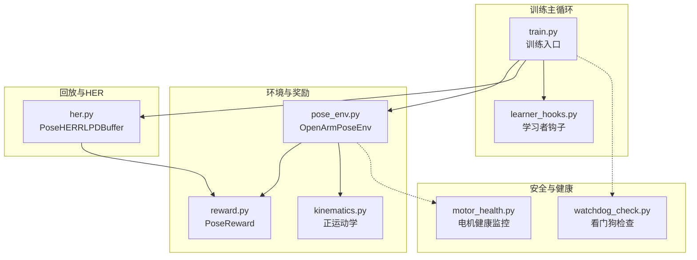
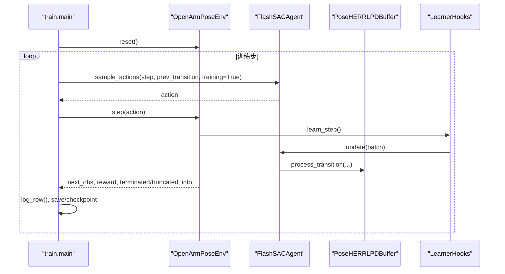
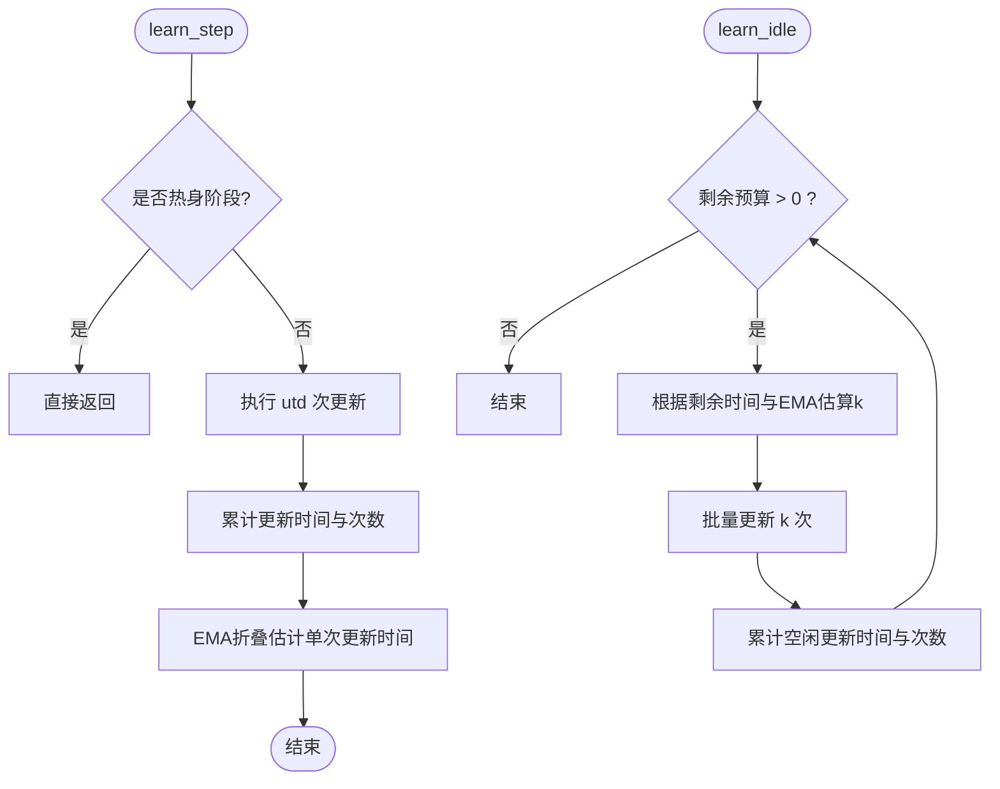
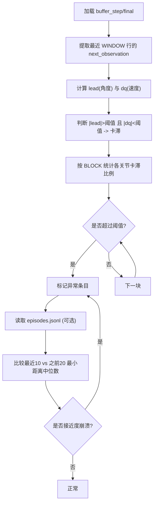
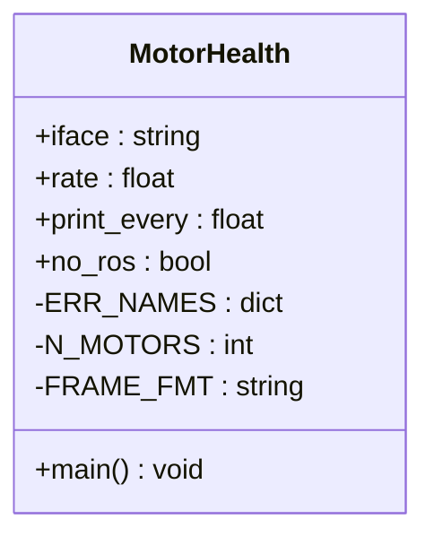
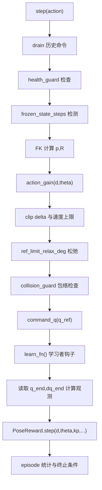
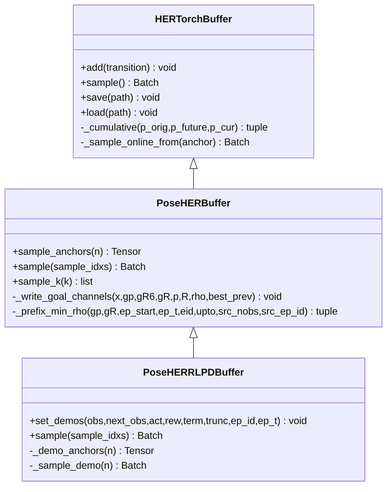
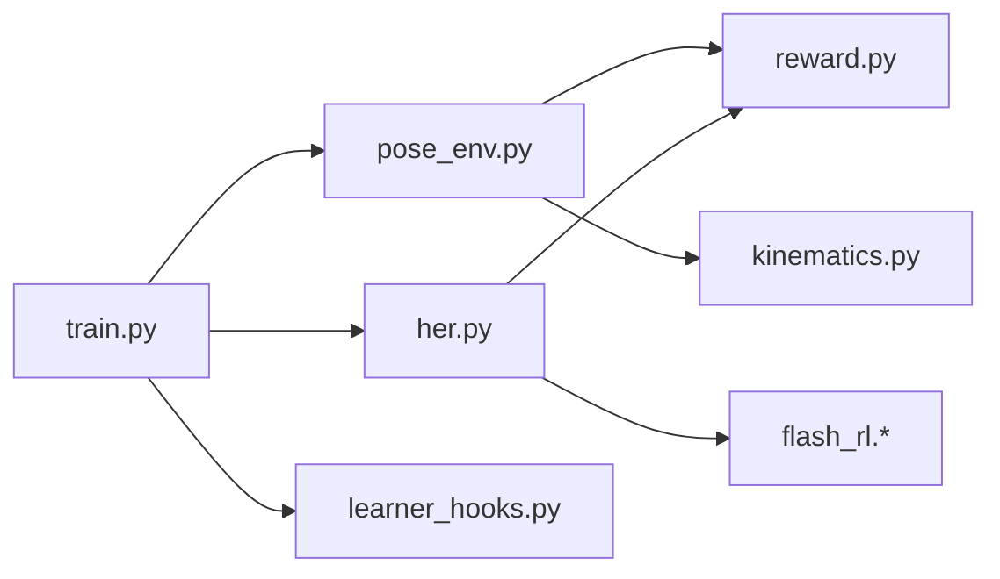

# 高级主题

<cite>
**本文引用的文件**   
- [learner_hooks.py](file://hardware/policyik_hw/rl/learner_hooks.py)
- [watchdog_check.py](file://hardware/policyik_hw/watchdog_check.py)
- [motor_health.py](file://hardware/policyik_hw/robot/motor_health.py)
- [train.py](file://hardware/policyik_hw/train.py)
- [config.yaml](file://hardware/config.yaml)
- [pose_env.py](file://hardware/policyik_hw/envs/pose_env.py)
- [reward.py](file://hardware/policyik_hw/envs/reward.py)
- [her.py](file://hardware/policyik_hw/rl/her.py)
- [kinematics.py](file://hardware/policyik_hw/utils/kinematics.py)
</cite>

## 目录
1. [引言](#引言)
2. [项目结构](#项目结构)
3. [核心组件](#核心组件)
4. [架构总览](#架构总览)
5. [详细组件分析](#详细组件分析)
6. [依赖关系分析](#依赖关系分析)
7. [性能与并行训练指南](#性能与并行训练指南)
8. [故障排查与看门狗诊断](#故障排查与看门狗诊断)
9. [扩展与定制指南](#扩展与定制指南)
10. [结论](#结论)

## 引言
本文面向PolicyIK的高级用户，聚焦以下高级特性与扩展点：
- 学习者钩子机制：在真实机械臂控制周期内执行梯度更新，支持热身、预算化空闲期更新与EMA自适应。
- 看门狗检查系统：基于回放缓冲区最近窗口检测关节“卡滞”和链路掉线等异常模式，并结合轨迹接近度退化进行自动判定。
- 电机健康监控：通过CAN总线读取电机状态、温度与丢包，提供ROS发布与控制台告警。
- 性能优化与内存管理：批量采样、编译加速、AMP关闭、设备选择、缓冲大小与日志频率调优。
- 自定义奖励函数与新环境适配：奖励项组合、观测布局、HER重标注策略与任务池调度。
- 算法扩展：FlashSAC配置、学习率与目标网络更新、动作空间与观察空间对齐。

## 项目结构
本项目硬件侧围绕OpenArm右臂的6维位姿到达任务展开，关键模块如下：
- 环境与奖励：位姿环境、碰撞包络、增益调度、密集奖励与PBRS潜在场。
- HER回放缓冲：在线环缓冲+演示数据冻结存储，支持原位重标注与近锚点采样。
- 学习者钩子：在控制步与复位空闲期插入学习更新，统计并估计每次更新时间。
- 看门狗：离线检查最近窗口数据，识别关节卡滞、多关节链式掉线与轨迹接近度崩溃。
- 电机健康：CAN只读监听，发布电机错误码、温度、消息年龄与接收计数。
- 训练主循环：构建Agent与环境、加载演示与任务池、记录指标、保存检查点。

**图表来源**
- [train.py:271-437](file://hardware/policyik_hw/train.py#L271-L437)
- [learner_hooks.py:7-78](file://hardware/policyik_hw/rl/learner_hooks.py#L7-L78)
- [pose_env.py:206-544](file://hardware/policyik_hw/envs/pose_env.py#L206-L544)
- [reward.py:85-184](file://hardware/policyik_hw/envs/reward.py#L85-L184)
- [her.py:39-517](file://hardware/policyik_hw/rl/her.py#L39-L517)
- [watchdog_check.py:10-57](file://hardware/policyik_hw/watchdog_check.py#L10-L57)
- [motor_health.py:12-78](file://hardware/policyik_hw/robot/motor_health.py#L12-L78)

**章节来源**
- [train.py:271-437](file://hardware/policyik_hw/train.py#L271-L437)
- [config.yaml:1-160](file://hardware/config.yaml#L1-L160)

## 核心组件
- 学习者钩子（LearnerHooks）：封装agent.update调用，支持utd批量更新、热身阶段跳过、空闲期预算化更新与EMA时间估计。
- 看门狗检查（watchdog_check）：从buffer_step或final buffer中抽取最近窗口，计算关节指令领先角与速度，检测卡滞与链路掉线；结合episodes.jsonl评估接近度退化。
- 电机健康监控（motor_health）：CAN只读监听，解析每个电机的错误码、温度、消息年龄与接收计数，可选ROS发布。
- 位姿环境（OpenArmPoseEnv）：实现step/reset、碰撞保护、健康守卫、参考限松弛、增益调度、观测构造与计时汇总。
- 奖励函数（PoseReward）：位置线性、关键点误差、动作变化率、关节速度、BSR/SNLB/PBRS、极限裕度等多项加权，支持dt缩放。
- HER缓冲（PoseHERRLPDBuffer）：在线环缓冲+演示数据混合，支持原位未来/当前/随机重标注、近锚点采样、动作与上一动作重标定。
- 训练主循环（train.main）：构建Agent、缓冲、演示与任务池，集成课程表、日志、检查点与总结。

**章节来源**
- [learner_hooks.py:7-78](file://hardware/policyik_hw/rl/learner_hooks.py#L7-L78)
- [watchdog_check.py:10-57](file://hardware/policyik_hw/watchdog_check.py#L10-L57)
- [motor_health.py:12-78](file://hardware/policyik_hw/robot/motor_health.py#L12-L78)
- [pose_env.py:206-544](file://hardware/policyik_hw/envs/pose_env.py#L206-L544)
- [reward.py:85-184](file://hardware/policyik_hw/envs/reward.py#L85-L184)
- [her.py:39-517](file://hardware/policyik_hw/rl/her.py#L39-L517)
- [train.py:271-437](file://hardware/policyik_hw/train.py#L271-L437)

## 架构总览
训练主循环将环境、Agent、回放缓冲与学习者钩子组合，形成“控制-学习-记录-保存”闭环。学习者钩子在每步控制后执行一次更新，并在复位空闲期以预算化方式继续更新，从而在不影响实时控制的前提下提升学习效率。

**图表来源**
- [train.py:374-428](file://hardware/policyik_hw/train.py#L374-L428)
- [pose_env.py:386-508](file://hardware/policyik_hw/envs/pose_env.py#L386-L508)
- [learner_hooks.py:50-78](file://hardware/policyik_hw/rl/learner_hooks.py#L50-L78)
- [her.py:79-103](file://hardware/policyik_hw/rl/her.py#L79-L103)

## 详细组件分析

### 学习者钩子机制（LearnerHooks）
- 设计要点：
  - 支持utd（updates per timestep）批量更新，内部使用agent._replay_buffer.sample_k(k)或直接多次update。
  - 热身阶段（n_total_upd < warmup_updates）不进入空闲期更新，避免早期不稳定。
  - EMA估计单次更新时间，用于空闲期预算化更新时动态决定chunk大小。
  - 统计每步更新时间、重置窗口更新时间、步数墙钟时间均值等，供训练日志输出。
- 关键流程：
  - learn_step：在控制步后执行一次更新，累计时间与次数，更新EMA。
  - learn_idle：在复位/缓动/稳定阶段按预算时间持续更新，根据剩余时间与EMA估算k。
  - pop_episode_timing：返回本episode的学习时序统计并重置。

**图表来源**
- [learner_hooks.py:50-78](file://hardware/policyik_hw/rl/learner_hooks.py#L50-L78)

**章节来源**
- [learner_hooks.py:7-78](file://hardware/policyik_hw/rl/learner_hooks.py#L7-L78)
- [train.py:362-364](file://hardware/policyik_hw/train.py#L362-L364)

### 看门狗检查系统（watchdog_check）
- 功能概述：
  - 读取指定run的buffer_step或final buffer，取最近WINDOW行数据。
  - 从next_observation中提取关节指令领先角（lead）与速度（dq），判断是否“卡滞”。
  - 按BLOCK分块统计各关节卡滞比例，超过阈值则标记异常。
  - 若存在episodes.jsonl，比较最近10条与之前20条的最小距离中位数，检测接近度崩溃。
- 异常判定：
  - 单关节卡滞比例过高。
  - 多关节同时卡滞（链路掉线特征）。
  - 最近轨迹接近度显著退化。

**图表来源**
- [watchdog_check.py:10-57](file://hardware/policyik_hw/watchdog_check.py#L10-L57)

**章节来源**
- [watchdog_check.py:10-57](file://hardware/policyik_hw/watchdog_check.py#L10-L57)

### 电机健康监控系统（motor_health）
- 功能概述：
  - 通过CAN接口订阅每个电机的帧，解析错误码、电机温度与转子温度。
  - 维护每个电机的最后收到时间、接收计数，计算消息年龄。
  - 可选ROS发布到/motor_health话题，包含错误名称映射与统计信息。
  - 控制台周期性打印表格，对异常电机发出ATTENTION提示。
- 错误码映射：
  - 包括禁用、启用、过压、欠压、过流、MOS过热、转子过热、通信丢失、过载等。

**图表来源**
- [motor_health.py:12-78](file://hardware/policyik_hw/robot/motor_health.py#L12-L78)

**章节来源**
- [motor_health.py:12-78](file://hardware/policyik_hw/robot/motor_health.py#L12-L78)

### 位姿环境与奖励（OpenArmPoseEnv & PoseReward）
- 环境行为：
  - 构建观测布局，包含关节、速度、末端位姿、目标位姿、误差、关键点误差、缩放通道、rho_best、上一动作、参考超前等。
  - 控制步中执行健康守卫、状态冻结检测、碰撞保护、参考限松弛、增益调度、命令下发与学习回调。
  - 统计每步墙钟时间，提供timing_summary用于评估有效频率。
- 奖励组成：
  - 位置线性、tanh精细、关键点宽/窄、动作变化率、关节速度、BSR/SNLB、驻留、PBRS、极限裕度。
  - 支持dt缩放，确保不同控制频率下奖励尺度一致。

**图表来源**
- [pose_env.py:386-508](file://hardware/policyik_hw/envs/pose_env.py#L386-L508)
- [reward.py:106-146](file://hardware/policyik_hw/envs/reward.py#L106-L146)

**章节来源**
- [pose_env.py:206-544](file://hardware/policyik_hw/envs/pose_env.py#L206-L544)
- [reward.py:85-184](file://hardware/policyik_hw/envs/reward.py#L85-L184)

### HER回放缓冲（PoseHERRLPDBuffer）
- 在线环缓冲：
  - 继承TorchUniformBuffer，维护episode元数据（id、t、len、start）。
  - 支持sample_k批量采样，便于LearnerHooks在空闲期批量更新。
- 重标注策略：
  - 原位（stored goal）、未来（future pose）、当前（perturbed current pose）、随机（random pose）四种目标源。
  - 近锚点采样：优先选择rho较小的样本，提高难例质量。
  - 动作与上一动作重标定：根据action_gain比率调整动作与prev_action，保持分布一致性。
- 演示数据混合：
  - 冻结演示存储，按比例混入训练批次，支持演示数据的HER重标注。
  - 校验演示数据完整性与维度一致性。

**图表来源**
- [her.py:39-517](file://hardware/policyik_hw/rl/her.py#L39-L517)

**章节来源**
- [her.py:39-517](file://hardware/policyik_hw/rl/her.py#L39-L517)

## 依赖关系分析
- train.py依赖：
  - 环境构建：pose_env.OpenArmPoseEnv、reward.PoseRewardConfig、workspace.ReverseConfig。
  - 演示与任务池：rl.demos.load_demos、utils.kinematics.set_urdf_path。
  - Agent与缓冲：flash_rl.agents.flashSAC.agent.FlashSACAgent、rl.her.PoseHERRLPDBuffer。
  - 学习者钩子：rl.learner_hooks.LearnerHooks。
- 环境依赖：
  - 安全与限制：robot.safety.joint_limits。
  - 运动学与姿态数学：utils.kinematics.N_JOINTS、utils.pose_math.angle_between/keypoints/rot6d_from_R/rotvec_body。
  - 奖励：envs.reward.PoseReward。
  - 工作区与课程：envs.workspace.CloudConfig/PoseCloud/ReverseConfig/ReverseCurriculum。
- HER缓冲依赖：
  - flash_rl.buffers.torch_buffer.TorchUniformBuffer。
  - utils.pose_math中的张量版本工具。
  - envs.reward.torch_pose_reward与torch_rho_best_channels。

**图表来源**
- [train.py:132-179](file://hardware/policyik_hw/train.py#L132-L179)
- [pose_env.py:12-16](file://hardware/policyik_hw/envs/pose_env.py#L12-L16)
- [her.py:12-17](file://hardware/policyik_hw/rl/her.py#L12-L17)

**章节来源**
- [train.py:132-179](file://hardware/policyik_hw/train.py#L132-L179)
- [pose_env.py:12-16](file://hardware/policyik_hw/envs/pose_env.py#L12-L16)
- [her.py:12-17](file://hardware/policyik_hw/rl/her.py#L12-L17)

## 性能与并行训练指南
- 设备与编译：
  - device参数支持auto/cpu/cuda，训练时可启用use_compile以加速模型前向与更新。
  - AMP默认关闭（use_amp=False），如需更高吞吐可评估开启AMP与编译器选项。
- 缓冲与批大小：
  - buffer_size=total_steps+step_offset，buffer_min_length保证预热采样。
  - batch_size=1024，可根据GPU显存与延迟调整。
- 学习率与更新周期：
  - lr固定为3e-4，actor_update_period=2，critic每步更新。
  - learning_rate_decay_step=max(total_steps*utd, 1)，配合utd控制整体更新节奏。
- 日志与检查点：
  - log.every=200，window=10，checkpoint_at列表定义保存步骤。
  - 建议在高延迟环境中降低log频率，减少IO开销。
- 并行训练配置：
  - LearnerHooks支持sample_k批量更新，空闲期按预算时间动态决定k，适合多核CPU/GPU并行。
  - 可通过增大utd与max_chunk提升吞吐，但需平衡控制周期与时延。
- 内存管理：
  - HER缓冲使用环形结构，避免频繁分配。
  - 演示数据一次性加载，避免重复IO。
  - 建议在长训练中定期清理临时变量，避免累积。

**章节来源**
- [train.py:132-179](file://hardware/policyik_hw/train.py#L132-L179)
- [config.yaml:107-128](file://hardware/config.yaml#L107-L128)
- [learner_hooks.py:35-78](file://hardware/policyik_hw/rl/learner_hooks.py#L35-L78)

## 故障排查与看门狗诊断
- 常见异常：
  - 电机健康故障：环境step中检测到health_check返回False时抛出异常，需停止检查硬件。
  - 关节状态冻结：连续若干步q值不变但/joint_states仍在发布，表明CAN读取停滞。
  - 碰撞保护触发：连续碰撞阻挡导致episode截断或终止。
  - 轨迹接近度崩溃：看门狗检测到最近10条episode的最小距离中位数显著上升。
- 诊断步骤：
  - 运行watchdog_check.py，传入run路径与step编号，查看卡滞比例与接近度对比。
  - 启动motor_health.py，检查电机错误码、温度与消息年龄，确认CAN通信正常。
  - 检查episodes.jsonl与metrics.jsonl，定位失败episode与指标异常。
- 恢复策略：
  - 重启控制栈与CAN接口，重新拉起bringup。
  - 调整reset_ramp_hz与min_post_learn_spin_s，改善复位稳定性。
  - 降低utd或batch_size，缓解控制周期压力。

**章节来源**
- [pose_env.py:393-423](file://hardware/policyik_hw/envs/pose_env.py#L393-L423)
- [watchdog_check.py:10-57](file://hardware/policyik_hw/watchdog_check.py#L10-L57)
- [motor_health.py:12-78](file://hardware/policyik_hw/robot/motor_health.py#L12-L78)

## 扩展与定制指南
- 自定义奖励函数：
  - 在PoseReward中添加新项，修改_weights与step方法，确保validate逻辑同步。
  - 注意dt缩放与权重符号约定，避免奖励尺度失衡。
- 新环境适配：
  - 重写build_layout以匹配新观测维度，确保HER缓冲layout字段完整。
  - 调整EnvConfig参数，如control_hz、max_episode_steps、zoom_obs等。
  - 集成新的安全守卫与碰撞包络，必要时扩展workspace模块。
- 算法扩展：
  - 替换FlashSAC为其他Actor-Critic算法，需对齐observation_space与action_space。
  - 调整HER重标注概率与near_anchor_frac，适应新任务分布。
  - 利用task_pool与schedule_value实现课程学习与任务切换。

**章节来源**
- [reward.py:85-184](file://hardware/policyik_hw/envs/reward.py#L85-L184)
- [pose_env.py:21-43](file://hardware/policyik_hw/envs/pose_env.py#L21-L43)
- [her.py:158-240](file://hardware/policyik_hw/rl/her.py#L158-L240)
- [train.py:75-81](file://hardware/policyik_hw/train.py#L75-L81)

## 结论
PolicyIK的高级特性围绕学习者钩子、看门狗检查与电机健康监控三大支柱，构建了高可靠、高性能的真实机械臂训练框架。通过HER回放缓冲与密集奖励设计，系统在复杂位姿任务上具备强鲁棒性。专家级用户可在此基础上扩展奖励函数、适配新环境、优化性能与并行训练，以满足多样化工业场景需求。